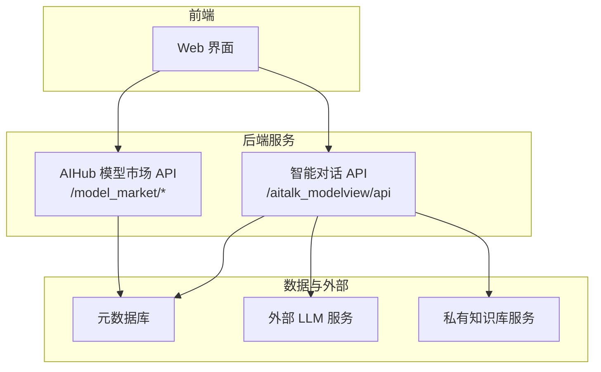
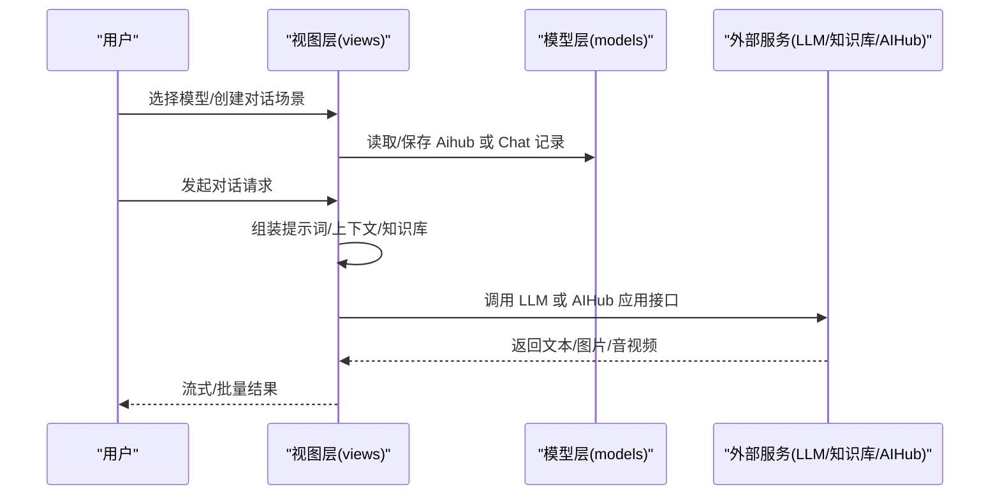
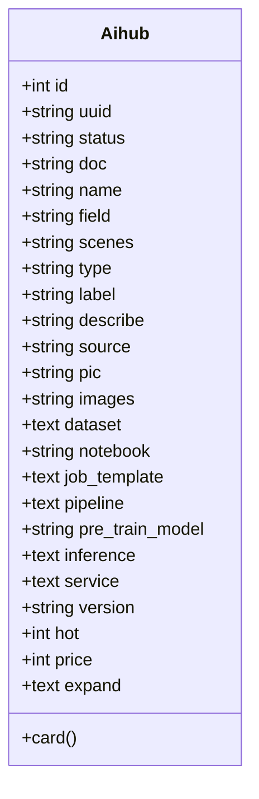
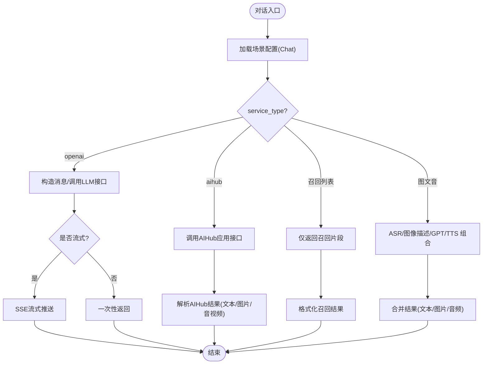
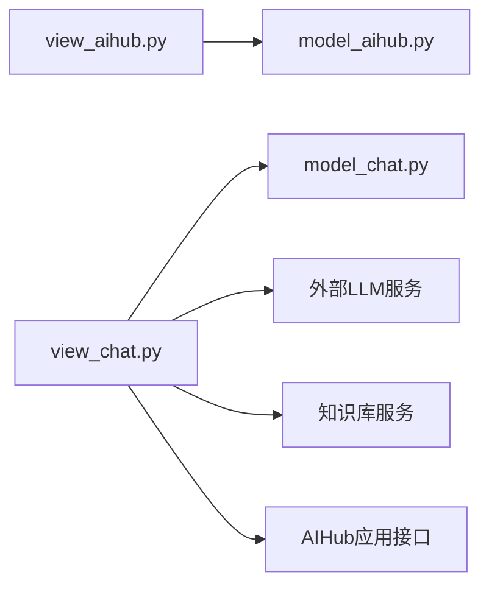

# AIHub与智能体

<cite>
**本文引用的文件**   
- [README.md](file://README.md)
- [model_aihub.py](file://myapp/models/model_aihub.py)
- [view_aihub.py](file://myapp/views/view_aihub.py)
- [init-aihub.json](file://myapp/init/init-aihub.json)
- [model_chat.py](file://myapp/models/model_chat.py)
- [view_chat.py](file://myapp/views/view_chat.py)
</cite>

## 目录
1. [引言](#引言)
2. [项目结构](#项目结构)
3. [核心组件](#核心组件)
4. [架构总览](#架构总览)
5. [详细组件分析](#详细组件分析)
6. [依赖关系分析](#依赖关系分析)
7. [性能与可用性](#性能与可用性)
8. [故障排查指南](#故障排查指南)
9. [结论](#结论)
10. [附录：扩展实践](#附录扩展实践)

## 引言
本文件面向“AIHub 模型市场”和“智能对话/智能体”两大能力域，系统性说明其实现机制与最佳实践。内容覆盖：
- 模型市场的数据模型、API 路由与卡片化展示
- 预训练模型管理（注册、版本、部署配置）
- 一键开发/微调/部署的端到端流程
- 智能对话场景配置（提示词模板、知识库、多模态输入、流式响应）
- 私有知识库构建方法（文件/接口/远程召回）
- 安全、权限与用户体验优化建议
- 如何扩展新的模型类型与智能体功能

## 项目结构
围绕 AIHub 与智能体的关键代码集中在以下位置：
- 数据模型层：myapp/models/model_aihub.py、myapp/models/model_chat.py
- 视图与 API 层：myapp/views/view_aihub.py、myapp/views/view_chat.py
- 初始化数据：myapp/init/init-aihub.json
- 平台概览与能力说明：README.md

图表来源
- [view_aihub.py:87-167](file://myapp/views/view_aihub.py#L87-L167)
- [view_chat.py:142-175](file://myapp/views/view_chat.py#L142-L175)

章节来源
- [README.md:362-430](file://README.md#L362-L430)

## 核心组件
- AIHub 模型市场
  - 数据模型：Aihub（字段包含领域、场景、框架、类型、推理配置、服务参数、版本、热度、价格等）
  - API：按领域分组的卡片式列表接口（视觉/听觉/自然语言/多模态/大模型），统一返回卡片渲染信息
- 智能对话/智能体
  - 数据模型：Chat（会话场景）、ChatLog（问答日志）
  - API：场景管理、对话请求（支持 OpenAI 兼容、AIHub 应用调用、知识库召回、多模态输入、流式输出）

章节来源
- [model_aihub.py:18-44](file://myapp/models/model_aihub.py#L18-L44)
- [view_aihub.py:87-167](file://myapp/views/view_aihub.py#L87-L167)
- [model_chat.py:16-35](file://myapp/models/model_chat.py#L16-L35)
- [view_chat.py:142-175](file://myapp/views/view_chat.py#L142-L175)

## 架构总览
AIHub 与智能体在平台中的角色：
- AIHub 提供“模型即应用”的市场化能力，将预训练模型以标准化卡片形式呈现，并支持一键转 Notebook、Pipeline 微调、推理服务发布
- 智能对话将用户问题通过提示词模板与私有知识库召回融合后，调用外部 LLM 或 AIHub 应用接口，返回文本/图像/音频/视频等多模态结果

图表来源
- [view_chat.py:616-937](file://myapp/views/view_chat.py#L616-L937)
- [view_chat.py:1176-1224](file://myapp/views/view_chat.py#L1176-L1224)

## 详细组件分析

### AIHub 模型市场
- 数据模型要点
  - 关键字段：uuid/name/field/scenes/type/label/describe/images/dataset/notebook/train/inference/service/version/hot/price/expand
  - card 属性用于前端卡片渲染（含图片、状态边框、操作入口）
- API 设计
  - 按领域分组：视觉/听觉/自然语言/多模态/大模型
  - 统一返回 list_ui_type=card 及卡片尺寸参数，便于前端卡片布局
- 初始化数据
  - init-aihub.json 定义了大量预置模型条目，包含推理资源、训练模板参数、文档链接等

图表来源
- [model_aihub.py:18-44](file://myapp/models/model_aihub.py#L18-L44)

章节来源
- [model_aihub.py:18-87](file://myapp/models/model_aihub.py#L18-L87)
- [view_aihub.py:87-167](file://myapp/views/view_aihub.py#L87-L167)
- [init-aihub.json:1-120](file://myapp/init/init-aihub.json#L1-L120)

### 智能对话与智能体
- 数据模型要点
  - Chat：名称、图标、标签、文档、会话保持条数、交互类型、欢迎语、提示词数组、先验知识、提示词模板、服务类型、服务配置、责任人、扩展参数
  - ChatLog：用户名、场景ID、问题、回答、反馈、状态、耗时、错误信息、时间戳
- 对话流程
  - 根据 service_type 分支处理：OpenAI 兼容接口、AIHub 应用接口、召回列表模式、图文音多模态链路
  - 支持流式响应、历史上下文缓存、知识库召回、提示词模板变量替换（{{knowledge}}/{{history}}/{{query}}）
- 知识库构建
  - 支持字符串、API 拉取、本地文件、SQL（预留）四种类型
  - 上传至远程知识库服务，设置 upload_url/recall_url，定时/触发式更新索引

图表来源
- [view_chat.py:616-937](file://myapp/views/view_chat.py#L616-L937)
- [view_chat.py:1176-1224](file://myapp/views/view_chat.py#L1176-L1224)
- [view_chat.py:940-1048](file://myapp/views/view_chat.py#L940-L1048)

章节来源
- [model_chat.py:16-72](file://myapp/models/model_chat.py#L16-L72)
- [view_chat.py:142-175](file://myapp/views/view_chat.py#L142-L175)
- [view_chat.py:616-937](file://myapp/views/view_chat.py#L616-L937)
- [view_chat.py:940-1048](file://myapp/views/view_chat.py#L940-L1048)
- [view_chat.py:1176-1224](file://myapp/views/view_chat.py#L1176-L1224)

## 依赖关系分析
- 模块耦合
  - view_aihub.py 依赖 model_aihub.py 的 Aihub 模型，并通过 Flask-AppBuilder 暴露 REST API
  - view_chat.py 依赖 model_chat.py 的 Chat/ChatLog，同时依赖外部 HTTP 服务（LLM、知识库、AIHub 应用）
- 外部依赖
  - requests/sseclient 用于 HTTP 与流式事件消费
  - cache（Redis/内存）用于会话上下文缓存
- 潜在循环依赖
  - 当前未见直接循环 import；注意新增逻辑时避免在视图与模型间形成双向依赖

图表来源
- [view_aihub.py:87-167](file://myapp/views/view_aihub.py#L87-L167)
- [view_chat.py:616-937](file://myapp/views/view_chat.py#L616-L937)

章节来源
- [view_aihub.py:87-167](file://myapp/views/view_aihub.py#L87-L167)
- [view_chat.py:616-937](file://myapp/views/view_chat.py#L616-L937)

## 性能与可用性
- 流式响应
  - 对 OpenAI 兼容接口采用 SSE 流式推送，降低首字延迟，提升交互体验
- 上下文缓存
  - 使用缓存存储多轮对话历史，限制最大保留条数，避免 Token 超限
- 重试与容错
  - 对 LLM 调用进行有限次重试；对 401 等鉴权失败自动标记失效 token
- 知识库更新策略
  - 基于更新时间阈值与状态判断触发增量/全量重建索引，避免频繁重建

章节来源
- [view_chat.py:1295-1455](file://myapp/views/view_chat.py#L1295-L1455)
- [view_chat.py:1054-1118](file://myapp/views/view_chat.py#L1054-L1118)

## 故障排查指南
- 无法连接 LLM 服务
  - 检查 service_config 中 llm_url/llm_tokens/headers 配置是否正确
  - 关注 401 鉴权失败后的 token 失效处理逻辑
- 知识库未生效
  - 确认 knowledge.type/file/url/upload_url/recall_url 配置完整
  - 检查知识库服务可达性与返回格式（result/source_documents）
- AIHub 应用调用异常
  - 校验 service_config.url/data/output 配置
  - 检查 AIHub 应用返回结构是否符合预期（status/result）

章节来源
- [view_chat.py:1123-1172](file://myapp/views/view_chat.py#L1123-L1172)
- [view_chat.py:1054-1118](file://myapp/views/view_chat.py#L1054-L1118)
- [view_chat.py:812-821](file://myapp/views/view_chat.py#L812-L821)

## 结论
AIHub 与智能体共同构成“模型即应用”与“对话即服务”的平台能力：
- AIHub 通过标准化模型卡片与配置，打通“开发—微调—部署”全链路
- 智能体通过灵活的提示词模板、知识库召回与多模态输入，将业务问题转化为可执行的 LLM/AIHub 调用
- 结合平台的算力调度、监控与权限体系，形成从资产沉淀到服务落地的闭环

## 附录：扩展实践

### 扩展新的模型类型（AIHub）
- 步骤
  1. 在初始化数据中添加新模型条目（参考 init-aihub.json 的结构）
  2. 如需新领域分类，可在 view_aihub.py 中新增对应 API 类并注册路由
  3. 在 model_aihub.py 的 Aihub 模型中按需扩展字段（如 expand）
- 关键点
  - 确保 type/field/scenes 与前端筛选一致
  - inference/service 配置需与平台推理服务规范对齐

章节来源
- [init-aihub.json:1-120](file://myapp/init/init-aihub.json#L1-L120)
- [view_aihub.py:87-167](file://myapp/views/view_aihub.py#L87-L167)
- [model_aihub.py:18-44](file://myapp/models/model_aihub.py#L18-L44)

### 扩展新的智能体功能
- 步骤
  1. 在 Chat 模型中扩展必要字段（如 expand）
  2. 在 view_chat.py 中新增 service_type 分支处理逻辑
  3. 若涉及知识库，完善 upload_knowledge/get_remote_knowledge 的处理路径
- 关键点
  - 保证提示词模板变量 {{knowledge}}/{{history}}/{{query}} 的正确替换
  - 对多模态输入（图/音/视频）进行规范化处理与回传

章节来源
- [model_chat.py:16-35](file://myapp/models/model_chat.py#L16-L35)
- [view_chat.py:616-937](file://myapp/views/view_chat.py#L616-L937)
- [view_chat.py:940-1048](file://myapp/views/view_chat.py#L940-L1048)

### 模型注册与一键部署流程
- 模型注册
  - 在 AIHub 初始化数据中登记模型元信息与推理/训练配置
  - 通过平台模型管理页面完成版本归档与指标可视化
- 一键部署
  - 从 AIHub 卡片进入“部署 Web/推理服务”，平台自动生成服务配置并上线
  - 支持调试/生产环境切换、灰度与回滚

章节来源
- [README.md:362-380](file://README.md#L362-L380)

### 对话场景配置与私有知识库构建
- 对话场景
  - 配置 service_type（openai/aihub/召回列表/图文音）
  - 设置 service_config（URL/Headers/Tokens/Stream/Before/After 等）
  - 配置 prompt 模板与 session_num（上下文条数）
- 私有知识库
  - 选择 knowledge.type（str/api/file/sql）
  - 配置 upload_url/recall_url，触发索引构建与召回测试

章节来源
- [view_chat.py:177-219](file://myapp/views/view_chat.py#L177-L219)
- [view_chat.py:303-342](file://myapp/views/view_chat.py#L303-L342)
- [view_chat.py:940-1048](file://myapp/views/view_chat.py#L940-L1048)