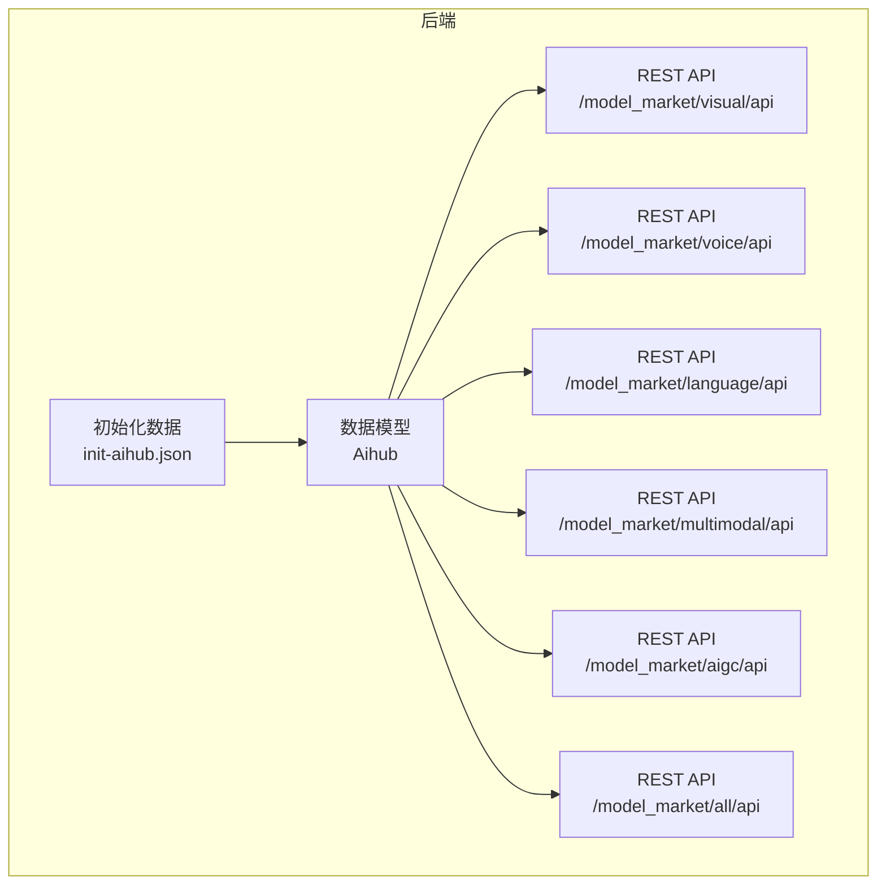
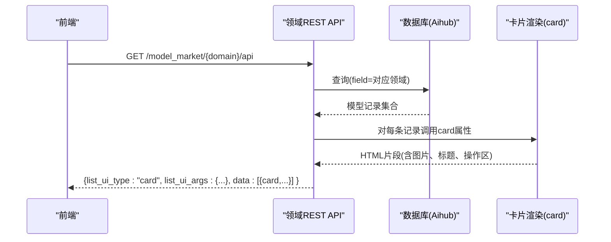
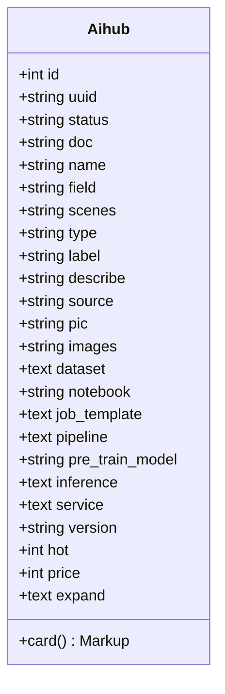
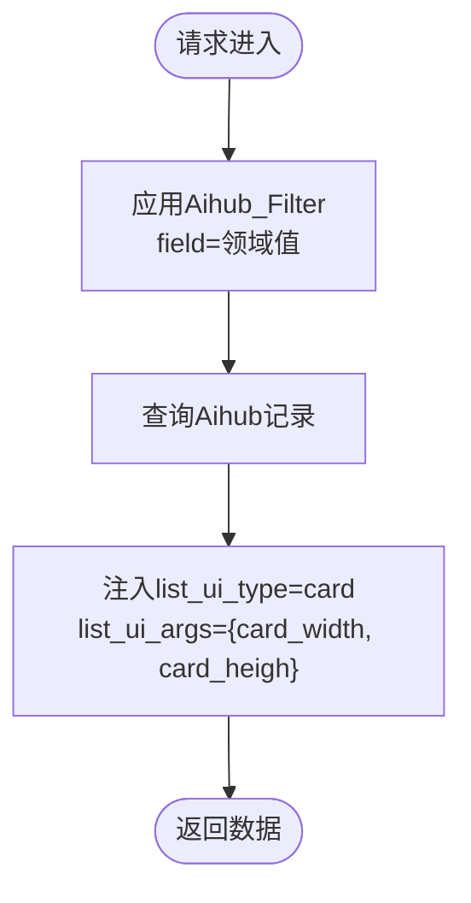
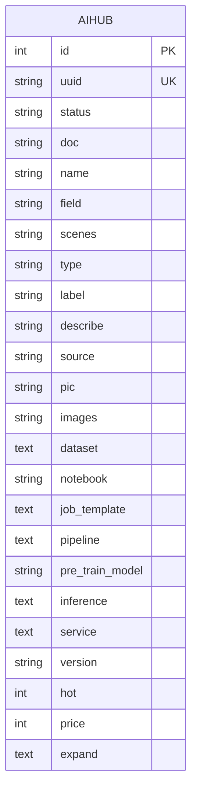
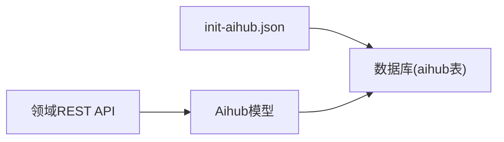

# AIHub模型市场

<cite>
**本文引用的文件**   
- [model_aihub.py](file://myapp/models/model_aihub.py)
- [view_aihub.py](file://myapp/views/view_aihub.py)
- [init-aihub.json](file://myapp/init/init-aihub.json)
</cite>

## 目录
1. [简介](#简介)
2. [项目结构](#项目结构)
3. [核心组件](#核心组件)
4. [架构总览](#架构总览)
5. [详细组件分析](#详细组件分析)
6. [依赖关系分析](#依赖关系分析)
7. [性能与体验优化](#性能与体验优化)
8. [故障排查指南](#故障排查指南)
9. [结论](#结论)
10. [附录：扩展与示例](#附录扩展与示例)

## 简介
本文件面向AIHub模型市场的后端实现，系统性说明模型分类体系（机器视觉、听觉、自然语言、多模态、大模型）的实现机制，包括模型卡片展示、搜索过滤与分类管理。文档覆盖模型元数据管理、图片资源处理、API接口设计，并提供模型注册流程、分类配置方法与前端展示逻辑的落地指引，同时给出添加新模型类型与自定义卡片样式的实践建议。

## 项目结构
AIHub模型市场由“数据模型 + REST API + 初始化数据”三部分构成：
- 数据模型：定义模型元数据的数据库表结构与卡片渲染方法
- REST API：按领域划分多个路由，提供列表与卡片展示能力
- 初始化数据：以JSON形式预置大量模型条目，作为市场内容的基础

图表来源
- [model_aihub.py:18-44](file://myapp/models/model_aihub.py#L18-L44)
- [view_aihub.py:87-167](file://myapp/views/view_aihub.py#L87-L167)
- [init-aihub.json:1-10](file://myapp/init/init-aihub.json#L1-L10)

章节来源
- [model_aihub.py:18-44](file://myapp/models/model_aihub.py#L18-L44)
- [view_aihub.py:87-167](file://myapp/views/view_aihub.py#L87-L167)
- [init-aihub.json:1-10](file://myapp/init/init-aihub.json#L1-L10)

## 核心组件
- Aihub 数据模型：承载模型的元数据字段与卡片HTML生成逻辑
- Aihub_base 基类：统一权限、排序、搜索列、分页与编辑表单扩展
- 领域API：按领域划分的REST端点，统一返回卡片布局参数
- 初始化数据：以JSON描述模型条目，驱动市场内容

关键要点
- 模型字段涵盖名称、领域、场景、类型、标签、描述、图片、镜像、数据集、Notebook、训练、推理、服务化、版本、热度、价格、扩展等
- 卡片属性card将图片路径规范化并输出带样式的HTML片段
- 领域API通过base_filters按field字段过滤，并在响应中注入list_ui_type=card与卡片尺寸参数

章节来源
- [model_aihub.py:18-82](file://myapp/models/model_aihub.py#L18-L82)
- [view_aihub.py:45-79](file://myapp/views/view_aihub.py#L45-L79)
- [view_aihub.py:87-167](file://myapp/views/view_aihub.py#L87-L167)

## 架构总览
下图展示了从请求到响应的端到端流程：前端调用各领域的REST API，后端基于Aihub模型进行过滤与序列化，并通过card属性生成卡片HTML返回给前端。

图表来源
- [view_aihub.py:87-167](file://myapp/views/view_aihub.py#L87-L167)
- [model_aihub.py:47-82](file://myapp/models/model_aihub.py#L47-L82)

## 详细组件分析

### 数据模型：Aihub
职责
- 定义aihub表的字段映射
- 提供card属性用于生成模型卡片的HTML片段

关键字段
- 标识与状态：id, uuid, status
- 基本信息：name, field, scenes, type, label, describe, source
- 媒体与资源：pic, images, dataset, notebook, job_template, pipeline, pre_train_model
- 运行与服务：inference, service
- 运营信息：version, hot, price, expand

卡片渲染逻辑
- 图片URL解析：若pic为http(s)则直接使用；否则拼接静态路径/static/aihub/deep-learning/{name}/{pic}
- 操作区：根据price是否大于0显示“商业版”，否则默认显示“开发/训练/部署web”占位链接
- 边框样式：依据status是否为online动态调整边框颜色

复杂度
- card属性为O(1)字符串构造，无外部IO

错误处理
- 图片加载失败时前端可回退至loading占位图（由onerror处理）

图表来源
- [model_aihub.py:18-82](file://myapp/models/model_aihub.py#L18-L82)

章节来源
- [model_aihub.py:18-82](file://myapp/models/model_aihub.py#L18-L82)

### REST API：领域分类与卡片展示
职责
- 按领域暴露REST接口，统一返回列表UI类型为卡片及卡片尺寸
- 使用Aihub_Filter按field字段过滤数据

领域路由
- 机器视觉：/model_market/visual/api
- 听觉：/model_market/voice/api
- 自然语言：/model_market/language/api
- 多模态：/model_market/multimodal/api
- 大模型：/model_market/aigc/api
- 全部：/model_market/all/api

统一行为
- base_filters：按field等于对应领域值过滤
- add_more_info：设置list_ui_type=card与list_ui_args（卡片宽高）

图表来源
- [view_aihub.py:45-79](file://myapp/views/view_aihub.py#L45-L79)
- [view_aihub.py:87-167](file://myapp/views/view_aihub.py#L87-L167)

章节来源
- [view_aihub.py:45-79](file://myapp/views/view_aihub.py#L45-L79)
- [view_aihub.py:87-167](file://myapp/views/view_aihub.py#L87-L167)

### 初始化数据：模型元数据
职责
- 提供初始模型条目，包含领域、场景、框架、类型、图片、推理/训练资源配置等
- 作为市场内容的种子数据

数据结构要点
- field：领域（机器视觉/听觉/自然语言/多模态/大模型）
- scenes：应用场景
- frameworks：框架（如pytorch/TensorFlow）
- type：能力类型（如dateset/notebook/train/inference/web）
- inference/train：资源需求（CPU/GPU/Memory）
- images：镜像地址
- pic：封面图文件名或URL

图表来源
- [model_aihub.py:18-44](file://myapp/models/model_aihub.py#L18-L44)
- [init-aihub.json:1-10](file://myapp/init/init-aihub.json#L1-L10)

章节来源
- [init-aihub.json:1-10](file://myapp/init/init-aihub.json#L1-L10)

## 依赖关系分析
- 数据模型依赖Flask-AppBuilder的Model与SQLAlchemy Column
- REST API依赖MyappModelRestApi与MyappFilter，以及Aihub模型
- 初始化数据通过系统导入机制写入数据库，供API查询

图表来源
- [model_aihub.py:18-44](file://myapp/models/model_aihub.py#L18-L44)
- [view_aihub.py:87-167](file://myapp/views/view_aihub.py#L87-L167)
- [init-aihub.json:1-10](file://myapp/init/init-aihub.json#L1-L10)

章节来源
- [model_aihub.py:18-44](file://myapp/models/model_aihub.py#L18-L44)
- [view_aihub.py:87-167](file://myapp/views/view_aihub.py#L87-L167)
- [init-aihub.json:1-10](file://myapp/init/init-aihub.json#L1-L10)

## 性能与体验优化
- 列表分页：page_size=100，避免一次性返回过多数据
- 图片加载：支持http(s)直链与本地静态路径，结合onerror回退图提升鲁棒性
- 缓存建议：对热门模型列表与卡片HTML做服务端缓存（如Redis），降低重复渲染开销
- 索引优化：对field、status、hot等常用过滤/排序字段建立数据库索引
- 前端优化：卡片宽度与高度可通过list_ui_args统一控制，便于在不同屏幕下自适应

[本节为通用指导，不直接分析具体文件]

## 故障排查指南
常见问题
- 图片无法显示：检查pic字段是否为有效http(s)链接或静态路径是否存在；确认静态资源目录与Nginx配置正确
- 卡片样式异常：确认status字段值是否正确（如online），影响边框样式；检查HTML模板中的条件分支
- 列表为空：检查field是否与领域路由一致；确认初始化数据已导入且数据库连接正常
- 搜索无效：确认search_columns包含目标字段（describe/label/name/scenes/expand）

定位步骤
- 查看API返回的list_ui_type与list_ui_args是否正确注入
- 校验Aihub_Filter的field过滤条件
- 检查数据库记录与初始化数据一致性

章节来源
- [model_aihub.py:47-82](file://myapp/models/model_aihub.py#L47-L82)
- [view_aihub.py:45-79](file://myapp/views/view_aihub.py#L45-L79)

## 结论
AIHub模型市场通过清晰的数据模型、统一的REST API与丰富的初始化数据，实现了按领域分类的模型展示与管理。card属性将复杂的卡片渲染逻辑封装在模型层，配合领域API的统一UI参数注入，使前端能够以一致的卡片风格呈现不同领域的模型。该架构具备良好的可扩展性与维护性，适合持续扩充模型生态与优化用户体验。

[本节为总结性内容，不直接分析具体文件]

## 附录：扩展与示例

### 新增模型类型（领域）的步骤
- 在edit_form_extra_fields的choices中添加新的领域选项
- 新增一个继承Aihub_base的领域API类，设置route_base与base_filters指向新领域
- 在初始化数据init-aihub.json中补充对应field的模型条目
- 确保前端路由与菜单配置与新API匹配

章节来源
- [view_aihub.py:71-79](file://myapp/views/view_aihub.py#L71-L79)
- [view_aihub.py:87-167](file://myapp/views/view_aihub.py#L87-L167)
- [init-aihub.json:1-10](file://myapp/init/init-aihub.json#L1-L10)

### 自定义模型卡片样式
- 修改Aihub.card属性的HTML模板，调整图片尺寸、标题排版、操作按钮等
- 通过list_ui_args的card_width/card_heigh控制卡片容器尺寸
- 如需更复杂交互，可在前端侧根据返回的card字段进行二次渲染

章节来源
- [model_aihub.py:47-82](file://myapp/models/model_aihub.py#L47-L82)
- [view_aihub.py:92-97](file://myapp/views/view_aihub.py#L92-L97)

### 模型注册流程（基于现有机制）
- 准备模型元数据：填写name、field、scenes、type、label、describe、pic、inference/train等资源字段
- 将模型条目追加至init-aihub.json，并确保uuid唯一
- 执行系统初始化导入，将数据写入数据库
- 通过对应领域API验证卡片展示与搜索过滤是否正常

章节来源
- [init-aihub.json:1-10](file://myapp/init/init-aihub.json#L1-L10)
- [view_aihub.py:87-167](file://myapp/views/view_aihub.py#L87-L167)

### 分类配置方法
- 领域枚举：在edit_form_extra_fields中维护field的可选值
- 路由映射：每个领域对应一个API类，使用base_filters限定field取值
- 前端展示：根据API返回的list_ui_type与list_ui_args渲染卡片网格

章节来源
- [view_aihub.py:71-79](file://myapp/views/view_aihub.py#L71-L79)
- [view_aihub.py:87-167](file://myapp/views/view_aihub.py#L87-L167)