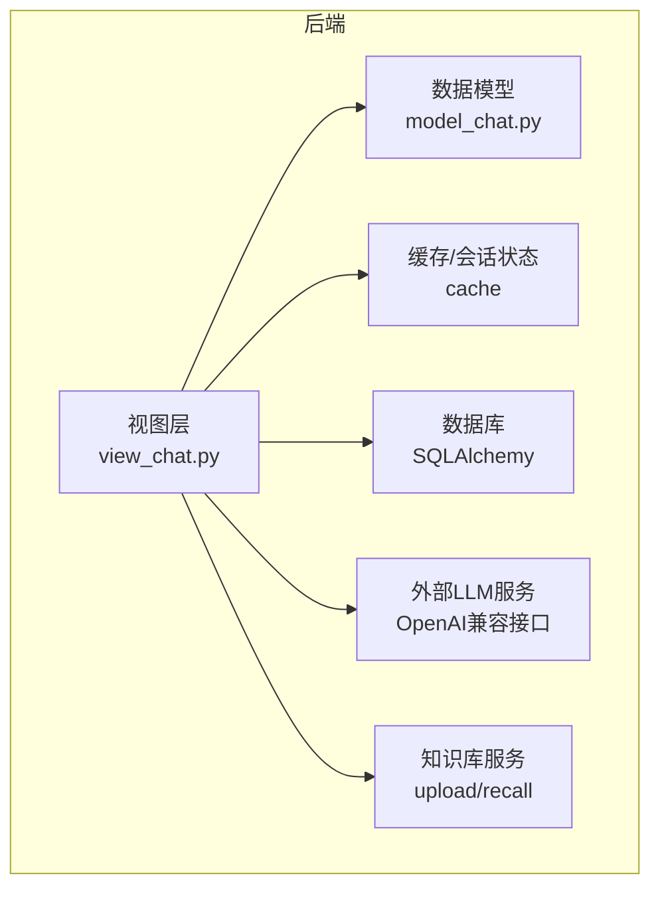
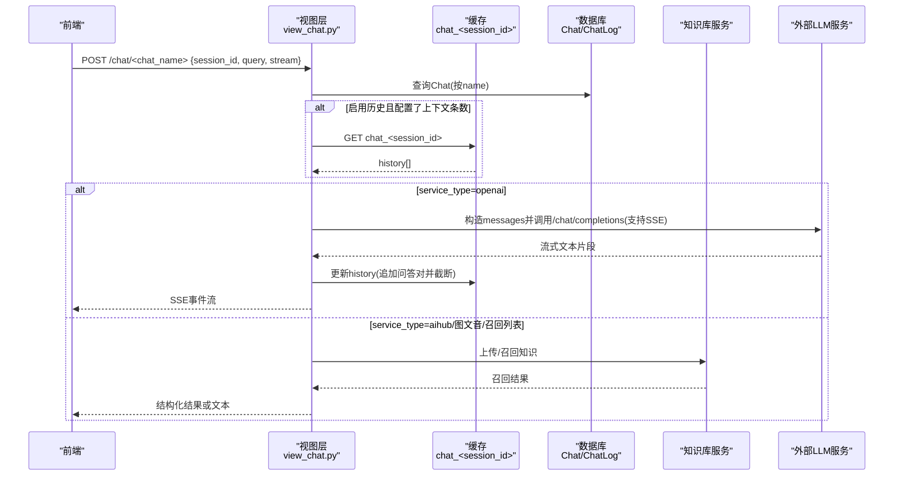
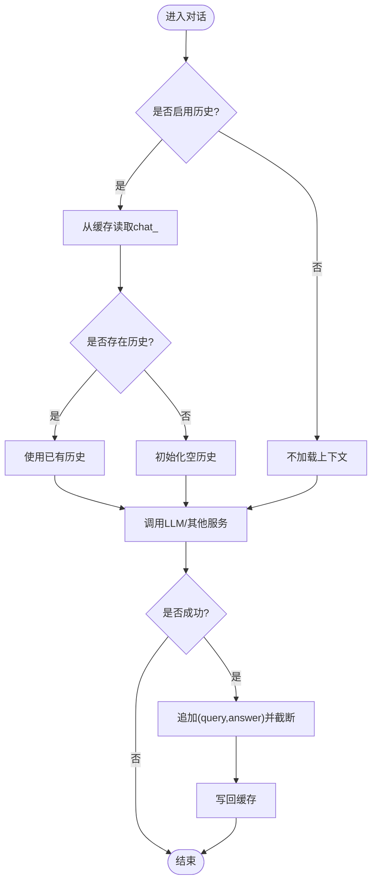
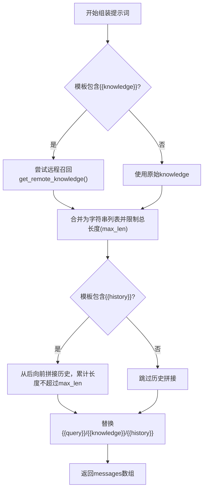
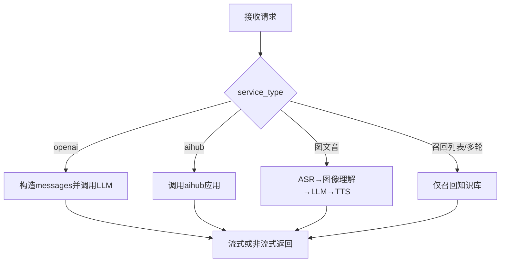
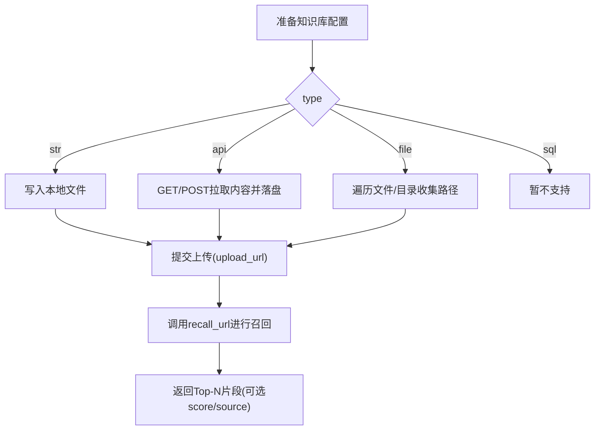
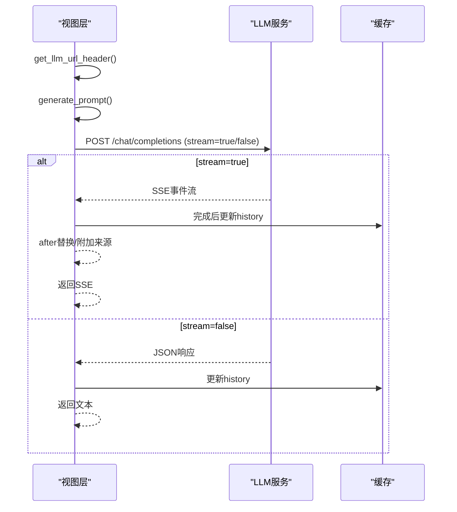
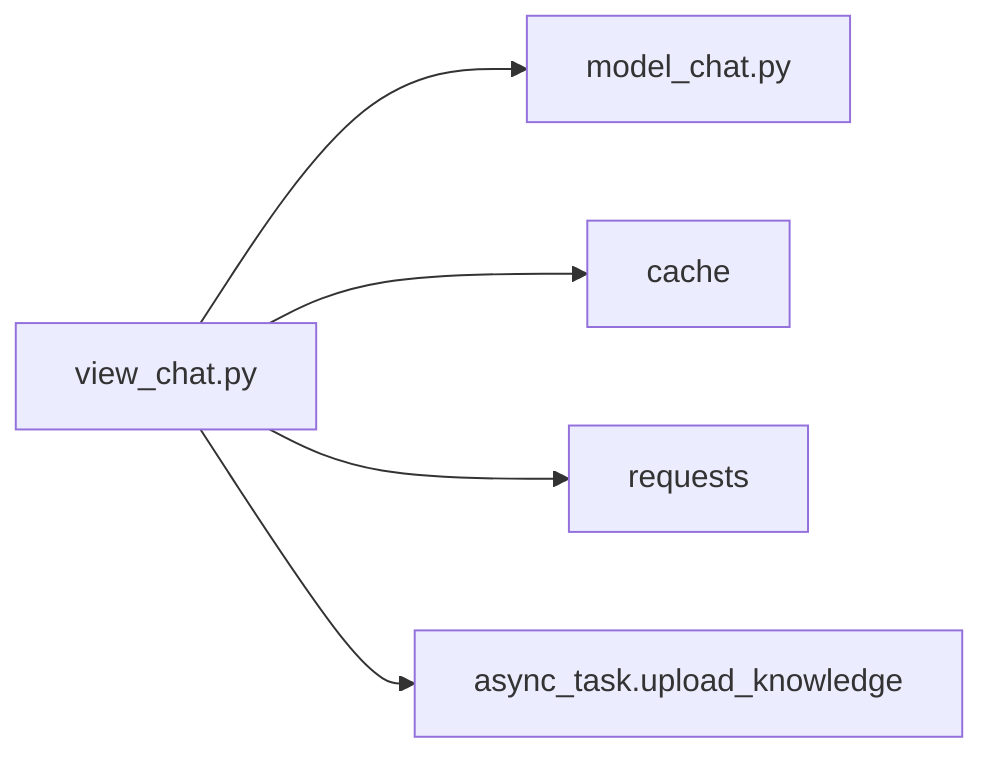

# 智能对话

<cite>
**本文引用的文件**   
- [model_chat.py](file://myapp/models/model_chat.py)
- [view_chat.py](file://myapp/views/view_chat.py)
</cite>

## 目录
1. [简介](#简介)
2. [项目结构](#项目结构)
3. [核心组件](#核心组件)
4. [架构总览](#架构总览)
5. [详细组件分析](#详细组件分析)
6. [依赖关系分析](#依赖关系分析)
7. [性能与可扩展性](#性能与可扩展性)
8. [故障排查指南](#故障排查指南)
9. [结论](#结论)

## 简介
本文件面向“智能对话”功能，系统性说明对话系统的架构设计、数据模型、会话历史与上下文管理、对话模板配置、意图识别与响应生成机制，以及外部AI服务集成方式。文档同时给出扩展新对话类型、接入外部LLM/Agent服务的实践路径，并总结对话质量评估、性能优化与安全加固的最佳实践。

## 项目结构
智能对话能力由后端视图与数据模型组成：
- 数据模型层：定义对话场景（Chat）与对话日志（ChatLog）。
- 视图层：提供对话场景的CRUD、对话请求处理、知识库上传与召回、OpenAI兼容接口调用、流式响应等。

图表来源
- [view_chat.py:142-1505](file://myapp/views/view_chat.py#L142-L1505)
- [model_chat.py:16-72](file://myapp/models/model_chat.py#L16-L72)

章节来源
- [model_chat.py:16-72](file://myapp/models/model_chat.py#L16-L72)
- [view_chat.py:142-1505](file://myapp/views/view_chat.py#L142-L1505)

## 核心组件
- 对话场景模型 Chat：描述一个可复用的对话智能体，包括交互类型、欢迎语、提示词模板、会话上下文条数、知识库配置、推理服务类型与配置、访问控制等。
- 对话日志模型 ChatLog：记录用户问题、回答、耗时、错误信息等，用于审计与评估。
- 对话视图 Chat_View_Base/Chat_View_Api：封装对话场景管理API与对话执行流程，包含：
  - 会话清理与上下文读取
  - 多服务路由（openai、aihub、图文音、召回列表等）
  - 知识库上传与召回
  - OpenAI兼容接口调用（含流式SSE）
  - 提示词组装（注入{{knowledge}}/{{history}}/{{query}}）

章节来源
- [model_chat.py:16-72](file://myapp/models/model_chat.py#L16-L72)
- [view_chat.py:142-1505](file://myapp/views/view_chat.py#L142-L1505)

## 架构总览
下图展示一次典型对话从前端到后端的完整调用链，涵盖会话上下文、知识库召回、LLM调用与流式返回。

图表来源
- [view_chat.py:616-937](file://myapp/views/view_chat.py#L616-L937)
- [view_chat.py:1295-1455](file://myapp/views/view_chat.py#L1295-L1455)
- [view_chat.py:1054-1118](file://myapp/views/view_chat.py#L1054-L1118)

## 详细组件分析

### 数据模型与权限控制
- Chat字段要点
  - name/label/icon/doc：标识与展示信息
  - session_num：上下文保留条数
  - chat_type：交互类型（text/digital_human等）
  - hello/tips/knowledge/prompt：欢迎语、输入示例、先验知识与提示词模板
  - service_type/service_config：推理服务类型与参数（如openai/aihub）
  - owner：可见用户（*表示公开）
- ChatLog字段要点
  - username/query/answer/manual_feedback/answer_status/answer_cost/err_msg：审计与评估指标
- 权限过滤
  - 非管理员仅能查看owner包含当前用户名或为*的场景

章节来源
- [model_chat.py:16-72](file://myapp/models/model_chat.py#L16-L72)
- [view_chat.py:51-61](file://myapp/views/view_chat.py#L51-L61)

### 对话场景配置与表单校验
- 基础配置：名称、图标、标签、文档链接、责任人
- 提示词配置：交互类型、欢迎语、输入示例、知识库、提示词模板、上下文条数
- 模型服务：服务类型（openai/aihub/召回列表）、接口配置JSON、扩展参数
- 自动默认值与规范化
  - 未配置service_config时写入默认OpenAI兼容结构
  - 未配置prompt时根据是否具备知识库自动选择模板
  - 将SVG尺寸统一为50x50
  - 确保prompt中包含{{query}}占位符

章节来源
- [view_chat.py:228-343](file://myapp/views/view_chat.py#L228-L343)
- [view_chat.py:449-552](file://myapp/views/view_chat.py#L449-L552)

### 会话历史管理与上下文维护
- 会话ID与缓存键
  - 使用session_id作为上下文键前缀，缓存键形如chat_{session_id}
- 上下文读取与更新
  - 若enable_history为真且chat.session_num>0，则从缓存读取history
  - 成功响应后将(query, answer)追加至history并按session_num截断
  - 流式模式下在收到[DONE]后更新上下文
- 会话清理
  - 提供/clear/<session_id>接口清空上下文缓存

图表来源
- [view_chat.py:605-614](file://myapp/views/view_chat.py#L605-L614)
- [view_chat.py:716-723](file://myapp/views/view_chat.py#L716-L723)
- [view_chat.py:908-930](file://myapp/views/view_chat.py#L908-L930)
- [view_chat.py:1360-1366](file://myapp/views/view_chat.py#L1360-L1366)

章节来源
- [view_chat.py:605-614](file://myapp/views/view_chat.py#L605-L614)
- [view_chat.py:716-723](file://myapp/views/view_chat.py#L716-L723)
- [view_chat.py:908-930](file://myapp/views/view_chat.py#L908-L930)
- [view_chat.py:1360-1366](file://myapp/views/view_chat.py#L1360-L1366)

### 对话模板与提示词组装
- 模板变量
  - {{query}}：用户问题
  - {{knowledge}}：知识库召回内容（字符串或数组）
  - {{history}}：多轮对话历史（Human/AI格式）
- 组装逻辑
  - 若模板包含{{knowledge}}，优先尝试远程召回；否则直接使用chat.knowledge原文
  - 若模板包含{{history}}，按最大长度阈值max_len逐步从后向前拼接历史，避免超限
  - 最终输出messages数组供LLM消费

图表来源
- [view_chat.py:1176-1224](file://myapp/views/view_chat.py#L1176-L1224)
- [view_chat.py:1182-1205](file://myapp/views/view_chat.py#L1182-L1205)
- [view_chat.py:1207-1222](file://myapp/views/view_chat.py#L1207-L1222)

章节来源
- [view_chat.py:1176-1224](file://myapp/views/view_chat.py#L1176-L1224)

### 意图识别与响应生成机制
- 服务路由
  - openai：走OpenAI兼容接口，支持流式与非流式
  - aihub：调用内部AIGC应用，支持图片/视频等多模态输出
  - 图文音：ASR→图像理解→LLM→TTS的组合流程
  - 召回列表/多轮：仅返回知识库召回结果
- 响应生成
  - OpenAI兼容：构造标准消息体，支持temperature/top_p/max_tokens等参数
  - 流式SSE：使用sseclient解析事件，逐块推送给前端，并在完成时更新上下文
  - 预处理/后处理：before/after规则可对请求/响应进行替换

图表来源
- [view_chat.py:724-821](file://myapp/views/view_chat.py#L724-L821)
- [view_chat.py:823-907](file://myapp/views/view_chat.py#L823-L907)
- [view_chat.py:1295-1455](file://myapp/views/view_chat.py#L1295-L1455)

章节来源
- [view_chat.py:724-907](file://myapp/views/view_chat.py#L724-L907)
- [view_chat.py:1295-1455](file://myapp/views/view_chat.py#L1295-L1455)

### 知识库上传与召回
- 上传
  - 支持str/api/file/sql四种类型
  - str：直接保存为本地文件
  - api：拉取远端资源并落盘
  - file：遍历本地文件或目录收集
  - 生产环境通过异步任务提交上传
- 召回
  - 定时检查知识库状态与更新时间，必要时触发重新上传
  - 调用recall_url获取Top-N相关片段，可按最小分数过滤
  - 支持返回得分与来源文档，便于溯源

图表来源
- [view_chat.py:940-1048](file://myapp/views/view_chat.py#L940-L1048)
- [view_chat.py:1054-1118](file://myapp/views/view_chat.py#L1054-L1118)

章节来源
- [view_chat.py:940-1048](file://myapp/views/view_chat.py#L940-L1048)
- [view_chat.py:1054-1118](file://myapp/views/view_chat.py#L1054-L1118)

### 外部AI服务集成（OpenAI兼容）
- 地址与鉴权
  - 优先使用chat.service_config中的llm_url与llm_headers
  - 支持多个token轮换与失败计数（miss_tokens）
  - 未配置时回退到全局配置
- 请求体
  - model/messages/temperature/top_p/n/stream/stop/max_tokens/penalties/user等
  - 可通过llm_data注入额外参数
- 流式SSE
  - 使用sseclient解析事件，逐块拼接文本
  - 完成后追加g.after_message（来源引用等），并更新上下文缓存
- 非流式
  - 直接返回choices[0].message.content，并进行after替换

图表来源
- [view_chat.py:1123-1172](file://myapp/views/view_chat.py#L1123-L1172)
- [view_chat.py:1295-1455](file://myapp/views/view_chat.py#L1295-L1455)

章节来源
- [view_chat.py:1123-1172](file://myapp/views/view_chat.py#L1123-L1172)
- [view_chat.py:1295-1455](file://myapp/views/view_chat.py#L1295-L1455)

### 扩展新的对话类型与集成外部服务
- 新增服务类型
  - 在service_type分支中添加新路由（参考现有openai/aihub/图文音分支）
  - 在service_config中定义该类型的参数结构
  - 在pre_add/pre_update中对默认值与校验进行适配
- 接入外部LLM/Agent
  - 保持OpenAI兼容协议即可复用chatgpt方法
  - 如需自定义协议，可在对应分支实现独立调用与响应解析
- 扩展知识库类型
  - 在upload_knowledge中增加新的knowledge.type分支
  - 在get_remote_knowledge中适配新的recall协议

章节来源
- [view_chat.py:724-821](file://myapp/views/view_chat.py#L724-L821)
- [view_chat.py:940-1048](file://myapp/views/view_chat.py#L940-L1048)
- [view_chat.py:1054-1118](file://myapp/views/view_chat.py#L1054-L1118)

## 依赖关系分析
- 视图层依赖
  - 数据模型：Chat/ChatLog
  - 缓存：基于cache的会话上下文存储
  - 外部服务：requests调用LLM与知识库服务
  - 异步任务：Celery任务（上传知识库）
- 模型层依赖
  - SQLAlchemy ORM
  - Flask-AppBuilder Model基类

图表来源
- [view_chat.py:1-48](file://myapp/views/view_chat.py#L1-L48)
- [view_chat.py:1031-1048](file://myapp/views/view_chat.py#L1031-L1048)
- [model_chat.py:1-13](file://myapp/models/model_chat.py#L1-L13)

章节来源
- [view_chat.py:1-48](file://myapp/views/view_chat.py#L1-L48)
- [view_chat.py:1031-1048](file://myapp/views/view_chat.py#L1031-L1048)
- [model_chat.py:1-13](file://myapp/models/model_chat.py#L1-L13)

## 性能与可扩展性
- 流式响应
  - 使用SSE降低首字延迟，提升用户体验
  - 注意服务端连接保持与缓存控制头设置
- 上下文裁剪
  - 通过session_num限制历史长度，结合max_len控制提示词总长，避免超出模型上下文窗口
- 重试与容错
  - LLM调用支持多次重试，异常时返回友好提示
  - Token失效自动记录miss_tokens，后续请求避开失效token
- 知识库异步上传
  - 生产环境通过异步任务上传，避免阻塞主流程
- 扩展点
  - before/after规则对请求/响应进行轻量级替换，无需改动核心逻辑
  - llm_data透传允许对接不同厂商的参数差异

章节来源
- [view_chat.py:1320-1455](file://myapp/views/view_chat.py#L1320-L1455)
- [view_chat.py:1176-1224](file://myapp/views/view_chat.py#L1176-L1224)
- [view_chat.py:1031-1048](file://myapp/views/view_chat.py#L1031-L1048)

## 故障排查指南
- 常见问题定位
  - 无上下文：检查enable_history与chat.session_num配置，确认缓存键chat_{session_id}存在
  - 知识库为空：检查knowledge.status与update_time，必要时手动触发upload_knowledge
  - LLM调用失败：检查llm_url、headers与token有效性，关注miss_tokens计数
  - 流式中断：检查网络与SSE客户端兼容性，确认服务端Connection/Cache-Control头
- 日志与审计
  - 通过ChatLog记录answer_status与err_msg，辅助定位问题
  - 建议在关键分支添加结构化日志（如请求ID、耗时、Token使用量）

章节来源
- [view_chat.py:605-614](file://myapp/views/view_chat.py#L605-L614)
- [view_chat.py:908-930](file://myapp/views/view_chat.py#L908-L930)
- [view_chat.py:1393-1400](file://myapp/views/view_chat.py#L1393-L1400)
- [model_chat.py:56-72](file://myapp/models/model_chat.py#L56-L72)

## 结论
本系统以“对话场景+知识库+外部LLM”为核心，提供了灵活的提示词模板、会话上下文管理、流式响应与多模态扩展能力。通过标准化的OpenAI兼容接口与可插拔的服务路由，能够快速接入多种AI服务。建议在生产环境中完善监控与评估体系，持续优化提示词与知识库召回策略，保障对话质量与稳定性。