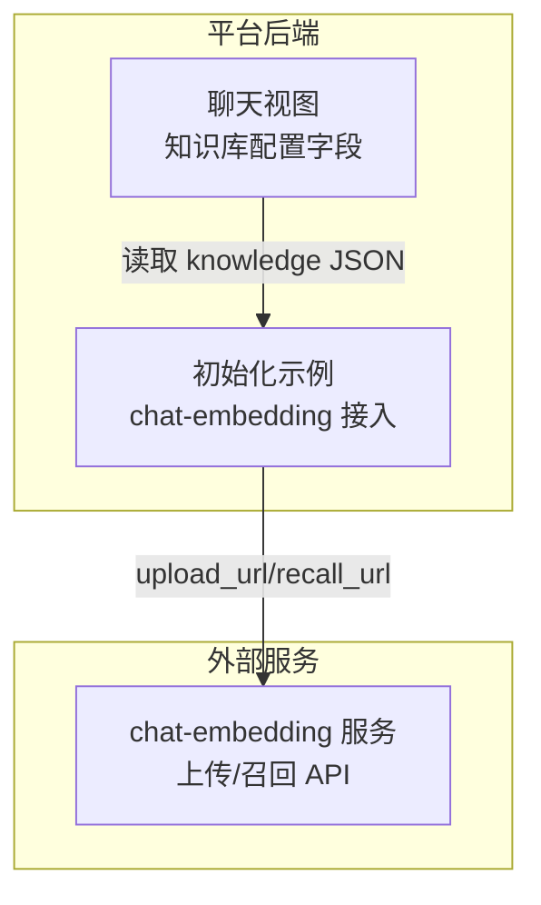
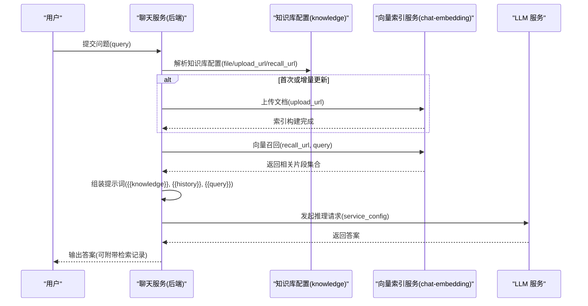
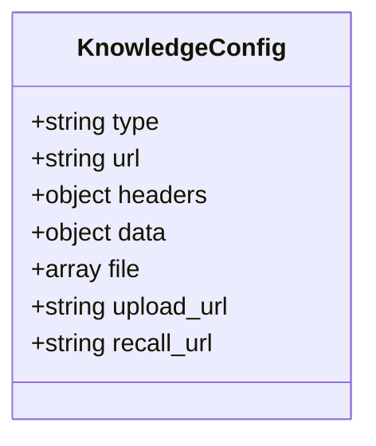
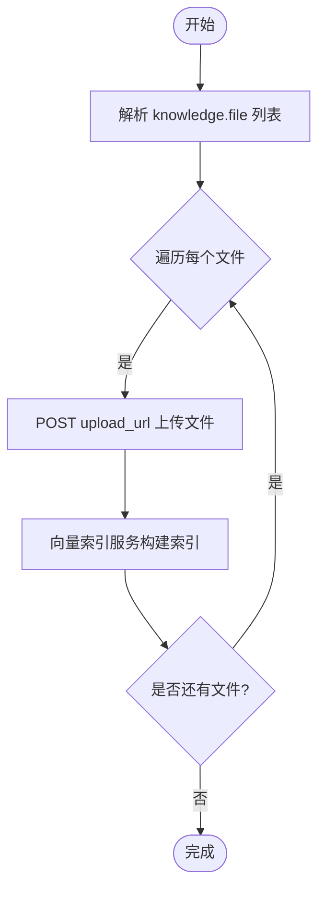
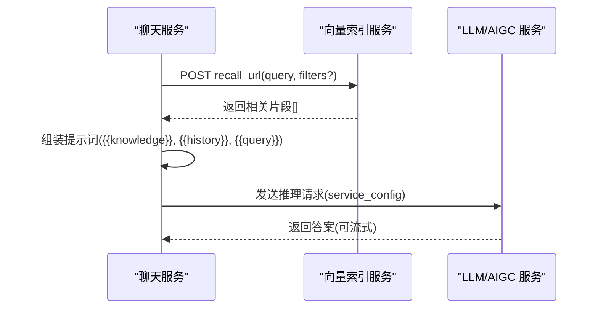
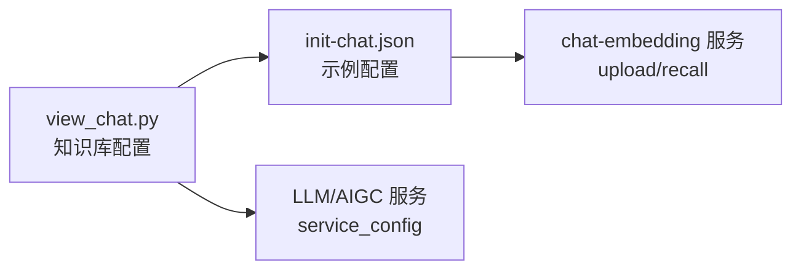

# 私有知识库

<cite>
**本文引用的文件**   
- [README.md](file://README.md)
- [view_chat.py](file://myapp/views/view_chat.py)
- [init-chat.json](file://myapp/init/init-chat.json)
</cite>

## 目录
1. [简介](#简介)
2. [项目结构](#项目结构)
3. [核心组件](#核心组件)
4. [架构总览](#架构总览)
5. [详细组件分析](#详细组件分析)
6. [依赖关系分析](#依赖关系分析)
7. [性能与扩展性](#性能与扩展性)
8. [故障排查指南](#故障排查指南)
9. [结论](#结论)
10. [附录](#附录)

## 简介
本文件面向“私有知识库”能力，围绕文档上传、文本解析、向量化存储与检索增强生成（RAG）机制进行系统化说明。结合仓库中的聊天服务配置与示例，给出可操作的配置方法、处理管道与查询优化建议，并补充大规模数据处理的最佳实践。

平台在 README 中明确支持“私有知识库”，可为聊天场景配置领域知识或 QA 文档，支持主题分割、语义 embedding、意图识别、概要提取、多路召回、排序等能力融合；同时智能对话支持展示检索知识库记录与安全问答检测。

**章节来源**
- [README.md:415-428](file://README.md#L415-L428)

## 项目结构
私有知识库在平台中以“聊天应用/机器人”为载体进行配置与使用：
- 聊天视图层提供“知识库”字段的 JSON 配置入口，包含 type、url、headers、data、file、upload_url、recall_url 等键。
- 初始化数据中包含一个已启用知识库的聊天应用示例，指向外部 chat-embedding 服务的上传与召回接口。
- 前端/后端通过该配置驱动 RAG 流程：上传文档至向量索引服务，查询时调用召回接口获取相关片段，再注入提示词模板参与 LLM 推理。

**图表来源**
- [view_chat.py:177-186](file://myapp/views/view_chat.py#L177-L186)
- [init-chat.json:144-149](file://myapp/init/init-chat.json#L144-L149)

**章节来源**
- [view_chat.py:177-186](file://myapp/views/view_chat.py#L177-L186)
- [init-chat.json:144-149](file://myapp/init/init-chat.json#L144-L149)

## 核心组件
- 知识库配置对象（knowledge）
  - type：api 或 file，决定数据来源与交互方式
  - url/headers/data：当 type=api 时的请求参数
  - file：本地文件或目录路径（可多个）
  - upload_url：文档上传到向量索引服务的地址
  - recall_url：向量检索召回的地址
- 聊天应用配置
  - prompt：提示词模板，支持变量 {{knowledge}}、{{history}}、{{query}}
  - service_type/service_config：对接 LLM 或 AIGC 服务
- 初始化示例
  - 提供一个已启用知识库的聊天应用，演示 upload_url 与 recall_url 的使用

**章节来源**
- [view_chat.py:177-186](file://myapp/views/view_chat.py#L177-L186)
- [view_chat.py:303-311](file://myapp/views/view_chat.py#L303-L311)
- [init-chat.json:144-150](file://myapp/init/init-chat.json#L144-L150)

## 架构总览
下图展示了从用户提问到返回答案的端到端流程，涵盖知识库上传、索引构建、召回与 RAG 合成。

**图表来源**
- [view_chat.py:177-186](file://myapp/views/view_chat.py#L177-L186)
- [init-chat.json:144-150](file://myapp/init/init-chat.json#L144-L150)

## 详细组件分析

### 知识库配置模型
- 字段说明
  - type：api | file
  - url：API 模式下的目标地址
  - headers：附加请求头
  - data：附加请求体
  - file：本地文件/目录列表
  - upload_url：向量索引服务上传接口
  - recall_url：向量索引服务召回接口
- 默认值与校验
  - 表单提供默认 JSON 模板，便于快速上手
  - 支持将短先验知识直接以字符串形式填写，长内容建议使用 JSON 配置

**图表来源**
- [view_chat.py:177-186](file://myapp/views/view_chat.py#L177-L186)

**章节来源**
- [view_chat.py:177-186](file://myapp/views/view_chat.py#L177-L186)
- [view_chat.py:303-311](file://myapp/views/view_chat.py#L303-L311)

### 文档上传与索引构建
- 触发时机
  - 当 knowledge.type=file 且存在 file 列表时，系统可将本地文件上传至 upload_url 对应的向量索引服务
- 上传协议
  - 由外部 chat-embedding 服务定义具体上传接口契约（如 multipart/form-data 或 JSON payload），平台侧仅负责调用 upload_url
- 索引构建
  - 向量索引服务负责解析文档、切片、向量化与建库；平台侧不直接实现该逻辑

**图表来源**
- [view_chat.py:177-186](file://myapp/views/view_chat.py#L177-L186)
- [init-chat.json:144-149](file://myapp/init/init-chat.json#L144-L149)

**章节来源**
- [view_chat.py:177-186](file://myapp/views/view_chat.py#L177-L186)
- [init-chat.json:144-149](file://myapp/init/init-chat.json#L144-L149)

### 检索与 RAG 合成
- 召回阶段
  - 基于 recall_url 发起向量检索，传入用户问题与可选过滤条件
- 提示词组装
  - 将召回结果注入 {{knowledge}}，结合历史上下文 {{history}} 与当前问题 {{query}} 生成最终提示词
- LLM 推理
  - 根据 service_type 与 service_config 调用 LLM 或 AIGC 服务，支持流式响应

**图表来源**
- [init-chat.json:144-150](file://myapp/init/init-chat.json#L144-L150)

**章节来源**
- [init-chat.json:144-150](file://myapp/init/init-chat.json#L144-L150)

### 知识切片策略与相似度匹配
- 切片策略
  - 由向量索引服务（chat-embedding）内部实现，通常包括：文本清洗、段落/句子切分、重叠窗口、元数据保留等
- 相似度匹配
  - 采用向量相似度（如余弦相似度）进行召回，可在上层通过 recall_url 的参数控制 top-k、阈值等
- 多路召回与排序
  - 平台 README 提及“多路召回、排序”能力，通常由向量索引服务提供多种召回策略（关键词+向量、重排模型等）

[本节为概念性说明，未直接分析具体代码文件]

### 查询优化技术
- 缓存与预取
  - 对高频问题或固定知识库，可对召回结果做短期缓存
- 过滤与路由
  - 在 recall_url 请求中加入业务标签/租户维度过滤，缩小搜索空间
- 提示词工程
  - 精简 {{knowledge}} 上下文长度，优先保留高相关片段
- 流式响应
  - 通过 service_config.stream=true 提升首字延迟体验

[本节为通用优化建议，未直接分析具体代码文件]

## 依赖关系分析
- 聊天视图依赖知识库配置（knowledge）
- 初始化示例依赖外部 chat-embedding 服务（upload_url/recall_url）
- 聊天服务依赖 LLM/AIGC 服务（service_type/service_config）

**图表来源**
- [view_chat.py:177-186](file://myapp/views/view_chat.py#L177-L186)
- [init-chat.json:144-150](file://myapp/init/init-chat.json#L144-L150)

**章节来源**
- [view_chat.py:177-186](file://myapp/views/view_chat.py#L177-L186)
- [init-chat.json:144-150](file://myapp/init/init-chat.json#L144-L150)

## 性能与扩展性
- 批量上传与异步索引
  - 大文档建议分批上传，避免单次请求过大；索引构建可异步化
- 向量索引规模
  - 按领域/租户拆分索引，减少单索引体积，提高召回速度
- 并发与限流
  - 对 upload_url/recall_url 设置合理的超时与重试策略，防止雪崩
- 资源隔离
  - 不同业务域使用独立 chat-embedding 实例或命名空间，避免相互干扰

[本节为通用指导，未直接分析具体代码文件]

## 故障排查指南
- 无法上传文档
  - 检查 upload_url 可达性与鉴权参数
  - 确认 file 路径权限与格式
- 召回结果为空或质量差
  - 检查 recall_url 参数是否正确（如 top-k、阈值）
  - 验证知识库是否已成功构建索引
- 提示词过长导致截断
  - 调整 {{knowledge}} 注入策略，限制片段数量与长度
- LLM 服务不可用
  - 检查 service_type 与 service_config 配置，确认 llm_url、stream 等参数

[本节为通用排查建议，未直接分析具体代码文件]

## 结论
私有知识库在平台中以“聊天应用”为载体，通过 knowledge JSON 配置驱动文档上传、向量索引与召回，并在提示词中注入相关知识片段，形成完整的 RAG 链路。平台侧聚焦于配置编排与服务集成，具体的文本解析、切片、向量化与相似度计算由外部 chat-embedding 服务承担。通过合理配置与优化，可实现稳定、可扩展的企业级私有知识库问答体验。

[本节为总结性内容，未直接分析具体代码文件]

## 附录

### 知识库配置参考
- 关键字段
  - type：api | file
  - url/headers/data：API 模式参数
  - file：本地文件/目录列表
  - upload_url：上传接口
  - recall_url：召回接口
- 示例位置
  - 初始化示例见 init-chat.json 中对应聊天应用的 knowledge 字段

**章节来源**
- [view_chat.py:177-186](file://myapp/views/view_chat.py#L177-L186)
- [init-chat.json:144-150](file://myapp/init/init-chat.json#L144-L150)