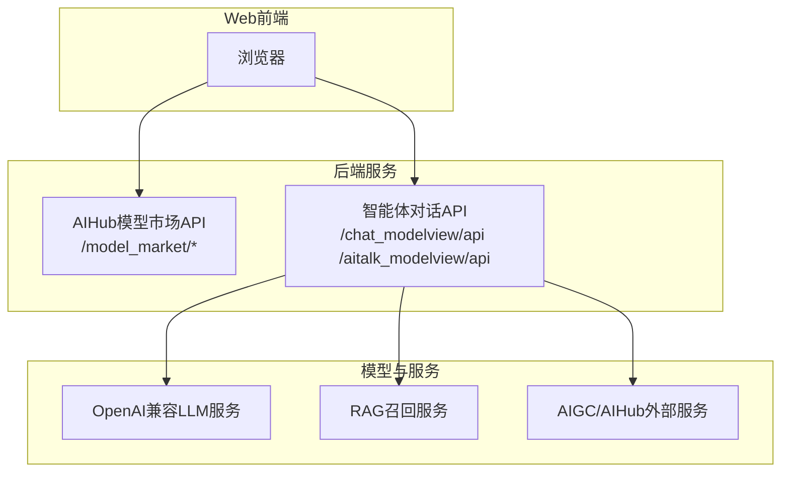
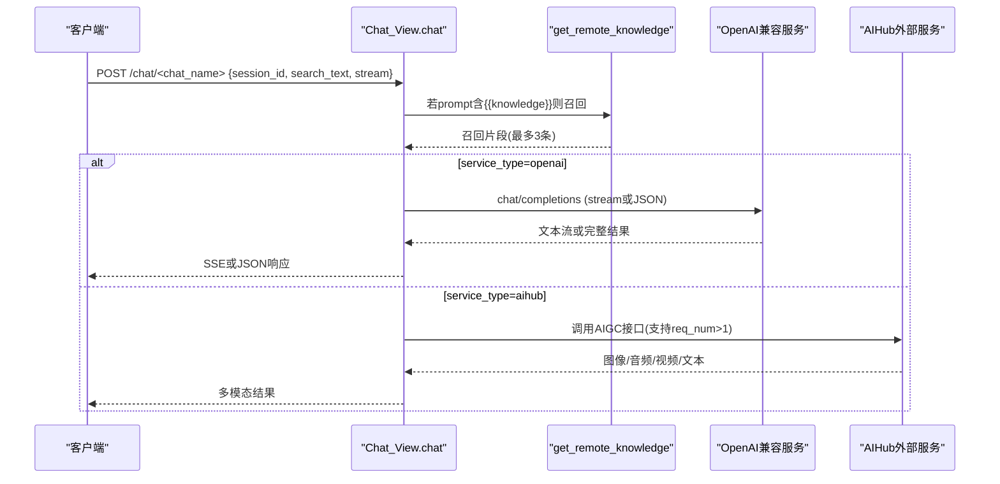
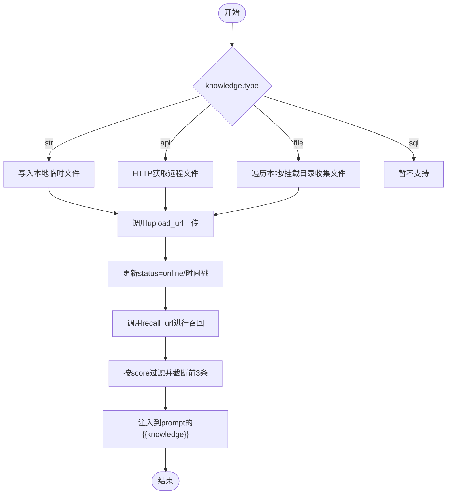
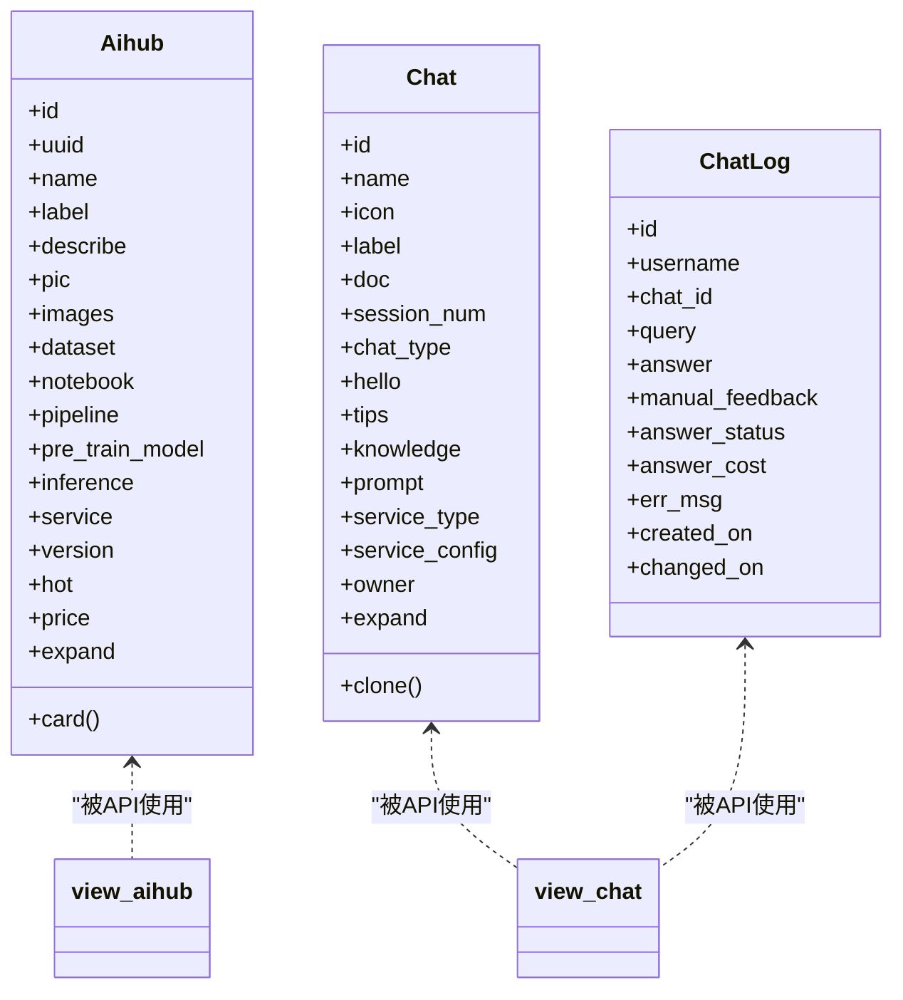

# AIHub与智能体API

<cite>
**本文引用的文件**   
- [view_aihub.py](file://myapp/views/view_aihub.py)
- [model_aihub.py](file://myapp/models/model_aihub.py)
- [view_chat.py](file://myapp/views/view_chat.py)
- [model_chat.py](file://myapp/models/model_chat.py)
</cite>

## 目录
1. [简介](#简介)
2. [项目结构](#项目结构)
3. [核心组件](#核心组件)
4. [架构总览](#架构总览)
5. [详细接口说明](#详细接口说明)
6. [依赖关系分析](#依赖关系分析)
7. [性能与并发特性](#性能与并发特性)
8. [故障排查指南](#故障排查指南)
9. [结论](#结论)

## 简介
本文件面向AIHub模型市场与智能体对话能力的REST API，覆盖以下能力：
- 模型市场浏览（视觉、听觉、自然语言、多模态、大模型）
- 预训练模型下载与在线开发/微调/部署配置入口
- 智能体对话（文本、数字人、多模态输入）、私有知识库问答（RAG检索增强生成）
- Prompt工程（模板变量注入）、流式响应、会话上下文管理
- 工具调用扩展点（通过aihub服务类型对接外部AIGC服务）
- 模型评估、效果对比与一键部署的集成入口（以配置项形式暴露）

## 项目结构
本项目在Flask AppBuilder基础上提供两类视图：
- AIHub模型市场：按领域分类的模型卡片列表与元数据展示
- 智能体对话：基于Chat配置的对话编排、RAG召回、OpenAI兼容接口转发与SSE流式输出

图表来源
- [view_aihub.py:87-167](file://myapp/views/view_aihub.py#L87-L167)
- [view_chat.py:605-937](file://myapp/views/view_chat.py#L605-L937)

章节来源
- [view_aihub.py:1-168](file://myapp/views/view_aihub.py#L1-L168)
- [view_chat.py:1-1536](file://myapp/views/view_chat.py#L1-L1536)

## 核心组件
- AIHub模型市场
  - 数据模型：Aihub（包含名称、描述、图片、镜像、数据集/Notebook/Pipeline/Inference等配置字段）
  - REST API：按领域分组的列表接口，统一返回卡片信息
- 智能体对话
  - 数据模型：Chat（智能体配置）、ChatLog（对话日志）
  - REST API：智能体CRUD、对话接口、会话清理、OpenAI兼容对话接口
  - 能力：RAG召回、Prompt模板渲染、流式响应、多模态输入、工具调用（aihub服务类型）

章节来源
- [model_aihub.py:18-87](file://myapp/models/model_aihub.py#L18-L87)
- [model_chat.py:16-72](file://myapp/models/model_chat.py#L16-L72)

## 架构总览
AIHub与智能体的整体交互流程如下：
- 模型市场：前端请求领域分类接口，后端返回模型卡片集合，包含可跳转的开发/训练/部署链接
- 智能体对话：
  - 根据service_type路由到不同处理分支：openai、aihub、图文音、召回列表、多轮
  - openai分支：构造消息、可选RAG注入、调用LLM；支持SSE流式输出
  - aihub分支：将用户输入映射为外部AIGC服务的请求参数，支持多图/视频等多模态输出
  - 知识库：支持本地文件、远程URL、SQL（预留）等多种先验知识来源，并调用recall_url进行向量召回

图表来源
- [view_chat.py:616-937](file://myapp/views/view_chat.py#L616-L937)
- [view_chat.py:1054-1118](file://myapp/views/view_chat.py#L1054-L1118)
- [view_chat.py:1295-1455](file://myapp/views/view_chat.py#L1295-L1455)

## 详细接口说明

### 一、AIHub模型市场API
- 分组列表接口
  - GET /model_market/visual/api
  - GET /model_market/voice/api
  - GET /model_market/language/api
  - GET /model_market/multimodal/api
  - GET /model_market/aigc/api
  - GET /model_market/all/api
- 行为说明
  - 返回列表数据，list_ui_type=card，用于前端卡片展示
  - 每条记录包含card字段（HTML片段），以及name、label、describe、pic、images、dataset、notebook、pipeline、pre_train_model、inference、service、version、hot、price、expand等元数据
- 使用建议
  - 前端根据field过滤显示对应领域的模型卡片
  - 点击“开发/训练/部署”按钮跳转到相应工作区（由业务侧实现）

章节来源
- [view_aihub.py:87-167](file://myapp/views/view_aihub.py#L87-L167)
- [model_aihub.py:18-87](file://myapp/models/model_aihub.py#L18-L87)

### 二、智能体对话API
- 基础CRUD
  - 智能体列表/详情/新增/编辑/删除
  - 路由前缀：/chat_modelview/api 与 /aitalk_modelview/api
  - 字段包括：name、icon、label、doc、session_num、chat_type、hello、tips、knowledge、prompt、service_type、service_config、owner、expand
- 会话清理
  - DELETE /clear/<session_id>
  - 作用：清除指定session_id的上下文缓存
- 智能体对话
  - POST /chat/<chat_name>
  - 请求体字段（示例）：
    - session_id: string，会话标识
    - request_id: string，请求标识
    - search_text: string，用户问题
    - search_audio/search_image/search_video: 可选，多模态输入
    - username: string，用户名（未传则取当前登录用户）
    - enable_tts: boolean，是否TTS转语音
    - stream: boolean，是否流式响应
    - history: boolean，是否启用历史上下文
- OpenAI兼容对话
  - POST /chat/chatgpt/<chat_name>
  - 请求体字段：session_id、request_id、search_text
  - 返回标准JSON格式结果（非流式）

章节来源
- [view_chat.py:605-614](file://myapp/views/view_chat.py#L605-L614)
- [view_chat.py:616-937](file://myapp/views/view_chat.py#L616-L937)
- [view_chat.py:1251-1283](file://myapp/views/view_chat.py#L1251-L1283)

### 三、RAG检索增强生成（私有知识库）
- 知识库配置（knowledge字段）
  - type: str|api|file|sql
  - content/url/data/file/upload_url/recall_url等
- 上传与更新
  - 当knowledge.type=file时，支持从本地路径或挂载目录收集文件，并通过upload_url异步上传至RAG服务
  - 支持定时刷新策略：超过1小时或状态非在线会触发重新上传
- 召回接口
  - 调用recall_url，传入knowledge_base_id、question、history
  - 返回result或source_documents，系统自动截取前3条并按min_score过滤
- 提示词注入
  - 当prompt包含{{knowledge}}时，系统将召回内容注入到提示词中，限制最大长度以避免超出token上限

图表来源
- [view_chat.py:940-1049](file://myapp/views/view_chat.py#L940-L1049)
- [view_chat.py:1054-1118](file://myapp/views/view_chat.py#L1054-L1118)
- [view_chat.py:1176-1224](file://myapp/views/view_chat.py#L1176-L1224)

章节来源
- [view_chat.py:177-219](file://myapp/views/view_chat.py#L177-L219)
- [view_chat.py:940-1118](file://myapp/views/view_chat.py#L940-L1118)

### 四、Prompt工程与多模态
- Prompt模板变量
  - {{query}}：用户问题
  - {{knowledge}}：RAG召回内容（若启用）
  - {{history}}：历史对话（若启用上下文）
- 多模态输入
  - search_image/search_audio/search_video：在service_type=图文音时，支持ASR、图像理解、文生图、TTS等组合流程
- 工具调用扩展
  - service_type=aihub时，将用户输入映射为外部AIGC服务的请求参数，支持req_num>1的多次调用与多种输出类型（text/markdown/image/audio/video）

章节来源
- [view_chat.py:124-140](file://myapp/views/view_chat.py#L124-L140)
- [view_chat.py:823-900](file://myapp/views/view_chat.py#L823-L900)
- [view_chat.py:812-822](file://myapp/views/view_chat.py#L812-L822)

### 五、流式响应与并发处理
- 流式响应（SSE）
  - 当stream=true且service_type=openai时，后端通过SSE逐块推送文本增量
  - 支持before/after字符串替换操作，便于对输出进行后处理
- 并发与重试
  - 对LLM调用设置max_retry=3，失败时自动重试
  - 会话上下文缓存使用cache.set存储，超时时间可控
- 多模态并行
  - 在aigc4中演示了多次调用的流式输出模式（示例占位）

章节来源
- [view_chat.py:1295-1455](file://myapp/views/view_chat.py#L1295-L1455)
- [view_chat.py:1459-1495](file://myapp/views/view_chat.py#L1459-L1495)

### 六、模型评估、效果对比与一键部署
- 模型评估与效果对比
  - 通过AIHub模型的pipeline/inference/service字段配置评估任务与评测指标（如准确率、F1、延迟等），由上层流水线驱动执行
- 一键部署
  - 通过AIHub模型的inference/service字段定义推理服务参数，结合平台的服务化能力完成快速部署
- 使用说明
  - 在模型卡片中点击“部署web”或“部署服务”，进入服务化配置页面，填写资源配额、端口、鉴权等参数后提交

章节来源
- [model_aihub.py:34-44](file://myapp/models/model_aihub.py#L34-L44)
- [view_aihub.py:61-69](file://myapp/views/view_aihub.py#L61-L69)

## 依赖关系分析
- 视图层
  - view_aihub.py：定义各领域的模型市场API类，继承自MyappModelRestApi
  - view_chat.py：定义智能体CRUD、对话、RAG、OpenAI兼容等逻辑
- 模型层
  - model_aihub.py：Aihub表结构与card属性
  - model_chat.py：Chat与ChatLog表结构
- 外部依赖
  - requests：调用LLM/RAG/AIGC服务
  - sseclient：解析SSE流
  - cache：会话上下文缓存

图表来源
- [model_aihub.py:18-87](file://myapp/models/model_aihub.py#L18-L87)
- [model_chat.py:16-72](file://myapp/models/model_chat.py#L16-L72)

章节来源
- [view_aihub.py:1-168](file://myapp/views/view_aihub.py#L1-L168)
- [view_chat.py:1-1536](file://myapp/views/view_chat.py#L1-L1536)

## 性能与并发特性
- SSE流式输出降低首字延迟，提升用户体验
- 会话上下文缓存避免重复计算，提高多轮对话效率
- 外部服务调用具备重试机制，增强鲁棒性
- 知识库上传采用异步任务队列，避免阻塞主线程

[本节为通用指导，不直接分析具体文件]

## 故障排查指南
- 认证失败（401）
  - 现象：LLM返回401，系统自动记录miss_tokens并尝试切换token
  - 处理：检查service_config中的llm_tokens配置是否正确
- 知识库未生效
  - 现象：prompt中{{knowledge}}为空
  - 处理：确认knowledge.type与upload_url/recall_url配置正确，检查status是否为online
- 流式响应中断
  - 现象：SSE连接断开
  - 处理：检查网络与代理配置，确保Accept:text/event-stream头正确

章节来源
- [view_chat.py:1393-1400](file://myapp/views/view_chat.py#L1393-L1400)
- [view_chat.py:1066-1071](file://myapp/views/view_chat.py#L1066-L1071)

## 结论
本API文档梳理了AIHub模型市场与智能体对话的核心接口与实现要点。通过统一的REST接口，用户可以：
- 浏览与选择模型，查看开发与部署配置
- 配置智能体，结合RAG与Prompt工程构建私有知识库问答
- 使用流式响应与多模态输入提升交互体验
- 借助外部AIGC服务扩展工具调用能力
- 通过配置项接入模型评估与一键部署流程

[本节为总结性内容，不直接分析具体文件]