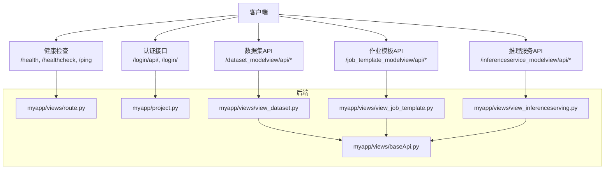
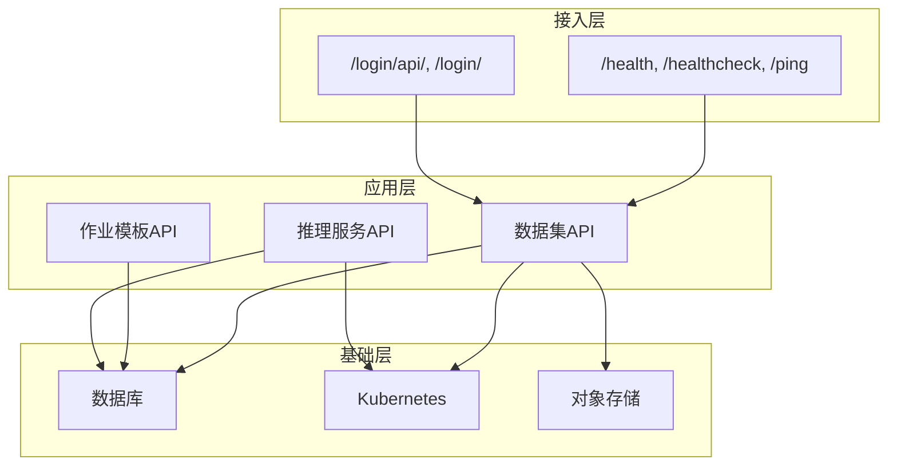
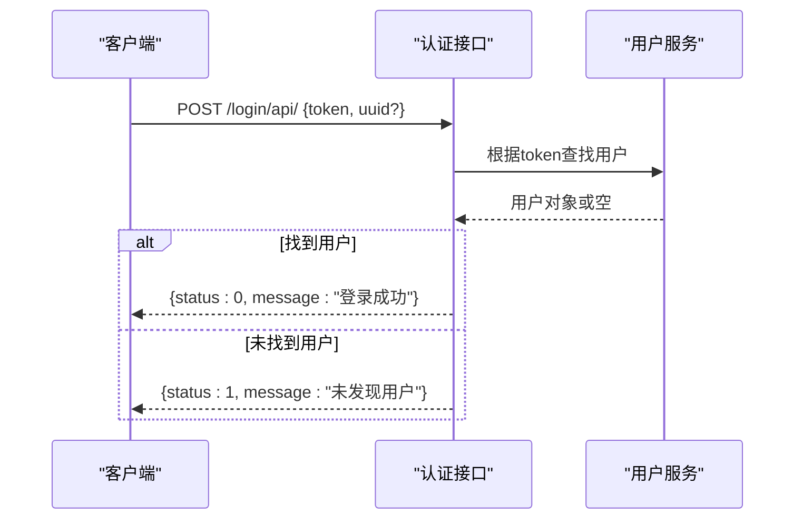
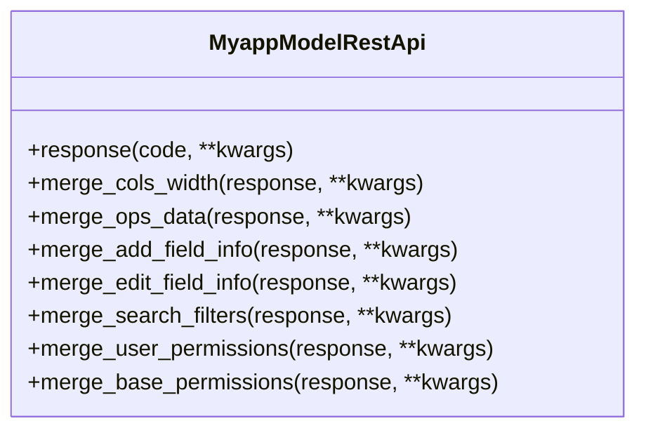
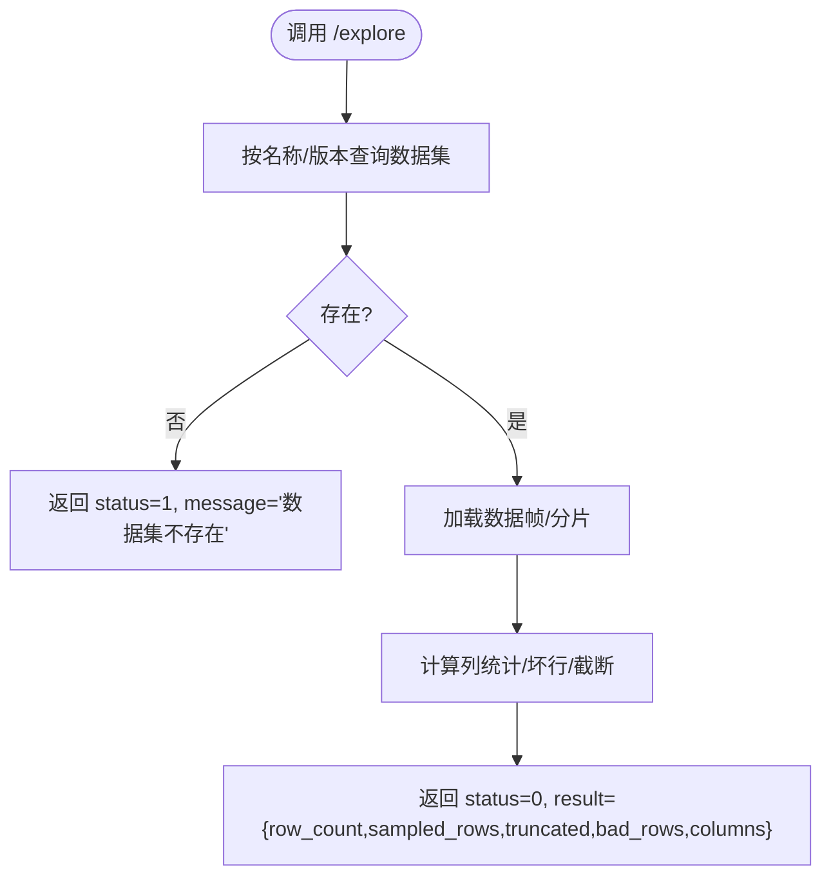
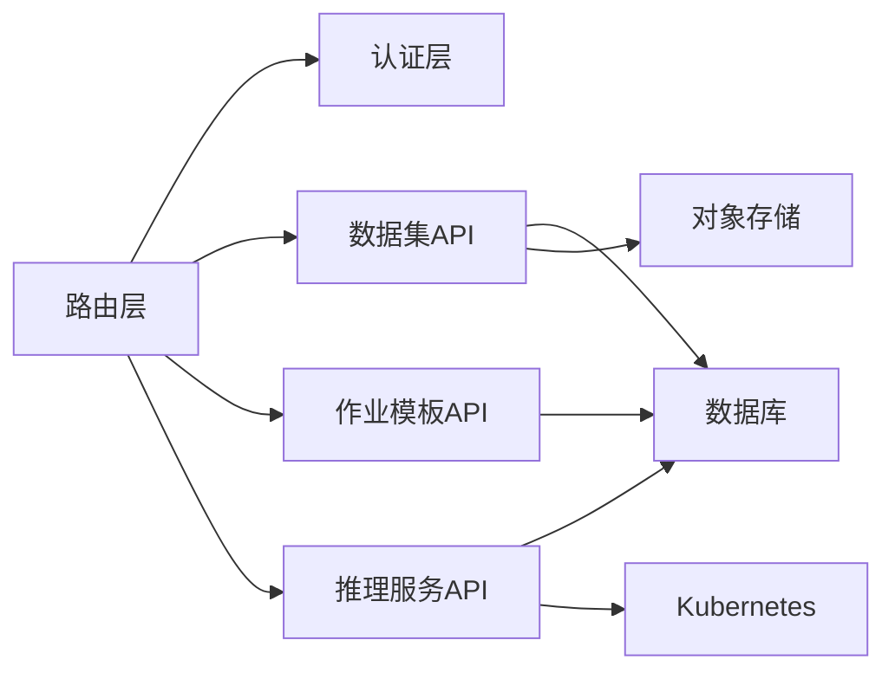

# API接口文档

<cite>
**本文引用的文件**   
- [README.md](file://README.md)
- [route.py](file://myapp/views/route.py)
- [project.py](file://myapp/project.py)
- [baseApi.py](file://myapp/views/baseApi.py)
- [view_dataset.py](file://myapp/views/view_dataset.py)
- [view_pipeline.py](file://myapp/views/view_pipeline.py)
- [view_job_template.py](file://myapp/views/view_job_template.py)
- [view_inferenceserving.py](file://myapp/views/view_inferenceserving.py)
</cite>

## 目录
1. [简介](#简介)
2. [项目结构](#项目结构)
3. [核心组件](#核心组件)
4. [架构总览](#架构总览)
5. [详细组件分析](#详细组件分析)
6. [依赖关系分析](#依赖关系分析)
7. [性能与限流](#性能与限流)
8. [故障排查指南](#故障排查指南)
9. [结论](#结论)
10. [附录：公共API参考](#附录公共api参考)

## 简介
本文件为 CubeStudio 平台的 RESTful API 参考文档，聚焦后端暴露的公共接口、请求/响应格式、认证授权机制、版本管理、限流策略与安全措施。平台基于 Flask + Flask-AppBuilder 构建，提供统一的模型REST基类与视图扩展，覆盖数据集、任务模板、推理服务、流水线等核心能力。

## 项目结构
- 路由与健康检查：统一健康探针与轻量探测端点
- 认证入口：账号密码登录与Token登录
- 通用API框架：统一的CRUD基类、字段信息、权限控制、错误处理
- 业务API：数据集探索与标注集成、流水线编排、作业模板、推理服务

图表来源
- [route.py:6-18](file://myapp/views/route.py#L6-L18)
- [project.py:42-181](file://myapp/project.py#L42-L181)
- [baseApi.py:242-800](file://myapp/views/baseApi.py#L242-L800)
- [view_dataset.py:480-598](file://myapp/views/view_dataset.py#L480-L598)
- [view_job_template.py:326-358](file://myapp/views/view_job_template.py#L326-L358)
- [view_inferenceserving.py:1333-1358](file://myapp/views/view_inferenceserving.py#L1333-L1358)

章节来源
- [README.md:18-163](file://README.md#L18-L163)

## 核心组件
- 健康检查与探测
  - GET /health
  - GET /healthcheck
  - GET /ping
- 认证接口
  - POST /login/api/（支持查询参数与JSON体）
  - GET/POST /login/（表单登录）
- 通用API框架
  - 统一响应结构：{message, status, result}
  - 统一字段元数据、权限、分页、过滤、排序、列宽、操作按钮等
- 数据集API
  - 探索数据集统计
  - 推送至标注平台
  - 从标注平台回存
- 作业模板API
  - 标准CRUD（由基类提供）
- 推理服务API
  - 标准CRUD（由基类提供），并动态填充默认配置

章节来源
- [route.py:6-18](file://myapp/views/route.py#L6-L18)
- [project.py:42-181](file://myapp/project.py#L42-L181)
- [baseApi.py:242-800](file://myapp/views/baseApi.py#L242-L800)
- [view_dataset.py:480-598](file://myapp/views/view_dataset.py#L480-L598)
- [view_job_template.py:326-358](file://myapp/views/view_job_template.py#L326-L358)
- [view_inferenceserving.py:1333-1358](file://myapp/views/view_inferenceserving.py#L1333-L1358)

## 架构总览
平台采用分层架构：
- 接入层：Flask路由与健康检查
- 安全层：认证与权限（FAB）
- 应用层：各业务模块API（数据集、流水线、作业模板、推理服务等）
- 基础设施层：数据库、Kubernetes、对象存储、消息队列等

图表来源
- [route.py:6-18](file://myapp/views/route.py#L6-L18)
- [project.py:42-181](file://myapp/project.py#L42-L181)
- [view_dataset.py:480-598](file://myapp/views/view_dataset.py#L480-L598)
- [view_job_template.py:326-358](file://myapp/views/view_job_template.py#L326-L358)
- [view_inferenceserving.py:1333-1358](file://myapp/views/view_inferenceserving.py#L1333-L1358)

## 详细组件分析

### 健康检查与探测
- 方法：GET
- URL：/health, /healthcheck, /ping
- 返回：纯文本“OK”
- 用途：存活探针、就绪探针、快速可达性检测

章节来源
- [route.py:6-18](file://myapp/views/route.py#L6-L18)

### 认证接口

#### Token登录
- 方法：GET/POST
- URL：/login/api/
- 参数
  - token：用户令牌（查询参数或JSON体）
  - uuid：可选的组织标识
- 成功响应示例
  - {status: 0, message: "登录成功", result: {}}
- 失败响应示例
  - {status: 1, message: "未发现用户", result: {}}

图表来源
- [project.py:45-72](file://myapp/project.py#L45-L72)

章节来源
- [project.py:42-181](file://myapp/project.py#L42-L181)

#### 表单登录
- 方法：GET/POST
- URL：/login/
- 行为：用户名/邮箱+密码校验；支持自动注册（可配置）；登录后重定向到首页或指定URL

章节来源
- [project.py:74-181](file://myapp/project.py#L74-L181)

### 通用API框架（MyappModelRestApi）
- 统一响应结构：{message, status, result}
- 统一字段元数据：add/edit/show/list/search字段、UI类型、校验器、选择项、帮助链接等
- 权限控制：全局与单条记录级权限
- 分页与过滤：Rison/JSON查询参数、过滤器定义
- 列宽与固定列：列表展示优化
- 导入导出：批量导入与下载开关
- 收藏与图表：enable_favorite、enable_echart
- 钩子函数：pre/post add/update/list/delete/web钩子，便于扩展

图表来源
- [baseApi.py:242-800](file://myapp/views/baseApi.py#L242-L800)

章节来源
- [baseApi.py:242-800](file://myapp/views/baseApi.py#L242-L800)

### 数据集API
- 基础路径：/dataset_modelview/api
- 关键接口
  - 探索数据集统计
    - URL：/explore/<dataset_name>/<dataset_version>[/<dataset_segment>]
    - 方法：GET/POST
    - 说明：返回行数、采样行数、截断标志、坏行、列统计
  - 推送至标注平台
    - URL：/push_to_labelstudio/<dataset_id>
    - 方法：POST
    - 参数：ls_token, task_type(text_classification/image_classification), ls_url, label_config, text_col/image_col
  - 从标注平台回存
    - URL：/import_from_labelstudio
    - 方法：POST
    - 参数：ls_token, ls_project_id, dataset_name, dataset_version

图表来源
- [view_dataset.py:484-505](file://myapp/views/view_dataset.py#L484-L505)

章节来源
- [view_dataset.py:480-598](file://myapp/views/view_dataset.py#L480-L598)

### 作业模板API
- 基础路径：/job_template_modelview/api
- 能力：标准CRUD（由基类提供），包含字段元数据、权限、分页、过滤、排序、列宽、操作按钮等
- 字段范围：project, images, name, version, describe, workdir, entrypoint, volume_mount, args, env, host_aliases, privileged, accounts, expand

章节来源
- [view_job_template.py:326-358](file://myapp/views/view_job_template.py#L326-L358)

### 推理服务API
- 基础路径：/inferenceservice_modelview/api
- 能力：标准CRUD（由基类提供），并在编辑时动态注入默认镜像、命令、端口、环境变量、健康检查等

章节来源
- [view_inferenceserving.py:1333-1358](file://myapp/views/view_inferenceserving.py#L1333-L1358)

### 流水线与任务（概览）
- 流水线将DAG转换为Argo Workflow YAML，支持并行度、TTL、归档日志、镜像拉取密钥、优先级注入等
- 任务渲染支持全局环境变量、模板变量替换、跳过节点、依赖关系等

章节来源
- [view_pipeline.py:80-127](file://myapp/views/view_pipeline.py#L80-L127)
- [view_pipeline.py:132-200](file://myapp/views/view_pipeline.py#L132-L200)

## 依赖关系分析
- 路由层
  - health/ping 直接返回字符串，无外部依赖
- 认证层
  - 依赖用户服务（FAB）进行用户查找与会话建立
- 业务API层
  - 数据集API依赖数据库会话、对象存储路径解析、数据读取与统计分析
  - 作业模板/推理服务API依赖SQLAlchemy模型与FAB权限体系
- 基础设施层
  - Kubernetes（流水线生成Workflow）、对象存储（数据集/模型文件）、数据库（元数据）

图表来源
- [route.py:6-18](file://myapp/views/route.py#L6-L18)
- [project.py:42-181](file://myapp/project.py#L42-L181)
- [view_dataset.py:480-598](file://myapp/views/view_dataset.py#L480-L598)
- [view_job_template.py:326-358](file://myapp/views/view_job_template.py#L326-L358)
- [view_inferenceserving.py:1333-1358](file://myapp/views/view_inferenceserving.py#L1333-L1358)

## 性能与限流
- 分页与列宽
  - 默认page_size=100，可通过基类属性调整
  - 自动列宽估算与固定列优化，提升列表渲染性能
- 大文件传输
  - 提供流式发送方法，避免一次性加载大文件到内存
- 限流策略
  - 代码库中未见内置限流实现；建议在网关/反向代理层实施限流与熔断
- 缓存
  - 引入缓存组件，可在业务层按需使用以提升热点数据访问性能

章节来源
- [baseApi.py:242-800](file://myapp/views/baseApi.py#L242-L800)

## 故障排查指南
- 统一错误响应
  - 所有异常被捕获后返回HTTP状态码与结构化错误消息
  - 堆栈仅在开启FAB_API_SHOW_STACKTRACE时返回
- 常见错误
  - 400：参数校验失败、Rison/JSON解析失败
  - 404：资源不存在
  - 500：服务端异常（含可选堆栈）
- 调试建议
  - 启用FAB_API_SHOW_STACKTRACE查看详细堆栈
  - 通过/api_flashes头获取前端flash消息集合
  - 检查权限配置与用户角色是否具备相应操作权限

章节来源
- [baseApi.py:99-115](file://myapp/views/baseApi.py#L99-L115)
- [baseApi.py:379-407](file://myapp/views/baseApi.py#L379-L407)

## 结论
CubeStudio 提供了统一的REST API框架与丰富的业务接口，涵盖数据集、作业模板、推理服务与流水线编排。通过统一的响应结构、字段元数据、权限控制与错误处理，开发者可以快速对接平台能力。建议在网关层补充限流、鉴权与审计，以满足生产环境的安全与稳定性要求。

## 附录：公共API参考

### 健康检查
- GET /health
- GET /healthcheck
- GET /ping
- 响应：纯文本“OK”

章节来源
- [route.py:6-18](file://myapp/views/route.py#L6-L18)

### 认证接口

#### Token登录
- POST /login/api/
- 参数
  - token：必填
  - uuid：可选
- 成功响应
  - {status: 0, message: "登录成功", result: {}}
- 失败响应
  - {status: 1, message: "未发现用户", result: {}}

章节来源
- [project.py:45-72](file://myapp/project.py#L45-L72)

#### 表单登录
- GET/POST /login/
- 行为：用户名/邮箱+密码校验；支持自动注册；登录后重定向

章节来源
- [project.py:74-181](file://myapp/project.py#L74-L181)

### 数据集API

#### 探索数据集统计
- URL：/dataset_modelview/api/explore/<dataset_name>/<dataset_version>[/<dataset_segment>]
- 方法：GET/POST
- 成功响应
  - {status: 0, message: "success", result: {row_count, sampled_rows, truncated, bad_rows, columns}}
- 失败响应
  - {status: 1, message: "数据集不存在"} 或读取异常信息

章节来源
- [view_dataset.py:484-505](file://myapp/views/view_dataset.py#L484-L505)

#### 推送至标注平台
- URL：/dataset_modelview/api/push_to_labelstudio/<dataset_id>
- 方法：POST
- 参数
  - ls_token：可选（优先使用请求参数，否则使用配置）
  - task_type：text_classification 或 image_classification
  - ls_url：可选
  - label_config：可选
  - text_col/image_col：根据task_type选择
- 成功响应
  - {status: 0, message: "success", result: {project_id, pushed}}
- 失败响应
  - {status: 1, message: "错误原因"}

章节来源
- [view_dataset.py:529-557](file://myapp/views/view_dataset.py#L529-L557)

#### 从标注平台回存
- URL：/dataset_modelview/api/import_from_labelstudio
- 方法：POST
- 参数
  - ls_token：可选
  - ls_project_id：必填
  - dataset_name：必填
  - dataset_version：必填
- 成功响应
  - {status: 0, message: "success", result: {file, record_count}}
- 失败响应
  - {status: 1, message: "错误原因"}

章节来源
- [view_dataset.py:558-595](file://myapp/views/view_dataset.py#L558-L595)

### 作业模板API
- 基础路径：/job_template_modelview/api
- 能力：标准CRUD（由基类提供）
- 字段范围：project, images, name, version, describe, workdir, entrypoint, volume_mount, args, env, host_aliases, privileged, accounts, expand

章节来源
- [view_job_template.py:326-358](file://myapp/views/view_job_template.py#L326-L358)

### 推理服务API
- 基础路径：/inferenceservice_modelview/api
- 能力：标准CRUD（由基类提供），编辑时动态注入默认镜像、命令、端口、环境变量、健康检查等

章节来源
- [view_inferenceserving.py:1333-1358](file://myapp/views/view_inferenceserving.py#L1333-L1358)

### 通用API规范

#### 统一响应结构
- 字段
  - message：字符串消息
  - status：数字状态码（0表示成功）
  - result：业务数据对象

章节来源
- [baseApi.py:227-234](file://myapp/views/baseApi.py#L227-L234)
- [baseApi.py:379-407](file://myapp/views/baseApi.py#L379-L407)

#### 字段元数据与权限
- 字段元数据：type、label、description、default、validators、choices、widget、ui-type等
- 权限：base_permissions、user_permissions
- 其他：ops_link、help_url、enable_favorite、enable_echart、page_size、cols_width、fixed_columns

章节来源
- [baseApi.py:444-800](file://myapp/views/baseApi.py#L444-L800)

#### 错误处理
- 捕获BadRequest与通用异常，返回400/500
- 可选返回堆栈信息（FAB_API_SHOW_STACKTRACE）

章节来源
- [baseApi.py:99-115](file://myapp/views/baseApi.py#L99-L115)

### API版本管理与命名约定
- 当前API以路由前缀区分功能域（如 /dataset_modelview/api、/job_template_modelview/api、/inferenceservice_modelview/api）
- 建议未来在路由前缀中加入版本号（如 /v1/...）以实现向后兼容

[本节为概念性说明，不直接分析具体文件]

### 限流策略与安全措施
- 限流
  - 代码库未内置限流；建议在网关/反向代理层实施
- 安全
  - 认证：Token登录与表单登录
  - 权限：RBAC与菜单/接口访问控制
  - 输入校验：Rison/JSON校验与Marshmallow Schema
  - 敏感信息：日志脱敏与错误堆栈可控输出

章节来源
- [project.py:42-181](file://myapp/project.py#L42-L181)
- [baseApi.py:99-115](file://myapp/views/baseApi.py#L99-L115)
- [baseApi.py:118-179](file://myapp/views/baseApi.py#L118-L179)