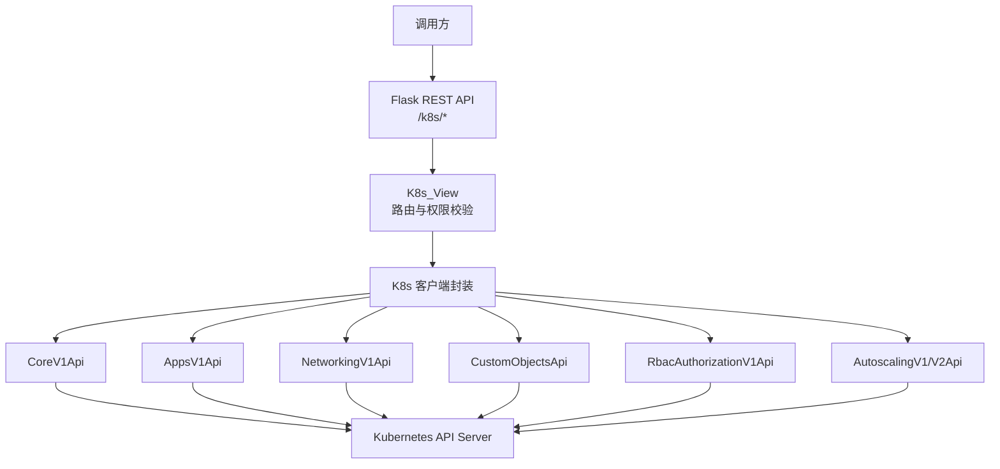
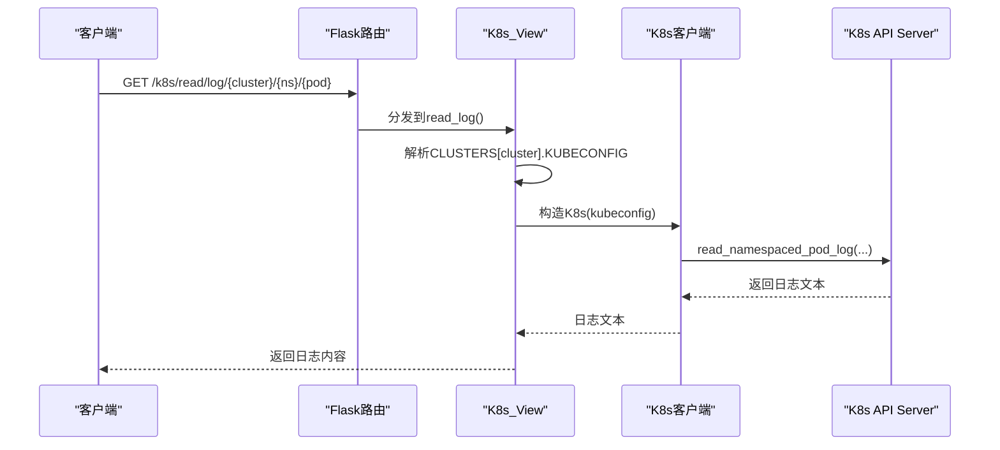
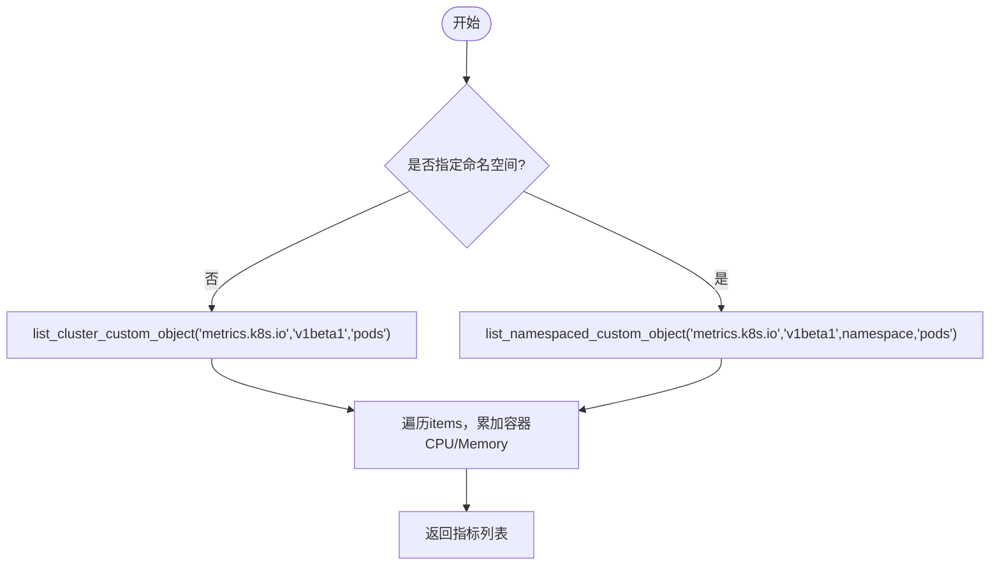
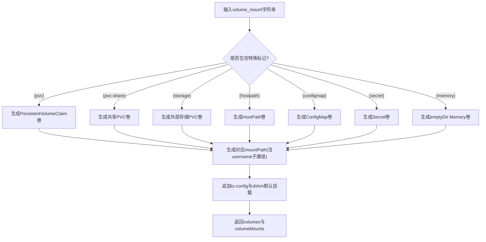
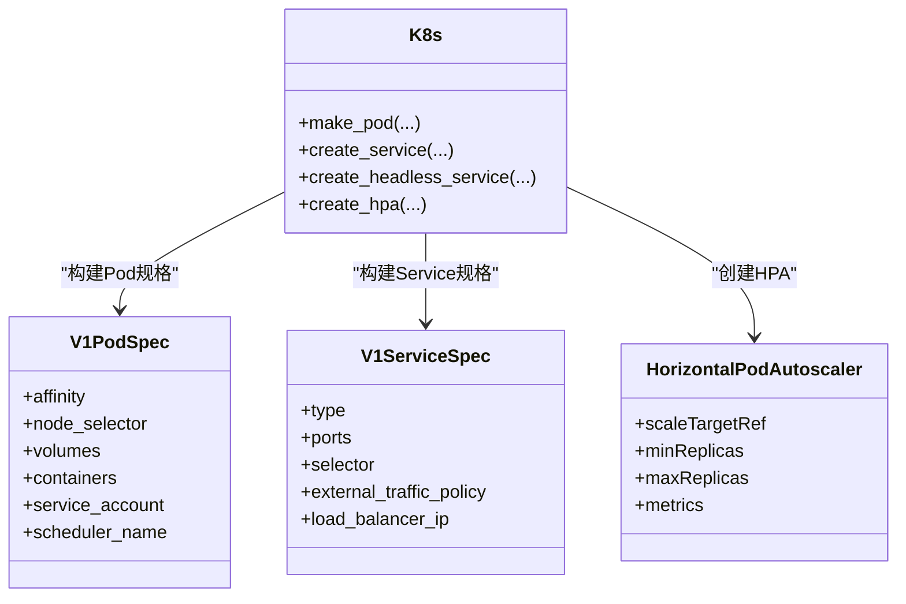
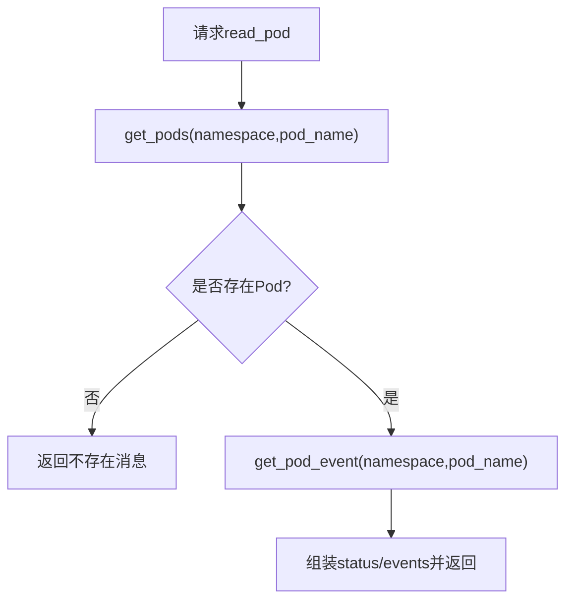
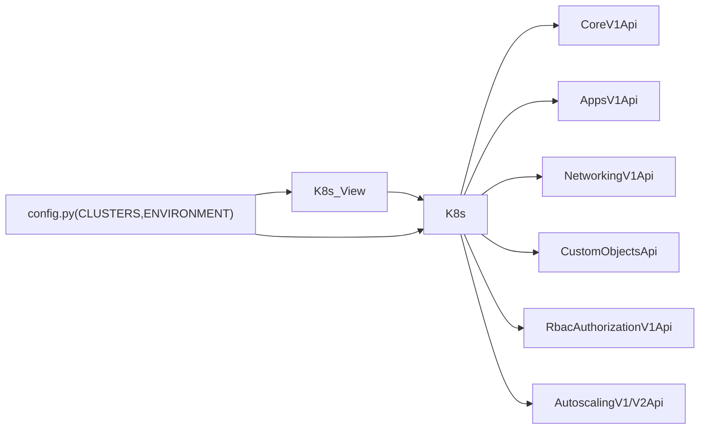

# Kubernetes集群管理API

<cite>
**本文引用的文件**   
- [view_k8s.py](file://myapp/views/view_k8s.py)
- [py_k8s.py](file://myapp/utils/py/py_k8s.py)
- [config.py](file://install/kubernetes/cube/overlays/config/config.py)
</cite>

## 目录
1. [简介](#简介)
2. [项目结构](#项目结构)
3. [核心组件](#核心组件)
4. [架构总览](#架构总览)
5. [详细组件分析](#详细组件分析)
6. [依赖关系分析](#依赖关系分析)
7. [性能与可扩展性](#性能与可扩展性)
8. [故障诊断与排错](#故障诊断与排错)
9. [结论](#结论)
10. [附录：REST接口清单](#附录rest接口清单)

## 简介
本文件面向Kubernetes集群管理的API文档，覆盖以下能力：
- 集群连接配置（多集群、命名空间隔离）
- 资源监控（节点/Pod指标采集）
- 节点管理（查询、打标、事件）
- 存储卷操作（PVC读取、PV/PVC创建、VolumeMount生成）
- Pod调度与服务发现（调度器选择、亲和/反亲和、Service/Headless Service、Istio VirtualService）
- 负载均衡（HPA、外部流量策略、LoadBalancer IP）
- 集群健康检查（Pod状态、事件聚合、Terminating Pod检测）
- 性能指标收集（metrics.k8s.io）
- 故障诊断（日志流式获取、命令执行、事件查看）
- 多集群管理（CLUSTERS配置、按集群名路由）
- 资源配额控制（HPA、默认资源限制注入）
- CRD操作（通用CRD增删查、特定CRD如Istio/Volcano等）
- Helm Chart部署（说明与建议）
- 自定义资源管理（CustomObjectsApi封装）

## 项目结构
本项目通过Flask视图暴露REST接口，底层使用kubernetes Python客户端对K8s API进行访问。关键文件职责如下：
- myapp/views/view_k8s.py：REST API路由与权限校验、模板渲染、Dashboard跳转
- myapp/utils/py/py_k8s.py：K8s客户端封装，包含Pod/Node/Service/Deployment/StatefulSet/HPA/Istio/Volcano/ConfigMap/Secret/PVC/Namespace/RBAC/指标采集等方法
- install/kubernetes/cube/overlays/config/config.py：多集群配置（CLUSTERS、ENVIRONMENT、HOST等）

图表来源
- [view_k8s.py:32-581](file://myapp/views/view_k8s.py#L32-L581)
- [py_k8s.py:21-69](file://myapp/utils/py/py_k8s.py#L21-L69)

章节来源
- [view_k8s.py:32-581](file://myapp/views/view_k8s.py#L32-L581)
- [py_k8s.py:21-69](file://myapp/utils/py/py_k8s.py#L21-L69)

## 核心组件
- K8s_View（Flask视图）
  - 提供日志查看/下载、Pod详情、删除Pod、Web调试入口、搜索Pod/Service、Terminating Pod列表等REST端点
  - 基于用户权限控制（管理员或Pod创建者）
- K8s（K8s客户端封装）
  - 初始化ApiClient并加载kubeconfig或in-cluster配置
  - 提供丰富的K8s对象操作方法：Pod/Node/Service/Deployment/StatefulSet/HPA/Istio/Volcano/ConfigMap/Secret/PVC/Namespace/RBAC/指标采集/日志流/终端会话等

章节来源
- [view_k8s.py:32-581](file://myapp/views/view_k8s.py#L32-L581)
- [py_k8s.py:21-69](file://myapp/utils/py/py_k8s.py#L21-L69)

## 架构总览
下图展示从HTTP请求到K8s API的完整流程，包括多集群配置解析、权限校验、以及具体K8s对象的读写。

图表来源
- [view_k8s.py:187-216](file://myapp/views/view_k8s.py#L187-L216)
- [py_k8s.py:2072-2084](file://myapp/utils/py/py_k8s.py#L2072-L2084)

## 详细组件分析

### 集群连接配置（多集群与命名空间隔离）
- 多集群配置
  - CLUSTERS字典中每个集群项包含KUBECONFIG路径与可选HOST
  - ENVIRONMENT决定默认集群；当未显式传入kubeconfig时，优先使用ENVIRONMENT对应的KUBECONFIG
  - 若环境变量KUBECONFIG存在且有效，则使用该文件
- 命名空间隔离
  - 所有API均支持namespace参数，结合RBAC与ServiceAccount实现细粒度权限控制
  - 提供create_namespace、delete_namespace_sa_rbac、create_workspace_pv_pvc等工具方法

章节来源
- [py_k8s.py:23-43](file://myapp/utils/py/py_k8s.py#L23-L43)
- [config.py:844-856](file://install/kubernetes/cube/overlays/config/config.py#L844-L856)

### 资源监控（节点与Pod指标）
- 节点指标
  - get_node_metrics：通过metrics.k8s.io/v1beta1.nodes采集CPU/Memory/Window时间窗口
- Pod指标
  - get_pod_metrics：支持全集群或指定命名空间的Pod指标聚合（容器级CPU/Memory求和）

图表来源
- [py_k8s.py:1995-2021](file://myapp/utils/py/py_k8s.py#L1995-L2021)

章节来源
- [py_k8s.py:1980-1993](file://myapp/utils/py/py_k8s.py#L1980-L1993)
- [py_k8s.py:1995-2021](file://myapp/utils/py/py_k8s.py#L1995-L2021)

### 节点管理
- 查询节点
  - get_node：支持label/name/ip过滤，缓存all_nodes并按需异步刷新
- 节点事件
  - get_node_event：根据节点IP筛选事件，格式化时间戳
- 节点打标
  - label_node：根据内部IP批量patch node labels

章节来源
- [py_k8s.py:395-467](file://myapp/utils/py/py_k8s.py#L395-L467)
- [py_k8s.py:469-497](file://myapp/utils/py/py_k8s.py#L469-L497)

### 存储卷操作
- PVC读取
  - get_pvc：返回PVC状态（Phase）
- PV/PVC创建
  - create_workspace_pv_pvc：为命名空间创建固定大小的PV与PVC（示例为500Gi RWX）
- VolumeMount生成
  - get_volume_mounts：支持(pvc)/(pvc-share)/(storage)/(hostpath)/(configmap)/(secret)/(memory)等多种挂载类型，自动处理去重与时区/共享内存挂载

图表来源
- [py_k8s.py:848-1011](file://myapp/utils/py/py_k8s.py#L848-L1011)

章节来源
- [py_k8s.py:2166-2181](file://myapp/utils/py/py_k8s.py#L2166-L2181)
- [py_k8s.py:2200-2255](file://myapp/utils/py/py_k8s.py#L2200-L2255)
- [py_k8s.py:848-1011](file://myapp/utils/py/py_k8s.py#L848-L1011)

### Pod调度与服务发现
- 调度
  - make_pod：支持scheduler_name（default-scheduler/kube-batch/volcano）、nodeSelector、affinity/anti-affinity、GPU独占聚集策略
- 服务发现
  - create_service：支持ClusterIP/NodePort/LoadBalancer，external_traffic_policy、load_balancer_ip
  - create_headless_service：无ClusterIP的服务，用于StatefulSet稳定网络标识
- 负载均衡
  - create_hpa：支持CPU/Memory/GPU阈值触发扩缩容（autoscaling/v2）

图表来源
- [py_k8s.py:1136-1224](file://myapp/utils/py/py_k8s.py#L1136-L1224)
- [py_k8s.py:1546-1598](file://myapp/utils/py/py_k8s.py#L1546-L1598)
- [py_k8s.py:1860-1957](file://myapp/utils/py/py_k8s.py#L1860-L1957)

章节来源
- [py_k8s.py:1136-1224](file://myapp/utils/py/py_k8s.py#L1136-L1224)
- [py_k8s.py:1546-1598](file://myapp/utils/py/py_k8s.py#L1546-L1598)
- [py_k8s.py:1860-1957](file://myapp/utils/py/py_k8s.py#L1860-L1957)

### 集群健康检查
- Pod状态与事件
  - read_pod：返回Pod基本信息与事件列表
  - read_terminating_pod：聚合Warning事件FailedKillPod，识别长时间无法终止的Pod
- 健康探针
  - make_container：支持HTTP或shell探针，自动注入端口或命令

图表来源
- [view_k8s.py:218-249](file://myapp/views/view_k8s.py#L218-L249)
- [py_k8s.py:269-276](file://myapp/utils/py/py_k8s.py#L269-L276)

章节来源
- [view_k8s.py:218-249](file://myapp/views/view_k8s.py#L218-L249)
- [view_k8s.py:251-303](file://myapp/views/view_k8s.py#L251-L303)
- [py_k8s.py:1097-1129](file://myapp/utils/py/py_k8s.py#L1097-L1129)

### 性能指标收集
- 节点指标：get_node_metrics
- Pod指标：get_pod_metrics（支持按命名空间过滤）

章节来源
- [py_k8s.py:1980-1993](file://myapp/utils/py/py_k8s.py#L1980-L1993)
- [py_k8s.py:1995-2021](file://myapp/utils/py/py_k8s.py#L1995-L2021)

### 故障诊断
- 日志
  - download_pod_log：支持tail_lines/since_seconds/since_time
  - get_pod_log_stream：流式读取日志
- 命令执行
  - exec_command：在Pod内执行命令
  - terminal_start：交互式TTY会话（配合前端WebSocket）

章节来源
- [py_k8s.py:2043-2084](file://myapp/utils/py/py_k8s.py#L2043-L2084)
- [py_k8s.py:2024-2040](file://myapp/utils/py/py_k8s.py#L2024-L2040)
- [py_k8s.py:2145-2165](file://myapp/utils/py/py_k8s.py#L2145-L2165)

### 多集群管理
- CLUSTERS配置
  - 每个集群项包含KUBECONFIG与可选HOST
  - 视图层根据cluster_name动态选择kubeconfig
- 默认集群
  - ENVIRONMENT决定默认集群名称，未传kubeconfig时使用ENVIRONMENT对应的KUBECONFIG

章节来源
- [config.py:844-856](file://install/kubernetes/cube/overlays/config/config.py#L844-L856)
- [view_k8s.py:39-46](file://myapp/views/view_k8s.py#L39-L46)
- [py_k8s.py:23-43](file://myapp/utils/py/py_k8s.py#L23-L43)

### 资源配额控制
- HPA
  - create_hpa/delete_hpa：支持CPU/Memory/GPU阈值，最小/最大副本数
- 默认资源注入
  - DEFAULT_POD_RESOURCES：为未声明的资源设置默认requests/limits

章节来源
- [py_k8s.py:1860-1957](file://myapp/utils/py/py_k8s.py#L1860-L1957)
- [py_k8s.py:1069-1074](file://myapp/utils/py/py_k8s.py#L1069-L1074)

### CRD操作与自定义资源管理
- 通用CRD
  - get_crd/get_one_crd/get_crd_all_namespaces/delete_crd：按group/version/plural/namespace/name/labels操作
  - get_crd_status：统一解析不同CRD的status结构（workflows/notebooks/inferenceservices/jobs等）
- Istio VirtualService
  - create_istio_ingress/delete_istio_ingress：支持canary分流与shadow镜像流量
- Volcano Job
  - delete_volcano：删除Volcano Job CRD

章节来源
- [py_k8s.py:499-677](file://myapp/utils/py/py_k8s.py#L499-L677)
- [py_k8s.py:1617-1800](file://myapp/utils/py/py_k8s.py#L1617-L1800)
- [py_k8s.py:1802-1816](file://myapp/utils/py/py_k8s.py#L1802-L1816)

### Helm Chart部署
- 本项目未直接提供Helm Chart部署的REST接口
- 建议通过CI/CD或运维脚本调用helm CLI完成Chart安装与升级，并在K8s中管理Release资源

[本节为概念性说明，不直接分析具体代码文件]

## 依赖关系分析
- Flask视图依赖K8s客户端封装
- K8s客户端封装依赖kubernetes Python客户端与各API组（CoreV1、AppsV1、NetworkingV1、CustomObjects、RBAC、Autoscaling）
- 多集群配置由config.py提供，视图层与客户端层共同消费

图表来源
- [view_k8s.py:32-581](file://myapp/views/view_k8s.py#L32-L581)
- [py_k8s.py:21-69](file://myapp/utils/py/py_k8s.py#L21-L69)
- [config.py:844-856](file://install/kubernetes/cube/overlays/config/config.py#L844-L856)

章节来源
- [view_k8s.py:32-581](file://myapp/views/view_k8s.py#L32-L581)
- [py_k8s.py:21-69](file://myapp/utils/py/py_k8s.py#L21-L69)
- [config.py:844-856](file://install/kubernetes/cube/overlays/config/config.py#L844-L856)

## 性能与可扩展性
- 缓存机制
  - all_pods/all_nodes缓存键按namespace与cluster_name区分，避免频繁API调用
  - 异步任务触发缓存更新（get_k8s_resource.apply_async）
- 并发与批处理
  - get_crd_all_namespaces支持进程池并行拉取跨命名空间CRD
- 指标采集优化
  - metrics.k8s.io聚合容器级指标并求和，减少上层计算开销

章节来源
- [py_k8s.py:204-267](file://myapp/utils/py/py_k8s.py#L204-L267)
- [py_k8s.py:337-393](file://myapp/utils/py/py_k8s.py#L337-L393)
- [py_k8s.py:616-640](file://myapp/utils/py/py_k8s.py#L616-L640)

## 故障诊断与排错
- Terminating Pod检测
  - 聚合Warning事件FailedKillPod，结合Pod列表识别卡住的Pod
- 日志与事件
  - 提供日志下载/流式读取与Pod事件查询
- 权限问题
  - 视图层对用户权限进行校验（管理员或Pod创建者），否则拒绝访问

章节来源
- [view_k8s.py:251-303](file://myapp/views/view_k8s.py#L251-L303)
- [view_k8s.py:187-216](file://myapp/views/view_k8s.py#L187-L216)
- [py_k8s.py:269-276](file://myapp/utils/py/py_k8s.py#L269-L276)

## 结论
该仓库提供了完善的Kubernetes集群管理API，涵盖多集群连接、资源监控、节点管理、存储卷操作、Pod调度、服务发现、负载均衡、健康检查、指标采集与故障诊断。同时支持CRD操作与自定义资源管理，便于扩展至更多工作负载类型。建议在运维侧结合CI/CD完成Helm Chart部署，并通过RBAC与命名空间隔离保障多租户安全。

[本节为总结性说明，不直接分析具体代码文件]

## 附录：REST接口清单
以下为K8s_View暴露的主要REST接口（仅列出路径与方法，不包含请求体与响应体细节）：
- GET /k8s/watch/log/{cluster_name}/{namespace}/{pod_name}/{container_name}
- GET /k8s/download/log/{cluster_name}/{namespace}/{pod_name}
- GET /k8s/read/log/{cluster_name}/{namespace}/{pod_name}[/{container}[/{tail}]]
- GET /k8s/read/pod/{cluster_name}/{namespace}/{pod_name}
- GET /k8s/read/pod/terminating[/namespace]
- GET/POST /k8s/web/delete/pod/{cluster_name}/{namespace}/{pod_name}
- GET /k8s/web/log/{cluster_name}/{namespace}/{pod_name}[/{container_name}]
- GET/POST /k8s/web/debug/{cluster_name}/{namespace}/{pod_name}[/{container_name}]
- GET/POST /k8s/web/pod/{cluster_name}/{namespace}/{pod_name}
- GET /k8s/web/search/{cluster_name}/{namespace}/{search}
- GET /k8s/web1/search/{cluster_name}/{namespace}/{search}

章节来源
- [view_k8s.py:32-581](file://myapp/views/view_k8s.py#L32-L581)