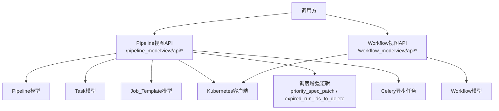
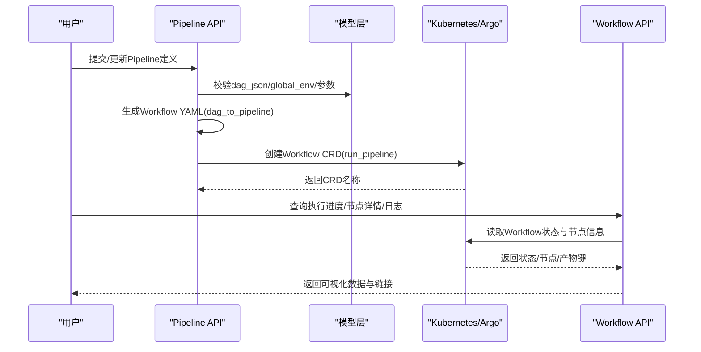
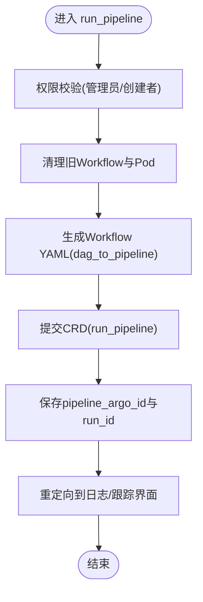
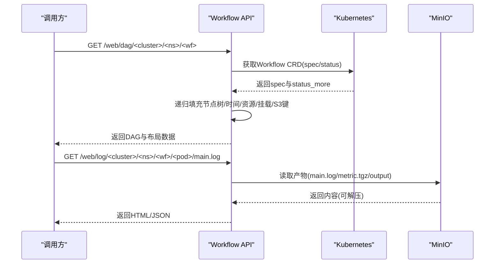
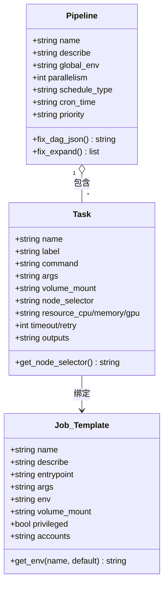
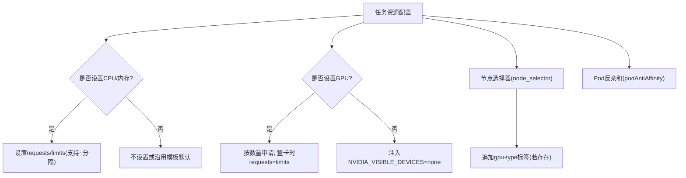
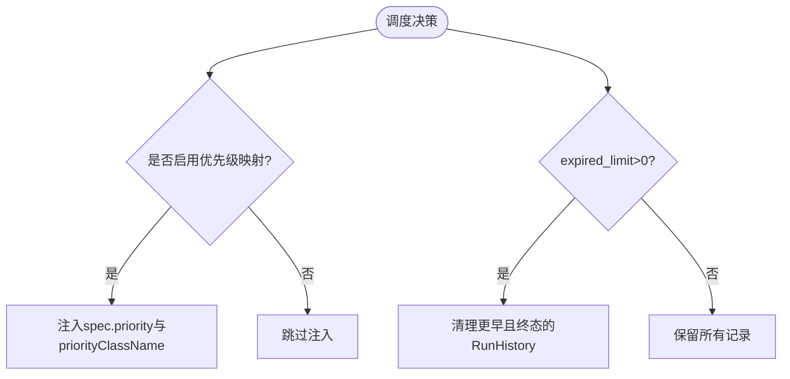
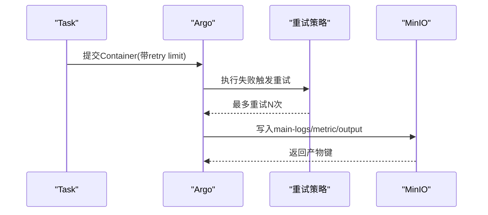
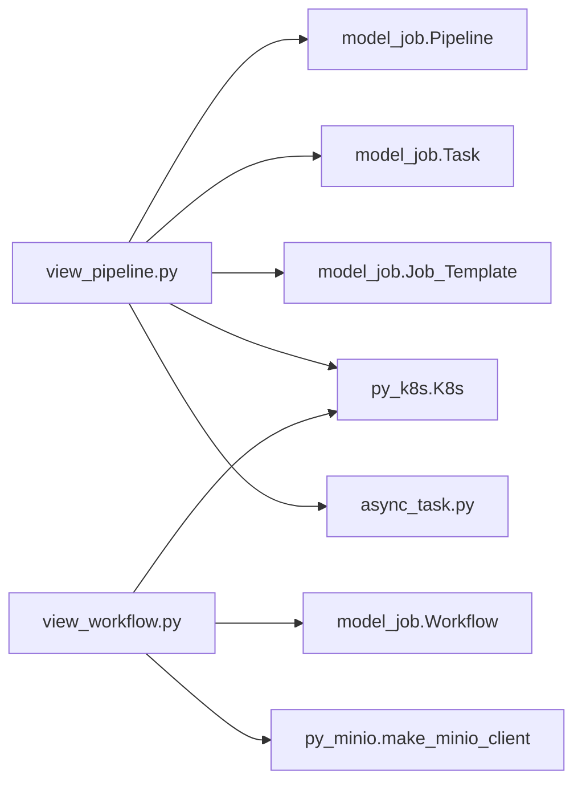

# Pipeline训练编排API

<cite>
**本文引用的文件**   
- [view_pipeline.py](file://myapp/views/view_pipeline.py)
- [view_workflow.py](file://myapp/views/view_workflow.py)
- [model_job.py](file://myapp/models/model_job.py)
- [pipeline_schedule.py](file://myapp/utils/py/pipeline_schedule.py)
- [async_task.py](file://myapp/tasks/async_task.py)
</cite>

## 目录
1. [简介](#简介)
2. [项目结构](#项目结构)
3. [核心组件](#核心组件)
4. [架构总览](#架构总览)
5. [详细组件分析](#详细组件分析)
6. [依赖关系分析](#依赖关系分析)
7. [性能与可扩展性](#性能与可扩展性)
8. [故障排查指南](#故障排查指南)
9. [结论](#结论)
10. [附录：接口规范与示例](#附录接口规范与示例)

## 简介
本文件面向“Pipeline训练编排”的REST API，覆盖任务流定义、工作流执行、任务调度与监控告警、分布式训练配置、超参搜索（镜像类型）、模型评估（任务模板）等能力的接口说明。文档同时给出任务模板管理、环境变量配置、资源分配接口的完整规范，并提供Pipeline构建、执行和结果查看的具体示例，涵盖异步任务处理、错误重试机制和执行历史查询功能。

## 项目结构
本项目围绕以下关键模块实现Pipeline编排能力：
- 视图层API：负责HTTP接口暴露、权限校验、参数校验、页面跳转与日志/监控入口
- 数据模型：定义Pipeline、Task、Job_Template、Workflow、RunHistory等实体
- 调度增强：优先级注入与过期记录清理策略
- 异步任务：Celery任务用于后台长时操作与状态轮询
- Kubernetes集成：通过K8s客户端创建/删除Argo Workflow CRD并拉取运行状态

**图表来源**
- [view_pipeline.py:80-127](file://myapp/views/view_pipeline.py#L80-L127)
- [view_pipeline.py:1094-1151](file://myapp/views/view_pipeline.py#L1094-L1151)
- [view_workflow.py:187-274](file://myapp/views/view_workflow.py#L187-L274)
- [model_job.py:174-207](file://myapp/models/model_job.py#L174-L207)
- [model_job.py:523-553](file://myapp/models/model_job.py#L523-L553)
- [model_job.py:732-760](file://myapp/models/model_job.py#L732-L760)
- [pipeline_schedule.py:16-32](file://myapp/utils/py/pipeline_schedule.py#L16-L32)
- [async_task.py:27-98](file://myapp/tasks/async_task.py#L27-L98)

**章节来源**
- [view_pipeline.py:80-127](file://myapp/views/view_pipeline.py#L80-L127)
- [view_workflow.py:187-274](file://myapp/views/view_workflow.py#L187-L274)
- [model_job.py:174-207](file://myapp/models/model_job.py#L174-L207)
- [pipeline_schedule.py:16-32](file://myapp/utils/py/pipeline_schedule.py#L16-L32)

## 核心组件
- Pipeline（任务流）：定义名称、描述、上下游关系、调度策略、并行度、全局环境变量、优先级、并发实例限制等
- Task（任务）：绑定Job_Template，定义启动命令、参数、资源配额、挂载、节点选择器、超时与重试次数、输出产物等
- Job_Template（任务模板）：封装镜像、入口点、默认参数与环境变量、强制挂载、特权模式等
- Workflow（工作流实例）：Argo Workflow在集群中的运行时对象，包含状态、标签、注解、规格与更详细的状态信息
- RunHistory（执行历史）：定时或手动触发的执行记录，关联pipeline_file、argo id、run_id、状态等

**章节来源**
- [model_job.py:174-207](file://myapp/models/model_job.py#L174-L207)
- [model_job.py:523-553](file://myapp/models/model_job.py#L523-L553)
- [model_job.py:628-666](file://myapp/models/model_job.py#L628-L666)
- [model_job.py:732-760](file://myapp/models/model_job.py#L732-L760)

## 架构总览
Pipeline编排的核心流程如下：
1. 用户通过REST接口提交或编辑Pipeline定义（含Task与上下游关系）
2. 后端校验并生成Argo Workflow YAML（包含容器、环境变量、资源、重试策略、优先级等）
3. 将Workflow CRD提交到Kubernetes集群，返回CRD名称
4. 前端通过Workflow API获取执行进度、节点详情、日志与指标
5. 支持定时调度、优先级控制、执行历史清理与告警通知

**图表来源**
- [view_pipeline.py:132-540](file://myapp/views/view_pipeline.py#L132-L540)
- [view_pipeline.py:544-563](file://myapp/views/view_pipeline.py#L544-L563)
- [view_workflow.py:187-274](file://myapp/views/view_workflow.py#L187-L274)

**章节来源**
- [view_pipeline.py:132-540](file://myapp/views/view_pipeline.py#L132-L540)
- [view_pipeline.py:544-563](file://myapp/views/view_pipeline.py#L544-L563)
- [view_workflow.py:187-274](file://myapp/views/view_workflow.py#L187-L274)

## 详细组件分析

### Pipeline定义与执行API
- 主要职责
  - 提供Pipeline的增删改查、复制、运行、Web界面跳转、日志/监控/Pod入口
  - 校验上下游关系、cron格式、全局环境变量
  - 生成Workflow YAML并提交至Kubernetes
  - 清理旧实例与绑定CRD，避免重复运行
- 关键接口
  - GET/POST /pipeline_modelview/api/run_pipeline/<pipeline_id>：运行指定Pipeline
  - GET /pipeline_modelview/api/web/<pipeline_id>：打开编排界面
  - GET /pipeline_modelview/api/web/log/<pipeline_id>：打开调试跟踪界面
  - GET /pipeline_modelview/api/web/monitoring/<pipeline_id>：打开监控界面
  - GET /pipeline_modelview/api/web/pod/<pipeline_id>：打开Pod界面
  - GET /pipeline_modelview/api/web/runhistory/<pipeline_id>：打开定时记录界面
  - GET /pipeline_modelview/api/web/workflow/<pipeline_id>：打开Workflow列表界面
  - GET /pipeline_modelview/api/copy_pipeline/<pipeline_id>：复制Pipeline
- 执行流程要点
  - 权限校验：仅管理员或创建者可运行
  - 清理旧实例：删除绑定的Workflow与相关Pod
  - 生成YAML：基于dag_json、Task参数、全局环境变量、资源配额、重试策略、优先级等
  - 提交CRD：使用K8s客户端创建Argo Workflow CRD，保存pipeline_argo_id与run_id

**图表来源**
- [view_pipeline.py:1094-1151](file://myapp/views/view_pipeline.py#L1094-L1151)
- [view_pipeline.py:1007-1038](file://myapp/views/view_pipeline.py#L1007-L1038)
- [view_pipeline.py:132-540](file://myapp/views/view_pipeline.py#L132-L540)

**章节来源**
- [view_pipeline.py:1094-1151](file://myapp/views/view_pipeline.py#L1094-L1151)
- [view_pipeline.py:1007-1038](file://myapp/views/view_pipeline.py#L1007-L1038)
- [view_pipeline.py:132-540](file://myapp/views/view_pipeline.py#L132-L540)

### Workflow执行与监控API
- 主要职责
  - 提供Workflow实例的停止、批量删除、日志读取、节点详情、DAG布局与进度
  - 从Kubernetes读取Workflow状态与节点树，组装UI所需数据结构
  - 提供MinIO产物下载与解压（日志、指标、输出）
- 关键接口
  - GET /workflow_modelview/api/stop/<crd_id>：停止Workflow
  - GET /workflow_modelview/api/web/log/<cluster>/<namespace>/<workflow>/<pod>[/<file>]：读取离线日志
  - GET /workflow_modelview/api/web/node_detail/<cluster>/<namespace>/<workflow>/<node>：节点详情
  - GET /workflow_modelview/api/web/dag/<cluster>/<namespace>/<workflow>：DAG图数据
  - GET /workflow_modelview/api/web/layout/<cluster>/<namespace>/<workflow>：布局与进度
- 数据流转
  - 读取K8s中Workflow CRD，解析spec与status_more
  - 递归填充子节点，计算开始/结束时间、重试次数、资源请求、挂载卷、S3键等
  - 返回结构化JSON供前端渲染

**图表来源**
- [view_workflow.py:187-274](file://myapp/views/view_workflow.py#L187-L274)
- [view_workflow.py:476-559](file://myapp/views/view_workflow.py#L476-L559)
- [view_workflow.py:561-820](file://myapp/views/view_workflow.py#L561-L820)
- [view_workflow.py:822-852](file://myapp/views/view_workflow.py#L822-L852)

**章节来源**
- [view_workflow.py:187-274](file://myapp/views/view_workflow.py#L187-L274)
- [view_workflow.py:476-559](file://myapp/views/view_workflow.py#L476-L559)
- [view_workflow.py:561-820](file://myapp/views/view_workflow.py#L561-L820)
- [view_workflow.py:822-852](file://myapp/views/view_workflow.py#L822-L852)

### 任务模板管理与环境变量配置
- 任务模板（Job_Template）
  - 字段包括镜像、入口点、默认参数、环境变量、强制挂载、特权模式、账户等
  - 提供get_env方法按行解析环境变量
- 环境变量配置
  - Pipeline级global_env：每行一个KEY=VALUE，支持datetime/creator/runner/uuid/pipeline_id等变量
  - Task级env：来自Job_Template.env，叠加系统级GLOBAL_ENV与任务上下文变量
  - 运行时注入：KFJ_TASK_ID/KFJ_TASK_NAME/KFJ_TASK_NODE_SELECTOR/KFJ_TASK_VOLUME_MOUNT/KFJ_TASK_IMAGES/KFJ_TASK_RESOURCE_CPU/MEMORY/GPU/KFJ_TASK_PROJECT_NAME/USERNAME/IMAGE_PULL_POLICY/HUBSECRET等
  - K8s字段注入：K8S_NODE_NAME/K8S_POD_IP/K8S_HOST_IP/K8S_POD_NAME

**图表来源**
- [model_job.py:97-153](file://myapp/models/model_job.py#L97-L153)
- [model_job.py:174-207](file://myapp/models/model_job.py#L174-L207)
- [model_job.py:523-553](file://myapp/models/model_job.py#L523-L553)

**章节来源**
- [model_job.py:97-153](file://myapp/models/model_job.py#L97-L153)
- [model_job.py:174-207](file://myapp/models/model_job.py#L174-L207)
- [model_job.py:523-553](file://myapp/models/model_job.py#L523-L553)
- [view_pipeline.py:171-259](file://myapp/views/view_pipeline.py#L171-L259)

### 资源分配与分布式训练配置
- 资源配额
  - CPU/内存：支持requests/limits，允许用“~”分隔上下限
  - GPU：整卡占用或按数量申请；未申请GPU时注入NVIDIA_VISIBLE_DEVICES=none
  - RDMA：resource_rdma字段预留
- 节点选择与亲和性
  - node_selector：支持项目级默认与任务级覆盖，自动追加gpu-type标签
  - podAntiAffinity：同Pipeline Pod尽量分散到不同主机
- 分布式训练
  - 通过Job_Template镜像类型区分（如pytorch/tf/ray/horovod/deepspeed等），由镜像与entrypoint决定分布式框架
  - 可通过args传入分布式参数（如节点数、端口、脚本路径等）

**图表来源**
- [view_pipeline.py:336-373](file://myapp/views/view_pipeline.py#L336-L373)
- [model_job.py:575-580](file://myapp/models/model_job.py#L575-L580)

**章节来源**
- [view_pipeline.py:336-373](file://myapp/views/view_pipeline.py#L336-L373)
- [model_job.py:575-580](file://myapp/models/model_job.py#L575-L580)

### 超参搜索与模型评估
- 超参搜索
  - 镜像类型中包含automl分类，用于超参搜索场景
  - 通过Job_Template.images.image_type标识为automl，结合args与entrypoint驱动搜索框架
- 模型评估
  - 通过Task的outputs字段声明产物键（如metric/output），由Argo收集到MinIO
  - Workflow节点详情中展示metric_key/output_key，便于前端可视化或下载

**章节来源**
- [model_job.py:56-93](file://myapp/models/model_job.py#L56-L93)
- [model_job.py:549-553](file://myapp/models/model_job.py#L549-L553)
- [view_workflow.py:391-401](file://myapp/views/view_workflow.py#L391-L401)

### 任务调度与优先级
- 调度类型
  - once：单次运行
  - crontab：周期运行，需符合cron表达式格式
- 优先级双注入
  - pipeline.priority映射到Argo spec.priority与templateDefaults.priorityClassName
  - 仅在PIPELINE_PRIORITY_CLASS映射开启时生效，否则行为与历史一致
- 过期记录清理
  - expired_run_ids_to_delete根据execution_date降序保留limit条，更早且终态的可安全删除

**图表来源**
- [pipeline_schedule.py:16-32](file://myapp/utils/py/pipeline_schedule.py#L16-L32)
- [pipeline_schedule.py:35-49](file://myapp/utils/py/pipeline_schedule.py#L35-L49)

**章节来源**
- [pipeline_schedule.py:16-32](file://myapp/utils/py/pipeline_schedule.py#L16-L32)
- [pipeline_schedule.py:35-49](file://myapp/utils/py/pipeline_schedule.py#L35-L49)
- [view_pipeline.py:123-127](file://myapp/views/view_pipeline.py#L123-L127)

### 异步任务处理与错误重试
- 异步任务
  - Celery任务用于后台长时操作（如服务升级、数据集备份、K8s资源缓存）
  - 通过session_scope确保数据库会话隔离
- 错误重试
  - Task.retry字段控制Argo retryStrategy.limit
  - Workflow节点显示重试次数与提示文本
  - 日志与指标产物通过MinIO持久化，失败时可重新拉取

**图表来源**
- [view_pipeline.py:447-458](file://myapp/views/view_pipeline.py#L447-L458)
- [view_workflow.py:391-401](file://myapp/views/view_workflow.py#L391-L401)
- [async_task.py:27-98](file://myapp/tasks/async_task.py#L27-L98)

**章节来源**
- [view_pipeline.py:447-458](file://myapp/views/view_pipeline.py#L447-L458)
- [view_workflow.py:391-401](file://myapp/views/view_workflow.py#L391-L401)
- [async_task.py:27-98](file://myapp/tasks/async_task.py#L27-L98)

## 依赖关系分析
- 视图与模型
  - Pipeline_ModelView_Api依赖Pipeline/Task/Job_Template模型
  - Workflow_ModelView_Api依赖Workflow模型
- 外部依赖
  - Kubernetes客户端：创建/删除CRD、查询Pod/Deployment等
  - MinIO：产物存储与下载
  - Celery：异步任务队列
  - Argo：Workflow编排引擎

**图表来源**
- [view_pipeline.py:1316-1348](file://myapp/views/view_pipeline.py#L1316-L1348)
- [view_workflow.py:856-862](file://myapp/views/view_workflow.py#L856-L862)
- [model_job.py:174-207](file://myapp/models/model_job.py#L174-L207)
- [model_job.py:523-553](file://myapp/models/model_job.py#L523-L553)
- [model_job.py:732-760](file://myapp/models/model_job.py#L732-L760)
- [async_task.py:27-98](file://myapp/tasks/async_task.py#L27-L98)

**章节来源**
- [view_pipeline.py:1316-1348](file://myapp/views/view_pipeline.py#L1316-L1348)
- [view_workflow.py:856-862](file://myapp/views/view_workflow.py#L856-L862)
- [model_job.py:174-207](file://myapp/models/model_job.py#L174-L207)
- [model_job.py:523-553](file://myapp/models/model_job.py#L523-L553)
- [model_job.py:732-760](file://myapp/models/model_job.py#L732-L760)
- [async_task.py:27-98](file://myapp/tasks/async_task.py#L27-L98)

## 性能与可扩展性
- 并行度控制
  - Pipeline.parallelism控制同一实例内最大并行Task数
  - Workflow.spec.parallelism与Argo控制器协同
- 资源隔离
  - requests/limits与GPU分配避免资源争抢
  - podAntiAffinity提升调度稳定性
- 产物与日志
  - MinIO异步写入，支持压缩与解压，减少I/O阻塞
- 扩展点
  - Job_Template.args/env/entrypoint支持多种训练框架
  - priority_spec_patch与expired_run_ids_to_delete提供企业版增强能力

[本节为通用指导，不涉及具体文件分析]

## 故障排查指南
- 常见问题
  - DAG循环或未知上游：pre_add/pre_update会校验并抛出异常
  - Cron格式错误：schedule_type=crontab时需匹配正则表达式
  - 无权限运行：非管理员或非创建者访问/run_pipeline会被拒绝
  - 无运行实例：web_log在未运行过Pipeline时会提示先运行
- 定位步骤
  - 检查Pipeline.dag_json与Task.upstream关系
  - 查看Workflow.status与status_more.message
  - 通过/web/node_detail查看节点重试次数、资源、挂载与S3键
  - 通过/web/log读取离线日志与指标

**章节来源**
- [view_pipeline.py:801-822](file://myapp/views/view_pipeline.py#L801-L822)
- [view_pipeline.py:867-870](file://myapp/views/view_pipeline.py#L867-L870)
- [view_pipeline.py:1094-1107](file://myapp/views/view_pipeline.py#L1094-L1107)
- [view_pipeline.py:1187-1198](file://myapp/views/view_pipeline.py#L1187-L1198)
- [view_workflow.py:391-401](file://myapp/views/view_workflow.py#L391-L401)

## 结论
本API体系以Pipeline为中心，串联Task、Job_Template、Workflow与RunHistory，提供完整的任务流定义、执行、监控与调度能力。通过Kubernetes与Argo实现分布式训练编排，借助MinIO持久化产物与日志，结合Celery异步任务与优先级增强，满足大规模训练与超参搜索场景的需求。

[本节为总结性内容，不涉及具体文件分析]

## 附录：接口规范与示例

### REST接口清单
- Pipeline
  - GET/POST /pipeline_modelview/api/run_pipeline/<pipeline_id>
  - GET /pipeline_modelview/api/web/<pipeline_id>
  - GET /pipeline_modelview/api/web/log/<pipeline_id>
  - GET /pipeline_modelview/api/web/monitoring/<pipeline_id>
  - GET /pipeline_modelview/api/web/pod/<pipeline_id>
  - GET /pipeline_modelview/api/web/runhistory/<pipeline_id>
  - GET /pipeline_modelview/api/web/workflow/<pipeline_id>
  - GET /pipeline_modelview/api/copy_pipeline/<pipeline_id>
- Workflow
  - GET /workflow_modelview/api/stop/<crd_id>
  - GET /workflow_modelview/api/web/log/<cluster>/<namespace>/<workflow>/<pod>[/<file>]
  - GET /workflow_modelview/api/web/node_detail/<cluster>/<namespace>/<workflow>/<node>
  - GET /workflow_modelview/api/web/dag/<cluster>/<namespace>/<workflow>
  - GET /workflow_modelview/api/web/layout/<cluster>/<namespace>/<workflow>

**章节来源**
- [view_pipeline.py:1094-1151](file://myapp/views/view_pipeline.py#L1094-L1151)
- [view_pipeline.py:1157-1233](file://myapp/views/view_pipeline.py#L1157-L1233)
- [view_workflow.py:174-184](file://myapp/views/view_workflow.py#L174-L184)
- [view_workflow.py:476-559](file://myapp/views/view_workflow.py#L476-L559)
- [view_workflow.py:561-820](file://myapp/views/view_workflow.py#L561-L820)
- [view_workflow.py:822-852](file://myapp/views/view_workflow.py#L822-L852)

### 示例：构建、执行与查看结果
- 构建Pipeline
  - 准备Task与Job_Template，定义上下游关系（dag_json）
  - 配置global_env与Task参数（args/command/volume_mount/resource_*）
- 执行Pipeline
  - 调用/run_pipeline/<pipeline_id>，后端生成YAML并提交CRD
  - 返回后重定向到日志/跟踪界面
- 查看结果
  - 通过/web/dag获取DAG与节点状态
  - 通过/web/log读取main.log与metric.tgz
  - 通过/web/node_detail查看节点详情与产物键

**章节来源**
- [view_pipeline.py:132-540](file://myapp/views/view_pipeline.py#L132-L540)
- [view_pipeline.py:1094-1151](file://myapp/views/view_pipeline.py#L1094-L1151)
- [view_workflow.py:822-852](file://myapp/views/view_workflow.py#L822-L852)
- [view_workflow.py:476-559](file://myapp/views/view_workflow.py#L476-L559)