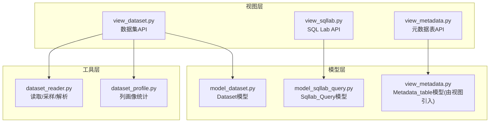
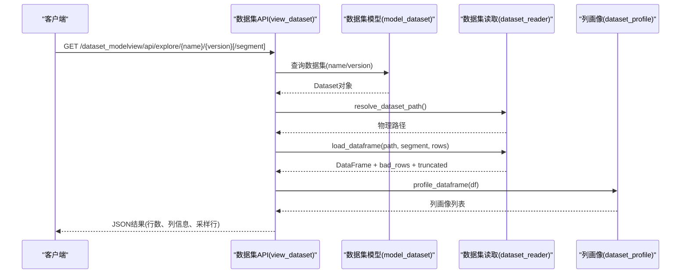
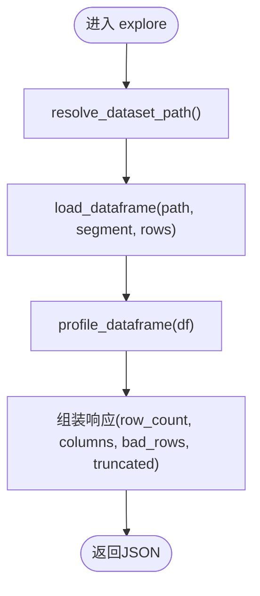
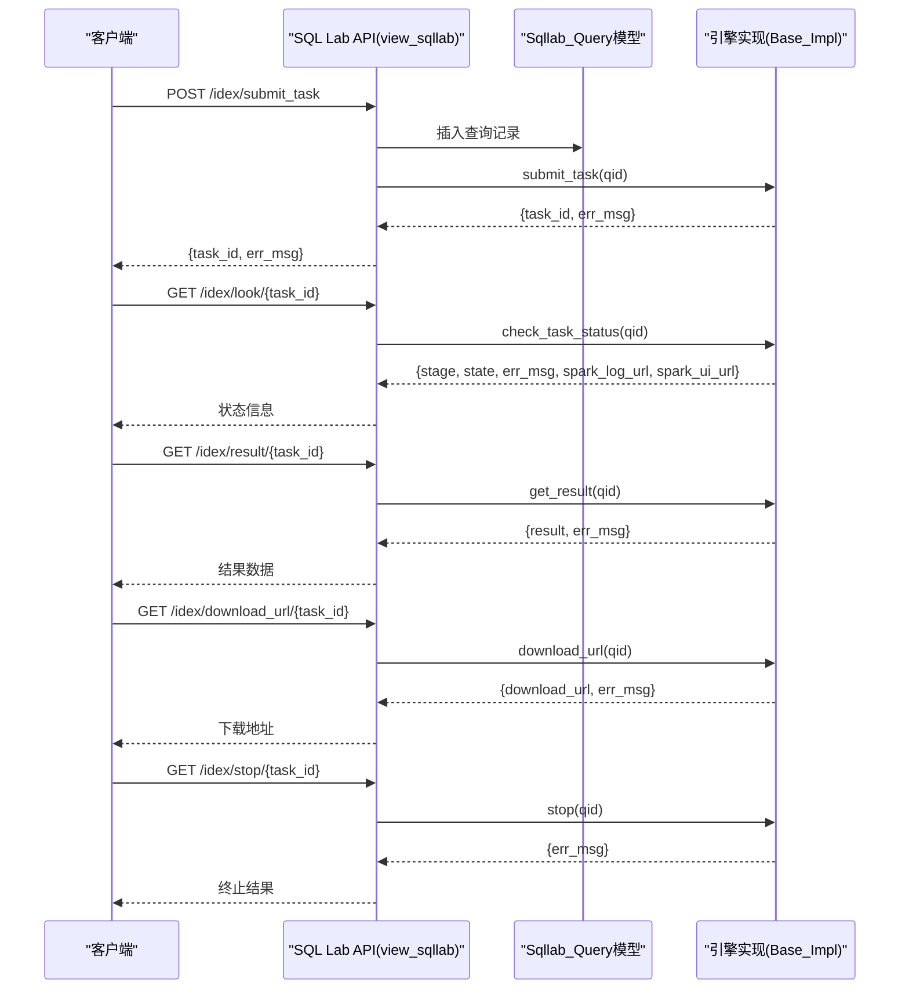
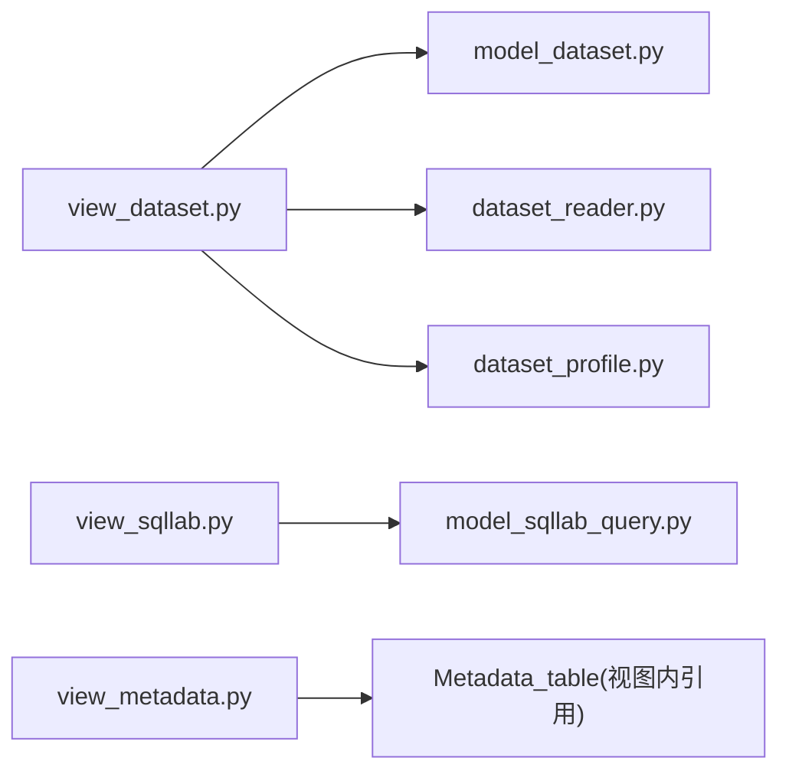

# 数据管理API

<cite>
**本文引用的文件**   
- [myapp/views/view_dataset.py](file://myapp/views/view_dataset.py)
- [myapp/models/model_dataset.py](file://myapp/models/model_dataset.py)
- [myapp/utils/dataset_reader.py](file://myapp/utils/dataset_reader.py)
- [myapp/utils/dataset_profile.py](file://myapp/utils/dataset_profile.py)
- [myapp/views/view_sqllab.py](file://myapp/views/view_sqllab.py)
- [myapp/models/model_sqllab_query.py](file://myapp/models/model_sqllab_query.py)
- [myapp/views/view_metadata.py](file://myapp/views/view_metadata.py)
</cite>

## 目录
1. [简介](#简介)
2. [项目结构](#项目结构)
3. [核心组件](#核心组件)
4. [架构总览](#架构总览)
5. [详细组件分析](#详细组件分析)
6. [依赖关系分析](#依赖关系分析)
7. [性能与优化](#性能与优化)
8. [故障排查指南](#故障排查指南)
9. [结论](#结论)
10. [附录：API规范与示例](#附录api规范与示例)

## 简介
本文件面向“数据管理”相关API，覆盖数据集CRUD、SQL查询执行、元数据管理与数据血缘追踪接口；说明数据导入导出、格式转换与数据质量检查能力；并给出数据集版本控制、标签管理与搜索过滤的API规范。同时提供CSV、JSON、Parquet等格式的读写示例路径，以及大数据集处理、并行查询优化与缓存策略建议。

## 项目结构
围绕数据管理的后端实现主要分布在以下模块：
- 视图层（REST API）：数据集、SQL Lab、元数据表
- 模型层：数据集、SQL查询记录、元数据表
- 工具层：数据集读取与采样、列级统计画像

图示来源
- [myapp/views/view_dataset.py:1-600](file://myapp/views/view_dataset.py#L1-L600)
- [myapp/models/model_dataset.py:1-148](file://myapp/models/model_dataset.py#L1-L148)
- [myapp/utils/dataset_reader.py:1-114](file://myapp/utils/dataset_reader.py#L1-L114)
- [myapp/utils/dataset_profile.py:1-74](file://myapp/utils/dataset_profile.py#L1-L74)
- [myapp/views/view_sqllab.py:1-205](file://myapp/views/view_sqllab.py#L1-L205)
- [myapp/models/model_sqllab_query.py:1-43](file://myapp/models/model_sqllab_query.py#L1-L43)
- [myapp/views/view_metadata.py:1-282](file://myapp/views/view_metadata.py#L1-L282)

章节来源
- [myapp/views/view_dataset.py:1-600](file://myapp/views/view_dataset.py#L1-L600)
- [myapp/views/view_sqllab.py:1-205](file://myapp/views/view_sqllab.py#L1-L205)
- [myapp/views/view_metadata.py:1-282](file://myapp/views/view_metadata.py#L1-L282)
- [myapp/models/model_dataset.py:1-148](file://myapp/models/model_dataset.py#L1-L148)
- [myapp/models/model_sqllab_query.py:1-43](file://myapp/models/model_sqllab_query.py#L1-L43)
- [myapp/utils/dataset_reader.py:1-114](file://myapp/utils/dataset_reader.py#L1-L114)
- [myapp/utils/dataset_profile.py:1-74](file://myapp/utils/dataset_profile.py#L1-L74)

## 核心组件
- 数据集API（CRUD、预览、探索、下载、标注平台对接）
- SQL Lab API（提交任务、状态查询、结果获取、下载、终止）
- 元数据表API（库表元数据增删改查、权限控制）
- 数据集读取与画像（CSV/JSONL/Parquet读取、采样、列统计）

章节来源
- [myapp/views/view_dataset.py:480-598](file://myapp/views/view_dataset.py#L480-L598)
- [myapp/views/view_sqllab.py:98-204](file://myapp/views/view_sqllab.py#L98-L204)
- [myapp/views/view_metadata.py:253-281](file://myapp/views/view_metadata.py#L253-L281)
- [myapp/utils/dataset_reader.py:44-113](file://myapp/utils/dataset_reader.py#L44-L113)
- [myapp/utils/dataset_profile.py:22-73](file://myapp/utils/dataset_profile.py#L22-L73)

## 架构总览
数据管理API的整体调用链如下：
- 客户端通过REST访问视图层API
- 视图层负责参数校验、权限控制、业务编排
- 模型层持久化实体（数据集、SQL查询、元数据表）
- 工具层完成数据读取、格式解析与统计分析

图示来源
- [myapp/views/view_dataset.py:484-505](file://myapp/views/view_dataset.py#L484-L505)
- [myapp/utils/dataset_reader.py:44-113](file://myapp/utils/dataset_reader.py#L44-L113)
- [myapp/utils/dataset_profile.py:72-73](file://myapp/utils/dataset_profile.py#L72-L73)

## 详细组件分析

### 数据集CRUD与探索API
- 基础能力
  - 列表/新增/编辑/删除：由Flask-AppBuilder的ModelRestApi自动生成
  - 权限过滤：按owner字段限制可见范围
  - 版本聚合：列表返回最新数据，历史版本作为children
- 预览与探索
  - 预览：按名称+版本+分片读取前N行
  - 探索：返回列画像、坏行数、是否截断、采样行数
- 下载
  - 支持本地静态路径、外部URL、对象存储三种方式
  - 支持按分片(segment)返回对应下载链接
- 标注平台集成
  - 推送至Label Studio：文本/图像分类任务
  - 从Label Studio回存为数据集：生成jsonl并登记到数据集中心

图示来源
- [myapp/views/view_dataset.py:484-505](file://myapp/views/view_dataset.py#L484-L505)
- [myapp/utils/dataset_reader.py:44-113](file://myapp/utils/dataset_reader.py#L44-L113)
- [myapp/utils/dataset_profile.py:72-73](file://myapp/utils/dataset_profile.py#L72-L73)

章节来源
- [myapp/views/view_dataset.py:48-129](file://myapp/views/view_dataset.py#L48-L129)
- [myapp/views/view_dataset.py:337-411](file://myapp/views/view_dataset.py#L337-L411)
- [myapp/views/view_dataset.py:413-445](file://myapp/views/view_dataset.py#L413-L445)
- [myapp/views/view_dataset.py:480-505](file://myapp/views/view_dataset.py#L480-L505)
- [myapp/views/view_dataset.py:529-595](file://myapp/views/view_dataset.py#L529-L595)
- [myapp/models/model_dataset.py:17-58](file://myapp/models/model_dataset.py#L17-L58)

### SQL查询执行API
- 引擎支持：MySQL、PostgreSQL、Presto、ClickHouse、Impala、Hive
- 生命周期
  - 提交任务：创建记录，调度底层引擎执行
  - 查询状态：阶段、状态、日志/UI链接
  - 获取结果：返回结果或下载链接
  - 终止任务：停止执行
- 配置接口：返回前端可用的引擎与数据库选择项

图示来源
- [myapp/views/view_sqllab.py:50-73](file://myapp/views/view_sqllab.py#L50-L73)
- [myapp/views/view_sqllab.py:155-201](file://myapp/views/view_sqllab.py#L155-L201)
- [myapp/models/model_sqllab_query.py:14-40](file://myapp/models/model_sqllab_query.py#L14-L40)

章节来源
- [myapp/views/view_sqllab.py:28-47](file://myapp/views/view_sqllab.py#L28-L47)
- [myapp/views/view_sqllab.py:98-204](file://myapp/views/view_sqllab.py#L98-L204)
- [myapp/models/model_sqllab_query.py:14-40](file://myapp/models/model_sqllab_query.py#L14-L40)

### 元数据管理与数据血缘追踪
- 元数据表API
  - 提供库表维度的增删改查、权限控制（owner）、展示字段与搜索字段配置
  - 支持建表DDL、仓库等级、安全等级、TTL等元信息
- 数据血缘追踪
  - 当前代码未直接实现血缘图接口；可通过扩展Sqllab_Query与外部系统（如Airflow/DolphinScheduler）关联任务链路，或在元数据表中增加上游/下游字段进行血缘描述

章节来源
- [myapp/views/view_metadata.py:67-101](file://myapp/views/view_metadata.py#L67-L101)
- [myapp/views/view_metadata.py:109-216](file://myapp/views/view_metadata.py#L109-L216)
- [myapp/views/view_metadata.py:253-281](file://myapp/views/view_metadata.py#L253-L281)

### 数据导入导出、格式转换与数据质量检查
- 导入
  - Label Studio回存：将标注结果写入jsonl，并登记为数据集
  - 通用上传：由AppBuilder的import_data开关启用（需结合前端表单）
- 导出
  - 数据集下载：根据path/download_url/对象存储返回可下载链接
  - SQL结果下载：通过download_url接口获取结果文件地址
- 格式转换
  - 读取层统一转换为DataFrame，便于后续转换或导出（CSV/JSONL/Parquet）
- 数据质量检查
  - 探索接口返回bad_rows、truncated、列null_rate、唯一值计数、数值分布直方图等

章节来源
- [myapp/views/view_dataset.py:558-595](file://myapp/views/view_dataset.py#L558-L595)
- [myapp/views/view_dataset.py:353-411](file://myapp/views/view_dataset.py#L353-L411)
- [myapp/views/view_sqllab.py:187-193](file://myapp/views/view_sqllab.py#L187-L193)
- [myapp/utils/dataset_reader.py:68-113](file://myapp/utils/dataset_reader.py#L68-L113)
- [myapp/utils/dataset_profile.py:22-73](file://myapp/utils/dataset_profile.py#L22-L73)

### 数据集版本控制、标签管理与搜索过滤
- 版本控制
  - 数据集模型包含version字段；列表返回时按name分组，仅顶层显示最新版本，历史版本放入children
- 标签管理
  - 模型含label、field、industry、usage、research等标签类字段；可在前端以多选/下拉形式维护
- 搜索过滤
  - search_columns定义可搜索字段；base_filters支持基于owner的权限过滤

章节来源
- [myapp/views/view_dataset.py:48-76](file://myapp/views/view_dataset.py#L48-L76)
- [myapp/views/view_dataset.py:449-469](file://myapp/views/view_dataset.py#L449-L469)
- [myapp/models/model_dataset.py:17-58](file://myapp/models/model_dataset.py#L17-L58)

## 依赖关系分析
- 视图与模型
  - view_dataset.py依赖model_dataset.py（Dataset）
  - view_sqllab.py依赖model_sqllab_query.py（Sqllab_Query）
  - view_metadata.py依赖Metadata_table模型（在视图内引入）
- 视图与工具
  - view_dataset.py依赖dataset_reader.py（路径解析、读取、采样）
  - view_dataset.py依赖dataset_profile.py（列画像统计）

图示来源
- [myapp/views/view_dataset.py:1-600](file://myapp/views/view_dataset.py#L1-L600)
- [myapp/models/model_dataset.py:1-148](file://myapp/models/model_dataset.py#L1-L148)
- [myapp/utils/dataset_reader.py:1-114](file://myapp/utils/dataset_reader.py#L1-L114)
- [myapp/utils/dataset_profile.py:1-74](file://myapp/utils/dataset_profile.py#L1-L74)
- [myapp/views/view_sqllab.py:1-205](file://myapp/views/view_sqllab.py#L1-L205)
- [myapp/models/model_sqllab_query.py:1-43](file://myapp/models/model_sqllab_query.py#L1-L43)
- [myapp/views/view_metadata.py:1-282](file://myapp/views/view_metadata.py#L1-L282)

章节来源
- [myapp/views/view_dataset.py:1-600](file://myapp/views/view_dataset.py#L1-L600)
- [myapp/views/view_sqllab.py:1-205](file://myapp/views/view_sqllab.py#L1-L205)
- [myapp/views/view_metadata.py:1-282](file://myapp/views/view_metadata.py#L1-L282)

## 性能与优化
- 大数据集处理
  - 读取层默认采样上限SAMPLE_ROWS=10000，避免全量加载导致内存溢出
  - CSV使用pandas一次性读取并跳过坏行；JSONL逐行解析并统计bad_rows；Parquet依赖pyarrow引擎
- 并行查询优化
  - SQL Lab采用异步任务模式，提交后轮询状态与结果，适合长耗时查询
  - 可扩展为多引擎并发执行（不同engine_arg1），并通过task_id隔离
- 数据缓存策略
  - 元数据配置接口中预留了缓存URI的注释逻辑，可按需接入Redis/Memcached缓存常用引擎连接串
  - 探索/预览结果可考虑对热点数据集做短期缓存（按name+version+segment键）

章节来源
- [myapp/utils/dataset_reader.py:9-12](file://myapp/utils/dataset_reader.py#L9-L12)
- [myapp/utils/dataset_reader.py:68-113](file://myapp/utils/dataset_reader.py#L68-L113)
- [myapp/views/view_sqllab.py:101-153](file://myapp/views/view_sqllab.py#L101-L153)

## 故障排查指南
- 数据集读取失败
  - 现象：预览/探索返回错误消息
  - 可能原因：路径不存在、格式不支持、Parquet引擎缺失
  - 定位：查看DatasetReadError抛出位置与异常链
- SQL查询任务异常
  - 现象：submit_task返回err_msg或check_task返回非成功状态
  - 可能原因：引擎未实现、参数缺失、远程引擎不可用
  - 定位：检查engine_impl映射与add_task/check_task_engine流程
- 权限问题
  - 现象：下载/编辑/删除被拒绝
  - 可能原因：owner不包含当前用户且非管理员
  - 定位：检查pre_add/pre_update中的owner设置与check_edit_permission

章节来源
- [myapp/utils/dataset_reader.py:17-19](file://myapp/utils/dataset_reader.py#L17-L19)
- [myapp/utils/dataset_reader.py:63-65](file://myapp/utils/dataset_reader.py#L63-L65)
- [myapp/utils/dataset_reader.py:103-113](file://myapp/utils/dataset_reader.py#L103-L113)
- [myapp/views/view_sqllab.py:50-73](file://myapp/views/view_sqllab.py#L50-L73)
- [myapp/views/view_sqllab.py:76-94](file://myapp/views/view_sqllab.py#L76-L94)
- [myapp/views/view_dataset.py:331-335](file://myapp/views/view_dataset.py#L331-L335)

## 结论
本数据管理API提供了完整的数据集生命周期管理能力，涵盖CRUD、预览探索、下载、标注平台对接、SQL查询执行与元数据管理。通过统一的读取层与列画像统计，支撑CSV/JSONL/Parquet等多格式数据处理与质量检查。建议在现有基础上增强血缘追踪、缓存与并行执行能力，以满足更大规模数据场景的需求。

## 附录：API规范与示例

### 数据集API
- 基础CRUD
  - 路由前缀：/dataset_modelview/api
  - 能力：列表、新增、编辑、删除、详情
  - 过滤：支持search_columns与base_filters（owner权限）
- 预览
  - 路由：GET/POST /dataset_modelview/api/preview/{dataset_name}[/dataset_version][/dataset_segment]
  - 行为：解析路径、读取前N行、返回rows
- 探索
  - 路由：GET/POST /dataset_modelview/api/explore/{dataset_name}/{dataset_version}[/dataset_segment]
  - 行为：返回row_count、sampled_rows、truncated、bad_rows、columns（列画像）
- 下载
  - 路由：GET/POST /dataset_modelview/api/download/{dataset_id}[/partition]
  - 行为：返回store_type与download_urls数组
- 标注平台
  - 推送：POST /dataset_modelview/api/push_to_labelstudio/{dataset_id}
  - 回存：POST /dataset_modelview/api/import_from_labelstudio

章节来源
- [myapp/views/view_dataset.py:480-598](file://myapp/views/view_dataset.py#L480-L598)
- [myapp/views/view_dataset.py:353-411](file://myapp/views/view_dataset.py#L353-L411)
- [myapp/views/view_dataset.py:413-445](file://myapp/views/view_dataset.py#L413-L445)
- [myapp/views/view_dataset.py:484-505](file://myapp/views/view_dataset.py#L484-L505)
- [myapp/views/view_dataset.py:529-595](file://myapp/views/view_dataset.py#L529-L595)

### SQL Lab API
- 配置
  - 路由：GET/POST /idex/config
  - 行为：返回引擎与数据库选择项
- 提交任务
  - 路由：POST /idex/submit_task
  - 请求体：engine_arg1、engine_arg2、sql
  - 返回：task_id、err_msg
- 查询状态
  - 路由：GET /idex/look/{task_id}
  - 返回：stage、state、err_msg、spark_log_url、spark_ui_url
- 获取结果
  - 路由：GET /idex/result/{task_id}
  - 返回：result、err_msg
- 下载结果
  - 路由：GET /idex/download_url/{task_id}
  - 返回：download_url、err_msg
- 终止任务
  - 路由：GET /idex/stop/{task_id}
  - 返回：err_msg

章节来源
- [myapp/views/view_sqllab.py:101-153](file://myapp/views/view_sqllab.py#L101-L153)
- [myapp/views/view_sqllab.py:155-201](file://myapp/views/view_sqllab.py#L155-L201)

### 元数据表API
- 路由前缀：/metadata_table_modelview/api
- 能力：列表、新增、编辑、删除、详情
- 字段：app、db、table、describe、field、warehouse_level、security_level、ttl、create_table_ddl等
- 权限：owner字段控制编辑/删除权限

章节来源
- [myapp/views/view_metadata.py:67-101](file://myapp/views/view_metadata.py#L67-L101)
- [myapp/views/view_metadata.py:109-216](file://myapp/views/view_metadata.py#L109-L216)
- [myapp/views/view_metadata.py:253-281](file://myapp/views/view_metadata.py#L253-L281)

### 数据格式读写示例（路径参考）
- CSV
  - 读取：load_dataframe(path, rows=SAMPLE_ROWS)
  - 路径：[dataset_reader.py:78-86](file://myapp/utils/dataset_reader.py#L78-L86)
- JSONL
  - 读取：逐行解析，统计bad_rows
  - 路径：[dataset_reader.py:87-102](file://myapp/utils/dataset_reader.py#L87-L102)
- Parquet
  - 读取：依赖pyarrow引擎，返回DataFrame
  - 路径：[dataset_reader.py:103-112](file://myapp/utils/dataset_reader.py#L103-L112)

章节来源
- [myapp/utils/dataset_reader.py:78-112](file://myapp/utils/dataset_reader.py#L78-L112)