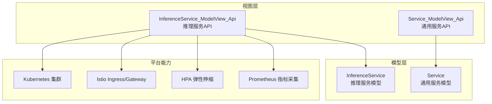
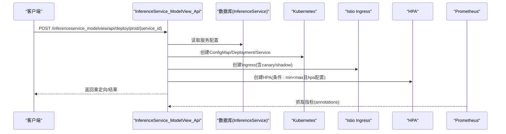
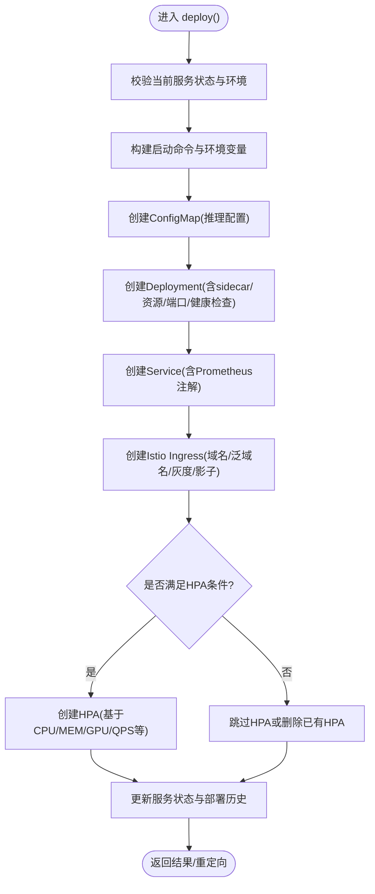
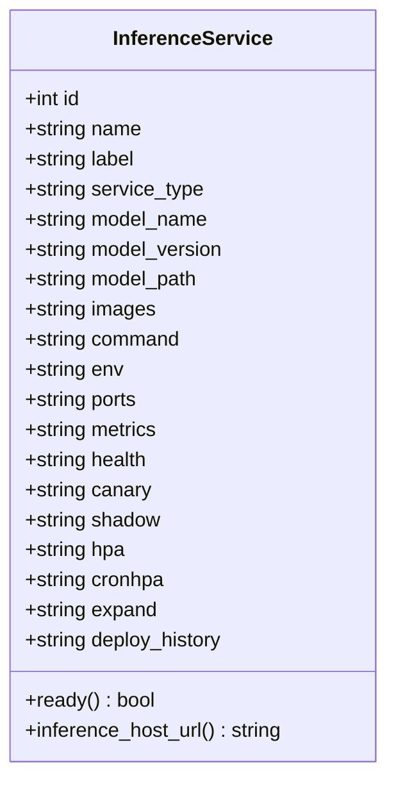
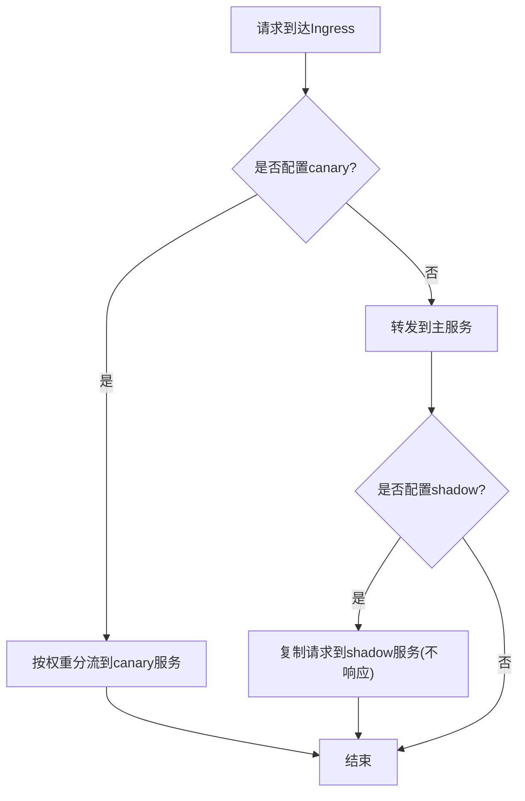
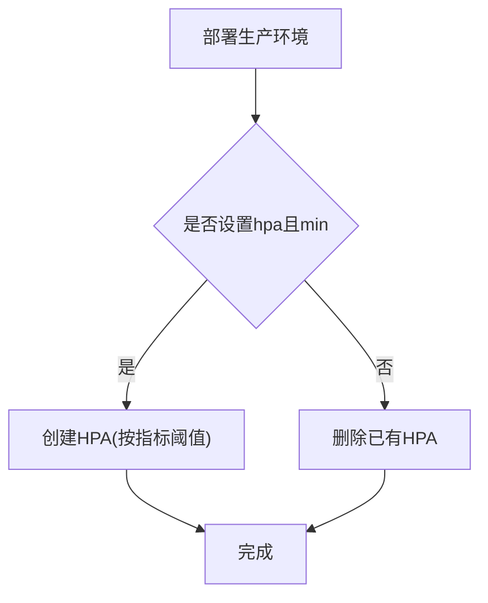
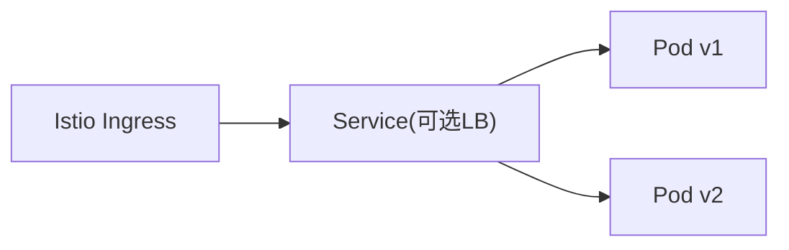
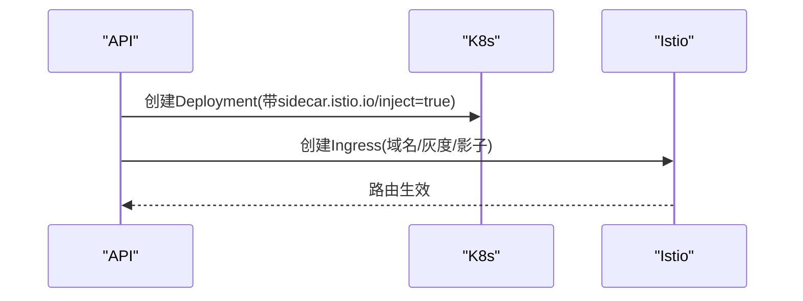
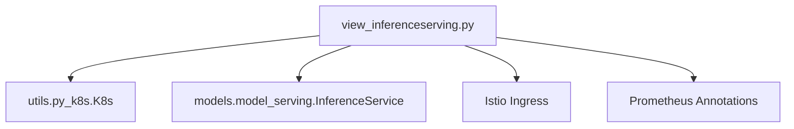

# 模型推理服务API

<cite>
**本文引用的文件**   
- [view_inferenceserving.py](file://myapp/views/view_inferenceserving.py)
- [model_serving.py](file://myapp/models/model_serving.py)
- [view_serving.py](file://myapp/views/view_serving.py)
</cite>

## 目录
1. [简介](#简介)
2. [项目结构](#项目结构)
3. [核心组件](#核心组件)
4. [架构总览](#架构总览)
5. [详细组件分析](#详细组件分析)
6. [依赖关系分析](#依赖关系分析)
7. [性能与伸缩性](#性能与伸缩性)
8. [故障排查指南](#故障排查指南)
9. [结论](#结论)
10. [附录：接口规范与示例](#附录接口规范与示例)

## 简介
本文件面向“模型推理服务”的REST API，覆盖以下能力：
- 模型版本管理、服务发布（调试/测试/生产）、流量治理（灰度/影子）与弹性伸缩（HPA/定时）
- A/B测试、灰度发布与回滚的API使用方法
- 模型性能监控、日志收集与告警配置的接口规范
- 模型预测、批量推理与实时调用的具体示例
- 多模型部署、负载均衡与服务网格（Istio）集成方案

## 项目结构
本项目围绕推理服务的Web视图与数据模型组织代码：
- 视图层：提供REST接口，负责参数校验、Kubernetes资源编排、Istio网关配置、HPA创建等
- 模型层：定义推理服务的数据结构与属性计算（如可访问URL、就绪状态等）
- 通用服务：内部云原生服务的管理（非推理专用），用于对比与复用部分逻辑

**图表来源** 
- [view_inferenceserving.py:804-1358](file://myapp/views/view_inferenceserving.py#L804-L1358)
- [model_serving.py:202-515](file://myapp/models/model_serving.py#L202-L515)
- [view_serving.py:183-341](file://myapp/views/view_serving.py#L183-L341)

**章节来源**
- [view_inferenceserving.py:1-1358](file://myapp/views/view_inferenceserving.py#L1-L1358)
- [model_serving.py:1-515](file://myapp/models/model_serving.py#L1-L515)
- [view_serving.py:1-341](file://myapp/views/view_serving.py#L1-L341)

## 核心组件
- InferenceService_ModelView_Api：推理服务REST API入口，提供清理、调试/测试/生产部署、升级查询等接口
- InferenceService：推理服务数据模型，包含模型名/版本/路径、镜像、端口、HPA、健康检查、指标采集、Sidecar等字段
- Service_ModelView_Api：通用服务REST API，用于非推理类服务的生命周期管理

关键职责划分：
- 视图层：接收请求、参数校验、调用K8s/Istio/HPA等能力，维护部署历史与状态
- 模型层：提供URL生成、就绪判断、操作按钮渲染等辅助能力

**章节来源**
- [view_inferenceserving.py:804-1358](file://myapp/views/view_inferenceserving.py#L804-L1358)
- [model_serving.py:202-515](file://myapp/models/model_serving.py#L202-L515)
- [view_serving.py:183-341](file://myapp/views/view_serving.py#L183-L341)

## 架构总览
推理服务通过REST API触发后端编排，最终在Kubernetes中创建Deployment/Service/ConfigMap，并通过Istio暴露域名访问；同时支持HPA弹性伸缩与Prometheus指标采集。

**图表来源** 
- [view_inferenceserving.py:914-1270](file://myapp/views/view_inferenceserving.py#L914-L1270)
- [model_serving.py:202-515](file://myapp/models/model_serving.py#L202-L515)

## 详细组件分析

### 推理服务REST接口
- 清理推理服务
  - 方法/路径：POST/GET /inferenceservice_modelview/api/clear/<service_id>
  - 功能：删除Deployment/StatefulSet/Service/ExternalService/Istio Ingress/HPA/ConfigMap等，记录清理历史
- 部署推理服务
  - 调试环境：POST/GET /inferenceservice_modelview/api/deploy/debug/<service_id>
  - 测试环境：POST/GET /inferenceservice_modelview/api/deploy/test/<service_id>
  - 生产环境：POST/GET /inferenceservice_modelview/api/deploy/prod/<service_id>
  - 功能：根据服务类型生成命令与配置，创建ConfigMap/Deployment/Service，必要时创建Istio Ingress与HPA
- 推理服务升级
  - 方法/路径：POST/GET /inferenceservice_modelview/api/deploy/update/
  - 功能：按service_id/name/model_name/version定位在线服务，更新最小副本数并重新部署，返回服务与Deployment详情

**图表来源** 
- [view_inferenceserving.py:914-1270](file://myapp/views/view_inferenceserving.py#L914-L1270)

**章节来源**
- [view_inferenceserving.py:804-1358](file://myapp/views/view_inferenceserving.py#L804-L1358)

### 模型版本管理与回滚
- 版本管理
  - 字段：model_name、model_version、model_path、service_type
  - 行为：不同service_type对应不同的默认命令、端口、健康检查与指标地址；系统自动注入环境变量便于运行时获取版本信息
- 回滚策略
  - 通过列表页将同一model_name的多版本聚合为树形结构，最新在线版本作为父节点，其他版本作为子节点
  - 回滚方式：选择目标版本进行部署（prod/test/debug），系统将清理旧资源并重建

**图表来源** 
- [model_serving.py:202-515](file://myapp/models/model_serving.py#L202-L515)

**章节来源**
- [model_serving.py:202-515](file://myapp/models/model_serving.py#L202-L515)
- [view_inferenceserving.py:1301-1329](file://myapp/views/view_inferenceserving.py#L1301-L1329)

### 流量治理：A/B测试、灰度发布与影子流量
- 灰度发布（Canary）
  - 字段：canary
  - 格式：service1:20%,service2:30%
  - 作用：按比例将流量分流到目标服务
- 影子流量（Shadow）
  - 字段：shadow
  - 格式：service1:20%,service2:30%
  - 作用：复制请求到目标服务，不影响主流量
- 实现位置：Istio Ingress创建时传入canary/shadow参数

**图表来源** 
- [view_inferenceserving.py:1103-1113](file://myapp/views/view_inferenceserving.py#L1103-L1113)

**章节来源**
- [view_inferenceserving.py:279-292](file://myapp/views/view_inferenceserving.py#L279-L292)
- [view_inferenceserving.py:1103-1113](file://myapp/views/view_inferenceserving.py#L1103-L1113)

### 弹性伸缩与定时伸缩
- 弹性伸缩（HPA）
  - 字段：hpa
  - 触发条件：cpu/mem/gpu/qps等指标组合，例如 cpu:50%,mem:50%,gpu:50%
  - 行为：当min_replicas < max_replicas且存在hpa配置时创建HPA；否则删除已有HPA
- 定时伸缩（CronHPA）
  - 字段：cronhpa
  - 格式：24小时制时间段，例如 9~21:1,21~9:0
  - 说明：定时伸缩与HPA互斥（定时生效时HPA失效）

**图表来源** 
- [view_inferenceserving.py:1207-1230](file://myapp/views/view_inferenceserving.py#L1207-L1230)

**章节来源**
- [view_inferenceserving.py:255-268](file://myapp/views/view_inferenceserving.py#L255-L268)
- [view_inferenceserving.py:1207-1230](file://myapp/views/view_inferenceserving.py#L1207-L1230)

### 多模型部署与负载均衡
- 多模型部署
  - 支持多种推理框架：tfserving、torch-server、triton-server、ml-server等
  - 每种框架有默认端口、健康检查、指标地址与启动命令
- 负载均衡
  - Service默认启用Kubernetes负载均衡
  - 可通过expand.disable_load_balancer=true禁用负载均衡（仅Pod直连）

**图表来源** 
- [view_inferenceserving.py:1079-1088](file://myapp/views/view_inferenceserving.py#L1079-L1088)

**章节来源**
- [view_inferenceserving.py:51-92](file://myapp/views/view_inferenceserving.py#L51-L92)
- [view_inferenceserving.py:1079-1088](file://myapp/views/view_inferenceserving.py#L1079-L1088)

### 服务网格集成（Istio）
- Sidecar注入
  - sidecar包含istio选项，开启后为Pod注入Istio Sidecar以接入服务网格
- Ingress路由
  - 通过create_istio_ingress创建Ingress，支持域名、端口、灰度与影子流量

**图表来源** 
- [view_inferenceserving.py:1032-1035](file://myapp/views/view_inferenceserving.py#L1032-L1035)
- [view_inferenceserving.py:1103-1113](file://myapp/views/view_inferenceserving.py#L1103-L1113)

**章节来源**
- [view_inferenceserving.py:95-109](file://myapp/views/view_inferenceserving.py#L95-L109)
- [view_inferenceserving.py:1032-1035](file://myapp/views/view_inferenceserving.py#L1032-L1035)
- [view_inferenceserving.py:1103-1113](file://myapp/views/view_inferenceserving.py#L1103-L1113)

## 依赖关系分析
- 视图层依赖
  - Flask AppBuilder：expose_api装饰器注册REST接口
  - Kubernetes Python Client：封装K8s资源创建/删除
  - Istio Ingress：通过自定义方法创建Ingress
  - Prometheus：通过Service注解暴露指标端点
- 模型层依赖
  - SQLAlchemy：ORM映射InferenceService/Service表结构
  - Jinja2/Flask：模板渲染与URL生成

**图表来源** 
- [view_inferenceserving.py:804-1358](file://myapp/views/view_inferenceserving.py#L804-L1358)
- [model_serving.py:202-515](file://myapp/models/model_serving.py#L202-L515)

**章节来源**
- [view_inferenceserving.py:804-1358](file://myapp/views/view_inferenceserving.py#L804-L1358)
- [model_serving.py:202-515](file://myapp/models/model_serving.py#L202-L515)

## 性能与伸缩性
- 指标采集
  - 通过metrics字段配置端口+路径，Service创建时添加Prometheus注解，便于Prometheus抓取
- 健康检查
  - health字段配置HTTP健康检查接口，部署时注入到Deployment探针
- 弹性伸缩
  - HPA基于CPU/MEM/GPU/QPS等指标自动扩缩容；定时伸缩通过cronhpa控制时间段副本数

**章节来源**
- [view_inferenceserving.py:1069-1088](file://myapp/views/view_inferenceserving.py#L1069-L1088)
- [view_inferenceserving.py:1207-1230](file://myapp/views/view_inferenceserving.py#L1207-L1230)

## 故障排查指南
- 服务清理失败
  - 现象：清理接口报错或未完全删除资源
  - 排查：确认命名空间、服务名称是否正确；检查K8s权限与网络连通性
- 部署状态异常
  - 现象：服务未就绪或无法访问
  - 排查：查看Endpoints与Pod状态；检查健康检查与指标端口是否开放
- 灰度/影子不生效
  - 现象：流量未按预期分流或复制
  - 排查：检查canary/shadow配置格式与Istio Ingress是否创建成功

**章节来源**
- [view_inferenceserving.py:749-818](file://myapp/views/view_inferenceserving.py#L749-L818)
- [model_serving.py:330-345](file://myapp/models/model_serving.py#L330-L345)

## 结论
本API体系围绕推理服务的全生命周期管理，提供从模型版本管理、服务发布、流量治理到弹性伸缩的一站式能力。结合Istio服务网格与Prometheus监控，可实现高可用、可观测与可控的推理服务交付。

## 附录：接口规范与示例

### REST接口清单
- 清理推理服务
  - 方法/路径：POST/GET /inferenceservice_modelview/api/clear/<service_id>
  - 说明：删除推理服务相关K8s与Istio资源，记录清理历史
- 部署推理服务
  - 调试环境：POST/GET /inferenceservice_modelview/api/deploy/debug/<service_id>
  - 测试环境：POST/GET /inferenceservice_modelview/api/deploy/test/<service_id>
  - 生产环境：POST/GET /inferenceservice_modelview/api/deploy/prod/<service_id>
  - 说明：创建ConfigMap/Deployment/Service，必要时创建Istio Ingress与HPA
- 推理服务升级
  - 方法/路径：POST/GET /inferenceservice_modelview/api/deploy/update/
  - 参数：service_id/service_name/model_name/model_version/min_replicas
  - 说明：更新最小副本数并重新部署，返回服务与Deployment详情

**章节来源**
- [view_inferenceserving.py:804-911](file://myapp/views/view_inferenceserving.py#L804-L911)

### 模型预测与调用示例
- 实时调用
  - 通过域名或IP+端口访问推理服务，路径由service_type决定（如tfserving的/v1/models/{model_name}/metadata）
- 批量推理
  - 使用离线任务模板（job-template中的model_offline_predict）进行批量数据处理与推理
- 注意事项
  - 确保health与metrics端口已正确配置并在Service中暴露
  - 若禁用负载均衡，需直接访问Pod或通过外部代理

**章节来源**
- [model_serving.py:348-411](file://myapp/models/model_serving.py#L348-L411)
- [view_inferenceserving.py:1069-1088](file://myapp/views/view_inferenceserving.py#L1069-L1088)