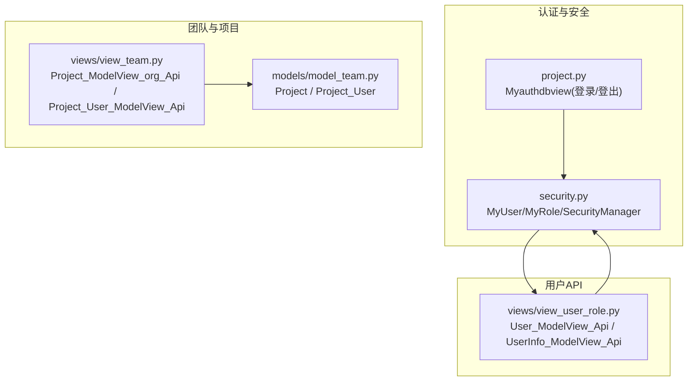
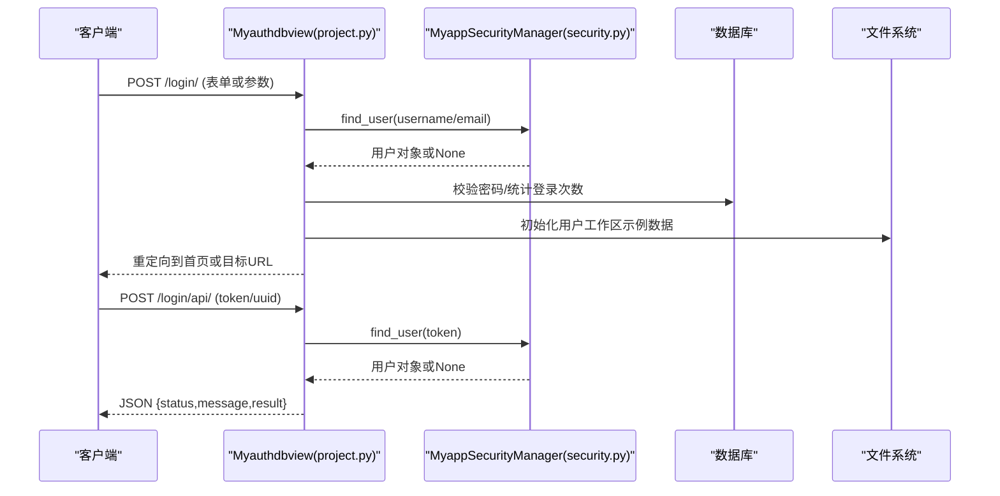
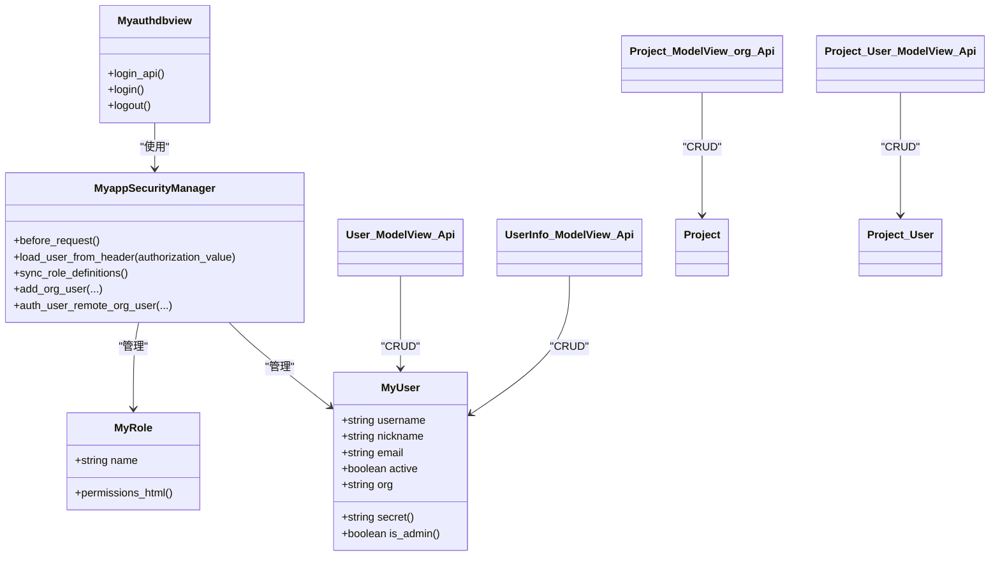

# 用户管理API

<cite>
**本文引用的文件**   
- [security.py](file://myapp/security.py)
- [project.py](file://myapp/project.py)
- [view_user_role.py](file://myapp/views/view_user_role.py)
- [view_team.py](file://myapp/views/view_team.py)
- [model_team.py](file://myapp/models/model_team.py)
</cite>

## 目录
1. [简介](#简介)
2. [项目结构](#项目结构)
3. [核心组件](#核心组件)
4. [架构总览](#架构总览)
5. [详细接口规范](#详细接口规范)
6. [依赖关系分析](#依赖关系分析)
7. [性能与扩展性](#性能与扩展性)
8. [故障排查指南](#故障排查指南)
9. [结论](#结论)

## 简介
本文件面向开发者与集成方，系统化梳理 cube-studio 的用户管理相关 RESTful API，覆盖：
- 用户注册、登录、登出、个人信息查询与更新
- 角色与权限（内置 Admin/Gamma）
- 团队/组织与项目成员管理
- 用户状态管理、搜索过滤、批量操作能力
- 审计日志与事件记录
- 认证方式（Cookie + Header Token/用户名直传）

说明：
- 所有接口基于 Flask-AppBuilder 的 ModelRestApi 生成标准 CRUD 接口，同时提供若干自定义端点。
- 鉴权支持两种模式：
  - Cookie 会话（浏览器登录流程）
  - Header 认证（Authorization 头），支持短 token（仅 payload.signature）或完整 JWT；也支持在特定条件下以纯用户名作为 Authorization 值进行免密访问。

## 项目结构
与用户管理相关的后端代码主要分布在以下模块：
- 安全与用户模型：myapp/security.py
- 登录/登出视图：myapp/project.py
- 用户与个人信息 API：myapp/views/view_user_role.py
- 团队/项目与成员 API：myapp/views/view_team.py
- 团队/项目数据模型：myapp/models/model_team.py

图表来源
- [security.py:40-107](file://myapp/security.py#L40-L107)
- [project.py:42-181](file://myapp/project.py#L42-L181)
- [view_user_role.py:27-115](file://myapp/views/view_user_role.py#L27-L115)
- [view_team.py:53-129](file://myapp/views/view_team.py#L53-L129)
- [model_team.py:26-225](file://myapp/models/model_team.py#L26-L225)

章节来源
- [security.py:40-107](file://myapp/security.py#L40-L107)
- [project.py:42-181](file://myapp/project.py#L42-L181)
- [view_user_role.py:27-115](file://myapp/views/view_user_role.py#L27-L115)
- [view_team.py:53-129](file://myapp/views/view_team.py#L53-L129)
- [model_team.py:26-225](file://myapp/models/model_team.py#L26-L225)

## 核心组件
- MyUser：继承自 AppBuilder 的 User，扩展了昵称、组织架构、配额、余额、微信、电话、优惠券、代金券、发票、实名认证、子账户等字段，并提供 is_admin、secret 等属性。
- MyRole：继承自 AppBuilder 的 Role，提供权限 HTML 展示。
- MyappSecurityManager：自定义安全管理器，实现 header 认证、用户加载、默认角色同步、组织用户自动注册、项目可见范围计算等。
- Myauthdbview：登录/登出视图，提供 /login/ 和 /login/api/ 以及 /logout。
- User_ModelView_Api：基于 MyUser 的标准 CRUD API，路由前缀 /users/api。
- UserInfo_ModelView_Api：个人信息 API，路由前缀 /userinfo/api，包含当前用户信息 GET 与 POST 更新。
- Project_ModelView_org_Api：组织项目分组 API，路由前缀 /project_modelview/org/api。
- Project_User_ModelView_Api：项目组成员 API，路由前缀 /project_user_modelview/api。
- Project / Project_User：项目与成员关系模型，定义成员角色 dev/ops/creator 及配额、资源组等。

章节来源
- [security.py:47-107](file://myapp/security.py#L47-L107)
- [security.py:237-406](file://myapp/security.py#L237-L406)
- [project.py:42-181](file://myapp/project.py#L42-L181)
- [view_user_role.py:27-115](file://myapp/views/view_user_role.py#L27-L115)
- [view_team.py:53-129](file://myapp/views/view_team.py#L53-L129)
- [model_team.py:26-225](file://myapp/models/model_team.py#L26-L225)

## 架构总览
下图展示了用户生命周期与关键交互：

图表来源
- [project.py:45-168](file://myapp/project.py#L45-L168)
- [security.py:256-286](file://myapp/security.py#L256-L286)

## 详细接口规范

### 一、认证与会话
- 登录页面与逻辑
  - 路径：GET/POST /login/
  - 功能：表单登录、参数登录（username/password）、未激活处理、失败计数、成功后创建用户工作区并分配默认角色。
  - 行为要点：
    - 支持通过 URL 参数 username 直接登录。
    - 若用户不存在且允许自动注册，则调用安全管理的远程用户注册流程。
    - 登录后将用户加入 Gamma 默认角色，并初始化用户工作区示例数据。
- 登录 API（Token 登录）
  - 路径：GET/POST /login/api/
  - 入参：token（可选）、uuid（可选）
  - 返回：JSON {status, message, result}
  - 行为要点：
    - 使用 token 查找用户并建立会话；若携带 uuid，会写入用户 org 字段。
- 登出
  - 路径：GET /logout
  - 行为：清除 session，跳转回登录页。

请求示例
- 表单登录
  - POST /login/
  - Body（表单）：username=xxx&password=xxx
- Token 登录
  - POST /login/api/?token=xxx&uuid=org_name

响应示例
- 成功
  - {"status":0,"message":"登录成功","result":{}}
- 失败
  - {"status":1,"message":"未发现用户","result":{}}

章节来源
- [project.py:45-168](file://myapp/project.py#L45-L168)
- [project.py:175-181](file://myapp/project.py#L175-L181)

### 二、用户CRUD（/users/api）
- 基础能力
  - 列表：GET /users/api/
  - 新增：POST /users/api/add/
  - 编辑：POST /users/api/edit/{id}/
  - 详情：GET /users/api/show/{id}/
  - 删除：POST /users/api/delete/{id}/
- 排序与分页
  - 支持 base_order、order_columns 配置（默认按 id 倒序）。
- 搜索字段
  - 支持 username、nickname、org 搜索。
- 显示列
  - list_columns 包含 username、nickname、active、roles_html、org。
- 权限控制
  - 默认具备 can_list/can_edit/can_add/can_show 权限。

请求示例
- 新增用户
  - POST /users/api/add/
  - Body（JSON）：{"username":"alice","nickname":"爱丽丝","email":"alice@example.com","password":"明文或密文","org":"工程一部","roles":[...]}
- 编辑用户
  - POST /users/api/edit/{id}/
  - Body（JSON）：{"active":true,"email":"new@example.com","org":"研发部"}

响应示例
- 列表
  - {"count":N,"list":[...],"offset":0,"total":N,...}
- 新增/编辑/删除
  - {"status":0,"message":"操作成功","result":{}}

章节来源
- [view_user_role.py:27-64](file://myapp/views/view_user_role.py#L27-L64)
- [security.py:119-227](file://myapp/security.py#L119-L227)

### 三、个人信息（/userinfo/api）
- 获取当前用户信息
  - 路径：GET /userinfo/api/current/userinfo
  - 返回字段：username、email、nickname、roles（逗号分隔字符串）、active、org、secret、created_on、changed_on、wechat、locale。
- 更新当前用户信息
  - 路径：POST /userinfo/api/current/userinfo
  - 入参：username、password、email、org、nickname、wechat（可选）
  - 行为要点：
    - 用户名/邮箱唯一性校验（排除自身）。
    - 若传入明文密码，将进行哈希加密后存储。
    - 提交成功后返回统一响应格式。

请求示例
- 更新
  - POST /userinfo/api/current/userinfo
  - Body（JSON）：{"nickname":"新昵称","email":"new@example.com","org":"研发部","password":"新密码"}

响应示例
- 成功
  - {"status":0,"message":"修正完成","result":{}}
- 失败（用户名或邮箱已存在）
  - {"status":1,"message":"用户名或邮箱已存在","result":{}}

章节来源
- [view_user_role.py:68-115](file://myapp/views/view_user_role.py#L68-L115)

### 四、角色与权限
- 内置角色
  - Admin：管理员角色
  - Gamma：普通用户角色（新用户默认分配）
- 角色管理 API
  - 由 SecurityManager 暴露的角色视图提供标准 CRUD（路由前缀通常为 /roles）。
- 权限控制
  - 系统默认开启 broad access（has_access/can_access 对已认证用户放行），具体业务可通过 view 层权限控制。

章节来源
- [security.py:403-406](file://myapp/security.py#L403-L406)
- [security.py:383-395](file://myapp/security.py#L383-L395)

### 五、团队/组织与项目成员
- 组织项目分组（/project_modelview/org/api）
  - 能力：增删改查组织类型的项目分组，支持 expand 扩展字段（如 cluster、org、volume_mount、SERVICE_EXTERNAL_IP 等）。
  - 权限：管理员可增删改；非管理员仅能查看。
  - 创建项目时会自动为创建者添加 creator 成员。
- 项目组成员（/project_user_modelview/api）
  - 能力：为项目添加/编辑/删除成员，成员角色包括 dev、ops、creator。
  - 权限：仅 admin 或项目的 creator 可添加/编辑/删除成员。
  - 列表/筛选：支持按项目类型过滤（org）。

请求示例
- 添加成员
  - POST /project_user_modelview/api/add/
  - Body（JSON）：{"project":1,"user":2,"role":"dev"}
- 编辑成员
  - POST /project_user_modelview/api/edit/{id}/
  - Body（JSON）：{"role":"ops"}

响应示例
- 成功
  - {"status":0,"message":"操作成功","result":{}}

章节来源
- [view_team.py:53-129](file://myapp/views/view_team.py#L53-L129)
- [view_team.py:233-363](file://myapp/views/view_team.py#L233-L363)
- [model_team.py:26-225](file://myapp/models/model_team.py#L26-L225)

### 六、用户状态管理
- active 字段
  - 控制用户是否可用。登录流程中对未激活用户进行拦截。
- 登录统计
  - 登录成功/失败会更新用户认证统计（update_user_auth_stat）。
- 默认角色
  - 新用户首次登录或注册时会分配 Gamma 角色。

章节来源
- [project.py:94-157](file://myapp/project.py#L94-L157)
- [security.py:201-227](file://myapp/security.py#L201-L227)

### 七、批量操作与搜索过滤
- 批量操作
  - 通过 AppBuilder 的 ModelRestApi 提供的 add/edit/delete/list/show 组合，可实现批量导入导出（前端或脚本驱动）。
- 搜索过滤
  - 用户列表支持按 username、nickname、org 搜索。
  - 项目成员与项目列表支持按 type=org 过滤。
  - 自定义过滤器：Creator_Filter、Project_Join_Filter 用于限制可见范围。

章节来源
- [view_user_role.py:27-64](file://myapp/views/view_user_role.py#L27-L64)
- [view_team.py:35-50](file://myapp/views/view_team.py#L35-L50)

### 八、用户生命周期与自动注册
- 自动注册
  - 当用户首次登录且不存在时，系统会根据安全管理器的远程用户注册流程创建用户，并赋予默认角色。
- 工作区初始化
  - 登录后为用户创建工作区目录并复制示例 pipeline 模板。

章节来源
- [project.py:140-168](file://myapp/project.py#L140-L168)
- [security.py:311-381](file://myapp/security.py#L311-L381)

### 九、审计日志与事件记录
- 登录事件
  - 登录成功后记录事件（event_logger.log），包含 action='login' 与耗时。
- 审计混入
  - 模型层使用 AuditMixinNullable，记录 created_by/changed_by 等审计字段。

章节来源
- [project.py:152-153](file://myapp/project.py#L152-L153)
- [model_team.py:11-13](file://myapp/models/model_team.py#L11-L13)

### 十、认证方式与Header鉴权
- Header 认证
  - 支持 Authorization 头中传递 JWT（HS256）或短 token（仅 payload.signature）。
  - 在特定条件（AUTH_PLATFORM_ACCESS 开启或内网域名访问）下，Authorization 可直接传用户名进行免密访问。
- 用户加载
  - SecurityManager.before_request 将当前用户注入 g.user。

章节来源
- [security.py:247-286](file://myapp/security.py#L247-L286)

## 依赖关系分析

图表来源
- [security.py:47-107](file://myapp/security.py#L47-L107)
- [security.py:237-406](file://myapp/security.py#L237-L406)
- [project.py:42-181](file://myapp/project.py#L42-L181)
- [view_user_role.py:27-115](file://myapp/views/view_user_role.py#L27-L115)
- [view_team.py:53-129](file://myapp/views/view_team.py#L53-L129)
- [model_team.py:26-225](file://myapp/models/model_team.py#L26-L225)

## 性能与扩展性
- 认证性能
  - Header 认证避免额外会话开销，适合服务间调用；JWT 解码轻量。
- 数据访问
  - 使用 SQLAlchemy ORM，建议结合分页与只读字段减少负载。
- 可扩展点
  - 可在 SecurityManager 中扩展 has_access/can_access 实现细粒度权限控制。
  - 在 ModelRestApi 子类中重写 pre_add/pre_update/post_list 等方法实现业务钩子。

[本节为通用指导，不直接分析具体文件]

## 故障排查指南
- 登录失败
  - 检查用户名是否存在、密码是否正确、用户是否被激活。
  - 查看登录失败计数与日志。
- 无法访问资源
  - 确认 Authorization 头是否正确（JWT 或短 token），或是否在允许免密访问的条件内。
  - 检查用户角色与项目成员角色是否满足访问要求。
- 个人信息更新失败
  - 检查用户名/邮箱唯一性冲突。
  - 确认密码是否为明文（需要哈希加密）。

章节来源
- [project.py:94-157](file://myapp/project.py#L94-L157)
- [view_user_role.py:94-113](file://myapp/views/view_user_role.py#L94-L113)
- [security.py:256-286](file://myapp/security.py#L256-L286)

## 结论
本仓库提供了完整的用户管理与团队协作能力：
- 用户注册/登录/登出、个人信息维护、角色权限管理
- 组织项目与成员管理，支持多角色与配额
- 灵活的认证机制（Cookie + Header Token/用户名直传）
- 审计与事件记录，便于追踪与合规

建议在集成时：
- 优先使用 /login/api/ 进行无状态认证
- 通过 /users/api 与 /userinfo/api 管理用户数据
- 通过 /project_modelview/org/api 与 /project_user_modelview/api 管理团队与成员
- 根据业务需要在 SecurityManager 与 ModelRestApi 子类中扩展权限与校验逻辑