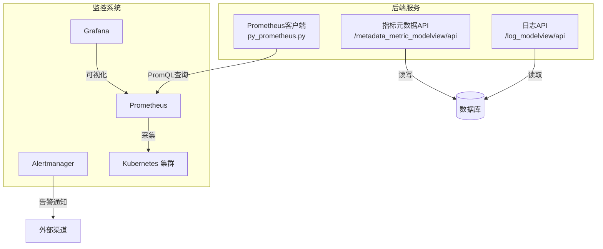
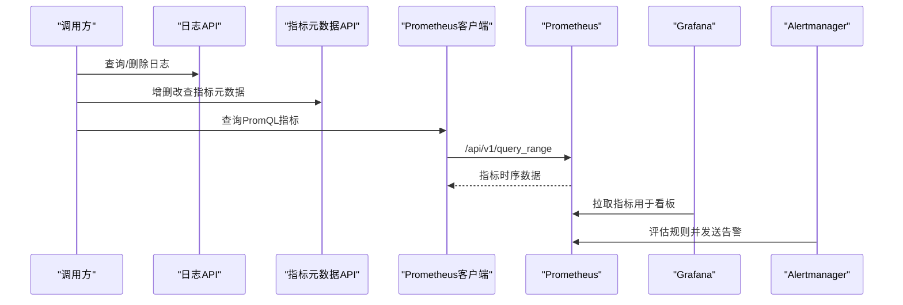
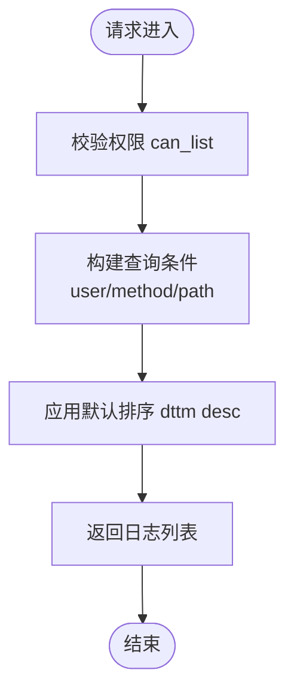
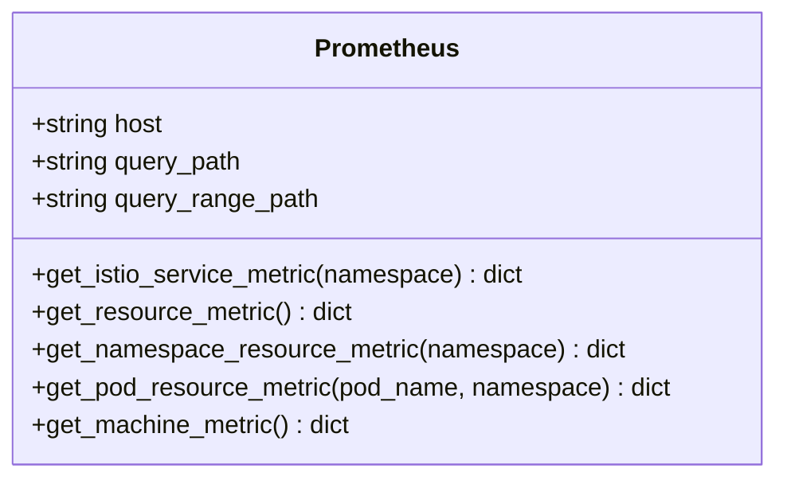
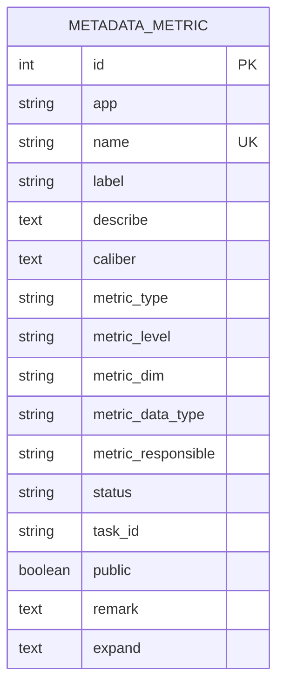
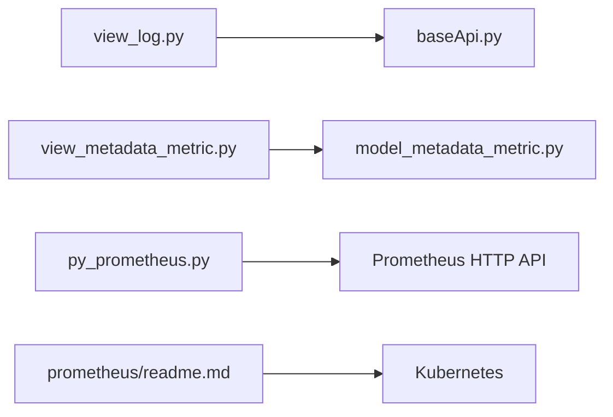

# 监控与日志API

<cite>
**本文引用的文件**   
- [myapp/views/view_log.py](file://myapp/views/view_log.py)
- [myapp/utils/py/py_prometheus.py](file://myapp/utils/py/py_prometheus.py)
- [myapp/models/model_metadata_metric.py](file://myapp/models/model_metadata_metric.py)
- [myapp/views/view_metadata_metric.py](file://myapp/views/view_metadata_metric.py)
- [install/kubernetes/prometheus/readme.md](file://install/kubernetes/prometheus/readme.md)
</cite>

## 目录
1. [简介](#简介)
2. [项目结构](#项目结构)
3. [核心组件](#核心组件)
4. [架构总览](#架构总览)
5. [详细组件分析](#详细组件分析)
6. [依赖关系分析](#依赖关系分析)
7. [性能考虑](#性能考虑)
8. [故障排查指南](#故障排查指南)
9. [结论](#结论)
10. [附录](#附录)

## 简介
本文件面向“监控与日志”相关能力的开发者与运维人员，系统化说明以下REST接口与集成能力：
- 系统指标收集与查询（Prometheus）
- 服务监控（Istio、Kubernetes节点/命名空间/Pod级资源）
- 日志查询与管理
- 自定义指标元数据管理
- Prometheus/Grafana集成部署要点
- 告警规则配置入口（通过Prometheus规则与Alertmanager）
- 分布式追踪与链路追踪的对接建议
- 容量规划支持（基于CPU/Memory/GPU利用率）

本仓库提供了：
- 日志API视图（Flask-AppBuilder REST）
- Prometheus客户端封装（PromQL查询、指标聚合）
- 指标元数据模型与REST API
- Kubernetes下Prometheus/Grafana/Alertmanager部署脚本与说明

## 项目结构
围绕监控与日志的核心代码分布如下：
- 日志API：views/view_log.py
- Prometheus客户端：utils/py/py_prometheus.py
- 指标元数据模型与API：models/model_metadata_metric.py、views/view_metadata_metric.py
- Prometheus/Grafana/Alertmanager部署说明：install/kubernetes/prometheus/readme.md

图表来源
- [myapp/views/view_log.py:10-31](file://myapp/views/view_log.py#L10-L31)
- [myapp/views/view_metadata_metric.py:223-228](file://myapp/views/view_metadata_metric.py#L223-L228)
- [myapp/utils/py/py_prometheus.py:6-13](file://myapp/utils/py/py_prometheus.py#L6-L13)
- [install/kubernetes/prometheus/readme.md:1-103](file://install/kubernetes/prometheus/readme.md#L1-L103)

章节来源
- [myapp/views/view_log.py:1-36](file://myapp/views/view_log.py#L1-L36)
- [myapp/views/view_metadata_metric.py:1-229](file://myapp/views/view_metadata_metric.py#L1-L229)
- [myapp/utils/py/py_prometheus.py:1-463](file://myapp/utils/py/py_prometheus.py#L1-L463)
- [install/kubernetes/prometheus/readme.md:1-103](file://install/kubernetes/prometheus/readme.md#L1-L103)

## 核心组件
- 日志API（Flask-AppBuilder REST）
  - 提供日志记录的列表、搜索、排序与批量删除能力。
  - 路由前缀：/log_modelview/api
  - 字段包括：用户、方法、路径、响应延迟、时间等。
- Prometheus客户端
  - 封装Prometheus HTTP API，提供PromQL查询、范围查询、指标聚合。
  - 支持Istio服务QPS、Pod CPU/Memory/GPU利用率、命名空间维度聚合。
- 指标元数据API
  - 提供指标定义（名称、标签、口径、负责人、等级、维度、状态等）的CRUD。
  - 路由前缀：/metadata_metric_modelview/api
  - 支持公开/私有权限过滤、表单扩展字段、导入导出。
- Prometheus/Grafana/Alertmanager集成
  - 提供在Kubernetes中部署Operator、Exporter、ServiceMonitor、Rules、Dashboard等的步骤说明。

章节来源
- [myapp/views/view_log.py:10-31](file://myapp/views/view_log.py#L10-L31)
- [myapp/utils/py/py_prometheus.py:6-131](file://myapp/utils/py/py_prometheus.py#L6-L131)
- [myapp/models/model_metadata_metric.py:18-35](file://myapp/models/model_metadata_metric.py#L18-L35)
- [myapp/views/view_metadata_metric.py:65-92](file://myapp/views/view_metadata_metric.py#L65-L92)
- [install/kubernetes/prometheus/readme.md:1-103](file://install/kubernetes/prometheus/readme.md#L1-L103)

## 架构总览
系统通过Prometheus采集Kubernetes/Istio/Node/DGPU等指标，Grafana进行可视化，Alertmanager负责告警；应用侧暴露日志与指标元数据的REST接口，并通过Prometheus客户端查询Prometheus以获取运行时指标。

图表来源
- [myapp/views/view_log.py:10-31](file://myapp/views/view_log.py#L10-L31)
- [myapp/views/view_metadata_metric.py:223-228](file://myapp/views/view_metadata_metric.py#L223-L228)
- [myapp/utils/py/py_prometheus.py:6-13](file://myapp/utils/py/py_prometheus.py#L6-L13)
- [install/kubernetes/prometheus/readme.md:60-100](file://install/kubernetes/prometheus/readme.md#L60-L100)

## 详细组件分析

### 日志API（/log_modelview/api）
- 功能
  - 列表查询：按用户、方法、路径检索，默认按时间倒序。
  - 批量删除：支持多选删除。
- 关键行为
  - 基础权限：can_list
  - 排序列：id
  - 展示列：user、method、path、duration_ms、dttm
- 典型用法
  - GET /log_modelview/api/list?search_columns=user,method,path&order_column=id&order_direction=desc
  - POST /log_modelview/api/muldelete（批量删除）

图表来源
- [myapp/views/view_log.py:10-31](file://myapp/views/view_log.py#L10-L31)

章节来源
- [myapp/views/view_log.py:10-31](file://myapp/views/view_log.py#L10-L31)

### Prometheus客户端（py_prometheus.py）
- 功能
  - 构造Prometheus HTTP请求，执行瞬时查询与范围查询。
  - 聚合Istio服务QPS、Pod CPU/Memory/GPU利用率、命名空间维度指标。
- 主要方法
  - get_istio_service_metric(namespace)：按命名空间聚合QPS、GPU、内存、CPU。
  - get_resource_metric()：当前集群Pod资源利用率（CPU/MEM/GPU）。
  - get_namespace_resource_metric(namespace)：指定命名空间内Pod资源利用率。
  - get_pod_resource_metric(pod_name, namespace)：单Pod资源利用率。
  - get_machine_metric()：节点维度负载（示例实现待完善）。
- 数据流
  - 使用requests发起HTTP GET至Prometheus的/api/v1/query或/api/v1/query_range。
  - 解析JSON结果，按pod/service维度聚合指标值。

图表来源
- [myapp/utils/py/py_prometheus.py:6-131](file://myapp/utils/py/py_prometheus.py#L6-L131)
- [myapp/utils/py/py_prometheus.py:137-233](file://myapp/utils/py/py_prometheus.py#L137-L233)
- [myapp/utils/py/py_prometheus.py:236-333](file://myapp/utils/py/py_prometheus.py#L236-L333)
- [myapp/utils/py/py_prometheus.py:337-414](file://myapp/utils/py/py_prometheus.py#L337-L414)
- [myapp/utils/py/py_prometheus.py:418-456](file://myapp/utils/py/py_prometheus.py#L418-L456)

章节来源
- [myapp/utils/py/py_prometheus.py:6-463](file://myapp/utils/py/py_prometheus.py#L6-L463)

### 指标元数据模型与API（/metadata_metric_modelview/api）
- 模型字段
  - app、name、label、describe、caliber、metric_type、metric_level、metric_dim、metric_data_type、metric_responsible、status、task_id、public、remark、expand
- API能力
  - 增删改查、导入导出、表单扩展字段、权限过滤（管理员可见全部，非管理员仅公开或本人负责的指标）。
- 路由
  - route_base = '/metadata_metric_modelview/api'

图表来源
- [myapp/models/model_metadata_metric.py:18-35](file://myapp/models/model_metadata_metric.py#L18-L35)
- [myapp/views/view_metadata_metric.py:65-92](file://myapp/views/view_metadata_metric.py#L65-L92)

章节来源
- [myapp/models/model_metadata_metric.py:18-35](file://myapp/models/model_metadata_metric.py#L18-L35)
- [myapp/views/view_metadata_metric.py:65-228](file://myapp/views/view_metadata_metric.py#L65-L228)

### Prometheus/Grafana/Alertmanager集成
- 部署步骤
  - 为节点添加monitoring标签，创建monitoring命名空间。
  - 部署Prometheus Operator、Alertmanager、Node Exporter、Kube State Metrics。
  - 配置Grafana数据源与仪表板。
  - 创建Prometheus Rules与ServiceMonitors以采集目标。
  - 部署GPU监控（DCGM Exporter）。
  - 部署prometheus-adapter以将Prometheus指标转换为K8s自定义指标。
- 关键点
  - ServiceMonitor需匹配k8s-app标签以便Prometheus发现。
  - 可通过alertmanager-main.yml配置告警通道。
  - grafana-datasources.yml配置Prometheus数据源。

章节来源
- [install/kubernetes/prometheus/readme.md:1-103](file://install/kubernetes/prometheus/readme.md#L1-L103)

## 依赖关系分析
- 日志API依赖Flask-AppBuilder的ModelRestApi与SQLAInterface，对Log模型提供标准REST。
- 指标元数据API依赖Metadata_metric模型与权限过滤器，提供带权限控制的CRUD。
- Prometheus客户端依赖requests库与Prometheus HTTP API。
- 部署脚本依赖Kubernetes API与Helm/Kubectl工具链。

图表来源
- [myapp/views/view_log.py:1-31](file://myapp/views/view_log.py#L1-L31)
- [myapp/views/view_metadata_metric.py:1-228](file://myapp/views/view_metadata_metric.py#L1-L228)
- [myapp/utils/py/py_prometheus.py:1-13](file://myapp/utils/py/py_prometheus.py#L1-L13)
- [install/kubernetes/prometheus/readme.md:1-103](file://install/kubernetes/prometheus/readme.md#L1-L103)

章节来源
- [myapp/views/view_log.py:1-31](file://myapp/views/view_log.py#L1-L31)
- [myapp/views/view_metadata_metric.py:1-228](file://myapp/views/view_metadata_metric.py#L1-L228)
- [myapp/utils/py/py_prometheus.py:1-13](file://myapp/utils/py/py_prometheus.py#L1-L13)
- [install/kubernetes/prometheus/readme.md:1-103](file://install/kubernetes/prometheus/readme.md#L1-L103)

## 性能考虑
- Prometheus查询优化
  - 尽量使用范围查询（query_range）并结合step参数减少数据量。
  - 合理设置start/end时间窗口，避免全表扫描。
- 指标聚合
  - 使用by/pod/namespace等维度聚合，降低返回结果集大小。
- 超时与重试
  - 对Prometheus HTTP请求设置超时（如5秒），避免阻塞。
- 缓存策略
  - 对高频查询（如命名空间资源利用率）可引入本地缓存以减少Prometheus压力。
- GPU指标
  - DCGM_FI_DEV_GPU_UTIL为百分比，注意归一化到0-1区间。

[本节为通用指导，不直接分析具体文件]

## 故障排查指南
- Prometheus连接失败
  - 检查Prometheus服务是否可用，确认host与端口配置正确。
  - 验证网络连通性与防火墙策略。
- 指标为空或异常
  - 检查ServiceMonitor是否正确匹配k8s-app标签。
  - 确认Exporter（node-exporter、kube-state-metrics、DCGM）已部署且健康。
- 告警未触发
  - 检查Prometheus Rules是否加载成功。
  - 确认Alertmanager配置与通知通道正常。
- 日志API无数据
  - 检查数据库连接与Log模型写入逻辑。
  - 确认权限与搜索条件是否正确。

章节来源
- [myapp/views/view_log.py:10-31](file://myapp/views/view_log.py#L10-L31)
- [myapp/utils/py/py_prometheus.py:154-233](file://myapp/utils/py/py_prometheus.py#L154-L233)
- [install/kubernetes/prometheus/readme.md:60-100](file://install/kubernetes/prometheus/readme.md#L60-L100)

## 结论
本仓库提供了完整的监控与日志能力支撑：
- 日志API便于统一记录与检索系统访问日志。
- Prometheus客户端封装简化了PromQL查询与指标聚合。
- 指标元数据API为业务指标治理提供结构化存储与权限控制。
- Prometheus/Grafana/Alertmanager部署文档帮助快速搭建监控体系。
结合这些能力，可实现从数据采集、可视化、告警到容量规划的闭环监控体系。

[本节为总结性内容，不直接分析具体文件]

## 附录

### REST接口规范摘要
- 日志API
  - 路由：/log_modelview/api
  - 能力：列表、搜索、排序、批量删除
  - 字段：user、method、path、duration_ms、dttm
- 指标元数据API
  - 路由：/metadata_metric_modelview/api
  - 能力：增删改查、导入导出、权限过滤
  - 字段：app、name、label、describe、caliber、metric_type、metric_level、metric_dim、metric_data_type、metric_responsible、status、task_id、public、remark、expand

章节来源
- [myapp/views/view_log.py:10-31](file://myapp/views/view_log.py#L10-L31)
- [myapp/views/view_metadata_metric.py:65-228](file://myapp/views/view_metadata_metric.py#L65-L228)

### Prometheus集成与Grafana仪表板
- 部署顺序
  - 安装Operator与Exporter
  - 配置ServiceMonitors与Rules
  - 配置Grafana数据源与仪表板
  - 部署Alertmanager并配置通知通道
- 关键配置项
  - prometheus-rules.yml：告警规则
  - grafana-datasources.yml：Prometheus数据源
  - alertmanager-main.yml：告警通道

章节来源
- [install/kubernetes/prometheus/readme.md:21-100](file://install/kubernetes/prometheus/readme.md#L21-L100)

### 分布式追踪与链路追踪支持
- 建议方案
  - 使用OpenTelemetry或Jaeger接入，将Span信息上报至追踪后端。
  - 在Prometheus中暴露应用自定义指标（如请求耗时、错误率），供Grafana展示。
  - 在日志中注入trace_id，便于跨系统关联。
- 与现有能力结合
  - 通过Prometheus客户端查询应用自定义指标，辅助定位问题。
  - 在日志API中增加trace_id字段，便于链路追踪关联。

[本节为概念性指导，不直接分析具体文件]

### 容量规划支持
- 指标维度
  - Pod CPU/Memory/GPU利用率
  - 命名空间维度聚合
  - Istio服务QPS
- 分析方法
  - 基于历史峰值与趋势预测扩容需求。
  - 结合业务SLA设定阈值，触发自动扩缩容。

章节来源
- [myapp/utils/py/py_prometheus.py:137-414](file://myapp/utils/py/py_prometheus.py#L137-L414)