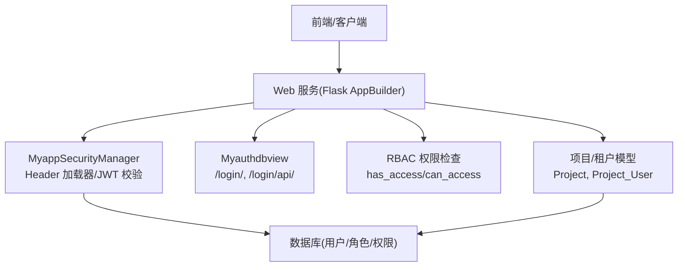
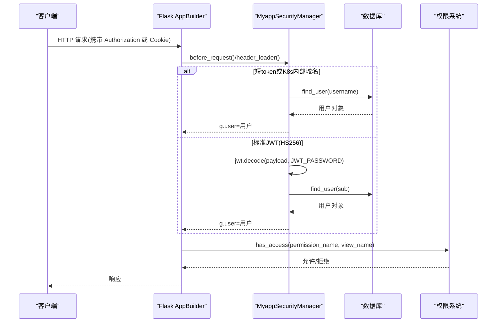
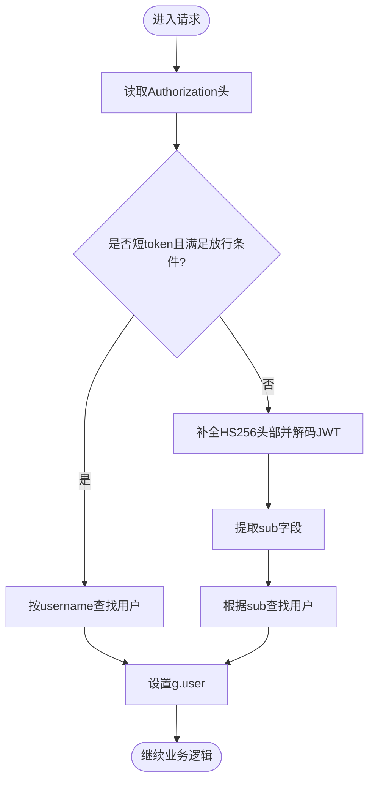
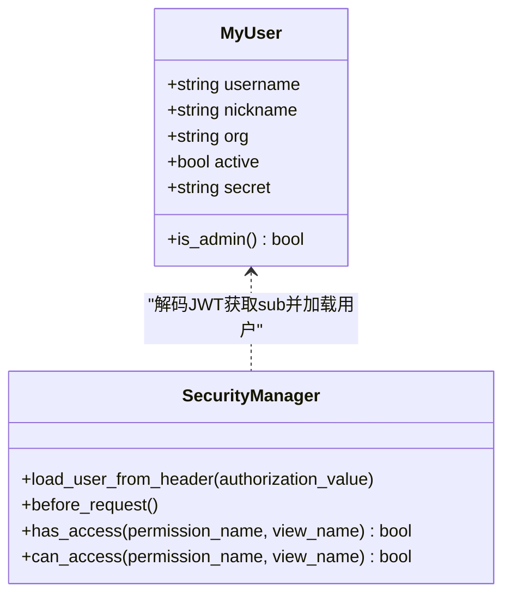
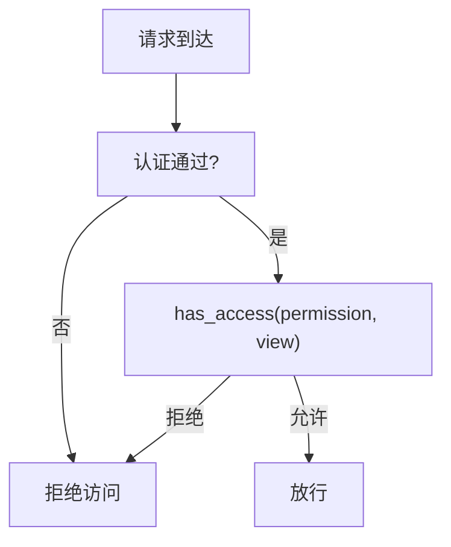
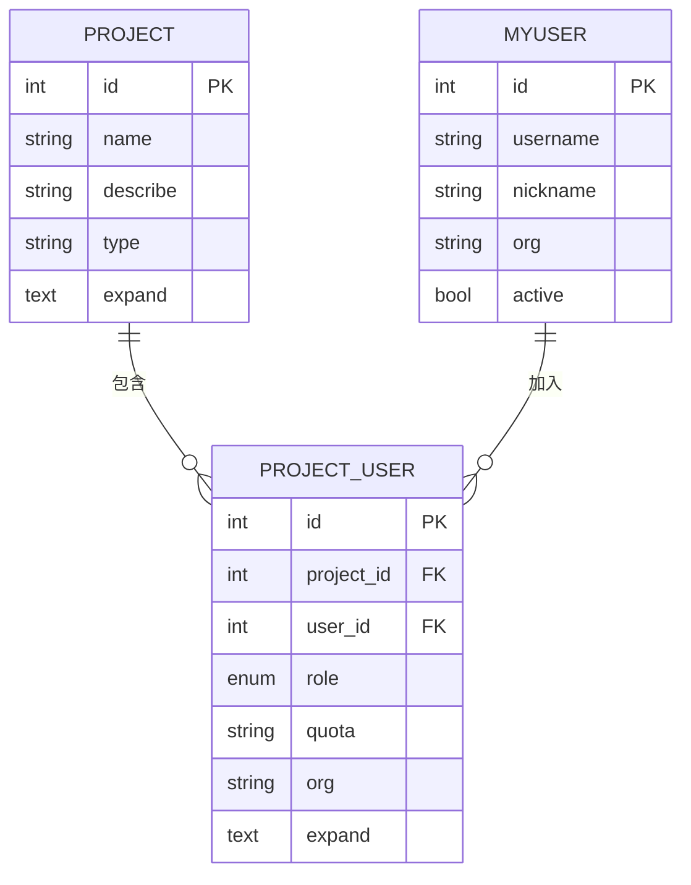
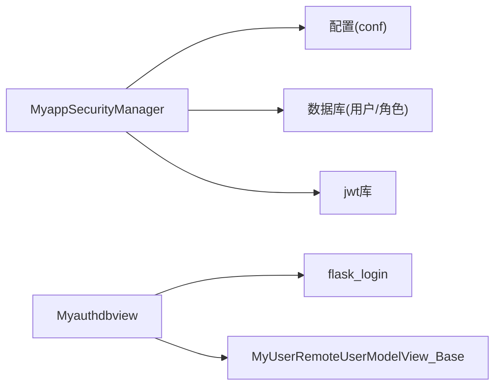

# 认证与授权

<cite>
**本文引用的文件**   
- [README.md](file://README.md)
- [security.py](file://myapp/security.py)
- [config.py](file://myapp/config.py)
- [project.py](file://myapp/project.py)
- [model_team.py](file://myapp/models/model_team.py)
</cite>

## 目录
1. [简介](#简介)
2. [项目结构](#项目结构)
3. [核心组件](#核心组件)
4. [架构总览](#架构总览)
5. [详细组件分析](#详细组件分析)
6. [依赖关系分析](#依赖关系分析)
7. [性能与安全考量](#性能与安全考量)
8. [故障排查指南](#故障排查指南)
9. [结论](#结论)
10. [附录：API 参考与示例](#附录api-参考与示例)

## 简介
本文件面向 CubeStudio 平台的“认证与授权”能力，系统性说明用户认证流程、JWT 令牌机制、SSO 单点登录集成、RBAC 权限控制、API 密钥管理、会话管理与安全最佳实践。文档同时覆盖多租户隔离、角色权限映射与访问控制策略，并提供不同认证方式的客户端集成思路（OAuth2、LDAP、自定义认证提供商）。

平台在功能清单中明确支持 SSO 单点登录（AUTH_OID/AUTH_LDAP/AUTH_REMOTE_USER 等）、账号密码注册自动登录、登录验证、强密码、远程用户、登录频率限制、密码密文传输等安全增强；并具备 RBAC 权限体系、菜单权限控制、接口访问类型控制以及多租户（多公司）隔离。

**章节来源**
- [README.md:23-30](file://README.md#L23-L30)
- [README.md:195-202](file://README.md#L195-L202)

## 项目结构
围绕认证与授权的核心代码主要位于 myapp 子模块：
- 安全模型与安全管理器：myapp/security.py
- 应用配置（含认证相关开关与常量）：myapp/config.py
- 登录视图与 API 入口：myapp/project.py
- 多租户/项目组模型：myapp/models/model_team.py

**图表来源**
- [security.py:237-286](file://myapp/security.py#L237-L286)
- [project.py:42-181](file://myapp/project.py#L42-L181)
- [model_team.py:26-225](file://myapp/models/model_team.py#L26-L225)

**章节来源**
- [security.py:1-491](file://myapp/security.py#L1-L491)
- [project.py:1-184](file://myapp/project.py#L1-L184)
- [model_team.py:1-225](file://myapp/models/model_team.py#L1-L225)

## 核心组件
- MyUser/MyRole 扩展模型：在 FAB 默认 User/Role 基础上扩展组织、配额、余额等字段，提供 secret 属性生成 JWT。
- MyappSecurityManager：统一的安全管理器，注入 header 认证加载器，实现短 token 兼容与 HS256 JWT 校验，并将当前用户挂载到 g.user。
- Myauthdbview：提供 /login/ 与 /login/api/ 两个登录入口，支持基于 token 的免密登录与用户名/邮箱登录。
- 配置项：AUTH_TYPE、AUTH_HEADER_NAME、JWT_PASSWORD、AUTH_PLATFORM_ACCESS 等控制认证行为。
- 多租户/项目组：Project/Project_User 定义租户与成员角色，支撑资源与命名空间隔离。

**章节来源**
- [security.py:47-107](file://myapp/security.py#L47-L107)
- [security.py:237-286](file://myapp/security.py#L237-L286)
- [project.py:42-181](file://myapp/project.py#L42-L181)
- [config.py:79-90](file://myapp/config.py#L79-L90)
- [config.py:561-563](file://myapp/config.py#L561-L563)
- [model_team.py:26-225](file://myapp/models/model_team.py#L26-L225)

## 架构总览
下图展示一次典型请求从进入 Web 服务到完成鉴权与权限判断的流程。

**图表来源**
- [security.py:247-286](file://myapp/security.py#L247-L286)
- [security.py:383-395](file://myapp/security.py#L383-L395)

**章节来源**
- [security.py:247-286](file://myapp/security.py#L247-L286)
- [security.py:383-395](file://myapp/security.py#L383-L395)

## 详细组件分析

### 用户认证流程（账号密码与Token）
- 账号密码登录：通过 Myauthdbview.login 处理表单提交，校验用户名/邮箱与密码，成功后调用 login_user 建立会话，并可重定向至目标页面。
- Token 免密登录：/login/api/ 接收 token，若匹配则直接登录并可选更新 org。
- Header 认证：MyappSecurityManager.header_loader 支持两类方式：
  - 短 token（长度小于阈值且满足条件）：按 username 免认证模式查找用户并设置 g.user。
  - 标准 JWT（HS256）：对两段式 token 进行头部补齐后解码，提取 sub 并加载用户。

**图表来源**
- [security.py:258-286](file://myapp/security.py#L258-L286)

**章节来源**
- [project.py:45-72](file://myapp/project.py#L45-L72)
- [project.py:74-168](file://myapp/project.py#L74-L168)
- [security.py:258-286](file://myapp/security.py#L258-L286)

### JWT 令牌机制
- 生成：MyUser.secret 使用 HS256 算法对用户名字段进行签名，返回仅 payload.signature 的短 token（便于缩短长度）。
- 校验：header_loader 在收到两段式 token 时自动补齐固定 HS256 头部，再使用配置的 JWT_PASSWORD 解码。
- 配置：JWT_PASSWORD 可通过环境变量或配置文件覆盖，未配置时使用默认值。

**图表来源**
- [security.py:47-94](file://myapp/security.py#L47-L94)
- [security.py:258-286](file://myapp/security.py#L258-L286)

**章节来源**
- [security.py:47-94](file://myapp/security.py#L47-L94)
- [security.py:258-286](file://myapp/security.py#L258-L286)

### SSO 单点登录集成
- 平台支持对接 AUTH_OID/LDAP/REMOTE_USER 等外部身份源，并在 README 中强调统一账号接入与多租户隔离。
- 当前后端默认启用 AUTH_DB，并通过 MyappSecurityManager.register_views 强制要求仅支持数据库认证模式（如需切换需修改对应逻辑）。
- 建议集成路径：
  - OAuth2/OIDC：在外部 IdP 认证成功后回调平台 /login/api/ 或直接通过 Authorization 头传递短 token/JWT。
  - LDAP：通过外部网关或代理将 LDAP 认证结果转换为平台可识别的 token/JWT。
  - 自定义认证提供商：在服务端完成认证后，调用 /login/api/ 或向客户端下发短 token/JWT，再由客户端以 Authorization 头发起后续请求。

**章节来源**
- [README.md:195-202](file://README.md#L195-L202)
- [security.py:297-309](file://myapp/security.py#L297-L309)
- [project.py:45-72](file://myapp/project.py#L45-L72)

### RBAC 权限控制
- 基础角色：Admin/Gamma 由同步逻辑创建，用户新增时默认分配 Gamma。
- 权限判定：has_access/can_access 用于判断当前用户是否有权访问指定视图/权限。
- 菜单与接口控制：FAB 提供菜单权限控制与接口访问类型控制，结合角色进行细粒度管控。
- 多租户/项目组：Project/Project_User 定义租户与成员角色（dev/ops/creator），配合命名空间与资源组实现数据与资源隔离。

**图表来源**
- [security.py:383-395](file://myapp/security.py#L383-L395)
- [model_team.py:26-225](file://myapp/models/model_team.py#L26-L225)

**章节来源**
- [security.py:101-117](file://myapp/security.py#L101-L117)
- [security.py:201-227](file://myapp/security.py#L201-L227)
- [security.py:383-395](file://myapp/security.py#L383-L395)
- [model_team.py:26-225](file://myapp/models/model_team.py#L26-L225)

### API 密钥与令牌管理
- 短 token：MyUser.secret 生成的两段式 token（payload.signature），适合轻量级场景。
- 标准 JWT：三段式 HS256 JWT，服务端自动补齐头部后解码。
- 配置项：
  - AUTH_HEADER_NAME：默认 Authorization。
  - JWT_PASSWORD：JWT 签名密钥，生产环境务必替换为强随机值。
  - AUTH_PLATFORM_ACCESS：开启后允许短 token 免认证模式（谨慎使用）。
- 建议：
  - 对外 API 优先使用标准 JWT，避免暴露明文用户名。
  - 对内服务间调用可使用短 token 或白名单域名/IP 放行。
  - 定期轮换 JWT_PASSWORD，并记录审计日志。

**章节来源**
- [security.py:74-94](file://myapp/security.py#L74-L94)
- [security.py:258-286](file://myapp/security.py#L258-L286)
- [config.py:561-563](file://myapp/config.py#L561-L563)

### 会话管理
- 基于 Flask-Login 的会话：成功登录后调用 login_user 建立会话，支持 remember 持久化。
- 登出：logout 清除 session 并跳转回登录页。
- 跨域：CORS 已启用，注意在生产环境收紧允许的 Origin。

**章节来源**
- [project.py:151-181](file://myapp/project.py#L151-L181)
- [config.py:152-153](file://myapp/config.py#L152-L153)

### 多租户隔离与命名空间
- 租户模型：Project 定义租户名称、描述、扩展参数与集群/命名空间策略。
- 成员模型：Project_User 关联用户与项目，定义角色与配额。
- 命名空间：NOTEBOOK_NAMESPACE、PIPELINE_NAMESPACE、SERVICE_NAMESPACE、AUTOML_NAMESPACE 等用于资源隔离。
- 资源组与集群：expand 字段可配置 node_selector、volume_mount、cluster 等，实现更细粒度的资源隔离。

**图表来源**
- [model_team.py:26-225](file://myapp/models/model_team.py#L26-L225)

**章节来源**
- [model_team.py:26-225](file://myapp/models/model_team.py#L26-L225)

## 依赖关系分析
- MyappSecurityManager 依赖：
  - flask_login.current_user 与 flask_jwt_extended.current_user
  - jwt 库进行 HS256 解码
  - myapp.conf 读取 JWT_PASSWORD、AUTH_PLATFORM_ACCESS 等配置
  - 数据库查询用户与角色
- Myauthdbview 依赖：
  - flask_appbuilder.security.views.AuthDBView
  - flask_login.login_user/logout_user
  - myapp.security.MyUserRemoteUserModelView_Base（用于新用户默认角色分配）

**图表来源**
- [security.py:237-286](file://myapp/security.py#L237-L286)
- [project.py:42-181](file://myapp/project.py#L42-L181)

**章节来源**
- [security.py:237-286](file://myapp/security.py#L237-L286)
- [project.py:42-181](file://myapp/project.py#L42-L181)

## 性能与安全考量
- 性能
  - JWT 解码为轻量操作，建议在高频接口中复用解码结果（如缓存用户信息）。
  - 短 token 免认证模式减少数据库查询，但应严格限制适用范围（内网域名/平台访问）。
- 安全
  - 生产环境必须设置强随机 JWT_PASSWORD，禁止使用默认值。
  - 谨慎开启 AUTH_PLATFORM_ACCESS，避免短 token 被滥用。
  - 关闭 DEBUG 与 SHOW_STACKTRACE，避免泄露敏感信息。
  - 限制 CORS 允许的 Origin，避免跨站请求风险。
  - 登录失败计数与频率限制需在外部网关或中间件层补充（平台 README 提及登录频率限制能力）。

**章节来源**
- [config.py:53-59](file://myapp/config.py#L53-L59)
- [config.py:152-153](file://myapp/config.py#L152-L153)
- [README.md:195-202](file://README.md#L195-L202)

## 故障排查指南
- 无法解析 JWT
  - 检查 Authorization 头是否为三段式 HS256 JWT；若为两段式，服务端会自动补齐头部。
  - 确认 JWT_PASSWORD 与服务端一致。
- 短 token 被拒绝
  - 检查 AUTH_PLATFORM_ACCESS 是否开启，或请求是否来自受信任的内网域名（kubeflow-dashboard.infra）。
- 登录失败
  - 核对用户名格式与密码是否正确；查看日志中的登录失败记录。
  - 确认用户是否处于激活状态。
- 权限不足
  - 检查用户是否拥有相应角色与权限；确认 has_access/can_access 的判断逻辑。

**章节来源**
- [security.py:258-286](file://myapp/security.py#L258-L286)
- [project.py:94-124](file://myapp/project.py#L94-L124)
- [security.py:383-395](file://myapp/security.py#L383-L395)

## 结论
CubeStudio 的认证与授权体系以 Flask AppBuilder 为基础，结合自定义的 MyappSecurityManager 实现了灵活的 Header 认证与 JWT 校验，并通过 RBAC 与多租户模型实现细粒度权限与资源隔离。平台支持 SSO 单点登录与多种认证方式集成，满足企业级安全与合规需求。建议在生产环境中强化密钥管理、收紧跨域与免认证范围，并结合外部网关完善登录频率限制与审计。

## 附录：API 参考与示例

### 登录 API
- 端点：/login/api/
- 方法：GET/POST
- 参数：
  - token：用于免密登录的凭证（短 token 或 JWT）
  - uuid：可选，用于更新用户的组织架构字段
- 响应：
  - status：0 表示成功，1 表示未发现用户
  - message：提示信息
  - result：附加数据

**章节来源**
- [project.py:45-72](file://myapp/project.py#L45-L72)

### 客户端集成示例（概念性步骤）
- OAuth2/OIDC
  - 用户在外部 IdP 完成认证后，服务端调用 /login/api/ 传入 token，或直接将 token 返回给客户端。
  - 客户端在后续请求中携带 Authorization: Bearer <token>。
- LDAP
  - 通过网关或代理将 LDAP 认证成功后的用户信息转换为平台可识别的 token/JWT。
  - 客户端同上，携带 Authorization 头。
- 自定义认证提供商
  - 服务端完成认证后，调用 /login/api/ 或直接签发短 token/JWT。
  - 客户端保存 token 并在请求头中携带。

[本节为概念性说明，不直接分析具体源码文件]