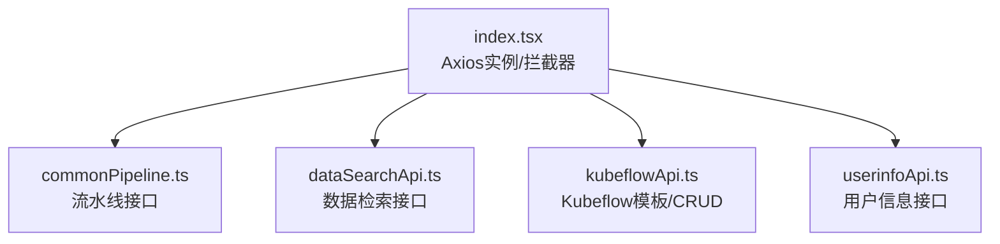
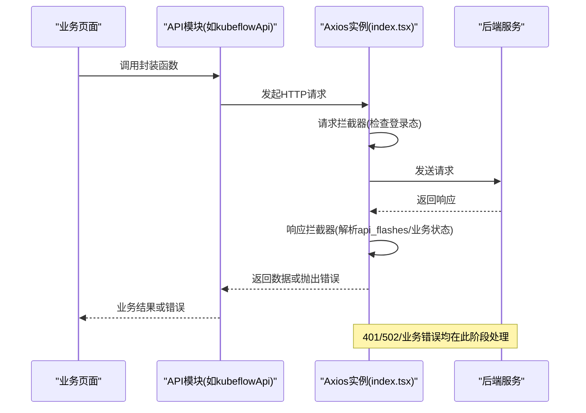
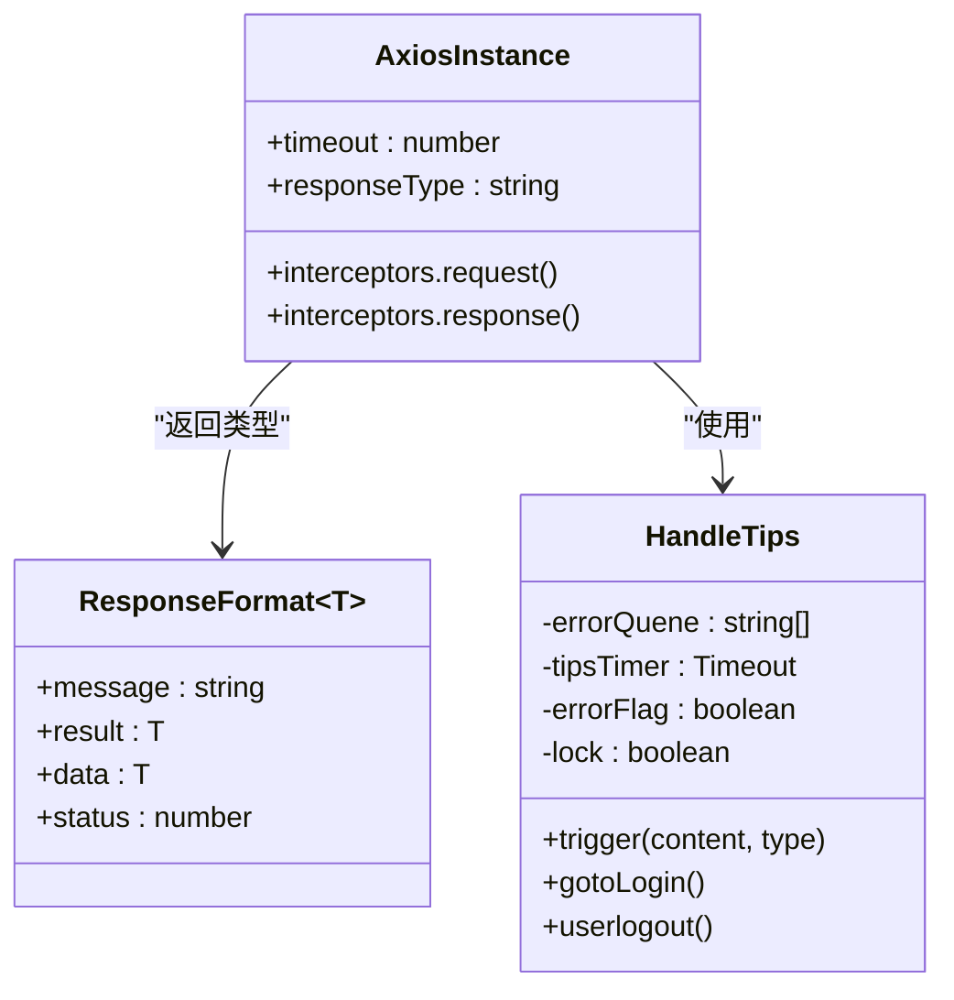
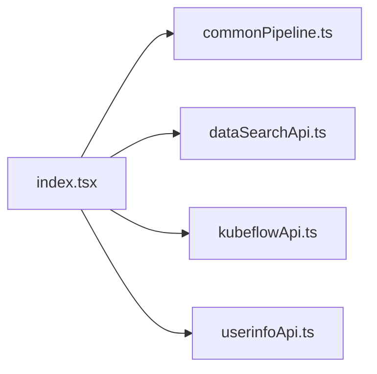

# API集成封装

<cite>
**本文引用的文件**   
- [myapp/frontend/src/api/index.tsx](file://myapp/frontend/src/api/index.tsx)
- [myapp/frontend/src/api/commonPipeline.ts](file://myapp/frontend/src/api/commonPipeline.ts)
- [myapp/frontend/src/api/dataSearchApi.ts](file://myapp/frontend/src/api/dataSearchApi.ts)
- [myapp/frontend/src/api/kubeflowApi.ts](file://myapp/frontend/src/api/kubeflowApi.ts)
- [myapp/frontend/src/api/userinfoApi.ts](file://myapp/frontend/src/api/userinfoApi.ts)
</cite>

## 目录
1. [引言](#引言)
2. [项目结构](#项目结构)
3. [核心组件](#核心组件)
4. [架构总览](#架构总览)
5. [详细组件分析](#详细组件分析)
6. [依赖关系分析](#依赖关系分析)
7. [性能与并发控制](#性能与并发控制)
8. [调试与监控](#调试与监控)
9. [故障排查指南](#故障排查指南)
10. [结论](#结论)

## 引言
本文件面向前端 API 集成封装层，系统性说明请求拦截器、响应处理机制、接口类型定义、错误处理策略、认证令牌管理、请求缓存与并发控制的现状与建议。文档同时给出新增业务接口的封装范式与异步数据流处理示例，并附带调试与性能监控方法，帮助团队在统一规范下高效扩展 API 能力。

## 项目结构
前端 API 封装位于 myapp/frontend/src/api 目录下，采用“基础实例 + 领域模块”的组织方式：
- index.tsx：Axios 实例创建、请求/响应拦截器、全局提示与登录态校验
- commonPipeline.ts：工作流/流水线相关接口
- dataSearchApi.ts：数据检索任务相关接口
- kubeflowApi.ts：Kubeflow 模板与通用 CRUD 封装
- userinfoApi.ts：用户信息相关接口

图表来源
- [myapp/frontend/src/api/index.tsx:15-18](file://myapp/frontend/src/api/index.tsx#L15-L18)
- [myapp/frontend/src/api/commonPipeline.ts:1-33](file://myapp/frontend/src/api/commonPipeline.ts#L1-L33)
- [myapp/frontend/src/api/dataSearchApi.ts:1-98](file://myapp/frontend/src/api/dataSearchApi.ts#L1-L98)
- [myapp/frontend/src/api/kubeflowApi.ts:1-106](file://myapp/frontend/src/api/kubeflowApi.ts#L1-L106)
- [myapp/frontend/src/api/userinfoApi.ts:1-85](file://myapp/frontend/src/api/userinfoApi.ts#L1-L85)

章节来源
- [myapp/frontend/src/api/index.tsx:1-168](file://myapp/frontend/src/api/index.tsx#L1-L168)
- [myapp/frontend/src/api/commonPipeline.ts:1-33](file://myapp/frontend/src/api/commonPipeline.ts#L1-L33)
- [myapp/frontend/src/api/dataSearchApi.ts:1-98](file://myapp/frontend/src/api/dataSearchApi.ts#L1-L98)
- [myapp/frontend/src/api/kubeflowApi.ts:1-106](file://myapp/frontend/src/api/kubeflowApi.ts#L1-L106)
- [myapp/frontend/src/api/userinfoApi.ts:1-85](file://myapp/frontend/src/api/userinfoApi.ts#L1-L85)

## 核心组件
- Axios 实例与基础配置
  - 超时时间、响应类型等基础参数在实例化时设置
  - 导出统一的 axios 实例供各业务模块使用
- 请求拦截器
  - 基于 Cookie 中的用户名判断是否已登录；未登录则跳转登录页并拒绝请求
  - 支持通过自定义头 X-Silent-Error 开启静默错误模式（仅控制台输出）
- 响应拦截器
  - 解析后端返回的 api_flashes 头部消息队列，按类型触发通知
  - 对业务状态码进行判断：成功直接返回；失败提取 message/msg/error 并抛出错误
  - 针对 401 自动跳转登录；502 显示网络中提示；其他错误根据静默模式决定是否弹窗
- 全局提示与登录态管理
  - 提供 HandleTips 类用于消息队列与定时弹出
  - 提供 gotoLogin 与 userlogout 方法统一处理鉴权失效与登出流程

章节来源
- [myapp/frontend/src/api/index.tsx:15-18](file://myapp/frontend/src/api/index.tsx#L15-L18)
- [myapp/frontend/src/api/index.tsx:21-66](file://myapp/frontend/src/api/index.tsx#L21-L66)
- [myapp/frontend/src/api/index.tsx:68-82](file://myapp/frontend/src/api/index.tsx#L68-L82)
- [myapp/frontend/src/api/index.tsx:84-165](file://myapp/frontend/src/api/index.tsx#L84-L165)

## 架构总览
下图展示了从页面调用到后端响应的完整链路，包括拦截器、错误处理与提示机制。

图表来源
- [myapp/frontend/src/api/index.tsx:68-165](file://myapp/frontend/src/api/index.tsx#L68-L165)
- [myapp/frontend/src/api/kubeflowApi.ts:6-106](file://myapp/frontend/src/api/kubeflowApi.ts#L6-L106)

## 详细组件分析

### 基础实例与类型定义（index.tsx）
- 导出类型 AxiosResFormat<T>，统一 Promise<AxiosResponse<ResponseFormat<T>>> 的返回形态
- ResponseFormat<T> 包含 message、result、data、status 字段，作为后端统一响应结构的契约
- 提供 handleTips 单例，集中管理通知与登录跳转逻辑

图表来源
- [myapp/frontend/src/api/index.tsx:6-12](file://myapp/frontend/src/api/index.tsx#L6-L12)
- [myapp/frontend/src/api/index.tsx:15-18](file://myapp/frontend/src/api/index.tsx#L15-L18)
- [myapp/frontend/src/api/index.tsx:21-66](file://myapp/frontend/src/api/index.tsx#L21-L66)

章节来源
- [myapp/frontend/src/api/index.tsx:6-12](file://myapp/frontend/src/api/index.tsx#L6-L12)
- [myapp/frontend/src/api/index.tsx:15-18](file://myapp/frontend/src/api/index.tsx#L15-L18)
- [myapp/frontend/src/api/index.tsx:21-66](file://myapp/frontend/src/api/index.tsx#L21-L66)

### 流水线接口（commonPipeline.ts）
- 提供获取节点关系、流水线布局、节点详情等接口
- 返回类型使用 AxiosResFormat，便于上层统一处理

章节来源
- [myapp/frontend/src/api/commonPipeline.ts:1-33](file://myapp/frontend/src/api/commonPipeline.ts#L1-L33)

### 数据检索接口（dataSearchApi.ts）
- 提交任务、查询任务状态、下载结果、停止任务、资源概览、表单配置等
- 部分接口返回非标准结构，需在上层做适配

章节来源
- [myapp/frontend/src/api/dataSearchApi.ts:1-98](file://myapp/frontend/src/api/dataSearchApi.ts#L1-L98)

### Kubeflow模板与通用CRUD（kubeflowApi.ts）
- 提供菜单、导航栏、模板信息、增删改查、收藏等接口
- 提供 getData/postData/putData/deleteData 等通用方法，简化重复代码

章节来源
- [myapp/frontend/src/api/kubeflowApi.ts:1-106](file://myapp/frontend/src/api/kubeflowApi.ts#L1-L106)

### 用户信息接口（userinfoApi.ts）
- 获取当前用户信息、更新个人信息、获取列配置等
- 明确 IUserInfo/IUserinfoInfo 等类型，增强类型安全

章节来源
- [myapp/frontend/src/api/userinfoApi.ts:1-85](file://myapp/frontend/src/api/userinfoApi.ts#L1-L85)

## 依赖关系分析
- 所有业务 API 模块均依赖 index.tsx 导出的 axios 实例与 AxiosResFormat 类型
- 业务模块之间无直接耦合，职责清晰，符合单一职责原则

图表来源
- [myapp/frontend/src/api/index.tsx:1-168](file://myapp/frontend/src/api/index.tsx#L1-L168)
- [myapp/frontend/src/api/commonPipeline.ts:1-33](file://myapp/frontend/src/api/commonPipeline.ts#L1-L33)
- [myapp/frontend/src/api/dataSearchApi.ts:1-98](file://myapp/frontend/src/api/dataSearchApi.ts#L1-L98)
- [myapp/frontend/src/api/kubeflowApi.ts:1-106](file://myapp/frontend/src/api/kubeflowApi.ts#L1-L106)
- [myapp/frontend/src/api/userinfoApi.ts:1-85](file://myapp/frontend/src/api/userinfoApi.ts#L1-L85)

章节来源
- [myapp/frontend/src/api/index.tsx:1-168](file://myapp/frontend/src/api/index.tsx#L1-L168)
- [myapp/frontend/src/api/commonPipeline.ts:1-33](file://myapp/frontend/src/api/commonPipeline.ts#L1-L33)
- [myapp/frontend/src/api/dataSearchApi.ts:1-98](file://myapp/frontend/src/api/dataSearchApi.ts#L1-L98)
- [myapp/frontend/src/api/kubeflowApi.ts:1-106](file://myapp/frontend/src/api/kubeflowApi.ts#L1-L106)
- [myapp/frontend/src/api/userinfoApi.ts:1-85](file://myapp/frontend/src/api/userinfoApi.ts#L1-L85)

## 性能与并发控制
现状
- 未实现请求级重试逻辑
- 未实现请求去重与缓存
- 未实现并发限制（如信号量/限流）

建议
- 请求重试
  - 仅在幂等 GET 请求上启用指数退避重试，避免副作用
  - 区分网络错误与服务端 5xx 错误，分别配置不同重试策略
- 请求缓存
  - 对 GET 请求按 URL+params 生成键，结合内存缓存与可选持久化（如 sessionStorage）
  - 支持 TTL 与主动失效（如写操作后清理相关缓存）
- 并发控制
  - 引入信号量或队列，限制同一时刻并发请求数，保护后端与用户体验
- 取消请求
  - 利用 AbortController 取消过时或不再需要的请求，减少无效开销

[本节为通用指导，不直接分析具体文件]

## 调试与监控
- 调试
  - 使用浏览器开发者工具 Network 面板查看请求头、响应头与负载
  - 关注 api_flashes 头部的消息队列，验证提示是否正常下发
  - 通过 X-Silent-Error 头切换静默模式，便于组件内自行处理错误
- 监控
  - 统计 401/502 比例与平均耗时，定位鉴权与网关问题
  - 记录业务错误码分布，辅助后端优化错误语义
  - 对高频接口增加采样日志，观察慢请求与异常峰值

[本节为通用指导，不直接分析具体文件]

## 故障排查指南
常见问题与定位要点
- 未登录导致请求被拒
  - 现象：请求被拦截并跳转登录页
  - 排查：确认 Cookie 中是否存在 myapp_username
  - 参考位置：请求拦截器
- 后端返回业务错误
  - 现象：弹出错误提示，Promise 被 reject
  - 排查：检查响应体中的 error_code/message 字段
  - 参考位置：响应拦截器
- 鉴权失效（401）
  - 现象：提示登录超时并跳转登录
  - 排查：确认 Token/Cookie 是否过期或被清理
  - 参考位置：响应拦截器
- 网关不可用（502）
  - 现象：提示网络连接中
  - 排查：检查网关/代理状态与后端可用性
  - 参考位置：响应拦截器
- 静默错误模式
  - 现象：错误仅打印到控制台，无弹窗
  - 排查：确认是否设置了 X-Silent-Error 头
  - 参考位置：响应拦截器

章节来源
- [myapp/frontend/src/api/index.tsx:68-82](file://myapp/frontend/src/api/index.tsx#L68-L82)
- [myapp/frontend/src/api/index.tsx:84-165](file://myapp/frontend/src/api/index.tsx#L84-L165)

## 结论
本项目的前端 API 封装以 Axios 为中心，通过拦截器统一处理鉴权、提示与错误，业务模块按领域拆分，职责清晰。当前尚未内置重试、缓存与并发控制，建议在后续迭代中按需引入，以提升健壮性与性能。通过统一的类型定义与封装范式，团队可快速扩展新的业务接口，并保持前后端契约一致。