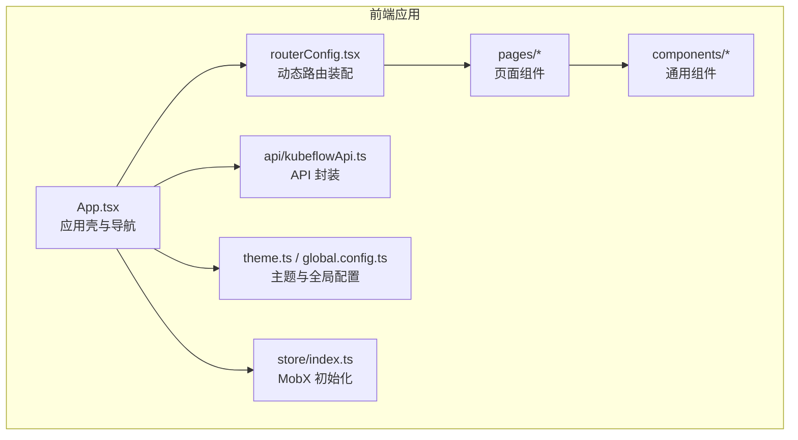
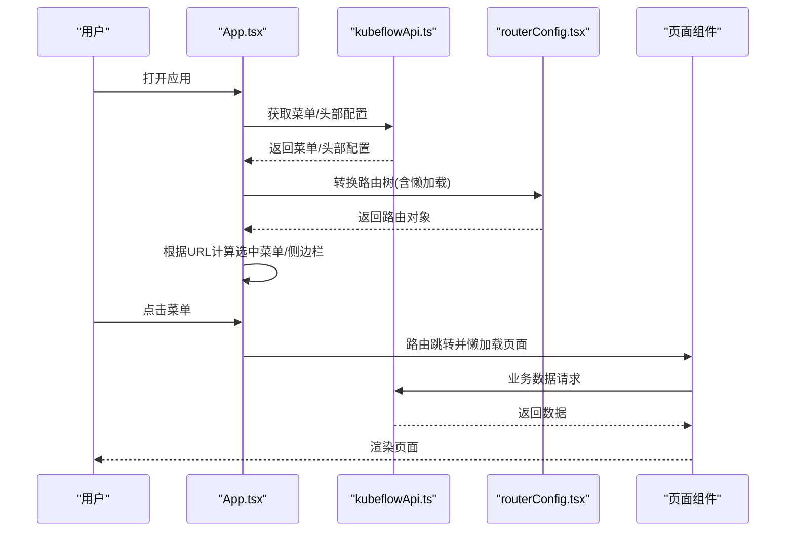
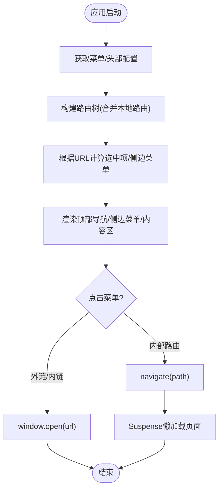
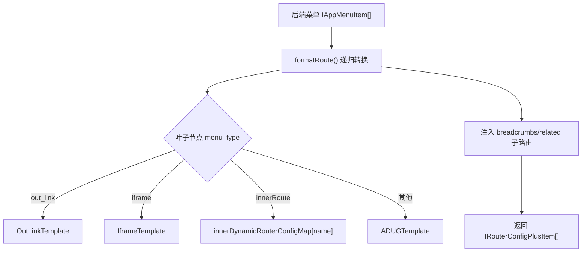
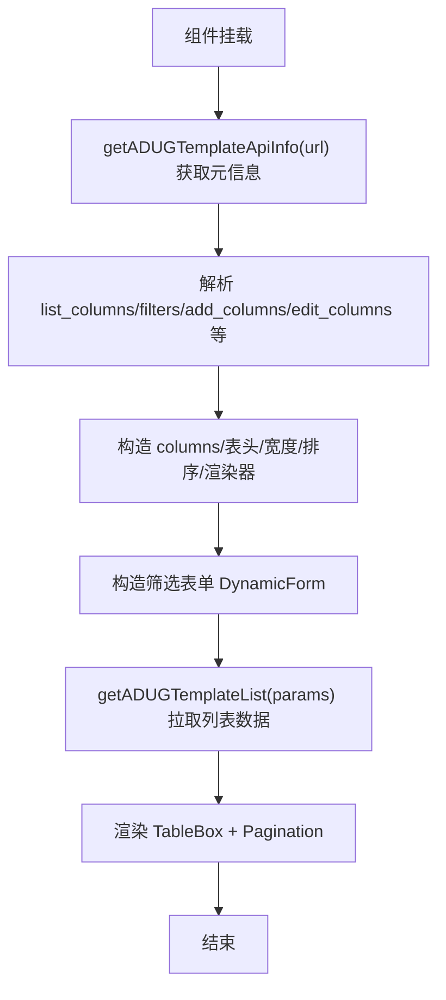
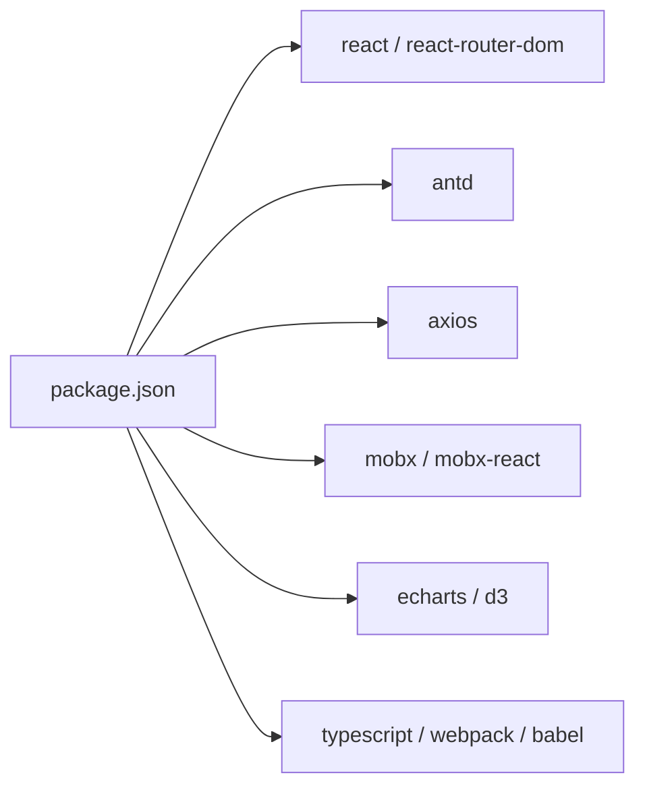

# 前端应用架构

<cite>
**本文引用的文件**   
- [package.json](file://myapp/frontend/package.json)
- [App.tsx](file://myapp/frontend/src/App.tsx)
- [routerConfig.tsx](file://myapp/frontend/src/routerConfig.tsx)
- [kubeflowApi.ts](file://myapp/frontend/src/api/kubeflowApi.ts)
- [ADUGTemplate.tsx](file://myapp/frontend/src/pages/ADUGTemplate.tsx)
- [theme.ts](file://myapp/frontend/src/theme.ts)
- [global.config.ts](file://myapp/frontend/src/global.config.ts)
- [store/index.ts](file://myapp/frontend/src/store/index.ts)
</cite>

## 目录
1. [简介](#简介)
2. [项目结构](#项目结构)
3. [核心组件](#核心组件)
4. [架构总览](#架构总览)
5. [详细组件分析](#详细组件分析)
6. [依赖关系分析](#依赖关系分析)
7. [性能与可维护性](#性能与可维护性)
8. [故障排查指南](#故障排查指南)
9. [结论](#结论)
10. [附录：扩展页面示例](#附录扩展页面示例)

## 简介
本文件面向 Cube Studio 前端（React + TypeScript + Ant Design）的架构文档，聚焦以下目标：
- React 应用结构与路由配置
- 组件设计模式与复用策略
- API 调用封装与状态管理
- UI 组件库使用与主题定制
- 页面开发示例、样式与交互扩展
- 性能优化与可维护性原则

## 项目结构
前端位于 myapp/frontend/src，采用“功能域+通用能力”的分层组织：
- src/api：统一 API 封装与接口类型
- src/components：通用业务与展示组件
- src/pages：页面级组件与模板
- src/store：MobX 全局状态初始化
- src/utils：工具函数
- 根级入口与配置：index.tsx、App.tsx、routerConfig.tsx、theme.ts、global.config.ts

图表来源
- [App.tsx:1-439](file://myapp/frontend/src/App.tsx#L1-L439)
- [routerConfig.tsx:1-161](file://myapp/frontend/src/routerConfig.tsx#L1-L161)
- [kubeflowApi.ts:1-106](file://myapp/frontend/src/api/kubeflowApi.ts#L1-L106)
- [theme.ts:1-107](file://myapp/frontend/src/theme.ts#L1-L107)
- [global.config.ts:1-18](file://myapp/frontend/src/global.config.ts#L1-L18)
- [store/index.ts:1-4](file://myapp/frontend/src/store/index.ts#L1-L4)

章节来源
- [package.json:1-213](file://myapp/frontend/package.json#L1-L213)

## 核心组件
- App.tsx：应用外壳，负责顶部导航、侧边菜单、动态路由渲染、自定义弹窗、用户退出等。
- routerConfig.tsx：将后端返回的菜单数据转换为 React Router v6 的路由树，并注入懒加载与默认模板。
- kubeflowApi.ts：基于 axios 的统一请求封装，提供菜单、头部配置、CRUD、收藏、图表等接口。
- ADUGTemplate.tsx：通用数据列表/表单/操作页模板，支持动态列、筛选、分页、批量操作、收藏、详情抽屉等。
- theme.ts / global.config.ts：Ant Design 主题变量与全局 Logo/主题开关。
- store/index.ts：MobX 初始化配置。

章节来源
- [App.tsx:1-439](file://myapp/frontend/src/App.tsx#L1-L439)
- [routerConfig.tsx:1-161](file://myapp/frontend/src/routerConfig.tsx#L1-L161)
- [kubeflowApi.ts:1-106](file://myapp/frontend/src/api/kubeflowApi.ts#L1-L106)
- [ADUGTemplate.tsx:1-800](file://myapp/frontend/src/pages/ADUGTemplate.tsx#L1-L800)
- [theme.ts:1-107](file://myapp/frontend/src/theme.ts#L1-L107)
- [global.config.ts:1-18](file://myapp/frontend/src/global.config.ts#L1-L18)
- [store/index.ts:1-4](file://myapp/frontend/src/store/index.ts#L1-L4)

## 架构总览
整体流程：
- 启动时从后端拉取菜单与头部配置，构建动态路由树；同时根据当前 URL 计算选中项与侧边菜单。
- 路由匹配后通过 lazy + Suspense 懒加载页面组件，提升首屏性能。
- 页面通过统一的 API 模块发起请求，结合 Ant Design 组件完成交互。
- 主题通过 CSS 变量在运行时切换。

图表来源
- [App.tsx:66-115](file://myapp/frontend/src/App.tsx#L66-L115)
- [routerConfig.tsx:71-145](file://myapp/frontend/src/routerConfig.tsx#L71-L145)
- [kubeflowApi.ts:6-12](file://myapp/frontend/src/api/kubeflowApi.ts#L6-L12)

## 详细组件分析

### 应用壳与路由装配（App.tsx）
职责：
- 拉取远程菜单与头部配置，合并本地路由，生成最终路由树。
- 根据当前路径计算顶部导航、侧边菜单、是否折叠等状态。
- 处理外链/内链/iframe 菜单跳转逻辑。
- 渲染自定义弹窗与全局 AI 聊天机器人。

关键点：
- 使用 useRoutes 动态渲染路由对象数组。
- 通过 getRouterMap 建立 path -> 路由项映射，便于快速定位当前菜单。
- 对 isSingleModule/isCollapsed 等字段进行差异化渲染。

图表来源
- [App.tsx:24-42](file://myapp/frontend/src/App.tsx#L24-L42)
- [App.tsx:66-115](file://myapp/frontend/src/App.tsx#L66-L115)
- [App.tsx:138-163](file://myapp/frontend/src/App.tsx#L138-L163)

章节来源
- [App.tsx:1-439](file://myapp/frontend/src/App.tsx#L1-L439)

### 路由配置与动态装配（routerConfig.tsx）
职责：
- 定义内置路由与懒加载包装器。
- 将后端菜单数据递归转换为 React Router v6 的路由对象。
- 根据 menu_type 选择不同模板（ADUGTemplate/OutLinkTemplate/IframeTemplate）。
- 支持 related 子路由与面包屑自动生成。

要点：
- lazy2Compont 统一包裹 React.lazy + Suspense，提供 LoadingStar 占位。
- formatRoute 递归生成 path、children、element，并注入 breadcrumbs。
- innerDynamicRouterConfig 用于特定页面的静态映射。

图表来源
- [routerConfig.tsx:14-22](file://myapp/frontend/src/routerConfig.tsx#L14-L22)
- [routerConfig.tsx:71-145](file://myapp/frontend/src/routerConfig.tsx#L71-L145)

章节来源
- [routerConfig.tsx:1-161](file://myapp/frontend/src/routerConfig.tsx#L1-L161)

### API 封装（kubeflowApi.ts）
职责：
- 统一 HTTP 方法封装（get/post/put/delete），并提供业务方法（菜单、头部、CRUD、收藏、图表、TabsModal 等）。
- 暴露强类型响应与参数，配合 interface 类型约束。

使用建议：
- 所有网络请求均通过该模块，避免分散的 axios 调用。
- 对需要取消的请求（如按路由变化取消上一次请求）传入 AbortSignal。

章节来源
- [kubeflowApi.ts:1-106](file://myapp/frontend/src/api/kubeflowApi.ts#L1-L106)

### 通用页面模板（ADUGTemplate.tsx）
职责：
- 根据后端返回的配置动态渲染表格列、筛选表单、分页、排序、固定列、操作按钮等。
- 支持新增/编辑表单的动态字段、校验规则、联动选项。
- 支持收藏/取消收藏、详情抽屉、批量操作、导出/导入、图表配置等。

关键流程（以列表加载为例）：

图表来源
- [ADUGTemplate.tsx:340-378](file://myapp/frontend/src/pages/ADUGTemplate.tsx#L340-L378)
- [ADUGTemplate.tsx:427-547](file://myapp/frontend/src/pages/ADUGTemplate.tsx#L427-L547)
- [ADUGTemplate.tsx:667-800](file://myapp/frontend/src/pages/ADUGTemplate.tsx#L667-L800)

章节来源
- [ADUGTemplate.tsx:1-800](file://myapp/frontend/src/pages/ADUGTemplate.tsx#L1-L800)

### 主题与全局配置（theme.ts / global.config.ts）
- theme.ts：通过 CSS 变量覆盖 Ant Design 主题色板，支持多套主题（star/blue/dark）。
- global.config.ts：集中应用 Logo、加载图标、默认主题等全局常量。

使用方式：
- 在应用入口处设置主题变量，或通过运行时切换主题。
- 全局 Logo 等静态资源通过 require 引入，便于打包。

章节来源
- [theme.ts:1-107](file://myapp/frontend/src/theme.ts#L1-L107)
- [global.config.ts:1-18](file://myapp/frontend/src/global.config.ts#L1-L18)

### 状态管理（store/index.ts）
- 使用 MobX，并通过 configure({ enforceActions: 'always' }) 强制通过 action 修改状态，保证状态变更可追踪。
- 适合轻量级全局状态（如用户信息、主题、权限等），复杂场景可结合组件局部 state 或上下文。

章节来源
- [store/index.ts:1-4](file://myapp/frontend/src/store/index.ts#L1-L4)

## 依赖关系分析
- 运行时依赖：react、react-router-dom、antd、axios、mobx、moment、echarts、d3 等。
- 构建与开发：webpack、babel、typescript、eslint、jest、less、tailwindcss 等。
- 包管理器：yarn（锁定版本）。

图表来源
- [package.json:1-213](file://myapp/frontend/package.json#L1-L213)

章节来源
- [package.json:1-213](file://myapp/frontend/package.json#L1-L213)

## 性能与可维护性
- 路由懒加载：所有页面通过 React.lazy + Suspense 按需加载，减少首屏体积。
- 组件拆分：页面与通用组件分离，降低耦合度，提高复用率。
- 主题变量化：通过 CSS 变量统一主题，便于多主题切换与维护。
- API 统一：集中封装请求，统一错误处理与拦截点，便于扩展日志与重试。
- 状态最小化：优先使用组件局部状态，必要时用 MobX 管理跨组件共享状态。
- 构建优化：Webpack/Terser/Babel 已启用压缩与转译，可按需开启代码分割与缓存。

[本节为通用指导，不直接分析具体文件]

## 故障排查指南
常见问题与建议：
- 菜单为空或路由不生效：检查后端 /myapp/menu 返回结构是否符合 IAppMenuItem，确认 formatRoute 生成的 path 与 navigate 一致。
- 外链/内链无法打开：确认菜单项包含 url 且 menu_type 正确，注意浏览器弹窗拦截。
- 页面空白或白屏：检查 Suspense fallback 是否正常，确认懒加载模块是否存在。
- 主题未生效：确认 setTheme 已执行且 CSS 变量被注入到 documentElement。
- 请求失败：查看 axios 拦截器与后端返回码，必要时增加日志与重试策略。

章节来源
- [App.tsx:66-115](file://myapp/frontend/src/App.tsx#L66-L115)
- [routerConfig.tsx:71-145](file://myapp/frontend/src/routerConfig.tsx#L71-L145)
- [kubeflowApi.ts:6-12](file://myapp/frontend/src/api/kubeflowApi.ts#L6-L12)

## 结论
本项目采用“动态路由 + 通用模板 + 统一 API”的前端架构，具备高可扩展性与良好的可维护性。通过懒加载、主题变量化与组件拆分，兼顾了性能与体验。建议在后续迭代中继续强化：
- 更细粒度的错误边界与监控埋点
- 更完善的国际化与无障碍支持
- 更严格的类型约束与单元测试覆盖

[本节为总结，不直接分析具体文件]

## 附录：扩展页面示例
目标：新增一个“数据看板”页面，并在顶部导航与侧边菜单中显示。

步骤概览：
1. 创建页面组件
   - 新建 src/pages/DataDashboard/DataDashboard.tsx，实现基础布局与图表展示。
2. 注册路由
   - 在 routerConfig.tsx 的 innerDynamicRouterConfig 中添加一条记录，指向 DataDashboard 组件。
3. 后端菜单接入
   - 在后端 /myapp/menu 返回的数据中加入对应菜单项（menu_type=innerRoute，name 与 innerDynamicRouterConfig 中的 key 一致）。
4. 运行验证
   - 启动应用，确认顶部导航出现新菜单，点击后能懒加载并渲染页面。

参考位置：
- 页面模板与懒加载：[routerConfig.tsx:14-22](file://myapp/frontend/src/routerConfig.tsx#L14-L22)、[routerConfig.tsx:24-39](file://myapp/frontend/src/routerConfig.tsx#L24-L39)
- 菜单转换逻辑：[routerConfig.tsx:71-145](file://myapp/frontend/src/routerConfig.tsx#L71-L145)
- 应用壳渲染与导航：[App.tsx:66-115](file://myapp/frontend/src/App.tsx#L66-L115)

章节来源
- [routerConfig.tsx:14-39](file://myapp/frontend/src/routerConfig.tsx#L14-L39)
- [routerConfig.tsx:71-145](file://myapp/frontend/src/routerConfig.tsx#L71-L145)
- [App.tsx:66-115](file://myapp/frontend/src/App.tsx#L66-L115)