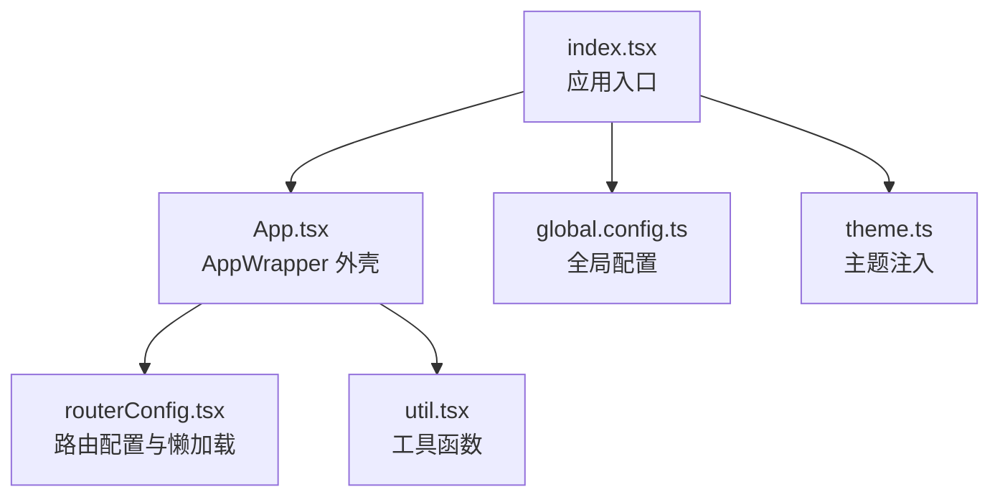
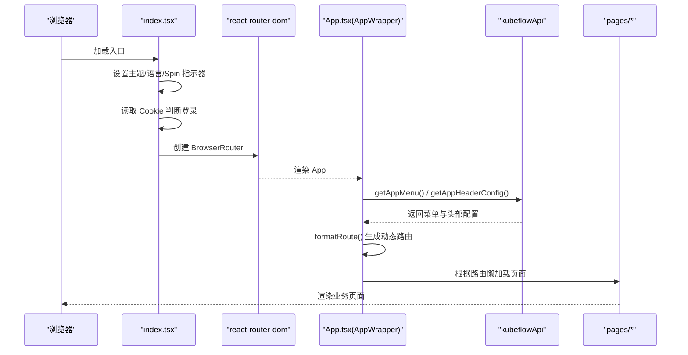
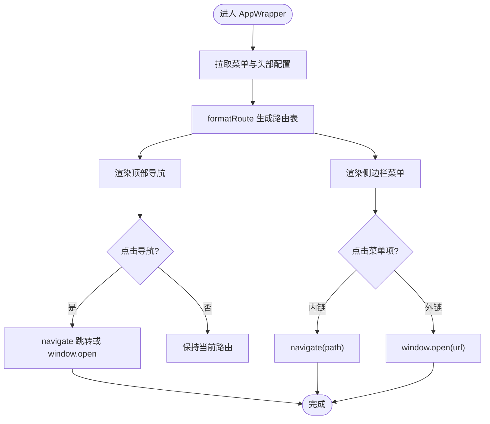
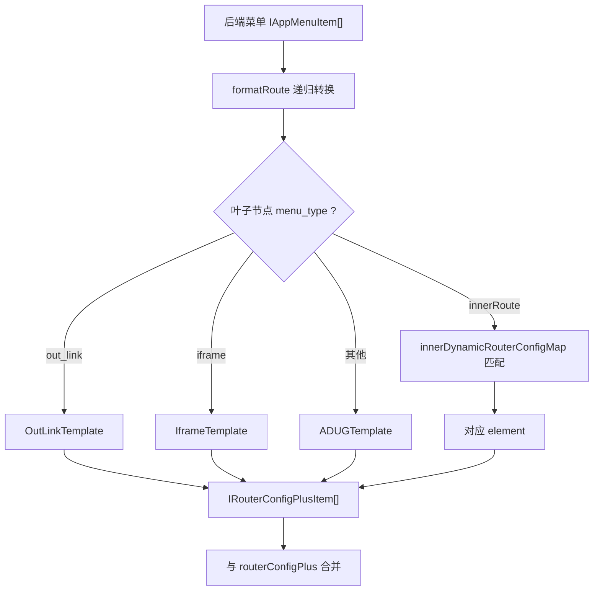
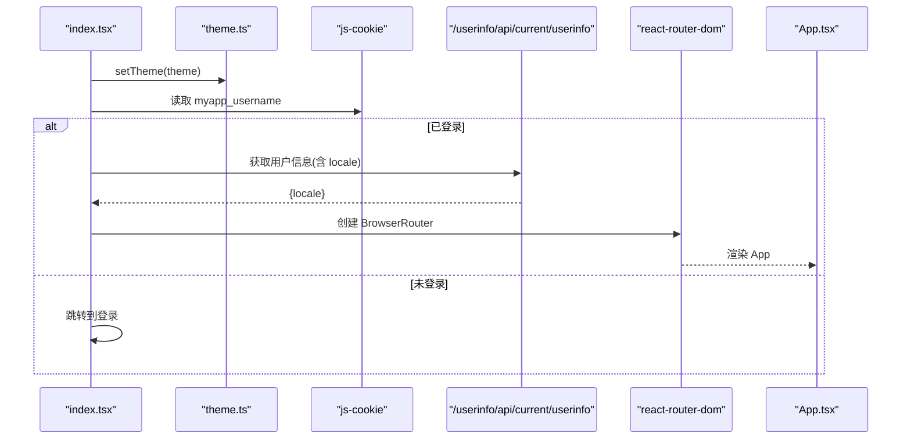
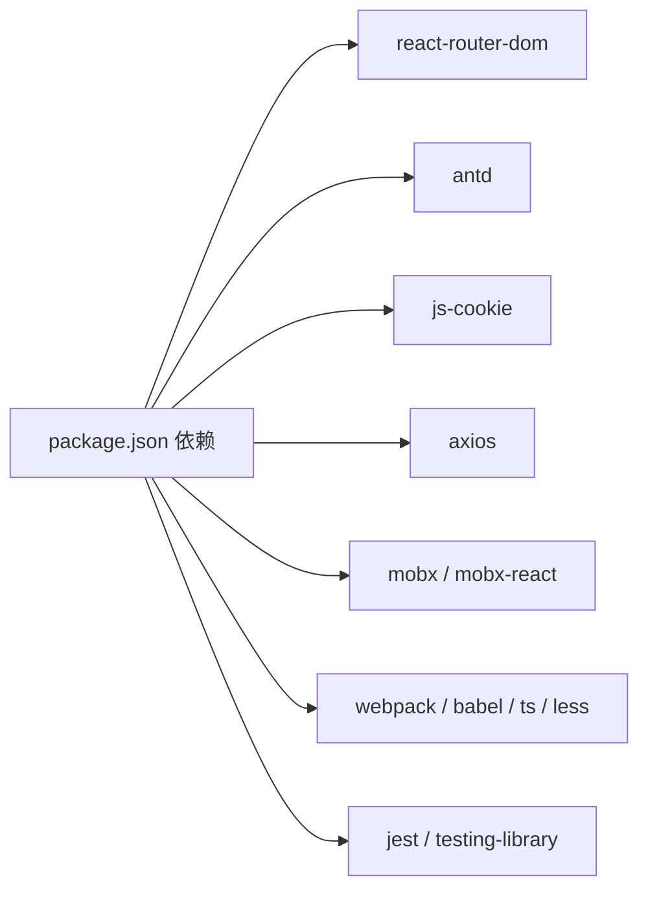

# 应用架构设计

<cite>
**本文引用的文件**   
- [index.tsx](file://myapp/frontend/src/index.tsx)
- [App.tsx](file://myapp/frontend/src/App.tsx)
- [routerConfig.tsx](file://myapp/frontend/src/routerConfig.tsx)
- [global.config.ts](file://myapp/frontend/src/global.config.ts)
- [theme.ts](file://myapp/frontend/src/theme.ts)
- [util.tsx](file://myapp/frontend/src/util.tsx)
- [package.json](file://myapp/frontend/package.json)
</cite>

## 目录
1. [简介](#简介)
2. [项目结构](#项目结构)
3. [核心组件](#核心组件)
4. [架构总览](#架构总览)
5. [详细组件分析](#详细组件分析)
6. [依赖关系分析](#依赖关系分析)
7. [性能优化与最佳实践](#性能优化与最佳实践)
8. [故障排查指南](#故障排查指南)
9. [结论](#结论)
10. [附录：扩展指南](#附录扩展指南)

## 简介
本文件面向前端工程，系统性梳理 React 应用的入口初始化、全局配置、路由动态加载、菜单系统与头部导航的交互逻辑，并给出 AppWrapper 组件的设计模式说明。文档同时覆盖应用生命周期管理、状态管理模式、组件树结构与可扩展性建议，并提供性能优化策略与排错指引。

## 项目结构
前端采用基于 Create React App 的工程化结构，核心源码位于 myapp/frontend/src。关键目录与职责如下：
- src/index.tsx：应用入口，负责主题注入、国际化、登录校验与根路由挂载
- src/App.tsx：应用外壳 AppWrapper，负责动态路由渲染、顶部导航、侧边栏菜单、用户信息与自定义弹窗
- src/routerConfig.tsx：路由配置与动态页面懒加载封装，内置模板页映射（ADUGTemplate/OutLinkTemplate/IframeTemplate）
- src/global.config.ts：全局配置（Logo、Loading 图标、默认主题）
- src/theme.ts：Ant Design 主题变量注入
- src/util.tsx：通用工具函数（水印、参数解析、数据格式化等）
- package.json：依赖与构建脚本

图示来源
- [index.tsx:1-60](file://myapp/frontend/src/index.tsx#L1-L60)
- [App.tsx:1-439](file://myapp/frontend/src/App.tsx#L1-L439)
- [routerConfig.tsx:1-161](file://myapp/frontend/src/routerConfig.tsx#L1-L161)
- [global.config.ts:1-18](file://myapp/frontend/src/global.config.ts#L1-L18)
- [theme.ts:1-107](file://myapp/frontend/src/theme.ts#L1-L107)

章节来源
- [index.tsx:1-60](file://myapp/frontend/src/index.tsx#L1-L60)
- [package.json:124-129](file://myapp/frontend/package.json#L124-L129)

## 核心组件
- index.tsx：完成 Antd 全局 Spin 指示器替换、主题设置、语言包选择、登录态检查与 BrowserRouter 挂载
- App.tsx（AppWrapper）：聚合顶部导航、侧边栏菜单、动态路由渲染、用户信息下拉、自定义弹窗与悬浮 AI 机器人
- routerConfig.tsx：提供 formatRoute 将后端菜单转换为前端路由表；lazy2Compont 统一包裹 React.lazy + Suspense；内置 innerDynamicRouterConfig 与 routerConfigPlus
- global.config.ts：集中 appLogo、loadingLogo、默认 theme
- theme.ts：通过 CSS 变量注入 Ant Design 主题色板
- util.tsx：提供 getParam、obj2UrlParam、parseParam2Obj、drawWater/clearWaterNow、data2Byte/data2Time 等工具

章节来源
- [index.tsx:1-60](file://myapp/frontend/src/index.tsx#L1-L60)
- [App.tsx:1-439](file://myapp/frontend/src/App.tsx#L1-L439)
- [routerConfig.tsx:1-161](file://myapp/frontend/src/routerConfig.tsx#L1-L161)
- [global.config.ts:1-18](file://myapp/frontend/src/global.config.ts#L1-L18)
- [theme.ts:1-107](file://myapp/frontend/src/theme.ts#L1-L107)
- [util.tsx:1-266](file://myapp/frontend/src/util.tsx#L1-L266)

## 架构总览
整体流程：浏览器请求 -> index.tsx 初始化 -> 主题与语言准备 -> 登录校验 -> 挂载 <BrowserRouter> -> 渲染 App -> AppWrapper 拉取远程菜单与头部配置 -> 生成动态路由 -> 渲染页面内容。

图示来源
- [index.tsx:20-54](file://myapp/frontend/src/index.tsx#L20-L54)
- [App.tsx:66-87](file://myapp/frontend/src/App.tsx#L66-L87)
- [routerConfig.tsx:71-145](file://myapp/frontend/src/routerConfig.tsx#L71-L145)

## 详细组件分析

### AppWrapper 组件（App.tsx）
职责与行为：
- 生命周期与数据获取
  - 首次加载时调用 getAppMenu 与 getAppHeaderConfig，分别得到菜单与头部配置
  - 使用 formatRoute 将后端菜单转为前端路由表，并与本地 routerConfigPlus 合并
  - 根据 location.pathname 计算当前选中导航与侧边栏可见性
- 路由与导航
  - 使用 useRoutes 动态渲染路由表
  - 顶部导航支持普通项、子菜单与下拉菜单；点击后根据 menu_type 决定内跳转或外链打开
  - 侧边栏菜单支持多级嵌套、展开/收起、折叠按钮
- 用户与系统能力
  - 头部右侧展示头像下拉（用户中心、退出登录）
  - 根据 URL 拉取自定义弹窗配置，以 Drawer 形式展示
  - 集成 AiChatBot 悬浮聊天入口

图示来源
- [App.tsx:66-115](file://myapp/frontend/src/App.tsx#L66-L115)
- [App.tsx:117-163](file://myapp/frontend/src/App.tsx#L117-L163)
- [App.tsx:165-277](file://myapp/frontend/src/App.tsx#L165-L277)
- [App.tsx:279-334](file://myapp/frontend/src/App.tsx#L279-L334)
- [App.tsx:336-439](file://myapp/frontend/src/App.tsx#L336-L439)

章节来源
- [App.tsx:1-439](file://myapp/frontend/src/App.tsx#L1-L439)

### 路由与动态加载（routerConfig.tsx）
关键点：
- lazy2Compont：统一封装 React.lazy + Suspense，提供 LoadingStar 作为占位
- formatRoute：递归遍历后端菜单，按 menu_type 映射到不同模板组件（ADUGTemplate/OutLinkTemplate/IframeTemplate），并为相关子路由生成关联路径
- innerDynamicRouterConfig：定义内部固定路由（如 DataSearch、CommonRelation）
- routerConfigPlus：应用级基础路由（首页、数据展示、外链、用户中心等）

图示来源
- [routerConfig.tsx:14-22](file://myapp/frontend/src/routerConfig.tsx#L14-L22)
- [routerConfig.tsx:24-69](file://myapp/frontend/src/routerConfig.tsx#L24-L69)
- [routerConfig.tsx:71-145](file://myapp/frontend/src/routerConfig.tsx#L71-L145)

章节来源
- [routerConfig.tsx:1-161](file://myapp/frontend/src/routerConfig.tsx#L1-L161)

### 应用入口与初始化（index.tsx）
关键点：
- 全局 Spin 指示器替换为 LoadingStar
- 通过 setTheme(globalConfig.theme) 注入主题
- 从 Cookie 中读取用户名进行登录态判断，未登录则引导至登录页
- 根据用户 locale 选择 antd 语言包（zh_CN/en_US）
- 使用 BrowserRouter 挂载 App

图示来源
- [index.tsx:20-54](file://myapp/frontend/src/index.tsx#L20-L54)
- [theme.ts:101-107](file://myapp/frontend/src/theme.ts#L101-L107)

章节来源
- [index.tsx:1-60](file://myapp/frontend/src/index.tsx#L1-L60)
- [theme.ts:1-107](file://myapp/frontend/src/theme.ts#L1-L107)

### 全局配置与主题（global.config.ts, theme.ts）
- global.config.ts：集中 Logo、Loading 图标与默认主题名
- theme.ts：通过 document.documentElement.style.setProperty 注入 CSS 变量，实现主题切换

章节来源
- [global.config.ts:1-18](file://myapp/frontend/src/global.config.ts#L1-L18)
- [theme.ts:1-107](file://myapp/frontend/src/theme.ts#L1-L107)

### 工具函数（util.tsx）
- 参数解析：getParam、parseParam2Obj、obj2UrlParam
- 水印：drawWater/drawWaterNow/clearWaterNow（Canvas 绘制背景水印）
- 数据格式化：data2Byte、data2Time
- DOM/JSON 判定：isJsonString、isDomString

章节来源
- [util.tsx:1-266](file://myapp/frontend/src/util.tsx#L1-L266)

## 依赖关系分析
- 运行时依赖
  - react-router-dom：路由与导航
  - antd：UI 组件与主题变量
  - js-cookie：Cookie 读写
  - axios：HTTP 请求（在 api 层使用）
  - mobx/mobx-react：状态管理（store 模块）
- 构建与开发
  - webpack、babel、typescript、less
  - jest、@testing-library/react：测试
  - workbox-webpack-plugin：PWA 缓存

图示来源
- [package.json:5-122](file://myapp/frontend/package.json#L5-L122)

章节来源
- [package.json:1-213](file://myapp/frontend/package.json#L1-L213)

## 性能优化与最佳实践
- 路由级代码分割
  - 所有页面均通过 React.lazy + Suspense 懒加载，减少首屏体积
  - 建议在新增页面时沿用 lazy2Compont 封装，确保一致的加载体验
- 资源与样式
  - 按需引入 antd 组件与图标，避免全量打包
  - 使用 CSS Modules 或 Less 局部作用域，降低样式冲突
- 网络请求
  - 对高频接口做防抖/节流与缓存（可结合 SWR/React Query 或本地缓存）
  - 列表分页与虚拟滚动，避免一次性渲染大量 DOM
- 渲染优化
  - 大表格使用虚拟滚动或分页
  - 复杂图表按需加载与销毁，避免内存泄漏
- 构建优化
  - 开启 Tree Shaking、Code Splitting、压缩与 Source Map 分级
  - 合理使用 CDN 与 HTTP/2，静态资源加长期缓存头
- 可观测性
  - 接入 Web Vitals 与错误上报，监控首屏与交互延迟

[本节为通用指导，不直接分析具体文件]

## 故障排查指南
- 登录后仍被重定向
  - 检查 Cookie 是否包含 myapp_username，以及后端 /userinfo/api/current/userinfo 是否正常返回
  - 确认 index.tsx 中的登录判断分支是否正确执行
- 菜单不显示或路由不生效
  - 检查后端菜单数据结构是否符合 IAppMenuItem 约定
  - 确认 formatRoute 生成的 path 与 navigate 跳转一致
  - 核对 menu_type 与模板映射（out_link/iframe/innerRoute）
- 主题未生效
  - 检查 global.config.ts 的 theme 值是否在 theme.ts 的主题集合中
  - 确认 setTheme 已在应用启动阶段执行
- 水印异常
  - 检查 drawWaterNow/clearWaterNow 调用时机，避免重复绘制或容器不存在
- 自定义弹窗不出现
  - 检查 getCustomDialog 接口返回的 hit 字段与 content 结构

章节来源
- [index.tsx:24-54](file://myapp/frontend/src/index.tsx#L24-L54)
- [App.tsx:66-115](file://myapp/frontend/src/App.tsx#L66-L115)
- [routerConfig.tsx:71-145](file://myapp/frontend/src/routerConfig.tsx#L71-L145)
- [theme.ts:101-107](file://myapp/frontend/src/theme.ts#L101-L107)
- [util.tsx:178-209](file://myapp/frontend/src/util.tsx#L178-L209)

## 结论
该前端应用以 AppWrapper 为核心外壳，通过动态路由与模板映射机制，将后端菜单驱动的前端页面组织起来。入口层负责主题、语言与登录态初始化，路由层统一懒加载与 Suspense 占位，工具层提供通用能力。整体架构清晰、可扩展性强，适合持续迭代与多模块扩展。

[本节为总结性内容，不直接分析具体文件]

## 附录：扩展指南

### 新增功能模块（页面）
步骤：
- 在 pages 下新建页面组件
- 在 routerConfig.tsx 的 innerDynamicRouterConfig 或 routerConfigPlus 中添加路由项，使用 lazy2Compont 包裹
- 若需由后端菜单驱动，确保后端菜单 name/path/menu_type 与 formatRoute 映射规则一致
- 如需独立顶部导航分组，可在 AppWrapper 中根据 isSingleModule/isDropdown 控制渲染

参考路径
- [routerConfig.tsx:24-69](file://myapp/frontend/src/routerConfig.tsx#L24-L69)
- [routerConfig.tsx:71-145](file://myapp/frontend/src/routerConfig.tsx#L71-L145)

### 新增布局模板
- ADUGTemplate：通用业务模板（带面包屑、标题、操作区等）
- OutLinkTemplate：外链包装页
- IframeTemplate：内嵌 iframe 页面
- 新增模板时，在 formatRoute 中增加对应分支映射

参考路径
- [routerConfig.tsx:92-121](file://myapp/frontend/src/routerConfig.tsx#L92-L121)

### 扩展头部导航与侧边栏
- 头部导航：AppWrapper 根据 currentNavList 渲染，支持子菜单与下拉
- 侧边栏：根据当前一级路由的子菜单渲染，支持多级嵌套与折叠
- 可通过后端菜单的 isCollapsed/isExpand/isSingleModule/isDropdown 控制展示行为

参考路径
- [App.tsx:117-163](file://myapp/frontend/src/App.tsx#L117-L163)
- [App.tsx:165-277](file://myapp/frontend/src/App.tsx#L165-L277)
- [App.tsx:279-334](file://myapp/frontend/src/App.tsx#L279-L334)

### 状态管理与生命周期
- 状态管理：使用 store 目录下的 MobX 状态（见 src/store）
- 生命周期：组件内使用 useEffect/useMemo/useCallback 管理副作用与计算属性
- 全局事件：利用 util.tsx 的工具函数与全局 Cookie 传递上下文

参考路径
- [App.tsx:66-115](file://myapp/frontend/src/App.tsx#L66-L115)
- [util.tsx:38-64](file://myapp/frontend/src/util.tsx#L38-L64)