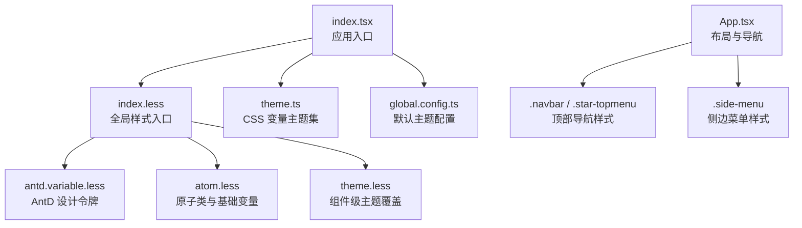
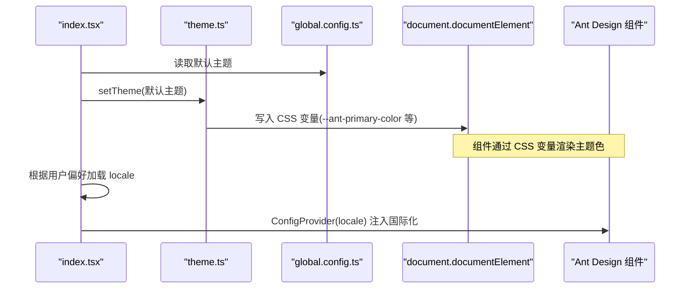
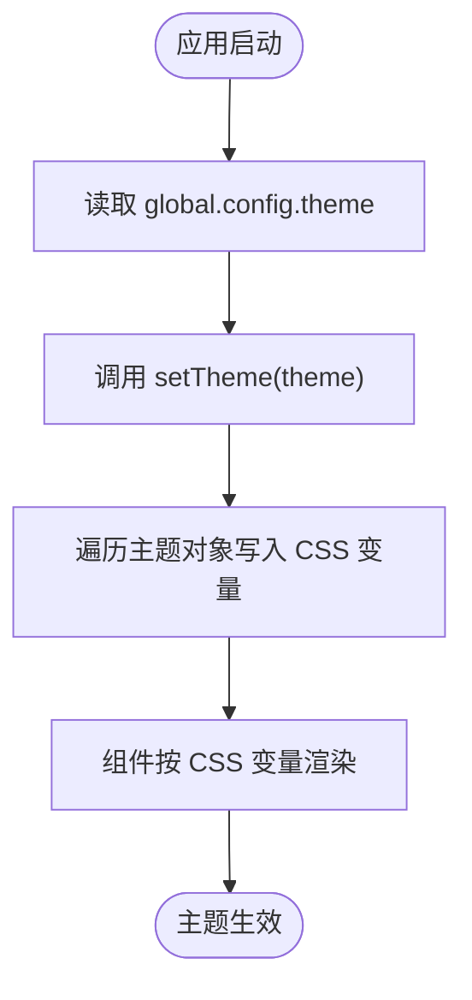
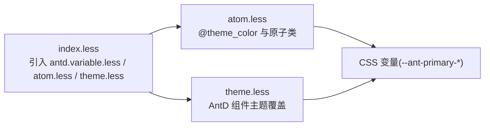
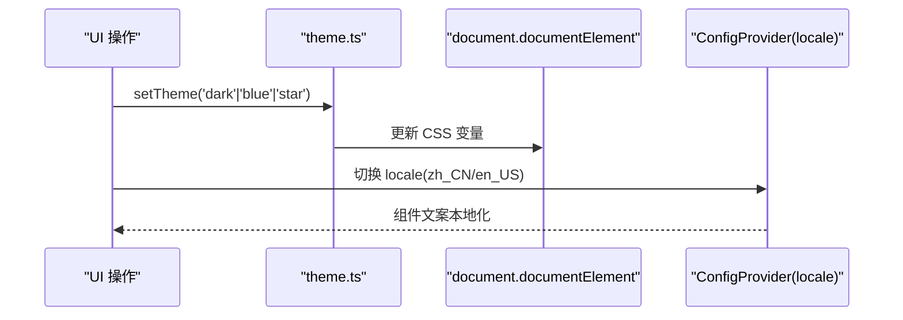
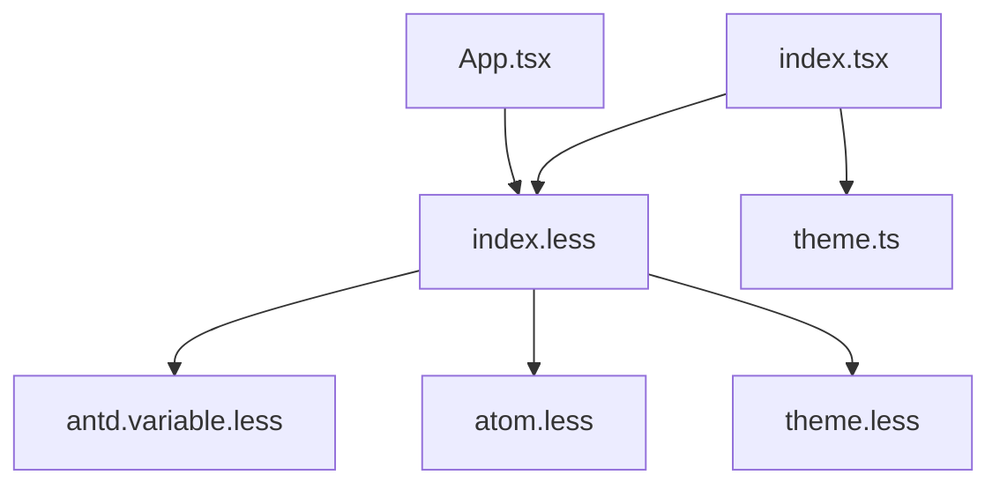

# 样式与主题

<cite>
**本文引用的文件**   
- [index.less](file://myapp/frontend/src/index.less)
- [theme.less](file://myapp/frontend/src/theme.less)
- [atom.less](file://myapp/frontend/src/atom.less)
- [theme.ts](file://myapp/frontend/src/theme.ts)
- [global.config.ts](file://myapp/frontend/src/global.config.ts)
- [index.tsx](file://myapp/frontend/src/index.tsx)
- [App.tsx](file://myapp/frontend/src/App.tsx)
</cite>

## 目录
1. [简介](#简介)
2. [项目结构](#项目结构)
3. [核心组件](#核心组件)
4. [架构总览](#架构总览)
5. [详细组件分析](#详细组件分析)
6. [依赖关系分析](#依赖关系分析)
7. [性能考虑](#性能考虑)
8. [故障排查指南](#故障排查指南)
9. [结论](#结论)
10. [附录](#附录)

## 简介
本文件系统性梳理前端样式与主题体系，覆盖 CSS-in-JS、Less 预处理器使用与 Ant Design 主题定制。重点说明全局样式变量、组件样式规范、响应式实现思路，以及主题切换、暗色模式支持与多语言样式适配。文档同时给出样式开发示例路径、性能优化建议与浏览器兼容性处理方法，帮助团队建立一致的视觉风格与可维护的样式工程。

## 项目结构
前端样式采用“Less + CSS 变量 + Ant Design 变量主题”的组合方案：
- Less 负责编译期变量、混合与原子类生成
- CSS 变量在运行时由 JavaScript 注入，驱动主题切换
- Ant Design 通过 variable.less 暴露设计令牌，便于运行时主题化
- 全局入口统一引入样式并初始化国际化与主题

图示来源
- [index.tsx:1-22](file://myapp/frontend/src/index.tsx#L1-L22)
- [index.less:1-10](file://myapp/frontend/src/index.less#L1-L10)
- [theme.ts:1-107](file://myapp/frontend/src/theme.ts#L1-L107)
- [global.config.ts:1-18](file://myapp/frontend/src/global.config.ts#L1-L18)
- [App.tsx:336-434](file://myapp/frontend/src/App.tsx#L336-L434)

章节来源
- [index.less:1-10](file://myapp/frontend/src/index.less#L1-L10)
- [index.tsx:1-22](file://myapp/frontend/src/index.tsx#L1-L22)
- [App.tsx:336-434](file://myapp/frontend/src/App.tsx#L336-L434)

## 核心组件
- 主题引擎（运行时）
  - 通过 theme.ts 定义主题集合与 setTheme 方法，向 document.documentElement 写入 CSS 变量，实现无刷新主题切换。
- 全局样式入口
  - index.less 引入 antd.variable.less、atom.less 与 theme.less，集中管理全局样式与组件覆盖。
- 原子类与基础变量
  - atom.less 提供大量原子类（间距、尺寸、颜色、状态等），并通过 @theme_color 绑定到 CSS 变量，保证主题一致性。
- 组件主题覆盖
  - theme.less 针对 Ant Design 组件（按钮、菜单、分页、步骤、表格等）进行主题色覆盖，确保交互态与选中态一致。
- 应用入口与国际化
  - index.tsx 初始化主题、加载国际化 locale，并使用 ConfigProvider 包裹应用，使 AntD 组件文案本地化。
- 布局与导航
  - App.tsx 构建顶部导航与侧边菜单，配合 index.less 中的 .navbar/.star-topmenu/.side-menu 完成整体布局。

章节来源
- [theme.ts:1-107](file://myapp/frontend/src/theme.ts#L1-L107)
- [index.less:1-10](file://myapp/frontend/src/index.less#L1-L10)
- [atom.less:1-25](file://myapp/frontend/src/atom.less#L1-L25)
- [theme.less:1-20](file://myapp/frontend/src/theme.less#L1-L20)
- [index.tsx:1-22](file://myapp/frontend/src/index.tsx#L1-L22)
- [App.tsx:336-434](file://myapp/frontend/src/App.tsx#L336-L434)

## 架构总览
下图展示从应用启动到主题生效的关键流程：

图示来源
- [index.tsx:16-22](file://myapp/frontend/src/index.tsx#L16-L22)
- [theme.ts:97-107](file://myapp/frontend/src/theme.ts#L97-L107)
- [global.config.ts:12-16](file://myapp/frontend/src/global.config.ts#L12-L16)

## 详细组件分析

### 主题系统（CSS-in-JS + CSS 变量）
- 主题集合
  - 定义 star/blue/dark 三种主题，包含 --ant-primary-* 系列变量与 --ant-link 等。
- 主题切换
  - setTheme(theme) 将主题对象键值对写入根节点 CSS 变量，实现即时切换。
- 默认主题
  - global.config.ts 指定默认主题为 'star'，并在应用启动时调用 setTheme。

图示来源
- [theme.ts:97-107](file://myapp/frontend/src/theme.ts#L97-L107)
- [global.config.ts:12-16](file://myapp/frontend/src/global.config.ts#L12-L16)
- [index.tsx:16-22](file://myapp/frontend/src/index.tsx#L16-L22)

章节来源
- [theme.ts:1-107](file://myapp/frontend/src/theme.ts#L1-L107)
- [global.config.ts:1-18](file://myapp/frontend/src/global.config.ts#L1-L18)
- [index.tsx:16-22](file://myapp/frontend/src/index.tsx#L16-L22)

### Less 预处理器与全局变量
- 变量与混合
  - atom.less 定义 @theme_color 与一系列原子类（间距、尺寸、颜色、状态），并通过 Less 循环批量生成类名，提升复用性。
- 全局样式入口
  - index.less 引入 antd.variable.less 与 atom.less，并通过 @custom-theme 绑定 CSS 变量，作为 Less 变量的运行时桥接。
- 组件覆盖
  - theme.less 针对 AntD 组件选择器进行主题色覆盖，如按钮、菜单、分页、步骤、表格行选中态等。

图示来源
- [index.less:1-10](file://myapp/frontend/src/index.less#L1-L10)
- [atom.less:1-25](file://myapp/frontend/src/atom.less#L1-L25)
- [theme.less:1-20](file://myapp/frontend/src/theme.less#L1-L20)

章节来源
- [index.less:1-10](file://myapp/frontend/src/index.less#L1-L10)
- [atom.less:1-25](file://myapp/frontend/src/atom.less#L1-L25)
- [theme.less:1-20](file://myapp/frontend/src/theme.less#L1-L20)

### Ant Design 主题定制
- 设计令牌
  - 通过 antd.variable.less 暴露设计令牌，结合 CSS 变量实现运行时主题化。
- 组件覆盖
  - theme.less 覆盖按钮主色、菜单选中态、步骤进度、分页激活项、表格选中行背景等。
- 链接与文本
  - 统一使用 --ant-link 控制链接颜色，保持品牌一致性。

章节来源
- [index.less:1-10](file://myapp/frontend/src/index.less#L1-L10)
- [theme.less:21-98](file://myapp/frontend/src/theme.less#L21-L98)

### 全局样式变量与组件样式规范
- 变量命名
  - 使用 CSS 变量 --ant-primary-* 与 --ant-link 作为主题源；Less 层通过 @theme_color 桥接。
- 原子类
  - 使用 atom.less 提供的原子类（如 .bg-theme/.c-theme/.b-theme/.fs*/.w*/.h*/.p*/.m*）统一间距、字号、宽高与颜色。
- 组件样式
  - 优先使用 AntD 组件属性与主题变量；必要时在 theme.less 中做最小化覆盖，避免直接硬编码颜色。

章节来源
- [atom.less:470-567](file://myapp/frontend/src/atom.less#L470-L567)
- [theme.less:41-98](file://myapp/frontend/src/theme.less#L41-L98)

### 响应式设计实现
- 布局容器
  - index.less 定义 .content-container/.main-content-container/.navbar/.side-menu 等布局容器，使用 flex 与百分比宽度适配不同屏幕。
- 导航与菜单
  - .star-topmenu 支持横向滚动与子菜单对齐；.side-menu 支持折叠与展开。
- 图表与编辑器
  - 为 CodeMirror、Tabs、Canvas 等容器设置高度自适应，保证在不同视口下内容完整显示。

章节来源
- [index.less:79-156](file://myapp/frontend/src/index.less#L79-L156)
- [index.less:158-301](file://myapp/frontend/src/index.less#L158-L301)
- [index.less:405-439](file://myapp/frontend/src/index.less#L405-L439)

### 主题切换、暗色模式与多语言样式适配
- 主题切换
  - 通过 setTheme(theme) 切换 CSS 变量，无需重新编译或刷新页面。
- 暗色模式
  - dark 主题已预留，可在 theme.ts 中完善暗色变量映射，并在 UI 中提供切换入口。
- 多语言样式
  - index.tsx 使用 ConfigProvider 注入 locale（zh_CN/en_US），AntD 组件文案自动本地化；样式层面通过 CSS 变量与原子类保持一致。

图示来源
- [theme.ts:97-107](file://myapp/frontend/src/theme.ts#L97-L107)
- [index.tsx:33-54](file://myapp/frontend/src/index.tsx#L33-L54)

章节来源
- [theme.ts:93-107](file://myapp/frontend/src/theme.ts#L93-L107)
- [index.tsx:33-54](file://myapp/frontend/src/index.tsx#L33-L54)

### 样式开发示例（路径指引）
- 创建一致视觉风格
  - 使用 atom.less 的原子类（如 .bg-theme/.c-theme/.b-theme/.fs14/.w-full/.h-100）快速搭建卡片、标签、按钮等元素。
  - 参考路径：[atom.less:470-567](file://myapp/frontend/src/atom.less#L470-L567)
- 自定义组件样式
  - 在 theme.less 中新增或调整组件选择器，仅覆盖必要样式，保持与主题变量的一致性。
  - 参考路径：[theme.less:41-98](file://myapp/frontend/src/theme.less#L41-L98)
- 顶部导航与侧边菜单
  - 基于 index.less 的 .navbar/.star-topmenu/.side-menu 扩展布局与交互样式。
  - 参考路径：[index.less:85-156](file://myapp/frontend/src/index.less#L85-L156), [index.less:158-301](file://myapp/frontend/src/index.less#L158-L301)

## 依赖关系分析
- 入口依赖
  - index.tsx 引入 index.less 与 theme.ts，并初始化主题与国际化。
- 样式依赖
  - index.less 依赖 antd.variable.less、atom.less、theme.less。
- 布局依赖
  - App.tsx 使用 .navbar/.star-topmenu/.side-menu 等类名，与 index.less 对应。

图示来源
- [index.tsx:1-22](file://myapp/frontend/src/index.tsx#L1-L22)
- [index.less:1-10](file://myapp/frontend/src/index.less#L1-L10)
- [App.tsx:336-434](file://myapp/frontend/src/App.tsx#L336-L434)

章节来源
- [index.tsx:1-22](file://myapp/frontend/src/index.tsx#L1-L22)
- [index.less:1-10](file://myapp/frontend/src/index.less#L1-L10)
- [App.tsx:336-434](file://myapp/frontend/src/App.tsx#L336-L434)

## 性能考虑
- 减少运行时样式计算
  - 尽量使用 CSS 变量与原子类，避免频繁内联样式与复杂选择器。
- 控制主题切换开销
  - setTheme 仅更新 CSS 变量，避免整页重绘；主题对象应精简，只包含必要变量。
- 按需引入与打包
  - 使用 antd.variable.less 按需编译 AntD 样式，减小包体；避免一次性引入全部组件样式。
- 动画与过渡
  - 谨慎使用复杂动画与阴影，优先使用 transform 与 opacity 以提升合成层性能。

## 故障排查指南
- 主题未生效
  - 检查是否调用了 setTheme，且主题对象键名与 CSS 变量一致。
  - 确认 document.documentElement 上是否存在 --ant-primary-* 变量。
- 组件样式错乱
  - 检查 theme.less 的选择器优先级是否被其他样式覆盖；必要时提高选择器特异性或使用 !important（谨慎）。
- 国际化文案不生效
  - 确认 ConfigProvider 已包裹应用，且 locale 正确传入（zh_CN/en_US）。
- 导航布局异常
  - 检查 .navbar/.star-topmenu/.side-menu 相关类名是否正确应用，以及父容器高度与 overflow 设置。

章节来源
- [theme.ts:97-107](file://myapp/frontend/src/theme.ts#L97-L107)
- [theme.less:41-98](file://myapp/frontend/src/theme.less#L41-L98)
- [index.tsx:33-54](file://myapp/frontend/src/index.tsx#L33-L54)
- [index.less:85-156](file://myapp/frontend/src/index.less#L85-L156)

## 结论
本项目通过 Less + CSS 变量 + Ant Design 变量主题的组合，实现了灵活的主题系统与一致的组件样式。主题切换在运行时通过 CSS 变量注入，无需重建样式；原子类与组件覆盖策略保证了样式的一致性与可维护性。建议在 dark 主题上继续完善变量映射，并在业务组件中优先使用原子类与主题变量，以进一步提升视觉一致性与性能表现。

## 附录
- 常用原子类参考
  - 颜色与背景：.bg-theme/.c-theme/.b-theme/.bg-success/.c-warn 等
  - 尺寸与间距：.w-full/.h-100/.fs14/.p16/.m8 等
  - 布局与定位：.d-f/.ac/.jc/.pos-a/.p-r 等
  - 参考路径：[atom.less:470-567](file://myapp/frontend/src/atom.less#L470-L567), [atom.less:23-116](file://myapp/frontend/src/atom.less#L23-L116)
- 主题变量清单
  - --ant-primary-color, --ant-primary-*, --ant-link 等
  - 参考路径：[theme.ts:5-91](file://myapp/frontend/src/theme.ts#L5-L91)
- 布局与导航样式
  - .navbar/.star-topmenu/.side-menu
  - 参考路径：[index.less:85-301](file://myapp/frontend/src/index.less#L85-L301)