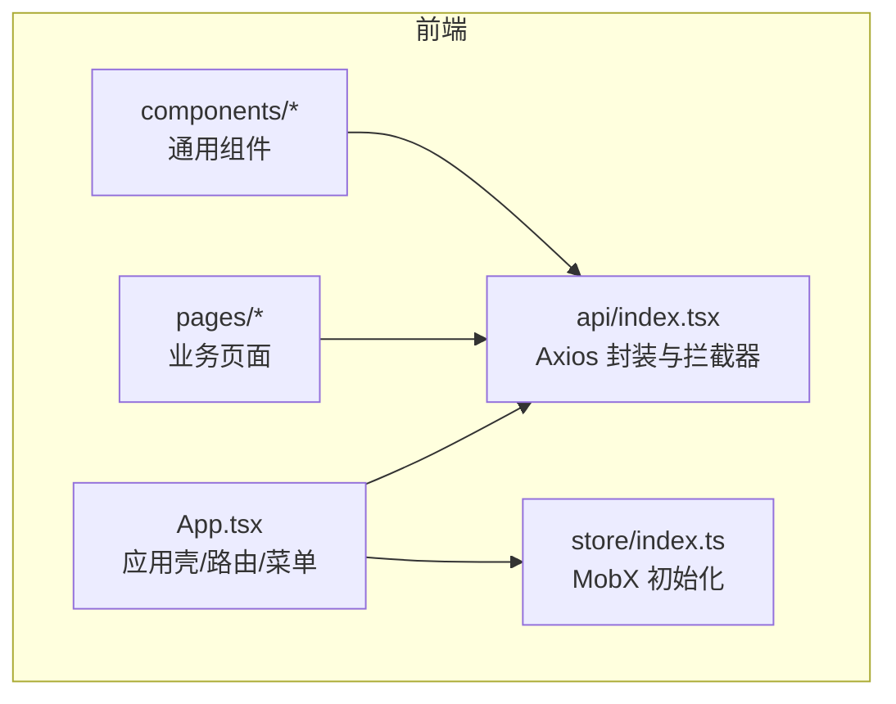
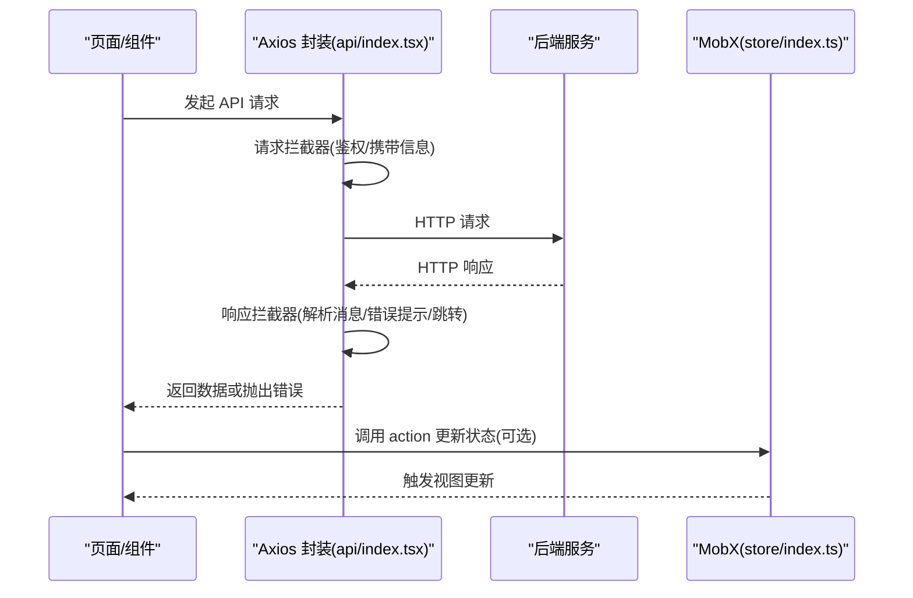
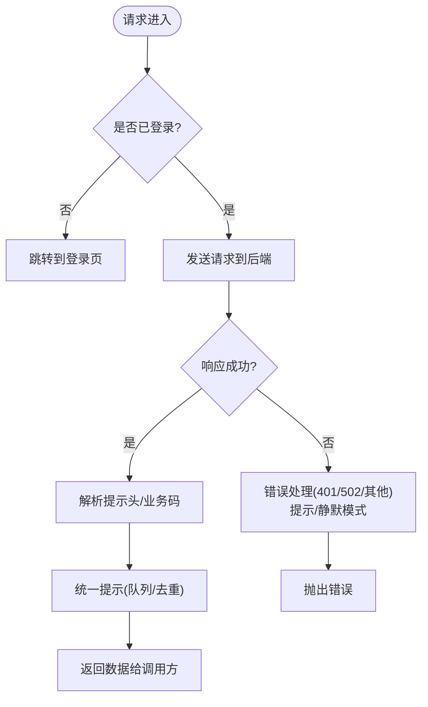
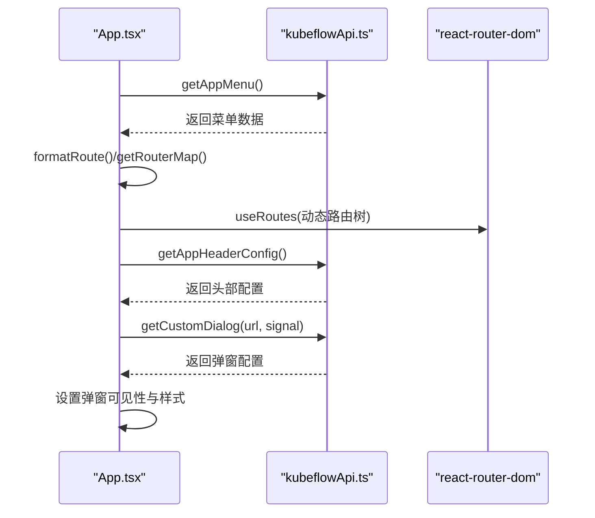
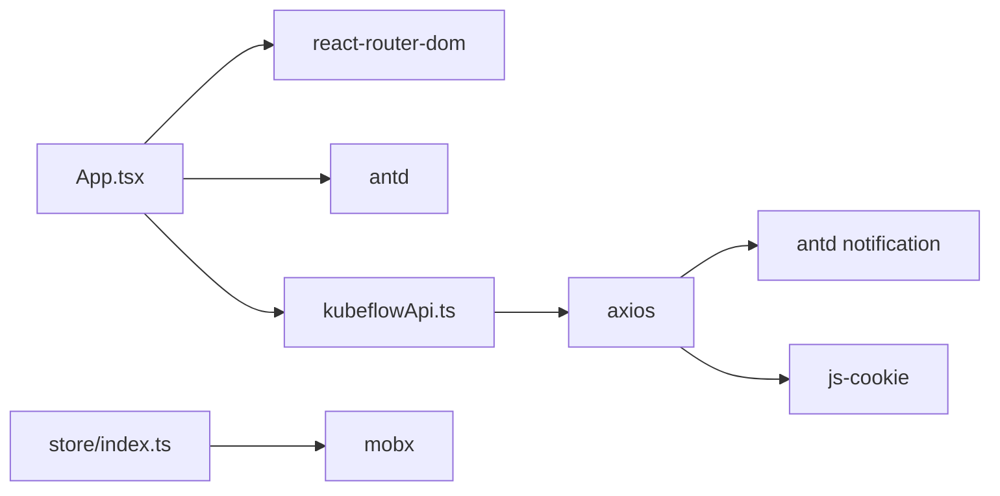

# 状态管理

<cite>
**本文引用的文件**   
- [store/index.ts](file://myapp/frontend/src/store/index.ts)
- [api/index.tsx](file://myapp/frontend/src/api/index.tsx)
- [App.tsx](file://myapp/frontend/src/App.tsx)
</cite>

## 目录
1. [简介](#简介)
2. [项目结构](#项目结构)
3. [核心组件](#核心组件)
4. [架构总览](#架构总览)
5. [详细组件分析](#详细组件分析)
6. [依赖关系分析](#依赖关系分析)
7. [性能考虑](#性能考虑)
8. [故障排查指南](#故障排查指南)
9. [结论](#结论)
10. [附录](#附录)

## 简介
本文件面向前端状态管理与数据流，聚焦以下目标：
- 解释当前前端的状态管理模式与数据流设计
- 说明 MobX 的启用方式、状态更新策略与持久化思路
- 梳理用户状态、应用配置状态与业务数据的统一组织方式
- 给出复杂状态结构与异步更新的实践示例（以路径引用形式）
- 提供状态调试工具与性能优化建议

本项目在前端采用 React + Ant Design，并使用 MobX 进行状态管理。全局网络请求通过 Axios 拦截器统一处理鉴权、错误提示与跳转登录等流程。路由与应用菜单由远端动态下发，页面内状态以组件级 useState 为主，配合 MobX 管理跨组件共享的全局状态。

## 项目结构
前端关键目录与职责：
- store：MobX 初始化与全局配置入口
- api：Axios 封装、请求/响应拦截、统一错误提示与鉴权处理
- App.tsx：应用壳、动态路由加载、顶部导航与侧边菜单渲染、自定义弹窗控制
- pages/components：业务页面与通用组件（具体实现不在本文展开）

图表来源
- [App.tsx:1-439](file://myapp/frontend/src/App.tsx#L1-L439)
- [api/index.tsx:1-168](file://myapp/frontend/src/api/index.tsx#L1-L168)
- [store/index.ts:1-4](file://myapp/frontend/src/store/index.ts#L1-L4)

章节来源
- [App.tsx:1-439](file://myapp/frontend/src/App.tsx#L1-L439)
- [api/index.tsx:1-168](file://myapp/frontend/src/api/index.tsx#L1-L168)
- [store/index.ts:1-4](file://myapp/frontend/src/store/index.ts#L1-L4)

## 核心组件
- MobX 初始化与严格模式
  - 在 store/index.ts 中引入 mobx 并开启 enforceActions: 'always'，强制所有状态变更必须在 action 中进行，避免意外直接修改 observable，提升可预测性与可调试性。
- Axios 封装与拦截器
  - 在 api/index.tsx 中创建 axios 实例，设置超时与响应类型；定义统一的 HandleTips 类用于消息队列与提示；注册请求与响应拦截器，完成鉴权检查、错误提示、跳转登录、静默错误模式等逻辑。
- 应用壳与动态路由
  - App.tsx 负责从远端拉取菜单与头部配置，构建动态路由树，渲染顶部导航与侧边菜单，并根据当前路由计算选中项与折叠状态；同时根据路由展示自定义弹窗。

章节来源
- [store/index.ts:1-4](file://myapp/frontend/src/store/index.ts#L1-L4)
- [api/index.tsx:1-168](file://myapp/frontend/src/api/index.tsx#L1-L168)
- [App.tsx:1-439](file://myapp/frontend/src/App.tsx#L1-L439)

## 架构总览
下图展示了“页面/组件 -> Axios 拦截器 -> 后端 API”的数据流，以及 MobX 在全局状态中的位置。

图表来源
- [api/index.tsx:68-165](file://myapp/frontend/src/api/index.tsx#L68-L165)
- [store/index.ts:1-4](file://myapp/frontend/src/store/index.ts#L1-L4)

## 详细组件分析

### Axios 封装与拦截器（api/index.tsx）
- 统一响应格式与类型定义
  - 定义了 ResponseFormat 泛型，便于各模块使用一致的返回结构。
- 请求拦截器
  - 校验本地会话标识（如用户名 Cookie），若缺失则触发跳转登录流程。
- 响应拦截器
  - 解析后端返回的提示头，按类型弹出通知；对业务错误码进行统一提示与抛错；对 401 自动跳转登录；对 502 显示网络连接中；支持通过特定请求头开启“静默错误模式”，仅控制台输出不弹窗。
- 提示与跳转
  - HandleTips 类维护消息队列与定时器，避免重复提示；提供 gotoLogin 与 userlogout 方法，集中处理鉴权相关跳转。

图表来源
- [api/index.tsx:21-66](file://myapp/frontend/src/api/index.tsx#L21-L66)
- [api/index.tsx:68-165](file://myapp/frontend/src/api/index.tsx#L68-L165)

章节来源
- [api/index.tsx:1-168](file://myapp/frontend/src/api/index.tsx#L1-L168)

### MobX 初始化（store/index.ts）
- 启用 MobX 严格模式
  - 通过 configure({ enforceActions: 'always' }) 强制所有状态变更在 action 中进行，有助于定位状态变更来源、减少隐式副作用。
- 扩展建议
  - 可在该文件中导出一个根 store，聚合用户状态、应用配置状态与业务数据，并通过 createRootStore 等方式组合多个领域 store，形成统一入口。

章节来源
- [store/index.ts:1-4](file://myapp/frontend/src/store/index.ts#L1-L4)

### 应用壳与动态路由（App.tsx）
- 动态菜单与路由
  - 启动时调用远端接口获取菜单与头部配置，转换为路由树，合并本地路由后渲染。
- 导航与选中态
  - 根据当前 pathname 计算顶级导航与子菜单，维护选中键与折叠状态。
- 自定义弹窗
  - 监听路由变化，拉取并展示自定义弹窗内容，支持关闭与样式控制。
- 用户操作
  - 退出登录通过移除本地 Cookie 并调用统一提示类的 logout 跳转。

图表来源
- [App.tsx:66-115](file://myapp/frontend/src/App.tsx#L66-L115)
- [App.tsx:117-163](file://myapp/frontend/src/App.tsx#L117-L163)
- [App.tsx:383-396](file://myapp/frontend/src/App.tsx#L383-L396)

章节来源
- [App.tsx:1-439](file://myapp/frontend/src/App.tsx#L1-L439)

## 依赖关系分析
- 组件耦合
  - App.tsx 依赖 api/kubeflowApi.ts 获取菜单与头部配置，依赖 react-router-dom 进行路由控制，依赖 antd 进行 UI 渲染。
  - api/index.tsx 依赖 axios、antd notification、js-cookie，承担鉴权与错误提示的统一职责。
  - store/index.ts 仅依赖 mobx，作为状态层的基础设施入口。
- 外部依赖
  - axios：HTTP 客户端
  - antd：UI 组件库与通知
  - js-cookie：Cookie 读写
  - react-router-dom：路由与导航
  - mobx：状态管理

图表来源
- [App.tsx:1-439](file://myapp/frontend/src/App.tsx#L1-L439)
- [api/index.tsx:1-168](file://myapp/frontend/src/api/index.tsx#L1-L168)
- [store/index.ts:1-4](file://myapp/frontend/src/store/index.ts#L1-L4)

章节来源
- [App.tsx:1-439](file://myapp/frontend/src/App.tsx#L1-L439)
- [api/index.tsx:1-168](file://myapp/frontend/src/api/index.tsx#L1-L168)
- [store/index.ts:1-4](file://myapp/frontend/src/store/index.ts#L1-L4)

## 性能考虑
- 网络请求
  - 合理设置 axios 超时时间，避免长时间阻塞；对高频列表查询使用分页与缓存策略（例如基于 URL 参数的简单内存缓存）。
  - 利用响应拦截器的“静默错误模式”减少不必要的 UI 抖动与重绘。
- 状态更新
  - 遵循 MobX 严格模式，将状态变更集中在 action 中，避免在渲染函数中产生副作用。
  - 对大型列表使用虚拟滚动或分页，避免一次性渲染过多节点。
- 路由与菜单
  - 动态菜单仅在首次加载时拉取，后续复用；对子菜单按需懒加载以减少初始包体积。
- 组件渲染
  - 合理使用 React.memo、useMemo、useCallback 避免不必要的重渲染；对大对象拆分状态，减小订阅范围。

[本节为通用指导，不直接分析具体文件]

## 故障排查指南
- 鉴权问题
  - 现象：频繁跳转登录或提示“登录超时”。
  - 排查：检查本地 Cookie 是否存在；确认请求拦截器是否正确读取会话标识；查看响应拦截器对 401 的处理分支。
- 网络异常
  - 现象：502 或后端错误码导致弹窗提示。
  - 排查：查看响应拦截器中对 error_code/message 的解析逻辑；必要时开启静默模式，在控制台观察原始错误。
- 状态未更新
  - 现象：调用 action 后视图未刷新。
  - 排查：确认 MobX 严格模式已启用；确保状态变更发生在 action 中；检查组件是否正确订阅了 observable。
- 路由异常
  - 现象：菜单点击无效或路由不匹配。
  - 排查：检查动态路由生成逻辑；确认菜单 path 与路由表一致；核对 isSingleModule/isCollapsed 等字段对渲染的影响。

章节来源
- [api/index.tsx:68-165](file://myapp/frontend/src/api/index.tsx#L68-L165)
- [store/index.ts:1-4](file://myapp/frontend/src/store/index.ts#L1-L4)
- [App.tsx:66-115](file://myapp/frontend/src/App.tsx#L66-L115)

## 结论
- 本项目前端采用 React + Ant Design，结合 MobX 进行状态管理，并通过 Axios 拦截器统一处理鉴权、错误提示与跳转。
- 应用壳负责动态菜单与路由渲染，页面内状态以组件级 useState 为主，MobX 适合承载跨组件共享的全局状态。
- 建议在 store/index.ts 基础上建立统一的根 store，划分用户状态、应用配置状态与业务数据域，并通过 action 统一管理异步更新与持久化策略。

[本节为总结性内容，不直接分析具体文件]

## 附录

### 状态管理最佳实践清单
- 使用 MobX 严格模式，所有状态变更在 action 中进行
- 将用户状态、应用配置状态与业务数据分域管理，避免单点臃肿
- 对异步操作使用 try/catch 并在失败时通过统一提示类反馈
- 对敏感状态（如 token、用户信息）进行安全存储与清理
- 对大数据集使用分页、虚拟滚动与选择性订阅

[本节为通用指导，不直接分析具体文件]