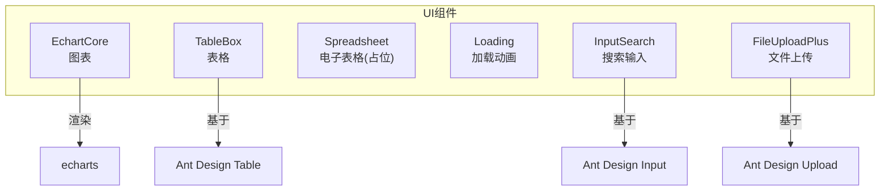
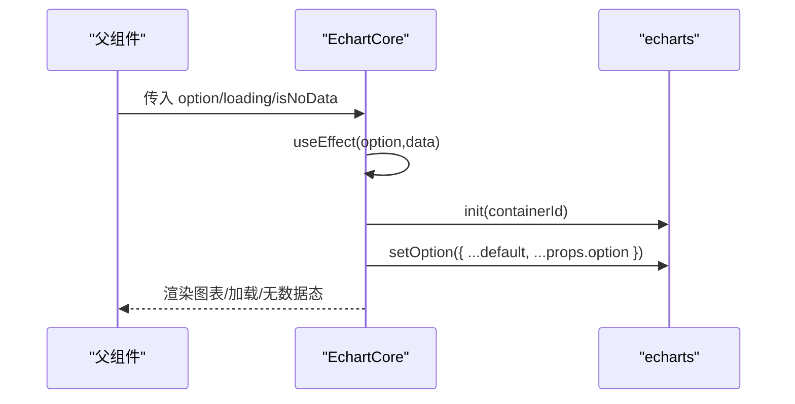
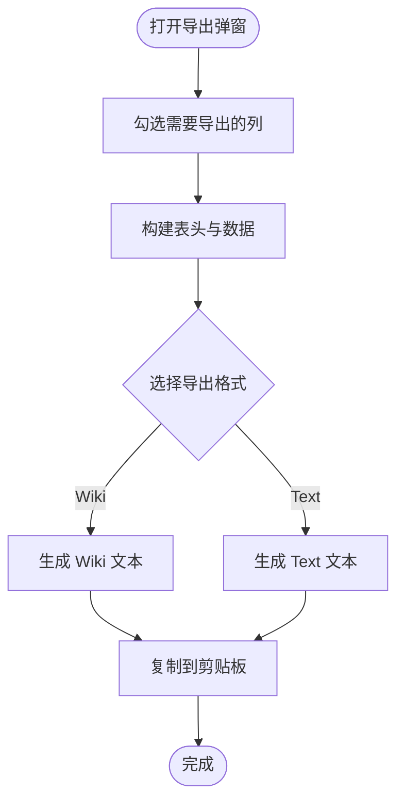
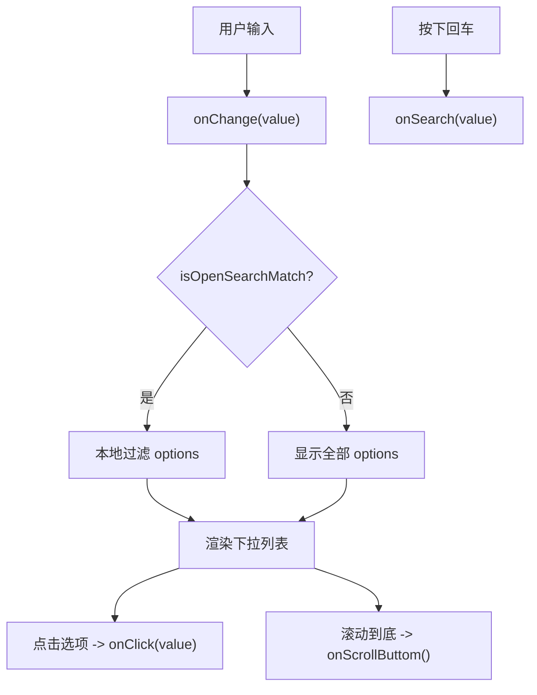
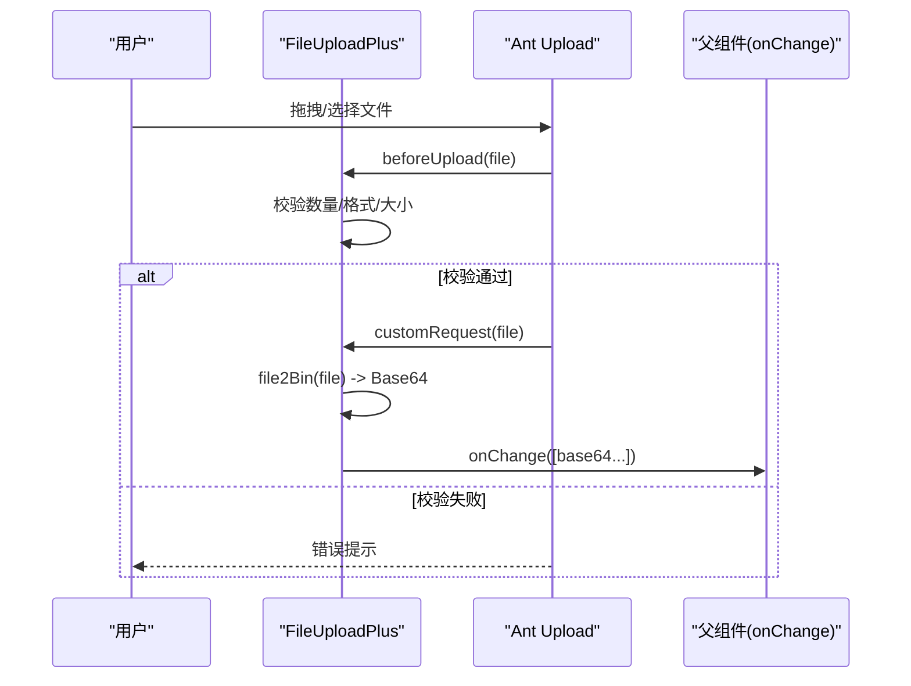
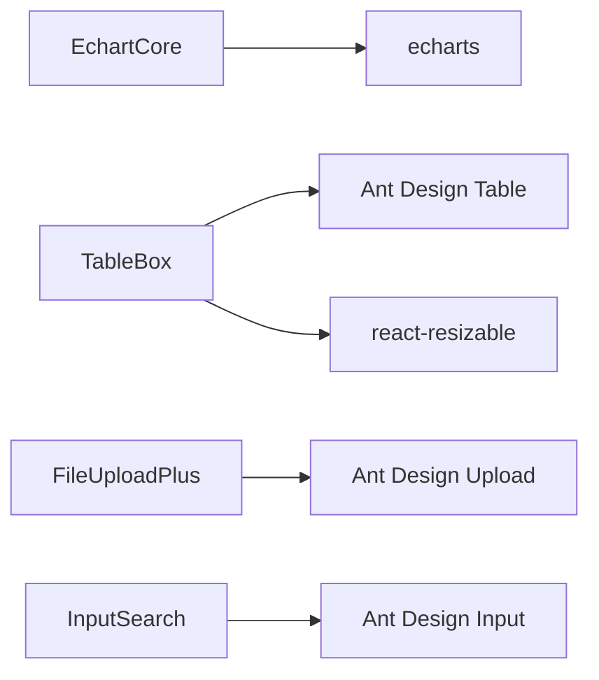

# UI组件库

<cite>
**本文引用的文件**   
- [EchartCore.tsx](file://myapp/frontend/src/components/EchartCore/EchartCore.tsx)
- [EchartCore.less](file://myapp/frontend/src/components/EchartCore/EchartCore.less)
- [TableBox.tsx](file://myapp/frontend/src/components/TableBox/TableBox.tsx)
- [TableBox.less](file://myapp/frontend/src/components/TableBox/TableBox.less)
- [Spreadsheet.tsx](file://myapp/frontend/src/components/Spreadsheet/Spreadsheet.tsx)
- [Loading.tsx](file://myapp/frontend/src/components/Loading/Loading.tsx)
- [Loading.less](file://myapp/frontend/src/components/Loading/Loading.less)
- [InputSearch.tsx](file://myapp/frontend/src/components/InputSearch/InputSearch.tsx)
- [InputSearch.less](file://myapp/frontend/src/components/InputSearch/InputSearch.less)
- [FileUploadPlus.tsx](file://myapp/frontend/src/components/FileUploadPlus/FileUploadPlus.tsx)
- [FileUploadPlus.less](file://myapp/frontend/src/components/FileUploadPlus/FileUploadPlus.less)
</cite>

## 目录
1. [简介](#简介)
2. [项目结构](#项目结构)
3. [核心组件](#核心组件)
4. [架构总览](#架构总览)
5. [组件详细分析](#组件详细分析)
6. [依赖关系分析](#依赖关系分析)
7. [性能与可访问性](#性能与可访问性)
8. [故障排查指南](#故障排查指南)
9. [结论](#结论)

## 简介
本文件为前端UI组件库的技术文档，聚焦以下基础组件的设计模式、Props接口、事件机制、样式定制与主题支持：
- EchartCore 图表组件
- TableBox 表格组件
- Spreadsheet 电子表格组件（当前为占位实现）
- Loading 加载组件
- InputSearch 搜索输入框
- FileUploadPlus 文件上传组件

文档同时提供使用示例路径、最佳实践、可访问性与响应式建议，帮助开发者快速集成并扩展。

## 项目结构
组件位于 myapp/frontend/src/components 目录下，每个组件包含一个TSX实现与可选的LESS样式文件。整体采用“按功能域组织”的结构，便于独立维护与按需引入。



图示来源
- [EchartCore.tsx:1-126](file://myapp/frontend/src/components/EchartCore/EchartCore.tsx#L1-L126)
- [TableBox.tsx:1-335](file://myapp/frontend/src/components/TableBox/TableBox.tsx#L1-L335)
- [FileUploadPlus.tsx:1-194](file://myapp/frontend/src/components/FileUploadPlus/FileUploadPlus.tsx#L1-L194)
- [InputSearch.tsx:1-145](file://myapp/frontend/src/components/InputSearch/InputSearch.tsx#L1-L145)

章节来源
- [EchartCore.tsx:1-126](file://myapp/frontend/src/components/EchartCore/EchartCore.tsx#L1-L126)
- [TableBox.tsx:1-335](file://myapp/frontend/src/components/TableBox/TableBox.tsx#L1-L335)
- [Spreadsheet.tsx:1-122](file://myapp/frontend/src/components/Spreadsheet/Spreadsheet.tsx#L1-L122)
- [Loading.tsx:1-190](file://myapp/frontend/src/components/Loading/Loading.tsx#L1-L190)
- [InputSearch.tsx:1-145](file://myapp/frontend/src/components/InputSearch/InputSearch.tsx#L1-L145)
- [FileUploadPlus.tsx:1-194](file://myapp/frontend/src/components/FileUploadPlus/FileUploadPlus.tsx#L1-L194)

## 核心组件
本节概述各组件的职责与关键能力：
- EchartCore：封装 echarts 初始化与更新，支持 loading、无数据态、自定义尺寸与样式。
- TableBox：在 Ant Design Table 基础上增强列宽拖拽、导出（Wiki/Text）、空状态、分页与滚动。
- Spreadsheet：当前为占位实现，预留了 x-data-spreadsheet 的集成思路与数据结构映射方案。
- Loading：纯CSS+HTML结构的DNA螺旋加载动画。
- InputSearch：带下拉选项、关键词高亮、回车回调、滚动到底触发的搜索输入。
- FileUploadPlus：支持多类型（文件/视频/音频）拖拽上传、预览、删除、格式/大小校验与二进制输出。

章节来源
- [EchartCore.tsx:76-126](file://myapp/frontend/src/components/EchartCore/EchartCore.tsx#L76-L126)
- [TableBox.tsx:12-37](file://myapp/frontend/src/components/TableBox/TableBox.tsx#L12-L37)
- [Spreadsheet.tsx:1-122](file://myapp/frontend/src/components/Spreadsheet/Spreadsheet.tsx#L1-L122)
- [Loading.tsx:1-190](file://myapp/frontend/src/components/Loading/Loading.tsx#L1-L190)
- [InputSearch.tsx:6-28](file://myapp/frontend/src/components/InputSearch/InputSearch.tsx#L6-L28)
- [FileUploadPlus.tsx:8-17](file://myapp/frontend/src/components/FileUploadPlus/FileUploadPlus.tsx#L8-L17)

## 架构总览
组件之间保持松耦合，均通过 props 暴露配置项，通过回调事件与父组件通信。图表类组件依赖第三方库（echarts），表格与上传基于 Ant Design 组件进行二次封装。

```mermaid
classDiagram
class EchartCore {
+option
+loading
+title
+style
+unit
+data
+isNoData
}
class TableBox {
+size
+tableKey
+rowKey
+titleNode
+buttonNode
+dataSource
+columns
+pagination
+scroll
+loading
+rowSelection
+cancelExportData
+onChange()
}
class Spreadsheet {
+width
+height
+dataSource
+onChange()
}
class Loading
class InputSearch {
+labelName
+width
+placeholder
+maxLength
+maxHeight
+isOpenSearchMatch
+loading
+options
+value
+disabled
+onSearch()
+onChange()
+onClick()
+onScrollButtom()
}
class FileUploadPlus {
+filetype
+onChange()
+value
+maxCount
+maxSize
+format
}
EchartCore --> "echarts" : "渲染图表"
TableBox --> "Ant Design Table" : "表格能力"
FileUploadPlus --> "Ant Design Upload" : "上传能力"
InputSearch --> "Ant Design Input" : "输入能力"
```

图示来源
- [EchartCore.tsx:76-126](file://myapp/frontend/src/components/EchartCore/EchartCore.tsx#L76-L126)
- [TableBox.tsx:12-37](file://myapp/frontend/src/components/TableBox/TableBox.tsx#L12-L37)
- [Spreadsheet.tsx:8-13](file://myapp/frontend/src/components/Spreadsheet/Spreadsheet.tsx#L8-L13)
- [InputSearch.tsx:6-28](file://myapp/frontend/src/components/InputSearch/InputSearch.tsx#L6-L28)
- [FileUploadPlus.tsx:8-17](file://myapp/frontend/src/components/FileUploadPlus/FileUploadPlus.tsx#L8-L17)

## 组件详细分析

### EchartCore 图表组件
- 设计要点
  - 基于 echarts 完整包，自动初始化实例并在 option/data 变化时更新。
  - 支持 loading 遮罩与“暂无数据”提示。
  - 默认高度 300，可通过 style 覆盖。
- Props 接口
  - option: echarts.EChartsOption
  - loading?: boolean
  - title?: string
  - style?: React.CSSProperties
  - unit?: string
  - data?: { xData: any[]; yData: any[] }
  - isNoData?: boolean
- 事件机制
  - 无对外事件；内部通过 setOption 同步图表配置。
- 样式与主题
  - 容器最小宽高由 .chart-container 控制；无数据态由 .chart-nodata 控制。
  - 主题可通过 echarts.option 传入或全局主题配置。
- 使用示例（路径）
  - [EchartCore.tsx:95-126](file://myapp/frontend/src/components/EchartCore/EchartCore.tsx#L95-L126)
- 最佳实践
  - 将 option 对象稳定化（useMemo）避免频繁重建。
  - 大数据集建议使用 data.xData/yData 配合 series.data 优化渲染。
  - 在父级容器设置固定宽高或使用百分比布局以适配响应式。



图示来源
- [EchartCore.tsx:95-126](file://myapp/frontend/src/components/EchartCore/EchartCore.tsx#L95-L126)

章节来源
- [EchartCore.tsx:76-126](file://myapp/frontend/src/components/EchartCore/EchartCore.tsx#L76-L126)
- [EchartCore.less:1-18](file://myapp/frontend/src/components/EchartCore/EchartCore.less#L1-L18)

### TableBox 表格组件
- 设计要点
  - 基于 Ant Design Table，增加列宽拖拽（react-resizable）。
  - 内置导出弹窗：支持 Wiki 与 Text 两种格式复制。
  - 空状态自定义、分页、滚动、行选择等。
- Props 接口
  - size?: 'large' | 'middle' | 'small'
  - tableKey?: string
  - rowKey?: string | GetRowKey<any>
  - titleNode?: string | ReactNode
  - buttonNode?: ReactNode
  - dataSource: any[]
  - columns: any[]
  - pagination?: false | TablePaginationConfig
  - scroll?: {...}
  - loading?: boolean
  - rowSelection?: TableRowSelection<any>
  - cancelExportData?: boolean
  - onChange?(pagination, filters, sorter)
- 事件机制
  - onChange 透传 Ant Design Table 的分页/筛选/排序回调。
  - 导出弹窗内操作通过本地状态管理，不向外抛出事件。
- 样式与主题
  - 容器样式 .tablebox；列拖拽手柄 .react-resizable-handle。
  - 可通过 ConfigProvider 统一主题。
- 使用示例（路径）
  - [TableBox.tsx:64-335](file://myapp/frontend/src/components/TableBox/TableBox.tsx#L64-L335)
- 最佳实践
  - 为 columns 中的 dataIndex 指定唯一标识，确保导出与过滤正确。
  - 大数据量建议开启虚拟滚动（Antd Table 自带）或分页。
  - 使用 tableKey 持久化列宽到 localStorage。



图示来源
- [TableBox.tsx:156-215](file://myapp/frontend/src/components/TableBox/TableBox.tsx#L156-L215)
- [TableBox.tsx:219-297](file://myapp/frontend/src/components/TableBox/TableBox.tsx#L219-L297)

章节来源
- [TableBox.tsx:12-37](file://myapp/frontend/src/components/TableBox/TableBox.tsx#L12-L37)
- [TableBox.tsx:64-335](file://myapp/frontend/src/components/TableBox/TableBox.tsx#L64-L335)
- [TableBox.less:1-40](file://myapp/frontend/src/components/TableBox/TableBox.less#L1-L40)

### Spreadsheet 电子表格组件
- 现状说明
  - 当前为占位实现，未启用具体逻辑。
  - 源码中保留了基于 x-data-spreadsheet 的集成注释，包括：
    - 配置项：mode、showToolbar、view.height/width、row/col 配置、style 等。
    - 数据转换：createDataRows 将二维对象数组转为 spreadsheet 的行结构。
    - 生命周期：根据 dataSource 初始化实例并监听 change 回调。
- 未来接入建议
  - 取消注释并安装 x-data-spreadsheet。
  - 将 createDataRows 与 loadData 流程恢复，绑定 onChange。
  - 通过 props.width/height 控制视图尺寸。
- 使用示例（路径）
  - [Spreadsheet.tsx:1-122](file://myapp/frontend/src/components/Spreadsheet/Spreadsheet.tsx#L1-L122)

章节来源
- [Spreadsheet.tsx:1-122](file://myapp/frontend/src/components/Spreadsheet/Spreadsheet.tsx#L1-L122)

### Loading 加载组件
- 设计要点
  - 纯 CSS 动画（旋转点阵）模拟 DNA 双螺旋效果。
  - 无 props，直接渲染。
- 样式与主题
  - 通过 .dna/.ele/.dot 控制结构与动画延迟。
  - 颜色与字体可在 Loading.less 中调整。
- 使用示例（路径）
  - [Loading.tsx:1-190](file://myapp/frontend/src/components/Loading/Loading.tsx#L1-L190)
  - [Loading.less:1-470](file://myapp/frontend/src/components/Loading/Loading.less#L1-L470)

章节来源
- [Loading.tsx:1-190](file://myapp/frontend/src/components/Loading/Loading.tsx#L1-L190)
- [Loading.less:1-470](file://myapp/frontend/src/components/Loading/Loading.less#L1-L470)

### InputSearch 搜索输入框
- 设计要点
  - 基于 Ant Design Input，支持本地过滤（isOpenSearchMatch）。
  - 下拉列表支持关键词高亮、回车触发 onSearch、滚动到底触发 onScrollButtom。
  - 支持受控与非受控两种用法（value 存在时为受控）。
- Props 接口
  - labelName?, width?, placeholder?, maxLength?, maxHeight?
  - isOpenSearchMatch?: boolean
  - loading?: boolean | JSX.Element
  - options?: string[]
  - value?: string
  - disabled?: boolean
  - onSearch?(value), onChange?(value), onClick?(value), onScrollButtom()?
- 事件机制
  - onChange/onSearch 分别处理输入与回车。
  - 点击选项触发 onClick 并回填 value。
  - 滚动到底部触发 onScrollButtom（防抖）。
- 样式与主题
  - 下拉面板 .select-option，焦点可见性由 :focus-within 控制。
  - 高亮词 .highlight 可在外部样式中覆盖。
- 使用示例（路径）
  - [InputSearch.tsx:30-145](file://myapp/frontend/src/components/InputSearch/InputSearch.tsx#L30-L145)
- 最佳实践
  - 大数据 options 建议结合后端搜索与分页加载，配合 onScrollButtom 做懒加载。
  - 使用 value 属性实现受控组件，保证表单一致性。



图示来源
- [InputSearch.tsx:37-88](file://myapp/frontend/src/components/InputSearch/InputSearch.tsx#L37-L88)
- [InputSearch.tsx:108-145](file://myapp/frontend/src/components/InputSearch/InputSearch.tsx#L108-L145)

章节来源
- [InputSearch.tsx:6-28](file://myapp/frontend/src/components/InputSearch/InputSearch.tsx#L6-L28)
- [InputSearch.tsx:30-145](file://myapp/frontend/src/components/InputSearch/InputSearch.tsx#L30-L145)
- [InputSearch.less:1-148](file://myapp/frontend/src/components/InputSearch/InputSearch.less#L1-L148)

### FileUploadPlus 文件上传组件
- 设计要点
  - 基于 Ant Design Upload.Dragger，支持文件/视频/音频三种类型。
  - 内置 beforeUpload 校验（数量、格式、大小）。
  - 自定义 customRequest 将文件转 Base64 二进制字符串并通过 onChange 返回。
  - 媒体类型提供预览与删除操作。
- Props 接口
  - filetype?: 'file' | 'video' | 'audio'
  - onChange?(value)
  - value?: string[]
  - maxCount?: number
  - maxSize?: number
  - format?: string[]
- 事件机制
  - onChange 在成功上传、移除文件后回调，传递二进制数组。
  - 删除按钮直接修改 fileList 并触发 onChange。
- 样式与主题
  - 卡片样式 .image-card，上传区域 .file-uploader。
  - 可通过 Ant Design Upload 的 className/style 进一步定制。
- 使用示例（路径）
  - [FileUploadPlus.tsx:19-194](file://myapp/frontend/src/components/FileUploadPlus/FileUploadPlus.tsx#L19-L194)
- 最佳实践
  - 大文件建议限制 maxSize 并考虑分片上传（需自行扩展）。
  - 对 video/audio 类型，注意浏览器兼容性（URL.createObjectURL）。
  - 如需服务端直传，可将 customRequest 替换为真实上传逻辑。



图示来源
- [FileUploadPlus.tsx:37-74](file://myapp/frontend/src/components/FileUploadPlus/FileUploadPlus.tsx#L37-L74)
- [FileUploadPlus.tsx:76-91](file://myapp/frontend/src/components/FileUploadPlus/FileUploadPlus.tsx#L76-L91)
- [FileUploadPlus.tsx:152-176](file://myapp/frontend/src/components/FileUploadPlus/FileUploadPlus.tsx#L152-L176)

章节来源
- [FileUploadPlus.tsx:8-17](file://myapp/frontend/src/components/FileUploadPlus/FileUploadPlus.tsx#L8-L17)
- [FileUploadPlus.tsx:19-194](file://myapp/frontend/src/components/FileUploadPlus/FileUploadPlus.tsx#L19-L194)
- [FileUploadPlus.less:1-19](file://myapp/frontend/src/components/FileUploadPlus/FileUploadPlus.less#L1-L19)

## 依赖关系分析
- 外部依赖
  - echarts：图表渲染（EchartCore）。
  - Ant Design（Table、Upload、Input、Modal、Tabs、Checkbox、message 等）：通用交互与展示。
  - react-resizable：列宽拖拽（TableBox）。
- 组件耦合
  - EchartCore 仅依赖 echarts，无业务耦合。
  - TableBox 依赖 Ant Design 组件与 react-resizable，导出逻辑为纯函数。
  - FileUploadPlus 依赖 Ant Design Upload，二进制转换逻辑自包含。
  - InputSearch 依赖 Ant Design Input，本地过滤与滚动逻辑自包含。
  - Spreadsheet 当前无运行时依赖。



图示来源
- [EchartCore.tsx:1-37](file://myapp/frontend/src/components/EchartCore/EchartCore.tsx#L1-L37)
- [TableBox.tsx:1-10](file://myapp/frontend/src/components/TableBox/TableBox.tsx#L1-L10)
- [FileUploadPlus.tsx:1-6](file://myapp/frontend/src/components/FileUploadPlus/FileUploadPlus.tsx#L1-L6)
- [InputSearch.tsx:1-5](file://myapp/frontend/src/components/InputSearch/InputSearch.tsx#L1-L5)

章节来源
- [EchartCore.tsx:1-37](file://myapp/frontend/src/components/EchartCore/EchartCore.tsx#L1-L37)
- [TableBox.tsx:1-10](file://myapp/frontend/src/components/TableBox/TableBox.tsx#L1-L10)
- [FileUploadPlus.tsx:1-6](file://myapp/frontend/src/components/FileUploadPlus/FileUploadPlus.tsx#L1-L6)
- [InputSearch.tsx:1-5](file://myapp/frontend/src/components/InputSearch/InputSearch.tsx#L1-L5)

## 性能与可访问性
- 性能
  - EchartCore：避免频繁重建 option，必要时使用 data.xData/yData 减少重绘；大数据集建议分页或采样。
  - TableBox：大数据集开启分页或虚拟滚动；列宽变更写入 localStorage 可能带来小开销，建议仅在必要场景使用。
  - InputSearch：长列表 options 建议分页加载与防抖；本地过滤仅在数据量较小场景使用。
  - FileUploadPlus：Base64 转换在大文件下会占用较多内存，建议限制文件大小或改用流式上传。
- 可访问性
  - InputSearch：为输入框设置 id 并与 label 关联，提升键盘与屏幕阅读器体验。
  - TableBox：为空状态提供语义化文案；导出弹窗使用 Modal 管理焦点。
  - EchartCore：在无数据态提供明确提示，便于辅助技术识别。
- 响应式
  - EchartCore：容器最小宽高保障小屏可读性；外层容器建议使用 flex/grid 自适应。
  - TableBox：列宽拖拽与横向滚动适配不同屏幕宽度。
  - FileUploadPlus：拖拽区宽度自适应父容器。

[本节为通用指导，不直接分析具体文件]

## 故障排查指南
- 图表不显示
  - 检查是否传入有效的 option，且容器有宽高。
  - 确认 loading=false 且 isNoData=false。
  - 参考：[EchartCore.tsx:95-126](file://myapp/frontend/src/components/EchartCore/EchartCore.tsx#L95-L126)
- 表格导出为空
  - 检查 columns.dataIndex 是否与 dataSource 字段一致。
  - 确认已勾选需要导出的列。
  - 参考：[TableBox.tsx:122-140](file://myapp/frontend/src/components/TableBox/TableBox.tsx#L122-L140)
- 搜索下拉不出现
  - 检查 options 是否为空；isOpenSearchMatch 是否正确。
  - 检查 maxHeight 是否过小导致溢出隐藏。
  - 参考：[InputSearch.tsx:37-47](file://myapp/frontend/src/components/InputSearch/InputSearch.tsx#L37-L47)
- 上传失败或无法预览
  - 检查 format/maxSize/maxCount 配置是否符合预期。
  - 媒体类型需浏览器支持 URL.createObjectURL。
  - 参考：[FileUploadPlus.tsx:37-55](file://myapp/frontend/src/components/FileUploadPlus/FileUploadPlus.tsx#L37-L55)

章节来源
- [EchartCore.tsx:95-126](file://myapp/frontend/src/components/EchartCore/EchartCore.tsx#L95-L126)
- [TableBox.tsx:122-140](file://myapp/frontend/src/components/TableBox/TableBox.tsx#L122-L140)
- [InputSearch.tsx:37-47](file://myapp/frontend/src/components/InputSearch/InputSearch.tsx#L37-L47)
- [FileUploadPlus.tsx:37-55](file://myapp/frontend/src/components/FileUploadPlus/FileUploadPlus.tsx#L37-L55)

## 结论
本组件库围绕常用业务场景提供了开箱即用的基础组件，兼顾可扩展性与易用性。建议在项目中：
- 统一通过 props 配置行为，避免在组件内部硬编码业务逻辑。
- 对大数据与多媒体场景做好性能与兼容性考量。
- 结合 Ant Design 主题系统实现一致的视觉风格。
- 逐步完善 Spreadsheet 的完整实现以满足复杂编辑需求。

[本节为总结性内容，不直接分析具体文件]