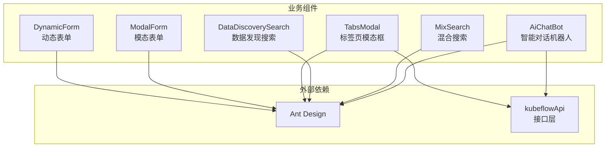
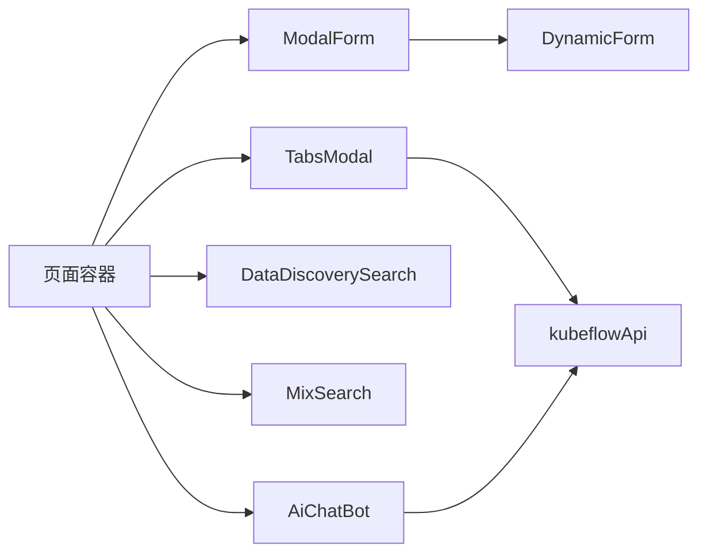
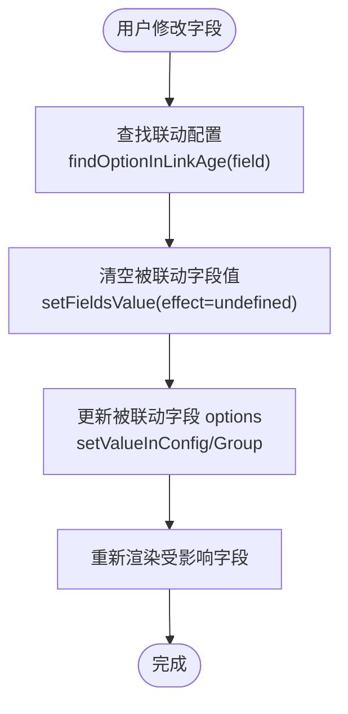
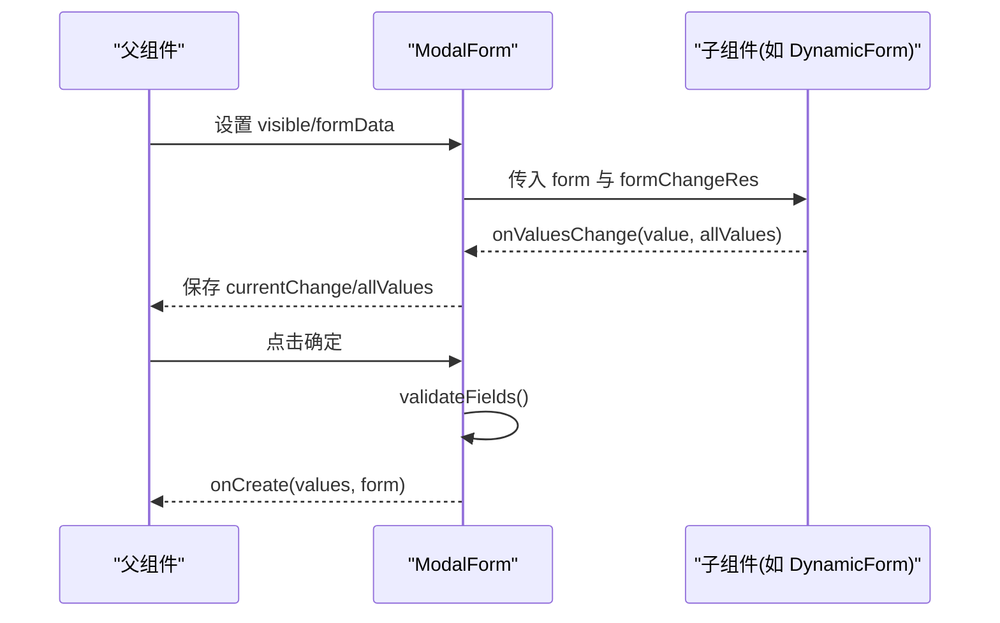
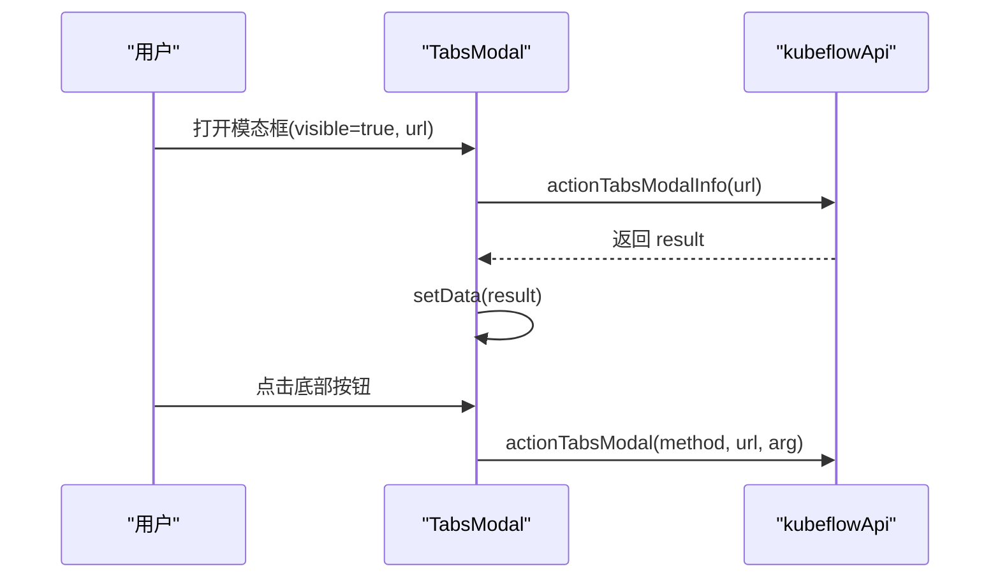
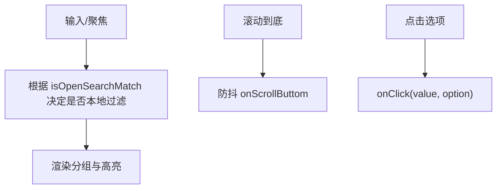
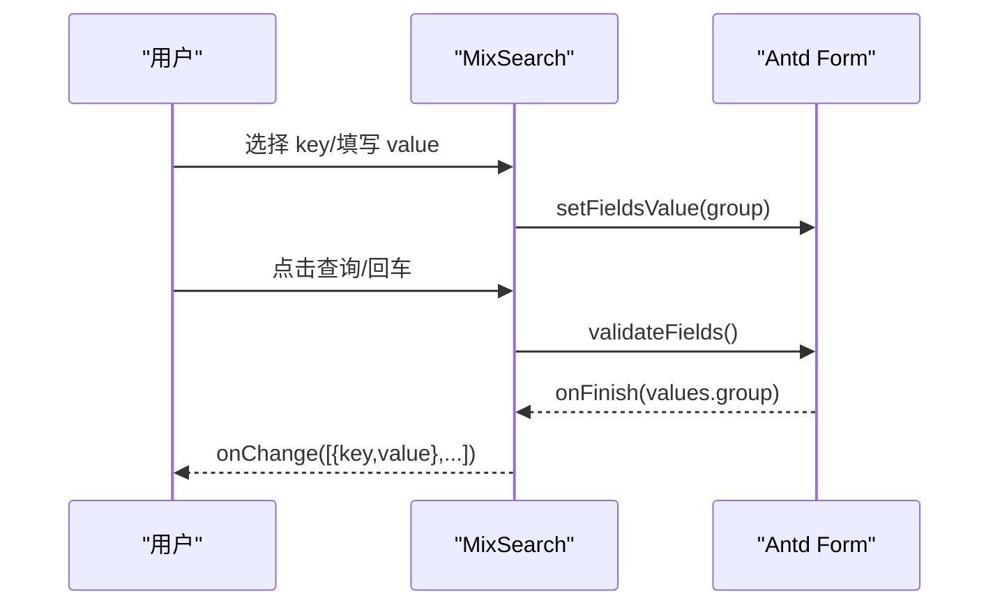
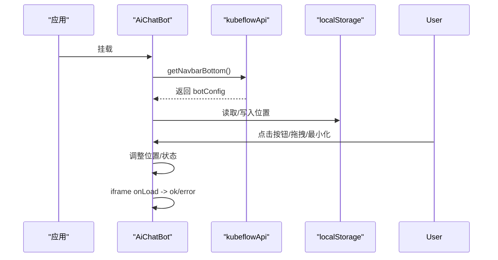
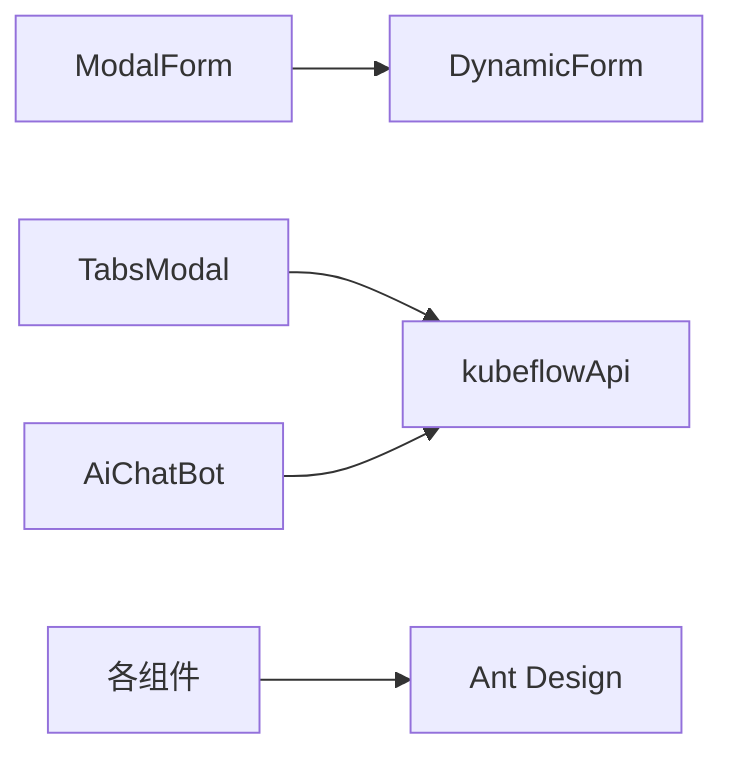

# 业务组件

<cite>
**本文引用的文件**   
- [DynamicForm.tsx](file://myapp/frontend/src/components/DynamicForm/DynamicForm.tsx)
- [ModalForm.tsx](file://myapp/frontend/src/components/ModalForm/ModalForm.tsx)
- [TabsModal.tsx](file://myapp/frontend/src/components/TabsModal/TabsModal.tsx)
- [DataDiscoverySearch.tsx](file://myapp/frontend/src/components/DataDiscoverySearch/DataDiscoverySearch.tsx)
- [MixSearch.tsx](file://myapp/frontend/src/components/MixSearch/MixSearch.tsx)
- [AiChatBot.tsx](file://myapp/frontend/src/components/AiChatBot/AiChatBot.tsx)
</cite>

## 目录
1. [简介](#简介)
2. [项目结构](#项目结构)
3. [核心组件](#核心组件)
4. [架构总览](#架构总览)
5. [详细组件分析](#详细组件分析)
6. [依赖关系分析](#依赖关系分析)
7. [性能考虑](#性能考虑)
8. [故障排查指南](#故障排查指南)
9. [结论](#结论)

## 简介
本文件面向复杂业务逻辑的前端组件，系统性梳理并文档化以下组件的设计与实现：
- DynamicForm 动态表单：基于配置驱动的多类型字段、分组步骤、联动与校验。
- ModalForm 模态表单：封装 Ant Design Modal + Form，提供受控数据流与变更事件。
- TabsModal 标签页模态框：根据后端返回的 tabs 配置渲染内容区与底部操作按钮。
- DataDiscoverySearch 数据发现搜索：支持分组选项、前端过滤、滚动到底触发加载。
- MixSearch 混合搜索：可配置的查询条件行（key/value），支持展开收起与提交序列化。
- AiChatBot 智能对话机器人：全局悬浮入口，iframe 嵌入外部对话服务，支持拖拽、最小化与错误重试。

目标读者包括前端开发者、产品与实施人员，帮助快速理解组件能力、集成方式与最佳实践。

## 项目结构
这些组件均位于 myapp/frontend/src/components 下，按功能域分目录组织，便于独立维护与复用。

图表来源
- [DynamicForm.tsx:1-12](file://myapp/frontend/src/components/DynamicForm/DynamicForm.tsx#L1-L12)
- [ModalForm.tsx:1-3](file://myapp/frontend/src/components/ModalForm/ModalForm.tsx#L1-L3)
- [TabsModal.tsx:1-7](file://myapp/frontend/src/components/TabsModal/TabsModal.tsx#L1-L7)
- [DataDiscoverySearch.tsx:1-5](file://myapp/frontend/src/components/DataDiscoverySearch/DataDiscoverySearch.tsx#L1-L5)
- [MixSearch.tsx:1-5](file://myapp/frontend/src/components/MixSearch/MixSearch.tsx#L1-L5)
- [AiChatBot.tsx:5-9](file://myapp/frontend/src/components/AiChatBot/AiChatBot.tsx#L5-L9)

章节来源
- [DynamicForm.tsx:1-12](file://myapp/frontend/src/components/DynamicForm/DynamicForm.tsx#L1-L12)
- [ModalForm.tsx:1-3](file://myapp/frontend/src/components/ModalForm/ModalForm.tsx#L1-L3)
- [TabsModal.tsx:1-7](file://myapp/frontend/src/components/TabsModal/TabsModal.tsx#L1-L7)
- [DataDiscoverySearch.tsx:1-5](file://myapp/frontend/src/components/DataDiscoverySearch/DataDiscoverySearch.tsx#L1-L5)
- [MixSearch.tsx:1-5](file://myapp/frontend/src/components/MixSearch/MixSearch.tsx#L1-L5)
- [AiChatBot.tsx:5-9](file://myapp/frontend/src/components/AiChatBot/AiChatBot.tsx#L5-L9)

## 核心组件
- DynamicForm：通过 config/configGroup 配置驱动渲染多种字段；支持 Steps 分组、Form.List 列表项、联动 effect/effectOption、提示与描述、JSON 编辑器、文件上传等。
- ModalForm：封装 Modal + Form，统一处理 visible、loading、onCreate/onCancel、formData 回填、onValuesChange 暴露 currentChange/allValues。
- TabsModal：根据 url 拉取 tabs 配置，渲染 TabsDetail 内容与底部按钮，支持关闭时重置数据。
- DataDiscoverySearch：输入框 + 下拉菜单，支持分组 options、前端过滤、关键词高亮、滚动到底回调、可控 value。
- MixSearch：Form.List 动态构建查询条件行，支持 key/value 选择、展开收起、提交序列化为 {key, value} 数组。
- AiChatBot：从 /myapp/navbar_bottom 获取助手配置，悬浮按钮 + iframe 面板，支持拖拽定位、最小化、加载/错误状态与重试。

章节来源
- [DynamicForm.tsx:13-64](file://myapp/frontend/src/components/DynamicForm/DynamicForm.tsx#L13-L64)
- [ModalForm.tsx:4-14](file://myapp/frontend/src/components/ModalForm/ModalForm.tsx#L4-L14)
- [TabsModal.tsx:7-11](file://myapp/frontend/src/components/TabsModal/TabsModal.tsx#L7-L11)
- [DataDiscoverySearch.tsx:6-39](file://myapp/frontend/src/components/DataDiscoverySearch/DataDiscoverySearch.tsx#L6-L39)
- [MixSearch.tsx:8-26](file://myapp/frontend/src/components/MixSearch/MixSearch.tsx#L8-L26)
- [AiChatBot.tsx:37-64](file://myapp/frontend/src/components/AiChatBot/AiChatBot.tsx#L37-L64)

## 架构总览
组件之间通过 props 与事件通信，部分组件依赖后端接口或第三方 UI 库。

图表来源
- [ModalForm.tsx:37-75](file://myapp/frontend/src/components/ModalForm/ModalForm.tsx#L37-L75)
- [DynamicForm.tsx:618-680](file://myapp/frontend/src/components/DynamicForm/DynamicForm.tsx#L618-L680)
- [TabsModal.tsx:16-47](file://myapp/frontend/src/components/TabsModal/TabsModal.tsx#L16-L47)
- [AiChatBot.tsx:157-171](file://myapp/frontend/src/components/AiChatBot/AiChatBot.tsx#L157-L171)

## 详细组件分析

### DynamicForm 动态表单
- 设计要点
  - 配置驱动：config 与 configGroup 分别定义字段与分组步骤，Steps 控制分页导航。
  - 多类型字段：input、textArea、select、radio、datePicker、rangePicker、cascader、json、fileUpload、match-input、input-select。
  - 联动机制：linkageConfig 指定 dep/effect/effectOption，当依赖字段变化时清空并更新被联动字段 options。
  - 列表字段：使用 Form.List 渲染 item.list，支持增删行。
  - 提示与描述：data.tips 与 description 支持 HTML 展示。
  - 校验：rules 透传至 Form.Item，分组切换前对当前组进行 validateFields。
- 数据流
  - onValuesChange 由上层 Form 触发，组件内部通过 formChangeRes 同步联动重置。
  - onRetryInfoChange 用于刷新下拉或搜索选项。
- 交互模式
  - 分组步骤：上一步/下一步，最后一步提示“点击确定完成提交”。
  - 列表项：增加/删除行。
- 错误处理
  - 校验失败捕获并打印错误；未命中联动规则时保持原值。
- 性能优化
  - 使用 ref 缓存当前配置，避免频繁重渲染；options 计算基于已存在的映射。
- 可维护性
  - 新增字段类型只需在 dispatchRenderFormItem 中扩展分支。

图表来源
- [DynamicForm.tsx:92-151](file://myapp/frontend/src/components/DynamicForm/DynamicForm.tsx#L92-L151)

章节来源
- [DynamicForm.tsx:13-64](file://myapp/frontend/src/components/DynamicForm/DynamicForm.tsx#L13-L64)
- [DynamicForm.tsx:75-170](file://myapp/frontend/src/components/DynamicForm/DynamicForm.tsx#L75-L170)
- [DynamicForm.tsx:180-553](file://myapp/frontend/src/components/DynamicForm/DynamicForm.tsx#L180-L553)
- [DynamicForm.tsx:555-680](file://myapp/frontend/src/components/DynamicForm/DynamicForm.tsx#L555-L680)

### ModalForm 模态表单
- 设计要点
  - 封装 Modal + Form，提供 visible、loading、title、width、formData 回填。
  - 暴露 children(form, formChangeRes)，供子组件访问 FormInstance 与变更结果。
  - 统一 onOk 校验后调用 onCreate(values, form)。
- 数据流
  - onValuesChange 将 currentChange 与 allValues 暴露给父级，便于联动或联动初始化。
- 交互模式
  - 取消时 resetFields 并回调 onCancel。
- 错误处理
  - 校验失败静默捕获，避免阻断流程。
- 性能优化
  - 使用 useMemo 注释掉 children 缓存，按需启用以避免不必要的重渲染。
- 可维护性
  - 对外仅暴露必要 props，内部 Form 实例与状态不泄露。

图表来源
- [ModalForm.tsx:37-75](file://myapp/frontend/src/components/ModalForm/ModalForm.tsx#L37-L75)

章节来源
- [ModalForm.tsx:4-14](file://myapp/frontend/src/components/ModalForm/ModalForm.tsx#L4-L14)
- [ModalForm.tsx:16-75](file://myapp/frontend/src/components/ModalForm/ModalForm.tsx#L16-L75)

### TabsModal 标签页模态框
- 设计要点
  - 根据 props.url 调用 actionTabsModalInfo 获取 tabs 配置，渲染 TabsDetail 与底部按钮。
  - 关闭时重置 data，确保下次打开重新拉取。
- 数据流
  - 成功时 setData(res.data.result)，失败时置空并记录错误。
- 交互模式
  - 底部按钮调用 actionTabsModal(method, url, arg) 执行动作。
- 错误处理
  - 数据格式异常或请求失败时，显示无数据占位。
- 性能优化
  - destroyOnClose 销毁节点，避免残留状态。
- 可维护性
  - 通过接口契约 ITabsModalData 约束数据结构。

图表来源
- [TabsModal.tsx:16-47](file://myapp/frontend/src/components/TabsModal/TabsModal.tsx#L16-L47)
- [TabsModal.tsx:48-86](file://myapp/frontend/src/components/TabsModal/TabsModal.tsx#L48-L86)

章节来源
- [TabsModal.tsx:7-11](file://myapp/frontend/src/components/TabsModal/TabsModal.tsx#L7-L11)
- [TabsModal.tsx:16-47](file://myapp/frontend/src/components/TabsModal/TabsModal.tsx#L16-L47)
- [TabsModal.tsx:48-86](file://myapp/frontend/src/components/TabsModal/TabsModal.tsx#L48-L86)

### DataDiscoverySearch 数据发现搜索
- 设计要点
  - 支持分组 options，前端过滤或开启 isOpenSearchMatch 时不做本地过滤。
  - 关键词高亮显示，滚动到底触发 onScrollButtom。
  - 支持可控 value 与非可控模式。
- 数据流
  - 监听 props.options 与 props.value 变化，更新 dataCache 与 value。
- 交互模式
  - 输入 onChange、回车 onSearch、点击 option onClick。
- 错误处理
  - 无特殊错误分支，依赖上层处理。
- 性能优化
  - 使用 debounce 包装滚动到底回调，减少重复触发。
- 可维护性
  - 清晰的 IProps 与 IOptionsGroupItem 接口定义。

图表来源
- [DataDiscoverySearch.tsx:41-185](file://myapp/frontend/src/components/DataDiscoverySearch/DataDiscoverySearch.tsx#L41-L185)

章节来源
- [DataDiscoverySearch.tsx:6-39](file://myapp/frontend/src/components/DataDiscoverySearch/DataDiscoverySearch.tsx#L6-L39)
- [DataDiscoverySearch.tsx:41-185](file://myapp/frontend/src/components/DataDiscoverySearch/DataDiscoverySearch.tsx#L41-L185)

### MixSearch 混合搜索
- 设计要点
  - 通过 params 定义可选择的查询键，values 初始化已选键值对。
  - Form.List 管理多行查询条件，支持删除与添加。
  - 提交时将 group 序列化为 {key, value} 数组。
- 数据流
  - useEffect 同步 props.values 到 form 与 used 标记。
  - handleFinishForm 输出最终查询参数。
- 交互模式
  - 展开/收起区域，回车触发校验并提交。
- 错误处理
  - 校验失败时阻止提交。
- 性能优化
  - 使用 Map(paramsDataMap) 加速 key 到配置的查找。
- 可维护性
  - IMixSearchParamItem 明确字段类型与可选属性。

图表来源
- [MixSearch.tsx:28-84](file://myapp/frontend/src/components/MixSearch/MixSearch.tsx#L28-L84)
- [MixSearch.tsx:147-293](file://myapp/frontend/src/components/MixSearch/MixSearch.tsx#L147-L293)

章节来源
- [MixSearch.tsx:8-26](file://myapp/frontend/src/components/MixSearch/MixSearch.tsx#L8-L26)
- [MixSearch.tsx:28-84](file://myapp/frontend/src/components/MixSearch/MixSearch.tsx#L28-L84)
- [MixSearch.tsx:147-293](file://myapp/frontend/src/components/MixSearch/MixSearch.tsx#L147-L293)

### AiChatBot 智能对话机器人
- 设计要点
  - 启动时调用 getNavbarBottom 获取助手配置，为空则不渲染。
  - 悬浮按钮与固定面板，支持拖拽定位、最小化、窗口 resize 自适应。
  - iframe 嵌入外部对话服务，支持 loading/error 状态与重试。
- 数据流
  - botConfig 来自接口；isOpen/isMinimized 控制面板；iframeStatus 控制蒙层与 iframe 显隐。
- 交互模式
  - 点击按钮打开/关闭；头部拖拽移动面板；最小化/展开切换；错误重试。
- 错误处理
  - 接口失败静默隐藏；iframe 加载失败显示错误并提供重试。
- 性能优化
  - localStorage 持久化位置；resize 监听中 clampPosition 限制范围；iframeKey 强制重载。
- 可维护性
  - 常量集中管理尺寸与偏移；URL 解析函数兼容相对/绝对/协议相关地址。

图表来源
- [AiChatBot.tsx:157-171](file://myapp/frontend/src/components/AiChatBot/AiChatBot.tsx#L157-L171)
- [AiChatBot.tsx:191-286](file://myapp/frontend/src/components/AiChatBot/AiChatBot.tsx#L191-L286)
- [AiChatBot.tsx:295-449](file://myapp/frontend/src/components/AiChatBot/AiChatBot.tsx#L295-L449)

章节来源
- [AiChatBot.tsx:37-64](file://myapp/frontend/src/components/AiChatBot/AiChatBot.tsx#L37-L64)
- [AiChatBot.tsx:157-171](file://myapp/frontend/src/components/AiChatBot/AiChatBot.tsx#L157-L171)
- [AiChatBot.tsx:191-286](file://myapp/frontend/src/components/AiChatBot/AiChatBot.tsx#L191-L286)
- [AiChatBot.tsx:295-449](file://myapp/frontend/src/components/AiChatBot/AiChatBot.tsx#L295-L449)

## 依赖关系分析
- 组件耦合
  - ModalForm 与 DynamicForm：ModalForm 作为容器，DynamicForm 作为子表单，二者通过 props.children 与 formChangeRes 协作。
  - TabsModal 与 kubeflowApi：直接依赖接口获取 tabs 配置。
  - AiChatBot 与 kubeflowApi：获取底部助手配置。
- 外部依赖
  - Ant Design：所有组件均依赖其基础控件与样式。
- 潜在循环依赖
  - 组件间为单向依赖，未见循环引用。

图表来源
- [ModalForm.tsx:37-75](file://myapp/frontend/src/components/ModalForm/ModalForm.tsx#L37-L75)
- [TabsModal.tsx:16-47](file://myapp/frontend/src/components/TabsModal/TabsModal.tsx#L16-L47)
- [AiChatBot.tsx:157-171](file://myapp/frontend/src/components/AiChatBot/AiChatBot.tsx#L157-L171)

章节来源
- [ModalForm.tsx:37-75](file://myapp/frontend/src/components/ModalForm/ModalForm.tsx#L37-L75)
- [TabsModal.tsx:16-47](file://myapp/frontend/src/components/TabsModal/TabsModal.tsx#L16-L47)
- [AiChatBot.tsx:157-171](file://myapp/frontend/src/components/AiChatBot/AiChatBot.tsx#L157-L171)

## 性能考虑
- 列表与长下拉
  - DataDiscoverySearch 使用防抖处理滚动到底事件，避免频繁触发。
  - 建议在大列表场景引入虚拟滚动或分页加载。
- 表单联动
  - DynamicForm 通过 ref 缓存配置，减少无效重渲染；联动重置仅在依赖字段变化时触发。
- 模态框
  - ModalForm 与 TabsModal 使用 destroyOnClose 清理 DOM，避免内存泄漏。
- iframe 与网络
  - AiChatBot 在打开面板时重置 iframe key 以强制重载；localStorage 持久化位置，减少布局抖动。
- 渲染优化
  - 按需渲染：TabsModal 在数据未就绪时显示占位；AiChatBot 在 botConfig 为空时不渲染任何内容。

[本节为通用指导，无需具体文件引用]

## 故障排查指南
- DynamicForm
  - 联动失效：检查 linkageConfig.dep 是否包含当前字段名，effectOption 映射是否存在对应 valueId。
  - 校验不生效：确认 rules 正确传入 Form.Item，且分组切换前调用了 validateFields。
- ModalForm
  - 子组件无法获取 form：确保 children 是函数形式并使用 (form, formChangeRes) 接收。
  - 取消后数据未清空：确认 onCancel 中调用了 form.resetFields。
- TabsModal
  - 数据为空：检查 actionTabsModalInfo 返回结构与 res.data.result 是否为预期对象。
  - 底部按钮无效：确认 button.method/url/arg 配置正确。
- DataDiscoverySearch
  - 选项不显示：检查 options 分组结构与 value 匹配；若 isOpenSearchMatch 为 true，不会做本地过滤。
  - 滚动到底未触发：确认 maxHeight 与外层容器高度合理，且 onScrollButtom 存在。
- MixSearch
  - 提交值为空：检查 group 中至少有一行的 key 已选择，且 values 初始值与 params.name 对应。
  - 展开收起异常：确认 collapsed 状态与 Form.List 渲染逻辑一致。
- AiChatBot
  - 不显示入口：getNavbarBottom 返回空数组或未加载完成时不会渲染。
  - iframe 连接失败：查看 iframeStatus 为 error，点击重试按钮重新加载。
  - 拖拽卡顿：检查 pointer 事件与 suppressNextClick 逻辑，避免误判点击。

章节来源
- [DynamicForm.tsx:92-151](file://myapp/frontend/src/components/DynamicForm/DynamicForm.tsx#L92-L151)
- [ModalForm.tsx:47-61](file://myapp/frontend/src/components/ModalForm/ModalForm.tsx#L47-L61)
- [TabsModal.tsx:28-47](file://myapp/frontend/src/components/TabsModal/TabsModal.tsx#L28-L47)
- [DataDiscoverySearch.tsx:41-185](file://myapp/frontend/src/components/DataDiscoverySearch/DataDiscoverySearch.tsx#L41-L185)
- [MixSearch.tsx:78-84](file://myapp/frontend/src/components/MixSearch/MixSearch.tsx#L78-L84)
- [AiChatBot.tsx:157-171](file://myapp/frontend/src/components/AiChatBot/AiChatBot.tsx#L157-L171)
- [AiChatBot.tsx:422-437](file://myapp/frontend/src/components/AiChatBot/AiChatBot.tsx#L422-L437)

## 结论
上述业务组件围绕“配置驱动 + 事件驱动”的模式，提供了丰富的表单、搜索与对话框能力。通过统一的接口约定与良好的状态管理，能够在复杂业务场景中快速集成与扩展。建议在后续迭代中：
- 完善单元测试与边界用例覆盖。
- 对大数据量下拉与列表引入虚拟化或分页。
- 对联动与校验逻辑抽取为可复用的 Hook。
- 对 AiChatBot 的网络错误增加更友好的重试策略与日志上报。

[本节为总结性内容，无需具体文件引用]