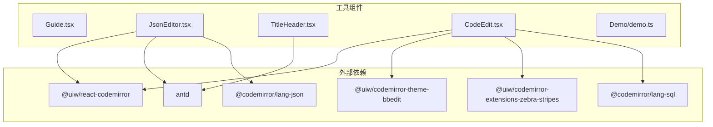
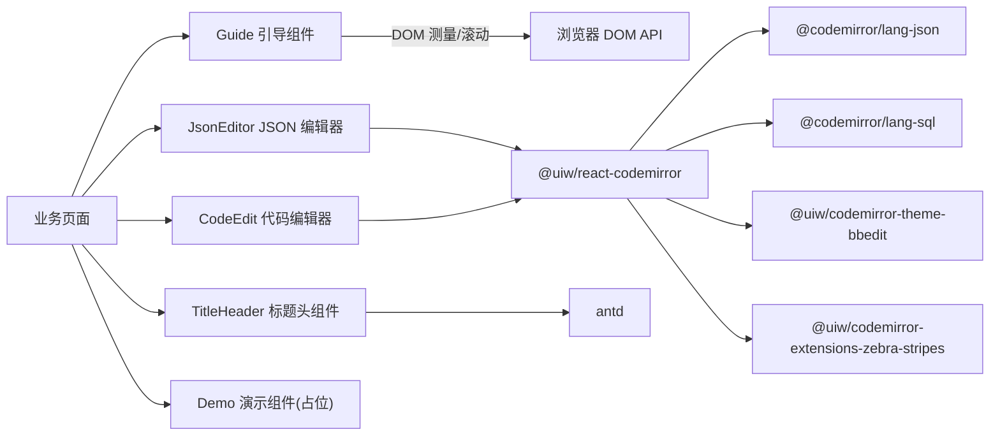
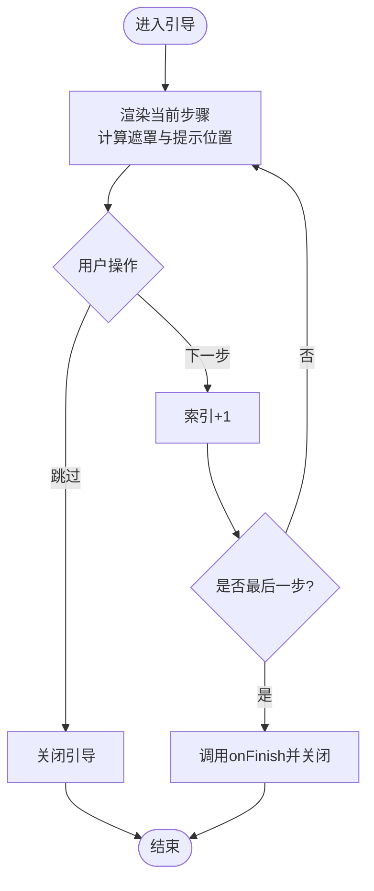
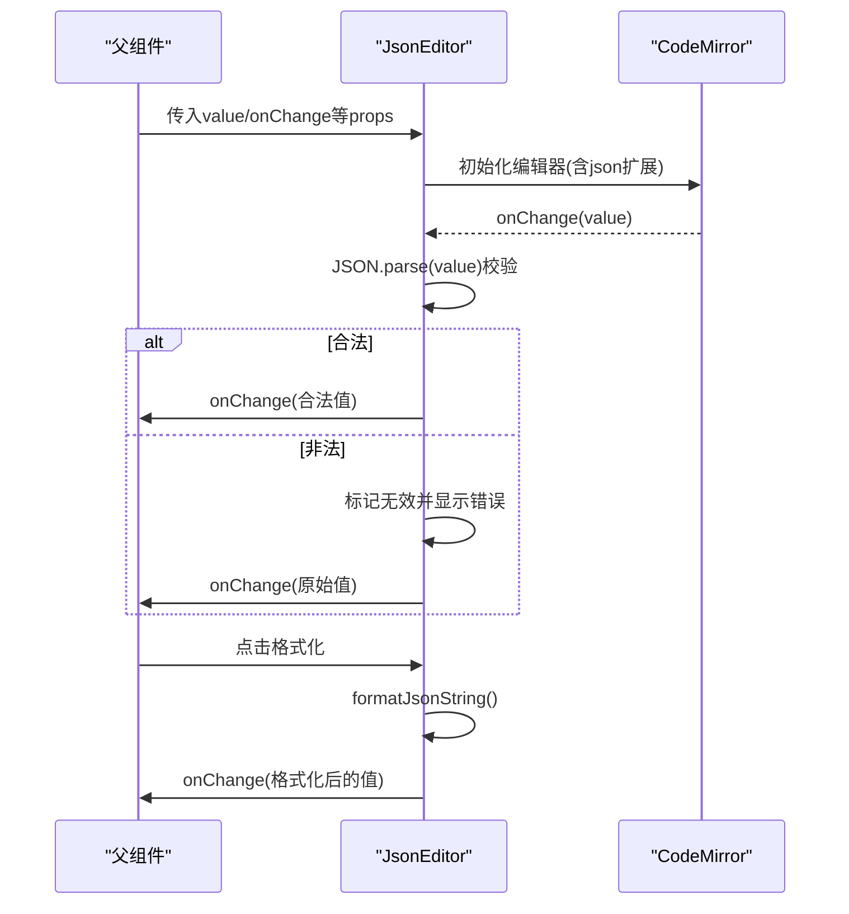
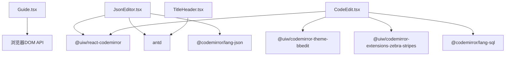

# 工具组件

<cite>
**本文引用的文件**   
- [Guide.tsx](file://myapp/frontend/src/components/Guide/Guide.tsx)
- [JsonEditor.tsx](file://myapp/frontend/src/components/JsonEditor\JsonEditor.tsx)
- [TitleHeader.tsx](file://myapp/frontend/src/components/TitleHeader\TitleHeader.tsx)
- [CodeEdit.tsx](file://myapp/frontend/src/components/CodeEdit.tsx)
- [demo.ts](file://myapp/frontend/src/components/Demo/demo.ts)
</cite>

## 目录
1. [简介](#简介)
2. [项目结构](#项目结构)
3. [核心组件](#核心组件)
4. [架构总览](#架构总览)
5. [详细组件分析](#详细组件分析)
6. [依赖关系分析](#依赖关系分析)
7. [性能与可用性考量](#性能与可用性考量)
8. [集成示例与使用场景](#集成示例与使用场景)
9. [扩展性与自定义开发指南](#扩展性与自定义开发指南)
10. [故障排查](#故障排查)
11. [结论](#结论)

## 简介
本章节面向“工具组件”子系统的整体说明，聚焦以下辅助性、工具性前端组件：
- Guide 引导组件：用于页面功能引导、新手教程、分步提示。
- JsonEditor JSON 编辑器：基于 CodeMirror 的 JSON 编辑与格式化能力。
- TitleHeader 标题头组件：统一的页面标题与操作区布局。
- CodeEdit 代码编辑器：基于 CodeMirror 的 SQL 高亮与斑马纹行展示。
- Demo 演示组件：占位示例（当前为空实现）。

这些组件以 React + TypeScript 实现，遵循可配置、可扩展的设计原则，便于在业务页面中快速复用与二次定制。

## 项目结构
工具组件位于 myapp/frontend/src/components 目录下，按功能模块划分：
- components/Guide/Guide.tsx
- components/JsonEditor/JsonEditor.tsx
- components/TitleHeader/TitleHeader.tsx
- components/CodeEdit.tsx
- components/Demo/demo.ts

图表来源
- [JsonEditor.tsx:1-132](file://myapp/frontend/src/components/JsonEditor\JsonEditor.tsx#L1-L132)
- [CodeEdit.tsx:1-165](file://myapp/frontend/src/components/CodeEdit.tsx#L1-L165)
- [TitleHeader.tsx:1-39](file://myapp/frontend/src/components/TitleHeader\TitleHeader.tsx#L1-L39)

章节来源
- [Guide.tsx:1-225](file://myapp/frontend/src/components/Guide/Guide.tsx#L1-L225)
- [JsonEditor.tsx:1-132](file://myapp/frontend/src/components/JsonEditor\JsonEditor.tsx#L1-L132)
- [TitleHeader.tsx:1-39](file://myapp/frontend/src/components/TitleHeader\TitleHeader.tsx#L1-L39)
- [CodeEdit.tsx:1-165](file://myapp/frontend/src/components/CodeEdit.tsx#L1-L165)
- [demo.ts:1-133](file://myapp/frontend/src/components/Demo/demo.ts#L1-L133)

## 核心组件
本节概述各工具组件的职责与关键特性：
- Guide 引导组件
  - 支持遮罩形状（圆形/矩形）、提示位置（上/下/左/右）与对齐方式（居中/左/右）。
  - 自动滚动容器至目标元素可视区域，计算遮罩尺寸与边框宽度。
  - 提供“下一步/完成/跳过”流程控制，支持 onFinish 回调。
- JsonEditor JSON 编辑器
  - 基于 @uiw/react-codemirror 与 @codemirror/lang-json。
  - 实时校验 JSON 合法性，提供“格式化”按钮。
  - 自适应高度（最大 300px），支持只读模式与 placeholder。
- TitleHeader 标题头组件
  - 基于 antd Row/Col/Space/Typography，统一标题、面包屑与右侧操作区布局。
  - 支持 sticky 定位与可选底部边框隐藏。
- CodeEdit 代码编辑器
  - 基于 @uiw/react-codemirror，启用 SQL 语言支持与斑马纹行扩展。
  - 使用 bbedit 主题，提供 value/onChange 受控接口。
- Demo 演示组件
  - 当前为占位实现，未暴露功能。

章节来源
- [Guide.tsx:1-225](file://myapp/frontend/src/components/Guide/Guide.tsx#L1-L225)
- [JsonEditor.tsx:1-132](file://myapp/frontend/src/components/JsonEditor\JsonEditor.tsx#L1-L132)
- [TitleHeader.tsx:1-39](file://myapp/frontend/src/components/TitleHeader\TitleHeader.tsx#L1-L39)
- [CodeEdit.tsx:1-165](file://myapp/frontend/src/components/CodeEdit.tsx#L1-L165)
- [demo.ts:1-133](file://myapp/frontend/src/components/Demo/demo.ts#L1-L133)

## 架构总览
工具组件均为无状态或弱状态的 React 函数组件，通过 props 进行配置，内部仅封装 UI 与交互逻辑，不直接耦合业务数据。它们依赖第三方库（antd、@uiw/react-codemirror 及其扩展）提供基础能力。

图表来源
- [Guide.tsx:32-72](file://myapp/frontend/src/components/Guide/Guide.tsx#L32-L72)
- [JsonEditor.tsx:1-132](file://myapp/frontend/src/components/JsonEditor\JsonEditor.tsx#L1-L132)
- [CodeEdit.tsx:1-165](file://myapp/frontend/src/components/CodeEdit.tsx#L1-L165)
- [TitleHeader.tsx:1-39](file://myapp/frontend/src/components/TitleHeader\TitleHeader.tsx#L1-L39)

## 详细组件分析

### Guide 引导组件
职责与行为
- 根据 option 数组驱动多步骤引导，渲染遮罩层与提示气泡。
- 自动将滚动容器滚动到目标元素可见区域。
- 根据 tipPosition/tipAlign 计算提示框位置与箭头方向。
- 提供“下一步/完成/跳过”控制，并在最后一步触发 onFinish。

关键数据结构
- IProps.option: 引导项数组，每项包含 maskType、tipPosition、tipAlign、maskDisplay、content、targetId。
- 类型 MaskType、TipPosition、TipAlign 定义遮罩形状、提示位置与对齐方式。

交互流程

图表来源
- [Guide.tsx:74-85](file://myapp/frontend/src/components/Guide/Guide.tsx#L74-L85)
- [Guide.tsx:199-224](file://myapp/frontend/src/components/Guide/Guide.tsx#L199-L224)

配置选项
- option: 引导步骤配置数组（必填）
- className: 外层容器类名
- isClose: 是否已关闭（受控开关）
- containerId: 滚动容器 ID（可选）
- onFinish: 完成回调（可选）

使用建议
- 确保每个 step 的 targetId 对应真实存在的 DOM 节点。
- 若存在滚动容器，务必设置 containerId，以获得正确的遮罩偏移计算。
- 在 onFinish 中清理状态或跳转路由。

章节来源
- [Guide.tsx:1-225](file://myapp/frontend/src/components/Guide/Guide.tsx#L1-L225)

### JsonEditor JSON 编辑器
职责与行为
- 基于 CodeMirror 提供 JSON 语法高亮与编辑体验。
- 实时校验 JSON 合法性，非法时显示错误提示。
- 提供“格式化”按钮，对合法 JSON 进行美化输出。
- 自适应编辑器高度（最大 300px），支持只读与 placeholder。

关键流程

图表来源
- [JsonEditor.tsx:22-84](file://myapp/frontend/src/components/JsonEditor\JsonEditor.tsx#L22-L84)
- [JsonEditor.tsx:86-131](file://myapp/frontend/src/components/JsonEditor\JsonEditor.tsx#L86-L131)

配置选项
- value: JSON 字符串（受控）
- onChange: 值变化回调
- readOnly: 是否只读
- rows: 行数（保留字段，实际由自适应高度控制）
- placeholder: 占位文本

使用建议
- 建议在父组件中对 value 做规范化处理（如默认 '{}'）。
- 格式化前确保 JSON 合法，避免异常抛出。
- 如需更高自由度，可直接使用底层 CodeMirror 扩展。

章节来源
- [JsonEditor.tsx:1-132](file://myapp/frontend/src/components/JsonEditor\JsonEditor.tsx#L1-L132)

### TitleHeader 标题头组件
职责与行为
- 提供统一的标题、面包屑与右侧操作区布局。
- 支持 sticky 定位，保证滚动时标题始终可见。
- 支持隐藏底部边框，适配不同页面风格。

配置选项
- title: 标题内容（ReactNode 或 string）
- breadcrumbs: 面包屑内容（ReactNode 或 string）
- children: 右侧操作区（按钮等）
- noBorderBottom: 是否隐藏底部边框

使用建议
- 将常用操作按钮放入 children，保持布局一致。
- 面包屑建议使用 antd Breadcrumb 组件组合。

章节来源
- [TitleHeader.tsx:1-39](file://myapp/frontend/src/components/TitleHeader\TitleHeader.tsx#L1-L39)

### CodeEdit 代码编辑器
职责与行为
- 基于 CodeMirror 提供 SQL 语法高亮与斑马纹行样式。
- 使用 bbedit 主题提升可读性。
- 提供 value/onChange 受控接口，便于与表单或状态管理集成。

配置选项
- value: 代码字符串（受控）
- onChange: 值变化回调
- 其他 CodeMirror 属性可通过扩展传递

使用建议
- 适合 SQL 查询、脚本编辑等场景。
- 如需更多语言支持，可替换 lang 扩展（例如 json、javascript 等）。

章节来源
- [CodeEdit.tsx:1-165](file://myapp/frontend/src/components/CodeEdit.tsx#L1-L165)

### Demo 演示组件
当前为占位实现，未暴露任何功能。可作为后续扩展的入口点。

章节来源
- [demo.ts:1-133](file://myapp/frontend/src/components/Demo/demo.ts#L1-L133)

## 依赖关系分析
- Guide 组件主要依赖浏览器 DOM API 进行元素测量与滚动定位，不依赖第三方 UI 库。
- JsonEditor 与 CodeEdit 均依赖 @uiw/react-codemirror 及其扩展；JsonEditor 额外依赖 antd Button。
- TitleHeader 依赖 antd 的 Row、Col、Space、Typography。

图表来源
- [Guide.tsx:32-72](file://myapp/frontend/src/components/Guide/Guide.tsx#L32-L72)
- [JsonEditor.tsx:1-132](file://myapp/frontend/src/components/JsonEditor\JsonEditor.tsx#L1-L132)
- [CodeEdit.tsx:1-165](file://myapp/frontend/src/components/CodeEdit.tsx#L1-L165)
- [TitleHeader.tsx:1-39](file://myapp/frontend/src/components/TitleHeader\TitleHeader.tsx#L1-L39)

章节来源
- [Guide.tsx:1-225](file://myapp/frontend/src/components/Guide/Guide.tsx#L1-L225)
- [JsonEditor.tsx:1-132](file://myapp/frontend/src/components/JsonEditor\JsonEditor.tsx#L1-L132)
- [CodeEdit.tsx:1-165](file://myapp/frontend/src/components/CodeEdit.tsx#L1-L165)
- [TitleHeader.tsx:1-39](file://myapp/frontend/src/components/TitleHeader\TitleHeader.tsx#L1-L39)

## 性能与可用性考量
- Guide 组件
  - 遮罩与提示位置计算涉及多次 DOM 读取，建议在大型页面中减少频繁重排。
  - 滚动容器需正确设置 containerId，避免不必要的滚动抖动。
- JsonEditor 组件
  - 每次输入都会尝试解析 JSON，建议在高频输入场景中进行防抖处理（由父组件负责）。
  - 自适应高度会触发重绘，注意在大数据量 JSON 下的性能影响。
- CodeEdit 组件
  - SQL 高亮与斑马纹扩展会带来一定渲染开销，适合中小规模代码编辑。
- TitleHeader 组件
  - 使用 sticky 定位，避免复杂嵌套导致的布局抖动。

[本节为通用指导，不涉及具体文件]

## 集成示例与使用场景

### 场景一：新功能上线引导
- 使用 Guide 组件为新功能提供分步引导。
- 在 option 中配置多个步骤，分别指向目标元素 ID。
- 在 onFinish 中记录用户已完成引导，避免重复展示。

章节来源
- [Guide.tsx:4-19](file://myapp/frontend/src/components/Guide/Guide.tsx#L4-L19)
- [Guide.tsx:74-85](file://myapp/frontend/src/components/Guide/Guide.tsx#L74-L85)

### 场景二：配置项 JSON 编辑
- 使用 JsonEditor 编辑系统配置或任务参数。
- 在父组件中维护 value 状态，并通过 onChange 同步更新。
- 利用“格式化”按钮提升可读性，结合错误提示避免非法 JSON。

章节来源
- [JsonEditor.tsx:7-11](file://myapp/frontend/src/components/JsonEditor\JsonEditor.tsx#L7-L11)
- [JsonEditor.tsx:62-84](file://myapp/frontend/src/components/JsonEditor\JsonEditor.tsx#L62-L84)

### 场景三：页面标题与操作区统一
- 使用 TitleHeader 包裹页面头部，左侧放置标题与面包屑，右侧放置操作按钮。
- 通过 noBorderBottom 控制是否需要底部边框，适配不同页面风格。

章节来源
- [TitleHeader.tsx:7-12](file://myapp/frontend/src/components/TitleHeader\TitleHeader.tsx#L7-L12)
- [TitleHeader.tsx:14-35](file://myapp/frontend/src/components/TitleHeader\TitleHeader.tsx#L14-L35)

### 场景四：SQL 查询与脚本编辑
- 使用 CodeEdit 作为 SQL 编辑器，配合后端查询接口。
- 在 onChange 中缓存用户输入，提交时再执行查询。

章节来源
- [CodeEdit.tsx:68-84](file://myapp/frontend/src/components/CodeEdit.tsx#L68-L84)

## 扩展性与自定义开发指南

### Guide 组件扩展
- 新增遮罩形状：扩展 MaskType 枚举，并在 handleTargetPosition 中增加对应样式逻辑。
- 自定义提示样式：通过 className 注入 CSS，或在 handleTipArrow/handleTipPosition 中调整样式。
- 多容器支持：扩展 containerId 为数组，支持多滚动容器切换。

章节来源
- [Guide.tsx:21-25](file://myapp/frontend/src/components/Guide/Guide.tsx#L21-L25)
- [Guide.tsx:32-72](file://myapp/frontend/src/components/Guide/Guide.tsx#L32-L72)
- [Guide.tsx:87-197](file://myapp/frontend/src/components/Guide/Guide.tsx#L87-L197)

### JsonEditor 组件扩展
- 自定义校验规则：在 handleEditorChange 中扩展 JSON.parse 之外的校验逻辑。
- 主题与扩展：通过 extensions 参数注入更多 CodeMirror 扩展（如 lint、autocomplete）。
- 高度策略：根据内容行数动态调整 maxHeight，或提供固定高度模式。

章节来源
- [JsonEditor.tsx:62-84](file://myapp/frontend/src/components/JsonEditor\JsonEditor.tsx#L62-L84)
- [JsonEditor.tsx:90-109](file://myapp/frontend/src/components/JsonEditor\JsonEditor.tsx#L90-L109)

### TitleHeader 组件扩展
- 响应式布局：根据屏幕尺寸调整标题字号与间距。
- 国际化：支持 i18n 文案注入。
- 可访问性：添加 aria-label 与键盘导航支持。

章节来源
- [TitleHeader.tsx:7-12](file://myapp/frontend/src/components/TitleHeader\TitleHeader.tsx#L7-L12)
- [TitleHeader.tsx:14-35](file://myapp/frontend/src/components/TitleHeader\TitleHeader.tsx#L14-L35)

### CodeEdit 组件扩展
- 多语言支持：替换 sql() 为其他语言扩展（如 javascript、python）。
- 自定义主题：更换 bbedit 为主题或其他 CodeMirror 主题。
- 功能增强：添加折叠、括号匹配、自动补全等扩展。

章节来源
- [CodeEdit.tsx:68-84](file://myapp/frontend/src/components/CodeEdit.tsx#L68-L84)

## 故障排查
- Guide 无法定位目标元素
  - 检查 targetId 是否存在于 DOM。
  - 确认 containerId 是否正确设置且可滚动。
- JsonEditor 格式化失败
  - 检查 JSON 是否合法，先修复格式错误后再格式化。
  - 观察错误提示区域，定位非法字符。
- CodeEdit 高亮异常
  - 确认已引入对应语言扩展（如 sql）。
  - 检查主题与扩展版本兼容性。
- TitleHeader 布局错位
  - 检查父容器是否有 overflow 或 transform 导致 sticky 失效。
  - 确认 antd 版本与样式冲突。

章节来源
- [Guide.tsx:32-72](file://myapp/frontend/src/components/Guide/Guide.tsx#L32-L72)
- [JsonEditor.tsx:62-84](file://myapp/frontend/src/components/JsonEditor\JsonEditor.tsx#L62-L84)
- [CodeEdit.tsx:68-84](file://myapp/frontend/src/components/CodeEdit.tsx#L68-L84)
- [TitleHeader.tsx:14-35](file://myapp/frontend/src/components/TitleHeader\TitleHeader.tsx#L14-L35)

## 结论
本工具组件集提供了轻量、可配置的 UI 能力，覆盖引导、JSON 编辑、标题布局与代码编辑等常见场景。组件设计强调低耦合与高内聚，便于在业务页面中快速集成与二次定制。未来可根据实际需求进一步扩展功能与样式，以满足更复杂的业务场景。