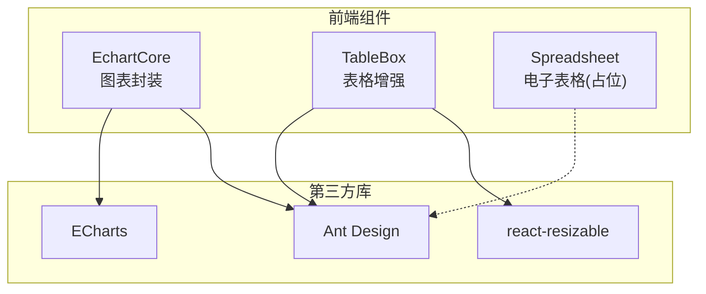
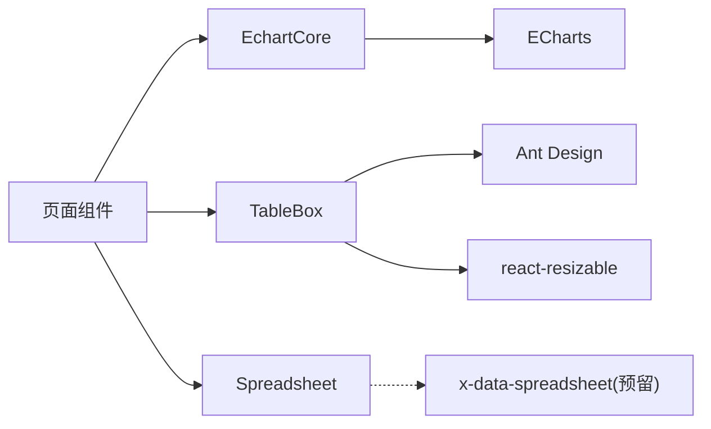
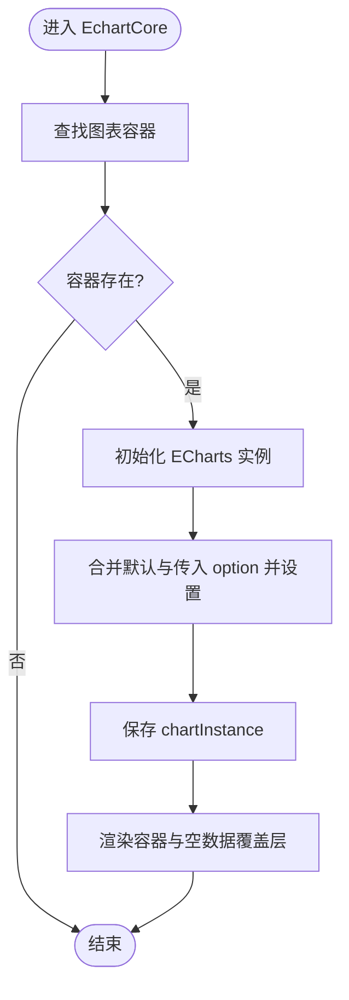
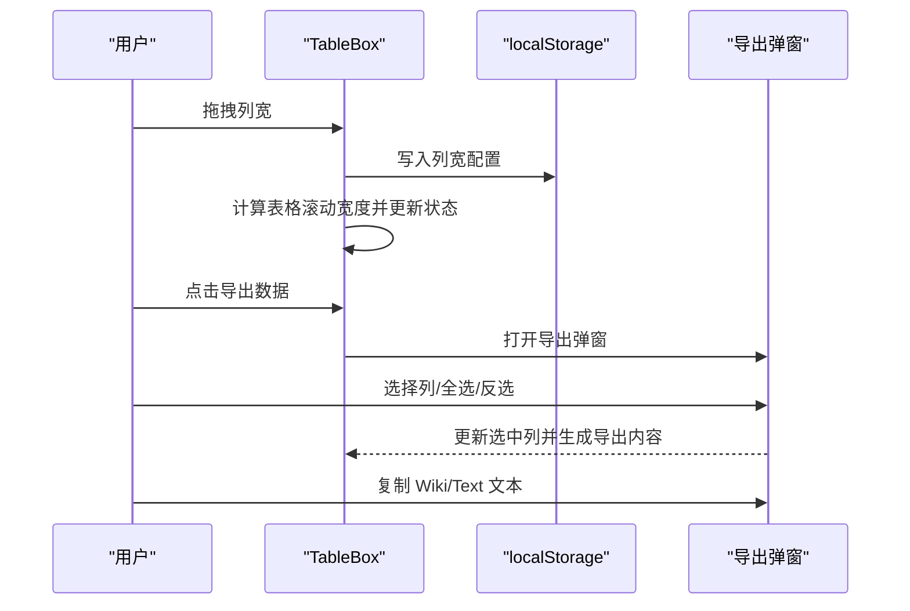
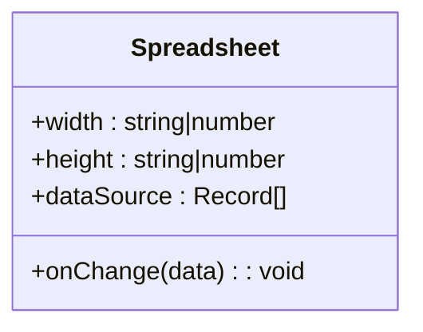
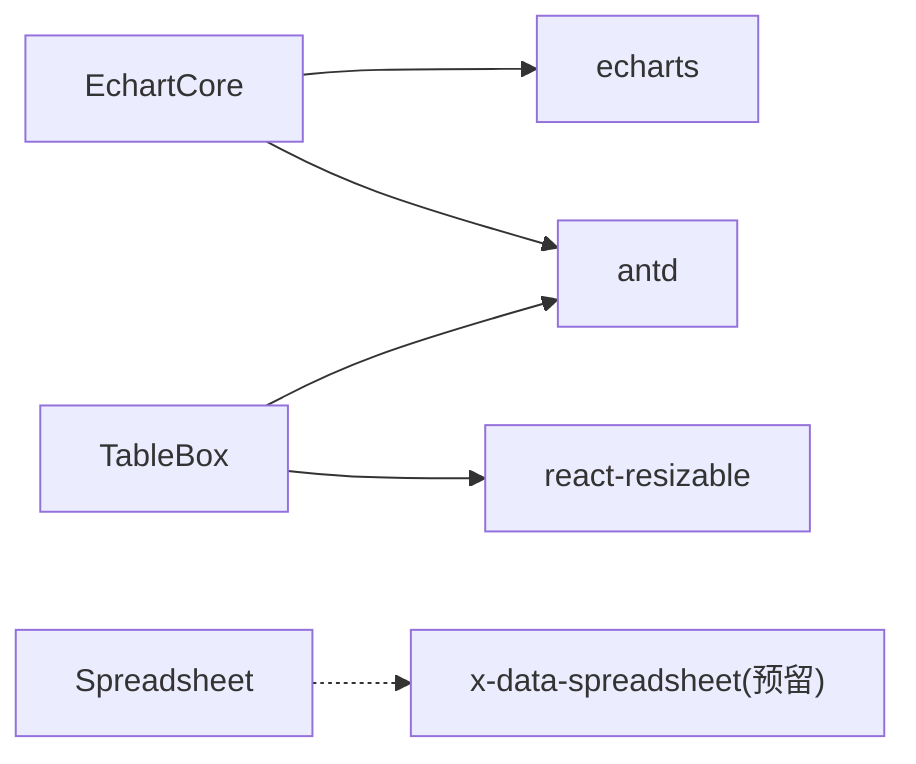

# 组件设计模式

<cite>
**本文引用的文件**   
- [EchartCore.tsx](file://myapp/frontend/src/components/EchartCore/EchartCore.tsx)
- [EchartCore.less](file://myapp/frontend/src/components/EchartCore/EchartCore.less)
- [TableBox.tsx](file://myapp/frontend/src/components/TableBox/TableBox.tsx)
- [TableBox.less](file://myapp/frontend/src/components/TableBox/TableBox.less)
- [Spreadsheet.tsx](file://myapp/frontend/src/components/Spreadsheet/Spreadsheet.tsx)
- [xDataSpreadsheet.less](file://myapp/frontend/src/components/Spreadsheet/xDataSpreadsheet.less)
</cite>

## 目录
1. [引言](#引言)
2. [项目结构](#项目结构)
3. [核心组件](#核心组件)
4. [架构总览](#架构总览)
5. [详细组件分析](#详细组件分析)
6. [依赖关系分析](#依赖关系分析)
7. [性能考量](#性能考量)
8. [故障排查指南](#故障排查指南)
9. [结论](#结论)
10. [附录](#附录)

## 引言
本文件面向前端工程中的 React 组件设计与复用，聚焦以下目标：
- 解释通用组件库的组织方式与页面组件规范
- 深入解析 EchartCore、TableBox、Spreadsheet 等常用组件的实现模式与复用策略
- 说明 Props 设计、事件处理、样式管理与主题定制方法
- 提供可复用的业务组件与 UI 组件开发示例（以路径引用为主）
- 给出组件测试策略与性能优化建议

## 项目结构
本项目的前端位于 myapp/frontend/src，组件统一放置在 components 目录下。本次文档重点关注的三个组件及其样式文件如下：
- EchartCore：图表封装，基于 ECharts
- TableBox：表格增强封装，支持列宽拖拽、导出等
- Spreadsheet：电子表格封装（当前为占位实现，预留扩展点）

图示来源
- [EchartCore.tsx:1-126](file://myapp/frontend/src/components/EchartCore/EchartCore.tsx#L1-L126)
- [TableBox.tsx:1-335](file://myapp/frontend/src/components/TableBox/TableBox.tsx#L1-L335)
- [Spreadsheet.tsx:1-122](file://myapp/frontend/src/components/Spreadsheet/Spreadsheet.tsx#L1-L122)

章节来源
- [EchartCore.tsx:1-126](file://myapp/frontend/src/components/EchartCore/EchartCore.tsx#L1-L126)
- [TableBox.tsx:1-335](file://myapp/frontend/src/components/TableBox/TableBox.tsx#L1-L335)
- [Spreadsheet.tsx:1-122](file://myapp/frontend/src/components/Spreadsheet/Spreadsheet.tsx#L1-L122)

## 核心组件
本节概述各组件的职责、Props 契约、事件与样式约定，并给出复用策略。

- EchartCore
  - 职责：对 ECharts 进行轻量封装，提供统一的加载态、空数据态与尺寸控制
  - 关键 Props：option、loading、title、style、unit、data、isNoData
  - 事件：无对外事件；通过 option 驱动渲染
  - 样式：独立 less 文件，定义容器与“暂无数据”覆盖层
  - 复用策略：在业务页面中直接传入 ECharts Option，结合 loading 与 isNoData 控制展示状态

- TableBox
  - 职责：在 Ant Design Table 基础上增强列宽拖拽、导出（Wiki/Text）、自定义空态、标题与按钮插槽
  - 关键 Props：size、tableKey、rowKey、titleNode、buttonNode、dataSource、columns、pagination、scroll、loading、rowSelection、cancelExportData、onChange
  - 事件：onChange 透传分页/筛选/排序回调
  - 样式：独立 less 文件，定义表格容器、标签与可拖拽手柄
  - 复用策略：作为通用数据列表的基座，配合 columns 配置与外部 state 管理分页与筛选

- Spreadsheet
  - 职责：电子表格能力封装（当前为占位实现，保留扩展接口）
  - 关键 Props（预留）：width、height、dataSource、onChange
  - 事件：onChange（预留）
  - 样式：预留 less 文件用于覆盖工具栏宽度等
  - 复用策略：待接入 x-data-spreadsheet 后，作为数据编辑与预览的统一入口

章节来源
- [EchartCore.tsx:76-126](file://myapp/frontend/src/components/EchartCore/EchartCore.tsx#L76-L126)
- [EchartCore.less:1-18](file://myapp/frontend/src/components/EchartCore/EchartCore.less#L1-L18)
- [TableBox.tsx:12-37](file://myapp/frontend/src/components/TableBox/TableBox.tsx#L12-L37)
- [TableBox.less:1-40](file://myapp/frontend/src/components/TableBox/TableBox.less#L1-L40)
- [Spreadsheet.tsx:1-122](file://myapp/frontend/src/components/Spreadsheet/Spreadsheet.tsx#L1-L122)
- [xDataSpreadsheet.less:1-5](file://myapp/frontend/src/components/Spreadsheet/xDataSpreadsheet.less#L1-L5)

## 架构总览
下图展示了组件与其依赖的关系，以及典型的数据流。

图示来源
- [EchartCore.tsx:1-126](file://myapp/frontend/src/components/EchartCore/EchartCore.tsx#L1-L126)
- [TableBox.tsx:1-335](file://myapp/frontend/src/components/TableBox/TableBox.tsx#L1-L335)
- [Spreadsheet.tsx:1-122](file://myapp/frontend/src/components/Spreadsheet/Spreadsheet.tsx#L1-L122)

## 详细组件分析

### EchartCore 组件分析
- 设计要点
  - 使用 useEffect 初始化图表实例，并在 option 或 data 变化时更新
  - 通过 Spin 包裹 loading 态，isNoData 控制“暂无数据”覆盖层
  - 默认高度 300，可通过 style 覆盖
- 复杂度与性能
  - 初始化仅在依赖项变化时触发，避免重复创建实例
  - 建议在父级缓存 option 对象，减少重绘
- 错误处理
  - 当容器不存在时跳过初始化，避免报错
- 主题定制
  - 通过传入 ECharts option 的主题字段进行定制
  - 容器样式由 EchartCore.less 统一管理

图示来源
- [EchartCore.tsx:95-126](file://myapp/frontend/src/components/EchartCore/EchartCore.tsx#L95-L126)

章节来源
- [EchartCore.tsx:76-126](file://myapp/frontend/src/components/EchartCore/EchartCore.tsx#L76-L126)
- [EchartCore.less:1-18](file://myapp/frontend/src/components/EchartCore/EchartCore.less#L1-L18)

### TableBox 组件分析
- 设计要点
  - 列宽拖拽：通过 react-resizable 包装表头单元格，持久化列宽到 localStorage
  - 导出功能：提供 Wiki 与 Text 两种格式复制，内置全选/反选列选择器
  - 空态：使用 ConfigProvider.renderEmpty 自定义空数据展示
  - 插槽：titleNode 与 buttonNode 允许外部注入标题与操作按钮
- 复杂度与性能
  - 列宽变更会触发 setCols 与 scroll.x 计算，注意大数据量场景下节流
  - 导出逻辑在弹窗内执行，避免主线程阻塞
- 错误处理
  - 过滤 handle 列，防止操作列参与导出
- 主题定制
  - 通过 TableBox.less 调整容器、标签与拖拽手柄样式

图示来源
- [TableBox.tsx:39-106](file://myapp/frontend/src/components/TableBox/TableBox.tsx#L39-L106)
- [TableBox.tsx:156-215](file://myapp/frontend/src/components/TableBox/TableBox.tsx#L156-L215)
- [TableBox.tsx:217-335](file://myapp/frontend/src/components/TableBox/TableBox.tsx#L217-L335)

章节来源
- [TableBox.tsx:12-37](file://myapp/frontend/src/components/TableBox/TableBox.tsx#L12-L37)
- [TableBox.tsx:39-106](file://myapp/frontend/src/components/TableBox/TableBox.tsx#L39-L106)
- [TableBox.tsx:156-215](file://myapp/frontend/src/components/TableBox/TableBox.tsx#L156-L215)
- [TableBox.tsx:217-335](file://myapp/frontend/src/components/TableBox/TableBox.tsx#L217-L335)
- [TableBox.less:1-40](file://myapp/frontend/src/components/TableBox/TableBox.less#L1-L40)

### Spreadsheet 组件分析
- 现状
  - 当前为占位实现，未启用具体电子表格库
  - 预留 ISpreadsheetProps 接口与 onChange 回调
- 扩展计划
  - 接入 x-data-spreadsheet，实现数据行格式化、中文本地化、动态行列长度
  - 通过 xDataSpreadsheet.less 覆盖工具栏宽度等样式
- 复用策略
  - 作为数据编辑与预览的统一入口，后续可在页面中直接传入 dataSource 与 onChange

图示来源
- [Spreadsheet.tsx:1-122](file://myapp/frontend/src/components/Spreadsheet/Spreadsheet.tsx#L1-L122)
- [xDataSpreadsheet.less:1-5](file://myapp/frontend/src/components/Spreadsheet/xDataSpreadsheet.less#L1-L5)

章节来源
- [Spreadsheet.tsx:1-122](file://myapp/frontend/src/components/Spreadsheet/Spreadsheet.tsx#L1-L122)
- [xDataSpreadsheet.less:1-5](file://myapp/frontend/src/components/Spreadsheet/xDataSpreadsheet.less#L1-L5)

## 依赖关系分析
- EchartCore
  - 依赖 ECharts 与 antd Spin
  - 样式依赖 EchartCore.less
- TableBox
  - 依赖 antd Table/Modal/Tabs/Checkbox 等
  - 依赖 react-resizable 实现列宽拖拽
  - 样式依赖 TableBox.less
- Spreadsheet
  - 预留依赖 x-data-spreadsheet
  - 样式依赖 xDataSpreadsheet.less

图示来源
- [EchartCore.tsx:1-126](file://myapp/frontend/src/components/EchartCore/EchartCore.tsx#L1-L126)
- [TableBox.tsx:1-335](file://myapp/frontend/src/components/TableBox/TableBox.tsx#L1-L335)
- [Spreadsheet.tsx:1-122](file://myapp/frontend/src/components/Spreadsheet/Spreadsheet.tsx#L1-L122)

章节来源
- [EchartCore.tsx:1-126](file://myapp/frontend/src/components/EchartCore/EchartCore.tsx#L1-L126)
- [TableBox.tsx:1-335](file://myapp/frontend/src/components/TableBox/TableBox.tsx#L1-L335)
- [Spreadsheet.tsx:1-122](file://myapp/frontend/src/components/Spreadsheet/Spreadsheet.tsx#L1-L122)

## 性能考量
- EchartCore
  - 避免频繁重建实例：确保 option 对象稳定引用或使用 useMemo
  - 大数据集渲染：按需拆分 series，开启 lazyUpdate
  - 内存释放：组件卸载时销毁实例（可扩展）
- TableBox
  - 列宽拖拽：对 onResize 做节流，避免频繁写 localStorage
  - 导出：大表格导出建议在 Web Worker 中进行字符串拼接
  - 分页与筛选：将分页/筛选逻辑上移至父组件，减少子组件重渲染
- Spreadsheet
  - 数据格式化：对大数据集分批渲染，限制初始行列数
  - 交互：对 onChange 做防抖，降低父组件更新频率

[本节为通用指导，不直接分析具体文件]

## 故障排查指南
- EchartCore
  - 现象：图表不显示
    - 检查容器是否存在且可见
    - 确认传入的 option 是否有效
    - 查看控制台是否有 ECharts 初始化错误
- TableBox
  - 现象：列宽无法保存
    - 检查 tableKey 是否唯一
    - 确认浏览器 localStorage 可用
  - 现象：导出内容为空
    - 检查 columns 中 dataIndex 是否正确
    - 确认 dataSource 非空且包含所选列
- Spreadsheet
  - 现象：未渲染
    - 当前为占位实现，需接入具体库后再验证

章节来源
- [EchartCore.tsx:95-126](file://myapp/frontend/src/components/EchartCore/EchartCore.tsx#L95-L126)
- [TableBox.tsx:100-113](file://myapp/frontend/src/components/TableBox/TableBox.tsx#L100-L113)
- [TableBox.tsx:156-215](file://myapp/frontend/src/components/TableBox/TableBox.tsx#L156-L215)
- [Spreadsheet.tsx:1-122](file://myapp/frontend/src/components/Spreadsheet/Spreadsheet.tsx#L1-L122)

## 结论
- EchartCore 提供了稳定的图表渲染入口，适合在数据可视化场景中复用
- TableBox 增强了表格的交互与导出能力，适合作为通用数据列表基座
- Spreadsheet 目前为占位实现，预留了扩展接口，便于后续接入电子表格能力
- 建议在各组件中遵循 Props 契约、事件透传与样式隔离原则，提升可维护性与可测试性

[本节为总结性内容，不直接分析具体文件]

## 附录
- 组件开发示例（以路径引用为主）
  - 在页面中使用 EchartCore：参考 [EchartCore.tsx:76-126](file://myapp/frontend/src/components/EchartCore/EchartCore.tsx#L76-L126)
  - 在页面中使用 TableBox：参考 [TableBox.tsx:12-37](file://myapp/frontend/src/components/TableBox/TableBox.tsx#L12-L37)、[TableBox.tsx:217-335](file://myapp/frontend/src/components/TableBox/TableBox.tsx#L217-L335)
  - 在页面中使用 Spreadsheet：参考 [Spreadsheet.tsx:1-122](file://myapp/frontend/src/components/Spreadsheet/Spreadsheet.tsx#L1-L122)

- 组件测试策略
  - EchartCore
    - 单元测试：验证 option 变化时是否调用 setOption
    - 快照测试：验证空数据态与加载态渲染
  - TableBox
    - 单元测试：验证列宽拖拽后 localStorage 写入
    - 集成测试：验证导出弹窗中选择列与复制行为
  - Spreadsheet
    - 待接入库后补充单元测试与端到端测试

- 主题定制建议
  - 通过 ECharts option 的主题字段定制图表主题
  - 通过 less 变量或类名覆盖组件默认样式
  - 在页面层集中管理主题色板，避免散落在组件内部

[本节为通用指导，不直接分析具体文件]