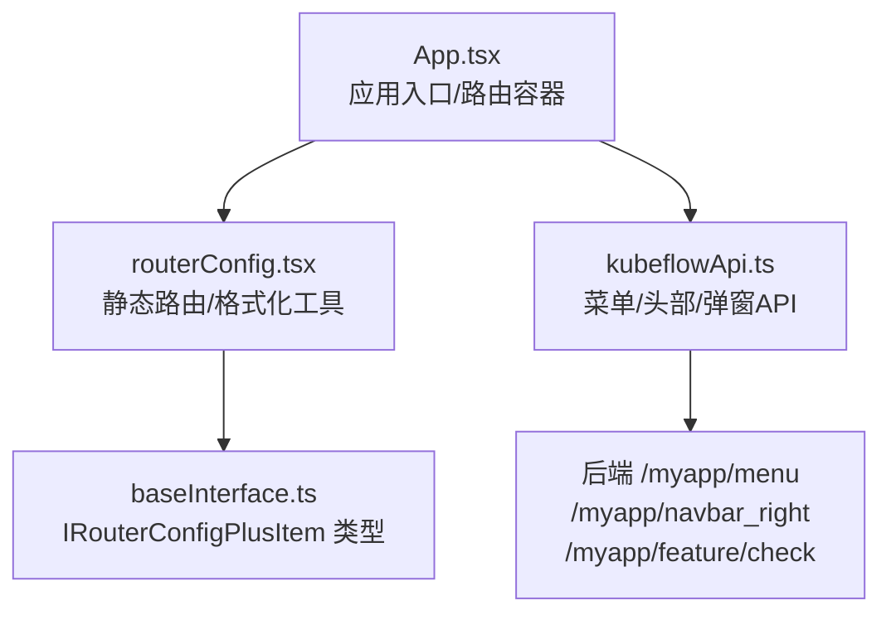
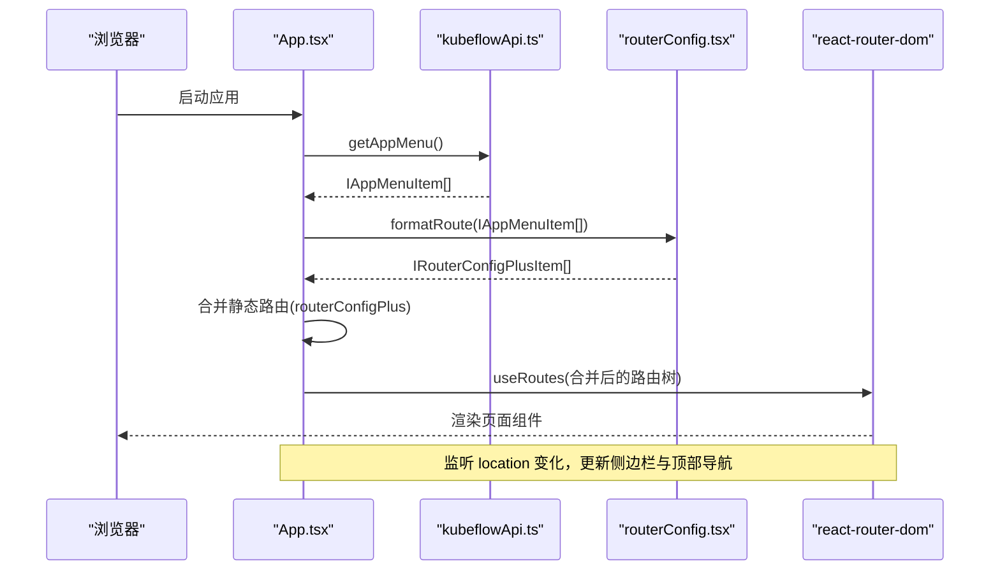
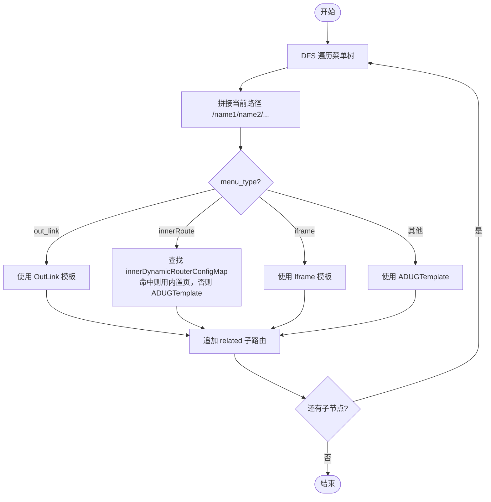
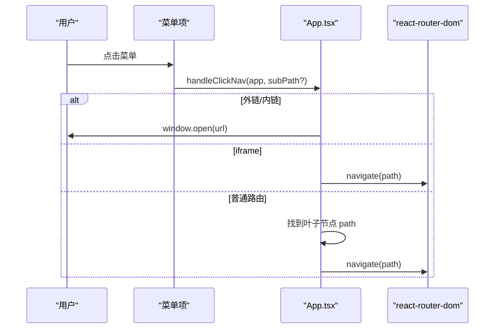
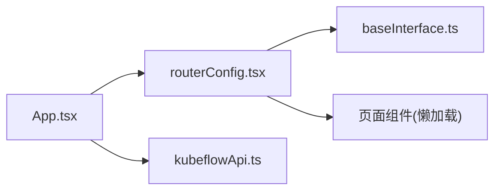

# 路由系统

<cite>
**本文引用的文件**   
- [App.tsx](file://myapp/frontend/src/App.tsx)
- [baseInterface.ts](file://myapp/frontend/src/api/interface/baseInterface.ts)
- [routerConfig.tsx](file://myapp/frontend/src/routerConfig.tsx)
- [kubeflowApi.ts](file://myapp/frontend/src/api/kubeflowApi.ts)
</cite>

## 目录
1. [简介](#简介)
2. [项目结构](#项目结构)
3. [核心组件](#核心组件)
4. [架构总览](#架构总览)
5. [详细组件分析](#详细组件分析)
6. [依赖关系分析](#依赖关系分析)
7. [性能与优化](#性能与优化)
8. [故障排查指南](#故障排查指南)
9. [结论](#结论)

## 简介
本文件面向 Cube Studio 前端路由子系统，系统性说明动态路由配置、路由映射机制、权限控制实现、嵌套路由、路由守卫、参数传递与监听等关键能力。重点围绕 IRouterConfigPlusItem 接口定义、formatRoute 格式化函数、默认路由处理逻辑展开，并给出添加新页面、设置权限与跳转的实践示例，以及性能优化与调试技巧。

## 项目结构
前端路由相关代码集中在 myapp/frontend/src 下：
- App.tsx：应用入口，负责加载远程菜单、构建路由树、渲染导航与内容区、监听路由变化。
- routerConfig.tsx：静态路由与模板路由的声明、动态菜单到路由配置的转换、默认打开项计算。
- baseInterface.ts：IRouterConfigPlusItem 类型定义，扩展 react-router 的路由对象以承载菜单/权限/展示属性。
- kubeflowApi.ts：获取菜单、头部配置、自定义弹窗等后端接口的封装。

图表来源
- [App.tsx:1-20](file://myapp/frontend/src/App.tsx#L1-L20)
- [routerConfig.tsx:1-22](file://myapp/frontend/src/routerConfig.tsx#L1-L22)
- [kubeflowApi.ts:6-12](file://myapp/frontend/src/api/kubeflowApi.ts#L6-L12)

章节来源
- [App.tsx:1-20](file://myapp/frontend/src/App.tsx#L1-L20)
- [routerConfig.tsx:1-22](file://myapp/frontend/src/routerConfig.tsx#L1-L22)
- [kubeflowApi.ts:1-12](file://myapp/frontend/src/api/kubeflowApi.ts#L1-L12)

## 核心组件
- IRouterConfigPlusItem：在 react-router 的 RouteObject 基础上扩展了菜单与权限相关字段，如 title、icon、menu_type、hidden、isMenu、children、related、isSingleModule、isDropdown 等，用于统一描述“可渲染路由 + 菜单项”。
- formatRoute：将后端返回的应用菜单（IAppMenuItem）转换为前端路由配置数组（IRouterConfigPlusItem[]），支持嵌套路径生成、不同 menu_type 对应不同模板组件、related 子路由注入。
- getRouterMap：将扁平或嵌套的路由列表拍平为 path -> item 的映射表，便于根据当前 pathname 快速定位当前模块与侧边栏数据。
- getDefaultOpenKeys：根据 isExpand 标记计算侧边栏默认展开项。
- AppWrapper：应用主容器，负责：
  - 初始化时拉取远程菜单与头部配置；
  - 合并动态路由与静态路由，构建路由树；
  - 根据 location.pathname 计算当前选中项、侧边栏可见性与内容区渲染；
  - 提供点击导航、外链/iframe 跳转、用户中心与退出登录等交互。

章节来源
- [baseInterface.ts:1-30](file://myapp/frontend/src/api/interface/baseInterface.ts#L1-L30)
- [routerConfig.tsx:71-160](file://myapp/frontend/src/routerConfig.tsx#L71-L160)
- [App.tsx:29-44](file://myapp/frontend/src/App.tsx#L29-L44)
- [App.tsx:48-115](file://myapp/frontend/src/App.tsx#L48-L115)

## 架构总览
下图展示了从后端菜单到前端路由渲染的完整流程，包括动态路由生成、路由映射、导航与内容渲染。

图表来源
- [App.tsx:66-87](file://myapp/frontend/src/App.tsx#L66-L87)
- [routerConfig.tsx:71-145](file://myapp/frontend/src/routerConfig.tsx#L71-L145)
- [kubeflowApi.ts:6-12](file://myapp/frontend/src/api/kubeflowApi.ts#L6-L12)

## 详细组件分析

### IRouterConfigPlusItem 接口定义
该接口扩展了 react-router 的路由对象，增加以下关键字段（节选）：
- 展示与菜单：title、icon、isMenu、isCollapsed、isExpand、isCloseSide、isSubRoute、isLocalMenu、isSingleModule、isDropdown
- 行为与权限：disable、hidden、menu_type、url、state、baseApi、key、appIndex
- 结构：children、related（关联子路由）、index（是否索引路由）

这些字段被用于：
- 决定菜单是否显示（hidden/disable）
- 决定渲染模板（menu_type 决定使用 ADUGTemplate/OutLink/Iframe 等）
- 决定导航行为（外链、内链、iframe、内部路由）
- 决定侧边栏与顶部导航的布局（isSingleModule、isDropdown、isCollapsed）

章节来源
- [baseInterface.ts:1-30](file://myapp/frontend/src/api/interface/baseInterface.ts#L1-L30)

### 动态路由格式化函数 formatRoute
职责：
- 将后端菜单树（IAppMenuItem）递归转换为前端路由树（IRouterConfigPlusItem[]）。
- 自动拼接路径：按节点 name 拼接成 /a/b/c 形式。
- 根据 menu_type 选择模板组件：
  - out_link：外链模板
  - innerRoute：内部动态路由（优先匹配 innerDynamicRouterConfigMap）
  - iframe：iframe 模板
  - 其他：ADUGTemplate 模板
- 注入 related 子路由：为每个叶子节点追加 related 列表作为子路由，携带父级上下文（如 model_name、breadcrumbs）。

复杂度：
- 时间复杂度 O(N)，N 为菜单节点总数（深度优先遍历一次）。
- 空间复杂度 O(H)，H 为最大递归深度（调用栈）。

图表来源
- [routerConfig.tsx:71-145](file://myapp/frontend/src/routerConfig.tsx#L71-L145)

章节来源
- [routerConfig.tsx:71-145](file://myapp/frontend/src/routerConfig.tsx#L71-L145)

### 默认路由与静态路由
- 静态路由 routerConfigPlus：包含首页、数据展示、外链、用户中心等基础页面，以及 404 兜底。
- 内置动态路由 innerDynamicRouterConfig：提供少量可直接通过 name 匹配的页面（如 dataSearch、commonRelation），供后端菜单通过 innerRoute 直接引用。

章节来源
- [routerConfig.tsx:24-69](file://myapp/frontend/src/routerConfig.tsx#L24-L69)

### 路由映射与导航
- getRouterMap：将路由树拍平成 path -> item 的字典，便于根据 pathname 快速定位当前模块与子菜单。
- handleCurrentRoute：根据当前 pathname 解析一级与二级模块，决定顶部导航与侧边栏数据，同时控制侧边栏折叠状态。
- handleClickNav：根据菜单项类型执行不同跳转策略：
  - 根路径：navigate('/')
  - iframe：navigate(path)
  - out_link/in_link：window.open(url)
  - 普通路由：向下取第一个叶子 path 进行 navigate

图表来源
- [App.tsx:138-163](file://myapp/frontend/src/App.tsx#L138-L163)

章节来源
- [App.tsx:29-44](file://myapp/frontend/src/App.tsx#L29-L44)
- [App.tsx:117-163](file://myapp/frontend/src/App.tsx#L117-L163)

### 权限控制实现
- 菜单隐藏与禁用：
  - hidden：菜单不显示（render 中跳过）
  - disable：菜单不可点击
- 路由访问控制：
  - 当前未看到全局前置守卫拦截逻辑；建议在 App.tsx 初始化后对 sourceAppList 做二次过滤，结合用户角色/权限模型，移除无权菜单与路由。
  - 可在 handleClickNav 前加入权限校验，拒绝跳转无权限路由。
- 建议方案：
  - 在后端返回菜单时附带权限标识（如 roles/permissions），前端据此过滤。
  - 在路由层增加白名单/黑名单机制，配合用户信息 store 进行判断。

章节来源
- [App.tsx:165-277](file://myapp/frontend/src/App.tsx#L165-L277)
- [baseInterface.ts:3-26](file://myapp/frontend/src/api/interface/baseInterface.ts#L3-L26)

### 嵌套路由与面包屑
- 嵌套路由：formatRoute 会递归 children 生成多级路径，并在 each 叶子节点追加 related 子路由。
- 面包屑：每条路由记录 breadcrumbs（由 chain 累积），可用于页面标题或面包屑展示。

章节来源
- [routerConfig.tsx:71-145](file://myapp/frontend/src/routerConfig.tsx#L71-L145)

### 路由监听与自定义弹窗
- 监听 location 变化：useEffect 监听 location，触发 handleCurrentRoute 更新导航状态。
- 自定义弹窗：每次路由变化请求 /myapp/feature/check，若命中则展示右侧抽屉式弹窗。

章节来源
- [App.tsx:89-115](file://myapp/frontend/src/App.tsx#L89-L115)
- [kubeflowApi.ts:26-28](file://myapp/frontend/src/api/kubeflowApi.ts#L26-L28)

### 参数传递与路由跳转
- 参数传递：
  - 通过 URL 查询参数（location.search）与 state（navigate 的 state 选项）传递。
  - 模板组件可通过 props 接收 breadcrumbs、related、model_name 等上下文。
- 跳转方式：
  - 内部路由：navigate(path)
  - 外链/内链：window.open(url)
  - iframe：navigate(path) 进入 iframe 模板

章节来源
- [App.tsx:138-163](file://myapp/frontend/src/App.tsx#L138-L163)
- [routerConfig.tsx:92-138](file://myapp/frontend/src/routerConfig.tsx#L92-L138)

## 依赖关系分析
- App.tsx 依赖：
  - routerConfig.tsx：formatRoute、getDefaultOpenKeys、routerConfigPlus
  - kubeflowApi.ts：getAppMenu、getAppHeaderConfig、getCustomDialog
  - react-router-dom：useRoutes/useNavigate/useLocation
- routerConfig.tsx 依赖：
  - baseInterface.ts：IRouterConfigPlusItem
  - 页面组件：Home、DataSearch、CommonPipeline/DWStandard、ShowData、IframeTemplate、UserCenter、Page404、LoadingStar、ADUGTemplate、OutLinkTemplate

图表来源
- [App.tsx:1-20](file://myapp/frontend/src/App.tsx#L1-L20)
- [routerConfig.tsx:1-22](file://myapp/frontend/src/routerConfig.tsx#L1-L22)
- [kubeflowApi.ts:1-12](file://myapp/frontend/src/api/kubeflowApi.ts#L1-L12)

章节来源
- [App.tsx:1-20](file://myapp/frontend/src/App.tsx#L1-L20)
- [routerConfig.tsx:1-22](file://myapp/frontend/src/routerConfig.tsx#L1-L22)
- [kubeflowApi.ts:1-12](file://myapp/frontend/src/api/kubeflowApi.ts#L1-L12)

## 性能与优化
- 路由懒加载：所有页面组件均通过 React.lazy + Suspense 包裹，减少首屏体积。
- 路由树构建：
  - formatRoute 仅遍历一次菜单树，避免重复计算。
  - getRouterMap 使用队列 BFS 拍平，O(N) 时间。
- 导航优化：
  - 外链/内链使用 window.open，避免不必要的组件卸载/挂载。
  - 侧边栏 openKeys 默认展开通过 getDefaultOpenKeys 预计算。
- 建议：
  - 对大型菜单树可增加分页或按需加载子级。
  - 对频繁切换的子路由考虑使用 keep-alive 或缓存策略（需自行实现）。
  - 对长列表菜单可使用虚拟滚动。

[本节为通用指导，不直接分析具体文件]

## 故障排查指南
- 菜单不显示：
  - 检查后端返回的菜单项是否包含 name/title，且 hidden=false。
  - 确认 formatRoute 生成的 path 是否正确拼接。
- 点击菜单无响应：
  - 检查 menu_type 与 url/path 配置是否匹配预期。
  - 确认 handleClickNav 分支逻辑是否符合业务需求。
- 路由 404：
  - 确认目标路径是否在最终路由树中（动态+静态合并后）。
  - 检查 404 兜底路由是否覆盖。
- 自定义弹窗异常：
  - 检查 /myapp/feature/check 接口返回结构与 hit 字段。
  - 注意 AbortController 取消请求，避免内存泄漏。

章节来源
- [App.tsx:89-115](file://myapp/frontend/src/App.tsx#L89-L115)
- [routerConfig.tsx:68-69](file://myapp/frontend/src/routerConfig.tsx#L68-L69)

## 结论
本路由系统通过“后端菜单 + 前端格式化”的方式实现了高度可配置的前端路由体系。IRouterConfigPlusItem 统一了菜单与路由的数据契约，formatRoute 将菜单树转化为可渲染的路由树，App.tsx 负责生命周期管理与导航交互。在此基础上，可便捷地扩展新页面、接入权限控制、实现复杂嵌套与参数传递，并通过懒加载等手段保障性能。