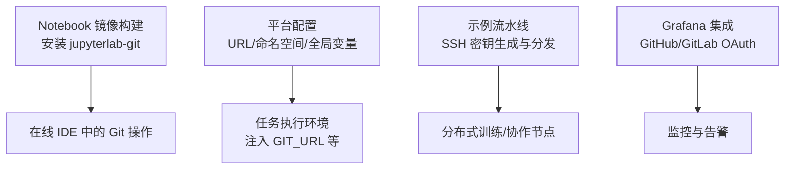
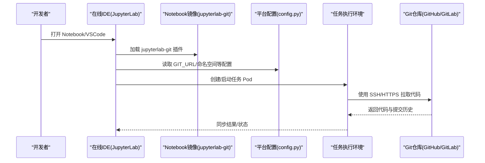
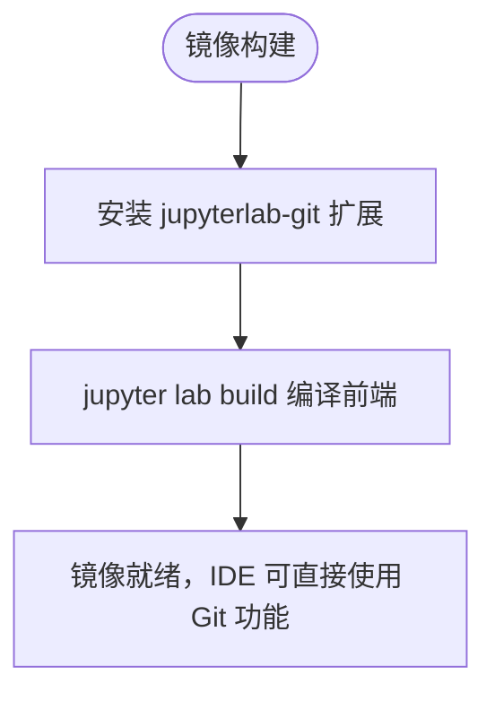
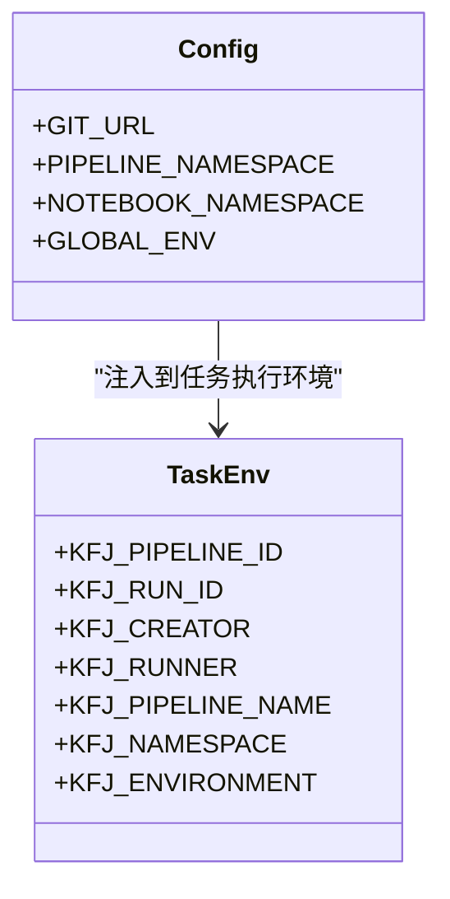
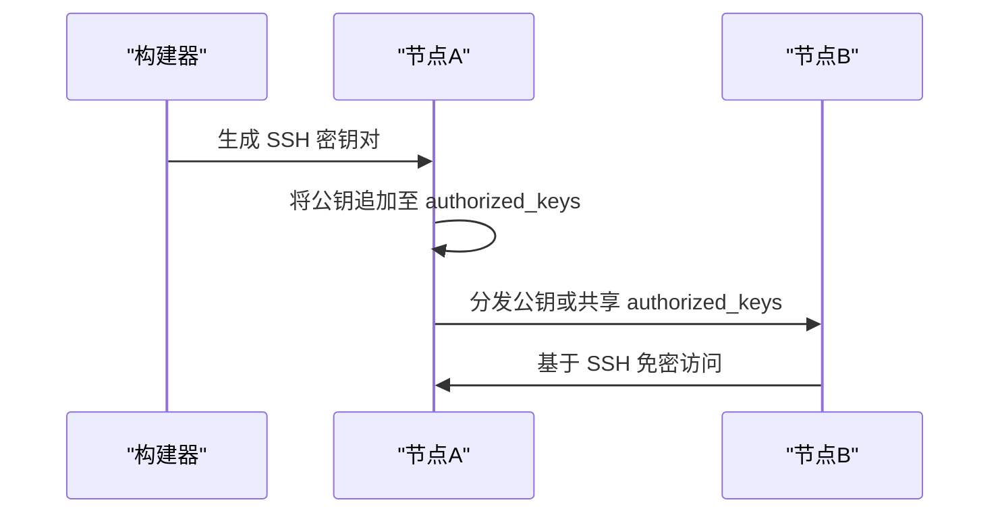
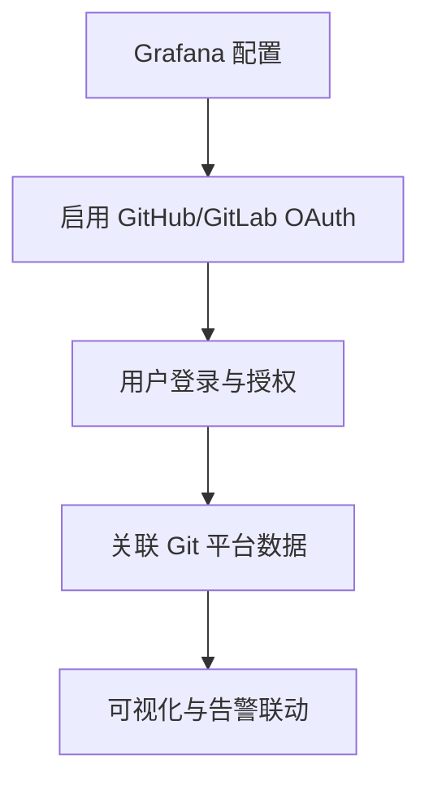
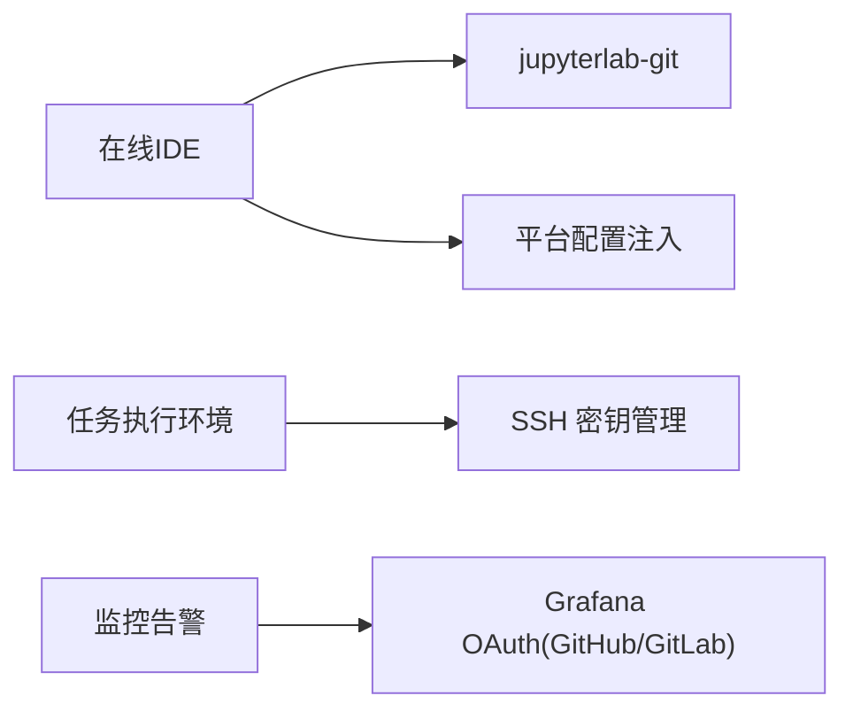

# Git代码集成

<cite>
**本文引用的文件**   
- [README.md](file://README.md)
- [Dockerfile-ubuntu-cpu-1.0.0](file://images/jupyter-notebook/Dockerfile-ubuntu-cpu-1.0.0)
- [requirements.txt](file://images/jupyter-notebook/requirements.txt)
- [config.py](file://myapp/config.py)
- [cluster-demo.yaml](file://install/kubernetes/rancher/cluster-demo.yaml)
- [start.sh](file://myapp/example/pipeline/colossalai/start.sh)
- [Dockerfile (colossalai)](file://myapp/example/pipeline/colossalai/Dockerfile)
- [grafana.ini](file://install/kubernetes/prometheus/grafana/grafana.ini)
- [grafana-back.ini](file://install/kubernetes/prometheus/grafana/grafana-back.ini)
</cite>

## 目录
1. [引言](#引言)
2. [项目结构](#项目结构)
3. [核心组件](#核心组件)
4. [架构总览](#架构总览)
5. [详细组件分析](#详细组件分析)
6. [依赖关系分析](#依赖关系分析)
7. [性能与可靠性](#性能与可靠性)
8. [故障排查指南](#故障排查指南)
9. [结论](#结论)
10. [附录：配置示例与最佳实践](#附录配置示例与最佳实践)

## 引言
本文件面向在 CubeStudio 平台中实现“Git 代码集成功能”的工程师与运维人员，系统阐述仓库管理、代码同步、分支管理与提交历史追踪的实现思路；并覆盖 SSH 密钥管理、HTTPS 认证、多仓库支持机制、自动同步、冲突解决、权限控制与审计日志。文档同时提供可操作的配置示例，展示如何配置 Git 仓库、设置自动同步规则、集成 CI/CD 流程与实现代码审查流程，并给出工作流最佳实践与安全配置建议。

## 项目结构
CubeStudio 以云原生方式组织功能模块，Git 相关能力主要分布在以下位置：
- Notebook 镜像构建脚本：安装 jupyterlab-git 插件，为在线 IDE 提供 Git 交互能力
- 平台配置：全局 URL、命名空间、环境变量注入等
- 示例流水线：演示 SSH 密钥生成与分发
- 外部工具集成：Grafana 对 GitHub/GitLab 的 OAuth 集成（用于可视化与告警）

图表来源
- [Dockerfile-ubuntu-cpu-1.0.0:7-8](file://images/jupyter-notebook/Dockerfile-ubuntu-cpu-1.0.0#L7-L8)
- [config.py:549-550](file://myapp/config.py#L549-L550)
- [start.sh:16-27](file://myapp/example/pipeline/colossalai/start.sh#L16-L27)
- [Dockerfile (colossalai):9-10](file://myapp/example/pipeline/colossalai/Dockerfile#L9-L10)
- [grafana.ini:286-305](file://install/kubernetes/prometheus/grafana/grafana.ini#L286-L305)

章节来源
- [README.md:172-187](file://README.md#L172-L187)
- [Dockerfile-ubuntu-cpu-1.0.0:7-8](file://images/jupyter-notebook/Dockerfile-ubuntu-cpu-1.0.0#L7-L8)
- [requirements.txt:116](file://images/jupyter-notebook/requirements.txt#L116)
- [config.py:549-550](file://myapp/config.py#L549-L550)
- [cluster-demo.yaml:8-15](file://install/kubernetes/rancher/cluster-demo.yaml#L8-L15)
- [start.sh:16-27](file://myapp/example/pipeline/colossalai/start.sh#L16-L27)
- [Dockerfile (colossalai):9-10](file://myapp/example/pipeline/colossalai/Dockerfile#L9-L10)
- [grafana.ini:286-305](file://install/kubernetes/prometheus/grafana/grafana.ini#L286-L305)

## 核心组件
- 在线 IDE 的 Git 插件：通过 jupyterlab-git 在 Notebook/JupyterLab 中直接进行 clone、commit、push、pull、分支切换等操作
- 平台配置中心：集中管理 Git 相关 URL、命名空间、全局环境变量，便于统一接入
- 示例流水线：演示如何在容器内生成/分发 SSH 密钥，支撑分布式场景下的 Git 访问
- Grafana 集成：通过 GitHub/GitLab OAuth 打通监控与告警，辅助审计与可视化

章节来源
- [Dockerfile-ubuntu-cpu-1.0.0:7-8](file://images/jupyter-notebook/Dockerfile-ubuntu-cpu-1.0.0#L7-L8)
- [requirements.txt:116](file://images/jupyter-notebook/requirements.txt#L116)
- [config.py:549-550](file://myapp/config.py#L549-L550)
- [start.sh:16-27](file://myapp/example/pipeline/colossalai/start.sh#L16-L27)
- [Dockerfile (colossalai):9-10](file://myapp/example/pipeline/colossalai/Dockerfile#L9-L10)
- [grafana.ini:286-305](file://install/kubernetes/prometheus/grafana/grafana.ini#L286-L305)

## 架构总览
下图展示了从用户到 Git 仓库的端到端路径，包括在线 IDE、平台配置、任务执行环境与外部 Git 服务之间的交互。

图表来源
- [Dockerfile-ubuntu-cpu-1.0.0:7-8](file://images/jupyter-notebook/Dockerfile-ubuntu-cpu-1.0.0#L7-L8)
- [config.py:549-550](file://myapp/config.py#L549-L550)
- [start.sh:16-27](file://myapp/example/pipeline/colossalai/start.sh#L16-L27)
- [Dockerfile (colossalai):9-10](file://myapp/example/pipeline/colossalai/Dockerfile#L9-L10)

## 详细组件分析

### 在线 IDE 的 Git 能力（jupyterlab-git）
- 作用：在 JupyterLab 中提供 Git 客户端能力，支持克隆、提交、推送、拉取、分支管理等
- 集成点：Notebook 镜像构建阶段安装 jupyterlab-git 扩展，并在构建时完成前端扩展编译
- 版本管理：通过 requirements.txt 锁定 jupyterlab-git 版本，确保环境一致性

图表来源
- [Dockerfile-ubuntu-cpu-1.0.0:7-8](file://images/jupyter-notebook/Dockerfile-ubuntu-cpu-1.0.0#L7-L8)
- [requirements.txt:116](file://images/jupyter-notebook/requirements.txt#L116)

章节来源
- [Dockerfile-ubuntu-cpu-1.0.0:7-8](file://images/jupyter-notebook/Dockerfile-ubuntu-cpu-1.0.0#L7-L8)
- [requirements.txt:116](file://images/jupyter-notebook/requirements.txt#L116)

### 平台配置与全局变量注入
- 全局 URL：配置 GIT_URL 等链接，便于统一入口与跳转
- 命名空间与环境：通过 PIPELINE_NAMESPACE、NOTEBOOK_NAMESPACE 等隔离不同业务域
- 全局环境变量：GLOBAL_ENV 可在任务执行时注入，便于下游组件获取运行上下文

图表来源
- [config.py:549-550](file://myapp/config.py#L549-L550)
- [config.py:667-680](file://myapp/config.py#L667-L680)
- [config.py:640-650](file://myapp/config.py#L640-L650)

章节来源
- [config.py:549-550](file://myapp/config.py#L549-L550)
- [config.py:640-650](file://myapp/config.py#L640-L650)
- [config.py:667-680](file://myapp/config.py#L667-L680)

### SSH 密钥管理与多节点协作
- 示例流水线展示了在容器内生成 SSH 密钥，并将公钥写入 authorized_keys，以便节点间免密访问
- Rancher 集群模板也提供了 ssh_key_path 与 ssh_key 的配置项，便于在编排层注入密钥

图表来源
- [Dockerfile (colossalai):9-10](file://myapp/example/pipeline/colossalai/Dockerfile#L9-L10)
- [start.sh:16-27](file://myapp/example/pipeline/colossalai/start.sh#L16-L27)
- [cluster-demo.yaml:8-15](file://install/kubernetes/rancher/cluster-demo.yaml#L8-L15)

章节来源
- [Dockerfile (colossalai):9-10](file://myapp/example/pipeline/colossalai/Dockerfile#L9-L10)
- [start.sh:16-27](file://myapp/example/pipeline/colossalai/start.sh#L16-L27)
- [cluster-demo.yaml:8-15](file://install/kubernetes/rancher/cluster-demo.yaml#L8-L15)

### HTTPS 认证与外部系统集成（Grafana）
- Grafana 配置文件包含 GitHub/GitLab 的 OAuth 集成段，可用于对接企业级身份源，配合 Git 平台的审计与可视化
- 该集成有助于将 Git 事件与监控告警打通，形成闭环

图表来源
- [grafana.ini:286-305](file://install/kubernetes/prometheus/grafana/grafana.ini#L286-L305)
- [grafana-back.ini:264-270](file://install/kubernetes/prometheus/grafana/grafana-back.ini#L264-L270)

章节来源
- [grafana.ini:286-305](file://install/kubernetes/prometheus/grafana/grafana.ini#L286-L305)
- [grafana-back.ini:264-270](file://install/kubernetes/prometheus/grafana/grafana-back.ini#L264-L270)

## 依赖关系分析
- 在线 IDE 依赖 jupyterlab-git 扩展，需在镜像构建期安装并编译
- 任务执行环境依赖平台配置注入的全局变量，如命名空间、运行标识等
- 分布式任务依赖 SSH 密钥的正确生成与分发，保证节点间免密通信
- 监控告警依赖 Grafana 的外部身份源集成，以打通 Git 平台审计

图表来源
- [Dockerfile-ubuntu-cpu-1.0.0:7-8](file://images/jupyter-notebook/Dockerfile-ubuntu-cpu-1.0.0#L7-L8)
- [config.py:549-550](file://myapp/config.py#L549-L550)
- [start.sh:16-27](file://myapp/example/pipeline/colossalai/start.sh#L16-L27)
- [grafana.ini:286-305](file://install/kubernetes/prometheus/grafana/grafana.ini#L286-L305)

章节来源
- [Dockerfile-ubuntu-cpu-1.0.0:7-8](file://images/jupyter-notebook/Dockerfile-ubuntu-cpu-1.0.0#L7-L8)
- [config.py:549-550](file://myapp/config.py#L549-L550)
- [start.sh:16-27](file://myapp/example/pipeline/colossalai/start.sh#L16-L27)
- [grafana.ini:286-305](file://install/kubernetes/prometheus/grafana/grafana.ini#L286-L305)

## 性能与可靠性
- 镜像构建优化：仅安装必要扩展，减少镜像体积与构建时间
- 任务执行稳定性：通过 Celery 任务队列与 Redis 消息中间件保障异步任务的可靠执行（与 Git 同步相关的后台任务可复用此机制）
- 资源隔离：通过命名空间与资源配额限制，避免 Git 同步任务影响其他业务

[本节为通用指导，不直接分析具体文件]

## 故障排查指南
- jupyterlab-git 无法加载：检查镜像构建是否执行了 jupyter lab build，确认扩展已正确安装
- SSH 连接失败：检查容器内是否生成并分发 SSH 密钥，authorized_keys 是否正确配置
- Grafana 无法登录 Git 平台：检查 OAuth 配置项是否正确，网络可达性与证书链是否正常

章节来源
- [Dockerfile-ubuntu-cpu-1.0.0:7-8](file://images/jupyter-notebook/Dockerfile-ubuntu-cpu-1.0.0#L7-L8)
- [Dockerfile (colossalai):9-10](file://myapp/example/pipeline/colossalai/Dockerfile#L9-L10)
- [start.sh:16-27](file://myapp/example/pipeline/colossalai/start.sh#L16-L27)
- [grafana.ini:286-305](file://install/kubernetes/prometheus/grafana/grafana.ini#L286-L305)

## 结论
CubeStudio 通过在线 IDE 的 jupyterlab-git 插件、平台配置注入、示例流水线的 SSH 密钥管理以及 Grafana 的外部身份源集成，构建了完整的 Git 代码集成能力。结合命名空间隔离、任务队列与监控告警，可实现稳定、可观测的代码同步与协作流程。

[本节为总结性内容，不直接分析具体文件]

## 附录：配置示例与最佳实践

### 配置 Git 仓库
- 在平台配置中设置 GIT_URL，作为统一的 Git 入口
- 在 Notebook 镜像中安装 jupyterlab-git，使在线 IDE 具备 Git 操作能力

章节来源
- [config.py:549-550](file://myapp/config.py#L549-L550)
- [Dockerfile-ubuntu-cpu-1.0.0:7-8](file://images/jupyter-notebook/Dockerfile-ubuntu-cpu-1.0.0#L7-L8)

### 设置自动同步规则
- 使用平台任务调度（Celery beat）定时触发 Git 同步任务
- 在任务环境中注入 GLOBAL_ENV 变量，携带 pipeline_id、creator、runner 等上下文信息
- 根据命名空间与资源配额限制同步任务的并发与资源占用

章节来源
- [config.py:640-650](file://myapp/config.py#L640-L650)
- [config.py:667-680](file://myapp/config.py#L667-L680)

### 集成 CI/CD 流程
- 在流水线中复用 SSH 密钥管理逻辑，确保分布式节点间免密访问
- 将 Git 提交信息与任务运行结果关联，便于追溯与审计

章节来源
- [Dockerfile (colossalai):9-10](file://myapp/example/pipeline/colossalai/Dockerfile#L9-L10)
- [start.sh:16-27](file://myapp/example/pipeline/colossalai/start.sh#L16-L27)

### 实现代码审查流程
- 借助 Git 平台的 PR/MR 机制，结合 Grafana 的 OAuth 集成，打通身份与审计
- 在任务执行前校验分支策略与变更范围，确保合规

章节来源
- [grafana.ini:286-305](file://install/kubernetes/prometheus/grafana/grafana.ini#L286-L305)

### Git 工作流最佳实践
- 分支策略：主干保护、特性分支、发布分支；强制代码审查与自动化测试
- 提交规范：语义化提交信息，关联需求/缺陷编号
- 安全基线：优先使用 SSH 密钥或受控的 Token；禁用弱口令与硬编码凭据

[本节为通用指导，不直接分析具体文件]

### 安全配置建议
- 密钥管理：使用平台 Secret 或外部密钥管理服务，避免明文存储
- 网络访问：限制 Git 仓库访问白名单，启用 TLS 与证书校验
- 审计日志：开启 Git 平台审计与平台侧操作日志，定期归档与分析

[本节为通用指导，不直接分析具体文件]