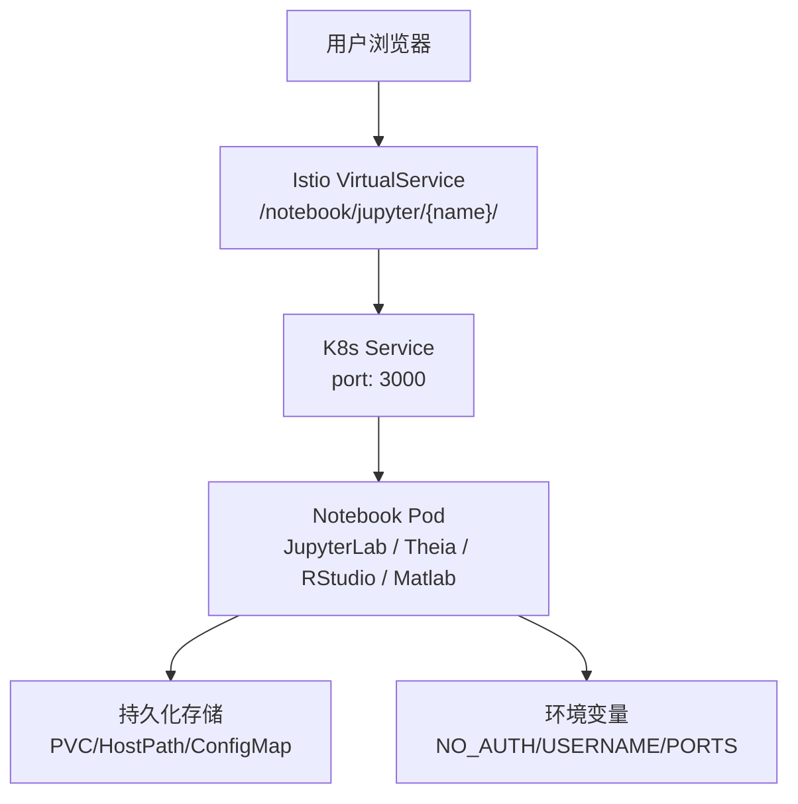
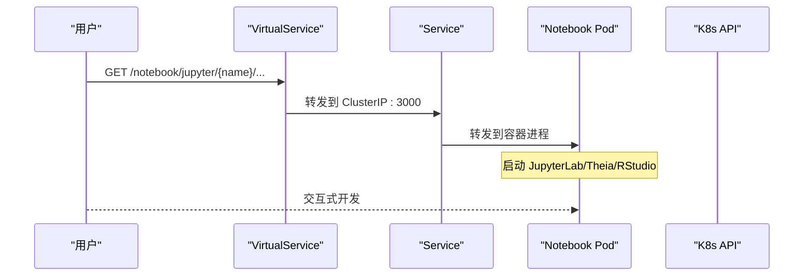
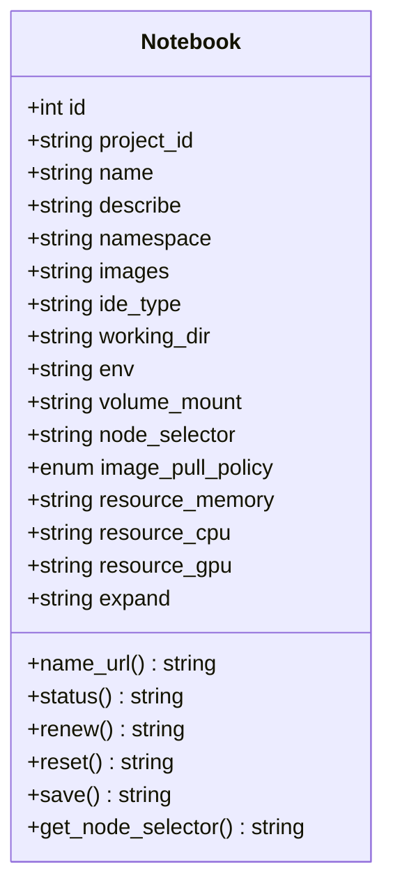
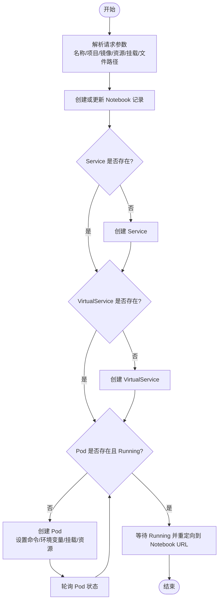
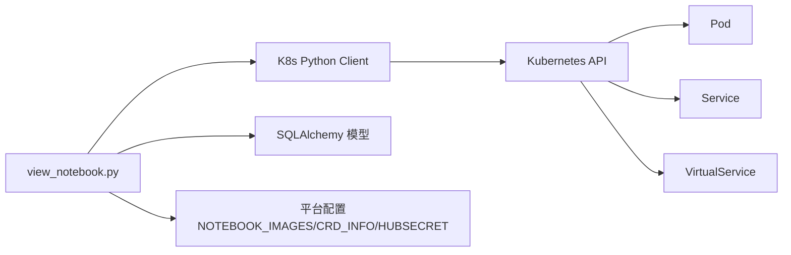

# Notebook开发环境

<cite>
**本文引用的文件**   
- [README.md](file://README.md)
- [model_notebook.py](file://myapp/models/model_notebook.py)
- [view_notebook.py](file://myapp/views/view_notebook.py)
- [Dockerfile-ubuntu-cpu-1.0.0](file://images/jupyter-notebook/Dockerfile-ubuntu-cpu-1.0.0)
- [bigdata Dockerfile](file://images/jupyter-notebook/bigdata/Dockerfile)
- [deeplearning Dockerfile](file://images/jupyter-notebook/deeplearning/Dockerfile)
- [machinelearning Dockerfile](file://images/jupyter-notebook/machinelearning/Dockerfile)
</cite>

## 目录
1. [引言](#引言)
2. [项目结构](#项目结构)
3. [核心组件](#核心组件)
4. [架构总览](#架构总览)
5. [详细组件分析](#详细组件分析)
6. [依赖关系分析](#依赖关系分析)
7. [性能与资源优化](#性能与资源优化)
8. [故障排查指南](#故障排查指南)
9. [结论](#结论)
10. [附录：配置示例清单](#附录配置示例清单)

## 引言
本文件面向在 CubeStudio 平台上使用在线 IDE（JupyterLab、VSCode/Theia、RStudio/Matlab）进行 Notebook 开发的工程师与平台运维人员，系统阐述 Notebook 的生命周期管理、资源分配、存储挂载、环境变量、网络访问控制，以及镜像定制与工作目录、持久化存储、外部工具集成等实践方法。文档同时给出调试技巧、性能优化建议与常见问题解决方案，帮助读者快速上手并稳定运行 Notebook 开发环境。

## 项目结构
CubeStudio 的 Notebook 能力由“后端模型/视图 + Kubernetes 调度 + 镜像生态”共同构成：
- 后端模型与视图负责 Notebook 元数据管理、生命周期 API、Kubernetes 资源编排（Pod/Service/VirtualService）。
- 镜像生态提供 JupyterLab、大数据、机器学习、深度学习等预置环境，支持用户自定义扩展。
- 运行时通过 Istio VirtualService 将浏览器请求路由到 Notebook Pod，实现多租户隔离与统一入口。

图表来源
- [view_notebook.py:405-481](file://myapp/views/view_notebook.py#L405-L481)
- [view_notebook.py:683-751](file://myapp/views/view_notebook.py#L683-L751)

章节来源
- [README.md:228-239](file://README.md#L228-L239)

## 核心组件
- Notebook 模型（数据库模型）
  - 定义 Notebook 的名称、命名空间、IDE 类型、工作目录、环境变量、存储挂载、节点选择器、镜像拉取策略、CPU/内存/GPU 资源、扩展字段等。
  - 提供状态查询、续期、重置、URL 生成等属性与方法。
- Notebook 视图（API 与页面逻辑）
  - 提供创建、启动、停止、重置、删除等接口；封装 K8s 客户端调用，创建 Pod/Service/VirtualService。
  - 根据 IDE 类型（jupyter/theia/rstudio/matlab）构造不同的启动命令与环境变量。
- 镜像生态
  - 提供 jupyter-ubuntu22.04 基础镜像及 bigdata/deeplearning/machinelearning 场景镜像，内置常用库与示例代码。

章节来源
- [model_notebook.py:27-47](file://myapp/models/model_notebook.py#L27-L47)
- [view_notebook.py:53-188](file://myapp/views/view_notebook.py#L53-L188)
- [Dockerfile-ubuntu-cpu-1.0.0:1-21](file://images/jupyter-notebook/Dockerfile-ubuntu-cpu-1.0.0#L1-L21)
- [bigdata Dockerfile:1-107](file://images/jupyter-notebook/bigdata/Dockerfile#L1-L107)
- [deeplearning Dockerfile:1-25](file://images/jupyter-notebook/deeplearning/Dockerfile#L1-L25)
- [machinelearning Dockerfile:1-31](file://images/jupyter-notebook/machinelearning/Dockerfile#L1-L31)

## 架构总览
Notebook 的运行架构围绕“Kubernetes + Istio + 容器镜像”展开：
- 用户通过浏览器访问统一入口（Istio VirtualService），按路径匹配到对应 Notebook 的 Service。
- Service 转发到 Notebook Pod，Pod 内运行 JupyterLab 或 Theia/RStudio/Matlab。
- 平台为每个 Notebook 创建独立的命名空间与资源配额，结合项目组的默认挂载策略，实现数据隔离与共享。
- 边缘模式或特定集群下，可通过 SERVICE_EXTERNAL_IP 暴露额外端口（如 SSH），便于本地 IDE 远程连接。

图表来源
- [view_notebook.py:405-481](file://myapp/views/view_notebook.py#L405-L481)
- [view_notebook.py:683-751](file://myapp/views/view_notebook.py#L683-L751)

## 详细组件分析

### Notebook 模型（数据结构与行为）
- 关键字段
  - ide_type：IDE 类型（jupyter/theia/rstudio/matlab），影响启动命令与 URL 生成。
  - working_dir：容器内工作目录，默认 /mnt。
  - env：环境变量，以换行分隔的 key=value 形式，合并到 Pod 环境变量。
  - volume_mount：存储挂载规则，支持 PVC/HostPath/ConfigMap 等。
  - resource_cpu/resource_memory/resource_gpu：CPU/内存/GPU 申请值，支持范围表达式与卡型指定。
  - node_selector/image_pull_policy：节点选择器与镜像拉取策略。
- 关键属性
  - name_url：根据 IDE 类型与 root 参数生成可访问 URL。
  - status：从 K8s 获取 Pod 子状态，并在数据库中更新 pod_ip 等扩展信息。
  - renew/reset/save：续期、重置、环境保存（商业版）操作入口。

图表来源
- [model_notebook.py:27-47](file://myapp/models/model_notebook.py#L27-L47)
- [model_notebook.py:52-115](file://myapp/models/model_notebook.py#L52-L115)
- [model_notebook.py:117-180](file://myapp/models/model_notebook.py#L117-L180)

章节来源
- [model_notebook.py:27-180](file://myapp/models/model_notebook.py#L27-L180)

### Notebook 视图（生命周期管理与 K8s 编排）
- 创建与启动
  - entry_jupyter：接收前端参数（名称、项目组、镜像、资源、挂载、文件路径），创建或复用 Notebook 记录，计算 rewrite_url，创建 Service 与 VirtualService，若 Pod 不存在则调用 make_pod 创建 Pod，等待 Running 后重定向到 Notebook 界面。
  - reset_notebook/reset：触发清理旧资源并重新部署，确保配置生效。
- 停止与删除
  - DELETE 请求时删除 Pod、CRD（VirtualService）、Service，并删除数据库记录。
- 环境变量与启动命令
  - Jupyter：设置 NO_AUTH=true，base_url 重写，notebook-dir 指向用户目录，禁用 token 校验与 XSRF 检查。
  - Theia：启动 theia 后端服务，设置 DISPLAY、SSH_PORT、PORT1/PORT2 等环境变量，用于远程开发与图形界面。
- 存储挂载与工作目录
  - 默认挂载项目组的 volume_mount，支持用户级覆盖（受 ENABLE_USER_VOLUME 控制），自动合并项目默认挂载。
  - working_dir 默认 /mnt，实际进入用户目录 /mnt/{username}。
- 网络访问控制
  - 通过 Istio VirtualService 匹配 cookie 中的用户名，实现基于会话的路由与鉴权。
  - 边缘模式或特定集群下，通过 SERVICE_EXTERNAL_IP 暴露额外端口（SSH 等），便于本地 IDE 远程连接。

图表来源
- [view_notebook.py:303-560](file://myapp/views/view_notebook.py#L303-L560)
- [view_notebook.py:564-781](file://myapp/views/view_notebook.py#L564-L781)

章节来源
- [view_notebook.py:303-560](file://myapp/views/view_notebook.py#L303-L560)
- [view_notebook.py:564-781](file://myapp/views/view_notebook.py#L564-L781)

### 镜像生态与自定义
- 预置镜像
  - jupyter-ubuntu22.04：基础 JupyterLab 环境，安装常用 labextensions 与语言服务器插件。
  - bigdata：内置 Spark/Flink/Hadoop/Maven/JDK8，适合大数据开发。
  - deeplearning：内置 TensorFlow/PyTorch/Keras 等深度学习框架与示例。
  - machinelearning：内置 sklearn/xgboost/lightgbm 等机器学习库与示例。
- 自定义镜像
  - 基于 jupyter-ubuntu22.04 或场景镜像，追加 pip/apt 包、拷贝示例代码、设置环境变量与初始化脚本。
  - 通过 NOTEBOOK_IMAGES 配置项映射显示名称与实际镜像地址，支持下拉选择与输入。

章节来源
- [Dockerfile-ubuntu-cpu-1.0.0:1-21](file://images/jupyter-notebook/Dockerfile-ubuntu-cpu-1.0.0#L1-L21)
- [bigdata Dockerfile:1-107](file://images/jupyter-notebook/bigdata/Dockerfile#L1-L107)
- [deeplearning Dockerfile:1-25](file://images/jupyter-notebook/deeplearning/Dockerfile#L1-L25)
- [machinelearning Dockerfile:1-31](file://images/jupyter-notebook/machinelearning/Dockerfile#L1-L31)

## 依赖关系分析
- 后端依赖
  - Flask-AppBuilder：提供 ModelView/REST API 能力。
  - SQLAlchemy：ORM 与数据库模型。
  - K8s Python Client：创建/删除 Pod/Service/CRD，查询 Pod 状态。
- 运行时依赖
  - Istio VirtualService：HTTP 路由与路径重写。
  - Kubernetes Service：ClusterIP/NodePort 暴露端口。
  - 持久化存储：PVC/HostPath/ConfigMap 等。
- 镜像依赖
  - JupyterLab/Theia/RStudio/Matlab：不同 IDE 的启动命令与依赖库。

图表来源
- [view_notebook.py:303-560](file://myapp/views/view_notebook.py#L303-L560)
- [view_notebook.py:564-781](file://myapp/views/view_notebook.py#L564-L781)

章节来源
- [view_notebook.py:303-560](file://myapp/views/view_notebook.py#L303-L560)
- [view_notebook.py:564-781](file://myapp/views/view_notebook.py#L564-L781)

## 性能与资源优化
- CPU/内存/GPU 资源配置
  - 合理设置 resource_cpu/resource_memory，避免过度申请导致调度失败或资源浪费。
  - GPU 申请支持整卡、虚拟卡、共享模式，按需选择卡型（如 V100/A100）。
- 镜像拉取策略
  - Always：总是拉取远程镜像，保证最新但可能较慢。
  - IfNotPresent：本地存在则使用本地镜像，提升启动速度。
- 存储挂载优化
  - 使用高性能 PVC（如 CephFS/NFS/OSS）作为工作目录，减少 I/O 瓶颈。
  - 避免频繁写入大文件到慢速存储，优先使用本地临时目录后再同步到持久化存储。
- 网络访问优化
  - 合理使用 Istio VirtualService 的超时与重试策略，避免长连接阻塞。
  - 边缘模式下，通过 SERVICE_EXTERNAL_IP 暴露必要端口，减少跨域与代理开销。

[本节为通用指导，不直接分析具体文件]

## 故障排查指南
- Notebook 无法启动
  - 检查 Pod 状态与事件日志，确认镜像拉取、资源配额、存储挂载是否正常。
  - 查看 VirtualService 与 Service 是否正确创建，路径重写是否生效。
- 无法访问 Notebook 界面
  - 确认浏览器 Cookie 中包含 myapp_username，VirtualService 匹配规则是否生效。
  - 检查 Istio Gateway 与 Ingress 配置，确保域名与端口正确。
- 存储未挂载或权限问题
  - 检查 volume_mount 配置，确认 PVC/HostPath 存在且权限正确。
  - 用户目录 /mnt/{username} 是否已创建，是否有读写权限。
- GPU 不可用
  - 确认节点是否具备 GPU 资源，node_selector 是否正确。
  - 检查 GPU 驱动与 nvidia-device-plugin 是否正常运行。

章节来源
- [model_notebook.py:117-148](file://myapp/models/model_notebook.py#L117-L148)
- [view_notebook.py:405-481](file://myapp/views/view_notebook.py#L405-L481)
- [view_notebook.py:683-751](file://myapp/views/view_notebook.py#L683-L751)

## 结论
CubeStudio 的 Notebook 开发环境以 Kubernetes 为底座，结合 Istio 路由与丰富的镜像生态，提供了开箱即用的 JupyterLab、Theia、RStudio、Matlab 等在线 IDE。通过灵活的资源配置、存储挂载、环境变量与网络访问控制，用户可在多租户环境下高效开展数据分析、算法开发与模型训练。配合本文档的配置示例与故障排查指南，可快速搭建稳定、可扩展的 Notebook 开发环境。

[本节为总结性内容，不直接分析具体文件]

## 附录：配置示例清单
- 自定义 Notebook 镜像
  - 在 NOTEBOOK_IMAGES 中注册镜像名称与地址，支持下拉选择与输入。
  - 基于 jupyter-ubuntu22.04 或场景镜像，追加所需依赖与示例代码。
- 设置工作目录
  - working_dir 默认为 /mnt，实际进入 /mnt/{username}，可根据需求调整。
- 配置持久化存储
  - volume_mount 支持 PVC/HostPath/ConfigMap，格式为 $pvc_name(pvc):/$container_path。
  - 管理员可启用 ENABLE_USER_VOLUME 允许用户自定义挂载规则。
- 集成外部工具
  - 通过 env 注入外部工具的环境变量（如数据库连接串、API Key）。
  - 在镜像中安装 CLI 工具（如 spark/hive/flink），并通过 PATH 暴露。
- 网络访问控制
  - 使用 Istio VirtualService 匹配 Cookie 中的用户名，实现会话级路由。
  - 边缘模式下，通过 SERVICE_EXTERNAL_IP 暴露 SSH 等端口，便于本地 IDE 远程连接。

[本节为配置示例说明，不直接分析具体文件]