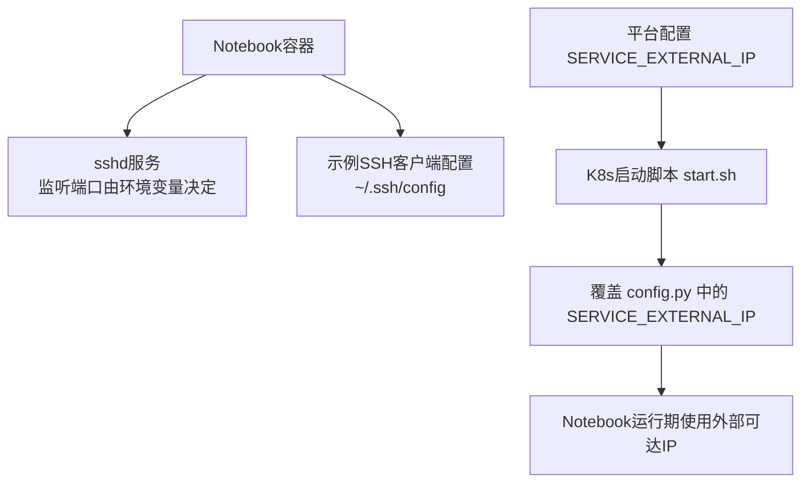
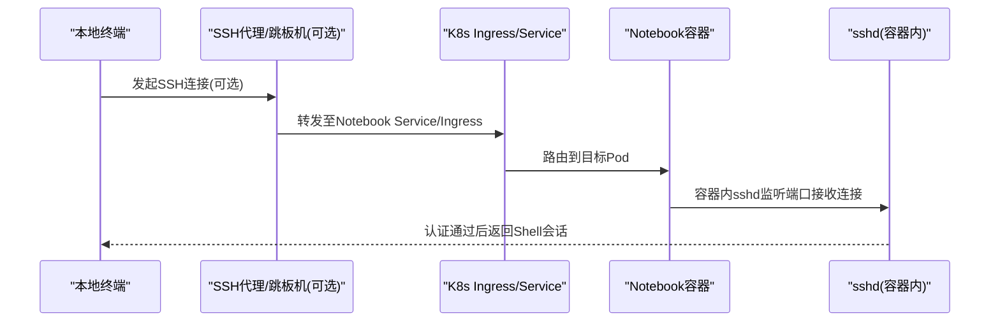
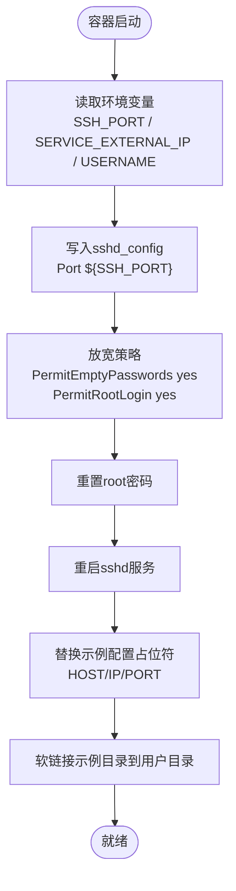
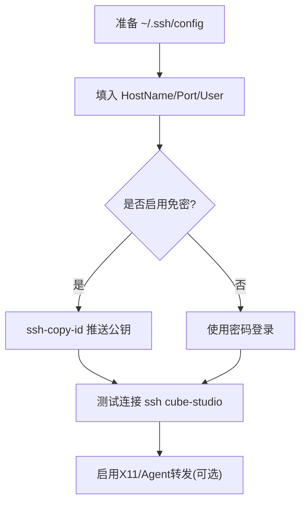
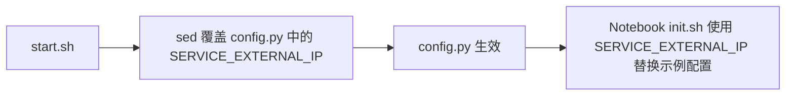
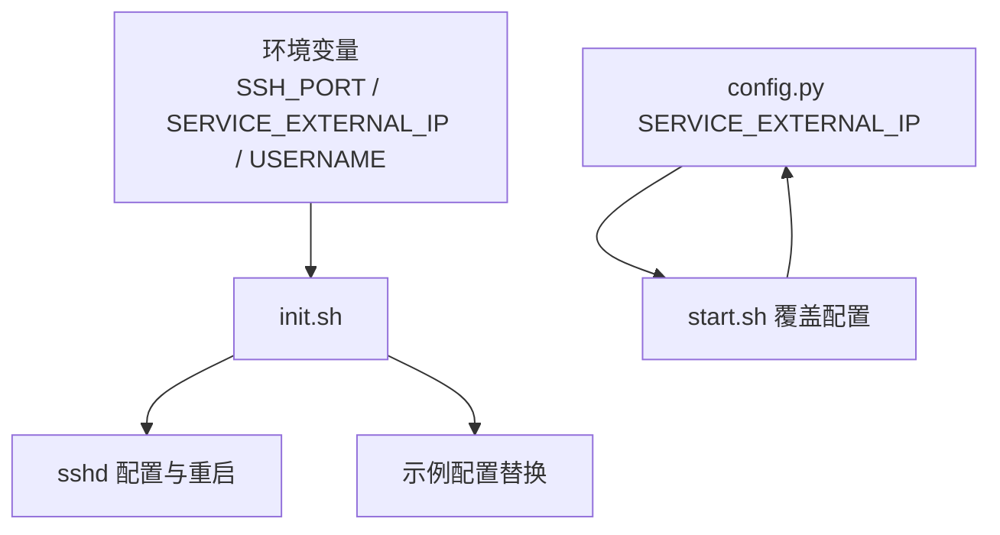

# SSH远程连接

<cite>
**本文引用的文件**   
- [README.md](file://README.md)
- [bigdata/init.sh](file://images/jupyter-notebook/bigdata/init.sh)
- [deeplearning/init.sh](file://images/jupyter-notebook/deeplearning/init.sh)
- [machinelearning/init.sh](file://images/jupyter-notebook/machinelearning/init.sh)
- [ssh连接示例](file://images/jupyter-notebook/examples/ssh连接)
- [config.py（K8s覆盖配置）](file://install/kubernetes/cube/overlays/config/config.py)
- [start.sh（K8s启动脚本）](file://install/kubernetes/start.sh)
- [config.py（应用配置）](file://myapp/config.py)
</cite>

## 目录
1. [简介](#简介)
2. [项目结构](#项目结构)
3. [核心组件](#核心组件)
4. [架构总览](#架构总览)
5. [详细组件分析](#详细组件分析)
6. [依赖关系分析](#依赖关系分析)
7. [性能与优化](#性能与优化)
8. [故障排查指南](#故障排查指南)
9. [结论](#结论)
10. [附录：配置与使用示例](#附录配置与使用示例)

## 简介
本章节面向在Notebook容器中启用SSH远程连接的运维与开发者，系统说明以下主题：
- SSH服务在Notebook容器中的部署方式、端口映射与连接管理机制
- 密钥生成、权限配置与安全访问控制
- 连接代理、跳板机支持与多用户隔离
- 端口转发、IDE远程开发集成与安全加固建议
- 连接优化与常见问题排查

本项目在多个Notebook镜像中内置了SSH服务端初始化脚本，统一通过环境变量注入端口与外部可达IP，并在示例中提供SSH客户端配置模板。平台文档亦提及“SSH remote与Notebook互通”“SSH jumpproxy单端口开放”等能力。

**章节来源**
- [README.md:46-46](file://README.md#L46-L46)
- [README.md:233-233](file://README.md#L233-L233)

## 项目结构
围绕SSH远程连接的相关代码与配置主要分布在以下位置：
- Notebook镜像初始化脚本：负责安装并配置sshd、设置端口、启用root登录、重置密码、重启服务，以及替换示例配置文件中的占位符
- 示例SSH客户端配置：提供~/.ssh/config片段，便于本地或Notebook内快速建立长连接、X11转发与Agent转发
- 平台配置项：SERVICE_EXTERNAL_IP用于声明Notebook对外可达地址，配合K8s启动脚本进行覆盖

**图示来源**
- [bigdata/init.sh:4-9](file://images/jupyter-notebook/bigdata/init.sh#L4-L9)
- [ssh连接示例:1-12](file://images/jupyter-notebook/examples/ssh连接#L1-L12)
- [config.py（K8s覆盖配置）:760-760](file://install/kubernetes/cube/overlays/config/config.py#L760-L760)
- [start.sh（K8s启动脚本）:139-139](file://install/kubernetes/start.sh#L139-L139)

**章节来源**
- [bigdata/init.sh:4-16](file://images/jupyter-notebook/bigdata/init.sh#L4-L16)
- [deeplearning/init.sh:4-16](file://images/jupyter-notebook/deeplearning/init.sh#L4-L16)
- [machinelearning/init.sh:4-16](file://images/jupyter-notebook/machinelearning/init.sh#L4-L16)
- [ssh连接示例:1-12](file://images/jupyter-notebook/examples/ssh连接#L1-L12)
- [config.py（K8s覆盖配置）:760-760](file://install/kubernetes/cube/overlays/config/config.py#L760-L760)
- [start.sh（K8s启动脚本）:139-139](file://install/kubernetes/start.sh#L139-L139)

## 核心组件
- SSH服务端初始化脚本（各环境一致）
  - 将SSH端口写入sshd_config
  - 允许空密码与root登录（默认安全策略较弱，需按需加固）
  - 重置root密码并重启sshd
  - 将示例配置文件中的占位符替换为实际的外部IP与端口
- 示例SSH客户端配置
  - 定义Host别名、主机名、端口、用户、KeepAlive、X11转发、Agent转发等
- 平台配置项
  - SERVICE_EXTERNAL_IP：声明Notebook对外可达的IP列表（内网或公网），供Notebook运行时使用
  - K8s启动脚本支持动态覆盖该配置

**章节来源**
- [bigdata/init.sh:4-16](file://images/jupyter-notebook/bigdata/init.sh#L4-L16)
- [deeplearning/init.sh:4-16](file://images/jupyter-notebook/deeplearning/init.sh#L4-L16)
- [machinelearning/init.sh:4-16](file://images/jupyter-notebook/machinelearning/init.sh#L4-L16)
- [ssh连接示例:1-12](file://images/jupyter-notebook/examples/ssh连接#L1-L12)
- [config.py（应用配置）:765-765](file://myapp/config.py#L765-L765)

## 架构总览
下图展示从本地终端到Notebook容器内sshd的连接路径，以及平台配置如何影响外部可达性。

**图示来源**
- [bigdata/init.sh:4-9](file://images/jupyter-notebook/bigdata/init.sh#L4-L9)
- [config.py（K8s覆盖配置）:760-760](file://install/kubernetes/cube/overlays/config/config.py#L760-L760)
- [start.sh（K8s启动脚本）:139-139](file://install/kubernetes/start.sh#L139-L139)

## 详细组件分析

### SSH服务端初始化流程
- 读取环境变量SSH_PORT，追加到sshd_config
- 修改sshd_config以允许空密码与root登录（默认宽松策略）
- 重置root密码并重启sshd
- 将示例配置文件中的localhost与localport替换为实际值
- 将示例目录软链接到用户工作区

**图示来源**
- [bigdata/init.sh:4-16](file://images/jupyter-notebook/bigdata/init.sh#L4-L16)
- [deeplearning/init.sh:4-16](file://images/jupyter-notebook/deeplearning/init.sh#L4-L16)
- [machinelearning/init.sh:4-16](file://images/jupyter-notebook/machinelearning/init.sh#L4-L16)

**章节来源**
- [bigdata/init.sh:4-16](file://images/jupyter-notebook/bigdata/init.sh#L4-L16)
- [deeplearning/init.sh:4-16](file://images/jupyter-notebook/deeplearning/init.sh#L4-L16)
- [machinelearning/init.sh:4-16](file://images/jupyter-notebook/machinelearning/init.sh#L4-L16)

### 示例SSH客户端配置
- 提供Host别名、HostName、Port、User
- 开启KeepAlive、X11转发、Agent转发
- 可通过ssh-copy-id实现免密登录

**图示来源**
- [ssh连接示例:1-12](file://images/jupyter-notebook/examples/ssh连接#L1-L12)

**章节来源**
- [ssh连接示例:1-12](file://images/jupyter-notebook/examples/ssh连接#L1-L12)

### 平台配置与外部可达性
- SERVICE_EXTERNAL_IP：用于声明Notebook对外可达的IP列表（可包含内网与公网）
- K8s启动脚本支持动态覆盖config.py中的SERVICE_EXTERNAL_IP
- Notebooks在初始化时会将示例配置中的占位符替换为实际的外部IP与端口

**图示来源**
- [config.py（K8s覆盖配置）:760-760](file://install/kubernetes/cube/overlays/config/config.py#L760-L760)
- [start.sh（K8s启动脚本）:139-139](file://install/kubernetes/start.sh#L139-L139)
- [bigdata/init.sh:12-13](file://images/jupyter-notebook/bigdata/init.sh#L12-L13)

**章节来源**
- [config.py（K8s覆盖配置）:760-760](file://install/kubernetes/cube/overlays/config/config.py#L760-L760)
- [start.sh（K8s启动脚本）:139-139](file://install/kubernetes/start.sh#L139-L139)
- [bigdata/init.sh:12-13](file://images/jupyter-notebook/bigdata/init.sh#L12-L13)

## 依赖关系分析
- 初始化脚本依赖环境变量：SSH_PORT、SERVICE_EXTERNAL_IP、USERNAME
- 示例配置依赖init.sh对占位符的替换结果
- 平台配置SERVICE_EXTERNAL_IP被K8s启动脚本覆盖，进而影响Notebook运行期的外部可达性

**图示来源**
- [bigdata/init.sh:4-16](file://images/jupyter-notebook/bigdata/init.sh#L4-L16)
- [config.py（K8s覆盖配置）:760-760](file://install/kubernetes/cube/overlays/config/config.py#L760-L760)
- [start.sh（K8s启动脚本）:139-139](file://install/kubernetes/start.sh#L139-L139)

**章节来源**
- [bigdata/init.sh:4-16](file://images/jupyter-notebook/bigdata/init.sh#L4-L16)
- [config.py（K8s覆盖配置）:760-760](file://install/kubernetes/cube/overlays/config/config.py#L760-L760)
- [start.sh（K8s启动脚本）:139-139](file://install/kubernetes/start.sh#L139-L139)

## 性能与优化
- KeepAlive与连接复用
  - 示例配置已启用ServerAliveInterval与ControlMaster，有助于减少握手开销与提升交互体验
- X11转发
  - 适合图形化工具场景；注意带宽与延迟影响
- Agent转发
  - 便于在Notebook中使用Git等需要私钥的工具；请谨慎评估安全风险
- 端口选择
  - 避免与宿主机或其他服务冲突；建议在K8s Service层做端口分配规划

[本节为通用指导，不直接分析具体文件]

## 故障排查指南
- 无法连接sshd
  - 检查容器内sshd是否已重启且监听端口正确
  - 确认K8s Service/Ingress已将端口暴露到集群外
  - 核对SERVICE_EXTERNAL_IP是否为当前网络可达地址
- 认证失败
  - 若使用密码登录，确认root密码是否正确
  - 若使用密钥登录，确认公钥已正确分发至目标主机
- 示例配置未生效
  - 检查init.sh是否成功替换示例配置中的HOST与PORT
  - 确认~/.ssh/config已正确加载

**章节来源**
- [bigdata/init.sh:4-16](file://images/jupyter-notebook/bigdata/init.sh#L4-L16)
- [deeplearning/init.sh:4-16](file://images/jupyter-notebook/deeplearning/init.sh#L4-L16)
- [machinelearning/init.sh:4-16](file://images/jupyter-notebook/machinelearning/init.sh#L4-L16)
- [ssh连接示例:1-12](file://images/jupyter-notebook/examples/ssh连接#L1-L12)

## 结论
本项目在Notebook镜像中提供了开箱即用的SSH服务端初始化逻辑，并通过平台配置项与K8s启动脚本管理外部可达性。结合示例SSH客户端配置，用户可以快速完成本地或Notebook内的SSH连接、端口转发与IDE远程开发集成。出于安全考虑，默认策略较为宽松，建议在生产环境中按最小权限原则进行加固。

[本节为总结性内容，不直接分析具体文件]

## 附录：配置与使用示例

- 基础SSH连接
  - 使用示例配置中的Host别名进行连接
  - 首次连接建议使用ssh-copy-id配置免密登录
- 端口转发
  - 利用SSH本地/远程端口转发将Notebook内部服务暴露给本地或远端
- IDE远程开发
  - 借助Agent转发与X11转发，在本地IDE中直接访问Notebook内资源与服务
- 安全加固建议
  - 限制仅允许密钥登录，禁用密码登录
  - 限制root登录，创建专用用户并授予必要权限
  - 使用防火墙或K8s NetworkPolicy限制源IP范围
  - 定期轮换密钥与密码，审计登录日志

[本节为通用指导，不直接分析具体文件]