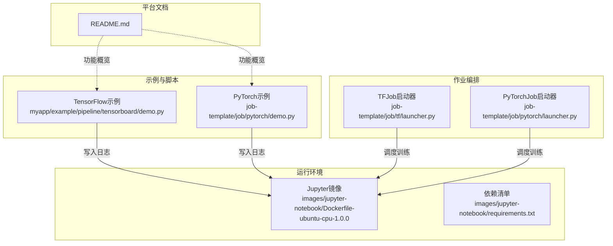
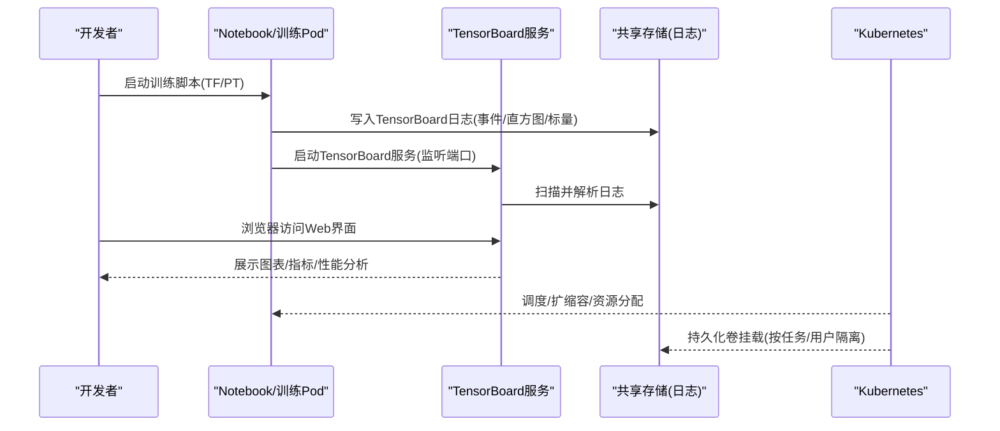
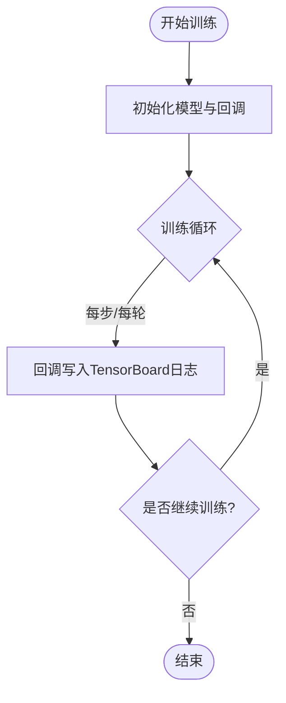
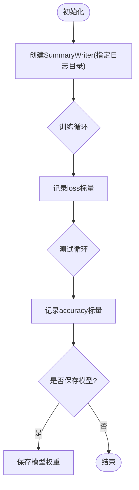
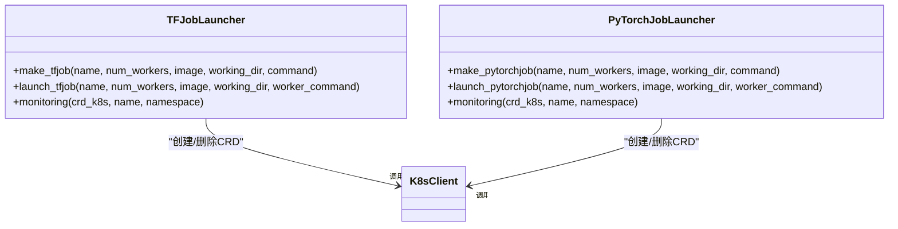
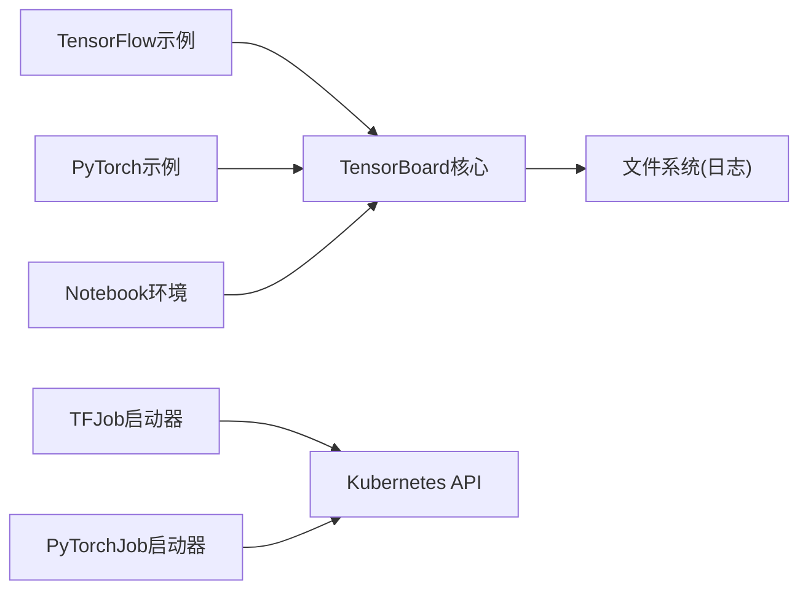

# TensorBoard可视化

<cite>
**本文引用的文件**   
- [README.md](file://README.md)
- [demo.py（TensorFlow示例）](file://myapp/example/pipeline/tensorboard/demo.py)
- [demo.py（PyTorch示例）](file://job-template/job/pytorch/demo.py)
- [launcher.py（TFJob启动器）](file://job-template/job/tf/launcher.py)
- [launcher.py（PyTorchJob启动器）](file://job-template/job/pytorch/launcher.py)
- [Dockerfile（Jupyter CPU镜像）](file://images/jupyter-notebook/Dockerfile-ubuntu-cpu-1.0.0)
- [requirements.txt（Jupyter环境依赖）](file://images/jupyter-notebook/requirements.txt)
</cite>

## 目录
1. [简介](#简介)
2. [项目结构](#项目结构)
3. [核心组件](#核心组件)
4. [架构总览](#架构总览)
5. [详细组件分析](#详细组件分析)
6. [依赖关系分析](#依赖关系分析)
7. [性能与优化](#性能与优化)
8. [故障排查指南](#故障排查指南)
9. [结论](#结论)
10. [附录：配置与使用清单](#附录配置与使用清单)

## 简介
本文件面向在Cube Studio中集成和使用TensorBoard的工程师与算法开发者，系统说明TensorBoard服务的启动、配置与Web访问机制；解释日志路径、数据持久化与多实例隔离；覆盖图表展示、指标监控与性能分析能力；并提供Notebook内启动、日志输出配置、可视化界面访问以及开发工作流集成的具体实践。同时给出使用技巧、性能优化建议与常见问题解决方案。

## 项目结构
仓库中与TensorBoard相关的代码与示例主要分布在以下位置：
- 示例脚本：TensorFlow与PyTorch训练示例分别演示了如何写入TensorBoard日志
- 作业启动器：Kubernetes上的TFJob与PyTorchJob启动器负责调度训练任务并管理Pod生命周期
- Notebook镜像与环境：预置TensorBoard相关依赖，便于在Notebook中直接启动服务或查看日志
- 平台文档：README中对TensorBoard能力的概述与定位

图示来源
- [demo.py（TensorFlow示例）:1-35](file://myapp/example/pipeline/tensorboard/demo.py#L1-L35)
- [demo.py（PyTorch示例）:1-184](file://job-template/job/pytorch/demo.py#L1-L184)
- [launcher.py（TFJob启动器）:1-348](file://job-template/job/tf/launcher.py#L1-L348)
- [launcher.py（PyTorchJob启动器）:1-401](file://job-template/job/pytorch/launcher.py#L1-L401)
- [Dockerfile（Jupyter CPU镜像）:8](file://images/jupyter-notebook/Dockerfile-ubuntu-cpu-1.0.0#L8)
- [requirements.txt（Jupyter环境依赖）:121,243-244](file://images/jupyter-notebook/requirements.txt#L121)
- [requirements.txt（Jupyter环境依赖）:243-244](file://images/jupyter-notebook/requirements.txt#L243-L244)
- [README.md:46,58,172,186,233](file://README.md#L46)
- [README.md:58](file://README.md#L58)
- [README.md:172](file://README.md#L172)
- [README.md:186](file://README.md#L186)
- [README.md:233](file://README.md#L233)

章节来源
- [README.md:46,58,172,186,233](file://README.md#L46)
- [README.md:58](file://README.md#L58)
- [README.md:172](file://README.md#L172)
- [README.md:186](file://README.md#L186)
- [README.md:233](file://README.md#L233)

## 核心组件
- TensorFlow示例：通过Keras回调将训练指标与直方图写入本地日志目录，供TensorBoard读取
- PyTorch示例：通过tensorboardX的SummaryWriter将标量指标写入日志目录
- TFJob/PyTorchJob启动器：在Kubernetes上创建分布式训练任务，管理Pod资源、卷挂载与日志跟踪
- Jupyter镜像与依赖：内置TensorBoard及JupyterLab扩展，支持在Notebook中直接启动TensorBoard服务

章节来源
- [demo.py（TensorFlow示例）:27-34](file://myapp/example/pipeline/tensorboard/demo.py#L27-L34)
- [demo.py（PyTorch示例）:120-136](file://job-template/job/pytorch/demo.py#L120-L136)
- [launcher.py（TFJob启动器）:162-291](file://job-template/job/tf/launcher.py#L162-L291)
- [launcher.py（PyTorchJob启动器）:174-339](file://job-template/job/pytorch/launcher.py#L174-L339)
- [Dockerfile（Jupyter CPU镜像）:8](file://images/jupyter-notebook/Dockerfile-ubuntu-cpu-1.0.0#L8)
- [requirements.txt（Jupyter环境依赖）:121,243-244](file://images/jupyter-notebook/requirements.txt#L121)
- [requirements.txt（Jupyter环境依赖）:243-244](file://images/jupyter-notebook/requirements.txt#L243-L244)

## 架构总览
下图展示了从训练脚本到TensorBoard可视化的端到端流程：训练进程写入日志，TensorBoard服务读取日志并对外提供Web界面；在Kubernetes环境中，作业启动器负责调度训练Pod，并通过卷挂载实现日志持久化与多实例隔离。

图示来源
- [demo.py（TensorFlow示例）:27-34](file://myapp/example/pipeline/tensorboard/demo.py#L27-L34)
- [demo.py（PyTorch示例）:120-136](file://job-template/job/pytorch/demo.py#L120-L136)
- [launcher.py（TFJob启动器）:162-291](file://job-template/job/tf/launcher.py#L162-L291)
- [launcher.py（PyTorchJob启动器）:174-339](file://job-template/job/pytorch/launcher.py#L174-L339)

## 详细组件分析

### TensorFlow示例：日志写入与回调
- 使用Keras回调TensorBoard，指定日志目录与直方图频率，训练过程中自动记录损失、准确率等指标与权重直方图
- 日志目录为相对路径，建议在Notebook或训练Pod中确保该目录可被TensorBoard服务访问

图示来源
- [demo.py（TensorFlow示例）:27-34](file://myapp/example/pipeline/tensorboard/demo.py#L27-L34)

章节来源
- [demo.py（TensorFlow示例）:27-34](file://myapp/example/pipeline/tensorboard/demo.py#L27-L34)

### PyTorch示例：SummaryWriter与指标记录
- 通过SummaryWriter在训练与测试阶段记录标量指标（如loss、accuracy），支持分布式场景下的统一日志输出
- 日志目录可通过参数传入，便于按任务/实验组织数据

图示来源
- [demo.py（PyTorch示例）:120-136](file://job-template/job/pytorch/demo.py#L120-L136)
- [demo.py（PyTorch示例）:53-85](file://job-template/job/pytorch/demo.py#L53-L85)

章节来源
- [demo.py（PyTorch示例）:53-85](file://job-template/job/pytorch/demo.py#L53-L85)
- [demo.py（PyTorch示例）:120-136](file://job-template/job/pytorch/demo.py#L120-L136)

### Kubernetes作业启动器：TFJob与PyTorchJob
- TFJob启动器：构建TFJob CRD，设置容器命令、卷挂载、节点选择与资源限制，并在后台跟踪日志
- PyTorchJob启动器：构建PyTorchJob CRD，配置Master/Worker副本、NCCL调试环境变量、GPU/RDMA资源与安全上下文
- 两者均通过stern进行日志跟踪，并在任务结束时清理相关进程

图示来源
- [launcher.py（TFJob启动器）:162-291](file://job-template/job/tf/launcher.py#L162-L291)
- [launcher.py（TFJob启动器）:295-331](file://job-template/job/tf/launcher.py#L295-L331)
- [launcher.py（PyTorchJob启动器）:174-339](file://job-template/job/pytorch/launcher.py#L174-L339)
- [launcher.py（PyTorchJob启动器）:347-384](file://job-template/job/pytorch/launcher.py#L347-L384)

章节来源
- [launcher.py（TFJob启动器）:162-291](file://job-template/job/tf/launcher.py#L162-L291)
- [launcher.py（TFJob启动器）:295-331](file://job-template/job/tf/launcher.py#L295-L331)
- [launcher.py（PyTorchJob启动器）:174-339](file://job-template/job/pytorch/launcher.py#L174-L339)
- [launcher.py（PyTorchJob启动器）:347-384](file://job-template/job/pytorch/launcher.py#L347-L384)

### Notebook环境与TensorBoard插件
- Jupyter CPU镜像在安装时卸载旧版TensorBoard并安装指定版本，同时启用JupyterLab TensorBoard扩展与服务端扩展
- requirements.txt包含jupyterlab-tensorboard-pro与tensorboard及其data-server依赖，便于在Notebook中直接使用TensorBoard

章节来源
- [Dockerfile（Jupyter CPU镜像）:8](file://images/jupyter-notebook/Dockerfile-ubuntu-cpu-1.0.0#L8)
- [requirements.txt（Jupyter环境依赖）:121](file://images/jupyter-notebook/requirements.txt#L121)
- [requirements.txt（Jupyter环境依赖）:243-244](file://images/jupyter-notebook/requirements.txt#L243-L244)

## 依赖关系分析
- 训练脚本依赖TensorFlow或PyTorch生态，分别通过Keras回调或tensorboardX写入日志
- 作业启动器依赖Kubernetes客户端与自定义K8s工具类，负责CRD创建、资源管理与日志跟踪
- Notebook环境依赖TensorBoard与JupyterLab扩展，提供交互式可视化体验

图示来源
- [demo.py（TensorFlow示例）:27-34](file://myapp/example/pipeline/tensorboard/demo.py#L27-L34)
- [demo.py（PyTorch示例）:120-136](file://job-template/job/pytorch/demo.py#L120-L136)
- [launcher.py（TFJob启动器）:162-291](file://job-template/job/tf/launcher.py#L162-L291)
- [launcher.py（PyTorchJob启动器）:174-339](file://job-template/job/pytorch/launcher.py#L174-L339)

章节来源
- [demo.py（TensorFlow示例）:27-34](file://myapp/example/pipeline/tensorboard/demo.py#L27-L34)
- [demo.py（PyTorch示例）:120-136](file://job-template/job/pytorch/demo.py#L120-L136)
- [launcher.py（TFJob启动器）:162-291](file://job-template/job/tf/launcher.py#L162-L291)
- [launcher.py（PyTorchJob启动器）:174-339](file://job-template/job/pytorch/launcher.py#L174-L339)

## 性能与优化
- 日志写入频率控制：合理设置回调直方图频率与标量记录间隔，避免频繁I/O影响训练吞吐
- 日志目录组织：按任务/实验/时间戳划分目录，便于TensorBoard筛选与对比
- 存储后端：优先使用高性能共享存储（如NFS/对象存储）作为日志持久化后端，减少IO瓶颈
- 并行与隔离：每个训练任务使用独立日志目录，避免多实例互相干扰；在Kubernetes中通过卷挂载与命名空间隔离
- 资源分配：根据训练规模合理分配CPU/GPU/内存，避免资源争用导致TensorBoard刷新延迟

[本节为通用指导，不直接分析具体文件]

## 故障排查指南
- 无法加载日志
  - 检查日志目录是否存在且TensorBoard服务有读权限
  - 确认日志格式正确（事件文件或直方图数据）
- Web界面空白或无数据
  - 确认TensorBoard服务已启动并监听正确端口
  - 检查浏览器是否能访问服务地址（注意代理/防火墙）
- 多实例冲突
  - 确保不同任务使用不同的日志目录与端口
  - 在Kubernetes中通过命名空间与卷挂载实现隔离
- 训练中断后日志不完整
  - 检查训练Pod状态与日志跟踪进程（stern）是否正常
  - 确认任务结束后未提前清理日志目录

章节来源
- [launcher.py（TFJob启动器）:295-331](file://job-template/job/tf/launcher.py#L295-L331)
- [launcher.py（PyTorchJob启动器）:347-384](file://job-template/job/pytorch/launcher.py#L347-L384)

## 结论
在本仓库中，TensorBoard通过训练脚本写入日志、TensorBoard服务读取并渲染，结合Kubernetes作业启动器实现分布式训练的可观测性。借助Notebook环境的预置依赖，开发者可在交互式环境中快速启动TensorBoard、观察指标与性能，并将可视化结果纳入日常开发与调优流程。通过合理的日志组织、存储与资源规划，可实现稳定高效的TensorBoard可视化体验。

[本节为总结性内容，不直接分析具体文件]

## 附录：配置与使用清单
- 在Notebook中启动TensorBoard
  - 使用JupyterLab TensorBoard扩展或服务端扩展，直接打开日志目录
  - 或通过命令行启动TensorBoard服务，指定日志目录与端口
- 配置日志输出
  - TensorFlow：使用Keras回调TensorBoard，设置日志目录与直方图频率
  - PyTorch：使用tensorboardX的SummaryWriter，记录标量指标
- 访问可视化界面
  - 在浏览器中访问TensorBoard服务地址，查看图表、指标与性能分析
- 集成到开发工作流
  - 在训练脚本中嵌入日志记录逻辑
  - 在作业启动器中配置卷挂载与资源限制，确保日志持久化与多实例隔离
  - 在Notebook中一键启动TensorBoard，实时观察训练过程

章节来源
- [demo.py（TensorFlow示例）:27-34](file://myapp/example/pipeline/tensorboard/demo.py#L27-L34)
- [demo.py（PyTorch示例）:120-136](file://job-template/job/pytorch/demo.py#L120-L136)
- [Dockerfile（Jupyter CPU镜像）:8](file://images/jupyter-notebook/Dockerfile-ubuntu-cpu-1.0.0#L8)
- [requirements.txt（Jupyter环境依赖）:121,243-244](file://images/jupyter-notebook/requirements.txt#L121)
- [requirements.txt（Jupyter环境依赖）:243-244](file://images/jupyter-notebook/requirements.txt#L243-L244)