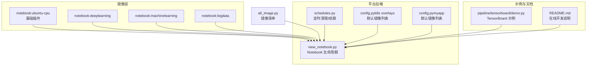
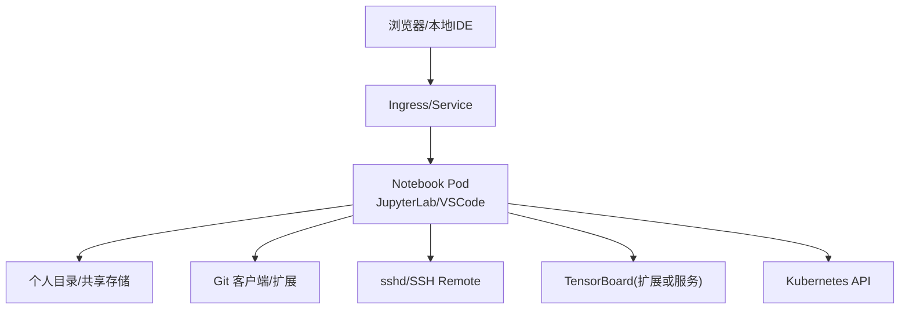
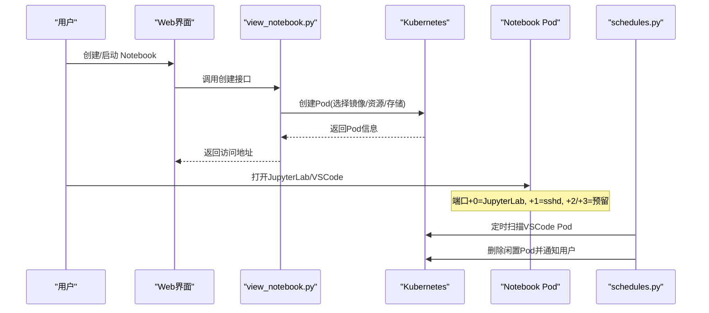
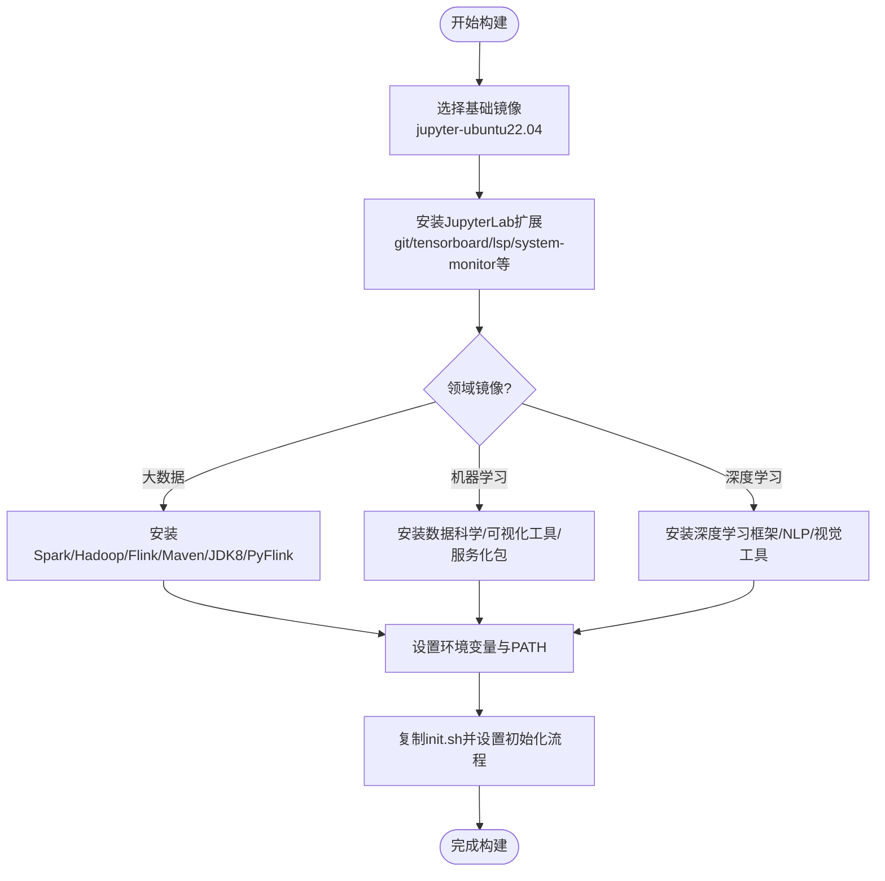
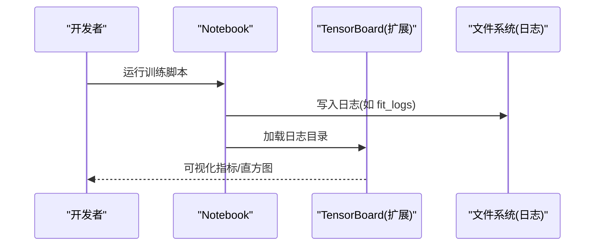
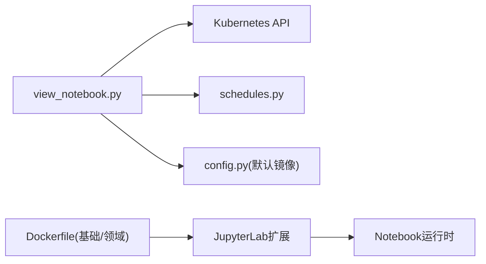

# 在线开发环境

<cite>
**本文引用的文件**   
- [README.md](file://README.md)
- [Dockerfile-ubuntu-cpu-1.0.0](file://images/jupyter-notebook/Dockerfile-ubuntu-cpu-1.0.0)
- [deeplearning Dockerfile](file://images/jupyter-notebook/deeplearning/Dockerfile)
- [bigdata Dockerfile](file://images/jupyter-notebook/bigdata/Dockerfile)
- [machinelearning Dockerfile](file://images/jupyter-notebook/machinelearning/Dockerfile)
- [all_image.py](file://install/kubernetes/all_image.py)
- [config.py（K8s overlays）](file://install/kubernetes/cube/overlays/config/config.py)
- [config.py（myapp）](file://myapp/config.py)
- [view_notebook.py](file://myapp/views/view_notebook.py)
- [schedules.py](file://myapp/tasks/schedules.py)
- [demo.py（tensorboard示例）](file://myapp/example/pipeline/tensorboard/demo.py)
</cite>

## 目录
1. [简介](#简介)
2. [项目结构](#项目结构)
3. [核心组件](#核心组件)
4. [架构总览](#架构总览)
5. [详细组件分析](#详细组件分析)
6. [依赖关系分析](#依赖关系分析)
7. [性能与优化](#性能与优化)
8. [故障排查指南](#故障排查指南)
9. [结论](#结论)
10. [附录：配置与示例清单](#附录配置与示例清单)

## 简介
本文件面向“在线开发环境”能力，系统性阐述 Notebook 开发环境、镜像管理系统与 Git 集成实现，覆盖 JupyterLab/VSCode 在线 IDE、SSH Remote 连接、TensorBoard 可视化、镜像构建、环境配置与多语言支持，并提供可操作的配置示例、工作流建议、调试技巧与性能优化策略。

## 项目结构
围绕在线开发环境的代码与资源主要分布在以下位置：
- 镜像定义：images/jupyter-notebook 下提供基础与领域镜像（CPU/GPU、大数据、机器学习、深度学习），以及扩展插件安装脚本。
- 平台配置：install/kubernetes 与 myapp 下的配置文件定义了默认 Notebook 镜像列表与调度参数。
- 运行时视图与任务：myapp/views/view_notebook.py 负责 Notebook 生命周期管理；myapp/tasks/schedules.py 负责定时清理等运维任务。
- 示例与文档：README.md 概述在线开发能力；myapp/example/pipeline/tensorboard 提供 TensorBoard 使用示例。

图表来源
- [Dockerfile-ubuntu-cpu-1.0.0:1-21](file://images/jupyter-notebook/Dockerfile-ubuntu-cpu-1.0.0#L1-L21)
- [deeplearning Dockerfile:1-25](file://images/jupyter-notebook/deeplearning/Dockerfile#L1-L25)
- [bigdata Dockerfile:1-107](file://images/jupyter-notebook/bigdata/Dockerfile#L1-L107)
- [machinelearning Dockerfile:1-31](file://images/jupyter-notebook/machinelearning/Dockerfile#L1-L31)
- [config.py（K8s overlays）:694-695](file://install/kubernetes/cube/overlays/config/config.py#L694-L695)
- [config.py（myapp）:697-698](file://myapp/config.py#L697-L698)
- [view_notebook.py:208-208](file://myapp/views/view_notebook.py#L208-L208)
- [view_notebook.py:604-604](file://myapp/views/view_notebook.py#L604-L604)
- [schedules.py:191-210](file://myapp/tasks/schedules.py#L191-L210)
- [all_image.py:57-58](file://install/kubernetes/all_image.py#L57-L58)
- [demo.py（tensorboard示例）:3-34](file://myapp/example/pipeline/tensorboard/demo.py#L3-L34)
- [README.md:228-239](file://README.md#L228-L239)

章节来源
- [README.md:228-239](file://README.md#L228-L239)

## 核心组件
- Notebook 开发环境
  - 基于 JupyterLab/VSCode 的在线 IDE，支持 GPU/CPU、监控、Git 交互、SSH Remote、TensorBoard 可视化、多语言内核与自定义镜像。
- 镜像管理系统
  - 提供基础镜像与领域镜像（大数据、机器学习、深度学习），支持在线构建与仓库管理，内置常用插件与示例。
- Git 集成
  - 通过 jupyterlab-git 扩展在 Notebook 中直接进行版本控制操作。
- SSH Remote
  - 通过 sshd 端口与 jump proxy 将本地 IDE 接入远程 Notebook 实例，单端口开放，便于快速提交与联调。
- TensorBoard 可视化
  - 内置 tensorboard 与 JupyterLab 扩展，可在 Notebook 内直接查看训练指标与直方图。

章节来源
- [README.md:228-239](file://README.md#L228-L239)
- [Dockerfile-ubuntu-cpu-1.0.0:6-19](file://images/jupyter-notebook/Dockerfile-ubuntu-cpu-1.0.0#L6-L19)
- [view_notebook.py:604-604](file://myapp/views/view_notebook.py#L604-L604)

## 架构总览
在线开发环境以 Kubernetes 为底座，平台后端根据用户选择启动对应 Notebook Pod，挂载个人目录与存储，暴露 JupyterLab/VSCode 服务端口，并通过 Ingress/Service 对外提供服务。TensorBoard 作为可选服务或扩展在 Notebook 内运行，Git 与 SSH 通过扩展与容器内进程协同工作。

图表来源
- [view_notebook.py:604-604](file://myapp/views/view_notebook.py#L604-L604)
- [Dockerfile-ubuntu-cpu-1.0.0:6-19](file://images/jupyter-notebook/Dockerfile-ubuntu-cpu-1.0.0#L6-L19)

## 详细组件分析

### Notebook 开发环境（JupyterLab/VSCode）
- 功能特性
  - 在线 IDE：JupyterLab/VSCode 汉化版，支持多内核（Python/R/Julia/PySpark 等）。
  - 资源类型：CPU/GPU/NPU/vGPU，支持整卡、虚拟卡、共享占用。
  - 监控与调试：系统监控、GPU 监控、日志查看、断点调试（VSCode）。
  - 自动初始化与清理：启动时执行 init.sh，定时清理闲置实例并通知用户。
  - 密码保护：Jupyter 支持密码保护。
- 关键实现要点
  - 端口规划：JupyterLab 主端口 + sshd 端口 + 预留应用端口。
  - VSCode 清理：定时任务检测并删除 VSCode Pod，释放资源。
  - 镜像选择：从平台配置读取默认镜像列表，支持 CPU/GPU Conda 环境。

图表来源
- [view_notebook.py:604-604](file://myapp/views/view_notebook.py#L604-L604)
- [schedules.py:191-210](file://myapp/tasks/schedules.py#L191-L210)

章节来源
- [view_notebook.py:208-208](file://myapp/views/view_notebook.py#L208-L208)
- [view_notebook.py:604-604](file://myapp/views/view_notebook.py#L604-L604)
- [schedules.py:191-210](file://myapp/tasks/schedules.py#L191-L210)

### 镜像管理系统
- 镜像分类
  - 基础镜像：ubuntu-cpu 基础镜像，预装 JupyterLab 插件（git、tensorboard、sublime、spreadsheet、toc、fasta、geojson、katex、mathjax、drawio、execute-time、lsp、system-monitor 等）。
  - 领域镜像：
    - bigdata：Spark/Hadoop/Flink/Maven/JDK8/PyFlink/HiveCatalog 等大数据工具链。
    - machinelearning：数据科学库、爬虫、数据库客户端、可视化工具与服务化包。
    - deeplearning：深度学习框架（TF/Keras/Torch/JAX 等）、NLP/视觉工具、示例代码。
- 构建与扩展
  - 通过 Dockerfile 安装 apt/pip 包与 JupyterLab 扩展，统一设置环境变量与 init.sh 初始化脚本。
  - 支持 pip/apt 镜像源切换，加速构建。
- 平台集成
  - 默认镜像列表在 K8s overlays 与 myapp 配置中声明，供 Notebook 创建时选择。
  - all_image.py 维护平台所需镜像清单，包含 VSCode 基础镜像。

图表来源
- [Dockerfile-ubuntu-cpu-1.0.0:1-21](file://images/jupyter-notebook/Dockerfile-ubuntu-cpu-1.0.0#L1-L21)
- [bigdata Dockerfile:1-107](file://images/jupyter-notebook/bigdata/Dockerfile#L1-L107)
- [machinelearning Dockerfile:1-31](file://images/jupyter-notebook/machinelearning/Dockerfile#L1-L31)
- [deeplearning Dockerfile:1-25](file://images/jupyter-notebook/deeplearning/Dockerfile#L1-L25)

章节来源
- [Dockerfile-ubuntu-cpu-1.0.0:6-19](file://images/jupyter-notebook/Dockerfile-ubuntu-cpu-1.0.0#L6-L19)
- [bigdata Dockerfile:34-103](file://images/jupyter-notebook/bigdata/Dockerfile#L34-L103)
- [machinelearning Dockerfile:7-31](file://images/jupyter-notebook/machinelearning/Dockerfile#L7-L31)
- [deeplearning Dockerfile:9-25](file://images/jupyter-notebook/deeplearning/Dockerfile#L9-L25)
- [config.py（K8s overlays）:694-695](file://install/kubernetes/cube/overlays/config/config.py#L694-L695)
- [config.py（myapp）:697-698](file://myapp/config.py#L697-L698)
- [all_image.py:57-58](file://install/kubernetes/all_image.py#L57-L58)

### Git 集成
- 在 Notebook 中通过 jupyterlab-git 扩展实现拉取、提交、分支管理等操作。
- 结合平台提供的 Git 凭据与仓库配置，支持私有仓库与多秘钥场景。

章节来源
- [Dockerfile-ubuntu-cpu-1.0.0:7-7](file://images/jupyter-notebook/Dockerfile-ubuntu-cpu-1.0.0#L7-L7)

### SSH Remote 连接
- 通过容器内 sshd 暴露端口，配合 jump proxy 单端口开放，使本地 IDE 可直接连接到远程 Notebook 实例，实现无缝联调与代码提交。
- 端口分配遵循：JupyterLab(+0)、sshd(+1)、预留应用(+2/+3)。

章节来源
- [view_notebook.py:604-604](file://myapp/views/view_notebook.py#L604-L604)

### TensorBoard 可视化
- 在基础镜像中安装 tensorboard 与 jupyterlab_tensorboard 扩展，并在 Notebook 中启用 serverextension。
- 示例 pipeline 展示如何生成日志并通过回调写入 TensorBoard。

图表来源
- [Dockerfile-ubuntu-cpu-1.0.0:8-8](file://images/jupyter-notebook/Dockerfile-ubuntu-cpu-1.0.0#L8-L8)
- [demo.py（tensorboard示例）:3-34](file://myapp/example/pipeline/tensorboard/demo.py#L3-L34)

章节来源
- [Dockerfile-ubuntu-cpu-1.0.0:8-8](file://images/jupyter-notebook/Dockerfile-ubuntu-cpu-1.0.0#L8-L8)
- [demo.py（tensorboard示例）:3-34](file://myapp/example/pipeline/tensorboard/demo.py#L3-L34)

## 依赖关系分析
- 组件耦合
  - view_notebook.py 依赖 Kubernetes API 创建/管理 Notebook Pod，并与 schedules.py 协作进行资源清理。
  - 镜像构建依赖 apt/pip 与 JupyterLab 扩展生态。
  - 平台配置（config.py）决定默认 Notebook 镜像与可用选项。
- 外部依赖
  - Kubernetes 集群、存储（PVC/hostpath/memory/configmap）、网络（Ingress/Service）。
  - 第三方扩展：jupyterlab-git、jupyterlab_tensorboard、jupyter-lsp 等。

图表来源
- [view_notebook.py:208-208](file://myapp/views/view_notebook.py#L208-L208)
- [view_notebook.py:604-604](file://myapp/views/view_notebook.py#L604-L604)
- [schedules.py:191-210](file://myapp/tasks/schedules.py#L191-L210)
- [config.py（K8s overlays）:694-695](file://install/kubernetes/cube/overlays/config/config.py#L694-L695)
- [config.py（myapp）:697-698](file://myapp/config.py#L697-L698)
- [Dockerfile-ubuntu-cpu-1.0.0:6-19](file://images/jupyter-notebook/Dockerfile-ubuntu-cpu-1.0.0#L6-L19)

章节来源
- [view_notebook.py:208-208](file://myapp/views/view_notebook.py#L208-L208)
- [view_notebook.py:604-604](file://myapp/views/view_notebook.py#L604-L604)
- [schedules.py:191-210](file://myapp/tasks/schedules.py#L191-L210)
- [config.py（K8s overlays）:694-695](file://install/kubernetes/cube/overlays/config/config.py#L694-L695)
- [config.py（myapp）:697-698](file://myapp/config.py#L697-L698)
- [Dockerfile-ubuntu-cpu-1.0.0:6-19](file://images/jupyter-notebook/Dockerfile-ubuntu-cpu-1.0.0#L6-L19)

## 性能与优化
- 镜像构建优化
  - 合并 RUN 指令减少层数；使用国内镜像源加速 apt/pip；清理缓存与临时文件。
  - 按需安装扩展，避免不必要的依赖膨胀。
- Notebook 运行优化
  - 合理选择镜像（大数据/机器学习/深度学习）以减少冷启动时间。
  - 使用持久化存储（PVC）缓存依赖与数据集，减少重复下载。
  - 利用系统监控与 LSP 提升编码体验与定位问题效率。
- 资源调度优化
  - 根据任务类型选择 CPU/GPU/NPU，开启 vGPU 共享或独占模式。
  - 定时清理闲置 VSCode Pod，释放计算资源。

[本节为通用指导，不直接分析具体文件]

## 故障排查指南
- Notebook 无法访问
  - 检查 Service/Ingress 是否就绪；确认端口映射（JupyterLab +0、sshd +1）。
  - 查看 Pod 状态与事件，确认镜像拉取与初始化脚本执行成功。
- VSCode 未清理
  - 检查 schedules.py 定时任务是否正常执行；确认命名空间与 Pod 标签匹配。
- TensorBoard 无数据
  - 确认日志目录路径正确；检查 jupyterlab_tensorboard 扩展是否启用；验证回调写入逻辑。
- Git 操作失败
  - 检查 jupyterlab-git 扩展是否安装；确认仓库凭据与网络可达性。

章节来源
- [view_notebook.py:604-604](file://myapp/views/view_notebook.py#L604-L604)
- [schedules.py:191-210](file://myapp/tasks/schedules.py#L191-L210)
- [Dockerfile-ubuntu-cpu-1.0.0:7-8](file://images/jupyter-notebook/Dockerfile-ubuntu-cpu-1.0.0#L7-L8)
- [demo.py（tensorboard示例）:3-34](file://myapp/example/pipeline/tensorboard/demo.py#L3-L34)

## 结论
CubeStudio 的在线开发环境以容器化与 Kubernetes 为基础，提供开箱即用的 JupyterLab/VSCode 在线 IDE、完善的镜像体系与丰富的扩展生态，支持 SSH Remote 与 TensorBoard 可视化，满足从数据处理、算法实验到模型训练的全链路需求。通过合理的镜像构建与资源调度策略，可显著提升开发效率与资源利用率。

[本节为总结性内容，不直接分析具体文件]

## 附录：配置与示例清单
- 默认 Notebook 镜像列表
  - K8s overlays 配置：vscode-ubuntu22.04-cpu-conda / vscode-ubuntu22.04-gpu-conda
  - myapp 配置：同上
- 基础镜像扩展
  - jupyterlab-git、jupyterlab_tensorboard、jupyter-lsp、system-monitor 等
- TensorBoard 示例
  - pipeline/tensorboard/demo.py 展示回调写入日志与可视化流程

章节来源
- [config.py（K8s overlays）:694-695](file://install/kubernetes/cube/overlays/config/config.py#L694-L695)
- [config.py（myapp）:697-698](file://myapp/config.py#L697-L698)
- [Dockerfile-ubuntu-cpu-1.0.0:6-19](file://images/jupyter-notebook/Dockerfile-ubuntu-cpu-1.0.0#L6-L19)
- [demo.py（tensorboard示例）:3-34](file://myapp/example/pipeline/tensorboard/demo.py#L3-L34)