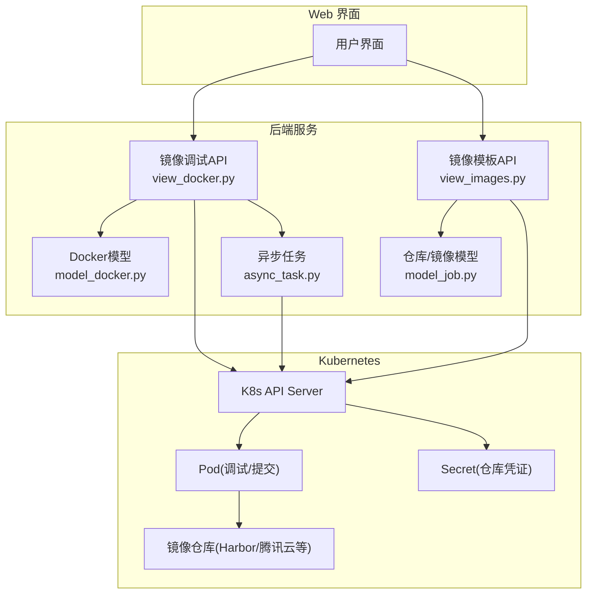
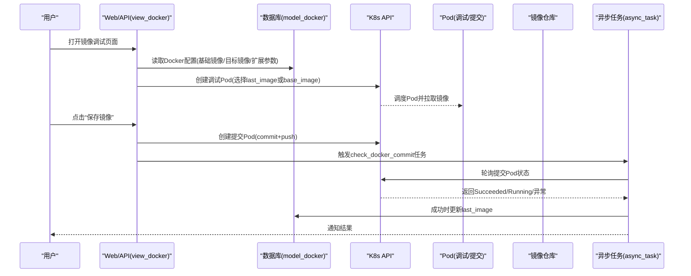
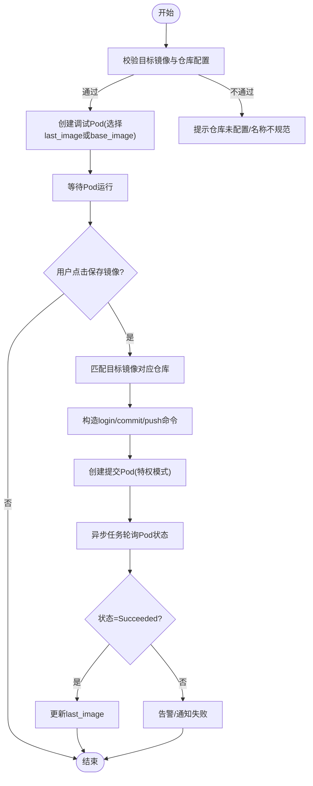
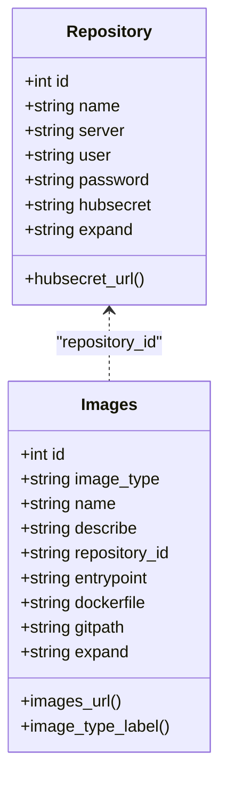
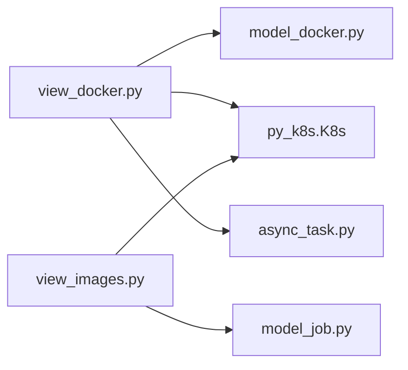

# 镜像管理系统

<cite>
**本文引用的文件**   
- [README.md](file://README.md)
- [model_docker.py](file://myapp/models/model_docker.py)
- [view_docker.py](file://myapp/views/view_docker.py)
- [view_images.py](file://myapp/views/view_images.py)
- [model_job.py](file://myapp/models/model_job.py)
- [async_task.py](file://myapp/tasks/async_task.py)
</cite>

## 目录
1. [简介](#简介)
2. [项目结构](#项目结构)
3. [核心组件](#核心组件)
4. [架构总览](#架构总览)
5. [详细组件分析](#详细组件分析)
6. [依赖关系分析](#依赖关系分析)
7. [性能与容量规划](#性能与容量规划)
8. [故障排查指南](#故障排查指南)
9. [结论](#结论)
10. [附录：配置与最佳实践](#附录配置与最佳实践)

## 简介
本文件面向“镜像管理系统”，系统性说明在 CubeStudio 平台中，如何完成 Docker 镜像的构建、推送、拉取与管理。内容覆盖：
- 镜像仓库配置与认证（Kubernetes Secret）
- 在线调试与保存镜像（commit + push）
- 镜像模板与分类管理
- 多架构支持与镜像加速（通过基础镜像与仓库源）
- 版本管理与清理策略
- 安全与最佳实践

## 项目结构
围绕镜像管理的代码主要分布在以下模块：
- 数据模型层：定义镜像仓库、镜像模板、Docker 调试任务等实体
- 视图与 API 层：提供 Web 表单、校验逻辑、K8s 资源操作
- 异步任务层：负责 commit/push 状态轮询与结果回写
- 文档与示例：README 中对“在线开发”和“镜像功能”有总体说明

图表来源
- [view_docker.py:1-405](file://myapp/views/view_docker.py#L1-L405)
- [view_images.py:1-220](file://myapp/views/view_images.py#L1-L220)
- [model_docker.py:1-50](file://myapp/models/model_docker.py#L1-L50)
- [model_job.py:35-93](file://myapp/models/model_job.py#L35-L93)
- [async_task.py:27-57](file://myapp/tasks/async_task.py#L27-L57)

章节来源
- [README.md:226-238](file://README.md#L226-L238)

## 核心组件
- 镜像调试与保存（Docker 模型与视图）
  - 支持在线调试容器、选择基础镜像或上次生成镜像、设置资源配额（CPU/GPU/内存）、挂载卷、注入环境变量
  - 支持将运行中的容器 commit 并 push 到目标仓库，自动匹配仓库凭证
- 镜像仓库与 Secret 管理
  - 维护仓库地址、用户名、密码，并在 K8s 各命名空间创建/更新 hubsecret，供镜像拉取使用
- 镜像模板与分类
  - 定义镜像类型（开发、Jupyter、任务模板、流水线、超参搜索、内部服务、推理服务等），记录 Dockerfile、入口命令、Git 源码路径等
- 异步任务
  - 轮询 commit pod 状态，成功后回写 last_image，失败则告警

章节来源
- [model_docker.py:20-50](file://myapp/models/model_docker.py#L20-L50)
- [view_docker.py:46-127](file://myapp/views/view_docker.py#L46-L127)
- [view_images.py:29-147](file://myapp/views/view_images.py#L29-L147)
- [model_job.py:35-93](file://myapp/models/model_job.py#L35-L93)
- [async_task.py:27-57](file://myapp/tasks/async_task.py#L27-L57)

## 架构总览
镜像管理的关键流程包括：
- 仓库配置与 Secret 下发
- 在线调试容器启动
- 容器内环境安装与验证
- 容器 commit 并 push 到目标仓库
- 异步任务轮询并更新数据库

图表来源
- [view_docker.py:201-278](file://myapp/views/view_docker.py#L201-L278)
- [view_docker.py:299-390](file://myapp/views/view_docker.py#L299-L390)
- [async_task.py:27-57](file://myapp/tasks/async_task.py#L27-L57)

## 详细组件分析

### 镜像调试与保存（Docker 模型与视图）
- 数据模型
  - 字段包含：项目组、描述、命名空间、基础镜像、目标镜像、最后生成镜像、是否需 GPU、连续构建开关、扩展参数（JSON）
- 视图与表单
  - 默认目标镜像组织前缀来自配置；基础镜像可参考帮助链接
  - 扩展参数支持 CPU/GPU/内存等资源限制
  - 预添加/更新时校验目标镜像格式与仓库配置是否存在
- 调试流程
  - 根据用户与项目信息创建调试 Pod，注入工作目录、节点选择器、镜像拉取策略、Secret 列表、环境变量等
  - 若存在历史非运行态 Pod，先清理再重建
- 保存镜像流程
  - 从所有仓库中匹配目标镜像所属仓库，优先使用当前用户创建的仓库
  - 根据集群容器运行时（docker/nerdctl）构造登录、commit、push 命令
  - 以特权模式创建提交 Pod，执行命令后异步检查状态并更新 last_image

图表来源
- [view_docker.py:163-200](file://myapp/views/view_docker.py#L163-L200)
- [view_docker.py:201-278](file://myapp/views/view_docker.py#L201-L278)
- [view_docker.py:299-390](file://myapp/views/view_docker.py#L299-L390)
- [async_task.py:27-57](file://myapp/tasks/async_task.py#L27-L57)

章节来源
- [model_docker.py:20-50](file://myapp/models/model_docker.py#L20-L50)
- [view_docker.py:46-127](file://myapp/views/view_docker.py#L46-L127)
- [view_docker.py:163-200](file://myapp/views/view_docker.py#L163-L200)
- [view_docker.py:201-278](file://myapp/views/view_docker.py#L201-L278)
- [view_docker.py:299-390](file://myapp/views/view_docker.py#L299-L390)

### 镜像仓库与 Secret 管理
- 仓库模型
  - 字段包含：名称、服务器地址、用户名、密码、K8s Secret 名、扩展参数
- 视图与行为
  - 新增/更新仓库时，遍历所有集群与命名空间，调用 K8s API 应用 hubsecret
  - 列表页隐藏密码字段，展示 Secret 名称及跳转链接（管理员可见）
- 用途
  - 为镜像拉取提供凭据，避免在 Pod 中硬编码敏感信息

图表来源
- [model_job.py:35-93](file://myapp/models/model_job.py#L35-L93)

章节来源
- [model_job.py:35-93](file://myapp/models/model_job.py#L35-L93)
- [view_images.py:29-147](file://myapp/views/view_images.py#L29-L147)

### 镜像模板与分类
- 镜像分类
  - 开发镜像、Jupyter 镜像、任务模板镜像、流水线镜像、超参搜索镜像、内部服务镜像、推理服务镜像
- 模板字段
  - 名称、描述、仓库关联、入口命令、Dockerfile 全文、Git 源码路径、扩展参数
- 用途
  - 统一沉淀标准镜像资产，便于在不同模块中选择复用

章节来源
- [model_job.py:56-93](file://myapp/models/model_job.py#L56-L93)
- [view_images.py:151-219](file://myapp/views/view_images.py#L151-L219)

### 异步任务与版本管理
- check_docker_commit
  - 定时轮询提交 Pod 状态，最长 30 分钟
  - 成功时更新 Docker.last_image；异常状态发送告警
- 版本管理
  - last_image 作为最近一次成功构建的目标镜像，用于后续调试或连续构建

章节来源
- [async_task.py:27-57](file://myapp/tasks/async_task.py#L27-L57)
- [model_docker.py:20-50](file://myapp/models/model_docker.py#L20-L50)

## 依赖关系分析
- 视图依赖模型
  - view_docker.py 依赖 model_docker.py（Docker 实体）
  - view_images.py 依赖 model_job.py（Repository、Images 实体）
- 视图依赖 K8s 客户端
  - 通过 myapp.utils.py.py_k8s.K8s 操作 Pod、Deployment、Secret 等
- 视图触发异步任务
  - view_docker.py 触发 async_task.check_docker_commit
- 模型间关系
  - Images.repository_id 引用 Repository.id

图表来源
- [view_docker.py:1-405](file://myapp/views/view_docker.py#L1-L405)
- [view_images.py:1-220](file://myapp/views/view_images.py#L1-L220)
- [model_docker.py:1-50](file://myapp/models/model_docker.py#L1-L50)
- [model_job.py:35-93](file://myapp/models/model_job.py#L35-L93)
- [async_task.py:27-57](file://myapp/tasks/async_task.py#L27-L57)

章节来源
- [view_docker.py:1-405](file://myapp/views/view_docker.py#L1-L405)
- [view_images.py:1-220](file://myapp/views/view_images.py#L1-L220)
- [model_docker.py:1-50](file://myapp/models/model_docker.py#L1-L50)
- [model_job.py:35-93](file://myapp/models/model_job.py#L35-L93)
- [async_task.py:27-57](file://myapp/tasks/async_task.py#L27-L57)

## 性能与容量规划
- 镜像拉取策略
  - 可通过配置项控制 Always/IfNotPresent，影响网络与缓存行为
- 并发与资源
  - 调试与提交 Pod 的资源配额建议按团队规模与镜像大小评估，避免同时大量构建导致节点压力
- 存储与缓存
  - 合理使用本地镜像缓存与私有仓库缓存，减少重复下载
- 监控与告警
  - 对长时间拉取、提交失败、Pod 异常状态进行告警，及时定位瓶颈

[本节为通用指导，不直接分析具体文件]

## 故障排查指南
- 目标镜像名称不符合规范或未找到仓库配置
  - 现象：创建/编辑时报错提示未发现目标所属仓库的配置
  - 处理：确认目标镜像前缀对应的仓库已正确配置，且用户名/密码有效
- 镜像拉取时间过长
  - 现象：调试 Pod 长时间处于 Pending/拉取中
  - 处理：检查镜像仓库连通性、Secret 是否正确下发、镜像加速配置是否生效
- 保存镜像失败
  - 现象：提交 Pod 非 Succeeded 状态
  - 处理：查看 Pod 日志，确认 login/commit/push 命令执行结果；检查容器运行时权限与磁盘空间
- 异步任务未更新 last_image
  - 现象：保存后 last_image 未变化
  - 处理：检查 Celery 任务队列与 worker 是否正常；查看任务日志

章节来源
- [view_docker.py:163-200](file://myapp/views/view_docker.py#L163-L200)
- [view_docker.py:255-278](file://myapp/views/view_docker.py#L255-L278)
- [view_docker.py:299-390](file://myapp/views/view_docker.py#L299-L390)
- [async_task.py:27-57](file://myapp/tasks/async_task.py#L27-L57)

## 结论
CubeStudio 的镜像管理系统提供了从仓库配置、在线调试、镜像构建到版本回写的完整闭环。通过 Kubernetes Secret 统一管理凭据，结合异步任务保障构建结果的可靠性，满足企业级场景下的镜像治理需求。配合合理的拉取策略、资源配额与监控告警，可在保证安全与稳定性的前提下提升构建效率。

[本节为总结性内容，不直接分析具体文件]

## 附录：配置与最佳实践

- 镜像仓库配置
  - 在“仓库”管理中填写服务器地址、用户名、密码，并指定 K8s Secret 名称
  - 系统会自动在各命名空间应用 Secret，确保镜像拉取可用
- 在线构建自定义镜像
  - 在“镜像调试”中填写基础镜像与目标镜像，按需设置 CPU/GPU/内存
  - 进入调试环境安装依赖，完成后点击“保存镜像”，系统将 commit 并 push
- 镜像模板管理
  - 在“镜像”管理中登记标准镜像的分类、名称、Dockerfile、入口命令与 Git 源码路径
  - 便于在 Pipeline、Notebook、推理服务等模块中复用
- 多架构支持与镜像加速
  - 通过选择不同基础镜像（如 amd64/arm64）适配多架构
  - 通过配置镜像仓库加速源或使用国内镜像站，提升拉取速度
- 版本管理与清理
  - 使用 last_image 追踪最近一次成功构建
  - 定期清理调试 Pod 与无用镜像，释放存储与计算资源
- 安全考虑
  - 使用 Secret 管理凭据，避免明文暴露
  - 限制调试 Pod 的权限与资源，最小化攻击面
  - 对目标镜像命名遵循组织规范，便于审计与追溯

[本节为通用指导，不直接分析具体文件]