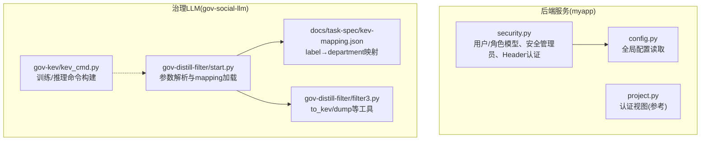
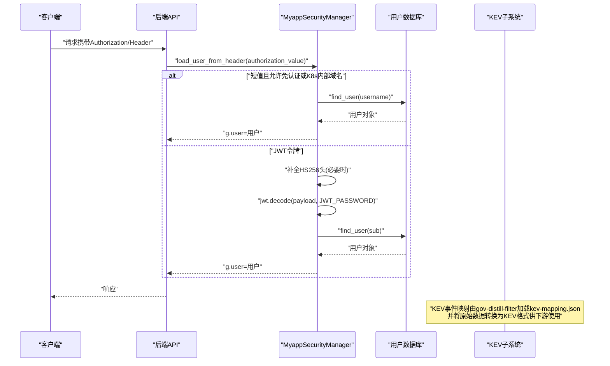
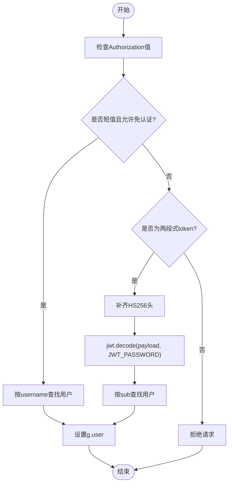
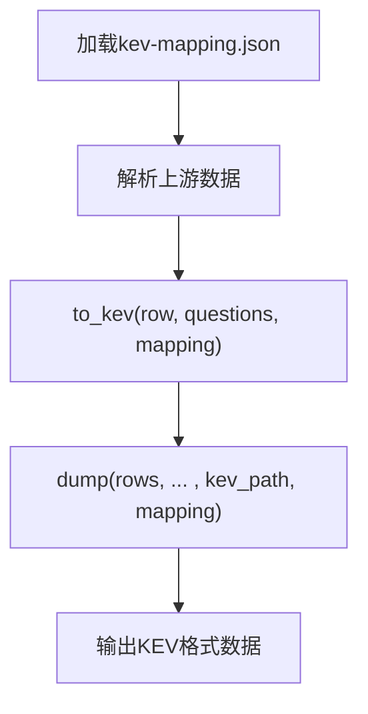
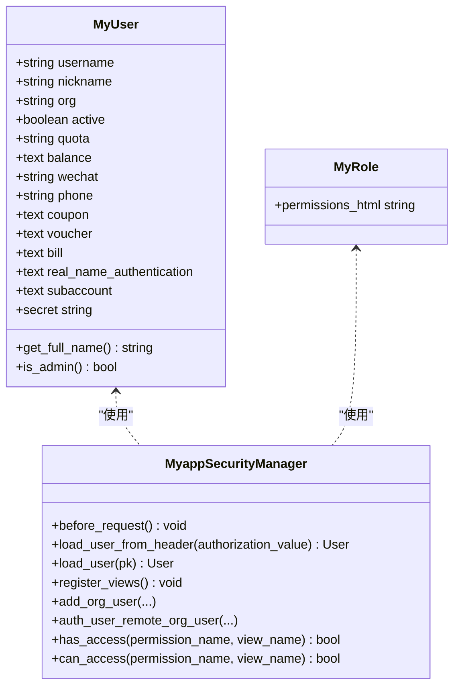
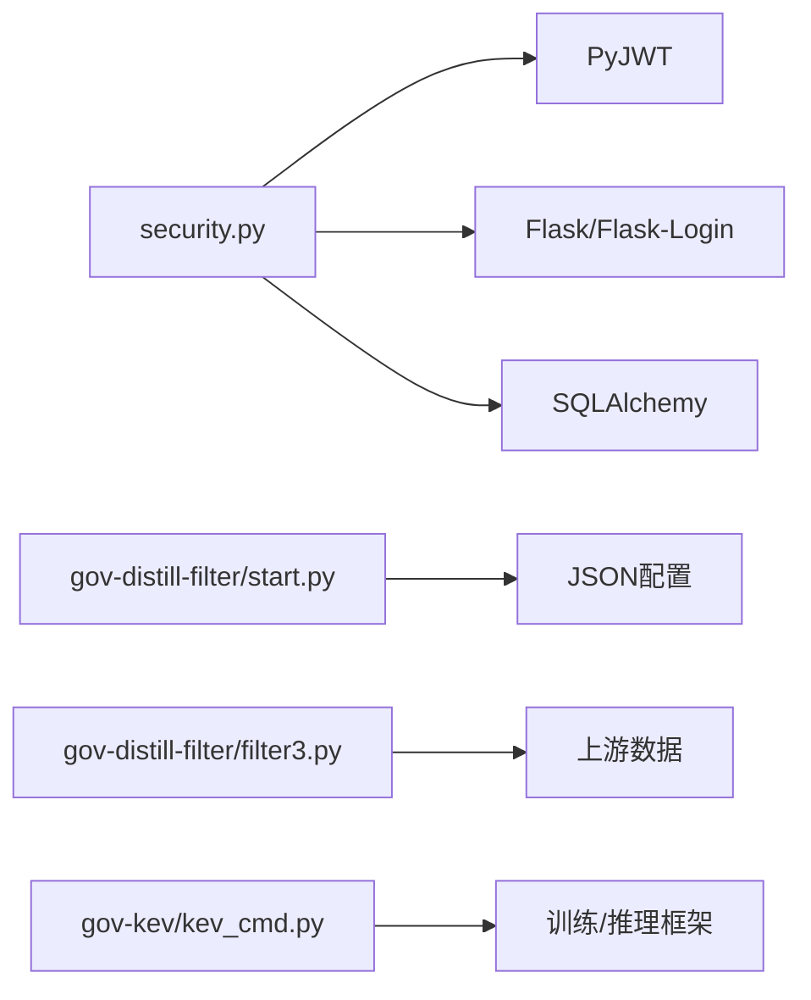

# Token管理

<cite>
**本文引用的文件**   
- [security.py](file://myapp/security.py)
- [config.py](file://myapp/config.py)
- [project.py](file://myapp/project.py)
- [start.py](file://gov-social-llm/ops/gov-distill-filter/start.py)
- [filter3.py](file://gov-social-llm/ops/gov-distill-filter/filter3.py)
- [kev_cmd.py](file://gov-social-llm/ops/gov-kev/kev_cmd.py)
- [kev-mapping.json](file://gov-social-llm/docs/task-spec/kev-mapping.json)
</cite>

## 目录
1. [引言](#引言)
2. [项目结构](#项目结构)
3. [核心组件](#核心组件)
4. [架构总览](#架构总览)
5. [详细组件分析](#详细组件分析)
6. [依赖关系分析](#依赖关系分析)
7. [性能与可扩展性](#性能与可扩展性)
8. [故障排查指南](#故障排查指南)
9. [结论](#结论)
10. [附录：配置与集成示例](#附录配置与集成示例)

## 引言
本文件面向平台安全与运维人员，系统性梳理 Cube Studio 中 Token 的生命周期与安全机制，并扩展说明 KEV（Key Event Validation）系统在事件映射、权限控制与审计日志方面的实现思路。文档覆盖以下主题：
- Token 的生成、验证、轮换与安全存储
- 基于 Header 的轻量认证流程
- KEV 的事件映射与数据流转
- 批量管理、过期处理与异常检测建议
- 不同认证方式的集成与扩展策略

## 项目结构
本项目在 myapp 层提供用户模型、角色模型与自定义安全管理器；在 gov-social-llm 子项目中提供 KEV 相关的命令构建与事件映射配置。Token 相关逻辑集中在安全模块中，KEV 相关逻辑集中在 gov-social-llm 的 ops 与 docs 目录。

**图表来源**
- [security.py:47-94](file://myapp/security.py#L47-L94)
- [security.py:237-286](file://myapp/security.py#L237-L286)
- [config.py](file://myapp/config.py)
- [project.py](file://myapp/project.py)
- [kev_cmd.py:10-32](file://gov-social-llm/ops/gov-kev/kev_cmd.py#L10-L32)
- [start.py:31-44](file://gov-social-llm/ops/gov-distill-filter/start.py#L31-L44)
- [filter3.py:102-122](file://gov-social-llm/ops/gov-distill-filter/filter3.py#L102-L122)
- [kev-mapping.json:1-7](file://gov-social-llm/docs/task-spec/kev-mapping.json#L1-L7)

**章节来源**
- [security.py:47-94](file://myapp/security.py#L47-L94)
- [security.py:237-286](file://myapp/security.py#L237-L286)
- [kev_cmd.py:10-32](file://gov-social-llm/ops/gov-kev/kev_cmd.py#L10-L32)
- [start.py:31-44](file://gov-social-llm/ops/gov-distill-filter/start.py#L31-L44)
- [filter3.py:102-122](file://gov-social-llm/ops/gov-distill-filter/filter3.py#L102-L122)
- [kev-mapping.json:1-7](file://gov-social-llm/docs/task-spec/kev-mapping.json#L1-L7)

## 核心组件
- MyUser/MyRole 模型扩展：承载用户基本信息、组织、余额、优惠券、发票、实名认证、子账户等字段，并提供 secret 属性用于生成 JWT。
- MyappSecurityManager：自定义安全管理员，注册 Header 认证方式，支持短 token 兼容与长 token 校验，提供访问控制钩子。
- gov-kev 命令构建器：封装训练与推理命令，便于流水线任务调度。
- gov-distill-filter：负责将上游数据转换为 KEV 格式，并加载 kev-mapping.json 进行 label→department 映射。
- kev-mapping.json：事件标签到部门名称的映射表，作为 KEV 系统的数据基础。

**章节来源**
- [security.py:47-94](file://myapp/security.py#L47-L94)
- [security.py:237-286](file://myapp/security.py#L237-L286)
- [kev_cmd.py:10-32](file://gov-social-llm/ops/gov-kev/kev_cmd.py#L10-L32)
- [start.py:31-44](file://gov-social-llm/ops/gov-distill-filter/start.py#L31-L44)
- [filter3.py:102-122](file://gov-social-llm/ops/gov-distill-filter/filter3.py#L102-L122)
- [kev-mapping.json:1-7](file://gov-social-llm/docs/task-spec/kev-mapping.json#L1-L7)

## 架构总览
下图展示 Token 从生成到鉴权的关键路径，以及 KEV 事件映射的数据流。

**图表来源**
- [security.py:258-286](file://myapp/security.py#L258-L286)
- [security.py:74-94](file://myapp/security.py#L74-L94)
- [start.py:31-44](file://gov-social-llm/ops/gov-distill-filter/start.py#L31-L44)
- [filter3.py:102-122](file://gov-social-llm/ops/gov-distill-filter/filter3.py#L102-L122)
- [kev-mapping.json:1-7](file://gov-social-llm/docs/task-spec/kev-mapping.json#L1-L7)

## 详细组件分析

### Token 生命周期管理
- 生成
  - 通过 MyUser.secret 属性生成 JWT，载荷包含用户名(sub)，并使用配置的 JWT_PASSWORD 进行 HS256 签名。为缩短长度，返回时仅保留 payload.signature 部分。
  - 该设计适合轻量传输场景，但需注意在鉴权端进行头部补齐。
- 验证
  - MyappSecurityManager.load_user_from_header 支持两种模式：
    - 免认证模式：当 Authorization 值为短字符串且满足条件（全局开关或 K8s 内部域名），直接按 username 查找用户。
    - JWT 模式：若传入的是两段式 token（仅 payload.signature），自动补齐 HS256 header 后解码，再根据 sub 查找用户。
- 轮换
  - 当前实现未内置轮换机制；建议在用户信息变更或定期策略下重新生成 secret，并在客户端侧更新 Authorization。
- 安全存储
  - JWT_PASSWORD 来自全局配置，建议通过环境变量或密钥管理服务注入，避免硬编码。
  - 前端或客户端应安全存储生成的 token，避免泄露。

**图表来源**
- [security.py:258-286](file://myapp/security.py#L258-L286)
- [security.py:74-94](file://myapp/security.py#L74-L94)

**章节来源**
- [security.py:74-94](file://myapp/security.py#L74-L94)
- [security.py:258-286](file://myapp/security.py#L258-L286)

### KEV（Key Event Validation）系统
- 事件映射
  - kev-mapping.json 定义事件标签到部门的映射，例如“矛盾纠纷/邻里纠纷”映射到“城管执法”。
  - gov-distill-filter 在启动时加载该映射，并在数据处理阶段使用 to_kev 函数将原始记录转换为 KEV 格式。
- 权限控制
  - 当前代码未直接实现基于 KEV 的权限控制；可在业务层结合用户角色与部门映射进行细粒度授权。
- 审计日志
  - 当前代码未直接输出 KEV 审计日志；建议在转换与分发阶段增加结构化日志，记录事件ID、来源、映射结果与时间戳。

**图表来源**
- [start.py:31-44](file://gov-social-llm/ops/gov-distill-filter/start.py#L31-L44)
- [filter3.py:102-122](file://gov-social-llm/ops/gov-distill-filter/filter3.py#L102-L122)
- [kev-mapping.json:1-7](file://gov-social-llm/docs/task-spec/kev-mapping.json#L1-L7)

**章节来源**
- [start.py:31-44](file://gov-social-llm/ops/gov-distill-filter/start.py#L31-L44)
- [filter3.py:102-122](file://gov-social-llm/ops/gov-distill-filter/filter3.py#L102-L122)
- [kev-mapping.json:1-7](file://gov-social-llm/docs/task-spec/kev-mapping.json#L1-L7)

### 类与职责图（面向对象视角）

**图表来源**
- [security.py:47-94](file://myapp/security.py#L47-L94)
- [security.py:101-107](file://myapp/security.py#L101-L107)
- [security.py:237-286](file://myapp/security.py#L237-L286)

**章节来源**
- [security.py:47-94](file://myapp/security.py#L47-L94)
- [security.py:101-107](file://myapp/security.py#L101-L107)
- [security.py:237-286](file://myapp/security.py#L237-L286)

## 依赖关系分析
- security.py 依赖 Flask-Login、Flask-JWT-Extended、PyJWT、SQLAlchemy 等库，用于用户会话、JWT 编解码与 ORM 操作。
- gov-distill-filter 依赖 JSON 配置文件与上游数据源，负责数据转换与导出。
- gov-kev 命令构建器依赖外部训练/推理框架（如 uv、LLaMA-Factory 等），以命令行形式驱动任务。

**图表来源**
- [security.py:1-10](file://myapp/security.py#L1-L10)
- [start.py:31-44](file://gov-social-llm/ops/gov-distill-filter/start.py#L31-L44)
- [filter3.py:102-122](file://gov-social-llm/ops/gov-distill-filter/filter3.py#L102-L122)
- [kev_cmd.py:10-32](file://gov-social-llm/ops/gov-kev/kev_cmd.py#L10-L32)

**章节来源**
- [security.py:1-10](file://myapp/security.py#L1-L10)
- [start.py:31-44](file://gov-social-llm/ops/gov-distill-filter/start.py#L31-L44)
- [filter3.py:102-122](file://gov-social-llm/ops/gov-distill-filter/filter3.py#L102-L122)
- [kev_cmd.py:10-32](file://gov-social-llm/ops/gov-kev/kev_cmd.py#L10-L32)

## 性能与可扩展性
- Token 生成与验证
  - 当前实现为同步解码与用户查询，适合中小规模并发。在高并发场景可引入缓存（如 Redis）以减少数据库压力。
  - 建议启用连接池与异步 I/O，提升鉴权吞吐。
- KEV 数据处理
  - 数据转换与导出为批处理模式，可通过分片与并行写入提升性能。
  - 建议在 pipeline 中加入指标采集（QPS、延迟、错误率）以便监控。
- 扩展点
  - 在 MyappSecurityManager 中扩展 has_access/can_access 以实现更细粒度的权限控制。
  - 在 gov-distill-filter 中扩展 to_kev 以支持更多事件类型与字段。

[本节为通用指导，不直接分析具体文件]

## 故障排查指南
- Token 无效或解码失败
  - 检查 Authorization 是否为两段式 token，必要时补齐 HS256 header。
  - 确认 JWT_PASSWORD 配置一致，避免服务端与客户端不一致导致解码失败。
- 免认证被拒绝
  - 检查 AUTH_PLATFORM_ACCESS 开关与请求 Host 是否匹配 K8s 内部域名。
- KEV 映射缺失
  - 确认 kev-mapping.json 存在且键名正确，确保 start.py 能成功加载。
- 数据转换异常
  - 检查 filter3.to_kev 输入数据结构是否符合预期，必要时增加空值与类型校验。

**章节来源**
- [security.py:258-286](file://myapp/security.py#L258-L286)
- [start.py:31-44](file://gov-social-llm/ops/gov-distill-filter/start.py#L31-L44)
- [filter3.py:102-122](file://gov-social-llm/ops/gov-distill-filter/filter3.py#L102-L122)

## 结论
本项目实现了轻量级的 Token 生成与鉴权机制，并通过 Header 认证简化了跨域与微服务调用场景。KEV 子系统提供了事件映射与数据转换能力，便于后续扩展权限控制与审计日志。建议在现有基础上完善 Token 轮换、过期策略与异常检测，同时增强 KEV 的权限与审计能力，以满足企业级安全需求。

[本节为总结，不直接分析具体文件]

## 附录：配置与集成示例
- Token 配置
  - JWT_PASSWORD：用于 HS256 签名的密钥，建议通过环境变量注入。
  - AUTH_PLATFORM_ACCESS：全局免认证开关，适用于内部服务或 K8s 环境。
- 集成不同认证方式
  - 短用户名直传：在 Authorization 中直接传递 username，需开启 AUTH_PLATFORM_ACCESS 或通过 K8s 内部域名访问。
  - JWT 令牌：客户端生成两段式 token，服务端自动补齐头部并解码。
- 扩展新安全策略
  - 在 MyappSecurityManager.has_access/can_access 中实现基于角色、组织或资源的访问控制。
  - 在 load_user_from_header 中增加速率限制、IP 白名单等前置校验。
- 批量管理与过期处理
  - 建议引入后台任务定期刷新用户的 secret，并在客户端侧实现自动续期。
  - 对 KEV 数据批次添加版本号与时间戳，便于清理过期数据。
- 异常检测
  - 在鉴权失败时记录失败次数与来源 IP，触发告警。
  - 在 KEV 转换失败时记录异常样本，便于人工复核与模型迭代。

**章节来源**
- [security.py:74-94](file://myapp/security.py#L74-L94)
- [security.py:258-286](file://myapp/security.py#L258-L286)