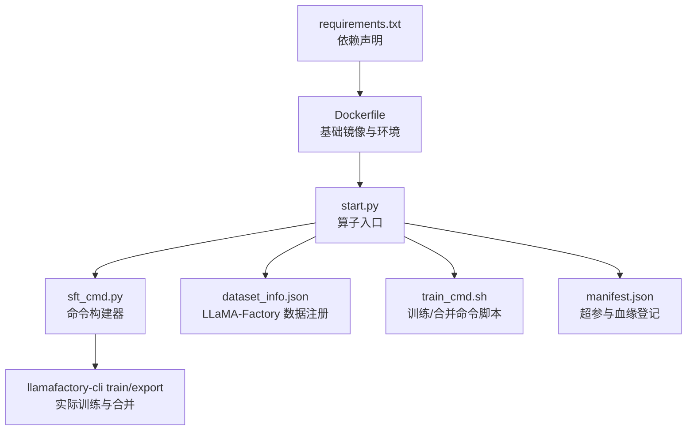
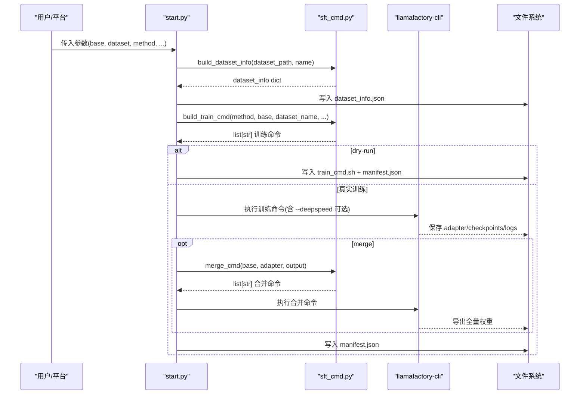
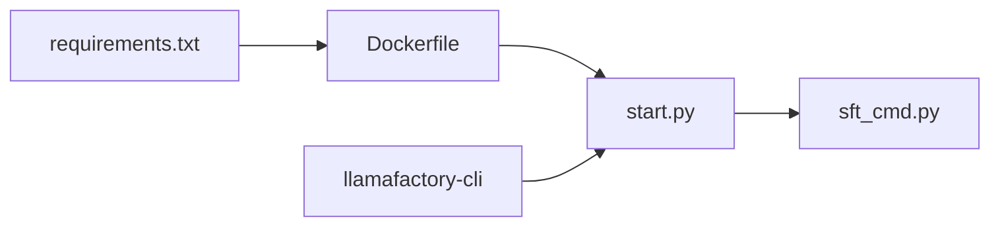

# 分布式训练

<cite>
**本文引用的文件**   
- [sft_cmd.py](file://gov-social-llm/ops/gov-sft/sft_cmd.py)
- [start.py](file://gov-social-llm/ops/gov-sft/start.py)
- [Dockerfile](file://gov-social-llm/ops/gov-sft/Dockerfile)
- [requirements.txt](file://gov-social-llm/ops/gov-sft/requirements.txt)
- [README.md](file://gov-social-llm/ops/gov-sft/README.md)
</cite>

## 目录
1. [引言](#引言)
2. [项目结构](#项目结构)
3. [核心组件](#核心组件)
4. [架构总览](#架构总览)
5. [详细组件分析](#详细组件分析)
6. [依赖关系分析](#依赖关系分析)
7. [性能与显存优化](#性能与显存优化)
8. [分布式训练配置示例](#分布式训练配置示例)
9. [故障恢复与监控](#故障恢复与监控)
10. [扩展新训练框架与策略](#扩展新训练框架与策略)
11. [排错指南](#排错指南)
12. [结论](#结论)

## 引言
本文件面向在 Cube Studio 平台上使用 gov-sft 算子进行 LLaMA-Factory LoRA/QLoRA 微调的工程师，系统性说明：
- 多卡并行训练接入方式（DeepSpeed）
- 显存优化策略（BF16、梯度累积、QLoRA 量化）
- 训练参数配置与数据加载机制
- 模型权重管理、检查点保存与合并导出
- 训练监控与血缘记录
- 如何扩展新的训练框架和优化策略

## 项目结构
gov-sft 是一个“薄算子”封装，负责生成 LLaMA-Factory 的训练命令与数据集注册信息，并通过 subprocess 执行真实训练。其关键文件如下：
- sft_cmd.py：纯函数式命令构建器，负责组装 llamafactory-cli train/export 命令与 dataset_info.json 条目
- start.py：算子入口，解析参数、生成 dataset_info.json、调用命令构建器、执行训练或 dry-run、写入 manifest
- Dockerfile：基于 hiyouga/llamafactory:latest 镜像，设置 CUDA 架构以适配 RTX 4090/5090
- requirements.txt：声明依赖由基础镜像提供，无额外 pip 依赖
- README.md：参数说明、dry-run 保护、产出物说明

图示来源
- [start.py:29-90](file://gov-social-llm/ops/gov-sft/start.py#L29-L90)
- [sft_cmd.py:9-70](file://gov-social-llm/ops/gov-sft/sft_cmd.py#L9-L70)
- [Dockerfile:1-11](file://gov-social-llm/ops/gov-sft/Dockerfile#L1-L11)
- [requirements.txt:1-3](file://gov-social-llm/ops/gov-sft/requirements.txt#L1-L3)

章节来源
- [README.md:1-47](file://gov-social-llm/ops/gov-sft/README.md#L1-L47)
- [Dockerfile:1-11](file://gov-social-llm/ops/gov-sft/Dockerfile#L1-L11)
- [requirements.txt:1-3](file://gov-social-llm/ops/gov-sft/requirements.txt#L1-L3)

## 核心组件
- 命令构建器（sft_cmd.py）
  - build_dataset_info：根据文件名是否包含 sharegpt 自动选择 formatting 与 columns 映射
  - build_train_cmd：组装 llamafactory-cli train 命令，支持 lora/qlora、deepspeed 配置路径
  - merge_cmd：组装 llamafactory-cli export 合并全量权重的命令
- 算子入口（start.py）
  - 参数解析：base、dataset、method、lora-rank、lr、epochs、seq-len、deepspeed、output、merge、dataset-manifest
  - 生成 dataset_info.json 并写入输出目录
  - 构建训练命令；可选合并命令
  - dry-run 模式：仅写 train_cmd.sh 与 manifest，不执行训练
  - 真实模式：设置 LLAMAFACTORY_DATA 环境变量后执行训练与合并，并写 manifest

章节来源
- [sft_cmd.py:9-70](file://gov-social-llm/ops/gov-sft/sft_cmd.py#L9-L70)
- [start.py:29-90](file://gov-social-llm/ops/gov-sft/start.py#L29-L90)

## 架构总览
gov-sft 作为平台侧的“薄算子”，将训练逻辑委托给 LLaMA-Factory。整体流程如下：

图示来源
- [start.py:29-90](file://gov-social-llm/ops/gov-sft/start.py#L29-L90)
- [sft_cmd.py:27-70](file://gov-social-llm/ops/gov-sft/sft_cmd.py#L27-L70)

## 详细组件分析

### 数据加载与 dataset_info.json
- 自动格式识别：若 dataset 路径包含 sharegpt，则使用 sharegpt 格式，并将 messages 列映射到 conversations；否则使用 alpaca 格式，映射 prompt/query/response 三列
- 输出位置：输出目录下的 dataset_info.json，供 LLaMA-Factory 读取
- 环境变量：通过 LLAMAFACTORY_DATA 指向输出目录，使 LLaMA-Factory 能找到 dataset_info.json

章节来源
- [sft_cmd.py:9-24](file://gov-social-llm/ops/gov-sft/sft_cmd.py#L9-L24)
- [start.py:49-51](file://gov-social-llm/ops/gov-sft/start.py#L49-L51)
- [start.py:69-72](file://gov-social-llm/ops/gov-sft/start.py#L69-L72)

### 训练命令构建与参数
- 基础参数：model_name_or_path、stage sft、do_train、template default、finetuning_type lora
- 超参：lora_rank、learning_rate、num_train_epochs、cutoff_len、output_dir、overwrite_output_dir
- 批大小与梯度累积：per_device_train_batch_size=1，gradient_accumulation_steps=8
- 日志与保存：logging_steps=10，save_strategy=steps，save_steps=100，plot_loss=true，report_to=none
- 精度：bf16=true
- QLoRA：当 method=qlora 时追加 quantization_bit=4
- DeepSpeed：当传入 deepspeed 参数时追加 --deepspeed <path>

章节来源
- [sft_cmd.py:27-57](file://gov-social-llm/ops/gov-sft/sft_cmd.py#L27-L57)

### 合并导出（adapter→全量权重）
- 使用 llamafactory-cli export，输入 base 模型与 adapter 路径，输出到指定 export_dir
- 仅在 start.py 中启用 --merge 时生成并执行合并命令

章节来源
- [sft_cmd.py:60-69](file://gov-social-llm/ops/gov-sft/sft_cmd.py#L60-L69)
- [start.py:57-59](file://gov-social-llm/ops/gov-sft/start.py#L57-L59)
- [start.py:73-74](file://gov-social-llm/ops/gov-sft/start.py#L73-L74)

### 检查点与输出产物
- 训练输出目录：output（默认 /mnt/gov/sft/{ver}），包含 adapter、checkpoints、logs 等
- 合并输出目录：output-merged，存放全量权重
- 元数据：train_manifest.json（通过 write_manifest 写入，op="gov-sft"，extra.hyper 记录超参）

章节来源
- [start.py:45-46](file://gov-social-llm/ops/gov-sft/start.py#L45-L46)
- [start.py:57-59](file://gov-social-llm/ops/gov-sft/start.py#L57-L59)
- [start.py:83-90](file://gov-social-llm/ops/gov-sft/start.py#L83-L90)

### 训练监控与血缘
- 监控：logging_steps=10，plot_loss=true；report_to=none 表示不向外部系统上报
- 血缘：parents 字段记录上游数据集 manifest 的 path 与 digest，便于追踪数据来源

章节来源
- [sft_cmd.py:46-50](file://gov-social-llm/ops/gov-sft/sft_cmd.py#L46-L50)
- [start.py:78-82](file://gov-social-llm/ops/gov-sft/start.py#L78-L82)

## 依赖关系分析
- 运行环境：hiyouga/llamafactory:latest 基础镜像，内置 torch/transformers/peft/trl 等依赖
- CUDA 架构：TORCH_CUDA_ARCH_LIST 设置为 8.9;12.0，适配 RTX 4090/5090
- 依赖声明：requirements.txt 无额外依赖，全部由基础镜像提供

图示来源
- [start.py:17-21](file://gov-social-llm/ops/gov-sft/start.py#L17-L21)
- [Dockerfile:1-11](file://gov-social-llm/ops/gov-sft/Dockerfile#L1-L11)
- [requirements.txt:1-3](file://gov-social-llm/ops/gov-sft/requirements.txt#L1-L3)

章节来源
- [Dockerfile:1-11](file://gov-social-llm/ops/gov-sft/Dockerfile#L1-L11)
- [requirements.txt:1-3](file://gov-social-llm/ops/gov-sft/requirements.txt#L1-L3)

## 性能与显存优化
- BF16 混合精度：启用 bf16，降低显存占用并提升吞吐
- 梯度累积：per_device_train_batch_size=1，gradient_accumulation_steps=8，等效增大 batch size 同时控制单步显存
- QLoRA 量化：method=qlora 时启用 4-bit 量化，显著降低显存需求
- DeepSpeed ZeRO：通过 --deepspeed 传入 ZeRO 配置文件，实现多卡并行与显存优化
- 数据切分：dataset_info.json 按 sharegpt/alpaca 自动映射，减少预处理开销

章节来源
- [sft_cmd.py:44-56](file://gov-social-llm/ops/gov-sft/sft_cmd.py#L44-L56)

## 分布式训练配置示例
以下示例展示如何在 gov-sft 中启用 DeepSpeed 多卡并行训练。注意：具体 ZeRO 配置需依据硬件规模与模型大小自行编写，并通过 --deepspeed 传入。

- 单卡 LoRA 微调（基准）
  - 参数要点：method=lora，不传 deepspeed
  - 适用场景：小模型或资源受限环境

- 多卡 LoRA 微调（DeepSpeed ZeRO Stage 2/3）
  - 参数要点：method=lora，--deepspeed /path/to/deepspeed_config.json
  - 建议：开启 bf16、合理设置 gradient_accumulation_steps 与 per_device_train_batch_size

- 多卡 QLoRA 微调（DeepSpeed + 4-bit 量化）
  - 参数要点：method=qlora，--deepspeed /path/to/deepspeed_config.json
  - 适用场景：大模型在有限显存下训练

- 训练后合并导出
  - 参数要点：--merge，输出目录为 output-merged

注意：
- 所有命令均由 start.py 调用 sft_cmd.py 构建，最终通过 subprocess 执行 llamafactory-cli
- 训练过程中 checkpoint 与日志保存在 output 目录，合并权重保存在 output-merged

章节来源
- [sft_cmd.py:27-57](file://gov-social-llm/ops/gov-sft/sft_cmd.py#L27-L57)
- [start.py:39-42](file://gov-social-llm/ops/gov-sft/start.py#L39-L42)
- [start.py:53-59](file://gov-social-llm/ops/gov-sft/start.py#L53-L59)

## 故障恢复与监控
- 断点续训：LLaMA-Factory 会在 output 目录保存 checkpoints；可通过调整 save_steps 控制检查点频率
- 日志查看：logging_steps=10，plot_loss=true，便于观察训练曲线
- 血缘追踪：manifest.json 记录 parents 血缘，便于回溯数据来源
- Dry-run 保护：GOV_SFT_DRYRUN=1 时仅生成 train_cmd.sh 与 manifest，避免误跑

章节来源
- [sft_cmd.py:46-50](file://gov-social-llm/ops/gov-sft/sft_cmd.py#L46-L50)
- [start.py:47-48](file://gov-social-llm/ops/gov-sft/start.py#L47-L48)
- [start.py:78-90](file://gov-social-llm/ops/gov-sft/start.py#L78-L90)

## 扩展新训练框架与策略
- 新增训练框架（如 ColossalAI/Megatron）：
  - 在 sft_cmd.py 中新增 build_train_cmd_xxx 函数，返回对应框架的命令列表
  - 在 start.py 中增加 --framework 参数分支，选择不同命令构建器
  - 保持 dataset_info.json 生成逻辑不变，确保数据加载兼容
- 新增优化策略（如 FlashAttention、Gradient Checkpointing）：
  - 在 build_train_cmd 中追加相应 flag（例如 --flash_attention、--gradient_checkpointing）
  - 根据硬件能力与模型规模动态决定是否启用
- 统一输出与血缘：
  - 保持 manifest.json 结构一致，记录 extra.hyper 与 parents
  - 输出目录规范：adapter 与 merged 权重分别位于 output 与 output-merged

章节来源
- [sft_cmd.py:27-70](file://gov-social-llm/ops/gov-sft/sft_cmd.py#L27-L70)
- [start.py:29-43](file://gov-social-llm/ops/gov-sft/start.py#L29-L43)
- [start.py:83-90](file://gov-social-llm/ops/gov-sft/start.py#L83-L90)

## 排错指南
- 训练命令未生效
  - 检查 GOV_SFT_DRYRUN 是否为 1，若是则不会执行训练
  - 确认 LLAMAFACTORY_DATA 环境变量是否正确指向 dataset_info.json 所在目录
- 显存不足
  - 启用 QLoRA（method=qlora）以降低显存
  - 调整 gradient_accumulation_steps 与 per_device_train_batch_size
  - 使用 DeepSpeed ZeRO 配置优化多卡显存分配
- 数据格式错误
  - 确认 dataset 路径是否包含 sharegpt 关键字，以正确选择 formatting 与 columns 映射
  - 检查 dataset_info.json 内容是否符合 LLaMA-Factory 要求
- 合并失败
  - 确认 adapter 路径存在且与 base 模型匹配
  - 检查 export_dir 权限与磁盘空间

章节来源
- [start.py:47-48](file://gov-social-llm/ops/gov-sft/start.py#L47-L48)
- [start.py:69-72](file://gov-social-llm/ops/gov-sft/start.py#L69-L72)
- [sft_cmd.py:9-24](file://gov-social-llm/ops/gov-sft/sft_cmd.py#L9-L24)

## 结论
gov-sft 以“薄算子”形式封装 LLaMA-Factory 的 LoRA/QLoRA 微调流程，提供：
- 自动化的数据注册与命令构建
- 多卡并行（DeepSpeed）与显存优化（BF16、QLoRA、梯度累积）
- 完整的输出产物与血缘记录
- 可扩展的训练框架与优化策略接入点

在实际生产中，建议结合硬件条件选择合适的量化与并行策略，并通过 manifest 与日志完善可观测性与可追溯性。