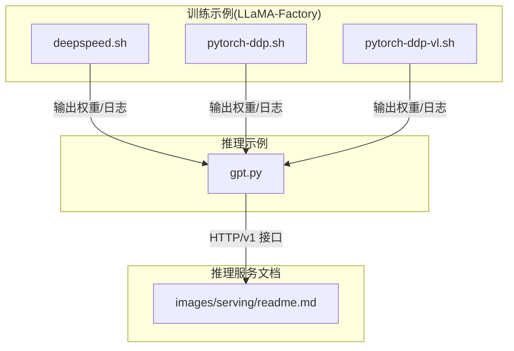
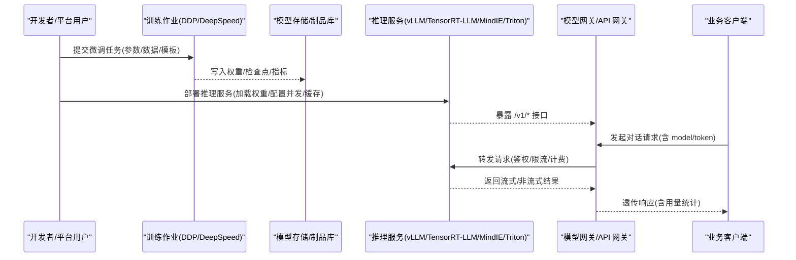
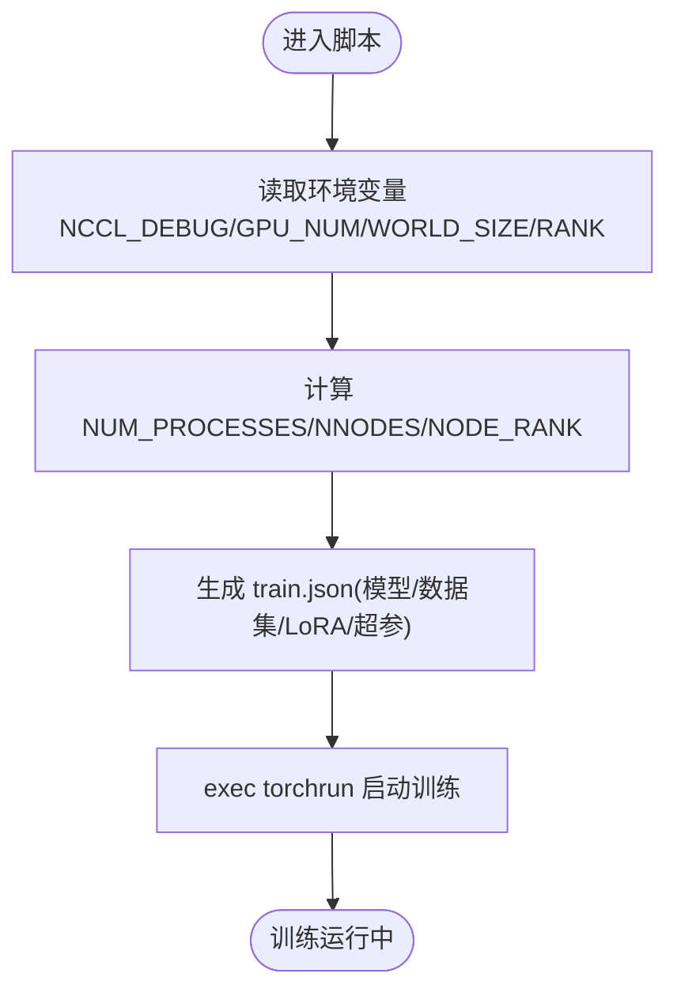
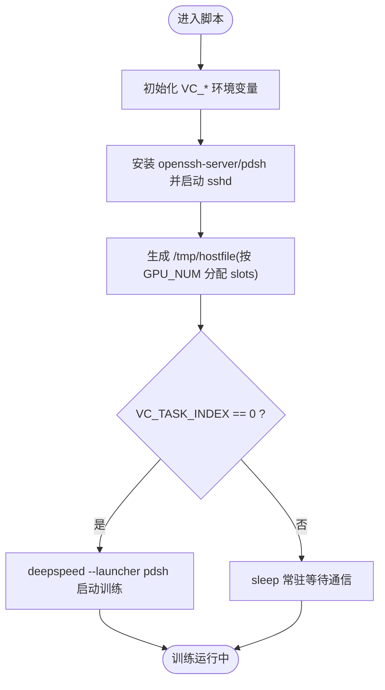
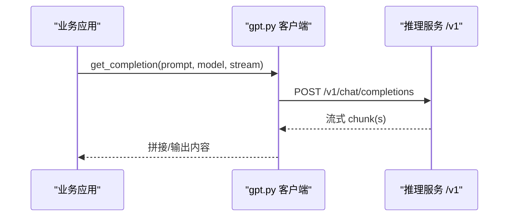
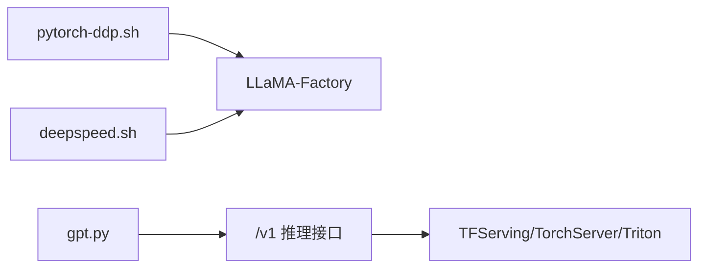

# 大模型支持

<cite>
**本文引用的文件**   
- [deepspeed.sh](file://myapp/example/pipeline/llamafactory/deepspeed.sh)
- [pytorch-ddp.sh](file://myapp/example/pipeline/llamafactory/pytorch-ddp.sh)
- [pytorch-ddp-vl.sh](file://myapp/example/pipeline/llamafactory/pytorch-ddp-vl.sh)
- [gpt.py](file://myapp/example/pipeline/inference/gpt.py)
- [readme.md](file://images/serving/readme.md)
</cite>

## 目录
1. [引言](#引言)
2. [项目结构](#项目结构)
3. [核心组件](#核心组件)
4. [架构总览](#架构总览)
5. [详细组件分析](#详细组件分析)
6. [依赖关系分析](#依赖关系分析)
7. [性能与成本优化](#性能与成本优化)
8. [故障排查指南](#故障排查指南)
9. [结论](#结论)
10. [附录](#附录)

## 引言
本章节面向希望在 Cube Studio 平台上进行大模型训练、量化评估、推理加速与模型网关集成的工程师，提供从分布式训练到推理服务化的端到端说明。仓库中已包含 LLaMA-Factory 的 DDP 与 DeepSpeed 示例脚本，以及基于 OpenAI 协议的推理客户端样例；同时提供了通用推理服务（TFServing/TorchServer/Triton）的入口文档。本文在此基础上，补充 vLLM、MindIE 等推理框架的集成思路与扩展方法，并给出微调配置、Token 管理机制与成本控制建议。

## 项目结构
围绕“大模型支持”的关键代码与示例集中在以下位置：
- myapp/example/pipeline/llamafactory：LLaMA-Factory 的微调启动脚本（DDP、DeepSpeed），涵盖文本与多模态（Qwen-VL）场景
- myapp/example/pipeline/inference：OpenAI 协议推理客户端示例
- images/serving：通用推理服务（TFServing/TorchServer/Triton）的文档索引

图表来源
- [deepspeed.sh:1-98](file://myapp/example/pipeline/llamafactory/deepspeed.sh#L1-L98)
- [pytorch-ddp.sh:1-72](file://myapp/example/pipeline/llamafactory/pytorch-ddp.sh#L1-L72)
- [pytorch-ddp-vl.sh:1-72](file://myapp/example/pipeline/llamafactory/pytorch-ddp-vl.sh#L1-L72)
- [gpt.py:1-31](file://myapp/example/pipeline/inference/gpt.py#L1-L31)
- [readme.md:1-15](file://images/serving/readme.md#L1-L15)

章节来源
- [deepspeed.sh:1-98](file://myapp/example/pipeline/llamafactory/deepspeed.sh#L1-L98)
- [pytorch-ddp.sh:1-72](file://myapp/example/pipeline/llamafactory/pytorch-ddp.sh#L1-L72)
- [pytorch-ddp-vl.sh:1-72](file://myapp/example/pipeline/llamafactory/pytorch-ddp-vl.sh#L1-L72)
- [gpt.py:1-31](file://myapp/example/pipeline/inference/gpt.py#L1-L31)
- [readme.md:1-15](file://images/serving/readme.md#L1-L15)

## 核心组件
- LLaMA-Factory 分布式训练
  - PyTorch DDP 纯分布式训练脚本：通过 torchrun 拉起多进程/多节点任务，参数以 JSON 传入 llamafactory.launcher
  - DeepSpeed 分布式训练脚本：使用 pdsh + deepspeed 启动多机多卡训练，Zero-3 显存优化
- 推理客户端
  - 基于 openai 库调用 /v1/chat/completions 接口，支持流式与非流式响应
- 推理服务文档
  - 提供 TFServing、TorchServer、Triton 等推理服务的部署参考

章节来源
- [pytorch-ddp.sh:1-72](file://myapp/example/pipeline/llamafactory/pytorch-ddp.sh#L1-L72)
- [deepspeed.sh:1-98](file://myapp/example/pipeline/llamafactory/deepspeed.sh#L1-L98)
- [gpt.py:1-31](file://myapp/example/pipeline/inference/gpt.py#L1-L31)
- [readme.md:1-15](file://images/serving/readme.md#L1-L15)

## 架构总览
下图展示从训练到推理的整体流程：训练阶段产出模型权重与日志，推理阶段通过统一 HTTP API（OpenAI 兼容）对外提供服务，并可接入网关做鉴权、限流与 Token 计费。

图表来源
- [pytorch-ddp.sh:1-72](file://myapp/example/pipeline/llamafactory/pytorch-ddp.sh#L1-L72)
- [deepspeed.sh:1-98](file://myapp/example/pipeline/llamafactory/deepspeed.sh#L1-L98)
- [gpt.py:1-31](file://myapp/example/pipeline/inference/gpt.py#L1-L31)
- [readme.md:1-15](file://images/serving/readme.md#L1-L15)

## 详细组件分析

### LLaMA-Factory 分布式训练（PyTorch DDP）
- 功能要点
  - 通过环境变量计算 nproc_per_node、nnodes、node_rank，适配多机多卡
  - 将训练超参以 JSON 形式注入 llamafactory.launcher，便于平台化配置
  - 支持 LoRA 微调、Cosine 学习率调度、梯度累积、FP16 等
- 关键流程
  - 解析环境变量 → 生成 train.json → 执行 torchrun → 启动 LLaMA-Factory 训练

图表来源
- [pytorch-ddp.sh:1-72](file://myapp/example/pipeline/llamafactory/pytorch-ddp.sh#L1-L72)

章节来源
- [pytorch-ddp.sh:1-72](file://myapp/example/pipeline/llamafactory/pytorch-ddp.sh#L1-L72)

### LLaMA-Factory 分布式训练（DeepSpeed Zero-3）
- 功能要点
  - 使用 pdsh 作为 launcher，自动构建 hostfile
  - 启用 ZeRO Stage 3、通信重叠、梯度融合等优化
  - rank0 负责启动训练，其他 rank 常驻等待
- 关键流程
  - 初始化环境 → 安装 ssh/pdsh → 生成 hostfile → deepspeed 启动

图表来源
- [deepspeed.sh:1-98](file://myapp/example/pipeline/llamafactory/deepspeed.sh#L1-L98)

章节来源
- [deepspeed.sh:1-98](file://myapp/example/pipeline/llamafactory/deepspeed.sh#L1-L98)

### LLaMA-Factory 视觉语言模型微调（Qwen-VL）
- 功能要点
  - 与文本 DDP 类似，但模板切换为 qwen2_vl，模型路径指向 Qwen-VL
  - 其余 LoRA、学习率、采样数等超参保持一致
- 适用场景
  - 图文理解/生成的指令微调

章节来源
- [pytorch-ddp-vl.sh:1-72](file://myapp/example/pipeline/llamafactory/pytorch-ddp-vl.sh#L1-L72)

### 推理客户端（OpenAI 协议）
- 功能要点
  - 使用 openai.OpenAI 连接后端 /v1 接口
  - 支持 stream 流式输出，逐 token 打印或拼接
- 典型用法
  - 构造 messages，设置 temperature/stream 等参数，消费 response.choices

图表来源
- [gpt.py:1-31](file://myapp/example/pipeline/inference/gpt.py#L1-L31)

章节来源
- [gpt.py:1-31](file://myapp/example/pipeline/inference/gpt.py#L1-L31)

### 推理服务文档（TFServing/TorchServer/Triton）
- 作用
  - 提供不同推理引擎的部署参考与链接
- 在平台中的定位
  - 可作为模型网关后端的多种实现，承载不同的性能与生态需求

章节来源
- [readme.md:1-15](file://images/serving/readme.md#L1-L15)

## 依赖关系分析
- 训练侧
  - pytorch-ddp.sh 依赖 torchrun、nccl、LLaMA-Factory
  - deepspeed.sh 依赖 pdsh、openssh-server、deepspeed、LLaMA-Factory
- 推理侧
  - gpt.py 依赖 openai SDK 与后端 /v1 兼容接口
- 服务侧
  - images/serving/readme.md 汇总了多种推理服务文档入口

图表来源
- [pytorch-ddp.sh:1-72](file://myapp/example/pipeline/llamafactory/pytorch-ddp.sh#L1-L72)
- [deepspeed.sh:1-98](file://myapp/example/pipeline/llamafactory/deepspeed.sh#L1-L98)
- [gpt.py:1-31](file://myapp/example/pipeline/inference/gpt.py#L1-L31)
- [readme.md:1-15](file://images/serving/readme.md#L1-L15)

章节来源
- [pytorch-ddp.sh:1-72](file://myapp/example/pipeline/llamafactory/pytorch-ddp.sh#L1-L72)
- [deepspeed.sh:1-98](file://myapp/example/pipeline/llamafactory/deepspeed.sh#L1-L98)
- [gpt.py:1-31](file://myapp/example/pipeline/inference/gpt.py#L1-L31)
- [readme.md:1-15](file://images/serving/readme.md#L1-L15)

## 性能与成本优化

### 分布式训练调优
- 选择合适并行策略
  - 小模型/单机多卡优先 DDP；大模型/多机多卡考虑 DeepSpeed ZeRO-3
- 超参与内存
  - 合理设置 per_device_train_batch_size、gradient_accumulation_steps
  - 开启 fp16/bf16，配合 ZeRO 通信重叠与梯度融合
- 监控与诊断
  - 利用 NCCL_DEBUG、wall_clock_breakdown 等定位通信瓶颈

章节来源
- [pytorch-ddp.sh:1-72](file://myapp/example/pipeline/llamafactory/pytorch-ddp.sh#L1-L72)
- [deepspeed.sh:1-98](file://myapp/example/pipeline/llamafactory/deepspeed.sh#L1-L98)

### 推理加速与吞吐提升
- 推理引擎选型
  - vLLM：PagedAttention、连续批处理，适合高并发长上下文
  - TensorRT-LLM：极致吞吐，需离线编译算子图
  - MindIE：昇腾生态下的推理优化
  - Triton：多框架统一服务，灵活编排
- 关键参数
  - max_num_seqs、max_model_len、enable_chunked_prefill、kv_cache_dtype、tensor_parallel、pipeline_parallel
- 资源规划
  - 根据 QPS、延迟目标与显存预算估算 TP/PP 规模与实例数

[本节为通用指导，不直接分析具体文件]

### 量化与评估
- 训练期
  - LoRA/QLoRA 降低显存占用，结合 bf16/fp16 混合精度
- 推理期
  - INT8/INT4 KV Cache、AWQ/GPTQ 权重量化
  - 结合 vLLM/TensorRT-LLM 的量化后端
- 评估体系
  - 准确性（BLEU/ROUGE/Perplexity）、安全性、公平性、时延/吞吐/成本

[本节为通用指导，不直接分析具体文件]

### 模型网关与 Token 管理
- 网关能力
  - 鉴权（API Key/OAuth）、限流（QPS/TPS）、路由（按模型/租户）
  - Token 计量（输入/输出长度统计）、配额与计费
- 实现建议
  - 在 /v1 前加一层网关（如 Kong/APISIX），采集 usage 字段
  - 与 LLM 服务解耦，独立扩缩容与灰度发布

[本节为通用指导，不直接分析具体文件]

### 成本控制
- 训练
  - 使用 Spot 实例、弹性伸缩、断点续训
  - 数据与权重落盘到对象存储，减少重复下载
- 推理
  - 按需扩缩容、冷热分层（热模型常驻，冷模型按需加载）
  - 批量合并请求、预取与缓存（Prompt Cache/KV Cache）

[本节为通用指导，不直接分析具体文件]

## 故障排查指南
- 分布式训练
  - NCCL 通信失败：检查 MASTER_ADDR/MASTER_PORT、防火墙、GPU 拓扑
  - DeepSpeed 启动异常：确认 pdsh/ssh 可达、hostfile 正确、ZeRO 参数匹配显存
- 推理服务
  - /v1 接口不可达：核对服务端口、健康检查、负载均衡配置
  - 流式输出异常：检查服务端是否支持 SSE/Chunked，客户端是否正确消费
- 日志与监控
  - 训练：收集 torchrun/deepspeed 日志、NCCL 日志、Prometheus 指标
  - 推理：记录 QPS、P95/P99 延迟、KV Cache 命中率、OOM 次数

章节来源
- [pytorch-ddp.sh:1-72](file://myapp/example/pipeline/llamafactory/pytorch-ddp.sh#L1-L72)
- [deepspeed.sh:1-98](file://myapp/example/pipeline/llamafactory/deepspeed.sh#L1-L98)
- [gpt.py:1-31](file://myapp/example/pipeline/inference/gpt.py#L1-L31)

## 结论
本仓库提供了 LLaMA-Factory 的 DDP 与 DeepSpeed 训练示例，以及基于 OpenAI 协议的推理客户端，辅以通用推理服务文档。结合本文对分布式训练、量化评估、推理加速与模型网关的系统化说明，可在 Cube Studio 上快速落地大模型训练与服务化闭环。对于 vLLM、MindIE 等新框架，可遵循“统一 /v1 接口 + 网关治理 + 指标观测”的模式进行集成与扩展。

## 附录

### 如何扩展新的推理框架（以 vLLM 为例）
- 步骤概览
  - 准备镜像与环境：安装 vLLM、CUDA/cuDNN、依赖库
  - 编写启动脚本：加载模型、设置 tensor/pipeline parallel、KV cache 类型、最大序列长度
  - 暴露 /v1 接口：确保与现有客户端（gpt.py）一致
  - 接入网关：配置鉴权、限流、Token 计量
  - 压测与调优：调整 batch size、max_num_seqs、chunked prefill 等参数
- 验收清单
  - 接口连通性、流式输出、错误码规范、资源利用率、延迟与吞吐达标

[本节为通用指导，不直接分析具体文件]

### 如何扩展新的训练框架（以 MindIE 训练为例）
- 步骤概览
  - 准备 MindIE 训练镜像与依赖
  - 封装训练入口：将参数映射为框架 CLI/SDK 所需格式
  - 对接平台：复用 DDP/DeepSpeed 的环境变量约定，输出标准日志与指标
  - 验证：单卡/多卡一致性、断点续训、资源回收
- 验收清单
  - 训练收敛曲线、显存峰值、通信开销、可复现性

[本节为通用指导，不直接分析具体文件]