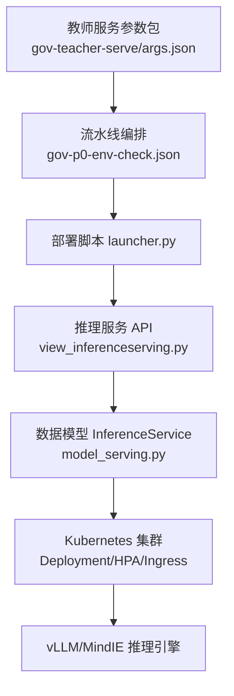
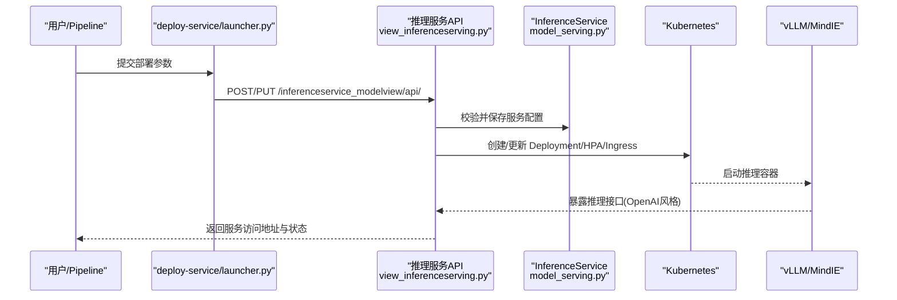
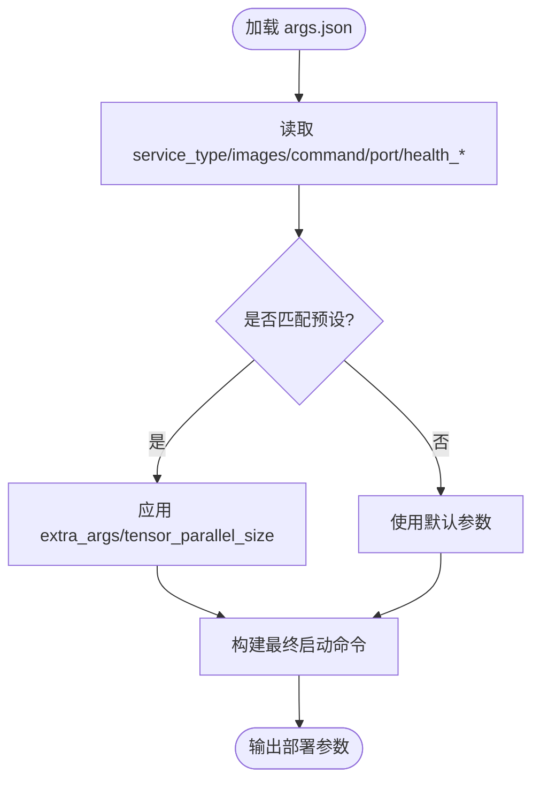
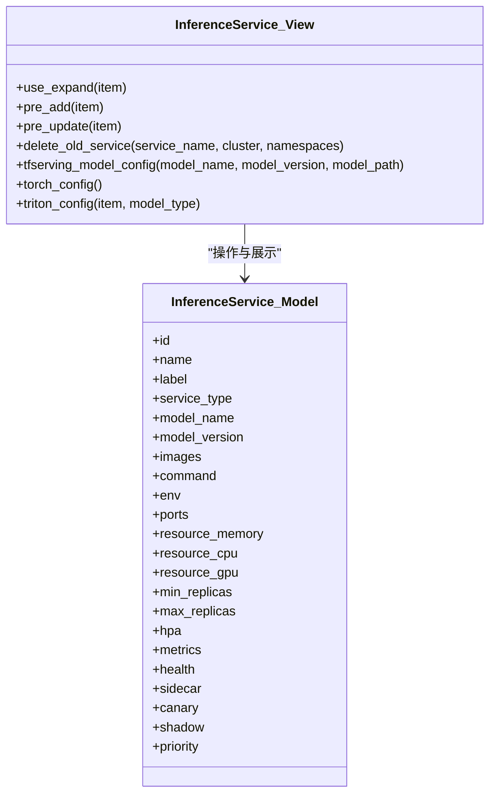
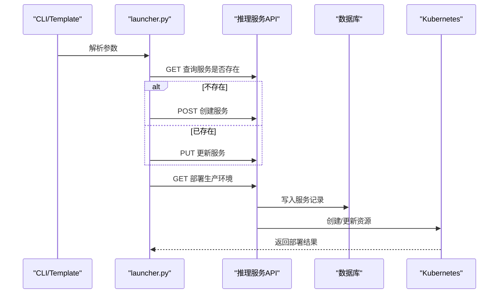
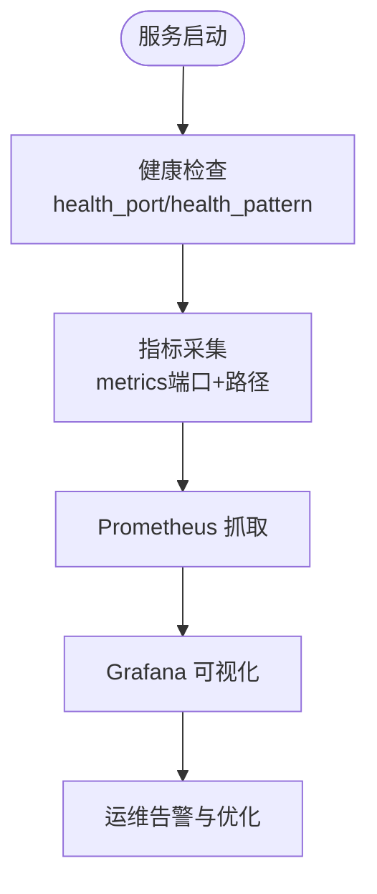
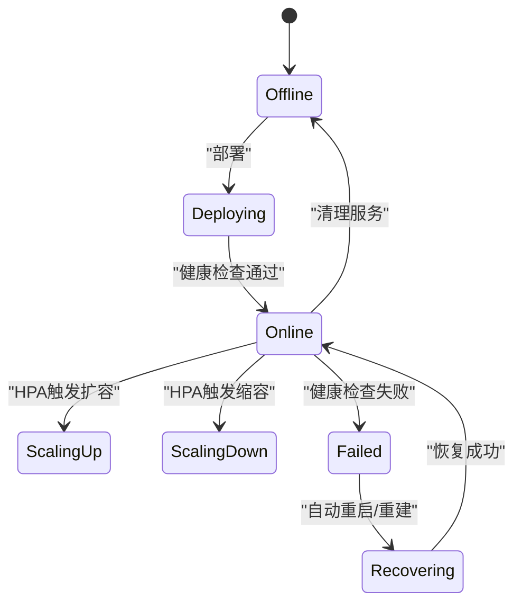

# 推理服务

<cite>
**本文引用的文件**   
- [README.md](file://README.md)
- [gov-social-llm/README.md](file://gov-social-llm/README.md)
- [gov-social-llm/serving/gov-teacher-serve/args.json](file://gov-social-llm/serving/gov-teacher-serve/args.json)
- [gov-social-llm/pipelines/gov-p0-env-check.json](file://gov-social-llm/pipelines/gov-p0-env-check.json)
- [myapp/views/view_inferenceserving.py](file://myapp/views/view_inferenceserving.py)
- [myapp/models/model_serving.py](file://myapp/models/model_serving.py)
- [job-template/job/deploy-service/launcher.py](file://job-template/job/deploy-service/launcher.py)
- [job-template/job/deploy-service/README.md](file://job-template/job/deploy-service/README.md)
</cite>

## 目录
1. [引言](#引言)
2. [项目结构](#项目结构)
3. [核心组件](#核心组件)
4. [架构总览](#架构总览)
5. [详细组件分析](#详细组件分析)
6. [依赖关系分析](#依赖关系分析)
7. [性能与调优](#性能与调优)
8. [监控与可观测性](#监控与可观测性)
9. [弹性伸缩、负载均衡与故障转移](#弹性伸缩负载均衡与故障转移)
10. [部署示例与最佳实践](#部署示例与最佳实践)
11. [故障排查指南](#故障排查指南)
12. [结论](#结论)

## 引言
本文件面向教师模型推理服务的生产部署与运维，聚焦以下目标：
- 解释教师模型推理服务的整体架构与启动流程。
- 说明 vLLM/MindIE 等推理引擎在平台中的集成方式与参数配置。
- 给出性能调优、并发处理、资源管理与监控指标建议。
- 提供基于仓库现有配置的部署示例，并覆盖弹性伸缩、负载均衡与故障转移机制。

平台 README 明确支持 vLLM 与 MindIE 大模型推理，并提供 OpenAI 风格流式接口、分布式多机多卡推理能力；同时具备网关侧的 QPS/TPS、失败率、输入输出 Token、E2E、TTFT、TPOS 等指标监控能力。

**章节来源**
- [README.md:3](file://README.md#L3)
- [README.md:76](file://README.md#L76)
- [README.md:347](file://README.md#L347)
- [README.md:411](file://README.md#L411)
- [README.md:412](file://README.md#L412)
- [README.md:444](file://README.md#L444)

## 项目结构
围绕教师模型推理服务，仓库中与“推理服务”直接相关的代码与配置主要分布在以下位置：
- gov-social-llm/serving/gov-teacher-serve/args.json：教师服务部署参数包，包含镜像、命令、端口、健康检查与环境变量，以及不同 GPU 硬件的 Presets。
- gov-social-llm/pipelines/gov-p0-env-check.json：流水线中调用 deploy-service 模板创建或更新推理服务的示例。
- myapp/views/view_inferenceserving.py：推理服务 Web 管理界面与默认配置映射（如端口、健康检查、指标采集、命令模板等）。
- myapp/models/model_serving.py：推理服务数据模型与属性方法（副本、端口、域名、状态、URL 生成等）。
- job-template/job/deploy-service/launcher.py：Pipeline 中一键创建/更新/发布推理服务的脚本。
- job-template/job/deploy-service/README.md：服务部署任务模板的参数说明与行为约定。

**图表来源**
- [gov-social-llm/serving/gov-teacher-serve/args.json:1-22](file://gov-social-llm/serving/gov-teacher-serve/args.json#L1-L22)
- [gov-social-llm/pipelines/gov-p0-env-check.json:15-44](file://gov-social-llm/pipelines/gov-p0-env-check.json#L15-L44)
- [job-template/job/deploy-service/launcher.py:18-129](file://job-template/job/deploy-service/launcher.py#L18-L129)
- [myapp/views/view_inferenceserving.py:49-92](file://myapp/views/view_inferenceserving.py#L49-L92)
- [myapp/models/model_serving.py:202-255](file://myapp/models/model_serving.py#L202-L255)

**章节来源**
- [gov-social-llm/README.md:24](file://gov-social-llm/README.md#L24)
- [gov-social-llm/README.md:67](file://gov-social-llm/README.md#L67)
- [gov-social-llm/serving/gov-teacher-serve/args.json:1-22](file://gov-social-llm/serving/gov-teacher-serve/args.json#L1-L22)
- [gov-social-llm/pipelines/gov-p0-env-check.json:15-44](file://gov-social-llm/pipelines/gov-p0-env-check.json#L15-L44)
- [job-template/job/deploy-service/README.md:1-340](file://job-template/job/deploy-service/README.md#L1-L340)

## 核心组件
- 教师服务参数包 args.json
  - 定义 service_type、images、command、port、health_port、health_pattern、env_var 与 presets。
  - presets 针对 2x4090-48G 与 2x5090-32G 两类 GPU 场景，分别设置 extra_args 与 tensor_parallel_size。
- 流水线编排 gov-p0-env-check.json
  - 通过 deploy-service 模板传入 images、command、service_type、ports、hpa、metrics、health 等参数，完成推理服务创建/更新与发布。
- 推理服务管理 view_inferenceserving.py
  - 提供推理服务类型选择、默认端口/健康检查/指标采集映射、命令模板、环境变量注入、域名与访问 URL 生成、HPA/定时伸缩、灰度/影子流量、挂载与扩展字段等。
- 数据模型 model_serving.py
  - 定义 InferenceService 实体字段：服务类型、模型信息、镜像、命令、环境变量、端口、资源、副本数、HPA、指标、健康检查、sidecar、优先级、灰度/影子流量、部署历史等。
- 部署脚本 launcher.py
  - 根据 project_name、model_name、model_version 查询是否存在服务，不存在则 POST 创建，存在则 PUT 更新，随后调用生产环境部署接口。

**章节来源**
- [gov-social-llm/serving/gov-teacher-serve/args.json:1-22](file://gov-social-llm/serving/gov-teacher-serve/args.json#L1-L22)
- [gov-social-llm/pipelines/gov-p0-env-check.json:15-44](file://gov-social-llm/pipelines/gov-p0-env-check.json#L15-L44)
- [myapp/views/view_inferenceserving.py:121-357](file://myapp/views/view_inferenceserving.py#L121-L357)
- [myapp/models/model_serving.py:202-255](file://myapp/models/model_serving.py#L202-L255)
- [job-template/job/deploy-service/launcher.py:18-129](file://job-template/job/deploy-service/launcher.py#L18-L129)

## 架构总览
教师模型推理服务在 CubeStudio 中的端到端流程如下：
- 用户或 Pipeline 通过 deploy-service 模板发起部署请求。
- launcher.py 调用推理服务 API 创建或更新 InferenceService。
- view_inferenceserving.py 对服务配置进行校验与默认值填充，生成 K8s 资源（Deployment/HPA/Ingress 等）。
- 容器内运行 vLLM/MindIE 推理引擎，暴露 OpenAI 风格接口。
- 平台侧通过 metrics/health 采集指标与健康状态，结合 Grafana 展示监控面板。

**图表来源**
- [job-template/job/deploy-service/launcher.py:18-129](file://job-template/job/deploy-service/launcher.py#L18-L129)
- [myapp/views/view_inferenceserving.py:121-357](file://myapp/views/view_inferenceserving.py#L121-L357)
- [myapp/models/model_serving.py:202-255](file://myapp/models/model_serving.py#L202-L255)

## 详细组件分析

### 教师服务参数包 args.json
- 关键配置项
  - service_type：服务类型为 serving。
  - images：教师服务镜像名称。
  - command：使用 vLLM 的 OpenAI API Server 启动命令，指定模型路径、量化方式、最大长度与端口。
  - port/health_port/health_pattern：服务监听端口与健康检查路径。
  - env_var：设置 vLLM 工作进程启动方式。
  - presets：针对不同 GPU 硬件的额外参数与张量并行大小。
- 设计要点
  - 将硬件差异通过 presets 隔离，便于在不同节点池上自动匹配最优参数。
  - 通过 health_pattern 统一健康检查入口，便于平台探针探测。

**图表来源**
- [gov-social-llm/serving/gov-teacher-serve/args.json:1-22](file://gov-social-llm/serving/gov-teacher-serve/args.json#L1-L22)

**章节来源**
- [gov-social-llm/serving/gov-teacher-serve/args.json:1-22](file://gov-social-llm/serving/gov-teacher-serve/args.json#L1-L22)

### 流水线编排 gov-p0-env-check.json
- 作用
  - 在流水线中调用 deploy-service 模板，传入 images、command、service_type、ports、hpa、metrics、health 等参数，完成教师服务的环境检查与部署。
- 关键点
  - 与 args.json 保持一致的 command 与端口配置，确保推理引擎以预期参数启动。
  - 通过 hpa/metrics/health 启用弹性伸缩与可观测性。

**章节来源**
- [gov-social-llm/pipelines/gov-p0-env-check.json:15-44](file://gov-social-llm/pipelines/gov-p0-env-check.json#L15-L44)

### 推理服务管理 view_inferenceserving.py
- 功能概览
  - 提供推理服务类型的默认配置映射（端口、健康检查、指标采集、命令模板、环境变量等）。
  - 支持 HPA/定时伸缩、灰度/影子流量、sidecar、挂载、扩展字段等高级特性。
  - 自动生成服务访问 URL 与域名，适配不同框架的默认路径。
- 重要逻辑
  - use_expand：根据 service_type 填充默认 ports/env/metrics/health/host，并对 tfserving/torch-server/triton-server 生成对应命令与配置文件。
  - pre_add/pre_update：校验与合并 volume_mount、project 变更、命名空间变更、清理旧服务等。
  - delete_old_service：删除 Deployment/StatefulSet/Service/Ingress/HPA/ConfigMap 等 K8s 资源。

**图表来源**
- [myapp/views/view_inferenceserving.py:121-357](file://myapp/views/view_inferenceserving.py#L121-L357)
- [myapp/models/model_serving.py:202-255](file://myapp/models/model_serving.py#L202-L255)

**章节来源**
- [myapp/views/view_inferenceserving.py:49-92](file://myapp/views/view_inferenceserving.py#L49-L92)
- [myapp/views/view_inferenceserving.py:547-700](file://myapp/views/view_inferenceserving.py#L547-L700)
- [myapp/views/view_inferenceserving.py:701-800](file://myapp/views/view_inferenceserving.py#L701-L800)

### 数据模型 model_serving.py
- InferenceService 实体字段涵盖服务类型、模型信息、镜像、命令、环境变量、端口、资源、副本数、HPA、指标、健康检查、sidecar、优先级、灰度/影子流量、部署历史等。
- 提供多个属性方法用于生成监控链接、节点选择器、访问 IP/URL、就绪状态等。

**章节来源**
- [myapp/models/model_serving.py:202-255](file://myapp/models/model_serving.py#L202-L255)
- [myapp/models/model_serving.py:258-467](file://myapp/models/model_serving.py#L258-L467)

### 部署脚本 launcher.py
- 行为约定
  - 校验项目组是否存在。
  - 根据 model_name + model_version 判断新建或更新服务。
  - 调用生产环境部署接口，等待数据库刷新后触发上线。
- 参数映射
  - 将命令行参数映射为 payload，包括 images、working_dir、command、args、env、resource_*、replicas、ports、volume_mount、inference_config、host、hpa、service_type、metrics、health。

**图表来源**
- [job-template/job/deploy-service/launcher.py:18-129](file://job-template/job/deploy-service/launcher.py#L18-L129)

**章节来源**
- [job-template/job/deploy-service/launcher.py:18-129](file://job-template/job/deploy-service/launcher.py#L18-L129)
- [job-template/job/deploy-service/README.md:1-340](file://job-template/job/deploy-service/README.md#L1-L340)

## 依赖关系分析
- 组件耦合
  - launcher.py 依赖推理服务 API 与数据库。
  - view_inferenceserving.py 依赖 model_serving.py 的数据模型与 K8s 客户端。
  - args.json 与 gov-p0-env-check.json 共同决定推理引擎的启动参数。
- 外部依赖
  - Kubernetes 集群（Deployment/HPA/Ingress/Endpoints）。
  - vLLM/MindIE 推理引擎（容器镜像与命令）。
  - Prometheus/Grafana（指标采集与可视化）。

**图表来源**
- [gov-social-llm/serving/gov-teacher-serve/args.json:1-22](file://gov-social-llm/serving/gov-teacher-serve/args.json#L1-L22)
- [gov-social-llm/pipelines/gov-p0-env-check.json:15-44](file://gov-social-llm/pipelines/gov-p0-env-check.json#L15-L44)
- [job-template/job/deploy-service/launcher.py:18-129](file://job-template/job/deploy-service/launcher.py#L18-L129)
- [myapp/views/view_inferenceserving.py:121-357](file://myapp/views/view_inferenceserving.py#L121-L357)
- [myapp/models/model_serving.py:202-255](file://myapp/models/model_serving.py#L202-L255)

**章节来源**
- [myapp/views/view_inferenceserving.py:121-357](file://myapp/views/view_inferenceserving.py#L121-L357)
- [myapp/models/model_serving.py:202-255](file://myapp/models/model_serving.py#L202-L255)

## 性能与调优
- vLLM 参数调优
  - 使用 args.json 的 presets 区分不同 GPU 显存与架构，调整 gpu-memory-utilization 与 max-num-seqs，控制 KV Cache 并发以避免 OOM。
  - 合理设置 tensor_parallel_size，匹配多卡张量并行规模。
  - 通过 max-model-len 控制最大上下文长度，避免过长序列导致内存压力。
- 并发与吞吐
  - 通过 HPA 按 CPU/Mem/GPU/QPS 指标自动扩缩容，提升并发处理能力。
  - 使用 sidecar 接入限流、重试、黑白名单、Token 限额等网关能力（商业版），保护后端推理引擎。
- 资源管理
  - 精确设置 resource_memory/resource_cpu/resource_gpu，避免资源争用。
  - 使用 node_selector 将服务调度到具备合适 GPU 的节点。

**章节来源**
- [gov-social-llm/serving/gov-teacher-serve/args.json:9-20](file://gov-social-llm/serving/gov-teacher-serve/args.json#L9-L20)
- [myapp/views/view_inferenceserving.py:255-268](file://myapp/views/view_inferenceserving.py#L255-L268)
- [README.md:76](file://README.md#L76)

## 监控与可观测性
- 指标采集
  - 通过 metrics 字段配置端口与路径，例如 8080:/metrics，由 Prometheus 抓取。
  - 平台 README 提及 QPS、失败率、TPS、输入/输出 Token、E2E、TTFT、TPOS 等指标。
- 健康检查
  - 通过 health 字段配置 HTTP 健康检查接口，例如 8000:/health，供 K8s Liveness/Readiness 探针使用。
- 可视化
  - 通过 Grafana 服务监控看板，结合 namespace/service 维度观察服务状态与性能。

**图表来源**
- [gov-social-llm/serving/gov-teacher-serve/args.json:5-8](file://gov-social-llm/serving/gov-teacher-serve/args.json#L5-L8)
- [myapp/views/view_inferenceserving.py:83-92](file://myapp/views/view_inferenceserving.py#L83-L92)
- [README.md:76](file://README.md#L76)

**章节来源**
- [gov-social-llm/serving/gov-teacher-serve/args.json:5-8](file://gov-social-llm/serving/gov-teacher-serve/args.json#L5-L8)
- [myapp/views/view_inferenceserving.py:83-92](file://myapp/views/view_inferenceserving.py#L83-L92)
- [README.md:76](file://README.md#L76)

## 弹性伸缩、负载均衡与故障转移
- 弹性伸缩
  - 通过 hpa 配置 CPU/Mem/GPU/QPS 等指标阈值，实现自动扩缩容。
  - 支持 cronhpa 定时伸缩，按时间段调整副本数。
- 负载均衡
  - 平台支持泛域名与 Ingress 路由，结合 sidecar（如 Istio）实现服务网格级别的负载均衡。
  - 支持 canary/shadow 流量分流与复制，用于灰度发布与影子测试。
- 故障转移
  - K8s 通过 Liveness/Readiness 探针检测服务健康，自动重启不健康 Pod。
  - 平台提供清理旧服务的能力，避免资源残留影响新服务上线。

**图表来源**
- [myapp/views/view_inferenceserving.py:255-292](file://myapp/views/view_inferenceserving.py#L255-L292)
- [myapp/views/view_inferenceserving.py:749-800](file://myapp/views/view_inferenceserving.py#L749-L800)

**章节来源**
- [myapp/views/view_inferenceserving.py:255-292](file://myapp/views/view_inferenceserving.py#L255-L292)
- [myapp/views/view_inferenceserving.py:749-800](file://myapp/views/view_inferenceserving.py#L749-L800)

## 部署示例与最佳实践
- 教师服务部署示例
  - 使用 gov-p0-env-check.json 中的 deploy-service 模板，传入 images、command、service_type、ports、hpa、metrics、health 等参数。
  - 参考 args.json 的 presets，选择合适的 GPU 硬件参数组合。
- 最佳实践
  - 使用 presets 隔离不同 GPU 场景，避免硬编码参数。
  - 通过 HPA/CronHPA 实现弹性伸缩，结合 sidecar 接入限流与认证。
  - 使用 metrics/health 完善可观测性，结合 Grafana 建立监控看板。
  - 使用 canary/shadow 进行灰度发布与影子测试，降低上线风险。

**章节来源**
- [gov-social-llm/pipelines/gov-p0-env-check.json:15-44](file://gov-social-llm/pipelines/gov-p0-env-check.json#L15-L44)
- [gov-social-llm/serving/gov-teacher-serve/args.json:9-20](file://gov-social-llm/serving/gov-teacher-serve/args.json#L9-L20)
- [job-template/job/deploy-service/README.md:1-340](file://job-template/job/deploy-service/README.md#L1-L340)

## 故障排查指南
- 常见问题
  - 模型路径不可达：确认 model_path 是否为网络地址或本地路径，必要时使用 wget/unzip/tar 下载解压。
  - 健康检查失败：检查 health_port/health_pattern 是否与推理引擎暴露的接口一致。
  - 指标采集失败：确认 metrics 端口与路径是否正确，Prometheus 是否能抓取。
  - 弹性伸缩未生效：检查 HPA 配置与指标源是否可用。
- 处理步骤
  - 查看服务状态与日志，确认 Pod 是否 Running。
  - 检查 K8s Endpoints 是否有地址，确认服务是否 Ready。
  - 清理旧服务并重新部署，避免资源冲突。

**章节来源**
- [myapp/views/view_inferenceserving.py:547-700](file://myapp/views/view_inferenceserving.py#L547-L700)
- [myapp/models/model_serving.py:330-345](file://myapp/models/model_serving.py#L330-L345)

## 结论
教师模型推理服务在 CubeStudio 中通过 args.json 与流水线编排实现标准化部署，结合 vLLM/MindIE 推理引擎提供高性能、可扩展的大模型推理能力。平台提供的 HPA/CronHPA、sidecar、metrics/health 等能力，使得服务具备弹性伸缩、负载均衡与可观测性，满足生产环境的稳定性与性能要求。通过合理的参数调优与监控告警，可有效提升推理服务的吞吐与可用性。