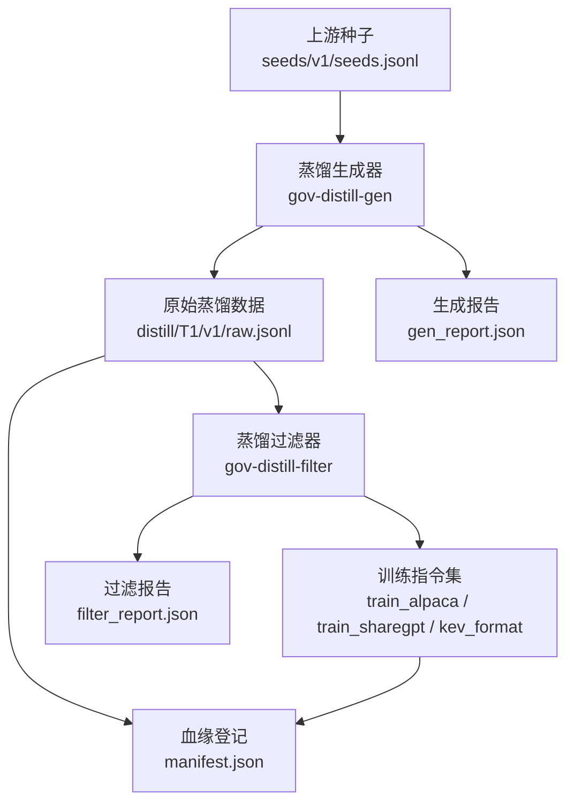
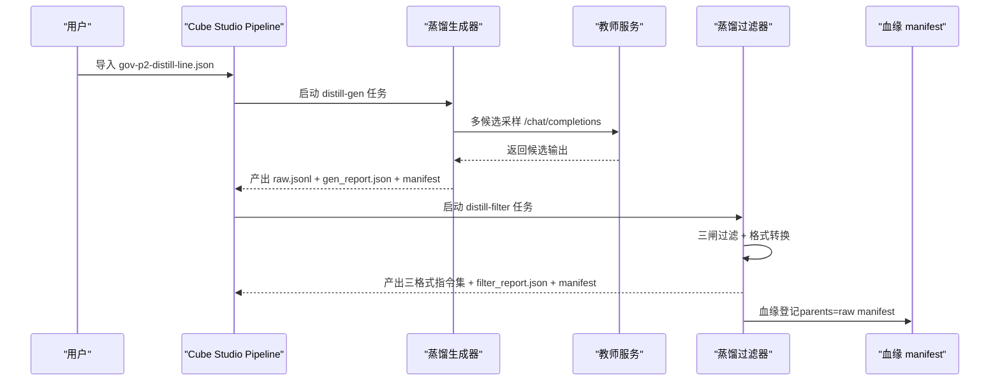
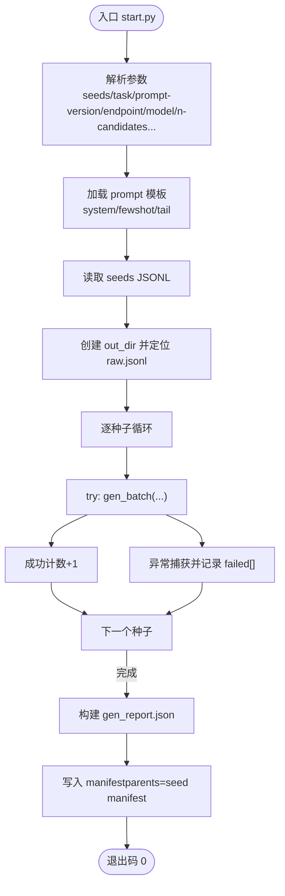
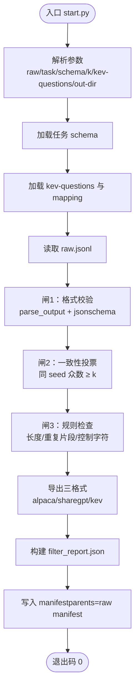
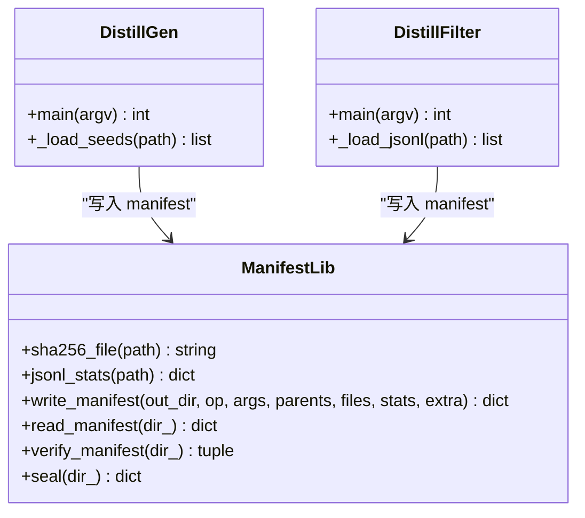
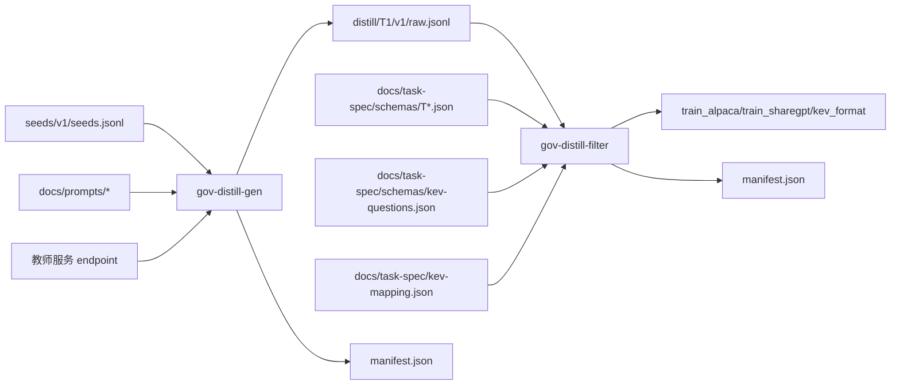

# 模型网关

<cite>
**本文引用的文件**   
- [gov-social-llm/README.md](file://gov-social-llm/README.md)
- [2026-11-06-gov-social-llm-distill-design.md](file://docs/superpowers/specs/2026-11-06-gov-social-llm-distill-design.md)
- [gov-p2-distill-line.json](file://gov-social-llm/pipelines/gov-p2-distill-line.json)
- [start.py（蒸馏生成器入口）](file://gov-social-llm/ops/gov-distill-gen/start.py)
- [gen.py（蒸馏生成器核心逻辑）](file://gov-social-llm/ops/gov-distill-gen/gen.py)
- [start.py（蒸馏过滤器入口）](file://gov-social-llm/ops/gov-distill-filter/start.py)
- [filter3.py（三闸过滤与格式转换）](file://gov-social-llm/ops/gov-distill-filter/filter3.py)
- [__init__.py（血缘 manifest 共享库）](file://gov-social-llm/ops/gov-manifest/lib/gov_manifest/__init__.py)
</cite>

## 目录
1. [引言](#引言)
2. [项目结构](#项目结构)
3. [核心组件](#核心组件)
4. [架构总览](#架构总览)
5. [详细组件分析](#详细组件分析)
6. [依赖关系分析](#依赖关系分析)
7. [性能与扩展性](#性能与扩展性)
8. [故障排查指南](#故障排查指南)
9. [结论](#结论)
10. [附录：配置示例与最佳实践](#附录配置示例与最佳实践)

## 引言
本文件面向“模型网关”在 gov-social-llm 中的实现，重点解释蒸馏生成器与蒸馏过滤器的内部机制，包括多候选采样、质量评估、数据格式转换，以及从输入验证到处理管道编排再到输出结果管理的完整数据流转。文档同时给出可复用的 Pipeline 配置示例，说明如何扩展新的数据处理算子并优化处理流程，最后补充性能监控、错误处理和版本管理（血缘与封存）的实践建议。

## 项目结构
gov-social-llm 以“薄算子 + 标准开源框架”的方式组织：每个算子是一个独立镜像，平台只负责调度；算子之间通过 `/mnt/gov` 下的 JSONL 文件和 `manifest.json` 血缘传递数据。蒸馏主线由三条关键算子组成：教师服务、蒸馏生成器、蒸馏过滤器，并由 `gov-p2-distill-line.json` 编排为 DAG。



图表来源
- [gov-p2-distill-line.json:1-100](file://gov-social-llm/pipelines/gov-p2-distill-line.json#L1-L100)
- [start.py（蒸馏生成器入口）:29-84](file://gov-social-llm/ops/gov-distill-gen/start.py#L29-L84)
- [start.py（蒸馏过滤器入口）:29-86](file://gov-social-llm/ops/gov-distill-filter/start.py#L29-L86)

章节来源
- [gov-social-llm/README.md:1-78](file://gov-social-llm/README.md#L1-L78)
- [2026-11-06-gov-social-llm-distill-design.md:28-110](file://docs/superpowers/specs/2026-11-06-gov-social-llm-distill-design.md#L28-L110)

## 核心组件
- 蒸馏生成器（gov-distill-gen）
  - 功能：读取种子 JSONL，按任务加载 prompt 模板，批量调用教师 OpenAI 兼容接口进行多候选采样，产出 raw.jsonl 与 gen_report.json，并写入血缘 manifest。
  - 关键参数：--seeds、--task、--prompt-version、--endpoint、--model、--n-candidates、--temperature、--top-p、--max-tokens、--concurrency、--out-dir、--seed-manifest。
  - 行为要点：逐种子隔离失败、并发线程池限流、断点续跑跳过已完成的 (seed_id, candidate_id)。

- 蒸馏过滤器（gov-distill-filter）
  - 功能：对 raw.jsonl 依次执行三闸过滤（格式校验、一致性投票、规则检查），导出 alpaca/sharegpt/kev 三种训练格式，并输出 filter_report.json 与 manifest。
  - 关键参数：--raw、--task、--schema、--k、--kev-questions、--kev-mapping、--out-dir、--raw-manifest。
  - 行为要点：JSON schema 硬校验、同 seed 多候选多数投票、长度/重复片段/控制字符规则。

- 血缘 manifest 共享库（gov-manifest）
  - 功能：统一写入 manifest.json，记录数据集路径、生产者信息、上游 parents、文件摘要与行数统计、标签分布等；提供 verify 与 seal 能力。
  - 关键函数：write_manifest、read_manifest、verify_manifest、seal。

章节来源
- [start.py（蒸馏生成器入口）:29-84](file://gov-social-llm/ops/gov-distill-gen/start.py#L29-L84)
- [gen.py:17-122](file://gov-social-llm/ops/gov-distill-gen/gen.py#L17-L122)
- [start.py（蒸馏过滤器入口）:29-86](file://gov-social-llm/ops/gov-distill-filter/start.py#L29-L86)
- [filter3.py:18-123](file://gov-social-llm/ops/gov-distill-filter/filter3.py#L18-L123)
- [__init__.py:18-124](file://gov-social-llm/ops/gov-manifest/lib/gov_manifest/__init__.py#L18-L124)

## 架构总览
模型网关的数据流围绕“教师服务 → 蒸馏生成 → 蒸馏过滤 → 血缘登记”展开，Pipeline 将各阶段串联为 DAG，并通过全局环境变量 DATA_ROOT=/mnt/gov 统一数据根路径。



图表来源
- [gov-p2-distill-line.json:1-100](file://gov-social-llm/pipelines/gov-p2-distill-line.json#L1-L100)
- [start.py（蒸馏生成器入口）:29-84](file://gov-social-llm/ops/gov-distill-gen/start.py#L29-L84)
- [start.py（蒸馏过滤器入口）:29-86](file://gov-social-llm/ops/gov-distill-filter/start.py#L29-L86)

## 详细组件分析

### 蒸馏生成器：多候选采样与数据流转
蒸馏生成器负责把种子案情转化为多条候选输出，每条候选包含 seed_id、candidate_id、messages、output 和 meta。其核心流程如下：



图表来源
- [start.py（蒸馏生成器入口）:29-84](file://gov-social-llm/ops/gov-distill-gen/start.py#L29-L84)
- [gen.py:79-122](file://gov-social-llm/ops/gov-distill-gen/gen.py#L79-L122)

关键点
- 多候选采样：n-candidates 决定每个 seed 的候选数量；并发由 concurrency 控制。
- 断点续跑：基于已存在的 raw.jsonl 中 (seed_id, candidate_id) 去重，避免重复请求。
- 失败隔离：单个种子失败不影响其他种子，失败详情写入 gen_report.failed。
- 血缘登记：若传入 --seed-manifest，则将其 self_digest 作为 parent 写入 manifest。

章节来源
- [start.py（蒸馏生成器入口）:29-84](file://gov-social-llm/ops/gov-distill-gen/start.py#L29-L84)
- [gen.py:17-122](file://gov-social-llm/ops/gov-distill-gen/gen.py#L17-L122)

### 蒸馏过滤器：三闸过滤与数据格式转换
蒸馏过滤器对 raw.jsonl 执行三步过滤，并将通过的数据转换为三种训练格式：



图表来源
- [start.py（蒸馏过滤器入口）:29-86](file://gov-social-llm/ops/gov-distill-filter/start.py#L29-L86)
- [filter3.py:18-123](file://gov-social-llm/ops/gov-distill-filter/filter3.py#L18-L123)

关键点
- 闸1（格式）：剥离 ```json 围栏后解析 JSON，并用 Draft202012Validator 校验 schema。
- 闸2（一致性）：按 label 或规范化后的全字段值进行投票，众数票数 ≥ k 才保留该 seed 的众数候选。
- 闸3（规则）：限制最大长度、拒绝控制字符、检测重复片段占比过高。
- 格式转换：to_alpaca/to_sharegpt/to_kev 分别适配 LLaMA-Factory、通用对话格式与 kev system-one 范式。

章节来源
- [start.py（蒸馏过滤器入口）:29-86](file://gov-social-llm/ops/gov-distill-filter/start.py#L29-L86)
- [filter3.py:18-123](file://gov-social-llm/ops/gov-distill-filter/filter3.py#L18-L123)

### 血缘 manifest：版本管理与完整性校验
血缘机制确保数据可追溯、不可篡改，并提供封存能力：



图表来源
- [__init__.py:18-124](file://gov-social-llm/ops/gov-manifest/lib/gov_manifest/__init__.py#L18-L124)
- [start.py（蒸馏生成器入口）:73-84](file://gov-social-llm/ops/gov-distill-gen/start.py#L73-L84)
- [start.py（蒸馏过滤器入口）:75-86](file://gov-social-llm/ops/gov-distill-filter/start.py#L75-L86)

关键点
- write_manifest：自动计算 self_digest，记录 producer（op/image/git_commit/args）、parents、files（含 sha256 与 rows）、stats。
- verify_manifest：校验自签名、文件内容漂移、上游血缘断裂。
- seal：设置 sealed=true，并对数据文件与 manifest 置只读，防止后续修改。

章节来源
- [__init__.py:54-124](file://gov-social-llm/ops/gov-manifest/lib/gov_manifest/__init__.py#L54-L124)

## 依赖关系分析
- 蒸馏生成器依赖：
  - 教师服务（OpenAI 兼容 /chat/completions）。
  - 共享血缘库 gov-manifest。
  - 本地 prompt 模板（docs/prompts/distill-{task}-{version}.md）。
- 蒸馏过滤器依赖：
  - 蒸馏生成器产出的 raw.jsonl。
  - 任务 schema（docs/task-spec/schemas/{task}.json）。
  - kev-questions 与 mapping（docs/task-spec/schemas/kev-questions.json、docs/task-spec/kev-mapping.json）。
  - 共享血缘库 gov-manifest。
- Pipeline 编排依赖：
  - Cube Studio 的 dataset/nlp-clean-data/nlp-filter-data/gov-eval/gov-distill-gen/gov-distill-filter/gov-manifest 模板。
  - 存储卷挂载（gov-nfs(pvc):/mnt）。



图表来源
- [gov-p2-distill-line.json:1-100](file://gov-social-llm/pipelines/gov-p2-distill-line.json#L1-L100)
- [start.py（蒸馏生成器入口）:29-84](file://gov-social-llm/ops/gov-distill-gen/start.py#L29-L84)
- [start.py（蒸馏过滤器入口）:29-86](file://gov-social-llm/ops/gov-distill-filter/start.py#L29-L86)

章节来源
- [2026-11-06-gov-social-llm-distill-design.md:89-110](file://docs/superpowers/specs/2026-11-06-gov-social-llm-distill-design.md#L89-L110)
- [gov-p2-distill-line.json:1-100](file://gov-social-llm/pipelines/gov-p2-distill-line.json#L1-L100)

## 性能与扩展性
- 并发与吞吐
  - 蒸馏生成器使用 ThreadPoolExecutor 控制并发度（concurrency），默认 4，可按教师服务 QPS 调整。
  - 断点续跑减少重复请求，提升重试效率。
- 显存与资源
  - 教师服务采用 AWQ-INT4 单卡部署，兼顾 4090 与 5090 两套环境；蒸馏与过滤算子为 CPU 密集型，无需 GPU。
- 可扩展性
  - 新增数据处理算子：遵循“python start.py --参数...”的统一入口契约，输入输出走 /mnt/gov 下 JSONL，并在产出目录写入 manifest。
  - 扩展过滤规则：在 filter3.py 中新增 gate_* 函数，并在 start.py 中接入流水线。
  - 扩展 prompt 模板：在 docs/prompts 下新增 distill-{task}-{version}.md，支持 system/fewshot/tail 三段式。

[本节为通用指导，不直接分析具体文件]

## 故障排查指南
- 教师服务 5xx 或网络异常
  - 现象：gen_report.failed 中出现错误条目，但整体不中断。
  - 排查：检查 endpoint 可达性与教师服务健康状态；适当提高 retries 或降低 concurrency。
  - 参考：[gen.py:48-61](file://gov-social-llm/ops/gov-distill-gen/gen.py#L48-L61)、[start.py（蒸馏生成器入口）:57-65](file://gov-social-llm/ops/gov-distill-gen/start.py#L57-L65)
- 过滤通过率过低
  - 现象：filter_report 显示 gate1/gate2/gate3 大量丢弃。
  - 排查：检查 schema 是否匹配、k 值是否过严、规则阈值是否合理；必要时调整 prompt 模板或增加 few-shot。
  - 参考：[filter3.py:30-85](file://gov-social-llm/ops/gov-distill-filter/filter3.py#L30-L85)、[start.py（蒸馏过滤器入口）:47-58](file://gov-social-llm/ops/gov-distill-filter/start.py#L47-L58)
- 血缘校验失败
  - 现象：verify_manifest 报出 self_digest 不一致、文件缺失或上游血缘断裂。
  - 排查：确认 manifest 未被篡改、文件未漂移、parents 路径正确且存在对应 manifest。
  - 参考：[__init__.py:83-102](file://gov-social-llm/ops/gov-manifest/lib/gov_manifest/__init__.py#L83-L102)
- 输出格式异常
  - 现象：alpaca/sharegpt/kev 格式不符合下游训练要求。
  - 排查：检查 to_alpaca/to_sharegpt/to_kev 映射逻辑与 messages/output 字段是否存在。
  - 参考：[filter3.py:88-123](file://gov-social-llm/ops/gov-distill-filter/filter3.py#L88-L123)

章节来源
- [gen.py:48-61](file://gov-social-llm/ops/gov-distill-gen/gen.py#L48-L61)
- [start.py（蒸馏生成器入口）:57-65](file://gov-social-llm/ops/gov-distill-gen/start.py#L57-L65)
- [filter3.py:30-85](file://gov-social-llm/ops/gov-distill-filter/filter3.py#L30-L85)
- [start.py（蒸馏过滤器入口）:47-58](file://gov-social-llm/ops/gov-distill-filter/start.py#L47-L58)
- [__init__.py:83-102](file://gov-social-llm/ops/gov-manifest/lib/gov_manifest/__init__.py#L83-L102)
- [filter3.py:88-123](file://gov-social-llm/ops/gov-distill-filter/filter3.py#L88-L123)

## 结论
模型网关通过蒸馏生成器与蒸馏过滤器两个核心算子，实现了从种子到高质量指令集的端到端数据生产。多候选采样与三闸过滤保障了数据质量与多样性，血缘 manifest 提供了完整的版本管理与完整性校验。Pipeline 编排将各阶段串联为稳定可复现的工作流，便于扩展新算子与优化处理流程。

[本节为总结性内容，不直接分析具体文件]

## 附录：配置示例与最佳实践

### Pipeline 配置示例（蒸馏主线）
- 名称：gov-p2-distill-line
- 节点顺序：import-seeds → clean-seeds → filter-seeds → teacher-probe → distill-gen → distill-filter → manifest-set
- 全局环境变量：DATA_ROOT=/mnt/gov
- 关键任务参数示例：
  - distill-gen：--seeds /mnt/gov/seeds/v1/seeds.jsonl --task T1 --prompt-version v1 --endpoint http://serve-teacher-svc:8000/v1 --model teacher --n-candidates 3 --out-dir /mnt/gov/distill/T1/v1
  - distill-filter：--raw /mnt/gov/distill/T1/v1/raw.jsonl --task T1 --out-dir /mnt/gov/distill/T1/v1/filtered
  - manifest-set：--cmd generate --dir /mnt/gov/distill/T1/v1/filtered

章节来源
- [gov-p2-distill-line.json:1-100](file://gov-social-llm/pipelines/gov-p2-distill-line.json#L1-L100)

### 扩展新数据处理算子的步骤
- 在 ops/ 下新建目录，编写 start.py（统一入口）与业务逻辑模块。
- 定义 CLI 参数，输入输出均指向 /mnt/gov 下的 JSONL。
- 在产出目录调用 write_manifest 写入血缘。
- 在 pipelines/ 下新增或修改 Pipeline JSON，注册新任务节点。
- 如需新增过滤规则，在 filter3.py 中添加 gate_* 函数并在 start.py 中接入。

章节来源
- [2026-11-06-gov-social-llm-distill-design.md:89-110](file://docs/superpowers/specs/2026-11-06-gov-social-llm-distill-design.md#L89-L110)
- [__init__.py:54-73](file://gov-social-llm/ops/gov-manifest/lib/gov_manifest/__init__.py#L54-L73)

### 性能优化建议
- 调整 concurrency 以匹配教师服务 QPS，避免过载。
- 使用断点续跑减少重复请求，提升重试效率。
- 根据任务复杂度调整 n-candidates 与 k 值，平衡质量与成本。
- 在教师服务侧启用合理的 max-model-len 与 gpu-memory-utilization，避免 OOM。

[本节为通用指导，不直接分析具体文件]