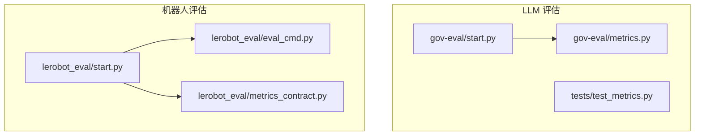
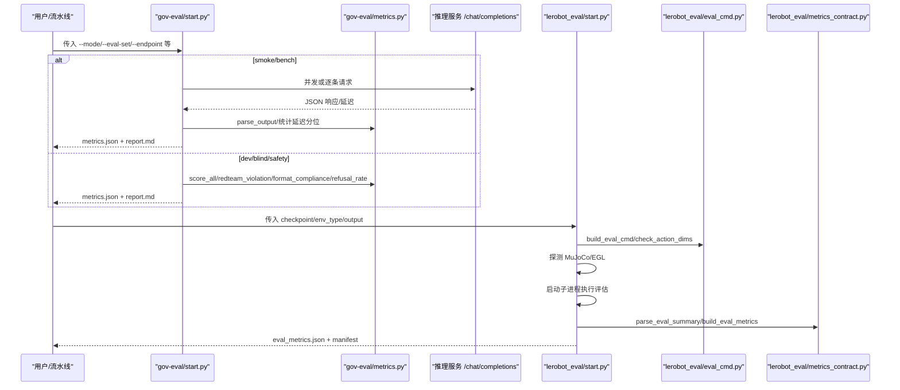
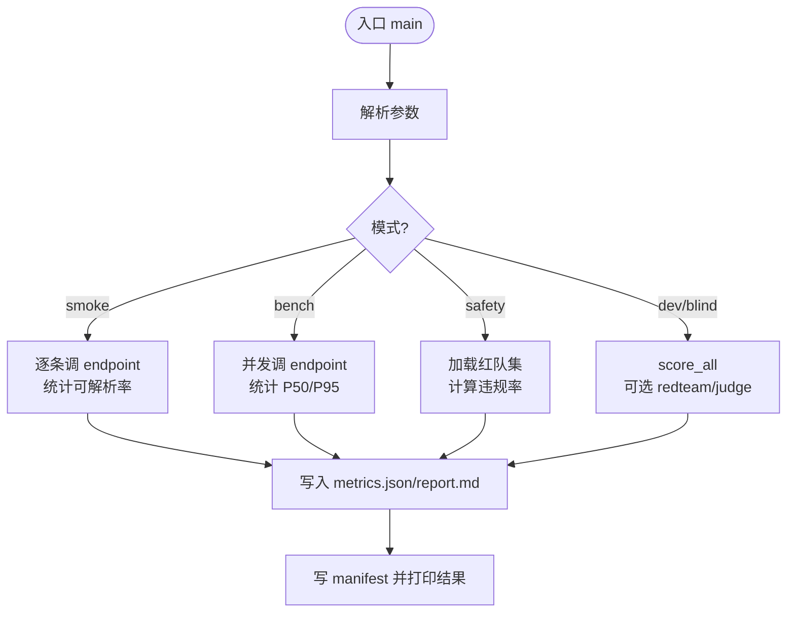
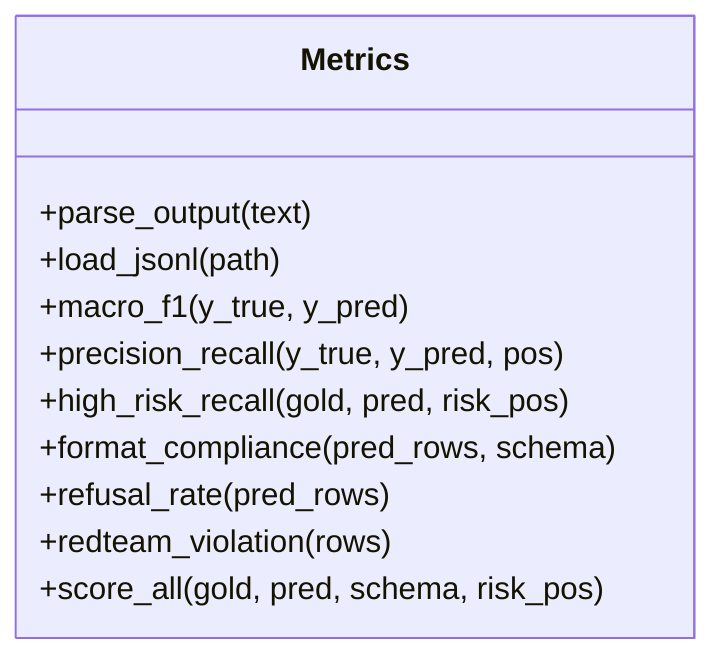
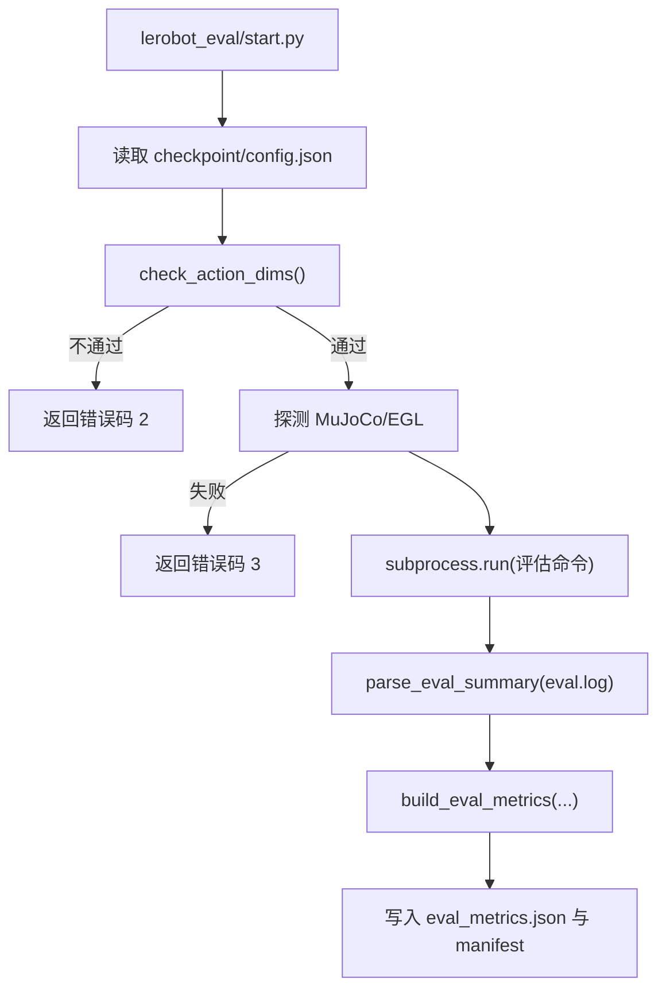
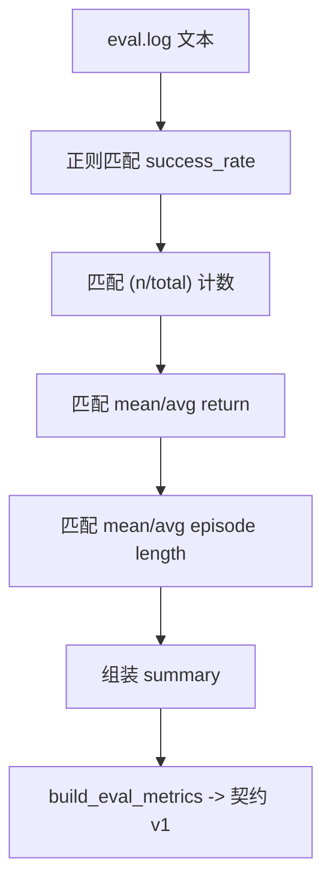
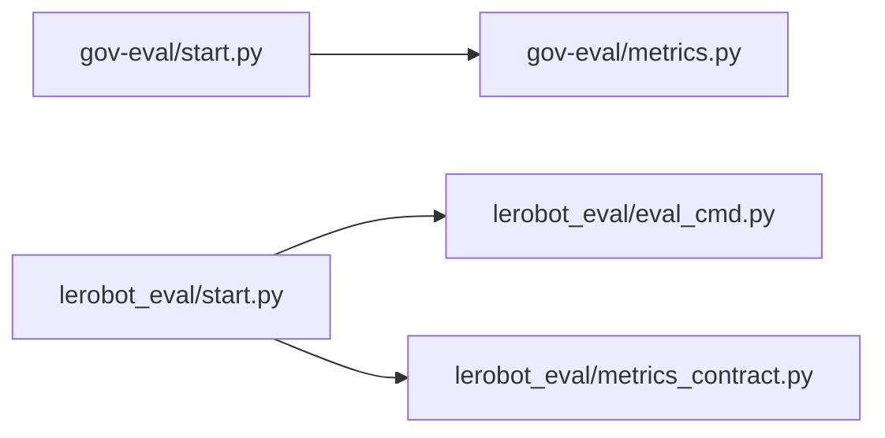

# 量化评估

<cite>
**本文引用的文件**   
- [gov-eval/start.py](file://gov-social-llm/ops/gov-eval/start.py)
- [gov-eval/metrics.py](file://gov-social-llm/ops/gov-eval/metrics.py)
- [test_metrics.py](file://gov-social-llm/tests/test_metrics.py)
- [lerobot_eval/start.py](file://job-template/job/lerobot_eval/start.py)
- [lerobot_eval/eval_cmd.py](file://job-template/job/lerobot_eval/eval_cmd.py)
- [lerobot_eval/metrics_contract.py](file://job-template/job/lerobot_eval/metrics_contract.py)
</cite>

## 目录
1. [引言](#引言)
2. [项目结构](#项目结构)
3. [核心组件](#核心组件)
4. [架构总览](#架构总览)
5. [详细组件分析](#详细组件分析)
6. [依赖关系分析](#依赖关系分析)
7. [性能与基准](#性能与基准)
8. [故障排查指南](#故障排查指南)
9. [结论](#结论)
10. [附录：配置与脚本示例](#附录配置与脚本示例)

## 引言
本文件面向“量化评估”主题，聚焦仓库中与模型量化、精度评估、性能测试相关的实现与流程。当前仓库未包含 AWQ 量化代码；但提供了两类可复用的评估框架：
- LLM 侧的 gov-eval：支持五种模式（smoke/dev/blind/safety/bench），提供指标计算、服务连通性检查、并发压测与合规性度量。
- 机器人学习侧的 lerobot-eval：负责策略评估命令组装、动作维度兼容性校验、结果解析与平台指标契约输出。

本文将系统梳理上述两套评估框架的实现细节、数据流、错误处理与扩展方式，并给出量化评估实践建议与回归分析方法。

## 项目结构
与量化评估直接相关的代码主要分布在两个子系统中：
- gov-social-llm/ops/gov-eval：LLM 评估入口与指标核心
- job-template/job/lerobot_eval：机器人策略评估入口、命令构建与指标契约

**图表来源**
- [gov-eval/start.py:1-139](file://gov-social-llm/ops/gov-eval/start.py#L1-L139)
- [gov-eval/metrics.py:1-130](file://gov-social-llm/ops/gov-eval/metrics.py#L1-L130)
- [lerobot_eval/start.py:1-120](file://job-template/job/lerobot_eval/start.py#L1-L120)
- [lerobot_eval/eval_cmd.py:1-45](file://job-template/job/lerobot_eval/eval_cmd.py#L1-L45)
- [lerobot_eval/metrics_contract.py:1-56](file://job-template/job/lerobot_eval/metrics_contract.py#L1-L56)

**章节来源**
- [gov-eval/start.py:1-139](file://gov-social-llm/ops/gov-eval/start.py#L1-L139)
- [lerobot_eval/start.py:1-120](file://job-template/job/lerobot_eval/start.py#L1-L120)

## 核心组件
- gov-eval/start.py：五模式调度器，统一参数解析、结果写入与 manifest 生成
- gov-eval/metrics.py：纯函数指标库（格式合规、拒答率、宏 F1、高敏召回、误报率、红队违规率）
- lerobot_eval/start.py：评估入口，执行环境探测、子进程调用、日志解析与指标契约封装
- lerobot_eval/eval_cmd.py：命令组装与动作维度兼容性校验
- lerobot_eval/metrics_contract.py：stdout → 平台指标契约 v1 的解析与构造

**章节来源**
- [gov-eval/start.py:1-139](file://gov-social-llm/ops/gov-eval/start.py#L1-L139)
- [gov-eval/metrics.py:1-130](file://gov-social-llm/ops/gov-eval/metrics.py#L1-L130)
- [lerobot_eval/start.py:1-120](file://job-template/job/lerobot_eval/start.py#L1-L120)
- [lerobot_eval/eval_cmd.py:1-45](file://job-template/job/lerobot_eval/eval_cmd.py#L1-L45)
- [lerobot_eval/metrics_contract.py:1-56](file://job-template/job/lerobot_eval/metrics_contract.py#L1-L56)

## 架构总览
下图展示两种评估路径的数据与控制流：

**图表来源**
- [gov-eval/start.py:32-89](file://gov-social-llm/ops/gov-eval/start.py#L32-L89)
- [gov-eval/metrics.py:14-129](file://gov-social-llm/ops/gov-eval/metrics.py#L14-L129)
- [lerobot_eval/start.py:34-115](file://job-template/job/lerobot_eval/start.py#L34-L115)
- [lerobot_eval/eval_cmd.py:6-44](file://job-template/job/lerobot_eval/eval_cmd.py#L6-L44)
- [lerobot_eval/metrics_contract.py:17-55](file://job-template/job/lerobot_eval/metrics_contract.py#L17-L55)

## 详细组件分析

### gov-eval：五模式评估框架
- 模式说明
  - smoke：对前 N 条样本逐条调用服务端点，报告可解析率，用于教师/学生服务连通性快速验证
  - dev/blind：gold 与模型输出跑 score_all；可选 redteam 追加违规率；可选 judge 抽检事实一致性
  - safety：仅红队集违规率
  - bench：对服务端点并发压测，报告 P50/P95 延迟
- 关键行为
  - 参数解析：mode/eval_set/pred/task/endpoint/model/risk-pos/redteam/judge/limit/concurrency/out-dir
  - 结果输出：metrics.json 与 report.md；manifest 中附带 args/files/stats
  - blind 留痕：当 eval_set 路径含 /blind/ 时，stats 记录 blind_touched_at

**图表来源**
- [gov-eval/start.py:92-133](file://gov-social-llm/ops/gov-eval/start.py#L92-L133)

**章节来源**
- [gov-eval/start.py:1-139](file://gov-social-llm/ops/gov-eval/start.py#L1-L139)

### gov-eval：指标核心
- 功能要点
  - parse_output：剥离围栏后 json.loads，返回 dict 或 None
  - load_jsonl：读取 JSONL 数据集
  - macro_f1：按类别计算 F1 再取算术平均
  - precision_recall：单类精确率/召回率
  - high_risk_recall：高风险类别召回率
  - format_compliance：非拒答行中 output 符合 schema 的比例
  - refusal_rate：拒答比例（含“无法回答”标记）
  - redteam_violation：红队违规率
  - score_all：汇总指标（宏 F1、每类 P/R、高敏召回、误报率、格式合规、拒答率）

**图表来源**
- [gov-eval/metrics.py:14-129](file://gov-social-llm/ops/gov-eval/metrics.py#L14-L129)

**章节来源**
- [gov-eval/metrics.py:1-130](file://gov-social-llm/ops/gov-eval/metrics.py#L1-L130)
- [test_metrics.py:1-28](file://gov-social-llm/tests/test_metrics.py#L1-L28)

### lerobot-eval：评估入口与兼容性校验
- 入口职责
  - 解析参数（checkpoint/env_type/output/n_episodes/batch_size/seed/video_n_episodes）
  - 从 checkpoint 目录向上查找训练 manifest，提取 digest
  - 在子进程启动前进行动作维度兼容性校验（DRYRUN 不豁免）
  - 探测 MuJoCo/EGL 环境，失败则提前退出
  - 启动子进程执行评估，解析 stdout 为平台指标契约
  - 输出 eval_metrics.json 与 manifest，附带 parents/files/stats

**图表来源**
- [lerobot_eval/start.py:19-115](file://job-template/job/lerobot_eval/start.py#L19-L115)
- [lerobot_eval/eval_cmd.py:6-44](file://job-template/job/lerobot_eval/eval_cmd.py#L6-L44)

**章节来源**
- [lerobot_eval/start.py:1-120](file://job-template/job/lerobot_eval/start.py#L1-L120)
- [lerobot_eval/eval_cmd.py:1-45](file://job-template/job/lerobot_eval/eval_cmd.py#L1-L45)

### lerobot-eval：指标契约解析
- 目标：将上游工具 stdout 文本解析为结构化 summary，再包装为平台自有指标契约 v1
- 关键字段
  - success_rate：成功率（自动识别百分比或小数）
  - mean_return：平均回报
  - mean_episode_len：平均回合长度
  - n_evaluated/n_success：评估总数/成功数
  - artifacts：视频列表与原始日志路径
  - policy_ref：策略引用（checkpoint_path、训练 manifest digest）

**图表来源**
- [lerobot_eval/metrics_contract.py:17-55](file://job-template/job/lerobot_eval/metrics_contract.py#L17-L55)

**章节来源**
- [lerobot_eval/metrics_contract.py:1-56](file://job-template/job/lerobot_eval/metrics_contract.py#L1-L56)

## 依赖关系分析
- gov-eval 内部依赖
  - start.py 依赖 metrics.py 提供的指标函数
  - 运行时依赖 requests（网络调用）、jsonschema（格式校验）
- lerobot-eval 内部依赖
  - start.py 依赖 eval_cmd.py（命令构建与维度校验）
  - start.py 依赖 metrics_contract.py（stdout 解析与契约构造）
  - 运行期依赖 mujoco（环境探测）

**图表来源**
- [gov-eval/start.py:18-22](file://gov-social-llm/ops/gov-eval/start.py#L18-L22)
- [lerobot_eval/start.py:14-16](file://job-template/job/lerobot_eval/start.py#L14-L16)

**章节来源**
- [gov-eval/start.py:1-139](file://gov-social-llm/ops/gov-eval/start.py#L1-L139)
- [lerobot_eval/start.py:1-120](file://job-template/job/lerobot_eval/start.py#L1-L120)

## 性能与基准
- 并发压测（bench 模式）
  - 使用线程池并发调用服务端点，收集延迟序列，计算 P50/P95
  - 可调参数 concurrency 控制并发度，limit 控制样本量
- 延迟统计
  - 基于排序后的延迟数组计算百分位数，避免外部库依赖
- 可扩展性
  - 可通过增加新的模式分支与指标函数扩展评估任务
  - 指标函数保持纯函数设计，便于单元测试与离线回测

[本节为通用指导，不涉及具体文件分析]

## 故障排查指南
- gov-eval
  - 服务不可达或超时：检查 endpoint 可达性与 timeout 设置
  - 输出不可解析：确认模型输出是否包含有效 JSON 或可接受文本
  - 指标异常：核对 gold/pred 字段 id/label/risk 是否一致
- lerobot-eval
  - 动作维度不匹配：check_action_dims 返回失败，需对齐策略与环境动作空间
  - MuJoCo/EGL 探测失败：检查 GPU 镜像与 MUJOCO_GL=egl 环境变量
  - 子进程启动失败：查看 eval.log 中的 launch failed 信息

**章节来源**
- [gov-eval/start.py:32-71](file://gov-social-llm/ops/gov-eval/start.py#L32-L71)
- [lerobot_eval/start.py:46-92](file://job-template/job/lerobot_eval/start.py#L46-L92)

## 结论
- 仓库未包含 AWQ 量化实现，但提供了完善的评估基础设施：
  - gov-eval 覆盖 LLM 的五种评估模式，兼顾连通性、精度、安全与性能
  - lerobot-eval 提供策略评估的命令编排、兼容性校验与指标契约
- 建议在量化链路中复用上述评估框架：
  - 量化前后分别运行 dev/blind 模式对比指标
  - 使用 bench 模式对比延迟分位
  - 使用 safety 模式监控违规率变化
  - 结合 manifest 与 stats 做回归分析与版本追踪

[本节为总结性内容，不涉及具体文件分析]

## 附录：配置与脚本示例
以下为常见用法示例（以命令行参数形式描述，不包含具体代码内容）：

- LLM 评估（smoke）
  - 参数：--mode smoke --eval-set <gold.jsonl> --endpoint <http://.../chat/completions> --model student --out-dir ./out
  - 用途：快速验证教师/学生服务连通性与输出可解析率

- LLM 评估（dev/blind）
  - 参数：--mode dev --eval-set <gold.jsonl> --pred <pred.jsonl> --task <task_name> --risk-pos 高 --out-dir ./out
  - 可选：--redteam <rt.jsonl> 追加违规率；--judge 启用事实一致性抽检

- LLM 评估（safety）
  - 参数：--mode safety --redteam <rt.jsonl> --out-dir ./out

- LLM 评估（bench）
  - 参数：--mode bench --eval-set <gold.jsonl> --endpoint <http://.../chat/completions> --concurrency 20 --limit 100 --out-dir ./out

- 机器人评估（lerobot-eval）
  - 参数：--checkpoint <path> --env_type aloha --output ./out --n_episodes 50 --batch_size 10 --seed 100000 --video_n_episodes 3
  - 用途：构建评估命令、校验动作维度、执行评估并输出契约指标

- 自定义指标与任务扩展
  - 在 metrics.py 中新增纯函数指标，并在 _mode_scored 或对应模式中聚合
  - 在 start.py 中新增模式分支，复用现有参数解析与结果写入逻辑
  - 在 lerobot_eval/metrics_contract.py 中扩展 stdout 解析规则与契约字段

**章节来源**
- [gov-eval/start.py:92-133](file://gov-social-llm/ops/gov-eval/start.py#L92-L133)
- [gov-eval/metrics.py:100-129](file://gov-social-llm/ops/gov-eval/metrics.py#L100-L129)
- [lerobot_eval/start.py:34-115](file://job-template/job/lerobot_eval/start.py#L34-L115)
- [lerobot_eval/metrics_contract.py:17-55](file://job-template/job/lerobot_eval/metrics_contract.py#L17-L55)