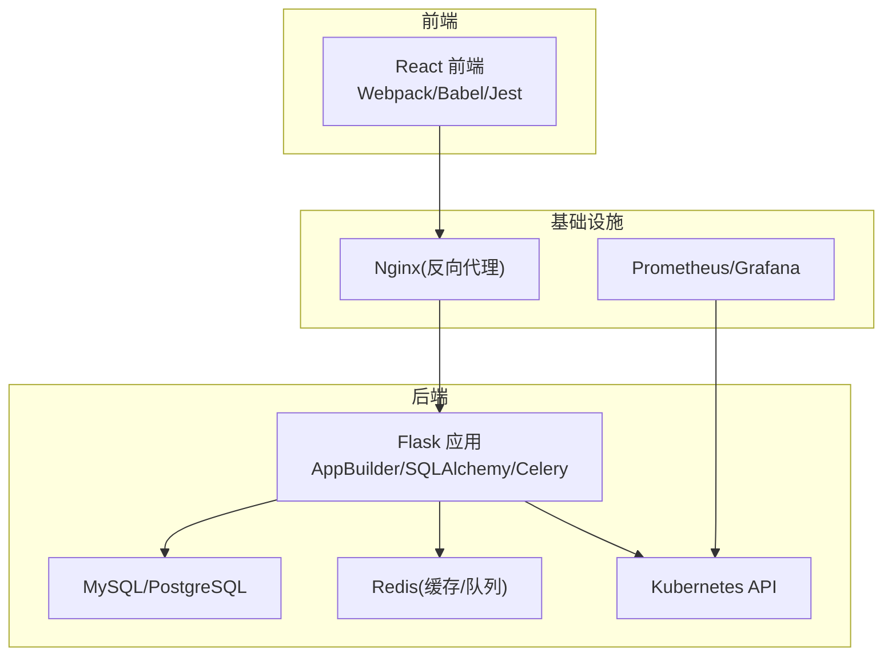
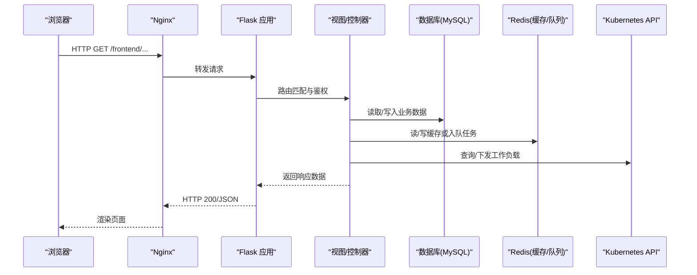
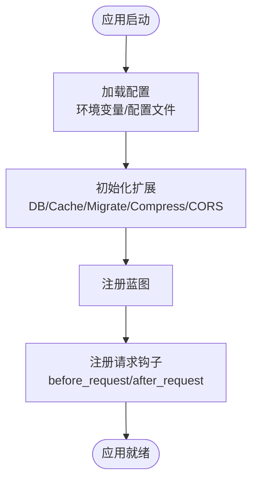
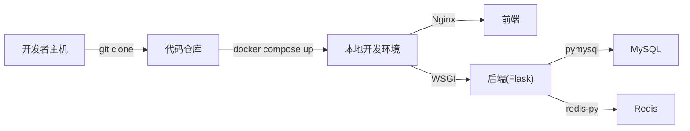
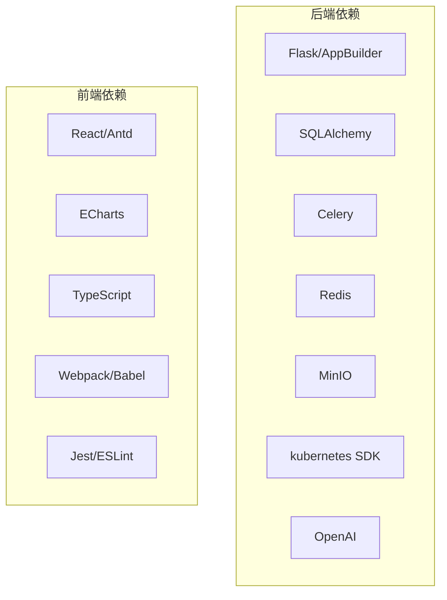

# 开发指南

<cite>
**本文引用的文件**   
- [README.md](file://README.md)
- [myapp/__init__.py](file://myapp/__init__.py)
- [myapp/config.py](file://myapp/config.py)
- [myapp/run.py](file://myapp/run.py)
- [install/docker/Dockerfile](file://install/docker/Dockerfile)
- [install/docker/docker-compose.yml](file://install/docker/docker-compose.yml)
- [install/docker/requirements.txt](file://install/docker/requirements.txt)
- [myapp/frontend/package.json](file://myapp/frontend/package.json)
</cite>

## 目录
1. [引言](#引言)
2. [项目结构](#项目结构)
3. [核心组件](#核心组件)
4. [架构总览](#架构总览)
5. [详细组件分析](#详细组件分析)
6. [依赖关系分析](#依赖关系分析)
7. [性能与可观测性](#性能与可观测性)
8. [故障排查指南](#故障排查指南)
9. [结论](#结论)
10. [附录：本地开发与远程调试配置示例](#附录本地开发与远程调试配置示例)

## 引言
本指南面向 CubeStudio 的开发者，覆盖从环境搭建、代码规范、提交流程到前后端工具链、调试技巧与性能分析的完整实践。同时提供新功能开发的端到端示例与本地/远程调试的配置方法，并总结代码质量保障、团队协作与版本管理的最佳实践。

## 项目结构
CubeStudio 采用“后端 Flask + 前端 React”的分层架构，配合 Docker/Kubernetes 部署。仓库关键目录说明：
- myapp：后端应用（Flask AppBuilder）、视图、模型、任务、模板、静态资源等
- install/docker：Docker 镜像构建与 docker-compose 编排
- images：各类基础镜像与推理服务镜像
- job-template：训练/数据处理等作业模板
- docs：产品文档与设计规划
- tests：单元测试与集成测试

图表来源
- [install/docker/docker-compose.yml:1-125](file://install/docker/docker-compose.yml#L1-L125)
- [myapp/__init__.py:1-343](file://myapp/__init__.py#L1-L343)
- [myapp/config.py:1-800](file://myapp/config.py#L1-L800)

章节来源
- [README.md:18-163](file://README.md#L18-L163)

## 核心组件
- 后端应用启动与装配：Flask 应用创建、扩展初始化、蓝图注册、安全与中间件、请求钩子、错误处理
- 配置中心：环境变量驱动的配置加载、数据库/缓存/异步任务/日志/国际化/特性开关等
- 容器化与编排：Docker 镜像构建、docker-compose 一键拉起依赖与前后端服务
- 前端工程：React + Webpack + Jest + ESLint 的开发与构建脚本

章节来源
- [myapp/__init__.py:1-343](file://myapp/__init__.py#L1-L343)
- [myapp/config.py:1-800](file://myapp/config.py#L1-L800)
- [install/docker/Dockerfile:1-26](file://install/docker/Dockerfile#L1-L26)
- [install/docker/docker-compose.yml:1-125](file://install/docker/docker-compose.yml#L1-L125)
- [myapp/frontend/package.json:1-213](file://myapp/frontend/package.json#L1-L213)

## 架构总览
下图展示一次典型的前端页面访问在本地开发环境中的调用链路：浏览器通过 Nginx 反向代理进入后端 Flask 应用，应用根据路由分发至各视图；数据读写经 SQLAlchemy 访问 MySQL，缓存与异步任务使用 Redis；Kubernetes 客户端用于调度与监控集群资源。

图表来源
- [install/docker/docker-compose.yml:29-68](file://install/docker/docker-compose.yml#L29-L68)
- [myapp/__init__.py:102-187](file://myapp/__init__.py#L102-L187)
- [myapp/config.py:347-412](file://myapp/config.py#L347-L412)

## 详细组件分析

### 后端应用启动与装配
- 应用创建与配置加载：Flask 实例化、从对象模块与环境变量加载配置、扩展初始化（CSRF、CORS、压缩、迁移、缓存）
- 蓝图与安全：动态注册蓝图、自定义安全管理器、基于 Header 的认证支持
- 请求钩子：统一鉴权、Cookie 注入、HTTP 头追加
- 错误处理：404 模板渲染

图表来源
- [myapp/__init__.py:28-187](file://myapp/__init__.py#L28-L187)
- [myapp/__init__.py:259-319](file://myapp/__init__.py#L259-L319)

章节来源
- [myapp/__init__.py:1-343](file://myapp/__init__.py#L1-L343)

### 配置体系与环境变量
- 关键配置项：
  - 运行模式：DEBUG 由 FLASK_ENV=development 控制
  - 数据库连接：SQLALCHEMY_DATABASE_URI
  - Redis：REDIS_HOST/PORT/PASSWORD/DB，以及 Celery broker/result_backend
  - 缓存：CACHE_CONFIG（Redis）
  - 日志：LOG_LEVEL、ENABLE_TIME_ROTATE、FILENAME 等
  - 国际化：BABEL_DEFAULT_LOCALE/LANGUAGES
  - 特性开关：DEFAULT_FEATURE_FLAGS/FEATURE_FLAGS
  - Kubernetes CRD 信息、命名空间、镜像仓库、存储路径等
- 配置优先级：默认值 < 环境变量 < 外部配置文件（MYAPP_CONFIG_PATH 或 myapp_config.py）

章节来源
- [myapp/config.py:1-800](file://myapp/config.py#L1-L800)

### 容器化与编排（Docker + Compose）
- 镜像构建：基础镜像 -> 复制源码与静态资源 -> 编译翻译 -> 设置入口
- Compose 服务：redis、mysql、frontend、myapp，包含端口映射、环境变量、卷挂载、健康检查与依赖顺序

图表来源
- [install/docker/Dockerfile:1-26](file://install/docker/Dockerfile#L1-L26)
- [install/docker/docker-compose.yml:1-125](file://install/docker/docker-compose.yml#L1-L125)

章节来源
- [install/docker/Dockerfile:1-26](file://install/docker/Dockerfile#L1-L26)
- [install/docker/docker-compose.yml:1-125](file://install/docker/docker-compose.yml#L1-L125)

### 前端工程与工具链
- 技术栈：React、Ant Design、ECharts、MobX、TypeScript、Less、Tailwind
- 构建与开发：Webpack、Babel、ESLint、Jest、react-refresh
- 常用脚本：start/build/test，支持不同构建目标（self/fab）

章节来源
- [myapp/frontend/package.json:1-213](file://myapp/frontend/package.json#L1-L213)

## 依赖关系分析
- 后端运行时依赖：Flask 生态、SQLAlchemy、Celery、Redis、MinIO、OpenAI、Kubernetes Python SDK 等
- 前端依赖：UI 组件库、可视化库、打包与测试工具链

图表来源
- [install/docker/requirements.txt:1-67](file://install/docker/requirements.txt#L1-L67)
- [myapp/frontend/package.json:1-213](file://myapp/frontend/package.json#L1-L213)

章节来源
- [install/docker/requirements.txt:1-67](file://install/docker/requirements.txt#L1-L67)
- [myapp/frontend/package.json:1-213](file://myapp/frontend/package.json#L1-L213)

## 性能与可观测性
- 日志与级别：通过 LOG_LEVEL 与 ENABLE_TIME_ROTATE 控制输出与轮转，便于定位问题
- 缓存：Redis 作为缓存后端，降低数据库压力
- 异步任务：Celery 将耗时任务解耦，提升吞吐与稳定性
- 指标与监控：结合 Prometheus/Grafana 对 Pod、节点、GPU、QPS 等进行监控（平台能力见 README）

章节来源
- [myapp/config.py:186-208](file://myapp/config.py#L186-L208)
- [myapp/config.py:372-412](file://myapp/config.py#L372-L412)
- [README.md:352-360](file://README.md#L352-L360)

## 故障排查指南
- 无法登录/鉴权失败：检查 Authorization Header 是否携带有效 Token；确认 AUTH_HEADER_NAME 配置；查看 before_request 逻辑
- 跨域报错：确认 ENABLE_CORS 与 CORS_OPTIONS 配置；检查 HTTP_HEADERS 中 Access-Control-* 头
- 数据库连接异常：核对 SQLALCHEMY_DATABASE_URI、连接池参数、网络连通性与账号权限
- Redis 不可用：检查 REDIS_HOST/PORT/PASSWORD/DB；确认 Celery broker/result_backend 指向一致
- 前端 404/白屏：确认 Nginx 配置与静态资源挂载；检查 manifest 与前端构建产物
- 异步任务不执行：检查 Celery worker/beat 是否启动；确认 Redis 队列可达；查看任务注解与超时配置

章节来源
- [myapp/__init__.py:259-319](file://myapp/__init__.py#L259-L319)
- [myapp/config.py:151-166](file://myapp/config.py#L151-L166)
- [myapp/config.py:347-412](file://myapp/config.py#L347-L412)

## 结论
CubeStudio 以 Flask + React 为核心，借助 Docker/Kubernetes 实现云原生交付。通过统一的配置体系、可扩展的安全与中间件机制、完善的异步任务与缓存方案，以及丰富的监控能力，为 AI 全链路提供了稳定高效的开发与运维基座。遵循本指南的流程与实践，可显著提升团队研发效率与系统可靠性。

## 附录：本地开发与远程调试配置示例

### 本地开发环境（推荐）
- 前置条件
  - 已安装 Docker 与 docker-compose
  - 已克隆仓库到本地
- 启动依赖与服务
  - 启动 Redis、MySQL、前端与后端服务
  - 首次运行需确保数据库初始化完成（可通过平台提供的初始化脚本或迁移命令）
- 访问地址
  - 前端：http://localhost:80
  - 后端 API：http://localhost:80/api/...

章节来源
- [install/docker/docker-compose.yml:1-125](file://install/docker/docker-compose.yml#L1-L125)

### 后端直接运行（快速迭代）
- 方式一：使用 run.py
  - 设置必要的环境变量（如 MYSQL_SERVICE、REDIS_*、ENVIRONMENT）
  - 执行 python myapp/run.py
- 方式二：使用 Flask CLI
  - 设置 FLASK_APP=myapp.__init__:app
  - 设置 FLASK_ENV=development
  - 执行 flask run --host=0.0.0.0 --port=80

章节来源
- [myapp/run.py:1-26](file://myapp/run.py#L1-L26)
- [myapp/config.py:52-55](file://myapp/config.py#L52-L55)

### 前端开发
- 进入前端目录并安装依赖
- 启动开发服务器（热重载）
- 构建生产包（按需）

章节来源
- [myapp/frontend/package.json:124-129](file://myapp/frontend/package.json#L124-L129)

### 远程调试（Python）
- 在远端容器或主机上启动后端服务（建议使用 gunicorn 或 uwsgi 生产模式）
- 使用 PySnooper 进行函数级追踪（已在依赖中声明）
- 结合日志输出（FILE/STDOUT）与集中式日志系统进行问题定位

章节来源
- [install/docker/requirements.txt:37-37](file://install/docker/requirements.txt#L37-L37)
- [myapp/config.py:186-208](file://myapp/config.py#L186-L208)

### 代码规范与提交流程（建议）
- 代码风格
  - Python：使用 pylint 进行静态检查（依赖已声明）
  - 前端：ESLint + Prettier（按现有规则）
- 提交前自检
  - 运行前端测试：npm test
  - 运行后端单测：pytest（如有新增测试）
- 分支与合并
  - 功能分支命名：feature/<模块>-<简述>
  - 提交信息规范：类型(范围): 描述
  - PR 要求：至少一位 reviewer 批准，CI 全部通过

章节来源
- [install/docker/requirements.txt:48-48](file://install/docker/requirements.txt#L48-L48)
- [myapp/frontend/package.json:131-136](file://myapp/frontend/package.json#L131-L136)

### 新功能开发端到端示例
- 需求分析与设计
  - 明确功能边界、输入输出、权限与审计要求
  - 评估是否需要新增 Celery 任务、Redis 缓存或新的数据库表
- 后端实现
  - 在视图中新增 API 路由，编写校验与业务逻辑
  - 如需异步处理，定义 Celery 任务并在配置中补充注解与调度
  - 更新配置项（如特性开关、常量、命名空间等）
- 前端实现
  - 新增页面/组件，对接后端 API
  - 增加表单校验与错误提示
- 测试与验证
  - 编写单测与集成测试用例
  - 本地联调通过后提交 PR
- 发布与回滚
  - 通过 CI/CD 流水线构建镜像并部署
  - 准备回滚策略与灰度方案

章节来源
- [myapp/config.py:372-412](file://myapp/config.py#L372-L412)
- [myapp/__init__.py:102-187](file://myapp/__init__.py#L102-L187)