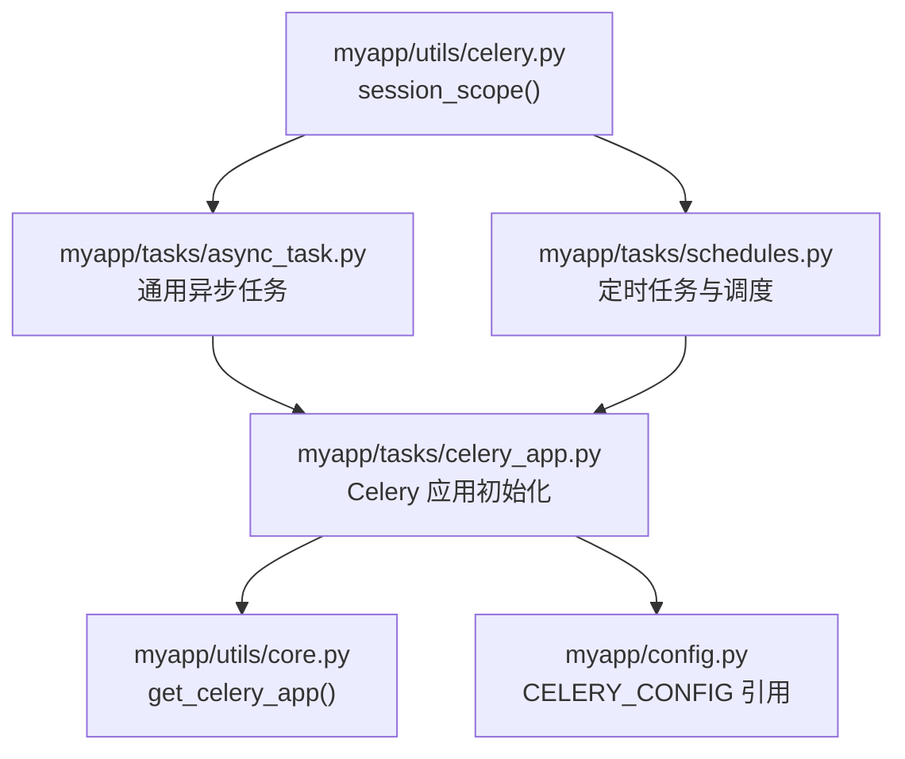
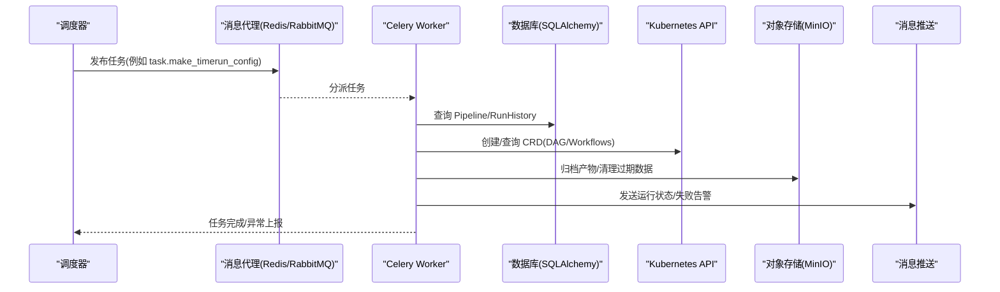
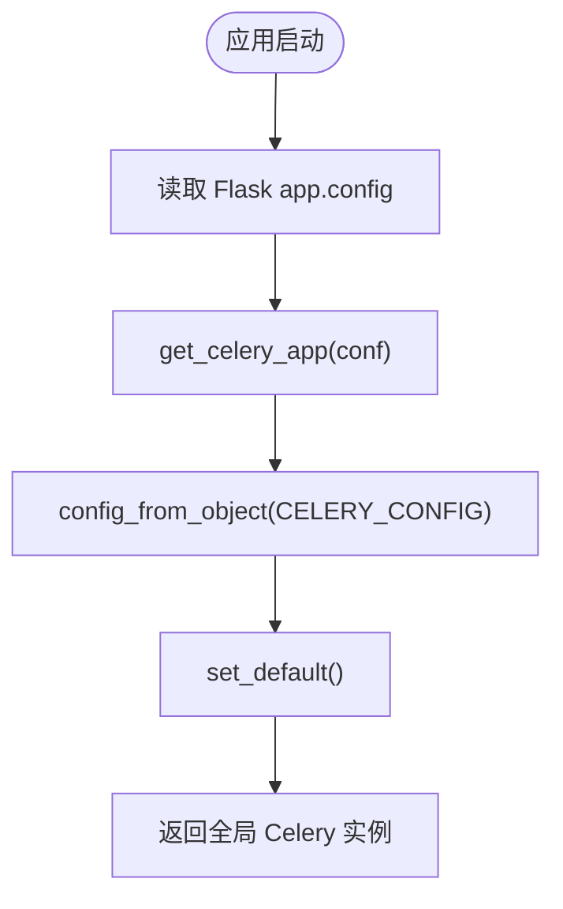
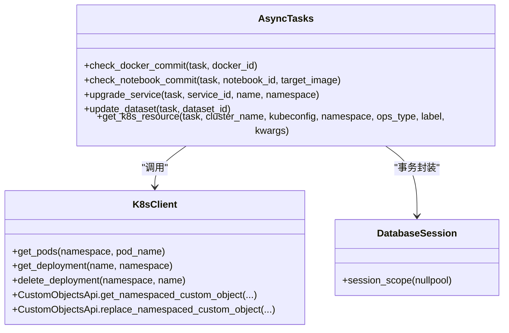
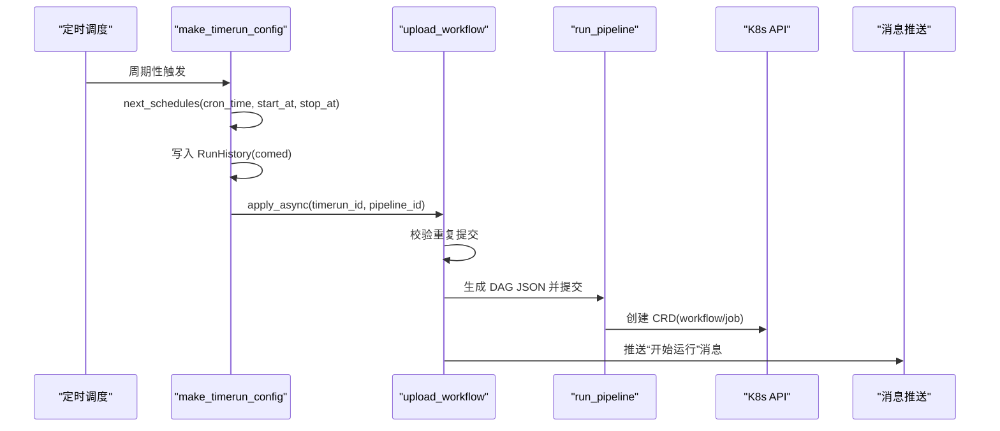
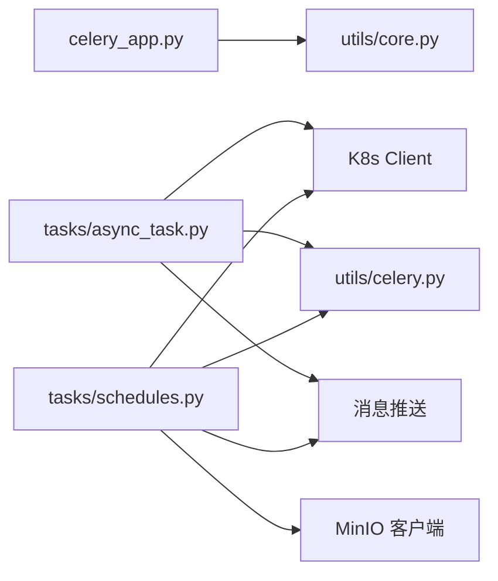
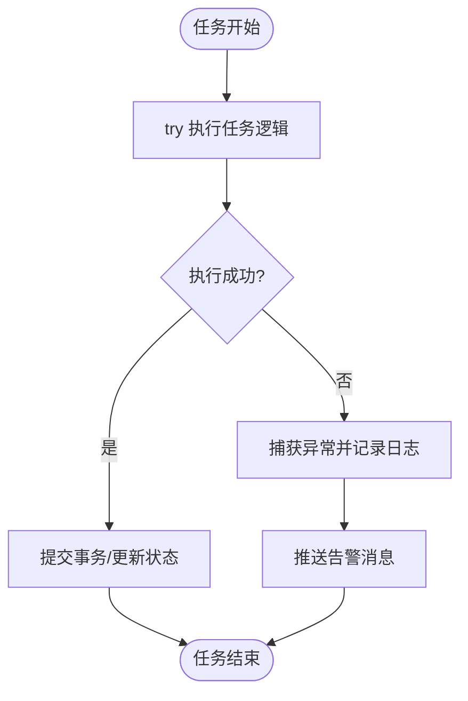

# 异步任务与调度

<cite>
**本文引用的文件**   
- [myapp/tasks/celery_app.py](file://myapp/tasks/celery_app.py)
- [myapp/utils/core.py](file://myapp/utils/core.py)
- [myapp/config.py](file://myapp/config.py)
- [myapp/utils/celery.py](file://myapp/utils/celery.py)
- [myapp/tasks/async_task.py](file://myapp/tasks/async_task.py)
- [myapp/tasks/schedules.py](file://myapp/tasks/schedules.py)
</cite>

## 目录
1. [引言](#引言)
2. [项目结构](#项目结构)
3. [核心组件](#核心组件)
4. [架构总览](#架构总览)
5. [详细组件分析](#详细组件分析)
6. [依赖关系分析](#依赖关系分析)
7. [性能与扩展性](#性能与扩展性)
8. [故障恢复与错误处理](#故障恢复与错误处理)
9. [监控与指标](#监控与指标)
10. [排错指南](#排错指南)
11. [结论](#结论)

## 引言
本技术文档聚焦于 Cube Studio 的异步任务与调度体系，围绕 Celery 任务队列、定时任务（Cron）以及任务监控展开。内容涵盖：
- 任务分发与执行流程
- 定时任务的生成、提交与幂等控制
- 错误处理与重试策略
- 监控指标收集与告警
- 可扩展的任务类型与调度策略
- 性能优化、故障恢复与最佳实践

## 项目结构
本项目在 myapp 下通过 tasks 子模块组织 Celery 相关能力：
- celery_app.py：Celery 应用实例初始化入口，统一加载全局配置
- async_task.py：通用异步任务实现（如镜像构建检查、服务升级、数据集更新、K8s 资源缓存）
- schedules.py：定时任务与调度逻辑（定时计划生成、工作流上传、清理过期数据与 CRD）
- utils/celery.py：Celery Worker 安全的数据库会话上下文
- utils/core.py：get_celery_app 工厂方法，从配置中创建 Celery 实例
- config.py：CELERY_CONFIG 引用及系统级常量（CRD_INFO、命名空间、Prometheus 地址等）

**图表来源**
- [myapp/tasks/celery_app.py:1-18](file://myapp/tasks/celery_app.py#L1-L18)
- [myapp/utils/core.py:853-860](file://myapp/utils/core.py#L853-L860)
- [myapp/config.py:559-559](file://myapp/config.py#L559-L559)
- [myapp/tasks/async_task.py:1-368](file://myapp/tasks/async_task.py#L1-L368)
- [myapp/tasks/schedules.py:1-800](file://myapp/tasks/schedules.py#L1-L800)
- [myapp/utils/celery.py:1-36](file://myapp/utils/celery.py#L1-L36)

**章节来源**
- [myapp/tasks/celery_app.py:1-18](file://myapp/tasks/celery_app.py#L1-L18)
- [myapp/utils/core.py:853-860](file://myapp/utils/core.py#L853-L860)
- [myapp/config.py:559-559](file://myapp/config.py#L559-L559)
- [myapp/tasks/async_task.py:1-368](file://myapp/tasks/async_task.py#L1-L368)
- [myapp/tasks/schedules.py:1-800](file://myapp/tasks/schedules.py#L1-L800)
- [myapp/utils/celery.py:1-36](file://myapp/utils/celery.py#L1-L36)

## 核心组件
- Celery 应用与配置
  - get_celery_app：从 CELERY_CONFIG 加载配置并返回单例 Celery 实例
  - celery_app.py：导入 Flask app 配置，调用 get_celery_app 获取全局 Celery 应用
- 任务定义
  - async_task.py：定义多个业务异步任务，使用 @celery_app.task 装饰器注册
  - schedules.py：定义定时任务与调度函数，包含 CRD 清理、Notebook 清理、调试服务清理、定时计划生成与工作流上传
- 数据库会话
  - session_scope：为 Celery Worker 提供安全的 SQLAlchemy Session，避免进程 fork 导致的连接池问题

**章节来源**
- [myapp/utils/core.py:853-860](file://myapp/utils/core.py#L853-L860)
- [myapp/tasks/celery_app.py:1-18](file://myapp/tasks/celery_app.py#L1-L18)
- [myapp/tasks/async_task.py:1-368](file://myapp/tasks/async_task.py#L1-L368)
- [myapp/tasks/schedules.py:1-800](file://myapp/tasks/schedules.py#L1-L800)
- [myapp/utils/celery.py:1-36](file://myapp/utils/celery.py#L1-L36)

## 架构总览
下图展示 Celery 任务与调度的整体交互：Web 或调度器触发任务，Celery Worker 消费任务，访问 K8s API、数据库与对象存储，并通过消息推送通知用户。

**图表来源**
- [myapp/tasks/schedules.py:387-467](file://myapp/tasks/schedules.py#L387-L467)
- [myapp/tasks/schedules.py:616-656](file://myapp/tasks/schedules.py#L616-L656)
- [myapp/tasks/async_task.py:27-98](file://myapp/tasks/async_task.py#L27-L98)
- [myapp/tasks/async_task.py:99-285](file://myapp/tasks/async_task.py#L99-L285)
- [myapp/tasks/async_task.py:287-368](file://myapp/tasks/async_task.py#L287-L368)

## 详细组件分析

### Celery 应用与配置
- 初始化流程
  - celery_app.py 读取 Flask app.config，调用 get_celery_app(conf) 获取全局 Celery 实例
  - get_celery_app 从 CELERY_CONFIG 加载配置并设置默认值
- 关键要点
  - 所有任务统一挂载到该 Celery 应用下
  - 可通过 CELERY_CONFIG 集中管理 broker、backend、task_routes、worker 并发等

**图表来源**
- [myapp/tasks/celery_app.py:1-18](file://myapp/tasks/celery_app.py#L1-L18)
- [myapp/utils/core.py:853-860](file://myapp/utils/core.py#L853-L860)
- [myapp/config.py:559-559](file://myapp/config.py#L559-L559)

**章节来源**
- [myapp/tasks/celery_app.py:1-18](file://myapp/tasks/celery_app.py#L1-L18)
- [myapp/utils/core.py:853-860](file://myapp/utils/core.py#L853-L860)
- [myapp/config.py:559-559](file://myapp/config.py#L559-L559)

### 通用异步任务（async_task.py）
- 任务列表与职责
  - check_docker_commit：轮询 K8s Pod 状态，成功后更新 Docker 镜像信息
  - check_notebook_commit：轮询 Notebook 提交 Pod，成功后更新镜像与时间戳，并推送成功消息
  - upgrade_service：推理服务滚动升级，按权重切换流量，清理旧版本服务
  - update_dataset：备份数据集到本地路径或下载远程 URL
  - get_k8s_resource：缓存集群 Pods/Nodes 列表，减少频繁 API 调用
- 错误处理
  - 捕获异常并记录日志；部分任务通过 push_message/push_admin 推送告警
- 数据库访问
  - 使用 session_scope(nullpool=True) 确保 Worker 安全的事务边界

**图表来源**
- [myapp/tasks/async_task.py:27-98](file://myapp/tasks/async_task.py#L27-L98)
- [myapp/tasks/async_task.py:99-285](file://myapp/tasks/async_task.py#L99-L285)
- [myapp/tasks/async_task.py:287-368](file://myapp/tasks/async_task.py#L287-L368)
- [myapp/utils/celery.py:15-35](file://myapp/utils/celery.py#L15-L35)

**章节来源**
- [myapp/tasks/async_task.py:27-98](file://myapp/tasks/async_task.py#L27-L98)
- [myapp/tasks/async_task.py:99-285](file://myapp/tasks/async_task.py#L99-L285)
- [myapp/tasks/async_task.py:287-368](file://myapp/tasks/async_task.py#L287-L368)
- [myapp/utils/celery.py:15-35](file://myapp/utils/celery.py#L15-L35)

### 定时任务与调度（schedules.py）
- 定时计划生成
  - make_timerun_config：根据 Pipeline.cron_time 计算未来调度时间点，去重后写入 RunHistory，并触发 upload_timerun
  - next_schedules：基于 croniter 计算下一个调度时间，支持最小间隔 resolution
- 工作流上传与执行
  - upload_workflow：校验重复提交，生成 DAG JSON，调用 run_pipeline 创建 CRD，更新 RunHistory 状态，推送通知
- 资源与生命周期管理
  - delete_old_crd：清理长时间运行的 CRD 或已结束超时的 CRD，并同步数据库状态
  - delete_workflow：删除已完成的 Deployment 与 CRD
  - delete_notebook：清理过期 Notebook Pod，并提醒用户续期
  - delete_debug_docker：清理 debug/test 服务与 Pod，标记离线服务
  - delete_old_data：清理历史日志、Workflow、RunHistory 与临时文件
- 监控与告警
  - deliver_message：向 Pipeline 创建者与告警用户推送消息
  - check_pipeline_time / check_pipeline_resource：统计运行时长与资源使用情况（用于监控）

**图表来源**
- [myapp/tasks/schedules.py:387-467](file://myapp/tasks/schedules.py#L387-L467)
- [myapp/tasks/schedules.py:472-611](file://myapp/tasks/schedules.py#L472-L611)
- [myapp/tasks/schedules.py:616-656](file://myapp/tasks/schedules.py#L616-L656)

**章节来源**
- [myapp/tasks/schedules.py:387-467](file://myapp/tasks/schedules.py#L387-L467)
- [myapp/tasks/schedules.py:472-611](file://myapp/tasks/schedules.py#L472-L611)
- [myapp/tasks/schedules.py:616-656](file://myapp/tasks/schedules.py#L616-L656)
- [myapp/tasks/schedules.py:48-146](file://myapp/tasks/schedules.py#L48-L146)
- [myapp/tasks/schedules.py:185-321](file://myapp/tasks/schedules.py#L185-L321)
- [myapp/tasks/schedules.py:686-730](file://myapp/tasks/schedules.py#L686-L730)

## 依赖关系分析
- 组件耦合
  - celery_app.py 依赖 core.get_celery_app 与 Flask app.config
  - async_task.py 依赖 K8s 客户端、数据库会话、消息推送与模型类
  - schedules.py 依赖 Pipeline/RunHistory/Workflow 模型、K8s 客户端、MinIO 客户端与消息推送
- 外部依赖
  - Kubernetes API（CRD、Deployment、Pod、Service）
  - 对象存储（MinIO）用于产物归档与清理
  - 消息推送（内部 push_message/push_admin）
- 潜在循环依赖
  - 当前代码通过模块内函数与工具类解耦，未见明显循环导入

**图表来源**
- [myapp/tasks/celery_app.py:1-18](file://myapp/tasks/celery_app.py#L1-L18)
- [myapp/utils/core.py:853-860](file://myapp/utils/core.py#L853-L860)
- [myapp/tasks/async_task.py:1-368](file://myapp/tasks/async_task.py#L1-L368)
- [myapp/tasks/schedules.py:1-800](file://myapp/tasks/schedules.py#L1-L800)
- [myapp/utils/celery.py:1-36](file://myapp/utils/celery.py#L1-L36)

**章节来源**
- [myapp/tasks/celery_app.py:1-18](file://myapp/tasks/celery_app.py#L1-L18)
- [myapp/utils/core.py:853-860](file://myapp/utils/core.py#L853-L860)
- [myapp/tasks/async_task.py:1-368](file://myapp/tasks/async_task.py#L1-L368)
- [myapp/tasks/schedules.py:1-800](file://myapp/tasks/schedules.py#L1-L800)
- [myapp/utils/celery.py:1-36](file://myapp/utils/celery.py#L1-L36)

## 性能与扩展性
- 性能优化
  - 使用 NullPool 避免 Worker 进程 fork 导致的连接池问题（session_scope）
  - 对 K8s 资源列表进行缓存（get_k8s_resource），降低 API 压力
  - 定时任务采用最小间隔 resolution 控制频率，避免高频调度
  - 限制并发运行数（max_active_runs）与过期保留数量（expired_limit）
- 扩展性
  - 新增任务类型：在 async_task.py 或 schedules.py 中定义新的 @celery_app.task 函数即可
  - 新增调度策略：扩展 next_schedules 或在 make_timerun_config 中添加自定义时间窗口与过滤规则
  - 多 Worker 与路由：通过 CELERY_CONFIG 中的 task_routes 将不同任务路由到专用 Worker

**章节来源**
- [myapp/utils/celery.py:15-35](file://myapp/utils/celery.py#L15-L35)
- [myapp/tasks/async_task.py:339-368](file://myapp/tasks/async_task.py#L339-L368)
- [myapp/tasks/schedules.py:349-366](file://myapp/tasks/schedules.py#L349-L366)
- [myapp/tasks/schedules.py:532-587](file://myapp/tasks/schedules.py#L532-L587)

## 故障恢复与错误处理
- 任务级错误处理
  - 各任务使用 try/except 捕获异常并记录日志
  - 通过 push_message/push_admin 推送失败告警
- 幂等与重复提交保护
  - upload_workflow 检测 timerun.status == 'created' 阻止重复提交
  - make_timerun_config 去重写入 RunHistory，避免同一时刻多次调度
- 超时与长任务
  - 轮询任务（如 check_docker_commit/check_notebook_commit）设置最大等待时间
  - 服务升级任务设置超时阈值，避免无限等待
- 资源清理
  - delete_old_crd/delete_workflow/delete_notebook/delete_debug_docker/delete_old_data 定期清理过期资源，防止堆积

**图表来源**
- [myapp/tasks/async_task.py:27-98](file://myapp/tasks/async_task.py#L27-L98)
- [myapp/tasks/async_task.py:99-285](file://myapp/tasks/async_task.py#L99-L285)
- [myapp/tasks/schedules.py:616-656](file://myapp/tasks/schedules.py#L616-L656)

**章节来源**
- [myapp/tasks/async_task.py:27-98](file://myapp/tasks/async_task.py#L27-L98)
- [myapp/tasks/async_task.py:99-285](file://myapp/tasks/async_task.py#L99-L285)
- [myapp/tasks/schedules.py:616-656](file://myapp/tasks/schedules.py#L616-L656)

## 监控与指标
- 运行时长统计
  - check_pipeline_time 统计今日 Workflow 的运行时长，输出日志供监控采集
- 资源使用统计
  - check_pipeline_resource 统计 Pipeline 的资源使用情况（CPU/Memory）
- Prometheus 集成
  - config.py 中 PROMETHEUS 地址可用于对接监控系统
- 告警与通知
  - deliver_message 与 push_message/push_admin 用于实时告警与进度通知

**章节来源**
- [myapp/tasks/schedules.py:731-792](file://myapp/tasks/schedules.py#L731-L792)
- [myapp/config.py:724-725](file://myapp/config.py#L724-L725)
- [myapp/tasks/schedules.py:324-344](file://myapp/tasks/schedules.py#L324-L344)

## 排错指南
- 常见问题
  - 任务未执行：检查 Celery Worker 是否启动，Broker 是否可达
  - 数据库连接异常：确认 session_scope 使用正确，避免共享连接池
  - K8s API 调用失败：检查 KUBECONFIG 与权限
  - 定时任务未触发：检查 cron_time 格式与 next_schedules 的时间窗口
- 定位建议
  - 查看任务日志与 push_message 推送记录
  - 检查 RunHistory 状态是否为 comed/created
  - 核对 CRD 与 Deployment 是否存在且状态正常

**章节来源**
- [myapp/utils/celery.py:15-35](file://myapp/utils/celery.py#L15-L35)
- [myapp/tasks/schedules.py:387-467](file://myapp/tasks/schedules.py#L387-L467)
- [myapp/tasks/schedules.py:616-656](file://myapp/tasks/schedules.py#L616-L656)

## 结论
Cube Studio 的异步任务与调度体系以 Celery 为核心，结合 K8s CRD 与对象存储，实现了可靠的分布式任务执行与定时调度。通过统一的 Celery 应用初始化、安全的数据库会话封装、完善的错误处理与资源清理机制，系统在性能、扩展性与可维护性方面具备良好基础。建议在后续迭代中进一步完善监控指标采集与告警闭环，提升运维可视性与自动化水平。