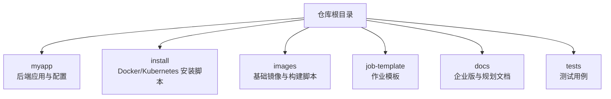
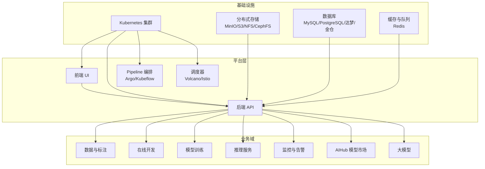
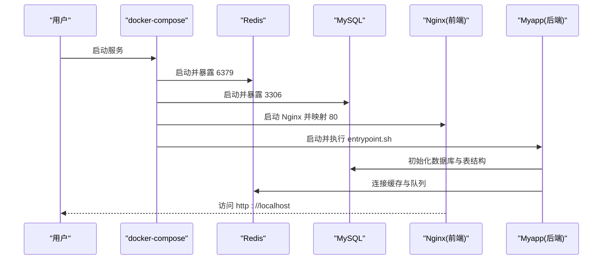
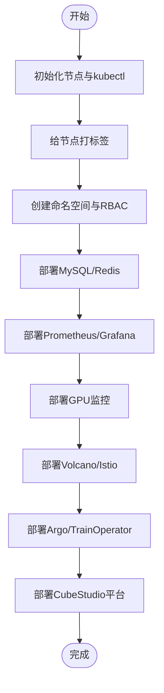
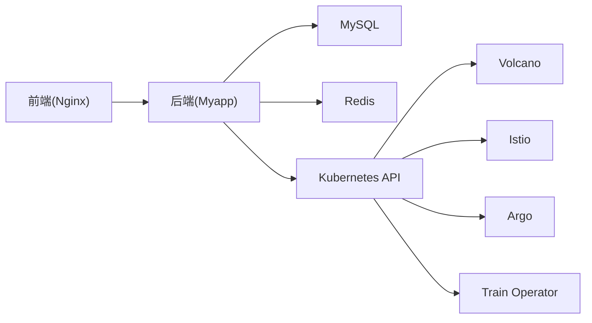

# 快速开始

<cite>
**本文引用的文件**   
- [README.md](file://README.md)
- [install/docker/README.md](file://install/docker/README.md)
- [install/docker/docker-compose.yml](file://install/docker/docker-compose.yml)
- [install/kubernetes/start.sh](file://install/kubernetes/start.sh)
- [myapp/config.py](file://myapp/config.py)
</cite>

## 目录
1. [简介](#简介)
2. [项目结构](#项目结构)
3. [核心组件](#核心组件)
4. [架构总览](#架构总览)
5. [详细组件分析](#详细组件分析)
6. [依赖关系分析](#依赖关系分析)
7. [性能与部署建议](#性能与部署建议)
8. [常见问题与故障排查](#常见问题与故障排查)
9. [结论](#结论)
10. [附录：安装步骤速查](#附录安装步骤速查)

## 简介
CubeStudio 是一款国产化、云原生的一站式人工智能平台，覆盖传统机器学习、深度学习与大模型全链路（MLOps / MaaS / 算力调度 / 训推平台）。平台提供多租户与算力纳管调度、Pipeline 任务流编排、分布式训练、推理服务、vGPU 虚拟化、边缘计算、自动化标注、大模型微调与推理、私有知识库与智能体等能力，并原生适配多种国产异构算力与 x86 / ARM CPU 架构。

本快速开始指南面向初学者与有经验的开发者，帮助你理解平台价值与技术架构，完成 Docker 单节点与 Kubernetes 集群两种方式的安装部署，掌握基本使用流程，并提供常见问题的解决方案与最佳实践建议。

**章节来源**
- [README.md:1-10](file://README.md#L1-L10)

## 项目结构
仓库采用“前后端 + 安装脚本 + 示例模板”的组织方式：
- myapp：后端应用、配置、视图、模型、迁移、工具与静态资源
- install：Docker 与 Kubernetes 安装脚本与资源清单
- images：各类基础镜像与运行环境构建脚本
- job-template：训练/数据处理/服务发布等作业模板
- docs：企业版功能与规划文档
- tests：单元测试与集成测试

**图表来源**
- [README.md:18-20](file://README.md#L18-L20)

**章节来源**
- [README.md:18-20](file://README.md#L18-L20)

## 核心组件
- 用户与权限：SSO 登录、RBAC、多租户与项目组隔离
- 算力调度：Kubernetes 底座、多集群/多资源组、GPU/NPU/vGPU/RDMA
- 在线开发：镜像仓库、Notebook/JupyterLab/VSCode、Git/TensorBoard
- 数据管理与标注：SQLLab、数据集管理、Label Studio 自动化标注
- 模型训练：拖拽式 Pipeline、分布式训练、超参搜索、TensorBoard
- 推理服务：模型管理、零代码发布、弹性伸缩、灰度与回滚
- 监控：Prometheus/Grafana、K8s Dashboard、告警推送
- AIHub 模型市场：预训练模型、一键部署/开发/微调
- 大模型：分布式训练/微调、量化评估剪枝、推理网关、智能对话

**章节来源**
- [README.md:23-84](file://README.md#L23-L84)

## 架构总览
CubeStudio 以 Kubernetes 为底座，向上提供从数据到上线的全链路能力，涵盖算力调度、在线开发、数据资产、模型训练、推理服务、监控与 AIHub 模型市场。

**图表来源**
- [README.md:145-163](file://README.md#L145-L163)

**章节来源**
- [README.md:145-163](file://README.md#L145-L163)

## 详细组件分析

### 系统环境要求与前置依赖
- 操作系统：Windows/macOS/Linux（本地调试）；生产推荐 Linux + Kubernetes
- 容器运行时：Docker Desktop（Windows/macOS），Docker/Containerd（Linux）
- Python 版本：3.9.x（本地后端调试）
- Node.js：16.15.0+（前端构建）
- Git：需关闭自动换行符转换（core.autocrlf=false）
- 网络：开放 80 端口或自定义端口；支持反向代理与 HTTPS

**章节来源**
- [install/docker/README.md:4-26](file://install/docker/README.md#L4-L26)

### Docker 单节点部署
- 通过 docker-compose 启动 Redis、MySQL、前端 Nginx 与后端 myapp
- 环境变量包含 MySQL 连接串、Redis 地址与密码、运行阶段等
- 首次启动会执行初始化脚本创建数据库与初始数据

**图表来源**
- [install/docker/docker-compose.yml:1-68](file://install/docker/docker-compose.yml#L1-L68)

**章节来源**
- [install/docker/docker-compose.yml:1-68](file://install/docker/docker-compose.yml#L1-L68)
- [install/docker/README.md:50-100](file://install/docker/README.md#L50-L100)

### Kubernetes 集群部署
- 通过 start.sh 脚本初始化节点、安装 kubectl、打标签、创建命名空间与 RBAC
- 依次部署 Dashboard、MySQL、Redis、Prometheus/Grafana、GPU 监控、Volcano、Istio、Argo、Train Operator
- 最后部署 CubeStudio 管理平台，替换 SERVICE_EXTERNAL_IP 并 apply overlays

**图表来源**
- [install/kubernetes/start.sh:1-152](file://install/kubernetes/start.sh#L1-L152)

**章节来源**
- [install/kubernetes/start.sh:1-152](file://install/kubernetes/start.sh#L1-L152)

### 基本使用流程
- 登录后首页会自动创建用户并绑定角色（Gamma），管理员可进一步授权
- 在 Notebook 中开发算法，在 Pipeline 中编排任务流，提交训练任务
- 将训练好的模型注册并发布为推理服务，进行灰度发布与回滚
- 通过 Prometheus/Grafana 查看资源与任务监控，设置告警通知

**章节来源**
- [install/docker/README.md:91-100](file://install/docker/README.md#L91-L100)
- [README.md:170-178](file://README.md#L170-L178)

## 依赖关系分析
- 后端依赖 MySQL 作为元数据库，Redis 作为缓存与 Celery 队列
- 前端由 Nginx 提供静态资源服务，并通过反向代理访问后端 API
- Kubernetes 部署依赖多个外部组件：Dashboard、Prometheus/Grafana、Volcano、Istio、Argo、Train Operator
- 配置文件集中位于 myapp/config.py，控制认证、语言、日志、Celery、CRD、工作区路径、镜像仓库、服务代理等

**图表来源**
- [install/docker/docker-compose.yml:1-68](file://install/docker/docker-compose.yml#L1-L68)
- [install/kubernetes/start.sh:90-142](file://install/kubernetes/start.sh#L90-L142)
- [myapp/config.py:357-414](file://myapp/config.py#L357-L414)

**章节来源**
- [install/docker/docker-compose.yml:1-68](file://install/docker/docker-compose.yml#L1-L68)
- [install/kubernetes/start.sh:90-142](file://install/kubernetes/start.sh#L90-L142)
- [myapp/config.py:357-414](file://myapp/config.py#L357-L414)

## 性能与部署建议
- 数据库连接池与超时：合理设置 SQLALCHEMY_POOL_SIZE、SQLALCHEMY_POOL_RECYCLE，避免连接泄漏与超时中断
- Redis 分库：共享实例时通过 REDIS_DB 指定起始编号，避免与其他业务冲突
- Celery 并发与超时：根据任务时长调整 worker_prefetch_multiplier、worker_max_tasks_per_child、task_time_limit 等
- 镜像拉取策略：根据内网/外网环境选择 IfNotPresent 或 Always，减少拉取延迟
- 工作区与归档路径：确保 WORKSPACE_HOST_PATH 与 ARCHIVES_HOST_PATH 指向持久化存储，避免数据丢失
- 服务代理 IP：SERVICE_EXTERNAL_IP 应设置为可达的内网或公网地址，便于外部访问推理服务

**章节来源**
- [myapp/config.py:350-414](file://myapp/config.py#L350-L414)
- [myapp/config.py:720-765](file://myapp/config.py#L720-L765)

## 常见问题与故障排查
- 镜像构建失败（网络问题）：配置 pip/npm/yarn 国内镜像源
- Windows 下 docker-compose 编码错误：修改 Python 编码文件或切换 VSCode 行尾为 LF
- Windows 下 shell 脚本报错：将 CRLF 转换为 LF
- 前端依赖安装失败：配置 npm/yarn 国内镜像
- 首次调试需要初始化数据库：执行 entrypoint.sh 或 python myapp/run.py
- 本地连接 K8s 开发集群：先部署 CubeStudio，再配置 kubeconfig 与 MinIO 地址

**章节来源**
- [install/docker/README.md:229-272](file://install/docker/README.md#L229-L272)
- [install/docker/README.md:91-110](file://install/docker/README.md#L91-L110)

## 结论
CubeStudio 提供了从数据到上线的一站式 AI/MLOps 平台能力，适合团队在私有化环境中快速落地机器学习与大模型项目。通过 Docker 单节点可快速体验，通过 Kubernetes 集群可实现生产级部署与扩展。建议在部署前明确环境依赖与网络策略，在生产环境做好监控与告警，并结合团队需求定制模板与算子。

[本节不直接分析具体文件，无需章节来源]

## 附录：安装步骤速查

### Docker 单节点部署
- 准备环境：安装 Docker Desktop（Windows/macOS）、Python 3.9.x、Node.js 16.15.0+
- 克隆仓库并进入 install/docker 目录
- 使用 docker-compose 启动服务
- 访问 http://localhost 登录并使用

**章节来源**
- [install/docker/README.md:4-26](file://install/docker/README.md#L4-L26)
- [install/docker/README.md:50-100](file://install/docker/README.md#L50-L100)
- [install/docker/docker-compose.yml:1-68](file://install/docker/docker-compose.yml#L1-L68)

### Kubernetes 集群部署
- 准备 K8s 集群与 kubectl 配置
- 执行 install/kubernetes/start.sh 传入内网 IP
- 等待各组件就绪后访问入口网址

**章节来源**
- [install/kubernetes/start.sh:1-152](file://install/kubernetes/start.sh#L1-L152)