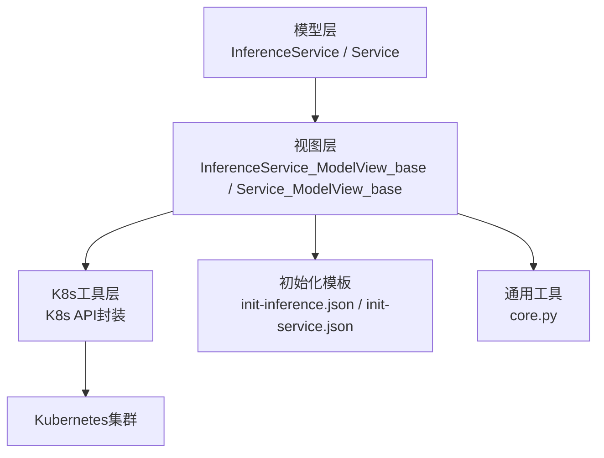
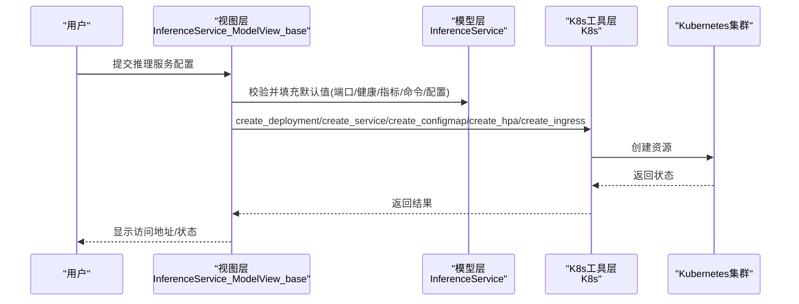
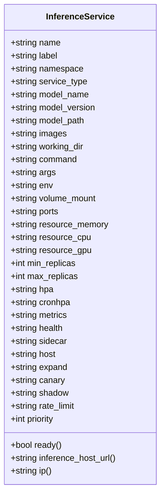
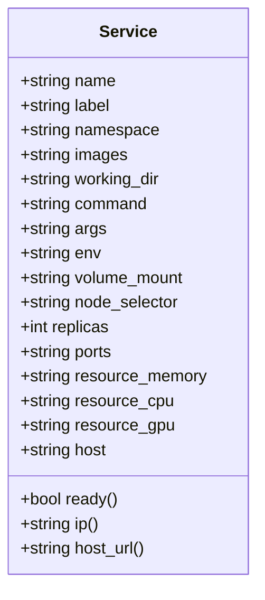
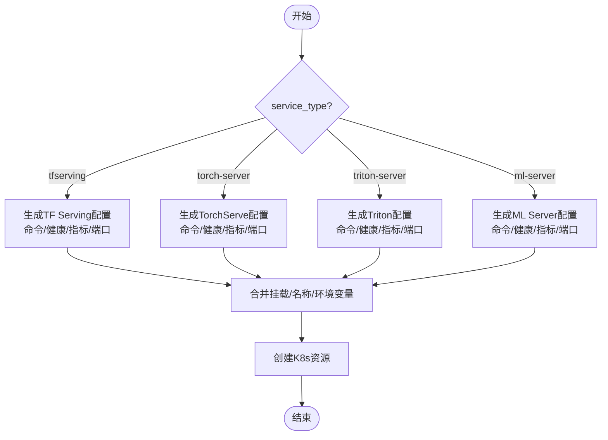
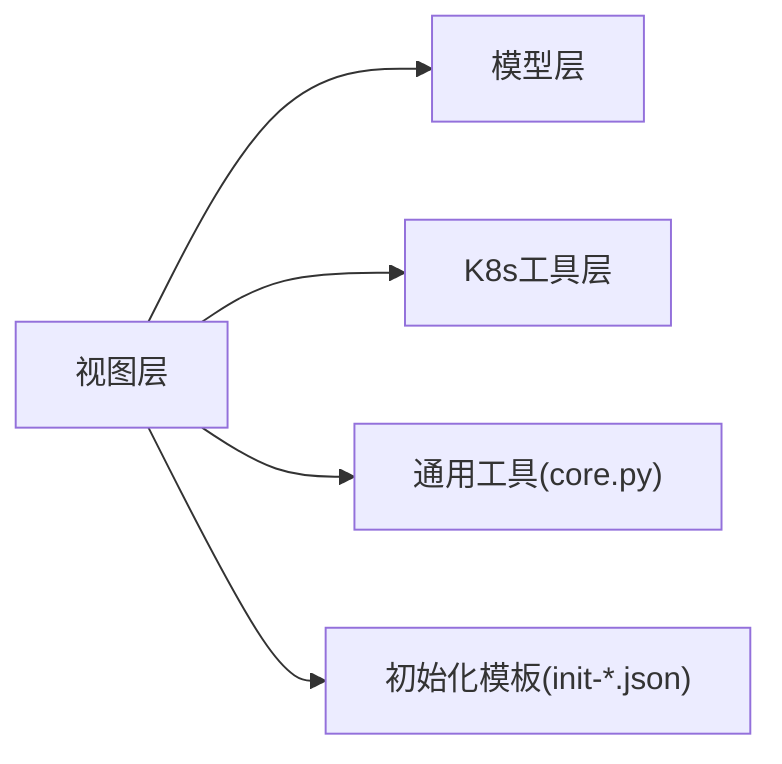

# 推理服务

<cite>
**本文引用的文件**   
- [README.md](file://README.md)
- [model_serving.py](file://myapp/models/model_serving.py)
- [view_inferenceserving.py](file://myapp/views/view_inferenceserving.py)
- [view_serving.py](file://myapp/views/view_serving.py)
- [init-inference.json](file://myapp/init/in init-inference.json)
- [init-service.json](file://myapp/init/init-service.json)
- [py_k8s.py](file://myapp/utils/py/py_k8s.py)
- [core.py](file://myapp/utils/core.py)
</cite>

## 目录
1. [简介](#简介)
2. [项目结构](#项目结构)
3. [核心组件](#核心组件)
4. [架构总览](#架构总览)
5. [详细组件分析](#详细组件分析)
6. [依赖关系分析](#依赖关系分析)
7. [性能与资源调优](#性能与资源调优)
8. [故障排查指南](#故障排查指南)
9. [结论](#结论)
10. [附录：新增推理框架与自定义配置示例](#附录新增推理框架与自定义配置示例)

## 简介
本文件系统性说明 CubeStudio 的“推理服务”能力，覆盖推理服务的创建、配置、部署与管理机制；解释支持的推理框架类型（tfserving、torch-server、triton-server、ml-server 等）及其配置方式；包含服务资源配置（CPU、内存、GPU）、端口映射、环境变量设置和启动命令配置；提供服务健康检查、指标采集和日志收集的配置方法；并提供实际代码示例路径，展示如何添加新的推理框架支持与自定义服务配置。同时给出性能调优、故障排查和资源监控的最佳实践。

## 项目结构
推理服务相关代码主要分布在以下模块：
- 数据模型层：定义推理服务与内部服务的数据库模型与属性
- 视图/接口层：提供 Web 表单、API 与部署逻辑
- 初始化模板：内置推理服务与内部服务的预置模板
- K8s 工具层：封装 Kubernetes 资源创建与删除操作
- 通用工具：端口分配、URL 解析、资源计算等

图示来源
- [model_serving.py:34-256](file://myapp/models/model_serving.py#L34-L256)
- [view_inferenceserving.py:121-180](file://myapp/views/view_inferenceserving.py#L121-L180)
- [view_serving.py:49-98](file://myapp/views/view_serving.py#L49-L98)
- [py_k8s.py:21-68](file://myapp/utils/py/py_k8s.py#L21-L68)

章节来源
- [model_serving.py:34-256](file://myapp/models/model_serving.py#L34-L256)
- [view_inferenceserving.py:121-180](file://myapp/views/view_inferenceserving.py#L121-L180)
- [view_serving.py:49-98](file://myapp/views/view_serving.py#L49-L98)
- [py_k8s.py:21-68](file://myapp/utils/py/py_k8s.py#L21-L68)

## 核心组件
- InferenceService（推理服务模型）
  - 关键字段：service_type、model_name、model_version、model_path、images、working_dir、command、args、env、volume_mount、ports、resource_cpu/memory/gpu、min_replicas/max_replicas、hpa/cronhpa、metrics、health、sidecar、canary/shadow、rate_limit、host、expand、priority 等
  - 支持多版本滚动升级、灰度发布、流量复制、限流、JWT 认证、定时伸缩容、在线测试等
- Service（内部服务模型）
  - 关键字段：images、working_dir、command、args、env、volume_mount、replicas、ports、resource_cpu/memory/gpu、node_selector、host 等
  - 用于快速部署开发运维工具或内部应用

章节来源
- [model_serving.py:34-256](file://myapp/models/model_serving.py#L34-L256)

## 架构总览
推理服务在平台中的整体流程如下：用户在界面选择推理框架类型并填写模型与运行参数，系统根据 service_type 自动生成命令、配置文件、端口、健康检查与指标采集地址，随后通过 K8s 工具层创建 Deployment/StatefulSet、Service、ConfigMap、HPA/CronHPA、Ingress/Istio 等资源，最终暴露域名或 IP+端口供调用。

图示来源
- [view_inferenceserving.py:548-734](file://myapp/views/view_inferenceserving.py#L548-L734)
- [view_serving.py:196-331](file://myapp/views/view_serving.py#L196-L331)
- [py_k8s.py:21-68](file://myapp/utils/py/py_k8s.py#L21-L68)

## 详细组件分析

### 推理服务模型（InferenceService）
- 字段分组
  - 模型信息：model_name、model_version、model_path、model_type、model_input/output、inference_config
  - 运行环境：images、working_dir、command、args、env、volume_mount、ports
  - 资源与弹性：resource_cpu/memory/gpu、min_replicas/max_replicas、hpa、cronhpa
  - 可观测性：metrics、health、sidecar
  - 治理与安全：canary、shadow、rate_limit、priority、host、expand
- 关键行为
  - ready：查询 Endpoints 判断 Pod 是否就绪
  - ip/inference_host_url：根据 service_type 生成默认访问路径（如 tfserving 的 metadata 接口、torch-server 的 /models）
  - clone：克隆服务配置便于快速复用

图示来源
- [model_serving.py:202-256](file://myapp/models/model_serving.py#L202-L256)
- [model_serving.py:330-467](file://myapp/models/model_serving.py#L330-L467)

章节来源
- [model_serving.py:202-256](file://myapp/models/model_serving.py#L202-L256)
- [model_serving.py:330-467](file://myapp/models/model_serving.py#L330-L467)

### 内部服务模型（Service）
- 字段分组
  - 基本信息：name、label、namespace、images、working_dir、command、args、env、volume_mount
  - 调度与资源：node_selector、replicas、ports、resource_cpu/memory/gpu
  - 访问：host
- 关键行为
  - deploy/clear：创建/清理 Deployment、Service、Istio Ingress 等
  - ip/host_url：根据集群与服务配置生成访问地址

图示来源
- [model_serving.py:34-83](file://myapp/models/model_serving.py#L34-L83)
- [model_serving.py:84-197](file://myapp/models/model_serving.py#L84-L197)

章节来源
- [model_serving.py:34-83](file://myapp/models/model_serving.py#L34-L83)
- [model_serving.py:84-197](file://myapp/models/model_serving.py#L84-L197)

### 视图与部署逻辑（InferenceService_ModelView_base）
- 推理框架类型与默认配置
  - INFERNENCE_MODEL_PATH、INFERNENCE_HOST、INFERNENCE_CONFIGMAP、INFERNENCE_COMMAND、INFERNENCE_ENV、INFERNENCE_PORTS、INFERNENCE_METRICS、INFERNENCE_HEALTH
  - 支持 tfserving、torch-server、triton-server、ml-server（商业版）等
- 自动配置生成
  - use_expand：根据 service_type 自动补齐 ports/env/metrics/health/host/command/inference_config
  - tfserving_model_config/monitoring_config/platform_config：生成 TF Serving 配置
  - torch_config：生成 TorchServe 配置
  - triton_config：根据模型类型生成 Triton config.pbtxt
- 前置处理
  - pre_add/pre_update：合并挂载、规范化名称、处理网络模型下载、GPU 资源大写化等
- 清理旧服务
  - delete_old_service：按命名空间清理 Deployment/StatefulSet/Service/Ingress/HPA/ConfigMap 等

图示来源
- [view_inferenceserving.py:49-92](file://myapp/views/view_inferenceserving.py#L49-L92)
- [view_inferenceserving.py:548-734](file://myapp/views/view_inferenceserving.py#L548-L734)

章节来源
- [view_inferenceserving.py:49-92](file://myapp/views/view_inferenceserving.py#L49-L92)
- [view_inferenceserving.py:548-734](file://myapp/views/view_inferenceserving.py#L548-L734)

### 内部服务视图（Service_ModelView_base）
- 表单字段：镜像、工作目录、启动命令、环境变量、端口、副本数、节点选择器、资源规格等
- 部署流程：创建 Deployment/Service/Istio Ingress，必要时创建外部 NodePort/ClusterIP 服务以暴露 IP+端口访问
- 清理流程：删除对应 K8s 资源并更新状态为 offline

章节来源
- [view_serving.py:49-98](file://myapp/views/view_serving.py#L49-L98)
- [view_serving.py:196-331](file://myapp/views/view_serving.py#L196-L331)

### K8s 工具层（K8s）
- 负责与 Kubernetes API 交互，包括：
  - 创建/删除 Deployment、StatefulSet、Service、Ingress、HPA、ConfigMap、CRD 等
  - 读取 Pod/Endpoints 状态，辅助 ready 判断
  - 统一 kubeconfig 加载与 SSL 配置

章节来源
- [py_k8s.py:21-68](file://myapp/utils/py/py_k8s.py#L21-L68)

### 初始化模板
- init-inference.json：内置 tfserving、torch-server、triton-server 示例推理服务配置
- init-service.json：内置 mysql-ui、redis-ui、neo4j、postgresql-ui、xinference 等内部服务模板

章节来源
- [init-inference.json:1-96](file://myapp/init/in init-inference.json#L1-L96)
- [init-service.json:1-69](file://myapp/init/init-service.json#L1-L69)

## 依赖关系分析
- 视图层依赖模型层获取字段与默认值
- 视图层依赖 K8s 工具层执行资源编排
- 视图层依赖通用工具 core.py 进行端口分配、URL 解析等
- 初始化模板为 UI 提供预置选项，降低配置门槛

图示来源
- [view_inferenceserving.py:121-180](file://myapp/views/view_inferenceserving.py#L121-L180)
- [view_serving.py:49-98](file://myapp/views/view_serving.py#L49-L98)
- [py_k8s.py:21-68](file://myapp/utils/py/py_k8s.py#L21-L68)
- [core.py:1-200](file://myapp/utils/core.py#L1-L200)

章节来源
- [view_inferenceserving.py:121-180](file://myapp/views/view_inferenceserving.py#L121-L180)
- [view_serving.py:49-98](file://myapp/views/view_serving.py#L49-L98)
- [py_k8s.py:21-68](file://myapp/utils/py/py_k8s.py#L21-L68)
- [core.py:1-200](file://myapp/utils/core.py#L1-L200)

## 性能与资源调优
- 资源规格
  - CPU/内存/GPU：通过 resource_cpu/resource_memory/resource_gpu 指定请求与限制；GPU 支持整卡、共享与 vGPU 模式
  - 副本与弹性：min_replicas/max_replicas 配合 HPA/CronHPA 实现基于 CPU/Mem/GPU/QPS 的弹性伸缩
- 推理引擎优化
  - tfserving：启用 batching、调整 rest_api_num_threads、GPU allow_growth
  - torch-server：线程数、队列大小、异步日志、超时与最大请求大小
  - triton-server：根据模型类型（onnx/tensorrt/pytorch/tf）设置 execution_mode、线程数、优化参数
- 可观测性
  - metrics：暴露 Prometheus 指标端点（如 8501:/metrics、8082:/metrics、8002:/metrics）
  - health：健康检查接口（如 /v1/models/*/metadata、/ping、/v2/health/ready）
- 安全与治理
  - sidecar：istio/jwt/rate_limit/whitelist/quotalimit/security/search/retry/desensitization/prompt/value_map/value_fixed（部分为商业版）
  - canary/shadow：灰度分流与流量复制
  - rate_limit：按 IP 限流（N/second|N/minute|N/hour）

章节来源
- [view_inferenceserving.py:49-92](file://myapp/views/view_inferenceserving.py#L49-L92)
- [view_inferenceserving.py:507-545](file://myapp/views/view_inferenceserving.py#L507-L545)
- [view_inferenceserving.py:548-734](file://myapp/views/view_inferenceserving.py#L548-L734)

## 故障排查指南
- 服务不可用
  - 检查 ready：通过 Endpoints 子集是否存在判断 Pod 是否就绪
  - 检查健康检查：确认 health 配置与容器内监听端口一致
  - 查看 K8s 事件：Pending/ContainerCreating/CrashLoopBackOff/ImagePullBackOff 等
- 端口冲突
  - 使用 core.get_not_black_port 分配可用端口；若端口耗尽则提示使用泛域名访问
- 模型加载失败
  - 确认 model_path 是否为有效目录或可下载文件；压缩文件需同名解压
  - 对 tfserving/triton-server 检查 models.config/config.pbtxt 是否正确
- 指标与健康未上报
  - 确认 metrics/health 端口与 URL 正确；容器内进程是否暴露相应端点
- 清理与回滚
  - 使用 clear 接口或视图层 delete_old_service 清理旧资源；滚动升级时保留历史版本以便回滚

章节来源
- [model_serving.py:182-197](file://myapp/models/model_serving.py#L182-L197)
- [model_serving.py:330-345](file://myapp/models/model_serving.py#L330-L345)
- [view_inferenceserving.py:749-767](file://myapp/views/view_inferenceserving.py#L749-L767)
- [view_serving.py:152-181](file://myapp/views/view_serving.py#L152-L181)

## 结论
CubeStudio 的推理服务通过统一的模型与视图抽象，结合 K8s 工具层，实现了多推理框架的统一编排与治理能力。用户可在界面上完成从模型注册到服务上线的全流程，并获得弹性伸缩、灰度发布、限流、安全认证与可观测性等企业级能力。通过合理的资源规划与推理引擎优化，可在保证稳定性的前提下提升吞吐与降低成本。

## 附录：新增推理框架与自定义配置示例
本节提供“添加新推理框架”与“自定义服务配置”的实际步骤与参考路径。

- 新增推理框架（以 xx-framework 为例）
  - 在视图层添加默认配置常量：
    - INFERNENCE_MODEL_PATH、INFERNENCE_HOST、INFERNENCE_CONFIGMAP、INFERNENCE_COMMAND、INFERNENCE_ENV、INFERNENCE_PORTS、INFERNENCE_METRICS、INFERNENCE_HEALTH
    - 参考路径：[view_inferenceserving.py:49-92](file://myapp/views/view_inferenceserving.py#L49-L92)
  - 在 use_expand 中增加分支逻辑，自动生成命令、配置文件、健康检查与指标地址
    - 参考路径：[view_inferenceserving.py:548-734](file://myapp/views/view_inferenceserving.py#L548-L734)
  - 在服务类型选择中添加 xx-framework
    - 参考路径：[view_inferenceserving.py:175-179](file://myapp/views/view_inferenceserving.py#L175-L179)
  - 可选：在初始化模板中添加示例配置
    - 参考路径：[init-inference.json:1-96](file://myapp/init/in init-inference.json#L1-L96)

- 自定义服务配置（内部服务 Service）
  - 在 Service_ModelView_base 中扩展 add_form_extra_fields/edit_form_extra_fields，增加自定义字段（如额外环境变量、挂载规则）
    - 参考路径：[view_serving.py:83-98](file://myapp/views/view_serving.py#L83-L98)
  - 在 pre_add/pre_update 中处理自定义字段的校验与合并
    - 参考路径：[view_serving.py:130-149](file://myapp/views/view_serving.py#L130-L149)
  - 在 deploy 中注入自定义逻辑（如额外注解、标签、主机别名）
    - 参考路径：[view_serving.py:196-331](file://myapp/views/view_serving.py#L196-L331)

- 实际示例参考
  - tfserving 示例：[init-inference.json:1-22](file://myapp/init/in init-inference.json#L1-L22)
  - torch-server 示例：[init-inference.json:23-45](file://myapp/init/in init-inference.json#L23-L45)
  - triton-server 示例：[init-inference.json:46-92](file://myapp/init/in init-inference.json#L46-L92)
  - 内部服务 xinference 示例：[init-service.json:53-67](file://myapp/init/init-service.json#L53-L67)

章节来源
- [view_inferenceserving.py:49-92](file://myapp/views/view_inferenceserving.py#L49-L92)
- [view_inferenceserving.py:175-179](file://myapp/views/view_inferenceserving.py#L175-L179)
- [view_inferenceserving.py:548-734](file://myapp/views/view_inferenceserving.py#L548-L734)
- [view_serving.py:83-98](file://myapp/views/view_serving.py#L83-L98)
- [view_serving.py:130-149](file://myapp/views/view_serving.py#L130-L149)
- [view_serving.py:196-331](file://myapp/views/view_serving.py#L196-L331)
- [init-inference.json:1-92](file://myapp/init/in init-inference.json#L1-L92)
- [init-service.json:53-67](file://myapp/init/init-service.json#L53-L67)