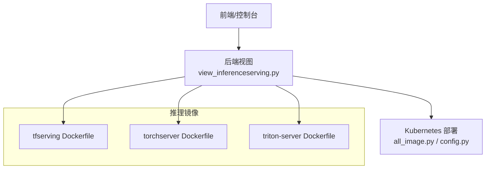
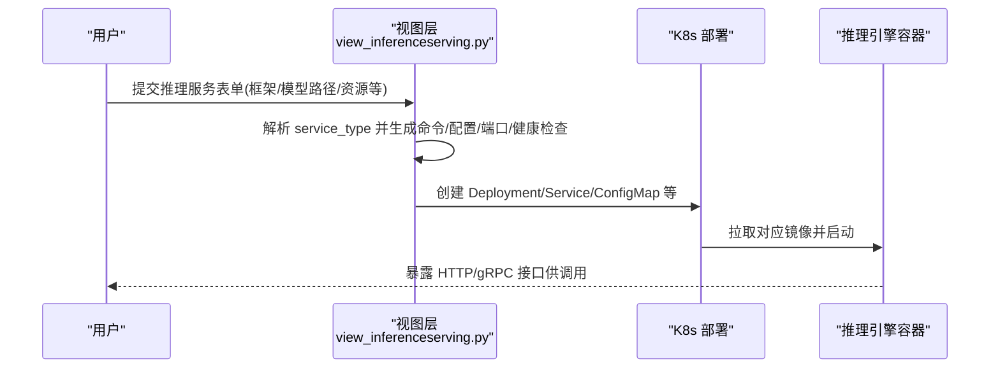
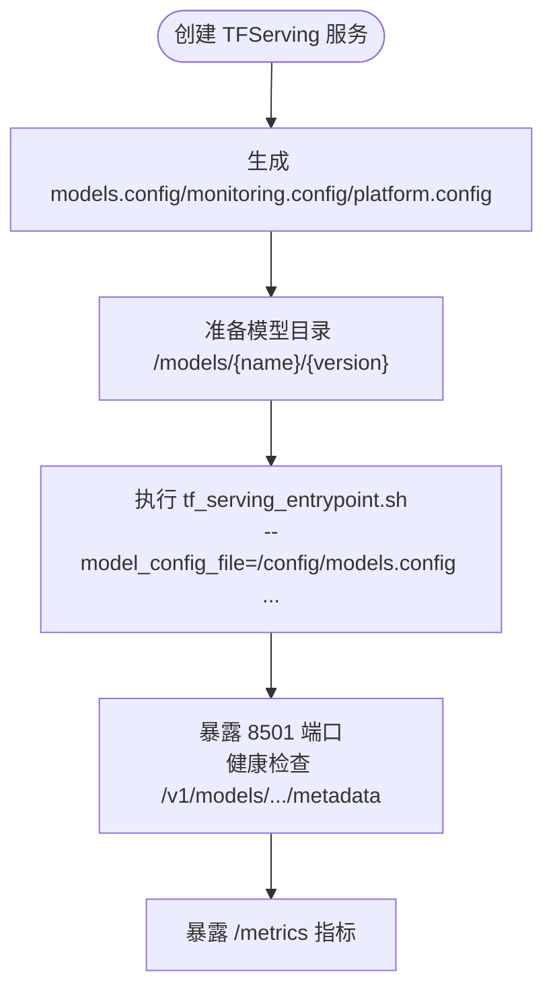
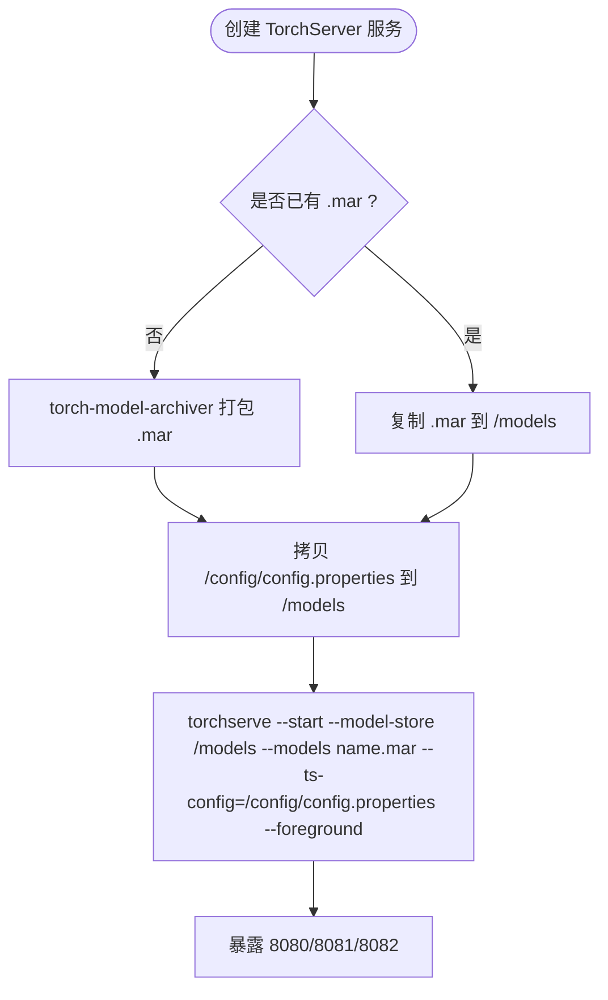
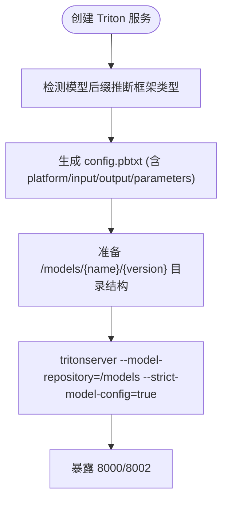
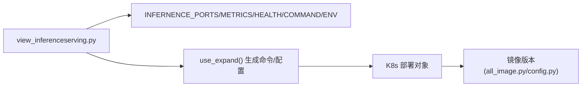

# 推理框架支持

<cite>
**本文引用的文件**   
- [images/serving/readme.md](file://images/serving/readme.md)
- [images/serving/tfserving/Dockerfile](file://images/serving/tfserving/Dockerfile)
- [images/serving/torchserver/Dockerfile](file://images/serving/torchserver/Dockerfile)
- [images/serving/triton-server/Dockerfile](file://images/serving/triton-server/Dockerfile)
- [images/serving/tfserving/example/readme.md](file://images/serving/tfserving/example/readme.md)
- [images/serving/torchserver/test.py](file://images/serving/torchserver/test.py)
- [myapp/views/view_inferenceserving.py](file://myapp/views/view_inferenceserving.py)
- [install/kubernetes/all_image.py](file://install/kubernetes/all_image.py)
- [install/kubernetes/cube/overlays/config/config.py](file://install/kubernetes/cube/overlays/config/config.py)
</cite>

## 目录
1. [简介](#简介)
2. [项目结构](#项目结构)
3. [核心组件](#核心组件)
4. [架构总览](#架构总览)
5. [详细组件分析](#详细组件分析)
6. [依赖关系分析](#依赖关系分析)
7. [性能与可观测性](#性能与可观测性)
8. [故障排查指南](#故障排查指南)
9. [结论](#结论)
10. [附录：配置速查表](#附录配置速查表)

## 简介
本文件系统性梳理平台支持的推理框架类型（tfserving、torch-server、triton-server、ml-server 等），说明各框架的模型格式要求、启动命令、端口配置、配置文件结构与示例，并提供框架选择建议与常见问题排查方法。内容基于仓库内推理服务视图与镜像构建脚本中的实现进行归纳。

## 项目结构
与推理框架相关的代码与资源主要分布在以下位置：
- images/serving：推理框架的基础镜像与示例
- myapp/views/view_inferenceserving.py：推理服务创建、默认配置生成与命令拼装逻辑
- install/kubernetes/*：Kubernetes 部署时使用的镜像清单与默认版本

图示来源
- [myapp/views/view_inferenceserving.py:49-92](file://myapp/views/view_inferenceserving.py#L49-L92)
- [install/kubernetes/all_image.py:76-99](file://install/kubernetes/all_image.py#L76-L99)
- [install/kubernetes/cube/overlays/config/config.py:778](file://install/kubernetes/cube/overlays/config/config.py#L778)

章节来源
- [images/serving/readme.md:1-15](file://images/serving/readme.md#L1-L15)
- [myapp/views/view_inferenceserving.py:49-92](file://myapp/views/view_inferenceserving.py#L49-L92)
- [install/kubernetes/all_image.py:76-99](file://install/kubernetes/all_image.py#L76-L99)
- [install/kubernetes/cube/overlays/config/config.py:778](file://install/kubernetes/cube/overlays/config/config.py#L778)

## 核心组件
- 推理服务视图层：负责根据 service_type 自动生成启动命令、健康检查、指标采集、端口映射与配置文件挂载。
- 推理镜像：为不同推理框架提供基础运行环境（语言运行时、系统工具、中文 locale 等）。
- Kubernetes 镜像清单：集中管理 tfserving、tritonserver 等镜像版本。

章节来源
- [myapp/views/view_inferenceserving.py:49-92](file://myapp/views/view_inferenceserving.py#L49-L92)
- [images/serving/tfserving/Dockerfile:1-23](file://images/serving/tfserving/Dockerfile#L1-L23)
- [images/serving/torchserver/Dockerfile:1-32](file://images/serving/torchserver/Dockerfile#L1-L32)
- [images/serving/triton-server/Dockerfile:1-24](file://images/serving/triton-server/Dockerfile#L1-L24)
- [install/kubernetes/all_image.py:76-99](file://install/kubernetes/all_image.py#L76-L99)

## 架构总览
下图展示从用户创建推理服务到容器启动推理引擎的关键流程。

图示来源
- [myapp/views/view_inferenceserving.py:548-693](file://myapp/views/view_inferenceserving.py#L548-L693)

## 详细组件分析

### TFServing
- 模型格式要求
  - 仅支持 SavedModel 目录形式，需包含服务签名。
  - 平台在创建服务时会自动生成 models.config、monitoring.config、platform.config 并挂载至 /config。
- 启动命令
  - 入口脚本会先准备模型目录，再执行 tf_serving_entrypoint.sh，并传入模型与监控、平台配置文件路径。
- 端口与访问
  - REST API 端口：8501
  - 健康检查：/v1/models/{model_name}/versions/{model_version}/metadata
  - 指标采集：/metrics
- 环境变量
  - 默认包含 TF_CPP_VMODULE 与 TZ 设置。
- 示例参考
  - 官方示例中通过 tensorflow_model_server 启动，参数包括 --rest_api_port、--model_name、--model_base_path。

图示来源
- [myapp/views/view_inferenceserving.py:586-609](file://myapp/views/view_inferenceserving.py#L586-L609)
- [images/serving/tfserving/example/readme.md:1-11](file://images/serving/tfserving/example/readme.md#L1-L11)

章节来源
- [myapp/views/view_inferenceserving.py:49-92](file://myapp/views/view_inferenceserving.py#L49-L92)
- [myapp/views/view_inferenceserving.py:586-609](file://myapp/views/view_inferenceserving.py#L586-L609)
- [images/serving/tfserving/example/readme.md:1-11](file://images/serving/tfserving/example/readme.md#L1-L11)

### TorchServer
- 模型格式要求
  - 支持 .mar 打包模型；若未提供 .mar，则使用 torch-model-archiver 将 handler 与序列化权重打包为 .mar。
  - 示例脚本展示了 PyTorch 模型的保存与加载方式，便于理解模型结构。
- 启动命令
  - 先将配置文件拷贝至 /models，再将模型复制到 /models，随后以 torchserve --start --model-store /models --models {name}.mar --ts-config=/config/config.properties --foreground 启动。
- 端口与访问
  - 推理端口：8080
  - 管理端口：8081
  - 指标端口：8082
  - 健康检查：/ping
- 配置文件
  - 默认生成 config.properties，包含监听地址、线程数、队列大小、超时等参数。
- 环境变量
  - 可通过 TS_<PROPERTY_NAME> 覆盖配置项。

图示来源
- [myapp/views/view_inferenceserving.py:632-657](file://myapp/views/view_inferenceserving.py#L632-L657)

章节来源
- [myapp/views/view_inferenceserving.py:49-92](file://myapp/views/view_inferenceserving.py#L49-L92)
- [myapp/views/view_inferenceserving.py:632-657](file://myapp/views/view_inferenceserving.py#L632-L657)
- [images/serving/torchserver/test.py:1-44](file://images/serving/torchserver/test.py#L1-L44)

### Triton Server
- 模型格式要求
  - 支持多框架：ONNX(.onnx)、TensorRT(.plan)、PyTorch(.pt/.pth)、TensorFlow(saved_model)。
  - 平台会根据模型后缀自动识别框架类型并生成对应的 config.pbtxt。
- 启动命令
  - tritonserver --model-repository=/models --strict-model-config=true --log-verbose=1
- 端口与访问
  - gRPC/HTTP 推理端口：8000
  - 指标端口：8002
  - 健康检查：/v2/health/ready
- 配置文件
  - 自动生成 config.pbtxt，包含 platform、max_batch_size、input/output 定义及优化参数（按框架类型差异化注入）。

图示来源
- [myapp/views/view_inferenceserving.py:659-692](file://myapp/views/view_inferenceserving.py#L659-L692)

章节来源
- [myapp/views/view_inferenceserving.py:49-92](file://myapp/views/view_inferenceserving.py#L49-L92)
- [myapp/views/view_inferenceserving.py:659-692](file://myapp/views/view_inferenceserving.py#L659-L692)

### ML-Server（商业版）
- 模型格式要求
  - 支持 sklearn/xgb 导出的模型文件（如 .pkl）。
- 配置文件
  - 自动生成 config.json，包含模型名称、路径、框架、版本与启用状态。
- 启动命令
  - python server.py --config_path /config/config.json
- 端口与访问
  - 默认监听 80 端口
  - 健康检查：/v1/models/{model_name}/metadata

章节来源
- [myapp/views/view_inferenceserving.py:611-630](file://myapp/views/view_inferenceserving.py#L611-L630)

### 自定义 Serving（serving）
- 适用场景
  - 使用自定义镜像承载推理服务，模型路径与启动命令完全由用户控制。
- 配置要点
  - 需要自行指定 working_dir、command、env、ports、metrics、health 等字段。

章节来源
- [myapp/views/view_inferenceserving.py:181-186](file://myapp/views/view_inferenceserving.py#L181-L186)

## 依赖关系分析
- 视图层依赖关系
  - view_inferenceserving.py 集中维护了各框架的默认端口、健康检查、指标端点、启动命令与环境变量，并在 pre_add/pre_update 阶段根据 service_type 动态生成命令与配置文件。
- 镜像与版本
  - all_image.py 与 config.py 维护了 tfserving、tritonserver 等镜像的版本列表，用于 K8s 部署时的镜像选择。

图示来源
- [myapp/views/view_inferenceserving.py:49-92](file://myapp/views/view_inferenceserving.py#L49-L92)
- [myapp/views/view_inferenceserving.py:548-693](file://myapp/views/view_inferenceserving.py#L548-L693)
- [install/kubernetes/all_image.py:76-99](file://install/kubernetes/all_image.py#L76-L99)
- [install/kubernetes/cube/overlays/config/config.py:778](file://install/kubernetes/cube/overlays/config/config.py#L778)

章节来源
- [myapp/views/view_inferenceserving.py:49-92](file://myapp/views/view_inferenceserving.py#L49-L92)
- [myapp/views/view_inferenceserving.py:548-693](file://myapp/views/view_inferenceserving.py#L548-L693)
- [install/kubernetes/all_image.py:76-99](file://install/kubernetes/all_image.py#L76-L99)
- [install/kubernetes/cube/overlays/config/config.py:778](file://install/kubernetes/cube/overlays/config/config.py#L778)

## 性能与可观测性
- 指标采集
  - tfserving：8501:/metrics
  - torch-server：8082:/metrics
  - triton-server：8002:/metrics
- 健康检查
  - tfserving：/v1/models/{model_name}/versions/{model_version}/metadata
  - torch-server：/ping
  - triton-server：/v2/health/ready
- 并发与线程
  - torch-server 默认 number_of_netty_threads=32，job_queue_size=1000，可根据负载调整。
- GPU 加速
  - tfserving 平台配置中开启 allow_growth 以减少显存碎片。
  - triton-server 针对 TensorFlow 模型可启用 TensorRT 加速（FP16）。

章节来源
- [myapp/views/view_inferenceserving.py:83-92](file://myapp/views/view_inferenceserving.py#L83-L92)
- [myapp/views/view_inferenceserving.py:487-504](file://myapp/views/view_inferenceserving.py#L487-L504)
- [myapp/views/view_inferenceserving.py:507-545](file://myapp/views/view_inferenceserving.py#L507-L545)

## 故障排查指南
- 模型路径或格式不匹配
  - tfserving：确保为 SavedModel 目录且包含签名。
  - torch-server：确认是否为 .mar 或可通过 torch-model-archiver 打包；handler 与序列化权重需一致。
  - triton-server：根据模型后缀正确识别框架类型，并确保 config.pbtxt 的 platform 与 input/output 定义与实际模型一致。
- 端口冲突或未暴露
  - 检查 ports 字段是否与框架默认端口一致（tfserving:8501；torch-server:8080/8081；triton-server:8000/8002）。
- 健康检查失败
  - 核对 health 端点是否正确（tfserving 需包含 model_name 与 model_version）。
- 指标不可用
  - 确认 metrics 端口与路径配置（tfserving:8501:/metrics；torch-server:8082:/metrics；triton-server:8002:/metrics）。
- 环境变量未生效
  - torch-server 支持 TS_<PROPERTY_NAME> 覆盖配置项；其他框架请参考各自文档或通过 inference_config 挂载配置文件。
- 网络下载模型失败
  - 当 model_path 为 http(s) 链接时，平台会在启动命令中加入 wget/unzip/tar 解压逻辑；请确保压缩文件名与解压后目录名一致（尤其是 .zip/.tar.gz）。

章节来源
- [myapp/views/view_inferenceserving.py:548-693](file://myapp/views/view_inferenceserving.py#L548-L693)

## 结论
本平台对主流推理框架提供了统一的创建与管理体验：通过 service_type 自动推导启动命令、端口、健康检查与指标采集，并生成必要的配置文件。对于常见框架（tfserving、torch-server、triton-server、ml-server），用户只需填写模型路径与基本资源限制即可完成部署；对于自定义场景，可使用 serving 模式完全掌控镜像与命令。

## 附录：配置速查表
- 模型路径模板
  - ml-server：/mnt/.../$model_name.pkl
  - tfserving：/mnt/.../saved_model
  - torch-server：/mnt/.../$model_name.mar
  - triton-server：framework:path（如 onnx:/mnt/.../model.onnx）
- 默认访问路径
  - tfserving：/v1/models/$model_name/metadata
  - torch-server：:8081/models
  - triton-server：/v2/models/$model_name
- 默认端口
  - tfserving：8501
  - torch-server：8080,8081
  - triton-server：8000,8002
- 默认健康检查
  - tfserving：8501:/v1/models/$model_name/versions/$model_version/metadata
  - torch-server：8080:/ping
  - triton-server：8000:/v2/health/ready
- 默认指标采集
  - tfserving：8501:/metrics
  - torch-server：8082:/metrics
  - triton-server：8002:/metrics

章节来源
- [myapp/views/view_inferenceserving.py:49-92](file://myapp/views/view_inferenceserving.py#L49-L92)