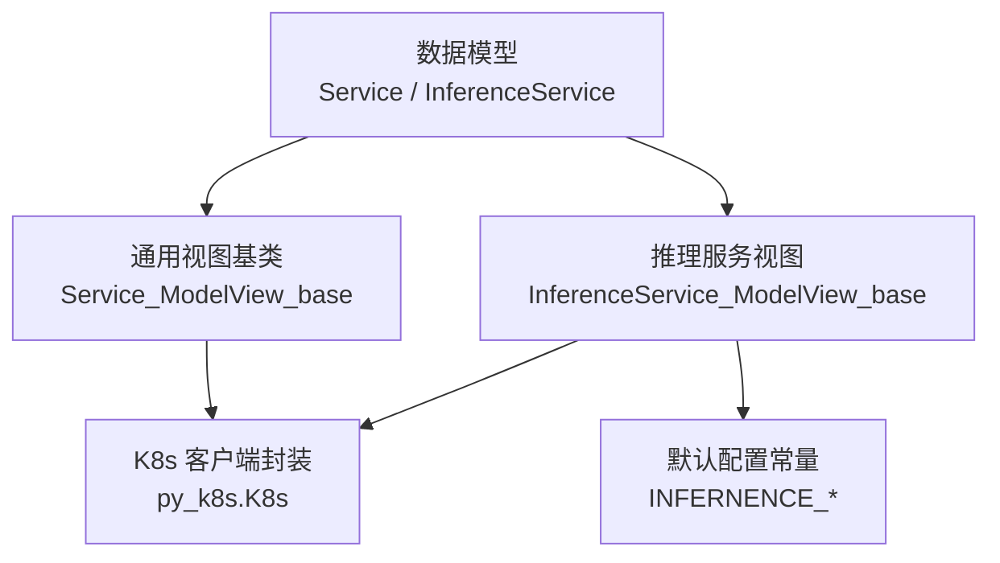
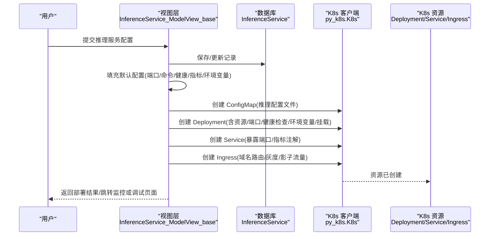
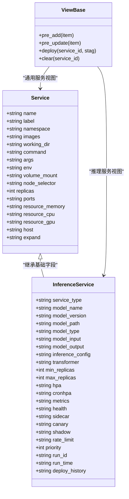

# 服务配置管理

<cite>
**本文引用的文件**   
- [model_serving.py](file://myapp/models/model_serving.py)
- [view_inferenceserving.py](file://myapp/views/view_inferenceserving.py)
- [view_serving.py](file://myapp/views/view_serving.py)
</cite>

## 目录
1. [简介](#简介)
2. [项目结构](#项目结构)
3. [核心组件](#核心组件)
4. [架构总览](#架构总览)
5. [详细组件分析](#详细组件分析)
6. [依赖关系分析](#依赖关系分析)
7. [性能与容量规划](#性能与容量规划)
8. [故障排查指南](#故障排查指南)
9. [结论](#结论)
10. [附录：配置项速查表](#附录配置项速查表)

## 简介
本文件面向“推理服务”的配置与管理，覆盖以下主题：
- 资源配置（CPU、内存、GPU）
- 端口映射与外部访问
- 环境变量与启动命令
- 挂载卷与配置文件（ConfigMap）
- 健康检查、指标采集与日志收集
- 服务模板与最佳实践
- 配置校验规则与错误处理机制

本仓库通过数据模型定义服务/推理服务的字段，并通过视图层提供表单校验、默认值填充、Kubernetes 资源创建与清理等能力。

## 项目结构
与“服务配置管理”直接相关的代码集中在后端 Python 模块中：
- 数据模型：定义服务与推理服务的持久化字段
- 视图层：提供 Web 表单、API 接口、部署/清理逻辑、默认配置注入

图表来源
- [model_serving.py:22-60](file://myapp/models/model_serving.py#L22-L60)
- [model_serving.py:202-256](file://myapp/models/model_serving.py#L202-L256)
- [view_inferenceserving.py:49-92](file://myapp/views/view_inferenceserving.py#L49-L92)
- [view_inferenceserving.py:121-179](file://myapp/views/view_inferenceserving.py#L121-L179)
- [view_serving.py:49-98](file://myapp/views/view_serving.py#L49-L98)

章节来源
- [model_serving.py:22-60](file://myapp/models/model_serving.py#L22-L60)
- [model_serving.py:202-256](file://myapp/models/model_serving.py#L202-L256)
- [view_inferenceserving.py:49-92](file://myapp/views/view_inferenceserving.py#L49-L92)
- [view_inferenceserving.py:121-179](file://myapp/views/view_inferenceserving.py#L121-L179)
- [view_serving.py:49-98](file://myapp/views/view_serving.py#L49-L98)

## 核心组件
- Service（通用云原生服务）
  - 用于承载任意镜像的进程服务，支持副本数、端口、资源、挂载、节点选择器等
- InferenceService（推理服务）
  - 在 Service 基础上扩展了模型信息、推理框架类型、弹性伸缩、灰度发布、侧车容器、健康检查、指标采集等

关键差异点：
- InferenceService 支持按推理框架自动注入默认命令、端口、健康检查、指标地址、环境变量与配置文件
- InferenceService 支持调试/测试/生产多环境部署与版本切换

章节来源
- [model_serving.py:34-66](file://myapp/models/model_serving.py#L34-L66)
- [model_serving.py:202-256](file://myapp/models/model_serving.py#L202-L256)

## 架构总览
推理服务从“用户填写表单”到“Kubernetes 资源就绪”的整体流程如下：

图表来源
- [view_inferenceserving.py:914-1270](file://myapp/views/view_inferenceserving.py#L914-L1270)
- [view_inferenceserving.py:952-967](file://myapp/views/view_inferenceserving.py#L952-L967)
- [view_inferenceserving.py:1041-1065](file://myapp/views/view_inferenceserving.py#L1041-L1065)
- [view_inferenceserving.py:1080-1113](file://myapp/views/view_inferenceserving.py#L1080-L1113)

## 详细组件分析

### 数据模型与字段说明

#### Service（通用服务）
- 用途：运行任意镜像的进程服务
- 关键字段
  - images：镜像
  - working_dir：工作目录
  - command：启动命令
  - args：启动参数
  - env：环境变量（每行一个键值对）
  - volume_mount：挂载（支持 PVC、HostPath 等）
  - node_selector：节点选择器
  - replicas：副本数
  - ports：监听端口（逗号分隔）
  - resource_memory/resource_cpu/resource_gpu：资源申请
  - host：首页路径（用于生成访问 URL）
  - expand：扩展参数（JSON）

章节来源
- [model_serving.py:34-66](file://myapp/models/model_serving.py#L34-L66)

#### InferenceService（推理服务）
- 用途：面向推理框架的服务化封装
- 关键字段
  - service_type：推理框架类型（如 tfserving、torch-server、triton-server、ml-server 等）
  - model_name/model_version/model_path/model_type：模型元信息
  - inference_config：推理配置文件（以多文件块形式输入，最终生成 ConfigMap）
  - transformer：前后置处理逻辑
  - min_replicas/max_replicas/hpa/cronhpa：弹性伸缩与定时伸缩
  - metrics：指标采集（端口:/path）
  - health：健康检查（端口:/path）
  - sidecar：侧车容器（如 istio、限流、鉴权等）
  - canary/shadow：灰度发布与影子流量
  - rate_limit：按 IP 限流
  - priority：优先级
  - 其他继承自 Service 的资源、端口、挂载、环境变量等

章节来源
- [model_serving.py:202-256](file://myapp/models/model_serving.py#L202-L256)

### 表单校验与默认值注入

- 表单校验
  - CPU/内存/GPU：正则表达式校验格式
  - 端口：仅允许数字与逗号
  - 域名：限制字符集并提示泛域名规则
  - 弹性伸缩/定时伸缩：正则校验表达式
  - 挂载：限制字符集，支持按策略过滤用户自定义挂载
  - 环境变量：每行一个键值对
  - 指标/健康：端口:/path 格式校验

- 默认值注入
  - 根据 service_type 自动填充：
    - 默认端口 INFERNENCE_PORTS
    - 默认环境变量 INFERNENCE_ENV
    - 默认指标地址 INFERNENCE_METRICS
    - 默认健康检查 INFERNENCE_HEALTH
    - 默认访问路径 INFERNENCE_HOST
    - 默认启动命令 INFERNENCE_COMMAND
    - 默认推理配置 INFERNENCE_CONFIGMAP
  - use_expand() 会根据模型路径、框架类型进一步生成命令、配置文件与名称

章节来源
- [view_inferenceserving.py:189-357](file://myapp/views/view_inferenceserving.py#L189-L357)
- [view_inferenceserving.py:547-700](file://myapp/views/view_inferenceserving.py#L547-L700)
- [view_inferenceserving.py:1339-1351](file://myapp/views/view_inferenceserving.py#L1339-L1351)

### 部署流程与 Kubernetes 资源

- 调试/测试/生产三环境
  - debug/test：命名空间前缀 + 固定副本数（debug=1），便于交互式调试
  - prod：正式环境，支持 HPA 弹性伸缩与同域名版本切换

- 主要资源
  - ConfigMap：推理配置文件（inference_config）
  - Deployment：应用容器（command/env/volume_mount/resources/ports/health）
  - Service：内部 Service 暴露端口，附带 Prometheus 抓取注解
  - Ingress：域名路由，支持灰度/影子流量
  - External Service：可选 NodePort/LoadBalancer 直连（IP+端口模式）

- 环境变量注入
  - 统一注入 KUBEFLOW_*、RESOURCE_*、MODEL_*、INFERENCE_NAME 等变量，供业务容器使用

- 健康检查与指标
  - health：作为探针注入（非 debug 环境）
  - metrics：作为 Service 注解，供 Prometheus 抓取

章节来源
- [view_inferenceserving.py:914-1270](file://myapp/views/view_inferenceserving.py#L914-L1270)
- [view_inferenceserving.py:1041-1065](file://myapp/views/view_inferenceserving.py#L1041-L1065)
- [view_inferenceserving.py:1070-1088](file://myapp/views/view_inferenceserving.py#L1070-L1088)
- [view_inferenceserving.py:1090-1113](file://myapp/views/view_inferenceserving.py#L1090-L1113)

### 清理与状态管理

- 清理旧资源
  - 删除 Deployment/StatefulSet/Service/External Service/Ingress/HPA/ConfigMap 等
  - 当项目组/集群/名称变更时自动触发清理

- 状态字段
  - model_status：offline/debug/test/online
  - deploy_history：部署历史（最近 10 条）

章节来源
- [view_inferenceserving.py:749-800](file://myapp/views/view_inferenceserving.py#L749-L800)
- [view_inferenceserving.py:804-818](file://myapp/views/view_inferenceserving.py#L804-L818)
- [view_inferenceserving.py:1237-1248](file://myapp/views/view_inferenceserving.py#L1237-L1248)

### 通用服务（Service）部署流程

- 与推理服务类似，但更简单：
  - 创建 Deployment（command/env/volume_mount/resources/ports）
  - 创建 Service（内部 Service）
  - 若未使用 IP 直连，则创建 Ingress（域名访问）
  - 可选创建 External Service（NodePort/ClusterIP 带 externalIP）

章节来源
- [view_serving.py:195-331](file://myapp/views/view_serving.py#L195-L331)

## 依赖关系分析

图表来源
- [model_serving.py:34-66](file://myapp/models/model_serving.py#L34-L66)
- [model_serving.py:202-256](file://myapp/models/model_serving.py#L202-L256)
- [view_serving.py:49-98](file://myapp/views/view_serving.py#L49-L98)
- [view_inferenceserving.py:121-179](file://myapp/views/view_inferenceserving.py#L121-L179)

## 性能与容量规划

- 资源分配建议
  - CPU：根据 QPS 与单请求耗时估算；大模型推理通常需更高核数
  - 内存：注意模型加载与批处理的峰值占用；预留系统开销
  - GPU：按卡型号与并发需求评估；可结合 HPA 基于 GPU 利用率伸缩

- 弹性伸缩
  - HPA：支持基于 CPU/MEM/GPU/QPS 等多指标
  - CronHPA：按时间段进行扩缩容（例如白天高负载、夜间低负载）

- 端口与网络
  - 优先使用域名访问（Ingress），避免 IP 变化导致的不稳定
  - 如需 IP 直连，确保端口池充足且不被黑名单占用

- 指标与健康
  - 务必配置 metrics 与 health，便于 Prometheus 抓取与 Liveness/Readiness 探测
  - 对于多端口服务，确保将 metrics/health 端口加入 Pod 端口列表

章节来源
- [view_inferenceserving.py:1207-1230](file://myapp/views/view_inferenceserving.py#L1207-L1230)
- [view_inferenceserving.py:1014-1030](file://myapp/views/view_inferenceserving.py#L1014-L1030)
- [view_inferenceserving.py:1070-1088](file://myapp/views/view_inferenceserving.py#L1070-L1088)

## 故障排查指南

- 常见问题定位
  - 端口耗尽：界面会提示“端口已耗尽，后续请使用泛域名访问服务”
  - 健康检查失败：确认 health 端口与路径正确，并确保该端口已加入 Pod 端口列表
  - 指标不可用：确认 metrics 端口与路径正确，并检查 Service 注解是否包含 prometheus.io/*
  - 模型下载失败：当 model_path 为 http(s) 压缩文件时，需保证压缩包名与解压后目录一致

- 清理与回滚
  - 先执行清理 API，再重新部署
  - 观察 deploy_history 与 K8s 资源状态，确认旧资源已释放

- 权限与访问
  - 确认 SERVICE_EXTERNAL_IP 或 SERVICE_DOMAIN 配置正确
  - 若使用 IP 直连，确保防火墙/安全组放行对应端口

章节来源
- [view_inferenceserving.py:1152-1175](file://myapp/views/view_inferenceserving.py#L1152-L1175)
- [view_inferenceserving.py:1186-1205](file://myapp/views/view_inferenceserving.py#L1186-L1205)
- [view_inferenceserving.py:804-818](file://myapp/views/view_inferenceserving.py#L804-L818)

## 结论
本系统通过数据模型与视图层的配合，提供了完整的推理服务配置、校验、默认值注入与 Kubernetes 资源管理能力。用户可按推理框架快速完成服务化，同时具备健康检查、指标采集、弹性伸缩与灰度发布等企业级能力。建议在上线前充分验证健康检查与指标采集，并结合业务负载合理设置资源与伸缩策略。

## 附录：配置项速查表

- 资源配置
  - resource_cpu：CPU 核数（整数）
  - resource_memory：内存（如 2G、8G）
  - resource_gpu：GPU 数量或型号（如 1、1(V100)）

- 端口与访问
  - ports：容器监听端口（逗号分隔）
  - host：访问域名或路径（支持泛域名）
  - metrics：指标端口:/path（Prometheus 抓取）
  - health：健康检查端口:/path（探针）

- 环境变量与启动
  - env：每行一个键值对
  - command：启动命令（留空时按框架自动注入）
  - working_dir：工作目录

- 存储与配置
  - volume_mount：挂载（PVC/HostPath 等）
  - inference_config：推理配置文件（多文件块，生成 ConfigMap）

- 弹性与灰度
  - hpa：弹性伸缩条件（如 cpu:50%,mem:50%,gpu:50%）
  - cronhpa：定时伸缩（如 9~21:1,21~9:0）
  - canary：流量分流（service1:20%,service2:30%）
  - shadow：流量复制（service1:20%,service2:30%）
  - sidecar：侧车容器（istio、限流、鉴权等）

- 其他
  - service_type：推理框架类型（tfserving/torch-server/triton-server/ml-server 等）
  - model_name/model_version/model_path/model_type：模型元信息
  - transformer：前后置处理逻辑
  - priority：服务优先级
  - expand：扩展参数（JSON）

章节来源
- [model_serving.py:202-256](file://myapp/models/model_serving.py#L202-L256)
- [view_inferenceserving.py:189-357](file://myapp/views/view_inferenceserving.py#L189-L357)
- [view_inferenceserving.py:547-700](file://myapp/views/view_inferenceserving.py#L547-L700)