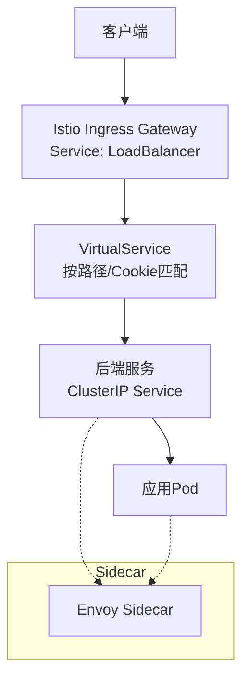
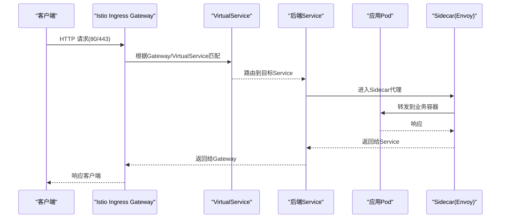
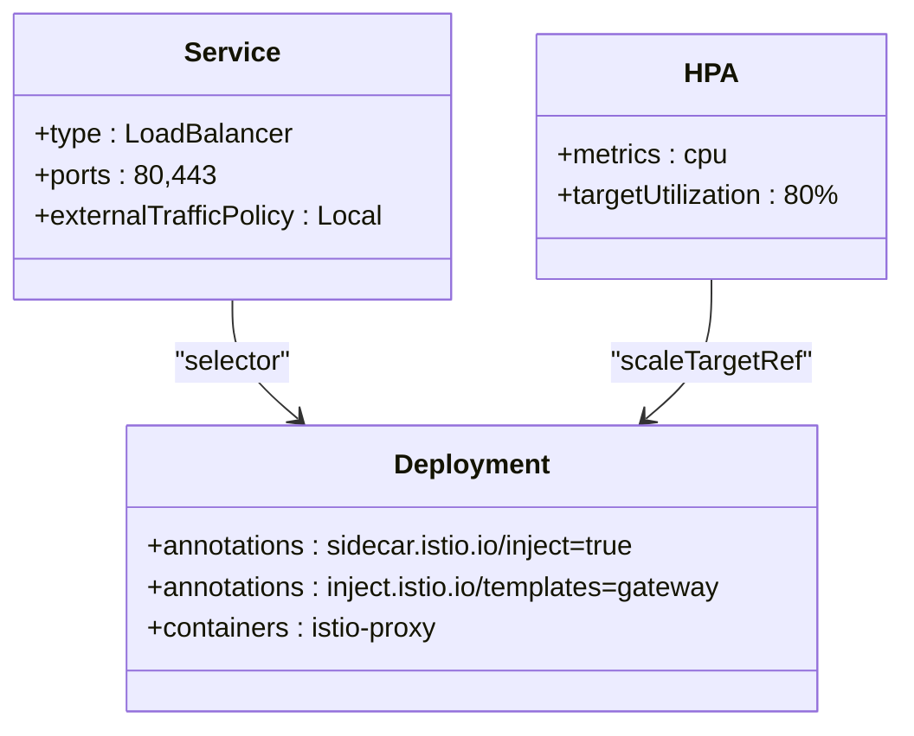
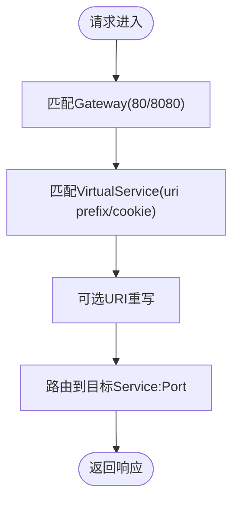
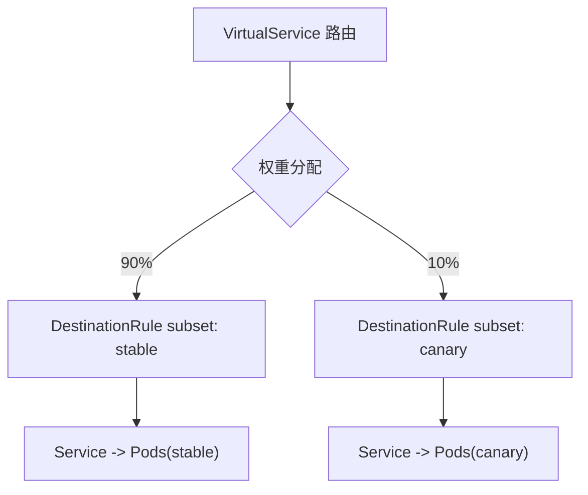
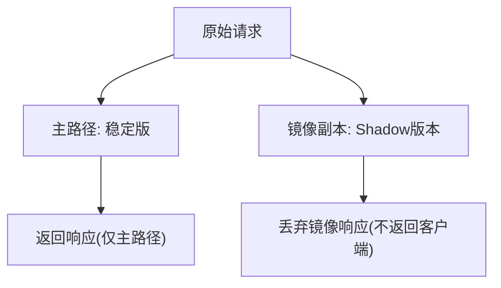
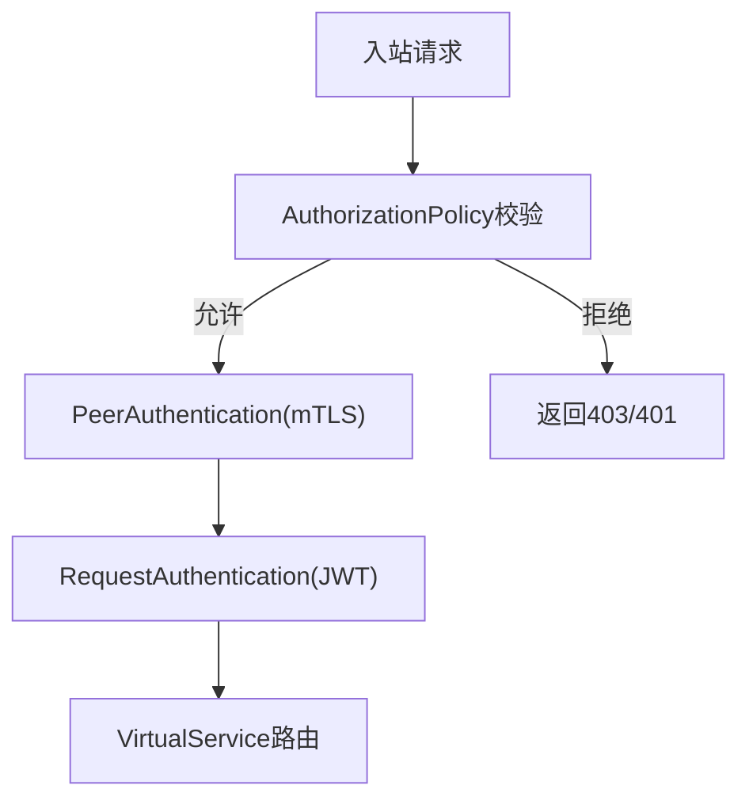
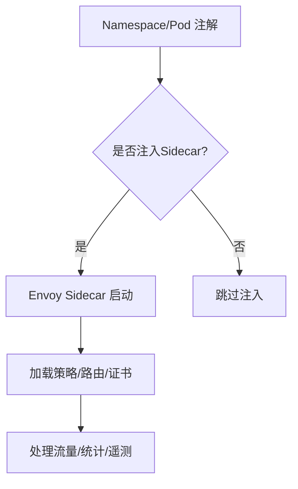
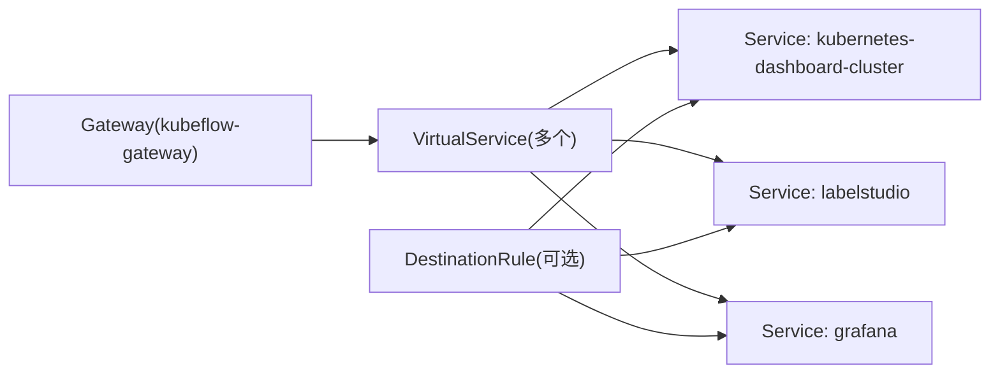

# 流量路由与治理

<cite>
**本文引用的文件**   
- [install/kubernetes/istio/install-1.15.0.yaml](file://install/kubernetes/istio/install-1.15.0.yaml)
- [install/kubernetes/istio/istio-gateway.yaml](file://install/kubernetes/istio/istio-gateway.yaml)
- [install/kubernetes/gateway.yaml](file://install/kubernetes/gateway.yaml)
- [install/kubernetes/virtual.yaml](file://install/kubernetes/virtual.yaml)
</cite>

## 目录
1. [简介](#简介)
2. [项目结构](#项目结构)
3. [核心组件](#核心组件)
4. [架构总览](#架构总览)
5. [详细组件分析](#详细组件分析)
6. [依赖关系分析](#依赖关系分析)
7. [性能与容量规划](#性能与容量规划)
8. [故障排查指南](#故障排查指南)
9. [结论](#结论)
10. [附录：配置清单与最佳实践](#附录配置清单与最佳实践)

## 简介
本文件面向在 Kubernetes 上运行 Cube Studio 的团队，聚焦“流量路由与治理”主题。仓库中已包含 Istio 安装资源、Ingress Gateway 部署、以及基于 VirtualService/Gateway 的流量入口示例。本文结合这些资源，系统说明：
- 流量分流（Canary）与流量复制（Shadow）的配置思路
- 负载均衡策略与连接池、熔断等治理能力
- Sidecar 代理注入与 Istio 集成要点
- 安全策略与访问控制（AuthorizationPolicy、PeerAuthentication、RequestAuthentication）
- 监控、可观测性与故障隔离的最佳实践
- 实际配置示例与调试技巧

## 项目结构
与流量路由和治理直接相关的资源位于 install/kubernetes 目录下：
- istio：Istio CRD 与安装清单、Gateway 部署
- gateway.yaml：定义集群入口 Gateway
- virtual.yaml：基于路径前缀与 Cookie 的 VirtualService 路由示例



图表来源
- [install/kubernetes/istio/istio-gateway.yaml:41-76](file://install/kubernetes/istio/istio-gateway.yaml#L41-L76)
- [install/kubernetes/gateway.yaml:1-38](file://install/kubernetes/gateway.yaml#L1-L38)
- [install/kubernetes/virtual.yaml:1-172](file://install/kubernetes/virtual.yaml#L1-L172)

章节来源
- [install/kubernetes/istio/istio-gateway.yaml:1-173](file://install/kubernetes/istio/istio-gateway.yaml#L1-L173)
- [install/kubernetes/gateway.yaml:1-38](file://install/kubernetes/gateway.yaml#L1-L38)
- [install/kubernetes/virtual.yaml:1-172](file://install/kubernetes/virtual.yaml#L1-L172)

## 核心组件
- Istio 控制面与数据面
  - 控制面：Pilot/Istiod 负责配置下发与策略计算
  - 数据面：Envoy Sidecar 与 Ingress Gateway 承载流量转发、策略执行与遥测采集
- 入口网关
  - 通过 Service LoadBalancer 暴露 80/443，并启用 sidecar 注入
- 路由规则
  - Gateway：声明监听端口与协议
  - VirtualService：按 URI 前缀、Header/Cookie 进行匹配与重写，再路由到目标 Service
- 安全与访问控制
  - AuthorizationPolicy：基于来源、方法、路径、命名空间等的细粒度访问控制
  - PeerAuthentication：mTLS 加密通信策略
  - RequestAuthentication：JWT 认证策略（需配合 Provider）

章节来源
- [install/kubernetes/istio/install-1.15.0.yaml:1-300](file://install/kubernetes/istio/install-1.15.0.yaml#L1-L300)
- [install/kubernetes/istio/istio-gateway.yaml:1-173](file://install/kubernetes/istio/istio-gateway.yaml#L1-L173)
- [install/kubernetes/gateway.yaml:1-38](file://install/kubernetes/gateway.yaml#L1-L38)
- [install/kubernetes/virtual.yaml:1-172](file://install/kubernetes/virtual.yaml#L1-L172)

## 架构总览
下图展示从外部请求到内部服务的完整链路，包括 Gateway、VirtualService、Service、Pod 与 Sidecar 的关系。



图表来源
- [install/kubernetes/istio/istio-gateway.yaml:41-76](file://install/kubernetes/istio/istio-gateway.yaml#L41-L76)
- [install/kubernetes/gateway.yaml:1-38](file://install/kubernetes/gateway.yaml#L1-L38)
- [install/kubernetes/virtual.yaml:1-172](file://install/kubernetes/virtual.yaml#L1-L172)

## 详细组件分析

### 入口网关与 Sidecar 注入
- Ingress Gateway 以 Service LoadBalancer 暴露 80/443，并开启 externalTrafficPolicy=Local 以保留真实客户端 IP
- Deployment 中启用了 sidecar.istio.io/inject=true，并通过 inject.istio.io/templates=gateway 使用专用模板
- HPA 基于 CPU 利用率自动扩缩容



图表来源
- [install/kubernetes/istio/istio-gateway.yaml:41-173](file://install/kubernetes/istio/istio-gateway.yaml#L41-L173)

章节来源
- [install/kubernetes/istio/istio-gateway.yaml:1-173](file://install/kubernetes/istio/istio-gateway.yaml#L1-L173)

### 流量入口与路由（Gateway + VirtualService）
- Gateway 定义监听 80/8080 端口，hosts 为通配符以支持泛域名
- VirtualService 通过 uri prefix 与 cookie 匹配，实现多应用的路由与路径重写
- 典型场景：Kubernetes Dashboard、Label Studio、Grafana 等通过统一域名+路径前缀暴露



图表来源
- [install/kubernetes/gateway.yaml:1-38](file://install/kubernetes/gateway.yaml#L1-L38)
- [install/kubernetes/virtual.yaml:1-172](file://install/kubernetes/virtual.yaml#L1-L172)

章节来源
- [install/kubernetes/gateway.yaml:1-38](file://install/kubernetes/gateway.yaml#L1-L38)
- [install/kubernetes/virtual.yaml:1-172](file://install/kubernetes/virtual.yaml#L1-L172)

### 流量分流（Canary）与灰度发布
- 通过 DestinationRule 的子集（subsets）将同一 Service 的不同版本划分到不同标签组
- VirtualService 通过 route.weight 将流量按比例分配到稳定版与金丝雀版本
- 建议结合 Header/Cookie 做精准灰度，便于测试与回滚



说明
- 该图为概念图，用于说明 Canay 分流思路；具体 YAML 可在现有 VirtualService/DestinationRule 基础上扩展 weight 与 subsets

### 流量复制（Shadow/Traffic Mirroring）
- 在 VirtualService 中使用 mirror/mirror_percent 将部分流量复制到 Shadow 服务
- 适用于上线前对生产流量的无损验证，不影响主路径响应



说明
- 该图为概念图，用于说明 Shadow 流量复制思路；具体 YAML 可在现有 VirtualService 基础上添加 mirror 字段

### 负载均衡与连接池
- DestinationRule 支持多种负载均衡算法（ROUND_ROBIN、LEAST_CONN、RANDOM、LEAST_REQUEST、一致性哈希等）
- 支持连接池（HTTP/TCP）、超时、重试、熔断（Outlier Detection）、本地亲和与故障转移
- 可通过 portLevelSettings 针对端口细化策略

```mermaid
classDiagram
class DestinationRule {
+host
+subsets[]
+trafficPolicy{
loadBalancer
connectionPool{http,tcp}
outlierDetection
localityLbSetting
tls
}
}
```

图表来源
- [install/kubernetes/istio/install-1.15.0.yaml:208-800](file://install/kubernetes/istio/install-1.15.0.yaml#L208-L800)

章节来源
- [install/kubernetes/istio/install-1.15.0.yaml:208-800](file://install/kubernetes/istio/install-1.15.0.yaml#L208-L800)

### 安全策略与访问控制
- AuthorizationPolicy：基于来源（IP、命名空间、Principal）、操作（Host/Method/Path/Port）、条件（when）进行允许/拒绝/审计
- PeerAuthentication：强制或允许 mTLS，保障服务间通信加密
- RequestAuthentication：JWT 认证，需配置 JWT Provider（如 Google、Auth0、自托管）



图表来源
- [install/kubernetes/istio/install-1.15.0.yaml:1-207](file://install/kubernetes/istio/install-1.15.0.yaml#L1-L207)

章节来源
- [install/kubernetes/istio/install-1.15.0.yaml:1-207](file://install/kubernetes/istio/install-1.15.0.yaml#L1-L207)

### Sidecar 代理功能与 Istio 集成
- Sidecar 注入开关：sidecar.istio.io/inject
- 默认命名空间或 Pod 级别可关闭注入（例如某些基础设施组件）
- Ingress Gateway 使用专用模板 inject.istio.io/templates=gateway



图表来源
- [install/kubernetes/istio/install-1.15.0.yaml:9052-9183](file://install/kubernetes/istio/install-1.15.0.yaml#L9052-L9183)
- [install/kubernetes/istio/istio-gateway.yaml:97-108](file://install/kubernetes/istio/istio-gateway.yaml#L97-L108)

章节来源
- [install/kubernetes/istio/install-1.15.0.yaml:9052-9183](file://install/kubernetes/istio/install-1.15.0.yaml#L9052-L9183)
- [install/kubernetes/istio/istio-gateway.yaml:97-108](file://install/kubernetes/istio/istio-gateway.yaml#L97-L108)

## 依赖关系分析
- Ingress Gateway Service 暴露 80/443，Deployment 内包含 istio-proxy 容器
- Gateway 对象选择 istio: ingressgateway 标签的 Ingress Gateway
- VirtualService 绑定到 kubeflow/kubeflow-gateway，按路径前缀与 Cookie 匹配后路由到各 Service
- DestinationRule 与 VirtualService 共同决定流量分发与负载均衡策略



图表来源
- [install/kubernetes/gateway.yaml:1-38](file://install/kubernetes/gateway.yaml#L1-L38)
- [install/kubernetes/virtual.yaml:1-172](file://install/kubernetes/virtual.yaml#L1-L172)

章节来源
- [install/kubernetes/gateway.yaml:1-38](file://install/kubernetes/gateway.yaml#L1-L38)
- [install/kubernetes/virtual.yaml:1-172](file://install/kubernetes/virtual.yaml#L1-L172)

## 性能与容量规划
- Ingress Gateway 横向扩容
  - 使用 HPA 基于 CPU 利用率（80%）自动扩缩容
  - 合理设置资源 requests/limits，避免被调度器驱逐
- 连接池与超时
  - 针对高并发服务调整 http2MaxRequests、idleTimeout、tcp.maxConnections
- 负载均衡
  - 低延迟场景优先 LEAST_REQUEST/LEAST_CONN
  - 会话粘性使用一致性哈希（Cookie/Header/Query/IP）
- 熔断与异常检测
  - 配置 consecutiveErrors/consecutive5xxErrors、interval、maxEjectionPercent
- 监控与指标
  - Ingress Gateway 暴露 /stats/prometheus，Prometheus 抓取
  - 结合 Grafana 可视化

章节来源
- [install/kubernetes/istio/istio-gateway.yaml:131-173](file://install/kubernetes/istio/istio-gateway.yaml#L131-L173)
- [install/kubernetes/istio/install-1.15.0.yaml:276-520](file://install/kubernetes/istio/install-1.15.0.yaml#L276-L520)

## 故障排查指南
- 无法访问入口
  - 检查 Gateway 是否正确创建且监听端口开放
  - 确认 Ingress Gateway Service 类型与外部 IP 可达
- VirtualService 不生效
  - 核对 hosts、uri prefix、cookie 匹配是否与请求一致
  - 检查 rewrite 是否导致路径错位
- 鉴权失败
  - 检查 AuthorizationPolicy 规则是否过于严格
  - 确认 JWT Provider 配置与 Token 签名密钥正确
- 连接异常/超时
  - 检查 DestinationRule 的连接池与超时配置
  - 查看 Outlier Detection 是否频繁剔除后端实例
- Sidecar 未注入
  - 检查 Namespace/Pod 的 sidecar.istio.io/inject 注解
  - 确认 mutating webhook 正常

章节来源
- [install/kubernetes/virtual.yaml:1-172](file://install/kubernetes/virtual.yaml#L1-L172)
- [install/kubernetes/istio/install-1.15.0.yaml:1-207](file://install/kubernetes/istio/install-1.15.0.yaml#L1-L207)
- [install/kubernetes/istio/install-1.15.0.yaml:208-800](file://install/kubernetes/istio/install-1.15.0.yaml#L208-L800)

## 结论
本仓库提供了 Istio 的基础设施与入口路由示例。通过 Gateway 与 VirtualService 可实现统一入口与精细化的路径级路由；借助 DestinationRule 与 VirtualService 的 subsets/weight/mirror 能力，可落地 Canary 与 Shadow 流量治理；AuthorizationPolicy/PeerAuthentication/RequestAuthentication 提供细粒度的访问控制与安全通信。结合 Prometheus/Grafana 与 HPA，可构建高可用、可观测、可扩展的服务网格体系。

## 附录：配置清单与最佳实践

- 入口与路由
  - 使用 Gateway 声明 80/8080 端口，VirtualService 按路径前缀与 Cookie 匹配
  - 参考：[install/kubernetes/gateway.yaml](file://install/kubernetes/gateway.yaml)、[install/kubernetes/virtual.yaml](file://install/kubernetes/virtual.yaml)
- Canary 与 Shadow
  - 在 DestinationRule 中定义 subsets（stable/canary），VirtualService 使用 weight 分流
  - 使用 mirror/mirror_percent 进行流量复制
- 负载均衡与连接池
  - 根据业务特性选择合适的负载均衡算法，配置连接池与超时
  - 参考：[install/kubernetes/istio/install-1.15.0.yaml](file://install/kubernetes/istio/install-1.15.0.yaml)
- 安全策略
  - 使用 AuthorizationPolicy 限制来源与方法/路径
  - 使用 PeerAuthentication 强制 mTLS
  - 使用 RequestAuthentication 对接 JWT Provider
  - 参考：[install/kubernetes/istio/install-1.15.0.yaml](file://install/kubernetes/istio/install-1.15.0.yaml)
- Sidecar 注入
  - 通过 sidecar.istio.io/inject 控制注入，Ingress Gateway 使用专用模板
  - 参考：[install/kubernetes/istio/istio-gateway.yaml](file://install/kubernetes/istio/istio-gateway.yaml)、[install/kubernetes/istio/install-1.15.0.yaml](file://install/kubernetes/istio/install-1.15.0.yaml)
- 监控与可观测性
  - Ingress Gateway 暴露 /stats/prometheus，Prometheus 抓取，Grafana 可视化
  - 参考：[install/kubernetes/istio/istio-gateway.yaml](file://install/kubernetes/istio/istio-gateway.yaml)