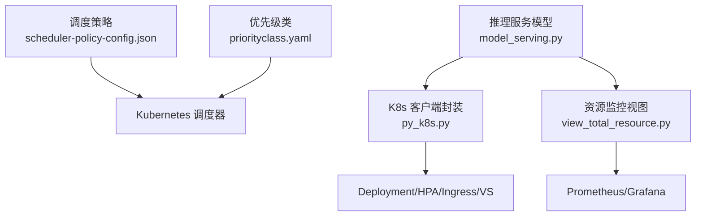
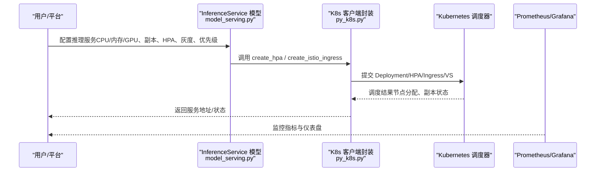
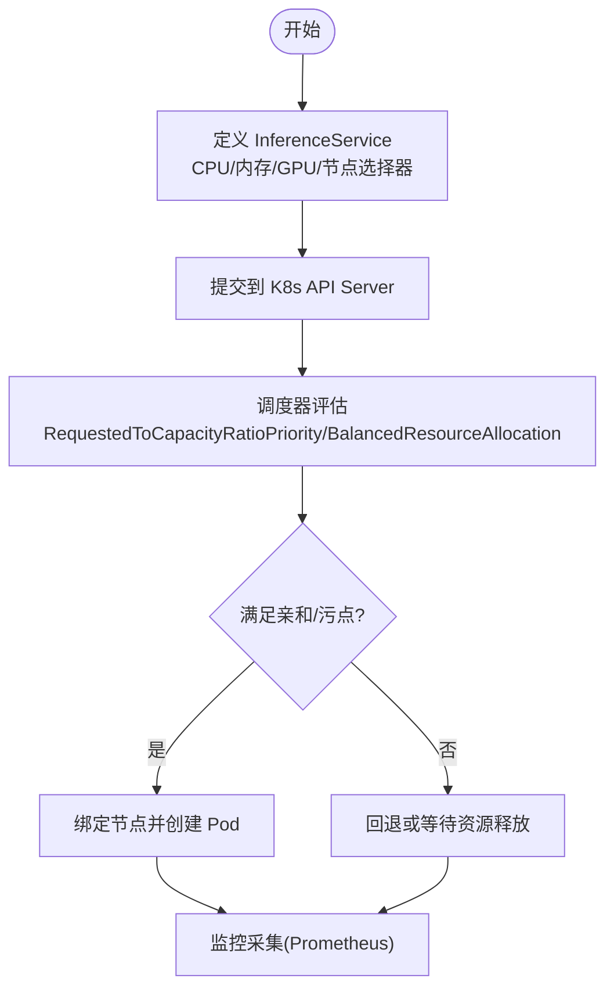
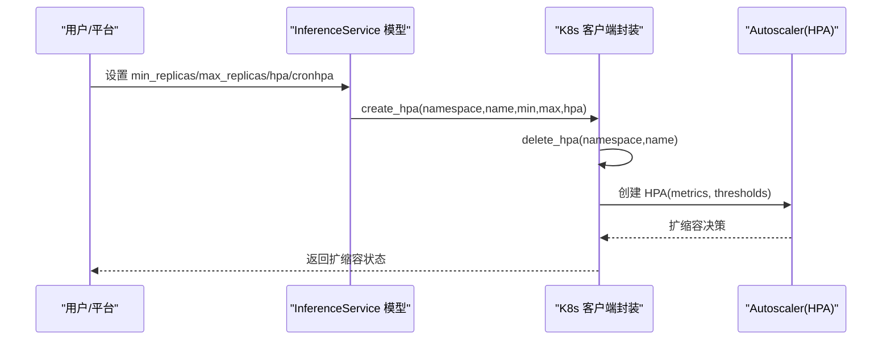
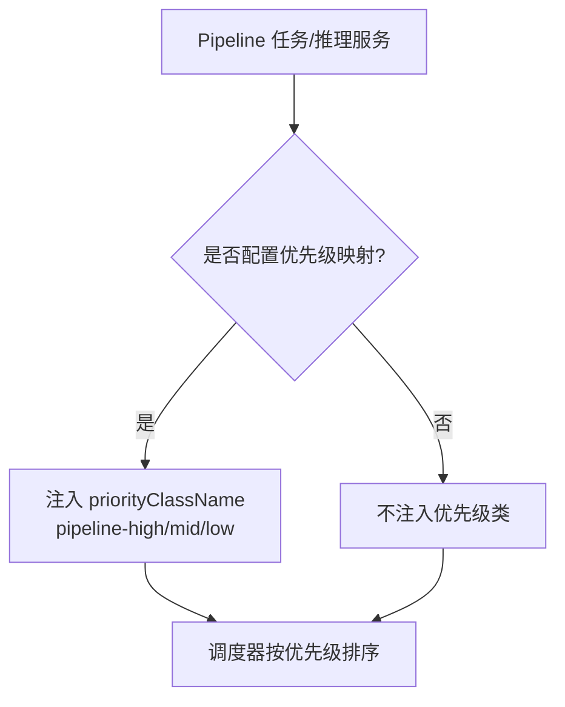
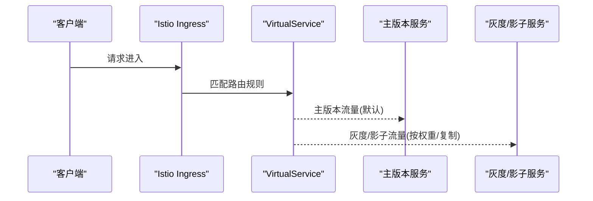
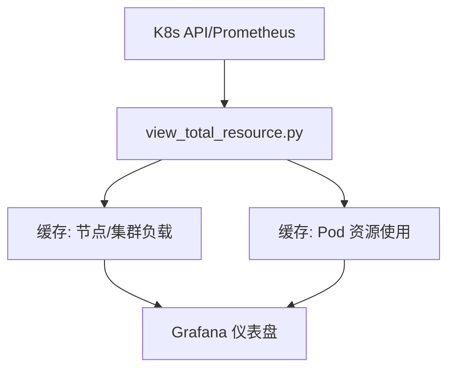
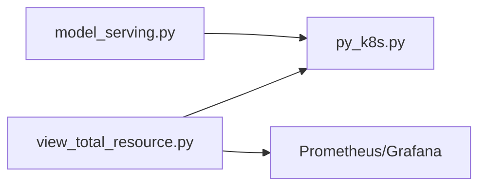

# 资源调度管理

<cite>
**本文引用的文件**   
- [scheduler-policy-config.json](file://install/kubernetes/scheduler-policy-config.json)
- [priorityclass.yaml](file://install/kubernetes/cube/priorityclass.yaml)
- [model_serving.py](file://myapp/models/model_serving.py)
- [view_total_resource.py](file://myapp/views/view_total_resource.py)
- [py_k8s.py](file://job-template/job/pkgs/k8s/py_k8s.py)
</cite>

## 目录
1. [简介](#简介)
2. [项目结构](#项目结构)
3. [核心组件](#核心组件)
4. [架构总览](#架构总览)
5. [详细组件分析](#详细组件分析)
6. [依赖关系分析](#依赖关系分析)
7. [性能与容量规划](#性能与容量规划)
8. [故障排查指南](#故障排查指南)
9. [结论](#结论)

## 简介
本文件面向推理服务的资源调度管理，覆盖 CPU、内存、GPU 资源的申请与调度机制；副本数管理与弹性伸缩（HPA）配置；优先级调度；服务负载均衡、流量分发与灰度发布；以及资源监控、性能调优与容量规划的最佳实践。文档基于仓库中的 Kubernetes 调度策略、PriorityClass、推理服务模型定义、K8s 客户端封装和资源监控视图进行系统化说明，并提供可操作的配置思路与排障指引。

## 项目结构
围绕资源调度与推理服务的关键代码与配置分布如下：
- 集群调度策略：install/kubernetes/scheduler-policy-config.json
- 任务优先级类：install/kubernetes/cube/priorityclass.yaml
- 推理服务数据模型与字段：myapp/models/model_serving.py
- K8s 客户端封装（含 HPA、Ingress/VirtualService 等）：job-template/job/pkgs/k8s/py_k8s.py
- 资源监控与可视化：myapp/views/view_total_resource.py

图表来源
- [scheduler-policy-config.json:1-65](file://install/kubernetes/scheduler-policy-config.json#L1-L65)
- [priorityclass.yaml:1-34](file://install/kubernetes/cube/priorityclass.yaml#L1-L34)
- [model_serving.py:202-256](file://myapp/models/model_serving.py#L202-L256)
- [py_k8s.py:1480-1565](file://job-template/job/pkgs/k8s/py_k8s.py#L1480-L1565)
- [view_total_resource.py:273-544](file://myapp/views/view_total_resource.py#L273-L544)

章节来源
- [scheduler-policy-config.json:1-65](file://install/kubernetes/scheduler-policy-config.json#L1-L65)
- [priorityclass.yaml:1-34](file://install/kubernetes/cube/priorityclass.yaml#L1-L34)
- [model_serving.py:202-256](file://myapp/models/model_serving.py#L202-L256)
- [py_k8s.py:1480-1565](file://job-template/job/pkgs/k8s/py_k8s.py#L1480-L1565)
- [view_total_resource.py:273-544](file://myapp/views/view_total_resource.py#L273-L544)

## 核心组件
- 调度策略与优先级
  - 调度策略通过 scheduler-policy-config.json 定义，包含 SelectorSpreadPriority、InterPodAffinityPriority、RequestedToCapacityRatioPriority、BalancedResourceAllocation、NodePreferAvoidPodsPriority、NodeAffinityPriority、TaintTolerationPriority、ImageLocalityPriority 等评分项，用于在节点选择与打分阶段平衡 CPU、内存等资源利用率。
  - PriorityClass 提供 pipeline-high/mid/low 三档优先级，preemptionPolicy 为 Never，避免抢占训练任务。
- 推理服务模型
  - InferenceService 定义了推理服务的最小/最大副本、HPA、定时伸缩、监控指标、健康检查、伴随容器、端口、资源请求/限制、灰度发布、影子流量、限流、优先级等关键属性。
- K8s 客户端封装
  - py_k8s.py 提供创建/删除 HPA、创建/更新 Istio Ingress/VirtualService（支持灰度分流与影子流量）等方法，支撑弹性伸缩与流量治理。
- 资源监控
  - view_total_resource.py 聚合节点与 Pod 资源使用，结合 Prometheus 指标生成仪表盘，展示集群整体负载、节点负载与 Pod 资源占用。

章节来源
- [scheduler-policy-config.json:1-65](file://install/kubernetes/scheduler-policy-config.json#L1-L65)
- [priorityclass.yaml:1-34](file://install/kubernetes/cube/priorityclass.yaml#L1-L34)
- [model_serving.py:202-256](file://myapp/models/model_serving.py#L202-L256)
- [py_k8s.py:1480-1565](file://job-template/job/pkgs/k8s/py_k8s.py#L1480-L1565)
- [view_total_resource.py:273-544](file://myapp/views/view_total_resource.py#L273-L544)

## 架构总览
推理服务从“模型定义”到“K8s 资源对象”，再到“流量入口与监控”的端到端流程如下：

图表来源
- [model_serving.py:202-256](file://myapp/models/model_serving.py#L202-L256)
- [py_k8s.py:1480-1565](file://job-template/job/pkgs/k8s/py_k8s.py#L1480-L1565)
- [view_total_resource.py:273-544](file://myapp/views/view_total_resource.py#L273-L544)

## 详细组件分析

### 资源申请与调度机制（CPU/内存/GPU）
- 资源申请
  - InferenceService 提供 resource_cpu、resource_memory、resource_gpu 字段，用于声明 Pod 的资源请求与限制。
  - node_selector 控制节点亲和性，例如 cpu=true;serving=true，可将服务调度到具备相应标签的节点。
- 调度策略
  - RequestedToCapacityRatioPriority 对 CPU、memory 进行加权评分，使新 Pod 倾向于被调度到资源更均衡的节点。
  - BalancedResourceAllocation 进一步平衡节点间资源分布。
  - NodeAffinityPriority/TaintTolerationPriority 确保节点亲和与污点容忍生效。
- GPU 调度
  - 通过 nvidia-device-plugin 暴露 GPU 资源，InferenceService.resource_gpu 指定所需 GPU 数量。
  - 节点标签 gpu=true/gpu-type=... 用于区分 GPU 机型。

图表来源
- [model_serving.py:202-256](file://myapp/models/model_serving.py#L202-L256)
- [scheduler-policy-config.json:1-65](file://install/kubernetes/scheduler-policy-config.json#L1-L65)

章节来源
- [model_serving.py:202-256](file://myapp/models/model_serving.py#L202-L256)
- [scheduler-policy-config.json:1-65](file://install/kubernetes/scheduler-policy-config.json#L1-L65)

### 副本数管理与弹性伸缩（HPA）
- 副本数
  - min_replicas/max_replicas 定义推理服务的弹性范围。
- HPA 配置
  - hpa 字段以字符串形式描述阈值与指标（如 CPU、内存、自定义指标），由 py_k8s.create_hpa 解析并创建 Autoscaler。
  - cronhpa 字段支持定时伸缩（扩缩容计划）。
- 实现要点
  - create_hpa 会先删除旧 HPA，再根据 hpa 配置构建 metrics 列表并创建新的 HPA。
  - delete_hpa 兼容 v1 与 v1beta1 API。

图表来源
- [model_serving.py:233-237](file://myapp/models/model_serving.py#L233-L237)
- [py_k8s.py:1693-1794](file://job-template/job/pkgs/k8s/py_k8s.py#L1693-L1794)

章节来源
- [model_serving.py:233-237](file://myapp/models/model_serving.py#L233-L237)
- [py_k8s.py:1693-1794](file://job-template/job/pkgs/k8s/py_k8s.py#L1693-L1794)

### 优先级调度
- PriorityClass
  - 提供 pipeline-high/mid/low 三档优先级，preemptionPolicy=Never，避免抢占运行中训练任务。
- 应用方式
  - 在 myapp 配置中映射 PIPELINE_PRIORITY_CLASS，平台可为 Pipeline 任务注入 priorityClassName。
- 推理服务优先级
  - InferenceService.priority 字段可用于标注推理服务优先级，便于后续调度策略扩展或平台侧统一处理。

图表来源
- [priorityclass.yaml:1-34](file://install/kubernetes/cube/priorityclass.yaml#L1-L34)
- [model_serving.py:255-256](file://myapp/models/model_serving.py#L255-L256)

章节来源
- [priorityclass.yaml:1-34](file://install/kubernetes/cube/priorityclass.yaml#L1-L34)
- [model_serving.py:255-256](file://myapp/models/model_serving.py#L255-L256)

### 服务负载均衡、流量分发与灰度发布
- 负载均衡
  - Service/Endpoints 提供基础负载均衡；Ingress/Istio VirtualService 提供高级流量治理。
- 灰度发布（Canary）
  - canary 字段支持按比例将流量分发给新版本服务（如 service_name:百分比%）。
- 影子流量（Shadow）
  - shadow 字段支持复制一定比例的流量到影子服务，用于离线验证。
- 实现要点
  - create_istio_ingress 解析 canary/shadow 配置，动态生成 VirtualService 路由规则与权重。

图表来源
- [py_k8s.py:1480-1565](file://job-template/job/pkgs/k8s/py_k8s.py#L1480-L1565)
- [model_serving.py:247-249](file://myapp/models/model_serving.py#L247-L249)

章节来源
- [py_k8s.py:1480-1565](file://job-template/job/pkgs/k8s/py_k8s.py#L1480-L1565)
- [model_serving.py:247-249](file://myapp/models/model_serving.py#L247-L249)

### 资源监控与可视化
- 节点与 Pod 资源
  - view_total_resource.node_traffic 聚合各节点 CPU/内存/GPU 使用情况，并按组织与设备类型分组展示。
  - pod_resource 汇总命名空间下 Pod 的请求与使用量，结合 Prometheus 指标计算实际使用率。
- 全局负载
  - 缓存集群级 CPU/内存/GPU 总量、请求量与使用量，供仪表盘渲染。
- 监控链接
  - 集成 Grafana 面板，提供节点、任务、GPU 等维度的监控跳转。

图表来源
- [view_total_resource.py:26-169](file://myapp/views/view_total_resource.py#L26-L169)
- [view_total_resource.py:174-269](file://myapp/views/view_total_resource.py#L174-L269)
- [view_total_resource.py:343-427](file://myapp/views/view_total_resource.py#L343-L427)

章节来源
- [view_total_resource.py:26-169](file://myapp/views/view_total_resource.py#L26-L169)
- [view_total_resource.py:174-269](file://myapp/views/view_total_resource.py#L174-L269)
- [view_total_resource.py:343-427](file://myapp/views/view_total_resource.py#L343-L427)

## 依赖关系分析
- 组件耦合
  - model_serving.py 定义推理服务元数据，作为部署与伸缩的配置源。
  - py_k8s.py 作为 K8s 客户端封装，负责创建/删除 HPA、Ingress/VirtualService 等对象。
  - view_total_resource.py 依赖 K8s API 与 Prometheus 获取监控数据，并通过缓存降低查询压力。
- 外部依赖
  - Kubernetes API Server、Scheduler、Autoscaler、Istio、Prometheus/Grafana。
- 潜在循环依赖
  - 当前模块职责清晰，未见直接循环依赖；但需注意 view_total_resource.py 与 K8s 客户端之间的频繁调用可能带来性能开销。

图表来源
- [model_serving.py:202-256](file://myapp/models/model_serving.py#L202-L256)
- [py_k8s.py:1480-1565](file://job-template/job/pkgs/k8s/py_k8s.py#L1480-L1565)
- [view_total_resource.py:273-544](file://myapp/views/view_total_resource.py#L273-L544)

章节来源
- [model_serving.py:202-256](file://myapp/models/model_serving.py#L202-L256)
- [py_k8s.py:1480-1565](file://job-template/job/pkgs/k8s/py_k8s.py#L1480-L1565)
- [view_total_resource.py:273-544](file://myapp/views/view_total_resource.py#L273-L544)

## 性能与容量规划
- 资源申请与限制
  - 合理设置 resource_cpu/resource_memory/resource_gpu，避免过度预留导致碎片化。
  - 使用 requests/limits 分离保证调度稳定性与 QoS。
- 调度策略优化
  - 调整 scheduler-policy-config.json 中各优先级的权重，平衡 CPU/内存利用率与节点亲和性。
  - 利用 NodeAffinity/TaintToleration 将推理服务调度到专用 GPU 节点。
- 弹性伸缩
  - HPA 指标建议同时考虑 CPU、内存与业务自定义指标（如 QPS、延迟）。
  - 设置合理的 min_replicas 保障冷启动时间，max_replicas 防止雪崩。
- 容量规划
  - 基于 view_total_resource 的全局负载与节点负载数据，定期评估集群扩容需求。
  - 关注 GPU 利用率与显存峰值，避免 OOM 与排队。
- 最佳实践
  - 灰度发布逐步放量，配合影子流量验证新版本稳定性。
  - 使用 PriorityClass 区分高优推理任务与批量训练任务，避免抢占冲突。

[本节为通用指导，不涉及具体文件分析]

## 故障排查指南
- 调度失败
  - 检查节点标签与 node_selector 是否匹配；确认 GPU 节点是否就绪且未被污点隔离。
  - 查看调度策略评分项是否导致无法找到合适节点。
- HPA 不生效
  - 确认 hpa 配置格式正确，指标可用；检查 Autoscaler CRD 是否安装。
  - 查看 Metrics Server 与 Prometheus 是否正常上报指标。
- 灰度/影子流量异常
  - 校验 canary/shadow 配置语法（service_name:百分比%）。
  - 检查 Istio Ingress/VirtualService 是否正确创建与更新。
- 监控数据缺失
  - 确认 Prometheus 抓取目标正常；检查 Grafana 面板变量与命名空间过滤。
  - 注意 view_total_resource 的缓存过期时间，必要时刷新缓存。

章节来源
- [scheduler-policy-config.json:1-65](file://install/kubernetes/scheduler-policy-config.json#L1-L65)
- [py_k8s.py:1480-1565](file://job-template/job/pkgs/k8s/py_k8s.py#L1480-L1565)
- [py_k8s.py:1693-1794](file://job-template/job/pkgs/k8s/py_k8s.py#L1693-L1794)
- [view_total_resource.py:26-169](file://myapp/views/view_total_resource.py#L26-L169)
- [view_total_resource.py:174-269](file://myapp/views/view_total_resource.py#L174-L269)

## 结论
本项目通过清晰的推理服务模型定义、K8s 客户端封装与调度策略配置，实现了 CPU/内存/GPU 资源的精细化申请与调度、副本数与弹性伸缩管理、优先级调度以及灰度发布与影子流量。结合 Prometheus/Grafana 监控，能够持续观测集群与 Pod 资源使用情况，辅助容量规划与性能调优。建议在生产环境中结合业务特征细化 HPA 指标、优化调度策略权重，并建立完善的灰度发布与回滚流程，以提升系统稳定性与资源利用率。