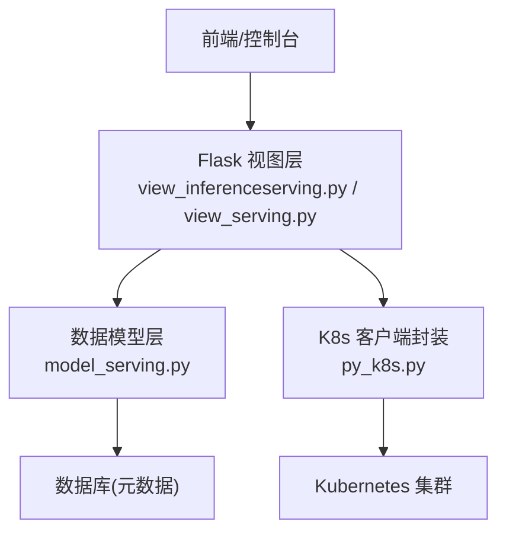
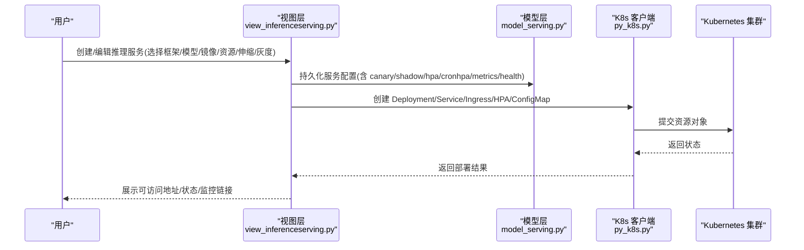
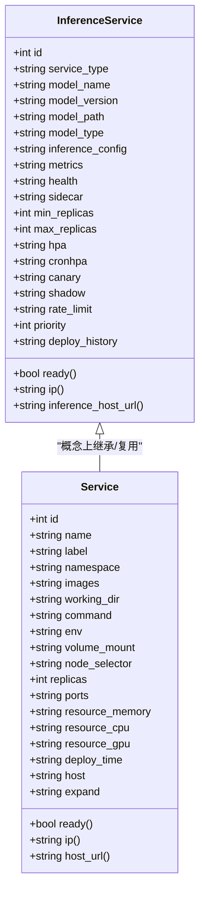
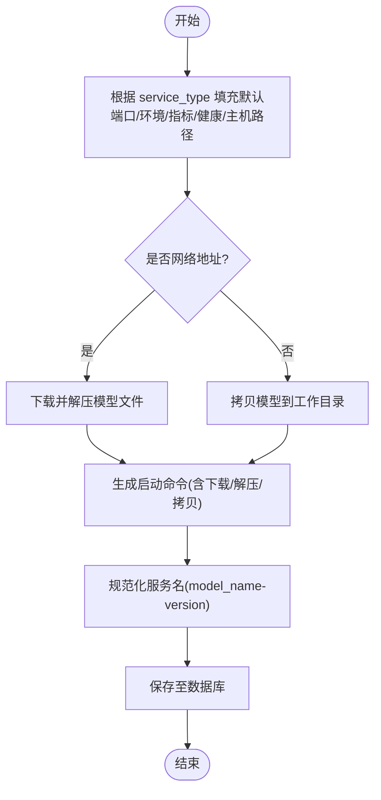
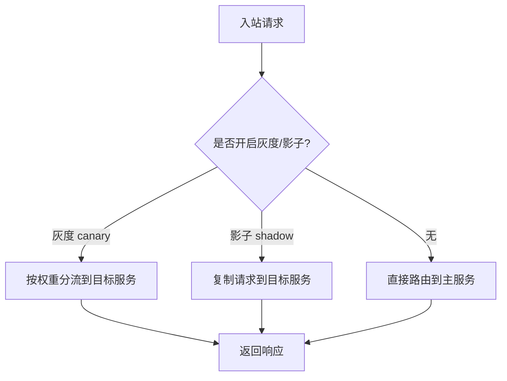
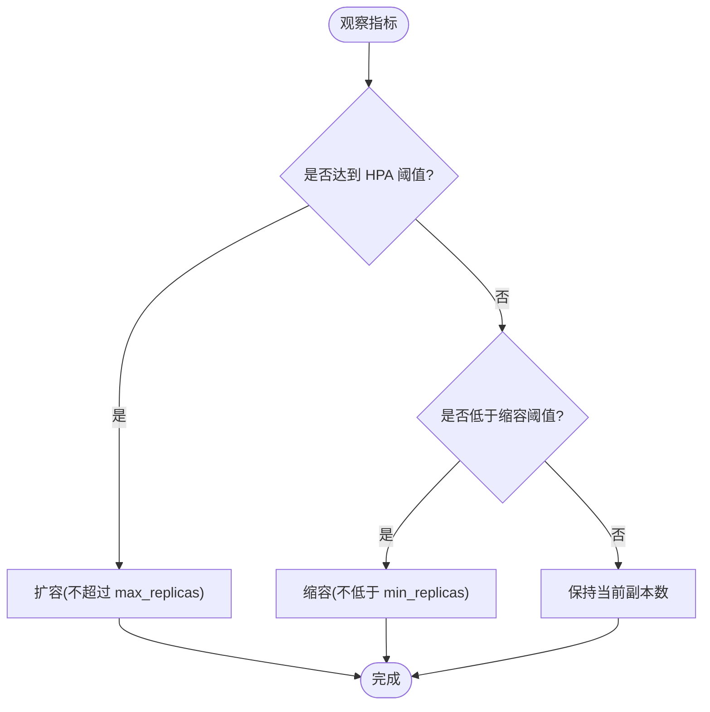
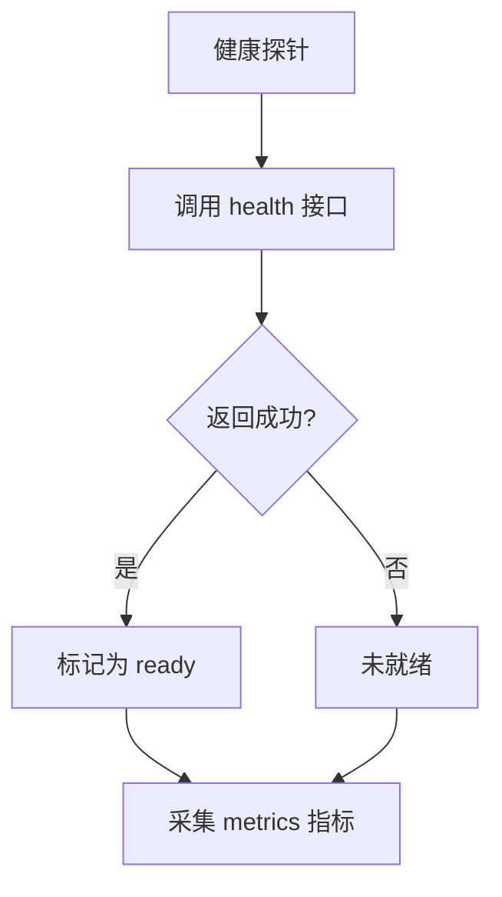
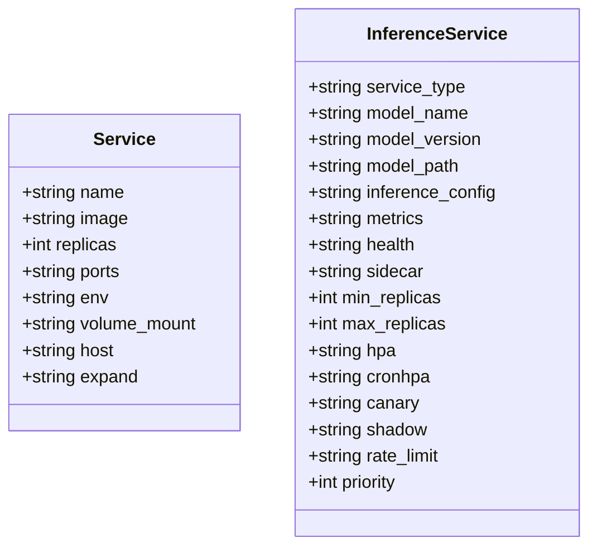
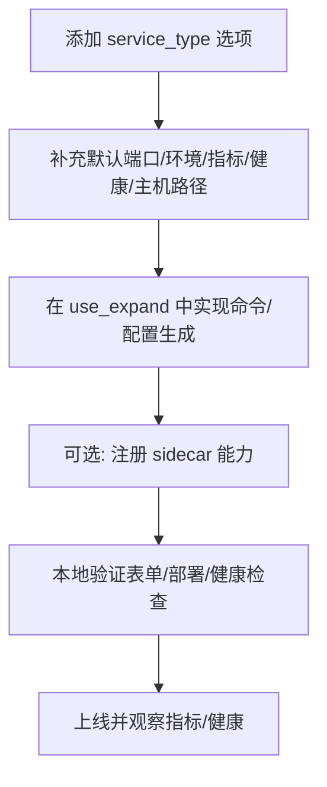
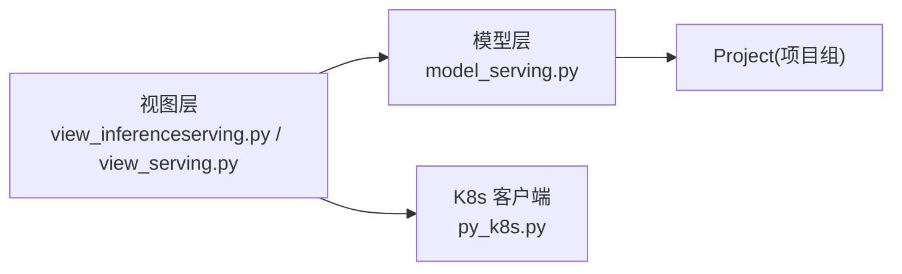

# 推理服务与模型管理

<cite>
**本文引用的文件**   
- [README.md](file://README.md)
- [model_serving.py](file://myapp/models/model_serving.py)
- [view_inferenceserving.py](file://myapp/views/view_inferenceserving.py)
- [view_serving.py](file://myapp/views/view_serving.py)
- [py_k8s.py](file://job-template/job/pkgs/k8s/py_k8s.py)
</cite>

## 目录
1. [引言](#引言)
2. [项目结构](#项目结构)
3. [核心组件](#核心组件)
4. [架构总览](#架构总览)
5. [详细组件分析](#详细组件分析)
6. [依赖关系分析](#依赖关系分析)
7. [性能与容量规划](#性能与容量规划)
8. [故障处理与排障指南](#故障处理与排障指南)
9. [结论](#结论)
10. [附录：API 与配置示例](#附录api-与配置示例)

## 引言
本文件面向“推理服务与模型管理”的完整技术文档，覆盖以下主题：
- 模型版本管理与多框架推理服务发布
- 流量治理（A/B 测试、灰度发布、流量复制/分流）
- 弹性伸缩（HPA/CronHPA）、优先级与副本控制
- 监控指标与健康检查
- 服务配置、API 接口定义与扩展新推理框架/服务类型
- 性能优化、故障处理与容量规划最佳实践

平台在 README 中明确支持推理服务的零代码发布、多版本滚动升级与回滚、弹性伸缩、随机/header 分流、限流、流量复制、sidecar、JWT 认证、定时伸缩容等能力。

**章节来源**
- [README.md:61-78](file://README.md#L61-L78)

## 项目结构
围绕推理服务与模型管理的核心代码位于后端 Python 应用 myapp 下：
- 数据模型：myapp/models/model_serving.py
- 视图与 API：myapp/views/view_inferenceserving.py、myapp/views/view_serving.py
- Kubernetes 客户端封装：job-template/job/pkgs/k8s/py_k8s.py

**图示来源**
- [view_inferenceserving.py:121-175](file://myapp/views/view_inferenceserving.py#L121-L175)
- [view_serving.py:49-100](file://myapp/views/view_serving.py#L49-L100)
- [model_serving.py:34-60](file://myapp/models/model_serving.py#L34-L60)
- [model_serving.py:202-256](file://myapp/models/model_serving.py#L202-L256)
- [py_k8s.py:1413-1420](file://job-template/job/pkgs/k8s/py_k8s.py#L1413-L1420)

**章节来源**
- [view_inferenceserving.py:121-175](file://myapp/views/view_inferenceserving.py#L121-L175)
- [view_serving.py:49-100](file://myapp/views/view_serving.py#L49-L100)
- [model_serving.py:34-60](file://myapp/models/model_serving.py#L34-L60)
- [model_serving.py:202-256](file://myapp/models/model_serving.py#L202-L256)
- [py_k8s.py:1413-1420](file://job-template/job/pkgs/k8s/py_k8s.py#L1413-L1420)

## 核心组件
- 内部服务 Service：用于快速部署通用容器化服务，提供基础资源、端口、挂载、环境变量、域名/泛域名访问等能力。
- 推理服务 InferenceService：面向 ML/TF/Torch/Triton 等多框架推理的统一抽象，包含模型元信息、镜像、命令、参数、弹性伸缩、健康检查、指标采集、灰度/影子流量、优先级、部署历史等。
- K8s 客户端封装：负责 Deployment/StatefulSet/Service/Ingress/HPA/ConfigMap 等资源的创建与清理。

关键职责划分：
- model_serving.py：定义 Service 与 InferenceService 的数据结构与属性方法（如 ready、ip、host_url、operate_html 等）。
- view_inferenceserving.py：实现推理服务的表单、校验、默认配置注入、预置命令/端口/健康检查/指标、灰度/影子流量、扩缩容策略、部署/调试/清理流程。
- view_serving.py：实现内部服务的表单、校验、部署/清理流程、外部 IP/泛域名接入。
- py_k8s.py：提供 create_service 等 K8s 操作封装。

**章节来源**
- [model_serving.py:34-60](file://myapp/models/model_serving.py#L34-L60)
- [model_serving.py:202-256](file://myapp/models/model_serving.py#L202-L256)
- [view_inferenceserving.py:121-175](file://myapp/views/view_inferenceserving.py#L121-L175)
- [view_serving.py:49-100](file://myapp/views/view_serving.py#L49-L100)
- [py_k8s.py:1413-1420](file://job-template/job/pkgs/k8s/py_k8s.py#L1413-L1420)

## 架构总览
推理服务从“模型注册 → 服务配置 → 发布上线 → 流量治理 → 监控告警”的全链路如下：

**图示来源**
- [view_inferenceserving.py:547-734](file://myapp/views/view_inferenceserving.py#L547-L734)
- [view_inferenceserving.py:749-797](file://myapp/views/view_inferenceserving.py#L749-L797)
- [model_serving.py:202-256](file://myapp/models/model_serving.py#L202-L256)
- [py_k8s.py:1413-1420](file://job-template/job/pkgs/k8s/py_k8s.py#L1413-L1420)

## 详细组件分析

### 数据模型与服务生命周期
- Service（内部服务）：字段包括 project、name、label、namespace、images、working_dir、command、env、volume_mount、node_selector、replicas、ports、resource_*、deploy_time、host、expand 等；提供 deploy/clear 快捷入口、ready/ip/host_url 等属性。
- InferenceService（推理服务）：在 Service 基础上增加 service_type、model_name/version/path/type、inference_config、metrics、health、sidecar、min/max_replicas、hpa、cronhpa、canary、shadow、rate_limit、priority、deploy_history 等；提供 operate_html/status_url/ready/ip/inference_host_url 等属性。

**图示来源**
- [model_serving.py:34-60](file://myapp/models/model_serving.py#L34-L60)
- [model_serving.py:202-256](file://myapp/models/model_serving.py#L202-L256)

**章节来源**
- [model_serving.py:34-60](file://myapp/models/model_serving.py#L34-L60)
- [model_serving.py:202-256](file://myapp/models/model_serving.py#L202-L256)

### 推理服务发布流程（含默认配置注入）
- 表单与校验：service_type、model_name/version、images、ports、metrics、health、hpa、cronhpa、canary、shadow、priority 等。
- 默认配置注入：根据 service_type 自动填充 INFERNENCE_PORTS/ENV/METRICS/HEALTH/HOST/COMMAND 等；对 tfserving/torch-server/triton-server/ml-server 分别生成对应命令与配置文件。
- 模型路径处理：支持本地路径或网络下载（zip/tar.gz），并在启动前解压/拷贝到约定目录。
- 名称规范化：按 model_name+version 生成稳定服务名。

**图示来源**
- [view_inferenceserving.py:547-734](file://myapp/views/view_inferenceserving.py#L547-L734)

**章节来源**
- [view_inferenceserving.py:547-734](file://myapp/views/view_inferenceserving.py#L547-L734)

### 流量治理：A/B 测试、灰度发布与流量复制
- 灰度分流 canary：将请求按比例路由到目标服务（格式 service1:20%,service2:30%）。
- 影子流量 shadow：按比例复制请求到目标服务，不影响主流量。
- 限流 rate_limit：按 IP 限流（N/second|N/minute|N/hour）。
- 这些字段均持久化于 InferenceService 模型，并在 UI 表单中暴露。

**图示来源**
- [model_serving.py:247-249](file://myapp/models/model_serving.py#L247-L249)
- [view_inferenceserving.py:279-292](file://myapp/views/view_inferenceserving.py#L279-L292)

**章节来源**
- [model_serving.py:247-249](file://myapp/models/model_serving.py#L247-L249)
- [view_inferenceserving.py:279-292](file://myapp/views/view_inferenceserving.py#L279-L292)

### 弹性伸缩与副本控制
- HPA：基于 CPU/MEM/GPU/QPS 等指标触发扩缩容（字段 hpa）。
- CronHPA：基于时间段的定时伸缩（字段 cronhpa）。
- 最小/最大副本数：min_replicas、max_replicas。
- 优先级 priority：高优先级优先满足资源需求，同时保证最低副本数。

**图示来源**
- [model_serving.py:233-237](file://myapp/models/model_serving.py#L233-L237)
- [view_inferenceserving.py:255-268](file://myapp/views/view_inferenceserving.py#L255-L268)

**章节来源**
- [model_serving.py:233-237](file://myapp/models/model_serving.py#L233-L237)
- [view_inferenceserving.py:255-268](file://myapp/views/view_inferenceserving.py#L255-L268)

### 监控指标与健康检查
- 指标采集 metrics：端口+URL 形式，例如 8080:/metrics。
- 健康检查 health：HTTP 接口，例如 8080:/health。
- 不同框架默认值由 INFERNENCE_METRICS/INFERNENCE_HEALTH 提供。
- ready 属性通过查询 K8s Endpoints 判断 Pod 是否就绪。

**图示来源**
- [view_inferenceserving.py:83-92](file://myapp/views/view_inferenceserving.py#L83-L92)
- [model_serving.py:181-197](file://myapp/models/model_serving.py#L181-L197)
- [model_serving.py:329-345](file://myapp/models/model_serving.py#L329-L345)

**章节来源**
- [view_inferenceserving.py:83-92](file://myapp/views/view_inferenceserving.py#L83-L92)
- [model_serving.py:181-197](file://myapp/models/model_serving.py#L181-L197)
- [model_serving.py:329-345](file://myapp/models/model_serving.py#L329-L345)

### 内部服务与推理服务对比
- 内部服务 Service：更简单，适合通用容器服务快速上线，支持副本、端口、挂载、环境变量、泛域名/IP 代理访问。
- 推理服务 InferenceService：面向模型推理，强调模型元信息、多框架适配、弹性伸缩、灰度/影子流量、指标/健康检查、sidecar 等。

**图示来源**
- [model_serving.py:34-60](file://myapp/models/model_serving.py#L34-L60)
- [model_serving.py:202-256](file://myapp/models/model_serving.py#L202-L256)

**章节来源**
- [model_serving.py:34-60](file://myapp/models/model_serving.py#L34-L60)
- [model_serving.py:202-256](file://myapp/models/model_serving.py#L202-L256)

### 扩展新的推理框架与服务类型
步骤概览：
1. 在 view_inferenceserving.py 中添加新的 service_type 选项。
2. 补充 INFERNENCE_PORTS/ENV/METRICS/HEALTH/HOST/COMMAND/CONFIGMAP 等默认配置。
3. 在 use_expand 中新增分支逻辑，生成对应的启动命令与配置文件。
4. 如需侧车能力，可在 sidecars 字典中注册新功能（如 istio/rate_limit/jwt 等）。
5. 在模型层 model_serving.py 中确保字段足够表达新框架的配置需求。

**图示来源**
- [view_inferenceserving.py:175-186](file://myapp/views/view_inferenceserving.py#L175-L186)
- [view_inferenceserving.py:547-734](file://myapp/views/view_inferenceserving.py#L547-L734)
- [view_inferenceserving.py:95-109](file://myapp/views/view_inferenceserving.py#L95-L109)

**章节来源**
- [view_inferenceserving.py:175-186](file://myapp/views/view_inferenceserving.py#L175-L186)
- [view_inferenceserving.py:547-734](file://myapp/views/view_inferenceserving.py#L547-L734)
- [view_inferenceserving.py:95-109](file://myapp/views/view_inferenceserving.py#L95-L109)

## 依赖关系分析
- 视图层依赖模型层进行数据持久化与属性计算。
- 视图层依赖 K8s 客户端封装执行资源编排。
- 模型层依赖 Project 关联项目组与命名空间。
- 视图层依赖 Flask AppBuilder 提供的 REST API 与表单渲染。

**图示来源**
- [view_inferenceserving.py:121-175](file://myapp/views/view_inferenceserving.py#L121-L175)
- [view_serving.py:49-100](file://myapp/views/view_serving.py#L49-L100)
- [model_serving.py:34-60](file://myapp/models/model_serving.py#L34-L60)
- [model_serving.py:202-256](file://myapp/models/model_serving.py#L202-L256)
- [py_k8s.py:1413-1420](file://job-template/job/pkgs/k8s/py_k8s.py#L1413-L1420)

**章节来源**
- [view_inferenceserving.py:121-175](file://myapp/views/view_inferenceserving.py#L121-L175)
- [view_serving.py:49-100](file://myapp/views/view_serving.py#L49-L100)
- [model_serving.py:34-60](file://myapp/models/model_serving.py#L34-L60)
- [model_serving.py:202-256](file://myapp/models/model_serving.py#L202-L256)
- [py_k8s.py:1413-1420](file://job-template/job/pkgs/k8s/py_k8s.py#L1413-L1420)

## 性能与容量规划
- 资源规格：合理设置 CPU/内存/GPU 申请值，避免过度预留导致利用率低。
- 副本数：结合业务 QPS 与延迟目标，设定 min/max_replicas，并通过 HPA/CronHPA 动态调整。
- 弹性伸缩：使用 CPU/MEM/GPU/QPS 组合指标，避免单一指标抖动造成频繁扩缩容。
- 优先级：高优先级服务保障最低副本数，同时提升调度成功率。
- 指标与健康：确保 metrics/health 正确暴露，便于 Prometheus/Grafana 采集与告警。
- 存储与 I/O：模型体积大时建议使用高速存储与并行下载，减少冷启动时间。
- 网络与端口：合理规划端口分配与外部 IP/泛域名访问，避免端口耗尽。

[本节为通用指导，不直接分析具体文件]

## 故障处理与排障指南
常见问题与定位要点：
- 服务不可达：检查 Service/Deployment/Endpoints 状态，确认 ready 属性与 K8s Endpoints 是否有地址。
- 健康检查失败：核对 health 配置与容器内监听端口/路径，查看日志与探针返回码。
- 指标缺失：核对 metrics 配置与容器暴露的指标端点，确认 Prometheus 抓取正常。
- 扩缩容异常：检查 HPA/CronHPA 配置与指标可用性，确认资源配额与节点容量。
- 灰度/影子流量无效：检查 canary/shadow 配置格式与网关/网格能力是否启用。
- 端口耗尽：当外部端口不足时，应切换为泛域名访问。

参考清理与删除逻辑：
- 删除旧服务时会清理 Deployment/StatefulSet/Service/Ingress/HPA/ConfigMap 等。
- 内部服务与推理服务均提供 clear/deploy 操作入口。

**章节来源**
- [view_inferenceserving.py:749-797](file://myapp/views/view_inferenceserving.py#L749-L797)
- [view_serving.py:152-181](file://myapp/views/view_serving.py#L152-L181)
- [model_serving.py:181-197](file://myapp/models/model_serving.py#L181-L197)
- [model_serving.py:329-345](file://myapp/models/model_serving.py#L329-L345)

## 结论
本平台以统一的模型与推理服务抽象，实现了从模型版本管理到多框架推理发布、流量治理、弹性伸缩与监控的全链路能力。通过视图层的表单与默认配置注入，降低了多框架推理的服务化门槛；通过 canary/shadow/rate_limit 等字段，提供了灵活的流量治理能力；通过 HPA/CronHPA/min-max-replicas/priority，实现了弹性与稳定性兼顾的扩缩容策略。配合 Prometheus/Grafana 的监控体系，可实现端到端的可观测性与运维自动化。

[本节为总结性内容，不直接分析具体文件]

## 附录：API 与配置示例

### 推理服务表单关键字段说明
- service_type：推理框架类型（serving/tfserving/torch-server/triton-server 等）
- model_name/model_version/model_path/model_type：模型标识与路径
- images/working_dir/command/env/ports：镜像与运行配置
- metrics/health：指标与健康检查
- min_replicas/max_replicas/hpa/cronhpa：弹性伸缩与定时伸缩
- canary/shadow/rate_limit：灰度/影子/限流
- priority：服务优先级
- sidecar：侧车能力（istio/jwt/monitor 等）

**章节来源**
- [view_inferenceserving.py:189-355](file://myapp/views/view_inferenceserving.py#L189-L355)

### 内部服务表单关键字段说明
- name/label/images/volume_mount/working_dir/command/env/node_selector：服务基本配置
- resource_memory/resource_cpu/resource_gpu/replicas/ports：资源与端口
- host：首页路径或自定义域名

**章节来源**
- [view_serving.py:82-98](file://myapp/views/view_serving.py#L82-L98)

### K8s 服务创建接口（封装）
- create_service(namespace, name, username, ports, selector, service_type='ClusterIP', external_ip=None, annotations=None, load_balancer_ip=None, external_traffic_policy=None, disable_load_balancer=False)

**章节来源**
- [py_k8s.py:1413-1420](file://job-template/job/pkgs/k8s/py_k8s.py#L1413-L1420)