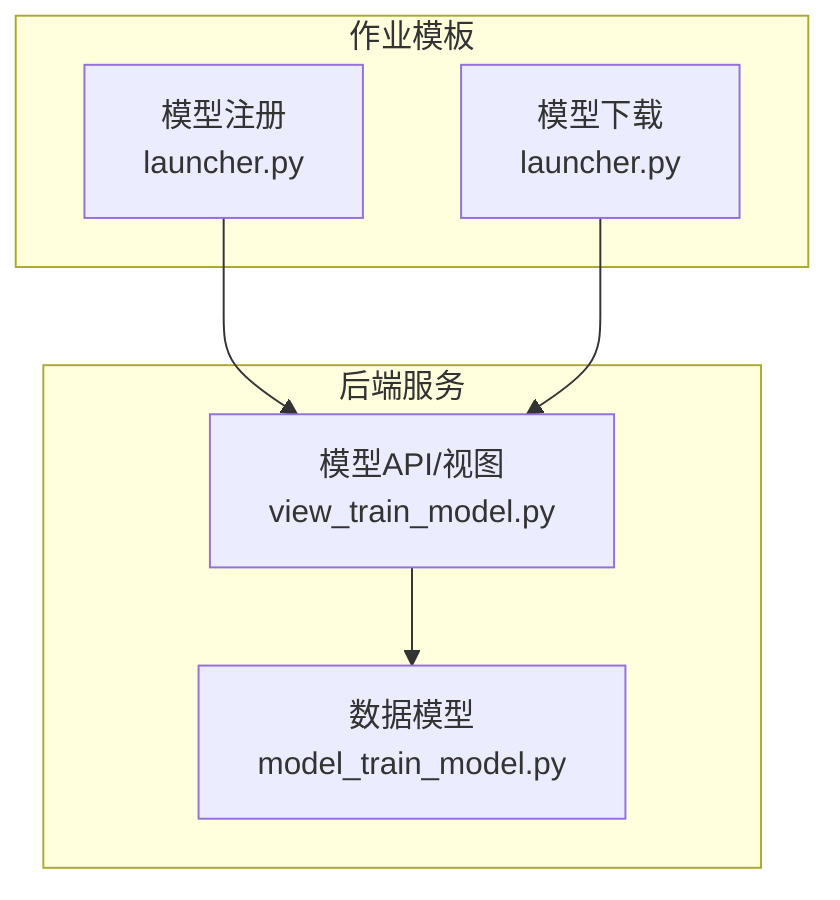
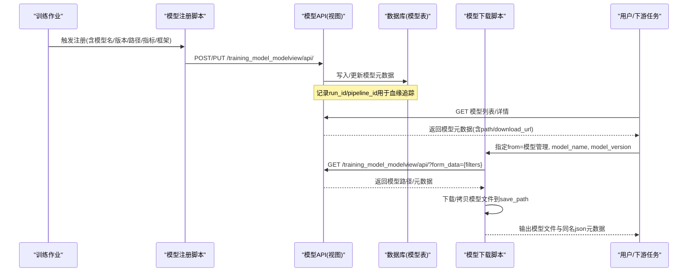
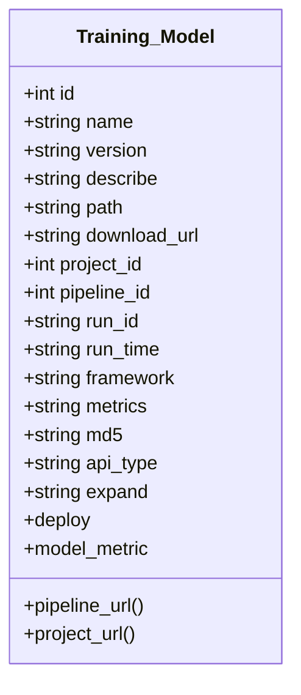
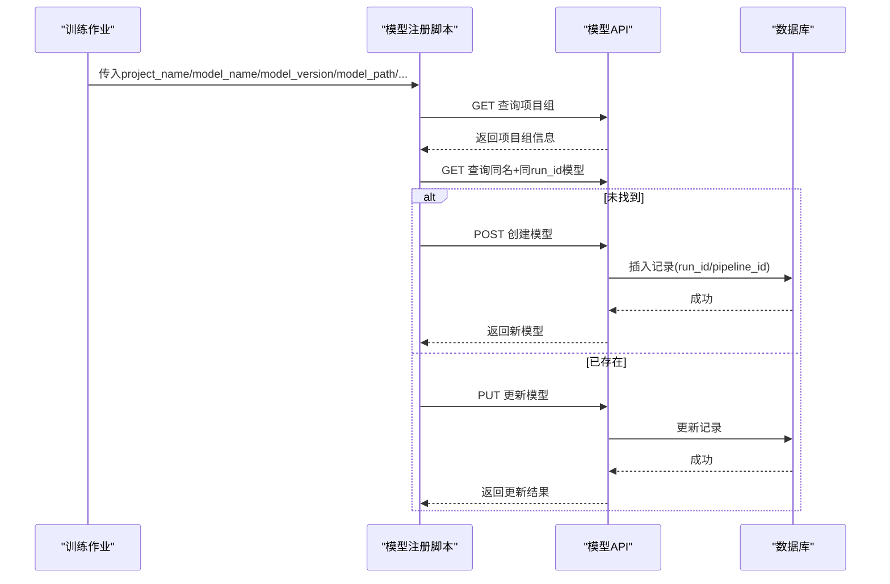
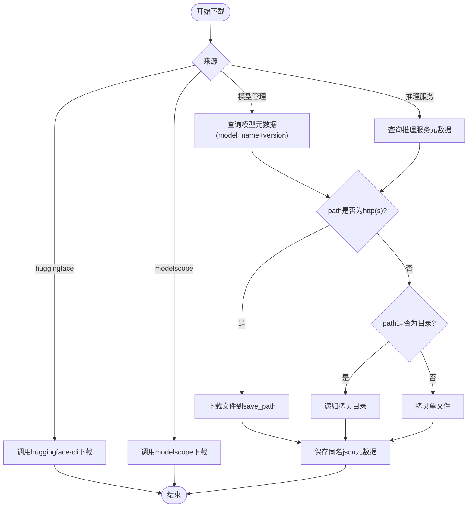
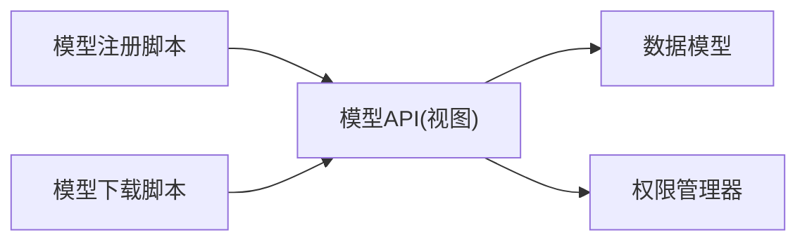

# 模型管理

<cite>
**本文引用的文件**   
- [launcher.py（模型注册）](file://job-template\job\model_register\launcher.py)
- [launcher.py（模型下载）](file://job-template\job\model_download\launcher.py)
- [model_train_model.py（训练模型数据模型）](file://myapp\models\model_train_model.py)
- [view_train_model.py（模型视图与API）](file://myapp\views\view_train_model.py)
</cite>

## 目录
1. [简介](#简介)
2. [项目结构](#项目结构)
3. [核心组件](#核心组件)
4. [架构总览](#架构总览)
5. [详细组件分析](#详细组件分析)
6. [依赖关系分析](#依赖关系分析)
7. [性能考虑](#性能考虑)
8. [故障排查指南](#故障排查指南)
9. [结论](#结论)
10. [附录：扩展指南与最佳实践](#附录：扩展指南与最佳实践)

## 简介
本章节面向“模型管理”能力，系统性说明模型版本控制、元数据管理、存储路径规范、生命周期管理，以及上传/下载/注册/版本管理/删除等关键操作。同时给出模型文件格式支持范围、权限控制、血缘追踪与质量评估的实现要点，并提供扩展新格式与自定义元数据的实践建议。

## 项目结构
围绕模型管理的代码主要分布在以下位置：
- 作业模板侧的“模型注册”和“模型下载”启动脚本，负责与平台后端交互完成模型的注册与拉取。
- 后端数据模型定义训练模型实体及其字段。
- 后端视图层提供模型列表、详情、下载、部署等REST接口与Web表单校验逻辑。



图表来源
- [launcher.py（模型注册）:1-133](file://job-template\job\model_register\launcher.py#L1-L133)
- [launcher.py（模型下载）:1-194](file://job-template\job\model_download\launcher.py#L1-L194)
- [view_train_model.py:1-299](file://myapp\views\view_train_model.py#L1-L299)
- [model_train_model.py:1-95](file://myapp\models\model_train_model.py#L1-L95)

章节来源
- [launcher.py（模型注册）:1-133](file://job-template\job\model_register\launcher.py#L1-L133)
- [launcher.py（模型下载）:1-194](file://job-template\job\model_download\launcher.py#L1-L194)
- [view_train_model.py:1-299](file://myapp\views\view_train_model.py#L1-L299)
- [model_train_model.py:1-95](file://myapp\models\model_train_model.py#L1-L95)

## 核心组件
- 训练模型数据模型：定义模型的核心元数据字段，包括名称、版本、描述、路径、项目、任务流ID、运行ID、运行时间、框架、指标、MD5、API类型、扩展参数等。
- 模型视图与API：提供模型的增删改查、下载、部署、权限过滤、表单校验、历史版本聚合展示等能力。
- 模型注册脚本：在训练完成后调用平台API进行模型注册或更新，携带版本、路径、指标、框架等信息。
- 模型下载脚本：根据模型名与版本从平台获取模型信息并下载到本地，支持在线URL、目录拷贝、HuggingFace与ModelScope源。

章节来源
- [model_train_model.py:20-39](file://myapp\models\model_train_model.py#L20-L39)
- [view_train_model.py:43-156](file://myapp\views\view_train_model.py#L43-L156)
- [launcher.py（模型注册）:19-130](file://job-template\job\model_register\launcher.py#L19-L130)
- [launcher.py（模型下载）:17-186](file://job-template\job\model_download\launcher.py#L17-L186)

## 架构总览
模型管理整体流程如下：
- 训练作业产出模型后，通过“模型注册”脚本将模型元数据写入平台数据库。
- 用户可在Web界面查看模型列表、详情，并进行下载或一键部署为推理服务。
- 下游任务可通过“模型下载”脚本按模型名+版本拉取模型文件到本地工作目录。



图表来源
- [launcher.py（模型注册）:19-130](file://job-template\job\model_register\launcher.py#L19-L130)
- [launcher.py（模型下载）:17-186](file://job-template\job\model_download\launcher.py#L17-L186)
- [view_train_model.py:204-254](file://myapp\views\view_train_model.py#L204-L254)
- [model_train_model.py:20-39](file://myapp\models\model_train_model.py#L20-L39)

## 详细组件分析

### 数据模型：Training_Model
- 关键字段
  - name/version/describe/path/project_id/pipeline_id/run_id/run_time/framework/metrics/md5/api_type/expand
- 关联关系
  - project_id 关联项目组；pipeline_id 关联任务流实例
- 辅助属性
  - pipeline_url/project_url：生成可点击链接
  - deploy：动态渲染“下载/发布”按钮
  - model_metric：解析metrics文本为可读字符串



图表来源
- [model_train_model.py:20-95](file://myapp\models\model_train_model.py#L20-L95)

章节来源
- [model_train_model.py:20-95](file://myapp\models\model_train_model.py#L20-L95)

### 视图与API：模型CRUD、下载、部署
- 权限控制
  - 列表查询时按用户所属项目组过滤
  - 编辑/删除仅允许管理员或创建者
- Web表单
  - 对name/version等字段进行正则校验
  - 提供framework/api_type下拉选择
  - path字段附带支持的推理框架说明
- 下载接口
  - 优先使用download_url，其次处理http(s)直链或/mnt映射路径
- 部署接口
  - 基于模型元数据自动创建推理服务记录，跳转到推理服务页面

```mermaid
flowchart TD
Start(["进入模型详情页"]) --> CheckDownload["检查download_url/path"]
CheckDownload --> |存在download_url| RedirectDL["重定向到外部下载地址"]
CheckDownload --> |path为http(s)| RedirectPath["重定向到path地址"]
CheckDownload --> |path以/mnt开头| MapLocal["映射为静态资源地址并重定向"]
CheckDownload --> |无可用路径| Warn["提示未发现模型存储地址"]
Warn --> End(["结束"])
RedirectDL --> End
RedirectPath --> End
MapLocal --> End
```

图表来源
- [view_train_model.py:204-218](file://myapp\views\view_train_model.py#L204-L218)

章节来源
- [view_train_model.py:43-156](file://myapp\views\view_train_model.py#L43-L156)
- [view_train_model.py:204-254](file://myapp\views\view_train_model.py#L204-L254)

### 模型注册流程
- 输入参数
  - project_name/model_name/model_version/model_path/describe/framework/inference_framework/model_metric
- 处理逻辑
  - 校验项目组是否存在
  - 查询同run_id是否已有同名模型
  - 不存在则POST创建，存在则PUT更新
  - 携带run_id/pipeline_id用于血缘追踪
- 错误处理
  - 非200响应直接退出并打印错误内容



图表来源
- [launcher.py（模型注册）:19-130](file://job-template\job\model_register\launcher.py#L19-L130)

章节来源
- [launcher.py（模型注册）:19-130](file://job-template\job\model_register\launcher.py#L19-L130)

### 模型下载流程
- 支持来源
  - from=模型管理：按model_name+version查询模型元数据，得到path
  - from=推理服务：按服务维度查询model_path
  - from=huggingface/modelscope：调用对应CLI下载
- 下载策略
  - 若path为http(s)：直接下载文件
  - 若path为目录：递归拷贝文件
  - 若path为单文件：直接拷贝
  - 同时将模型元数据保存为同名.json文件
- 错误处理
  - 访问平台失败或路径不存在时退出并打印错误



图表来源
- [launcher.py（模型下载）:17-186](file://job-template\job\model_download\launcher.py#L17-L186)

章节来源
- [launcher.py（模型下载）:17-186](file://job-template\job\model_download\launcher.py#L17-L186)

## 依赖关系分析
- 模块耦合
  - 模型注册/下载脚本依赖后端REST API
  - 视图层依赖数据模型与权限管理器
- 外部依赖
  - requests用于HTTP通信
  - huggingface-cli/modelscope CLI可选依赖
- 潜在循环依赖
  - 当前未见循环导入；视图层通过显式import引入推理服务视图类



图表来源
- [launcher.py（模型注册）:1-133](file://job-template\job\model_register\launcher.py#L1-L133)
- [launcher.py（模型下载）:1-194](file://job-template\job\model_download\launcher.py#L1-L194)
- [view_train_model.py:1-299](file://myapp\views\view_train_model.py#L1-L299)
- [model_train_model.py:1-95](file://myapp\models\model_train_model.py#L1-L95)

章节来源
- [launcher.py（模型注册）:1-133](file://job-template\job\model_register\launcher.py#L1-L133)
- [launcher.py（模型下载）:1-194](file://job-template\job\model_download\launcher.py#L1-L194)
- [view_train_model.py:1-299](file://myapp\views\view_train_model.py#L1-L299)
- [model_train_model.py:1-95](file://myapp\models\model_train_model.py#L1-L95)

## 性能考虑
- 批量下载优化
  - 对目录拷贝建议使用并行复制与断点续传（如rsync/scp），避免小文件IO瓶颈
- 网络请求
  - 对远端URL下载增加重试与超时控制，避免长尾延迟
- 元数据序列化
  - metrics字段采用JSON存储，建议在入库前做规范化与压缩，减少存储体积
- 缓存策略
  - 对频繁访问的模型元数据可增加Redis缓存，降低数据库压力

[本节为通用指导，不直接分析具体文件]

## 故障排查指南
- 注册失败
  - 检查Authorization头是否正确
  - 确认项目是否存在
  - 核对同名+同run_id是否冲突
- 下载失败
  - 确认from参数与model_name/model_version匹配
  - 检查path是否为有效http(s)或本地路径
  - 若为/mnt路径，确保静态资源映射正确
- 权限问题
  - 编辑/删除需管理员或创建者身份
  - 列表受项目组权限过滤影响

章节来源
- [launcher.py（模型注册）:19-130](file://job-template\job\model_register\launcher.py#L19-L130)
- [launcher.py（模型下载）:17-186](file://job-template\job\model_download\launcher.py#L17-L186)
- [view_train_model.py:43-50](file://myapp\views\view_train_model.py#L43-L50)
- [view_train_model.py:191-201](file://myapp\views\view_train_model.py#L191-L201)

## 结论
本项目实现了完整的模型注册、下载、版本管理与基础的生命周期管理能力。通过统一的元数据结构与清晰的API边界，支撑了从训练到部署的全链路流转。后续可扩展更多模型格式、增强权限与审计、完善血缘与质量评估体系。

[本节为总结性内容，不直接分析具体文件]

## 附录：扩展指南与最佳实践

### 模型版本控制
- 版本命名规范
  - 默认采用日期序列形式，建议保持语义化且稳定
- 版本唯一性
  - 同一模型名+版本号应唯一；如需覆盖更新，请确保业务幂等
- 历史版本聚合
  - 视图层已实现按模型名分组并将旧版本作为子节点展示

章节来源
- [view_train_model.py:118-124](file://myapp\views\view_train_model.py#L118-L124)
- [view_train_model.py:257-277](file://myapp\views\view_train_model.py#L257-L277)

### 模型元数据管理
- 标准字段
  - name/version/describe/path/project_id/pipeline_id/run_id/run_time/framework/metrics/md5/api_type/expand
- 指标字段
  - metrics为JSON文本，建议结构化存储便于检索与可视化
- 扩展字段
  - expand可用于存放任意扩展配置，注意序列化与兼容性

章节来源
- [model_train_model.py:20-39](file://myapp\models\model_train_model.py#L20-L39)
- [view_train_model.py:174-184](file://myapp\views\view_train_model.py#L174-L184)

### 模型存储与路径规范
- 支持的路径类型
  - http(s)直链
  - 容器内/mnt开头的本地路径（由静态资源映射提供服务）
  - 任意本地目录（会被递归拷贝）
- 推理框架与路径约定
  - tfserving：saved_model目录
  - torch-server：.mar或torchscript模型
  - triton-server：onnx/tensorrt/pytorch/tf等对应格式
  - ml-server：sklearn/xgb导出模型，需配套配置文件

章节来源
- [view_train_model.py:91-98](file://myapp\views\view_train_model.py#L91-L98)
- [view_train_model.py:210-215](file://myapp\views\view_train_model.py#L210-L215)

### 模型生命周期管理
- 注册：训练完成后调用注册脚本，写入元数据
- 下载：下游任务按模型名+版本拉取模型文件
- 部署：一键创建推理服务，跳转至服务管理页
- 删除：支持批量删除，受权限控制

章节来源
- [launcher.py（模型注册）:19-130](file://job-template\job\model_register\launcher.py#L19-L130)
- [launcher.py（模型下载）:17-186](file://job-template\job\model_download\launcher.py#L17-L186)
- [view_train_model.py:221-254](file://myapp\views\view_train_model.py#L221-L254)
- [view_train_model.py:279-281](file://myapp\views\view_train_model.py#L279-L281)

### 模型权限控制
- 列表权限：按用户所属项目组过滤
- 编辑/删除权限：管理员或创建者可操作
- 下载权限：遵循上述规则，结合路径可见性控制

章节来源
- [view_train_model.py:43-50](file://myapp\views\view_train_model.py#L43-L50)
- [view_train_model.py:191-201](file://myapp\views\view_train_model.py#L191-L201)

### 模型血缘追踪
- 关键字段
  - run_id：训练运行实例ID
  - pipeline_id：任务流ID
- 使用方式
  - 注册脚本在创建/更新模型时写入run_id与pipeline_id
  - 前端可通过pipeline_url跳转到任务流详情

章节来源
- [launcher.py（模型注册）:65-78](file://job-template\job\model_register\launcher.py#L65-L78)
- [model_train_model.py:44-51](file://myapp\models\model_train_model.py#L44-L51)

### 模型质量评估
- 指标采集
  - metrics字段支持JSON结构，可包含多指标键值对
- 展示与解析
  - model_metric属性将metrics解析为可读字符串
- 建议
  - 在训练作业中统一输出指标JSON，并在注册时一并提交

章节来源
- [launcher.py（模型注册）:65-78](file://job-template\job\model_register\launcher.py#L65-L78)
- [model_train_model.py:78-92](file://myapp\models\model_train_model.py#L78-L92)

### 模型文件格式支持
- 已支持推理框架与格式
  - tfserving：SavedModel目录
  - torch-server：.mar或TorchScript
  - triton-server：ONNX/TensorRT/PyTorch/TensorFlow
  - ml-server：sklearn/XGBoost导出模型
- 其他格式
  - Pickle：可作为ml-server或自定义推理服务的输入，需配合相应加载器
  - TensorFlow SavedModel：tfserving/triton-server原生支持
  - PyTorch：TorchScript/.pt或ONNX导出后由triton/onnxruntime加载

章节来源
- [view_train_model.py:91-98](file://myapp\views\view_train_model.py#L91-L98)

### 扩展新的模型格式支持
- 步骤建议
  - 在视图层新增推理框架选项与路径约定说明
  - 在下载脚本中增加对应格式的识别与转换逻辑
  - 在注册脚本中补充框架标识与必要元数据
- 示例参考
  - 参考现有triton-server与onnxruntime的处理方式，在path字段中约定“框架:地址”的格式

章节来源
- [view_train_model.py:91-98](file://myapp\views\view_train_model.py#L91-L98)

### 自定义模型元数据字段
- 推荐做法
  - 使用expand字段存储扩展配置，保持向后兼容
  - 对需要索引与筛选的字段，建议升级为独立列并在视图层暴露搜索能力
- 注意事项
  - 变更数据库结构需配合迁移脚本
  - 对外部系统对接时，需在API层明确契约与校验规则

章节来源
- [model_train_model.py:39-39](file://myapp\models\model_train_model.py#L39-L39)
- [view_train_model.py:61-65](file://myapp\views\view_train_model.py#L61-L65)