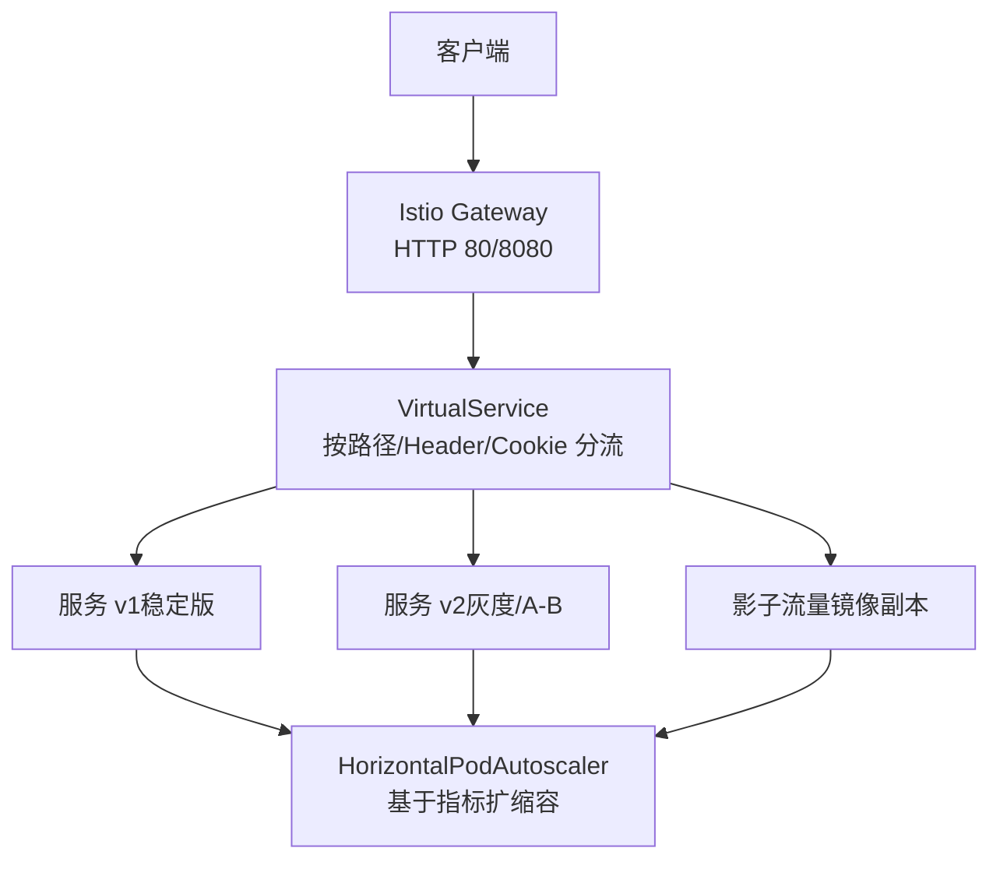
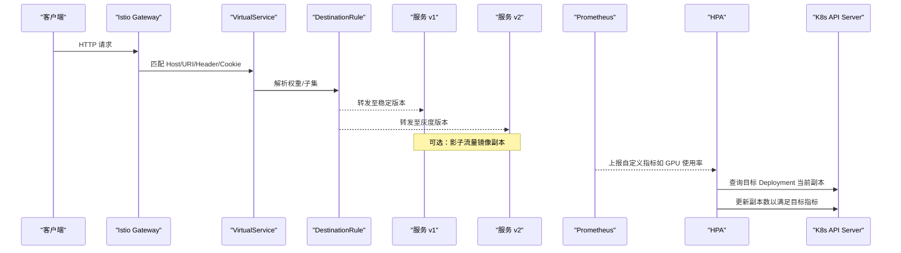
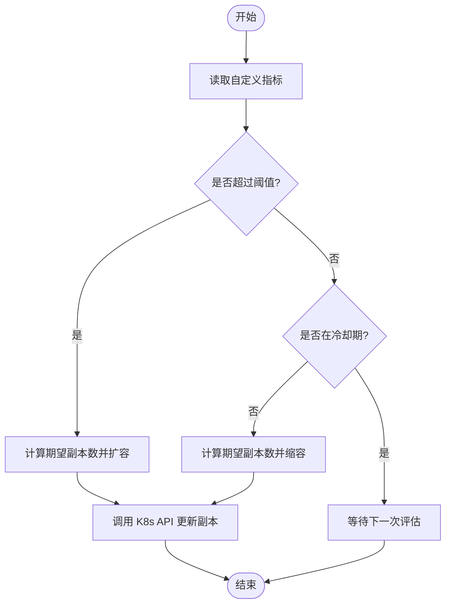
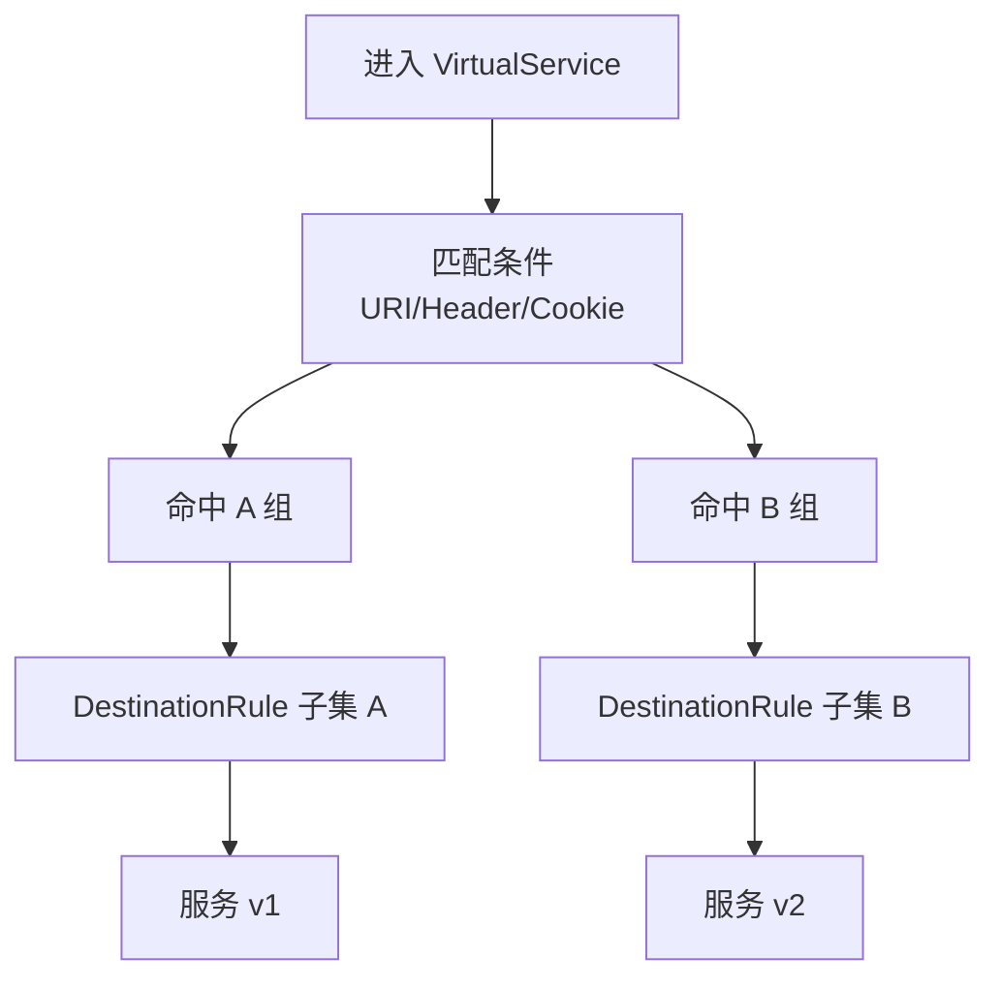
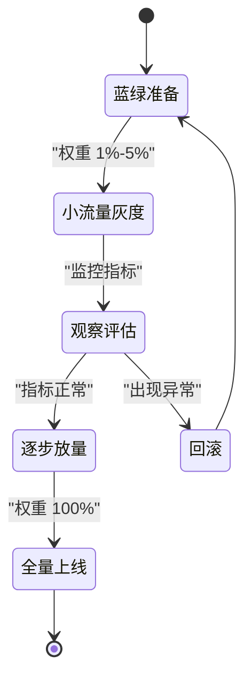
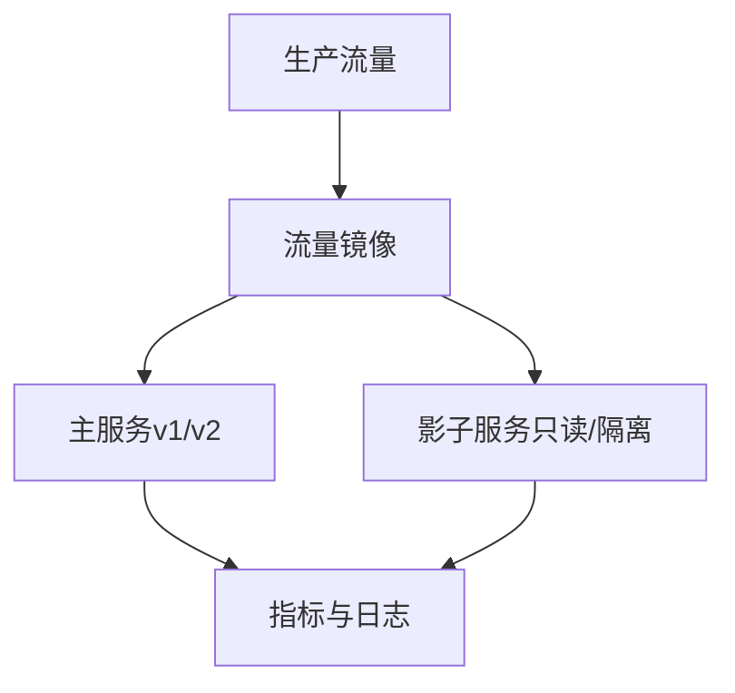
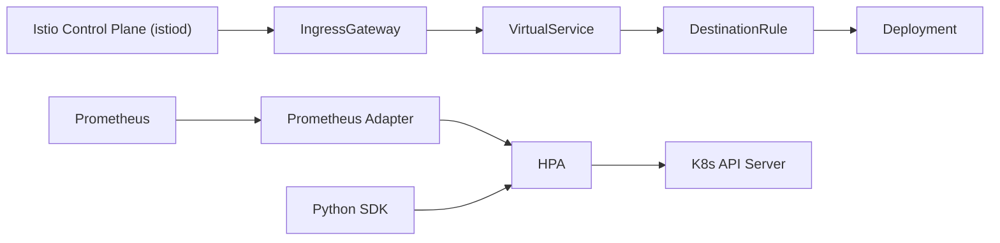

# 流量治理

<cite>
**本文引用的文件**   
- [gateway.yaml](file://install/kubernetes/gateway.yaml)
- [virtual.yaml](file://install/kubernetes/virtual.yaml)
- [hpa-demo.yaml](file://install/kubernetes/prometheus/prometheus_adapter/hpa-demo.yaml)
- [istio-gateway.yaml](file://install/kubernetes/istio/istio-gateway.yaml)
- [istio-istiod.yaml](file://install/kubernetes/istio/istio-istiod.yaml)
- [py_k8s.py](file://job-template/job/pkgs/k8s/py_k8s.py)
</cite>

## 目录
1. [简介](#简介)
2. [项目结构](#项目结构)
3. [核心组件](#核心组件)
4. [架构总览](#架构总览)
5. [详细组件分析](#详细组件分析)
6. [依赖关系分析](#依赖关系分析)
7. [性能考量](#性能考量)
8. [故障排查指南](#故障排查指南)
9. [结论](#结论)
10. [附录](#附录)

## 简介
本文件面向在 Kubernetes + Istio 环境下进行“流量治理”的工程师与运维人员，系统性说明弹性伸缩、A/B 测试、灰度发布与影子流量（流量复制）的实现原理与实践方法。文档结合仓库内提供的 Istio Gateway/VirtualService 配置与 HPA 示例，给出可操作的步骤、关键配置要点、监控指标建议与故障恢复策略，帮助读者快速落地并安全演进线上服务。

## 项目结构
本项目通过以下资源完成流量治理的基础能力：
- 入口网关与路由：Istio Gateway 暴露 HTTP 端口，VirtualService 定义按路径、Header、Cookie 等条件的路由规则，用于实现 A/B 与灰度分流。
- 自动扩缩容：HPA 基于 Prometheus 采集的自定义指标（如 GPU 使用率）对 Deployment 进行水平扩缩容。
- 控制面与扩展点：Istio 控制面（istiod）与 IngressGateway 提供流量转发、观测与治理能力；Kubernetes Python SDK 封装了对 HPA 的创建/删除等操作。

图示来源
- [gateway.yaml:1-38](file://install/kubernetes/gateway.yaml#L1-L38)
- [virtual.yaml:1-172](file://install/kubernetes/virtual.yaml#L1-L172)
- [hpa-demo.yaml:1-28](file://install/kubernetes/prometheus/prometheus_adapter/hpa-demo.yaml#L1-L28)

章节来源
- [gateway.yaml:1-38](file://install/kubernetes/gateway.yaml#L1-L38)
- [virtual.yaml:1-172](file://install/kubernetes/virtual.yaml#L1-L172)
- [hpa-demo.yaml:1-28](file://install/kubernetes/prometheus/prometheus_adapter/hpa-demo.yaml#L1-L28)

## 核心组件
- Istio Gateway：对外暴露 HTTP 端口，作为统一入口。
- VirtualService：根据 URI 前缀、Header、Cookie 等条件将请求路由到不同后端服务，支撑 A/B 与灰度。
- DestinationRule：配合 VirtualService 设置权重、子集（subset），实现精细化流量分配。
- HorizontalPodAutoscaler（HPA）：依据 CPU/GPU/业务指标自动调整 Pod 副本数。
- Prometheus Adapter：将 Prometheus 中的自定义指标暴露给 HPA。
- K8s Python SDK：在作业模板中封装 HPA 的增删改查操作。

章节来源
- [gateway.yaml:1-38](file://install/kubernetes/gateway.yaml#L1-L38)
- [virtual.yaml:1-172](file://install/kubernetes/virtual.yaml#L1-L172)
- [hpa-demo.yaml:1-28](file://install/kubernetes/prometheus/prometheus_adapter/hpa-demo.yaml#L1-L28)
- [py_k8s.py:1695-1710](file://job-template/job/pkgs/k8s/py_k8s.py#L1695-L1710)

## 架构总览
下图展示从客户端到后端的完整流量路径，以及自动扩缩容的作用点。

图示来源
- [gateway.yaml:1-38](file://install/kubernetes/gateway.yaml#L1-L38)
- [virtual.yaml:1-172](file://install/kubernetes/virtual.yaml#L1-L172)
- [hpa-demo.yaml:1-28](file://install/kubernetes/prometheus/prometheus_adapter/hpa-demo.yaml#L1-L28)

## 详细组件分析

### 弹性伸缩（HPA）
- 工作原理
  - HPA 周期性地从指标源（Prometheus Adapter）读取自定义指标（例如容器 GPU 使用率）。
  - 当指标超过阈值时，HPA 调用 K8s API 增加 Deployment 的副本数；低于阈值则减少副本数。
  - 支持 minReplicas/maxReplicas 限制，避免过度扩缩容。
- 关键配置项
  - scaleTargetRef：指向目标 Deployment。
  - metrics：指定指标类型与目标平均值。
  - minReplicas/maxReplicas：副本上下限。
- 实践建议
  - 选择能反映真实负载的指标（CPU、GPU、QPS、延迟、错误率等）。
  - 合理设置目标平均值与冷却时间，避免抖动。
  - 为不同环境（开发/预发/生产）分别配置 HPA。

图示来源
- [hpa-demo.yaml:1-28](file://install/kubernetes/prometheus/prometheus_adapter/hpa-demo.yaml#L1-L28)
- [py_k8s.py:1695-1710](file://job-template/job/pkgs/k8s/py_k8s.py#L1695-L1710)

章节来源
- [hpa-demo.yaml:1-28](file://install/kubernetes/prometheus/prometheus_adapter/hpa-demo.yaml#L1-L28)
- [py_k8s.py:1695-1710](file://job-template/job/pkgs/k8s/py_k8s.py#L1695-L1710)

### A/B 测试
- 实现思路
  - 通过 VirtualService 的 match 条件（URI、Header、Cookie）区分用户群体或实验组。
  - 使用 DestinationRule 的 subset 与 weight 将流量按比例分发到不同版本。
- 典型场景
  - 按 Cookie 字段区分新老用户。
  - 按 Header 区分内部测试流量。
  - 按 URI 前缀区分功能开关。
- 注意事项
  - 确保下游服务对同一会话的请求一致性（粘性会话或 Session Affinity）。
  - 灰度期间保留回滚能力（快速切回稳定版本）。

图示来源
- [virtual.yaml:1-172](file://install/kubernetes/virtual.yaml#L1-L172)

章节来源
- [virtual.yaml:1-172](file://install/kubernetes/virtual.yaml#L1-L172)

### 灰度发布（渐进式放量）
- 实施步骤
  - 初始阶段：将极小比例流量（如 1%~5%）导向新版本。
  - 观察阶段：监控错误率、延迟、资源使用等指标。
  - 放量阶段：逐步提升权重（如 10%→30%→50%→100%）。
  - 全量阶段：确认稳定后，将全部流量切至新版本。
- 风险控制
  - 设置熔断与降级策略。
  - 保留一键回滚能力。
  - 针对关键路径做专项验证。

图示来源
- [virtual.yaml:1-172](file://install/kubernetes/virtual.yaml#L1-L172)

章节来源
- [virtual.yaml:1-172](file://install/kubernetes/virtual.yaml#L1-L172)

### 影子流量（流量复制）
- 概念
  - 将生产流量按一定比例复制到影子服务，用于压测、回归或新模型验证，不影响主链路。
- 实现要点
  - 通过 VirtualService/DestinationRule 将部分请求镜像到影子服务。
  - 影子服务通常不返回响应给客户端，仅记录日志与指标。
- 注意事项
  - 影子流量可能放大系统压力，需评估容量。
  - 避免影子服务写入生产数据造成污染。

图示来源
- [virtual.yaml:1-172](file://install/kubernetes/virtual.yaml#L1-L172)

章节来源
- [virtual.yaml:1-172](file://install/kubernetes/virtual.yaml#L1-L172)

### 入口网关与路由
- Gateway
  - 暴露 HTTP 80/8080 端口，作为统一入口。
- VirtualService
  - 定义按路径、Header、Cookie 的路由规则，支撑多应用与多环境的访问。
- 最佳实践
  - 域名与路径规划清晰，避免冲突。
  - 对敏感接口增加鉴权与白名单。

章节来源
- [gateway.yaml:1-38](file://install/kubernetes/gateway.yaml#L1-L38)
- [virtual.yaml:1-172](file://install/kubernetes/virtual.yaml#L1-L172)

## 依赖关系分析
- Istio 控制面与数据面
  - istiod 负责配置下发与状态同步。
  - istio-ingressgateway 承载外部流量。
- HPA 与指标体系
  - Prometheus 采集指标 → Prometheus Adapter 暴露 → HPA 消费。
- 代码侧集成
  - Python SDK 封装 HPA 的创建/删除，便于在作业流程中自动化管理。

图示来源
- [istio-istiod.yaml:1681-1683](file://install/kubernetes/istio/istio-istiod.yaml#L1681-L1683)
- [istio-gateway.yaml:146-146](file://install/kubernetes/istio/istio-gateway.yaml#L146-L146)
- [hpa-demo.yaml:1-28](file://install/kubernetes/prometheus/prometheus_adapter/hpa-demo.yaml#L1-L28)
- [py_k8s.py:1695-1710](file://job-template/job/pkgs/k8s/py_k8s.py#L1695-L1710)

章节来源
- [istio-istiod.yaml:1681-1683](file://install/kubernetes/istio/istio-istiod.yaml#L1681-L1683)
- [istio-gateway.yaml:146-146](file://install/kubernetes/istio/istio-gateway.yaml#L146-L146)
- [hpa-demo.yaml:1-28](file://install/kubernetes/prometheus/prometheus_adapter/hpa-demo.yaml#L1-L28)
- [py_k8s.py:1695-1710](file://job-template/job/pkgs/k8s/py_k8s.py#L1695-L1710)

## 性能考量
- 流量治理开销
  - VirtualService/DestinationRule 匹配与权重计算带来少量额外延迟。
  - 影子流量会成倍增加系统负载，需谨慎评估。
- 扩缩容抖动
  - 指标波动可能导致频繁扩缩容，需设置合适的目标值与冷却时间。
- 资源预留
  - 灰度与影子服务应独立命名空间或配额，避免影响主链路。
- 缓存与连接复用
  - 上游服务尽量启用连接池与缓存，降低重复计算与 IO 压力。

[本节为通用指导，无需引用具体文件]

## 故障排查指南
- 入口不可达
  - 检查 Gateway 是否正确监听 80/8080 端口。
  - 确认 VirtualService 的 hosts 与 match 条件与实际请求一致。
- 路由错配
  - 核对 URI 前缀、Header、Cookie 匹配逻辑。
  - 检查 DestinationRule 的 subset 与 weight 配置。
- HPA 不生效
  - 确认 Prometheus Adapter 已正确暴露自定义指标。
  - 校验 HPA 的 scaleTargetRef、metrics 与阈值设置。
  - 查看 K8s Events 与 HPA 状态。
- 影子流量异常
  - 检查镜像流量是否被正确转发。
  - 确认影子服务未写回生产数据。

章节来源
- [gateway.yaml:1-38](file://install/kubernetes/gateway.yaml#L1-L38)
- [virtual.yaml:1-172](file://install/kubernetes/virtual.yaml#L1-L172)
- [hpa-demo.yaml:1-28](file://install/kubernetes/prometheus/prometheus_adapter/hpa-demo.yaml#L1-L28)
- [py_k8s.py:1695-1710](file://job-template/job/pkgs/k8s/py_k8s.py#L1695-L1710)

## 结论
通过 Istio 的 Gateway/VirtualService/DestinationRule 与 Kubernetes HPA，可以在保证稳定性的前提下实现精细化的流量治理与弹性伸缩。结合影子流量与渐进式灰度策略，能够显著降低发布风险，同时借助 Prometheus 指标体系保障系统的可观测性与可控性。建议在每次灰度前制定明确的回滚计划与监控告警，确保问题早发现、早处置。

[本节为总结性内容，无需引用具体文件]

## 附录
- 关键配置清单
  - Gateway：监听端口与协议。
  - VirtualService：hosts、match、rewrite、route。
  - DestinationRule：subset、weight。
  - HPA：scaleTargetRef、metrics、minReplicas、maxReplicas。
- 常用指标建议
  - 资源类：CPU、内存、GPU 使用率。
  - 业务类：QPS、P99 延迟、错误率、队列长度。
- 回滚策略
  - 快速切换权重至稳定版本。
  - 关闭灰度与影子流量。
  - 清理临时资源与中间状态。

[本节为补充信息，无需引用具体文件]