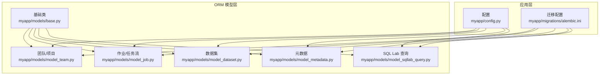
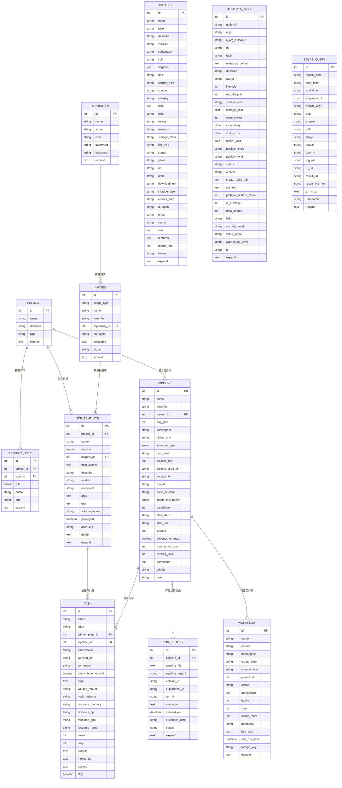
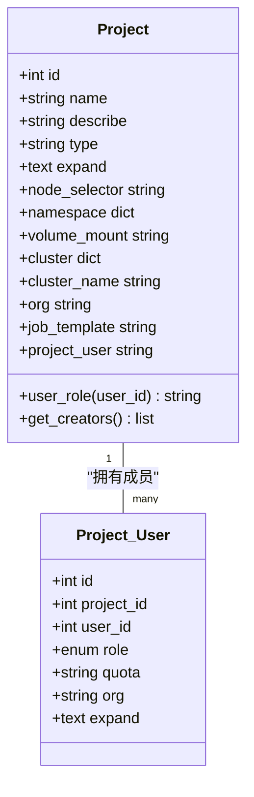
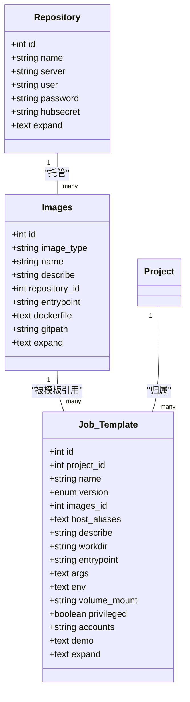
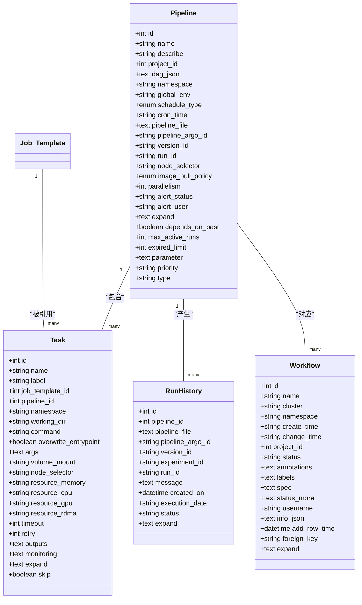
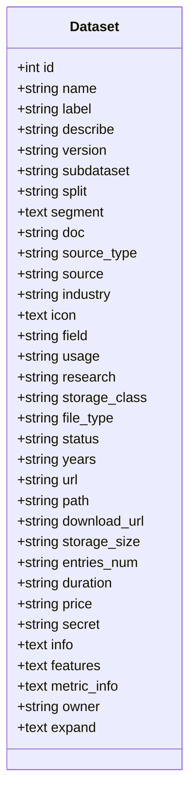
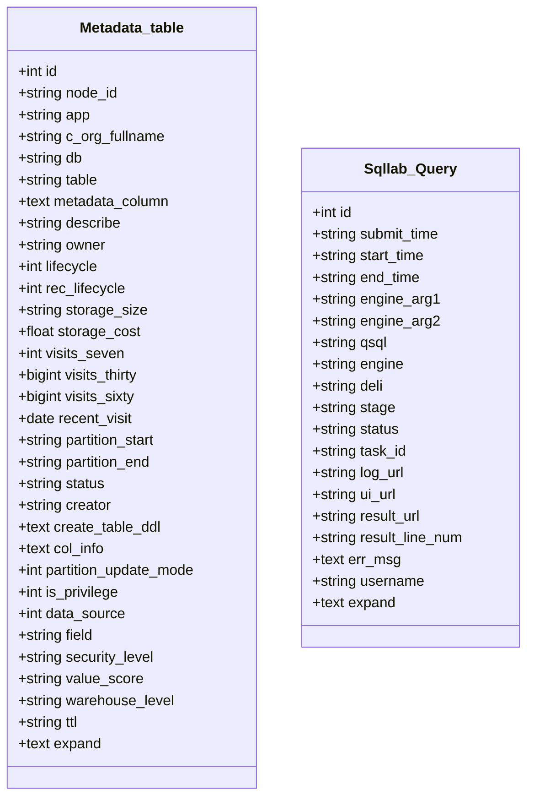
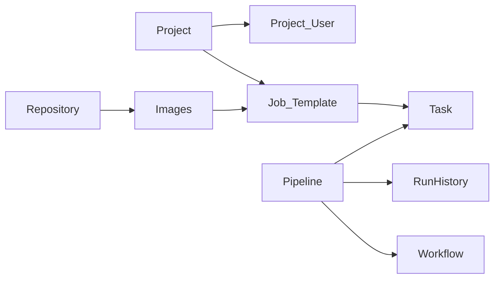

# 数据库设计

<cite>
**本文引用的文件**   
- [myapp/models/base.py](file://myapp/models/base.py)
- [myapp/models/model_team.py](file://myapp/models/model_team.py)
- [myapp/models/model_job.py](file://myapp/models/model_job.py)
- [myapp/models/model_dataset.py](file://myapp/models/model_dataset.py)
- [myapp/models/model_metadata.py](file://myapp/models/model_metadata.py)
- [myapp/models/model_sqllab_query.py](file://myapp/models/model_sqllab_query.py)
- [myapp/config.py](file://myapp/config.py)
- [myapp/migrations/alembic.ini](file://myapp/migrations/alembic.ini)
</cite>

## 目录
1. [引言](#引言)
2. [项目结构](#项目结构)
3. [核心数据模型](#核心数据模型)
4. [架构总览](#架构总览)
5. [详细组件分析](#详细组件分析)
6. [依赖关系分析](#依赖关系分析)
7. [索引与约束设计](#索引与约束设计)
8. [数据迁移策略](#数据迁移策略)
9. [查询优化与事务最佳实践](#查询优化与事务最佳实践)
10. [数据安全、备份恢复与性能调优](#数据安全备份恢复与性能调优)
11. [故障排查指南](#故障排查指南)
12. [结论](#结论)

## 引言
本文件面向 CubeStudio 平台的数据库设计与运维，聚焦以下目标：
- 梳理数据模型定义、表结构与关系映射机制
- 明确主外键约束、索引设计与数据迁移策略
- 提供实体关系图、字段定义与业务规则说明
- 给出 SQL 示例，展示查询优化与事务处理的最佳实践
- 覆盖数据安全、备份恢复与性能调优的技术细节

本项目使用 Flask-AppBuilder + SQLAlchemy ORM 进行建模，并通过 Alembic 管理数据库迁移。核心领域包括：项目与成员、镜像仓库与任务模板、任务流与任务实例、数据集元数据、SQL Lab 查询记录等。

## 项目结构
数据库相关代码集中在 myapp/models 目录下，按业务域拆分多个模型文件；配置在 myapp/config.py；迁移工具配置在 myapp/migrations/alembic.ini。

**图表来源**
- [myapp/config.py:350-369](file://myapp/config.py#L350-L369)
- [myapp/migrations/alembic.ini:1-46](file://myapp/migrations/alembic.ini#L1-L46)
- [myapp/models/base.py:7-311](file://myapp/models/base.py#L7-L311)
- [myapp/models/model_team.py:26-225](file://myapp/models/model_team.py#L26-L225)
- [myapp/models/model_job.py:35-875](file://myapp/models/model_job.py#L35-L875)
- [myapp/models/model_dataset.py:17-148](file://myapp/models/model_dataset.py#L17-L148)
- [myapp/models/model_metadata.py:20-62](file://myapp/models/model_metadata.py#L20-L62)
- [myapp/models/model_sqllab_query.py:14-43](file://myapp/models/model_sqllab_query.py#L14-L43)

**章节来源**
- [myapp/config.py:350-369](file://myapp/config.py#L350-L369)
- [myapp/migrations/alembic.ini:1-46](file://myapp/migrations/alembic.ini#L1-L46)

## 核心数据模型
本节概述各模型职责与关键字段，便于快速理解系统的数据边界。

- 基础基类
  - 提供通用标签映射、默认节点选择器计算等公共能力，所有模型继承该基类以统一 UI 标签与部分行为。
  - 参考路径：[myapp/models/base.py:7-311](file://myapp/models/base.py#L7-L311)

- 项目与成员
  - Project：项目组，包含名称、描述、类型、扩展参数，支持唯一约束（name,type）。
  - Project_User：项目成员关联表，维护用户角色、配额、组织等，含唯一约束（project_id,user_id）。
  - 参考路径：[myapp/models/model_team.py:26-225](file://myapp/models/model_team.py#L26-L225)

- 镜像仓库与任务模板
  - Repository：镜像仓库信息，含仓库地址、账户、密码、K8s Secret 名等。
  - Images：镜像定义，关联仓库，包含入口点、Dockerfile、Git 地址等。
  - Job_Template：任务模板，关联项目与镜像，定义启动命令、参数、环境变量、挂载、特权模式等。
  - 参考路径：[myapp/models/model_job.py:35-172](file://myapp/models/model_job.py#L35-L172)

- 任务流与任务实例
  - Pipeline：任务流定义，包含 DAG JSON、调度策略、并行度、命名空间、镜像拉取策略、告警配置等。
  - Task：任务实例，关联任务模板与任务流，定义资源申请、超时重试、输出、监控等。
  - RunHistory：运行历史，记录每次上传运行的 workflow yaml、Argo ID、状态等。
  - Workflow：工作流对象，复用 Crd 基类，封装状态、耗时、任务明细等属性。
  - 参考路径：[myapp/models/model_job.py:174-875](file://myapp/models/model_job.py#L174-L875)

- 数据集
  - Dataset：数据集元数据，包含版本、子集、分区、来源、存储大小、价格、所有者、扩展信息等。
  - 参考路径：[myapp/models/model_dataset.py:17-148](file://myapp/models/model_dataset.py#L17-L148)

- 元数据与 SQL Lab
  - Metadata_table：数据表元数据，包含库名、表名、列信息、生命周期、访问统计、安全等级、成本等。
  - Sqllab_Query：SQL Lab 查询记录，包含提交/执行时间、引擎参数、SQL 语句、状态、日志 URL 等。
  - 参考路径：[myapp/models/model_metadata.py:20-62](file://myapp/models/model_metadata.py#L20-L62)、[myapp/models/model_sqllab_query.py:14-43](file://myapp/models/model_sqllab_query.py#L14-L43)

**章节来源**
- [myapp/models/base.py:7-311](file://myapp/models/base.py#L7-L311)
- [myapp/models/model_team.py:26-225](file://myapp/models/model_team.py#L26-L225)
- [myapp/models/model_job.py:35-875](file://myapp/models/model_job.py#L35-L875)
- [myapp/models/model_dataset.py:17-148](file://myapp/models/model_dataset.py#L17-L148)
- [myapp/models/model_metadata.py:20-62](file://myapp/models/model_metadata.py#L20-L62)
- [myapp/models/model_sqllab_query.py:14-43](file://myapp/models/model_sqllab_query.py#L14-L43)

## 架构总览
下图展示了核心实体之间的关系与主要外键依赖。

**图表来源**
- [myapp/models/model_team.py:26-225](file://myapp/models/model_team.py#L26-L225)
- [myapp/models/model_job.py:35-875](file://myapp/models/model_job.py#L35-L875)
- [myapp/models/model_dataset.py:17-148](file://myapp/models/model_dataset.py#L17-L148)
- [myapp/models/model_metadata.py:20-62](file://myapp/models/model_metadata.py#L20-L62)
- [myapp/models/model_sqllab_query.py:14-43](file://myapp/models/model_sqllab_query.py#L14-L43)

## 详细组件分析

### 项目与成员（Project / Project_User）
- 业务规则
  - 项目名称与类型组合唯一，避免重复项目。
  - 项目成员与用户组合唯一，防止重复授权。
  - 成员角色枚举 dev/ops/creator，用于权限控制。
- 关键约束
  - UniqueConstraint(name,type) 于 Project。
  - UniqueConstraint(project_id,user_id) 于 Project_User。
- 常用查询
  - 获取项目创建者列表、成员角色、配额等。
- 参考路径
  - [myapp/models/model_team.py:26-225](file://myapp/models/model_team.py#L26-L225)

**图表来源**
- [myapp/models/model_team.py:26-225](file://myapp/models/model_team.py#L26-L225)

**章节来源**
- [myapp/models/model_team.py:26-225](file://myapp/models/model_team.py#L26-L225)

### 镜像仓库与任务模板（Repository / Images / Job_Template）
- 业务规则
  - 镜像仓库统一管理镜像地址与认证信息。
  - 镜像定义可关联仓库，并携带入口点、Dockerfile、Git 地址等。
  - 任务模板关联项目与镜像，定义运行时参数、环境变量、挂载、特权模式等。
- 关键约束
  - Repository.name 唯一。
  - Job_Template.name 唯一。
  - 外键：Images.repository_id -> Repository.id；Job_Template.images_id -> Images.id；Job_Template.project_id -> Project.id。
- 参考路径
  - [myapp/models/model_job.py:35-172](file://myapp/models/model_job.py#L35-L172)

**图表来源**
- [myapp/models/model_job.py:35-172](file://myapp/models/model_job.py#L35-L172)

**章节来源**
- [myapp/models/model_job.py:35-172](file://myapp/models/model_job.py#L35-L172)

### 任务流与任务实例（Pipeline / Task / RunHistory / Workflow）
- 业务规则
  - Pipeline 定义 DAG 关系、调度策略、并行度、镜像拉取策略、告警配置等。
  - Task 是具体任务实例，关联模板与任务流，定义资源申请、超时重试、输出、监控等。
  - RunHistory 记录每次上传运行的 workflow yaml、Argo ID、状态等。
  - Workflow 复用 Crd 基类，封装状态、耗时、任务明细等属性。
- 关键约束
  - Pipeline.name 唯一。
  - 外键：Task.job_template_id -> Job_Template.id；Task.pipeline_id -> Pipeline.id；RunHistory.pipeline_id -> Pipeline.id。
- 参考路径
  - [myapp/models/model_job.py:174-875](file://myapp/models/model_job.py#L174-L875)

**图表来源**
- [myapp/models/model_job.py:174-875](file://myapp/models/model_job.py#L174-L875)

**章节来源**
- [myapp/models/model_job.py:174-875](file://myapp/models/model_job.py#L174-L875)

### 数据集（Dataset）
- 业务规则
  - 数据集包含版本、子集、分区、来源、存储大小、价格、所有者、扩展信息等。
  - 支持多行 URL、本地持久化路径、预览图片等。
- 参考路径
  - [myapp/models/model_dataset.py:17-148](file://myapp/models/model_dataset.py#L17-L148)

**图表来源**
- [myapp/models/model_dataset.py:17-148](file://myapp/models/model_dataset.py#L17-L148)

**章节来源**
- [myapp/models/model_dataset.py:17-148](file://myapp/models/model_dataset.py#L17-L148)

### 元数据与 SQL Lab（Metadata_table / Sqllab_Query）
- 业务规则
  - Metadata_table 记录数据表的元数据、生命周期、访问统计、安全等级、成本等。
  - Sqllab_Query 记录 SQL 查询的提交/执行时间、引擎参数、SQL 语句、状态、日志 URL 等。
- 参考路径
  - [myapp/models/model_metadata.py:20-62](file://myapp/models/model_metadata.py#L20-L62)
  - [myapp/models/model_sqllab_query.py:14-43](file://myapp/models/model_sqllab_query.py#L14-L43)

**图表来源**
- [myapp/models/model_metadata.py:20-62](file://myapp/models/model_metadata.py#L20-L62)
- [myapp/models/model_sqllab_query.py:14-43](file://myapp/models/model_sqllab_query.py#L14-L43)

**章节来源**
- [myapp/models/model_metadata.py:20-62](file://myapp/models/model_metadata.py#L20-L62)
- [myapp/models/model_sqllab_query.py:14-43](file://myapp/models/model_sqllab_query.py#L14-L43)

## 依赖关系分析
- 直接依赖
  - Project 与 Project_User：一对多成员关系。
  - Repository 与 Images：一对多镜像托管。
  - Images 与 Job_Template：一对多模板引用。
  - Project 与 Job_Template：一对多模板归属。
  - Job_Template 与 Task：一对多任务引用。
  - Pipeline 与 Task：一对多任务包含。
  - Pipeline 与 RunHistory：一对多运行历史。
  - Pipeline 与 Workflow：一对多工作流。
- 间接依赖
  - Workflow 通过 labels 与 RunHistory 关联（基于 run-id 标签匹配）。
  - Project 通过 expand 配置集群、命名空间、卷挂载等运行时环境。

**图表来源**
- [myapp/models/model_team.py:26-225](file://myapp/models/model_team.py#L26-L225)
- [myapp/models/model_job.py:35-875](file://myapp/models/model_job.py#L35-L875)

**章节来源**
- [myapp/models/model_team.py:26-225](file://myapp/models/model_team.py#L26-L225)
- [myapp/models/model_job.py:35-875](file://myapp/models/model_job.py#L35-L875)

## 索引与约束设计
- 主键
  - 所有模型均定义自增整数主键 id。
- 唯一约束
  - Repository.name 唯一。
  - Job_Template.name 唯一。
  - Pipeline.name 唯一。
  - Project 的 (name,type) 组合唯一。
  - Project_User 的 (project_id,user_id) 组合唯一。
- 外键
  - Images.repository_id -> Repository.id
  - Job_Template.images_id -> Images.id
  - Job_Template.project_id -> Project.id
  - Task.job_template_id -> Job_Template.id
  - Task.pipeline_id -> Pipeline.id
  - RunHistory.pipeline_id -> Pipeline.id
- 建议索引
  - 高频查询字段建议加索引：
    - Pipeline.name、Pipeline.schedule_type、Pipeline.namespace
    - Task.name、Task.pipeline_id、Task.job_template_id
    - RunHistory.pipeline_id、RunHistory.status、RunHistory.created_on
    - Metadata_table.db、Metadata_table.table、Metadata_table.recent_visit
    - Sqllab_Query.engine、Sqllab_Query.status、Sqllab_Query.submit_time
  - 复合索引：
    - (pipeline_id, status) 用于运行历史分页与状态筛选
    - (db, table) 用于元数据检索
    - (engine, status) 用于 SQL Lab 查询过滤

**章节来源**
- [myapp/models/model_job.py:35-875](file://myapp/models/model_job.py#L35-L875)
- [myapp/models/model_team.py:26-225](file://myapp/models/model_team.py#L26-L225)
- [myapp/models/model_metadata.py:20-62](file://myapp/models/model_metadata.py#L20-L62)
- [myapp/models/model_sqllab_query.py:14-43](file://myapp/models/model_sqllab_query.py#L14-L43)

## 数据迁移策略
- 迁移工具
  - 使用 Alembic 管理数据库变更，配置文件位于 myapp/migrations/alembic.ini。
- 迁移流程
  - 生成迁移脚本：根据模型变更自动生成 alembic revision。
  - 审查与调整：检查生成的 up/down 操作是否符合预期。
  - 执行迁移：在生产环境分批执行，确保回滚方案完备。
- 注意事项
  - 大表变更建议使用在线 DDL 工具或分阶段迁移。
  - 对已有数据的迁移需考虑兼容性与回滚策略。
  - 结合 CI/CD 流水线自动化执行迁移，减少人为错误。

**章节来源**
- [myapp/migrations/alembic.ini:1-46](file://myapp/migrations/alembic.ini#L1-L46)

## 查询优化与事务最佳实践
- 查询优化
  - 使用合适索引：为高频查询字段建立单列或复合索引。
  - 避免 N+1 查询：使用 eager loading（如 selectin）加载关联对象。
  - 分页与过滤：对大表查询使用分页与条件过滤，减少返回数据量。
  - 避免全表扫描：确保 WHERE 条件命中索引。
- 事务处理
  - 短事务原则：尽量缩短事务持续时间，减少锁竞争。
  - 幂等写入：对重复请求进行去重处理，保证数据一致性。
  - 批量操作：使用批量插入/更新提升性能。
- SQL 示例（概念性）
  - 查询某项目下的任务流及其任务数量：
    - SELECT p.name AS pipeline_name, COUNT(t.id) AS task_count FROM pipeline p LEFT JOIN task t ON p.id = t.pipeline_id WHERE p.project_id = ? GROUP BY p.name;
  - 查询最近 7 天访问量最高的表：
    - SELECT db, table, visits_seven FROM metadata_table ORDER BY visits_seven DESC LIMIT 10;
  - 查询 SQL Lab 中失败状态的查询记录：
    - SELECT id, engine, qsql, err_msg FROM sqlab_query WHERE status = 'FAILED' ORDER BY submit_time DESC;

[本节为通用指导，不直接分析具体文件]

## 数据安全、备份恢复与性能调优
- 数据安全
  - 敏感字段加密：对密码、密钥等敏感字段进行加密存储。
  - 访问控制：基于项目成员角色进行权限控制，最小权限原则。
  - 审计日志：记录关键操作的审计日志，便于追溯。
- 备份恢复
  - 定期备份：制定定期备份策略，确保数据可恢复。
  - 增量备份：结合 binlog 或 WAL 实现增量备份，减少备份窗口。
  - 恢复演练：定期进行恢复演练，验证备份有效性。
- 性能调优
  - 连接池：合理配置连接池大小与超时时间，避免连接泄漏。
  - 缓存策略：对热点数据使用缓存，减轻数据库压力。
  - 慢查询优化：定期分析慢查询日志，优化 SQL 与索引。

**章节来源**
- [myapp/config.py:350-369](file://myapp/config.py#L350-L369)

## 故障排查指南
- 常见问题
  - 连接池耗尽：检查连接池配置与连接泄漏。
  - 迁移失败：检查迁移脚本与数据库版本一致性。
  - 查询缓慢：检查索引与 SQL 执行计划。
- 排查步骤
  - 查看应用日志：定位异常堆栈与错误信息。
  - 检查数据库状态：确认连接数、锁等待、慢查询。
  - 验证迁移版本：确保数据库版本与应用一致。

**章节来源**
- [myapp/config.py:350-369](file://myapp/config.py#L350-L369)

## 结论
本文档系统梳理了 CubeStudio 平台的数据模型、表结构与关系映射机制，明确了主外键约束、索引设计与数据迁移策略，提供了查询优化与事务处理的最佳实践，并覆盖了数据安全、备份恢复与性能调优的技术细节。通过实体关系图与流程图，帮助读者快速理解系统架构与数据流转，为后续开发与运维提供参考。