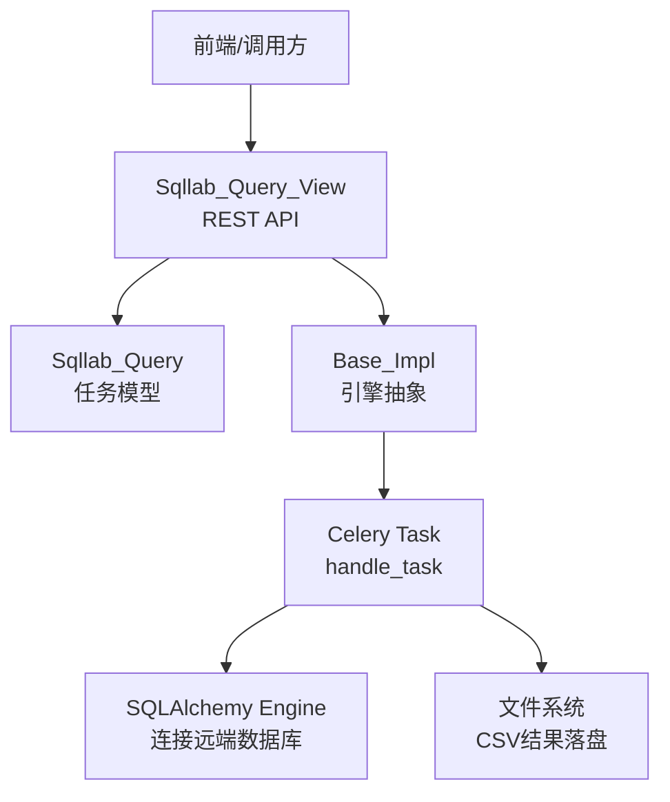
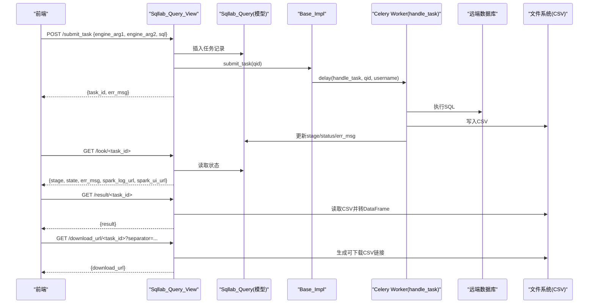
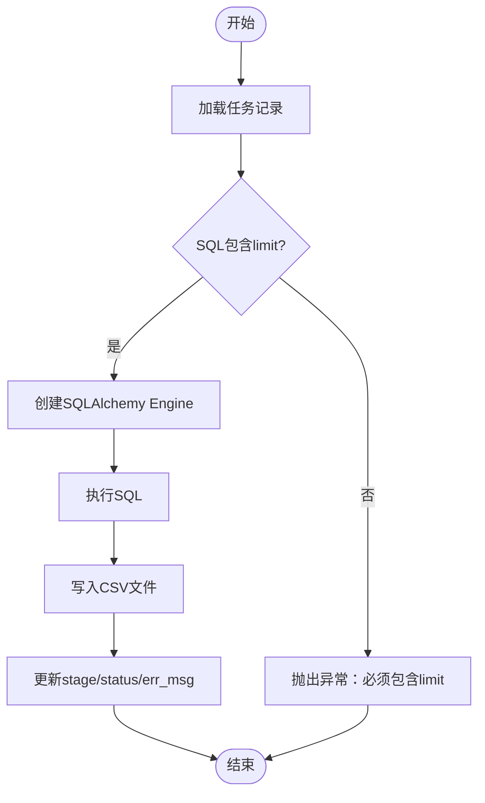
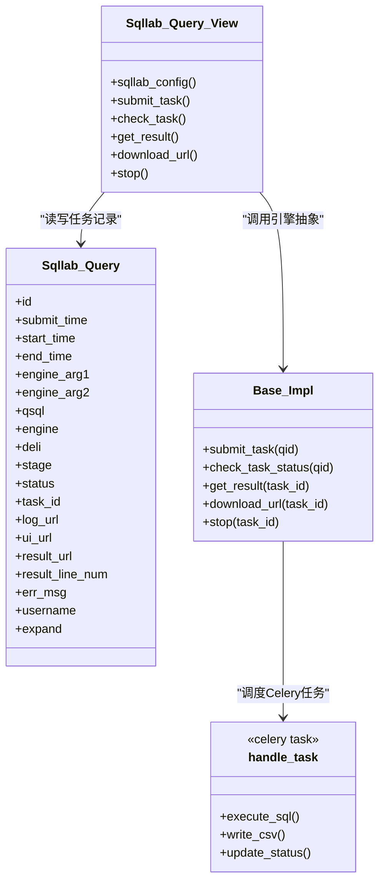

# SQLLab数据查询

<cite>
**本文引用的文件**   
- [view_sqllab.py](file://myapp/views/view_sqllab.py)
- [model_sqllab_query.py](file://myapp/models/model_sqllab_query.py)
- [base_impl.py](file://myapp/utils/sqllab/base_impl.py)
- [celery_app.py](file://myapp/tasks/celery_app.py)
</cite>

## 目录
1. [简介](#简介)
2. [项目结构](#项目结构)
3. [核心组件](#核心组件)
4. [架构总览](#架构总览)
5. [详细组件分析](#详细组件分析)
6. [依赖关系分析](#依赖关系分析)
7. [性能与优化](#性能与优化)
8. [错误处理与日志](#错误处理与日志)
9. [扩展新数据库引擎指南](#扩展新数据库引擎指南)
10. [故障排查](#故障排查)
11. [结论](#结论)

## 简介
本文件系统性梳理 SQLLab 数据查询功能的实现机制，覆盖多数据库引擎（MySQL、PostgreSQL、Presto、ClickHouse、Hive、Impala）的连接配置、查询执行与结果处理；解释异步任务提交、状态监控与结果获取的完整流程；并提供扩展新数据库引擎的实践路径，包括 Base_Impl 基类的使用与自定义查询逻辑。同时给出查询性能优化、错误处理和日志记录的最佳实践建议。

## 项目结构
SQLLab 功能由视图层、模型层、工具层与任务层共同组成：
- 视图层：对外暴露 REST API，负责参数校验、任务创建、状态与结果查询、下载等。
- 模型层：持久化查询任务元数据与执行状态。
- 工具层：提供 Base_Impl 基类，封装通用异步任务调度、结果读取与下载逻辑。
- 任务层：基于 Celery 执行实际的远程数据库查询与结果落盘。

图表来源
- [view_sqllab.py:98-204](file://myapp/views/view_sqllab.py#L98-L204)
- [model_sqllab_query.py:14-42](file://myapp/models/model_sqllab_query.py#L14-L42)
- [base_impl.py:41-92](file://myapp/utils/sqllab/base_impl.py#L41-L92)
- [base_impl.py:95-200](file://myapp/utils/sqllab/base_impl.py#L95-L200)

章节来源
- [view_sqllab.py:1-205](file://myapp/views/view_sqllab.py#L1-L205)
- [model_sqllab_query.py:1-43](file://myapp/models/model_sqllab_query.py#L1-L43)
- [base_impl.py:1-201](file://myapp/utils/sqllab/base_impl.py#L1-L201)
- [celery_app.py:1-18](file://myapp/tasks/celery_app.py#L1-L18)

## 核心组件
- Sqllab_Query_View：定义 /config、/submit_task、/look/<task_id>、/result/<task_id>、/download_url/<task_id>、/stop/<task_id> 等接口，统一编排任务生命周期。
- Sqllab_Query：任务持久化模型，包含提交时间、启动/结束时间、引擎参数、SQL、阶段、状态、任务ID、日志/UI/结果URL、错误信息、用户名、扩展字段等。
- Base_Impl：引擎抽象基类，提供 submit_task、check_task_status、get_result、download_url、stop 的统一实现，内部通过 Celery 调度 handle_task 执行查询并落盘 CSV。
- handle_task：Celery 任务，负责根据 engine_arg1/engine_arg2 构建 SQLAlchemy Engine，执行 SQL，将结果写入 CSV，更新任务状态与阶段。

章节来源
- [view_sqllab.py:98-204](file://myapp/views/view_sqllab.py#L98-L204)
- [model_sqllab_query.py:14-42](file://myapp/models/model_sqllab_query.py#L14-L42)
- [base_impl.py:41-92](file://myapp/utils/sqllab/base_impl.py#L41-L92)
- [base_impl.py:95-200](file://myapp/utils/sqllab/base_impl.py#L95-L200)

## 架构总览
SQLLab 采用“API + 异步任务”的分层架构：
- 请求进入 Sqllab_Query_View，校验参数后创建 Sqllab_Query 记录，并通过 Base_Impl.submit_task 提交 Celery 任务。
- Celery Worker 执行 handle_task，使用 SQLAlchemy 连接远端数据库执行 SQL，并将结果保存为 CSV。
- 前端轮询 /look/<task_id> 获取 stage/state/err_msg 等状态，完成后通过 /result/<task_id> 或 /download_url/<task_id> 拉取结果。

图表来源
- [view_sqllab.py:155-201](file://myapp/views/view_sqllab.py#L155-L201)
- [base_impl.py:41-92](file://myapp/utils/sqllab/base_impl.py#L41-L92)
- [base_impl.py:95-200](file://myapp/utils/sqllab/base_impl.py#L95-L200)

## 详细组件分析

### 视图层：Sqllab_Query_View
职责
- 提供引擎与数据库选择配置接口 /config，返回支持的引擎及历史成功连接的 engine_arg2 列表。
- 提交异步查询 /submit_task，创建任务记录并调用引擎实现提交任务。
- 查询任务状态 /look/<task_id>，返回阶段、状态、错误信息与外部 UI/日志 URL。
- 获取结果 /result/<task_id>，从 CSV 文件读取并转换为二维数组。
- 生成下载链接 /download_url/<task_id>，按分隔符转换并返回静态资源 URL。
- 终止任务 /stop/<task_id>，当前默认返回未实现提示。

关键点
- 引擎注册表 engine_impls 支持 mysql、presto、clickhouse、postgres、impala、hive，默认均使用 Base_Impl。
- db_uri_demo 提供各引擎的标准 URI 模板，便于前端展示与用户复用。
- 所有接口返回结构通过 check_process_res 进行键值校验，确保一致性。

章节来源
- [view_sqllab.py:28-47](file://myapp/views/view_sqllab.py#L28-L47)
- [view_sqllab.py:98-204](file://myapp/views/view_sqllab.py#L98-L204)

### 模型层：Sqllab_Query
字段说明
- id：主键
- submit_time/start_time/end_time：任务时间线
- engine_arg1/engine_arg2：引擎类型与连接串
- qsql：待执行的 SQL
- engine：引擎标识（默认 mysql）
- deli：分隔符（默认 |）
- stage/status：执行阶段与状态
- task_id/log_url/ui_url/result_url/result_line_num：执行产物与外部系统链接
- err_msg：错误信息
- username：提交人
- expand：扩展参数 JSON

用途
- 作为任务全生命周期的持久化载体，贯穿提交、执行、状态查询与结果下载。

章节来源
- [model_sqllab_query.py:14-42](file://myapp/models/model_sqllab_query.py#L14-L42)

### 工具层：Base_Impl 与 Celery 任务
Base_Impl
- submit_task：支持同步/异步两种模式，默认异步提交 Celery 任务，返回 task_id。
- check_task_status：读取 Sqllab_Query 的状态与阶段，映射到统一的返回结构。
- get_result：从固定路径读取 CSV，填充空值并转为二维数组。
- download_url：根据分隔符生成新的 CSV 副本并返回静态访问 URL，同时回填 result_line_num。
- stop：当前返回“暂未实现远程数据库kill操作”。

handle_task（Celery 任务）
- 校验任务存在性与用户名。
- 强制要求 SQL 包含 limit，避免无界查询。
- 根据 engine_arg1 分支：
  - mysql/postgres：使用 SQLAlchemy create_engine 执行 SQL，结果写入 CSV。
- 更新 stage/status/err_msg，并在 finally 中记录 end_time。

图表来源
- [base_impl.py:41-92](file://myapp/utils/sqllab/base_impl.py#L41-L92)

章节来源
- [base_impl.py:41-92](file://myapp/utils/sqllab/base_impl.py#L41-L92)
- [base_impl.py:95-200](file://myapp/utils/sqllab/base_impl.py#L95-L200)

### 任务层：Celery 应用
- celery_app 通过 get_celery_app(conf) 初始化全局 Celery 实例，所有任务统一挂载在该 app 下。
- handle_task 在 base_impl.py 中以 @celery_app.task 装饰器注册。

章节来源
- [celery_app.py:1-18](file://myapp/tasks/celery_app.py#L1-L18)
- [base_impl.py:41-42](file://myapp/utils/sqllab/base_impl.py#L41-L42)

## 依赖关系分析
- 视图层依赖模型层以持久化任务，依赖工具层以统一调度与结果处理。
- 工具层依赖 Celery 任务执行实际查询，依赖 SQLAlchemy 连接远端数据库，依赖文件系统落盘。
- 模型层独立于执行逻辑，仅承载状态与元数据。

图表来源
- [view_sqllab.py:98-204](file://myapp/views/view_sqllab.py#L98-L204)
- [model_sqllab_query.py:14-42](file://myapp/models/model_sqllab_query.py#L14-L42)
- [base_impl.py:41-92](file://myapp/utils/sqllab/base_impl.py#L41-L92)
- [base_impl.py:95-200](file://myapp/utils/sqllab/base_impl.py#L95-L200)

## 性能与优化
- 限制查询规模：handle_task 强制 SQL 包含 limit，避免大结果集拖垮系统。
- 结果落盘：将查询结果直接写入 CSV，减少内存占用，便于后续下载与离线分析。
- 异步执行：通过 Celery 将耗时查询移出 Web 线程，提升接口响应性。
- 连接复用：对高频使用的引擎连接串，可在上层做连接池与缓存策略（需结合 SQLAlchemy 配置）。
- 结果格式优化：download_url 支持多种分隔符，便于下游系统高效解析。

[本节为通用指导，不直接分析具体文件]

## 错误处理与日志
- 视图层：通过 check_process_res 校验返回键集合，缺失则抛出明确错误。
- 工具层：
  - handle_task 捕获异常，记录 traceback 到 err_msg，并将 status 置为 failure。
  - get_result 与 download_url 捕获 IO 异常并返回结构化错误。
- 日志：BASE_LOGGING_CONF 定义了统一日志格式；handle_task 在关键节点输出日志。

章节来源
- [view_sqllab.py:89-94](file://myapp/views/view_sqllab.py#L89-L94)
- [base_impl.py:81-92](file://myapp/utils/sqllab/base_impl.py#L81-L92)
- [base_impl.py:148-160](file://myapp/utils/sqllab/base_impl.py#L148-L160)
- [base_impl.py:163-196](file://myapp/utils/sqllab/base_impl.py#L163-L196)

## 扩展新数据库引擎指南
目标
- 新增一个数据库引擎（例如 ClickHouse/Presto/Hive/Impala），使其可通过 /submit_task 提交查询，并正确返回状态与结果。

步骤
1. 注册引擎
   - 在 engine_impls 中添加新引擎键，指向 Base_Impl 或自定义实现类。
   - 在 db_uri_demo 中补充该引擎的标准 URI 模板，便于前端展示。

2. 实现引擎逻辑
   - 若使用 Base_Impl：仅需在 handle_task 中增加对应分支，使用 SQLAlchemy 或专用驱动执行 SQL，并将结果写入 CSV。
   - 若需要差异化行为：继承 Base_Impl，重写 submit_task/check_task_status/get_result/download_url/stop 等方法。

3. 安全与约束
   - 保持 SQL 必须包含 limit 的约束，防止无界查询。
   - 对敏感连接信息（如密码）建议使用环境变量或密钥管理服务注入。

4. 测试与验证
   - 通过 /config 确认引擎与连接串可用。
   - 通过 /submit_task 提交测试 SQL，轮询 /look/<task_id> 观察 stage/state。
   - 通过 /result/<task_id> 或 /download_url/<task_id> 验证结果。

参考位置
- 引擎注册与 URI 模板：[view_sqllab.py:28-47](file://myapp/views/view_sqllab.py#L28-L47)
- 任务执行分支示例（mysql/postgres）：[base_impl.py:71-79](file://myapp/utils/sqllab/base_impl.py#L71-L79)
- Base_Impl 方法签名与返回约定：[base_impl.py:95-200](file://myapp/utils/sqllab/base_impl.py#L95-L200)

章节来源
- [view_sqllab.py:28-47](file://myapp/views/view_sqllab.py#L28-L47)
- [base_impl.py:71-79](file://myapp/utils/sqllab/base_impl.py#L71-L79)
- [base_impl.py:95-200](file://myapp/utils/sqllab/base_impl.py#L95-L200)

## 故障排查
常见问题
- 任务不存在：/look/<task_id> 或 /result/<task_id> 报“任务数据库记录不存在”。检查 qid 是否正确，或任务是否已被清理。
- 引擎未实现：传入的 engine_arg1 不在 engine_impls 中。检查前端选择或后端注册表。
- SQL 不包含 limit：handle_task 会抛出异常。请修改 SQL 添加 limit。
- 结果下载失败：CSV 文件不存在或权限不足。检查文件系统路径与权限，以及服务是否已写入结果。
- 连接失败：engine_arg2 连接串错误或网络不可达。核对数据库地址、端口、认证方式。

定位建议
- 查看任务记录的 err_msg 与 stage/status，快速定位失败阶段。
- 检查 Celery Worker 日志，确认 handle_task 是否执行与报错堆栈。
- 验证文件系统路径是否存在，CSV 是否生成。

章节来源
- [view_sqllab.py:76-86](file://myapp/views/view_sqllab.py#L76-L86)
- [base_impl.py:41-92](file://myapp/utils/sqllab/base_impl.py#L41-L92)
- [base_impl.py:148-160](file://myapp/utils/sqllab/base_impl.py#L148-L160)

## 结论
SQLLab 通过清晰的视图层、模型层、工具层与任务层协作，实现了跨多数据库引擎的异步查询能力。Base_Impl 提供了统一的异步任务调度、状态监控与结果处理框架，handle_task 负责具体的 SQL 执行与结果落盘。在此基础上，扩展新引擎只需注册引擎、补充 URI 模板并在任务执行分支中实现相应逻辑即可。配合限制查询规模、结果落盘与异步执行等策略，可有效保障系统的稳定性与可扩展性。