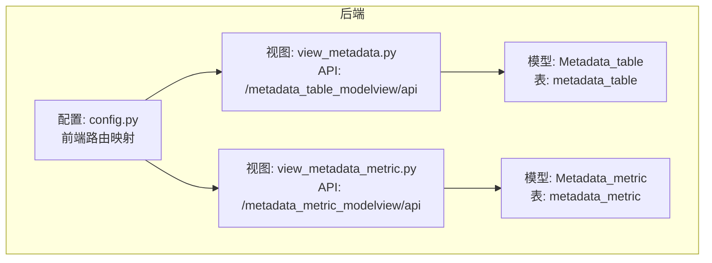
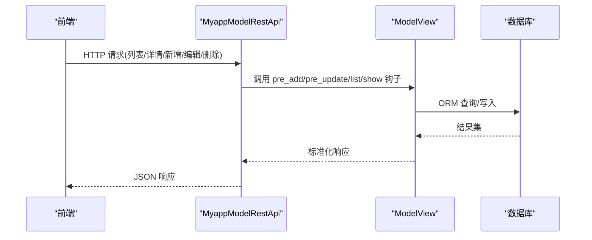
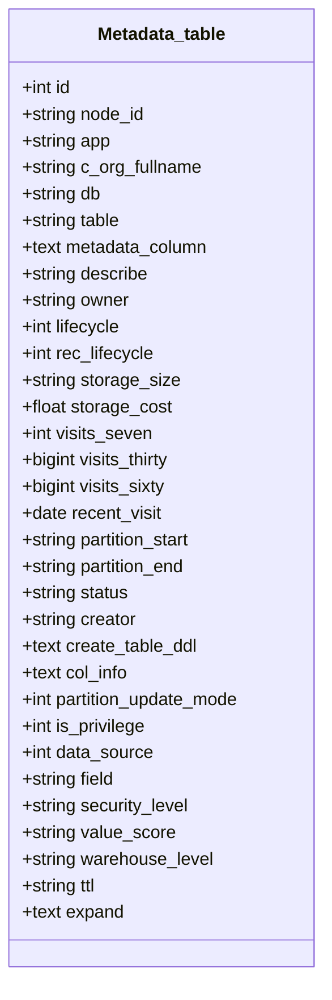
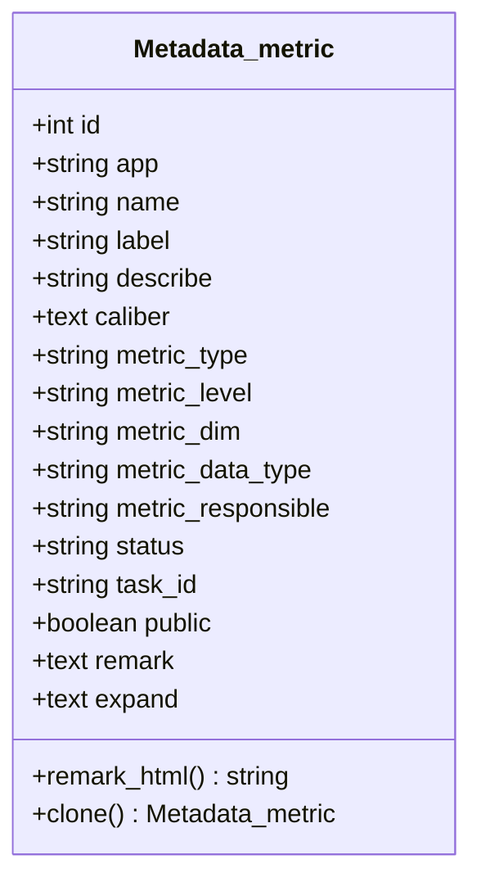
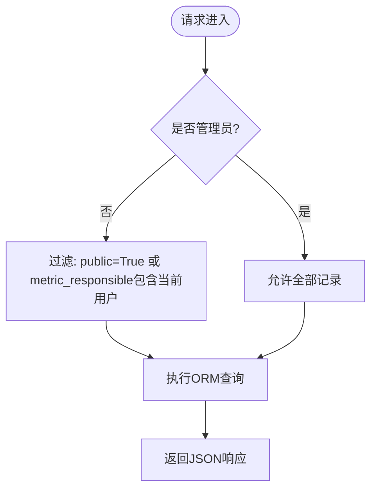
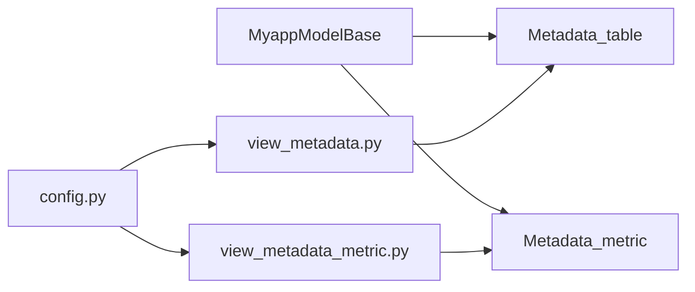

# 元数据管理

<cite>
**本文引用的文件**   
- [model_metadata.py](file://myapp/models/model_metadata.py)
- [model_metadata_metric.py](file://myapp/models/model_metadata_metric.py)
- [view_metadata.py](file://myapp/views/view_metadata.py)
- [view_metadata_metric.py](file://myapp/views/view_metadata_metric.py)
- [base.py](file://myapp/models/base.py)
- [config.py](file://myapp/config.py)
</cite>

## 目录
1. [引言](#引言)
2. [项目结构](#项目结构)
3. [核心组件](#核心组件)
4. [架构总览](#架构总览)
5. [详细组件分析](#详细组件分析)
6. [依赖关系分析](#依赖关系分析)
7. [性能与缓存](#性能与缓存)
8. [故障排查指南](#故障排查指南)
9. [结论](#结论)
10. [附录：API接口说明](#附录api接口说明)

## 引言
本文件面向“元数据管理”能力，覆盖以下目标：
- 元数据的定义、存储与检索机制（结构化与非结构化）
- 指标系统的实现（指标定义、采集、存储、可视化）
- 数据血缘追踪功能（数据流转与依赖维护）
- 编程式操作元数据与指标的API文档
- 元数据同步策略、缓存机制与查询性能优化

## 项目结构
围绕元数据与指标的核心代码位于 myapp/models 与 myapp/views 两个目录：
- models：数据库模型定义（表结构与字段语义）
- views：基于 Flask-AppBuilder 的视图与REST API路由注册

图表来源
- [model_metadata.py:20-56](file://myapp/models/model_metadata.py#L20-L56)
- [model_metadata_metric.py:18-37](file://myapp/models/model_metadata_metric.py#L18-L37)
- [view_metadata.py:253-281](file://myapp/views/view_metadata.py#L253-L281)
- [view_metadata_metric.py:223-228](file://myapp/views/view_metadata_metric.py#L223-L228)
- [config.py:814-817](file://myapp/config.py#L814-L817)

章节来源
- [model_metadata.py:20-56](file://myapp/models/model_metadata.py#L20-L56)
- [model_metadata_metric.py:18-37](file://myapp/models/model_metadata_metric.py#L18-L37)
- [view_metadata.py:253-281](file://myapp/views/view_metadata.py#L253-L281)
- [view_metadata_metric.py:223-228](file://myapp/views/view_metadata_metric.py#L223-L228)
- [config.py:814-817](file://myapp/config.py#L814-L817)

## 核心组件
- 元数据表模型 Metadata_table：描述库/表级元数据，包含访问统计、生命周期、分区信息、DDL、扩展参数等。
- 指标模型 Metadata_metric：描述业务指标的定义、口径、维度、等级、责任人、任务关联、公开范围与备注等。
- 视图与API：
  - view_metadata.py 提供 Metadata_table_ModelView_Api，暴露 RESTful 接口用于表的增删改查与批量删除。
  - view_metadata_metric.py 提供 Metadata_metric_ModelView_Api，暴露 RESTful 接口用于指标的增删改查与权限过滤。

章节来源
- [model_metadata.py:20-56](file://myapp/models/model_metadata.py#L20-L56)
- [model_metadata_metric.py:18-37](file://myapp/models/model_metadata_metric.py#L18-L37)
- [view_metadata.py:67-281](file://myapp/views/view_metadata.py#L67-L281)
- [view_metadata_metric.py:29-228](file://myapp/views/view_metadata_metric.py#L29-L228)

## 架构总览
系统采用“模型-视图-API”分层：
- 模型层：SQLAlchemy ORM 定义持久化结构
- 视图层：Flask-AppBuilder ModelView + MyappModelRestApi 自动生成CRUD API
- 配置层：统一的前端路由映射，便于前端页面跳转

图表来源
- [view_metadata.py:253-281](file://myapp/views/view_metadata.py#L253-L281)
- [view_metadata_metric.py:223-228](file://myapp/views/view_metadata_metric.py#L223-L228)

## 详细组件分析

### 元数据表模型（Metadata_table）
- 职责：描述数据仓库中的表级元数据，包括应用归属、库名、表名、列信息、负责人、生命周期、访问热度、分区起止、状态、创建者、DDL、扩展参数等。
- 关键设计点：
  - 使用 Text 类型存储非结构化或半结构化数据（如 metadata_column、col_info、expand），支持灵活扩展。
  - 访问统计字段（visits_seven/thirty/sixty、recent_visit）用于活跃度分析与成本评估。
  - 安全等级、数仓级别、价值评分、TTL 等治理字段支撑数据治理与合规。

图表来源
- [model_metadata.py:20-56](file://myapp/models/model_metadata.py#L20-L56)

章节来源
- [model_metadata.py:20-56](file://myapp/models/model_metadata.py#L20-L56)

### 指标模型（Metadata_metric）
- 职责：描述业务指标的定义、口径、维度、等级、责任人、任务ID、公开范围与备注等。
- 关键设计点：
  - 通过 metric_type/metric_level/metric_dim/metric_data_type 等枚举型字段进行指标分类与分级。
  - caliber 文本字段承载口径描述与计算公式；remark 支持结构化备注（JSON）。
  - public 控制可见性，metric_responsible 指定责任人，task_id 关联调度任务。

图表来源
- [model_metadata_metric.py:18-57](file://myapp/models/model_metadata_metric.py#L18-L57)

章节来源
- [model_metadata_metric.py:18-57](file://myapp/models/model_metadata_metric.py#L18-L57)

### 视图与API（表与指标）
- 表API（Metadata_table_ModelView_Api）
  - 路由前缀：/metadata_table_modelview/api
  - 能力：标准CRUD、批量删除、默认过滤（按owner）、列表展示时数值格式化（storage_cost）
  - 表单增强：app/db/field/security_level/warehouse_level/ttl/sql_demo/create_table_ddl 等
- 指标API（Metadata_metric_ModelView_Api）
  - 路由前缀：/metadata_metric_modelview/api
  - 能力：标准CRUD、批量删除、权限过滤（仅管理员或公开/本人负责）
  - 表单增强：app/name/label/describe/metric_type/metric_level/metric_dim/metric_responsible/caliber/task_id/public/remark 等
  - 备注处理：前后端对 remark 字段进行 JSON 序列化/反序列化

图表来源
- [view_metadata_metric.py:29-40](file://myapp/views/view_metadata_metric.py#L29-L40)

章节来源
- [view_metadata.py:67-281](file://myapp/views/view_metadata.py#L67-L281)
- [view_metadata_metric.py:29-228](file://myapp/views/view_metadata_metric.py#L29-L228)

### 数据结构与复杂度
- 表级元数据以单表为主，查询多为等值/范围条件，时间复杂度近似 O(n)（n为匹配行数），可通过索引优化高频字段（如 app、db、table、owner、status）。
- 指标查询涉及权限过滤（public 与 metric_responsible），建议对 public、metric_responsible 建立合适索引以提升过滤性能。
- 非结构化字段（Text）适合存储复杂对象（如列信息、备注JSON），但应避免在 WHERE 中对大文本做全文检索，必要时引入搜索引擎。

[本节为通用分析，不直接引用具体文件]

## 依赖关系分析
- 模型依赖：
  - Metadata_table 继承自 Model、AuditMixinNullable、MyappModelBase
  - Metadata_metric 继承自 Model、ImportMixin、MyappModelBase
- 视图依赖：
  - 视图通过 SQLAInterface 包装模型，并继承 MyappModelRestApi 生成REST API
  - 视图内使用 Flask-AppBuilder 的 action、validator、widget 等组件
- 配置依赖：
  - config.py 中定义了前端路由映射，将“元数据表/指标/数据血缘/维度”等菜单项映射到前端路径

图表来源
- [model_metadata.py:20-56](file://myapp/models/model_metadata.py#L20-L56)
- [model_metadata_metric.py:18-37](file://myapp/models/model_metadata_metric.py#L18-L37)
- [view_metadata.py:253-281](file://myapp/views/view_metadata.py#L253-L281)
- [view_metadata_metric.py:223-228](file://myapp/views/view_metadata_metric.py#L223-L228)
- [config.py:814-817](file://myapp/config.py#L814-L817)

章节来源
- [model_metadata.py:20-56](file://myapp/models/model_metadata.py#L20-L56)
- [model_metadata_metric.py:18-37](file://myapp/models/model_metadata_metric.py#L18-L37)
- [view_metadata.py:253-281](file://myapp/views/view_metadata.py#L253-L281)
- [view_metadata_metric.py:223-228](file://myapp/views/view_metadata_metric.py#L223-L228)
- [config.py:814-817](file://myapp/config.py#L814-L817)

## 性能与缓存
- 查询优化建议
  - 对高频过滤字段添加数据库索引：app、db、table、owner、status、public、metric_responsible
  - 避免对 Text 字段进行全表扫描或模糊匹配；如需搜索，考虑引入外部搜索引擎
  - 列表页分页与排序应结合后端索引，减少全表扫描
- 缓存策略建议
  - 热点元数据（如常用表的列信息、指标口径）可加入内存缓存（如 Redis），设置合理过期时间
  - 指标列表可按用户角色与权限维度进行缓存键拆分，避免越权读取
- 同步策略建议
  - 元数据同步可采用增量+全量兜底：定时任务拉取远端元数据变更，合并至本地；异常时触发全量重建
  - 指标采集建议异步化：通过消息队列解耦采集与入库，提升吞吐与容错

[本节为通用指导，不直接引用具体文件]

## 故障排查指南
- 权限问题
  - 指标列表不可见：检查用户是否为管理员，或指标是否 public=True，或 metric_responsible 是否包含当前用户名
- 数据校验失败
  - 新增/编辑失败：检查表单验证规则（如正则、必填），以及 remark 字段的 JSON 序列化是否正确
- 批量删除异常
  - 确认当前用户具备删除权限（管理员或创建者/责任人），查看日志中的错误提示

章节来源
- [view_metadata_metric.py:29-40](file://myapp/views/view_metadata_metric.py#L29-L40)
- [view_metadata_metric.py:180-190](file://myapp/views/view_metadata_metric.py#L180-L190)
- [view_metadata.py:220-235](file://myapp/views/view_metadata.py#L220-L235)

## 结论
本项目实现了基础的元数据与指标管理能力，通过清晰的模型定义与 AppBuilder 视图快速生成REST API，满足常见的增删改查与权限控制需求。后续可在索引优化、缓存与同步策略方面进一步增强，以满足更大规模的数据治理与监控场景。

[本节为总结，不直接引用具体文件]

## 附录：API接口说明

### 元数据表 API（/metadata_table_modelview/api）
- 列表：GET /metadata_table_modelview/api
  - 默认过滤：owner=当前用户（pre_add_web 中设置 default_filter）
  - 列表后处理：storage_cost 四舍五入保留小数位（pre_list_res）
- 详情：GET /metadata_table_modelview/api/{id}
- 新增：POST /metadata_table_modelview/api
  - 预填充：owner=node_id=creator（pre_add_web/pre_add）
- 更新：PUT /metadata_table_modelview/api/{id}
- 删除：DELETE /metadata_table_modelview/api/{id}
- 批量删除：POST /metadata_table_modelview/api/action/muldelete
  - 权限校验：管理员或责任人可删除

章节来源
- [view_metadata.py:253-281](file://myapp/views/view_metadata.py#L253-L281)
- [view_metadata.py:238-243](file://myapp/views/view_metadata.py#L238-L243)
- [view_metadata.py:226-235](file://myapp/views/view_metadata.py#L226-L235)

### 指标 API（/metadata_metric_modelview/api）
- 列表：GET /metadata_metric_modelview/api
  - 权限过滤：管理员可见全部；普通用户仅可见 public=True 或 metric_responsible 包含自己的指标
- 详情：GET /metadata_metric_modelview/api/{id}
  - 展示预处理：remark 从 JSON 字符串解析为数组（pre_show_res）
- 新增：POST /metadata_metric_modelview/api
  - 请求预处理：remark 序列化为 JSON 字符串（pre_add_req/pre_update_req）
- 更新：PUT /metadata_metric_modelview/api/{id}
- 删除：DELETE /metadata_metric_modelview/api/{id}
- 批量删除：POST /metadata_metric_modelview/api/action/muldelete
  - 权限校验：管理员或创建者可删除

章节来源
- [view_metadata_metric.py:29-40](file://myapp/views/view_metadata_metric.py#L29-L40)
- [view_metadata_metric.py:180-190](file://myapp/views/view_metadata_metric.py#L180-L190)
- [view_metadata_metric.py:205-220](file://myapp/views/view_metadata_metric.py#L205-L220)
- [view_metadata_metric.py:223-228](file://myapp/views/view_metadata_metric.py#L223-L228)

### 前端路由映射
- 配置项示例：
  - metadata_table -> /frontend/data/metadata/metadata_table
  - data_blood -> /frontend/data/metadata/data_blood
  - metadata_metric -> /frontend/data/metadata/metadata_metric
  - dimension -> /frontend/data/metadata/metadata_dimension

章节来源
- [config.py:814-817](file://myapp/config.py#L814-L817)