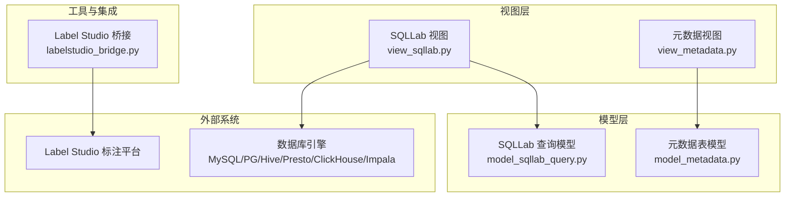
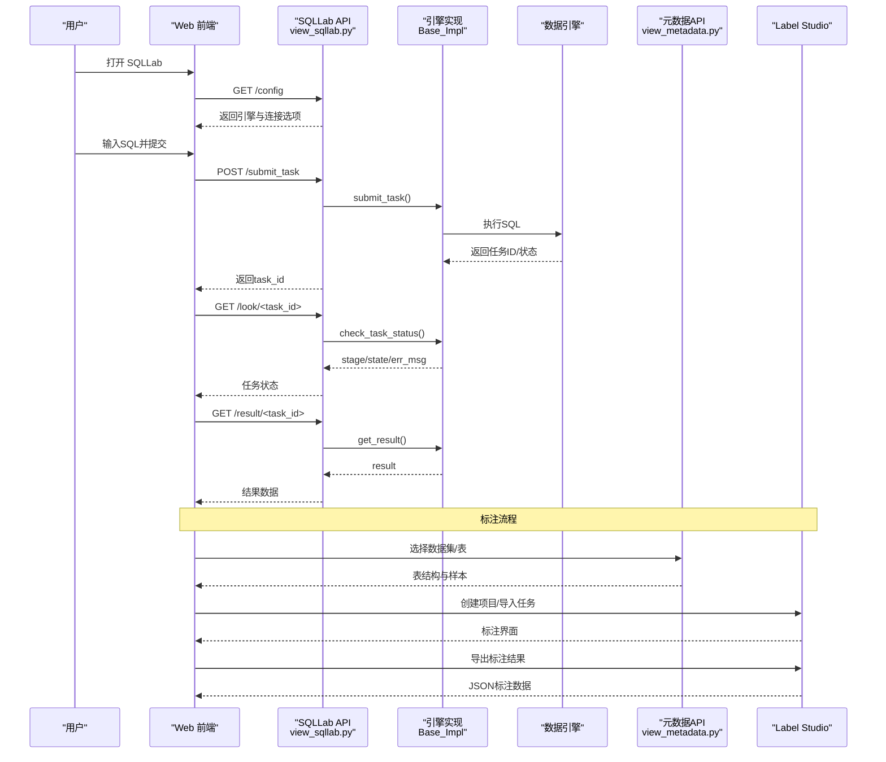
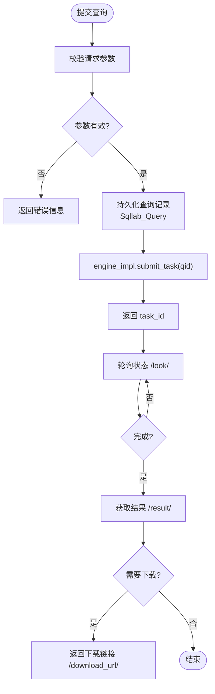
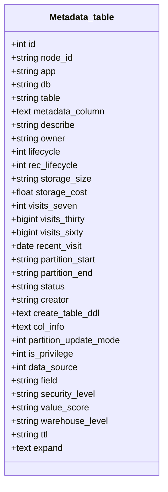
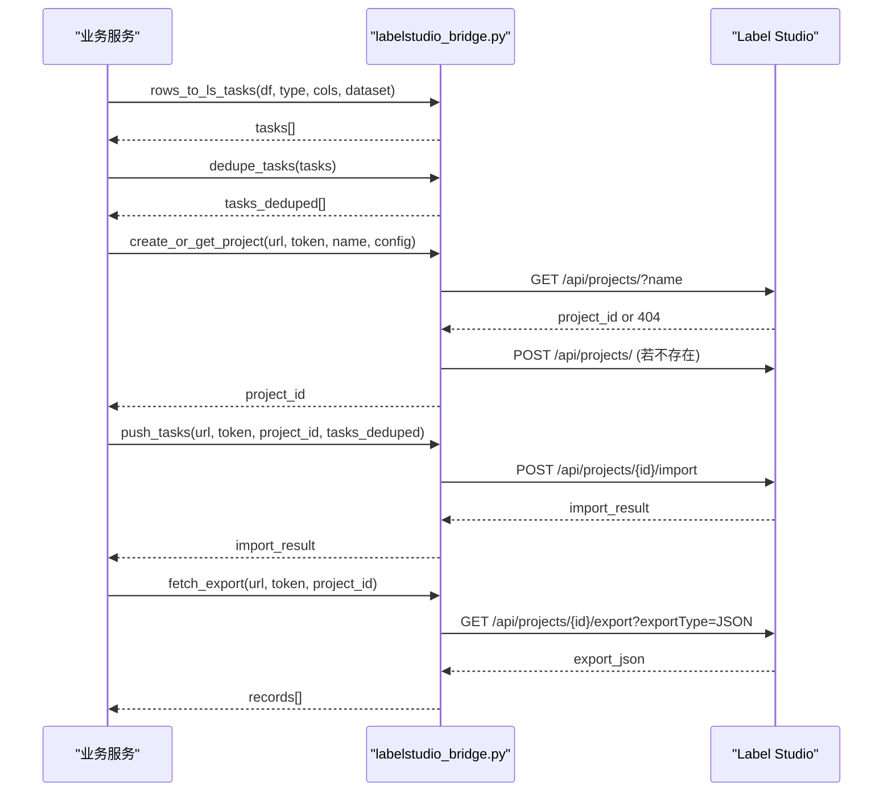
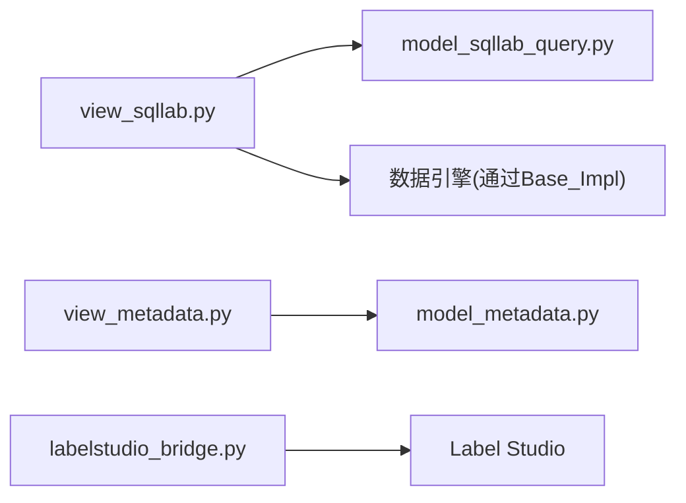

# 数据管理与标注

<cite>
**本文引用的文件**   
- [README.md](file://README.md)
- [view_sqllab.py](file://myapp/views/view_sqllab.py)
- [model_sqllab_query.py](file://myapp/models/model_sqllab_query.py)
- [labelstudio_bridge.py](file://myapp/utils/labelstudio_bridge.py)
- [view_metadata.py](file://myapp/views/view_metadata.py)
- [model_metadata.py](file://myapp/models/model_metadata.py)
</cite>

## 目录
1. [引言](#引言)
2. [项目结构](#项目结构)
3. [核心组件](#核心组件)
4. [架构总览](#架构总览)
5. [详细组件分析](#详细组件分析)
6. [依赖关系分析](#依赖关系分析)
7. [性能与扩展性](#性能与扩展性)
8. [安全与合规](#安全与合规)
9. [故障排查指南](#故障排查指南)
10. [结论](#结论)

## 引言
本文件聚焦 CubeStudio 的数据管理与标注能力，围绕 SQLLab 数据查询、数据集管理、元数据管理、标注平台集成（Label Studio）、自动化标注和数据血缘追踪进行系统化说明。文档同时给出数据处理流程、标注任务配置与质量控制机制，并提供扩展新数据源、标注类型和处理算子的实践指引，覆盖数据安全、隐私保护与性能优化最佳实践。

## 项目结构
与“数据管理与标注”直接相关的代码主要分布在以下位置：
- 视图层 API：myapp/views/view_sqllab.py、myapp/views/view_metadata.py
- 模型层：myapp/models/model_sqllab_query.py、myapp/models/model_metadata.py
- 工具与集成：myapp/utils/labelstudio_bridge.py
- 产品能力概览：README.md

图表来源
- [view_sqllab.py:28-47](file://myapp/views/view_sqllab.py#L28-L47)
- [view_metadata.py:253-281](file://myapp/views/view_metadata.py#L253-L281)
- [model_sqllab_query.py:14-42](file://myapp/models/model_sqllab_query.py#L14-L42)
- [model_metadata.py:20-56](file://myapp/models/model_metadata.py#L20-L56)
- [labelstudio_bridge.py:77-112](file://myapp/utils/labelstudio_bridge.py#L77-L112)

章节来源
- [README.md:42-46](file://README.md#L42-L46)
- [README.md:241-260](file://README.md#L241-L260)

## 核心组件
- SQLLab 数据查询
  - 提供统一的异步查询接口，支持多引擎（MySQL、PostgreSQL、Presto、ClickHouse、Hive、Impala），统一提交、状态查询、结果获取、下载与终止。
  - 通过 Base_Impl 抽象实现引擎差异，便于扩展新的数据源。
- 元数据管理
  - 以 Metadata_table 模型为核心，提供库表级元数据录入、展示、导入导出与安全等级、数仓分层等维度管理。
  - 视图层提供表单校验、权限控制与批量删除等操作。
- 标注平台集成（Label Studio）
  - 提供任务创建/去重、项目复用、任务导入、标注结果导出的纯函数式桥接，便于在 Pipeline 或后端服务中调用。
  - 支持文本分类、图像分类等任务类型的自动标注与人工复核闭环。

章节来源
- [view_sqllab.py:98-204](file://myapp/views/view_sqllab.py#L98-L204)
- [model_sqllab_query.py:14-42](file://myapp/models/model_sqllab_query.py#L14-L42)
- [view_metadata.py:67-281](file://myapp/views/view_metadata.py#L67-L281)
- [model_metadata.py:20-56](file://myapp/models/model_metadata.py#L20-L56)
- [labelstudio_bridge.py:9-112](file://myapp/utils/labelstudio_bridge.py#L9-L112)

## 架构总览
SQLLab 与元数据、标注模块共同构成“数据接入—探索—治理—标注—消费”的闭环。

图表来源
- [view_sqllab.py:101-204](file://myapp/views/view_sqllab.py#L101-L204)
- [labelstudio_bridge.py:77-112](file://myapp/utils/labelstudio_bridge.py#L77-L112)

## 详细组件分析

### SQLLab 数据查询
- 功能要点
  - 引擎注册：engine_impls 维护各引擎实例，新增引擎只需在此注册并实现 Base_Impl 接口。
  - 任务生命周期：提交→状态查询→结果获取→下载→终止，全部通过统一 API 暴露。
  - 配置动态化：/config 接口根据历史成功连接动态生成引擎与连接下拉项。
- 关键流程
  - 提交任务：add_task 写入 Sqllab_Query 记录，随后调用 engine_impl.submit_task。
  - 状态与结果：check_task/get_result/download_url/stop 均基于 qid 路由到对应引擎实现。
- 扩展点
  - 新增数据源：在 engine_impls 中添加键值对，并在 Base_Impl 中实现 submit_task/check_task_status/get_result/download_url/stop。
  - 参数注入：SQLLAB_ARGS 可全局注入默认参数。

图表来源
- [view_sqllab.py:50-73](file://myapp/views/view_sqllab.py#L50-L73)
- [view_sqllab.py:155-204](file://myapp/views/view_sqllab.py#L155-L204)
- [model_sqllab_query.py:14-42](file://myapp/models/model_sqllab_query.py#L14-L42)

章节来源
- [view_sqllab.py:28-47](file://myapp/views/view_sqllab.py#L28-L47)
- [view_sqllab.py:98-204](file://myapp/views/view_sqllab.py#L98-L204)
- [model_sqllab_query.py:14-42](file://myapp/models/model_sqllab_query.py#L14-L42)

### 元数据管理
- 数据模型
  - Metadata_table 包含应用、库、表、描述、责任人、数仓层级、访问统计、分区范围、DDL、安全等级、价值评分等字段，支撑数据地图与治理。
- 视图与权限
  - 提供增删改查、导入导出、批量删除；pre_add 设置 owner/creator/node_id；check_edit_permission 限制非管理员仅能编辑本人拥有表。
- 表单与校验
  - 使用 WTForms 定义列名、类型、分区类型等字段校验规则，增强数据质量。

图表来源
- [model_metadata.py:20-56](file://myapp/models/model_metadata.py#L20-L56)

章节来源
- [model_metadata.py:20-56](file://myapp/models/model_metadata.py#L20-L56)
- [view_metadata.py:67-281](file://myapp/views/view_metadata.py#L67-L281)

### 标注平台集成（Label Studio）
- 能力概述
  - 将 DataFrame 转换为 Label Studio 任务，支持文本分类、图像分类；具备幂等去重（dataset+row_idx）。
  - 提供项目创建/复用、任务导入、标注结果导出解析。
- 典型流程
  - 从数据集/表中抽取样本 → rows_to_ls_tasks → dedupe_tasks → push_tasks → 人工标注 → fetch_export → ls_export_to_records。
- 错误处理
  - LsApiError 封装 REST 失败信息，便于上层统一捕获与提示。

图表来源
- [labelstudio_bridge.py:9-57](file://myapp/utils/labelstudio_bridge.py#L9-L57)
- [labelstudio_bridge.py:77-112](file://myapp/utils/labelstudio_bridge.py#L77-L112)

章节来源
- [labelstudio_bridge.py:9-112](file://myapp/utils/labelstudio_bridge.py#L9-L112)

### 数据处理流程与质量控制
- 数据接入与探索
  - 通过 SQLLab 对多引擎进行交互式查询与统计分析，结合元数据了解表结构、分区、访问热度与安全等级。
- 标注与质检
  - 使用 Label Studio 桥接进行任务导入与结果导出；可在 Pipeline 中加入抽样复核、一致性检查、标签分布监控等质量控制步骤。
- 数据血缘与溯源
  - 借助 Sqllab_Query 记录（提交时间、引擎、SQL、任务ID、日志/UI/结果URL）与 Metadata_table（DDL、owner、分区、访问统计）形成基础血缘线索；可扩展在 Pipeline 中记录上下游节点与数据版本，完善血缘图谱。

章节来源
- [view_sqllab.py:155-204](file://myapp/views/view_sqllab.py#L155-L204)
- [model_sqllab_query.py:14-42](file://myapp/models/model_sqllab_query.py#L14-L42)
- [model_metadata.py:20-56](file://myapp/models/model_metadata.py#L20-L56)

## 依赖关系分析
- 视图与模型
  - view_sqllab.py 依赖 model_sqllab_query.py 存储查询任务上下文。
  - view_metadata.py 依赖 model_metadata.py 提供库表元数据的 CRUD。
- 外部依赖
  - SQLLab 通过 Base_Impl 对接多种数据引擎。
  - Label Studio 桥接通过 HTTP 与 LS 交互。

图表来源
- [view_sqllab.py:28-47](file://myapp/views/view_sqllab.py#L28-L47)
- [view_metadata.py:253-281](file://myapp/views/view_metadata.py#L253-L281)
- [labelstudio_bridge.py:77-112](file://myapp/utils/labelstudio_bridge.py#L77-L112)

章节来源
- [view_sqllab.py:28-47](file://myapp/views/view_sqllab.py#L28-L47)
- [view_metadata.py:253-281](file://myapp/views/view_metadata.py#L253-L281)
- [labelstudio_bridge.py:77-112](file://myapp/utils/labelstudio_bridge.py#L77-L112)

## 性能与扩展性
- SQLLab 性能建议
  - 合理分页与限制返回行数，避免大结果集拖垮前端与网络。
  - 利用缓存（如 Redis）缓存常用查询结果与引擎配置。
  - 对长耗时任务采用异步执行与进度上报，提升用户体验。
- 扩展新数据源
  - 在 engine_impls 中注册新引擎键值对。
  - 在 Base_Impl 中实现 submit_task/check_task_status/get_result/download_url/stop，遵循统一返回键约定（err_msg、task_id、stage、state、spark_log_url、spark_ui_url、result、download_url）。
- 扩展标注类型
  - 在 VALID_TASK_TYPES 中添加新类型，并在 rows_to_ls_tasks 中适配字段映射。
  - 在 ls_export_to_records 中解析新类型的标注结果。
- 元数据治理
  - 结合访问统计（visits_seven/thirty/sixty）、storage_cost、security_level 等指标，制定冷热分层与保留策略（ttl）。

章节来源
- [view_sqllab.py:28-47](file://myapp/views/view_sqllab.py#L28-L47)
- [view_sqllab.py:155-204](file://myapp/views/view_sqllab.py#L155-L204)
- [labelstudio_bridge.py:6-22](file://myapp/utils/labelstudio_bridge.py#L6-L22)
- [model_metadata.py:20-56](file://myapp/models/model_metadata.py#L20-L56)

## 安全与合规
- 身份与权限
  - 元数据编辑/删除需校验 owner 与管理员角色，防止越权操作。
  - SQLLab 查询记录 username 字段用于审计与隔离。
- 数据安全
  - 敏感字段（密码、Token）不应出现在日志或 UI 中；Label Studio Token 应通过环境变量或密钥管理系统注入。
  - 对导出数据进行脱敏与最小化原则，避免泄露个人隐私。
- 合规与审计
  - 利用 AuditMixinNullable 提供的审计字段（创建者、修改者、时间戳）满足合规审计需求。
  - 为高安全等级表（security_level）增加访问审批与水印/脱敏策略。

章节来源
- [view_metadata.py:220-224](file://myapp/views/view_metadata.py#L220-L224)
- [model_sqllab_query.py:14-42](file://myapp/models/model_sqllab_query.py#L14-L42)
- [labelstudio_bridge.py:64-74](file://myapp/utils/labelstudio_bridge.py#L64-L74)

## 故障排查指南
- SQLLab 常见问题
  - 任务未找到：检查 task_id 是否有效，确认 Sqllab_Query 记录存在。
  - 引擎未实现：确认 engine_arg1 是否在 engine_impls 中注册。
  - 返回值异常：检查引擎实现的返回键是否符合约定（err_msg、task_id、stage、state、spark_log_url、spark_ui_url、result、download_url）。
- Label Studio 集成问题
  - Token 缺失：确保传入 ls_token 或配置 LABELSTUDIO_TOKEN。
  - 项目创建/导入失败：查看 LS 响应摘要（LsApiError.message），核对 label_config 与权限。
  - 导出为空：确认项目有标注结果且 exportType=JSON。

章节来源
- [view_sqllab.py:76-94](file://myapp/views/view_sqllab.py#L76-L94)
- [view_sqllab.py:155-204](file://myapp/views/view_sqllab.py#L155-L204)
- [labelstudio_bridge.py:60-74](file://myapp/utils/labelstudio_bridge.py#L60-L74)
- [labelstudio_bridge.py:77-112](file://myapp/utils/labelstudio_bridge.py#L77-L112)

## 结论
CubeStudio 的数据管理与标注体系以 SQLLab 的多引擎查询能力为基础，结合元数据治理与 Label Studio 标注集成，形成从数据接入、探索、治理到标注与消费的完整闭环。通过 Base_Impl 抽象与桥接层的纯函数设计，系统具备良好的可扩展性与可测试性。在生产环境中，建议结合访问统计、安全等级与成本指标进行数据分层与治理，并通过审计与权限控制保障数据安全与合规。